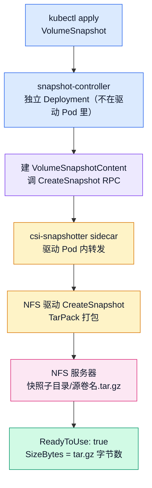

# K8s 存储第 8 篇：VolumeSnapshot——NFS 驱动把快照做成了一个 tar.gz

> 存储系列第 8 篇。[上一篇](allow-volume-expansion.md)翻驱动 capability 清单时撞见了 `CREATE_DELETE_SNAPSHOT`：NFS 驱动居然声称支持快照？块存储的快照是写时复制，NFS 这块没有块设备的"盘"拿什么做快照——tar 归档吗？这次把源码拉出来对行号，答案比猜想更直白：**就是把整个卷子目录打成一个 tar.gz**。装上快照生态实测全流程，物理层验证归档内容——然后恢复实验一脚踩空：驱动的 200Mi 内存限额被 300M 的解包打爆，38 次重启的崩溃循环、1.5 秒的 page cache 假完成、一次差点误判成"恢复泄漏"的时序坑。快照好用，恢复才是这套方案真正的成本现场。

## 先把结论放桌上

K8s 的快照和扩容走的是**两套完全不同的生态**。扩容（[上一篇](allow-volume-expansion.md)）里所有角色都在 CSI 驱动的 Pod 里：resizer 是驱动 Pod 里的 sidecar，PVC 还是那个 PVC。快照不一样——它是三个 CRD（VolumeSnapshot / VolumeSnapshotContent / VolumeSnapshotClass）加一个**独立部署的 snapshot-controller**（不在任何 CSI 驱动 Pod 里），CSI 驱动侧只挂一个 csi-snapshotter sidecar 负责转发 RPC。所以玩快照的第一步不是建对象，是先把这套独立生态装进集群。

第二个结论，NFS 驱动的快照实现，源码里就一行日志写得明明白白：

```go
// controllerserver.go L398
klog.V(2).Infof("tar %v -> %v", srcPath, dstPath)
```

把源卷子目录打成 tar.gz，存进快照自己的子目录，完事。没有写时复制、没有引用计数、没有增量——**每个快照都是全量拷贝**。这决定了它的速度（和拷贝整个卷一样慢）、空间成本（和整个卷一样大），还有两个天然局限和一场计划外的崩溃循环——C 组见。

先说清楚一件事：`csi-driver-nfs` 的 controller Pod 里那五个容器（[上一篇](allow-volume-expansion.md) B 组列过：`csi-provisioner csi-resizer csi-snapshotter liveness-probe nfs`）里的 csi-snapshotter **只是转发员**，真正推动快照流程的 snapshot-controller 是独立 Deployment，和驱动的部署完全解耦。这也是为什么所有 CSI 驱动的快照文档第一步都是"先装 external-snapshotter"。

## 源码预读：CreateSnapshot 领到的活

按老规矩，源码先行。csi-driver-nfs v4.13.4 的 `pkg/nfs/controllerserver.go`，CreateSnapshot 在 L352-432（[上篇](allow-volume-expansion.md)预告说 L475-482 差了 5 行是扩容函数，这次快照函数的具体行号我逐行核过 raw 文件）：

```go
// controllerserver.go L352-364（节选）
func (cs *ControllerServer) CreateSnapshot(ctx context.Context, req *csi.CreateSnapshotRequest) (*csi.CreateSnapshotResponse, error) {
        if len(req.GetName()) == 0 {
                return nil, status.Error(codes.InvalidArgument, "CreateSnapshot name must be provided")
        }
        // ... sourceVolumeId 校验 ...
        snapshot, err := newNFSSnapshot(req.GetName(), req.GetParameters(), srcVol)
```

参数校验之后，`volumeFromSnapshot`（L909）把快照**变成了一个 NFS 卷**——subDir 就是快照名。也就是说 NFS 服务器上会多出一个以快照名命名的子目录，快照在驱动眼里和卷是同一个东西。归档文件名由 `archiveName` 决定（L83-87）：

```go
// controllerserver.go L83-87
func (snap nfsSnapshot) archiveName(enableCompression bool) string {
        if enableCompression {
                return fmt.Sprintf("%v.tar.gz", snap.src)
        }
        return fmt.Sprintf("%v.tar", snap.src)
}
```

打包走的是哪条路，CreateSnapshot 里的一个 gate 决定（L399）：`if cs.Driver.useTarCommandInSnapshot`——开了就 exec 系统 `tar` 命令，不开走 Go 原生的 `TarPack()`（tar.go L33，遍历文件、写 tar 流、gzip 压缩）。部署清单的 nfs 容器 args 实测全文：

```bash
kubectl -n kube-system get deploy csi-nfs-controller -o jsonpath='{.spec.template.spec.containers[?(@.name=="nfs")].args}'
```

```json
["-v=5","--nodeid=$(NODE_ID)","--endpoint=$(CSI_ENDPOINT)"]
```

没有任何 snapshot 相关 flag——gate 未开，实测的打包是 Go 代码干的，B 组 `tar -tzf` 看到的裸文件名加 `.` 根条目（GNU tar 是 `./` 前缀风格）佐证同一点。顺带 `-v=5` 也在这行里：`klog.V(2)` 级别的日志全程可见，靠的就是它。归档名由 `archiveName` 决定（L83-87）：

```go
// controllerserver.go L83-87
func (snap nfsSnapshot) archiveName(enableCompression bool) string {
        if enableCompression {
                return fmt.Sprintf("%v.tar.gz", snap.src)
        }
        return fmt.Sprintf("%v.tar", snap.src)
}
```

压缩默认开（`enable-snapshot-compression`），产物是 `<源卷名>.tar.gz`——B 组物理层会看到这个名字规则。快照创建的核心段（L393-429）：

```go
// controllerserver.go L393-429（节选）
        dstPath := filepath.Join(snapInternalVolPath, snapshot.archiveName(cs.Driver.enableSnapshotCompression))
        if cs.Driver.useTarCommandInSnapshot {
                // ... exec.Command("tar", "-cvf", dstPath, ".") ...
        } else if err := TarPack(srcPath, dstPath, enableCompression); err != nil {
                return nil, status.Errorf(codes.Internal, "failed to copy volume for snapshot: %v", err)
        }
        var snapshotSize int64
        // ... os.Stat 归档文件 ...
        snapshotSize = fi.Size()
        return &csi.CreateSnapshotResponse{
                Snapshot: &csi.Snapshot{
                        SnapshotId:     snapshot.id,
                        SourceVolumeId: req.GetSourceVolumeId(),
                        SizeBytes:      snapshotSize,
                        ReadyToUse:     true,
                },
        }, nil
```

三个值得停留的细节：

1. **`SizeBytes` 是归档文件的实际字节数**（`fi.Size()`），不是源卷的声明容量。这意味着 VolumeSnapshot 的 restoreSize 字段在 NFS 上有完全不同的语义——块存储上它等于卷大小，NFS 上它等于压缩后 tar.gz 的字节数。A 组实测见分晓。
2. **`ReadyToUse: true` 是同步返回的**——tar 打完才返回。块存储的快照经常是异步的（ReadyToUse 要轮询等），NFS 这里创建请求本身就是秒表。
3. **删除就是删目录**。DeleteSnapshot（L434-464）核心一行 `os.RemoveAll(internalVolumePath)`——把快照子目录整个 remove 掉，顺带返回成功是幂等的（目录不存在也返回成功）。ListSnapshots（L466-468）直接 Unimplemented——快照的元数据全在 K8s 对象里，驱动不维护清单。

 **

恢复的源码（`copyFromSnapshot`，L537 起）留到 C 组对照——先看实测的数字对不对得上。

## 快照链路图

快照的参与方比扩容多一个独立角色：



和[上一篇](allow-volume-expansion.md)扩容链路对照：扩容是 resizer 直调驱动，中间没有独立 controller；快照的推动力是独立部署的 snapshot-controller，它 watch VolumeSnapshot 对象、建 VolumeSnapshotContent、再通过驱动 Pod 里的 csi-snapshotter sidecar 调 RPC。多一层解耦，也多一层排查路径——A 组装完就能感受到。

## A 组：把快照生态装起来

实验环境还是那套：1.36.1 三 master 三 worker，NFS 服务器 192.168.114.155（50G 数据盘），csi-driver-nfs v4.13.4。

### 重建基线

[上一篇](allow-volume-expansion.md)清理过了，先重建一个带数据的基线卷。SC 和 PVC：

```yaml
# snapshot-sc.yaml
apiVersion: storage.k8s.io/v1
kind: StorageClass
metadata:
  name: nfs-snap
provisioner: nfs.csi.k8s.io
parameters:
  server: 192.168.114.155
  share: /nfs/k8s
reclaimPolicy: Delete
volumeBindingMode: Immediate
```

```yaml
# snapshot-pvc.yaml
apiVersion: v1
kind: PersistentVolumeClaim
metadata:
  name: pvc-snap
spec:
  storageClassName: nfs-snap
  accessModes: ["ReadWriteMany"]
  resources:
    requests:
      storage: 1Gi
```

Pod 挂载后写两个标记文件——**写一个 300MB 的可压缩文件，B 组要看 tar.gz 的压缩比**：

```yaml
# snapshot-pod.yaml
apiVersion: v1
kind: Pod
metadata:
  name: pod-snap
spec:
  terminationGracePeriodSeconds: 1
  containers:
    - name: main
      image: m.daocloud.io/docker.io/busybox
      command: ["sleep", "3600"]
      volumeMounts:
        - name: data
          mountPath: /mnt
  volumes:
    - name: data
      persistentVolumeClaim:
        claimName: pvc-snap
```

```bash
kubectl apply -f snapshot-sc.yaml
kubectl apply -f snapshot-pvc.yaml
kubectl apply -f snapshot-pod.yaml
kubectl exec pod-snap -- sh -c 'echo "snapshot-marker-v1" > /mnt/marker.txt && dd if=/dev/zero of=/mnt/data.bin bs=1M count=300 2>/dev/null && ls -lh /mnt'
```

```
total 300M
-rw-r--r--    1 root     root      300.0M Sep  4 06:06 data.bin
-rw-r--r--    1 root     root          19 Sep  4 06:06 marker.txt
```

（时间戳是 06:06——busybox 容器输出 UTC，本机是 14:06。NFS 卷上的文件时间戳按 UTC 走，后面 C 组判 mtime 时再用到这个。）

### 装 external-snapshotter

1.36 的集群是 vanilla 的，VolumeSnapshot 这套 CRD 不自带（feature gate 早已 GA，但 CRD 和 controller 从来都是独立部署的）。版本对应：external-snapshotter **v8.6.0**（2026-05-28 发布，配 1.34+ 没问题）。

先装三个 v1 CRD（文件名没有 `crd-` 前缀，别抄旧文档）：

```bash
kubectl apply -f https://ghproxy.net/https://raw.githubusercontent.com/kubernetes-csi/external-snapshotter/v8.6.0/client/config/crd/snapshot.storage.k8s.io_volumesnapshotclasses.yaml
kubectl apply -f https://ghproxy.net/https://raw.githubusercontent.com/kubernetes-csi/external-snapshotter/v8.6.0/client/config/crd/snapshot.storage.k8s.io_volumesnapshotcontents.yaml
kubectl apply -f https://ghproxy.net/https://raw.githubusercontent.com/kubernetes-csi/external-snapshotter/v8.6.0/client/config/crd/snapshot.storage.k8s.io_volumesnapshots.yaml
```

再装 controller。官方清单（`deploy/kubernetes/snapshot-controller/`）在 kube-system 建双副本 Deployment（leader election），镜像在 `registry.k8s.io`，国内直连换成 daocloud 前缀：

```bash
kubectl apply -f https://ghproxy.net/https://raw.githubusercontent.com/kubernetes-csi/external-snapshotter/v8.6.0/deploy/kubernetes/snapshot-controller/rbac-snapshot-controller.yaml
kubectl apply -f https://ghproxy.net/https://raw.githubusercontent.com/kubernetes-csi/external-snapshotter/v8.6.0/deploy/kubernetes/snapshot-controller/setup-snapshot-controller.yaml
kubectl -n kube-system patch deployment snapshot-controller --type merge -p '{"spec":{"template":{"spec":{"containers":[{"name":"snapshot-controller","image":"k8s.m.daocloud.io/sig-storage/snapshot-controller:v8.6.0"}]}}}}'
```

一个细节：v8.6.0 tag 的 setup 清单里镜像还写着 `v8.5.0`——清单没跟着镜像 bump（核对 raw 文件实锤）。所以 patch 一步显式把镜像钉到 v8.6.0，和 CRD 同 tag。

实测输出（patch 之后立刻查了一次，隔了 7 分钟又查了一次）：

```bash
kubectl get pods -n kube-system -l app.kubernetes.io/name=snapshot-controller
# patch 后 18 秒：
NAME                                   READY   STATUS              RESTARTS   AGE
snapshot-controller-58b6fc7b8f-fsgbb   0/1     ContainerCreating   0          18s
snapshot-controller-58b6fc7b8f-nvhjr   0/1     Terminating         0          18s
snapshot-controller-74978c97fd-jnwpv   0/1     ContainerCreating   0          9s
# 7 分钟后：
NAME                                   READY   STATUS    RESTARTS   AGE
snapshot-controller-74978c97fd-jnwpv   1/1     Running   0          7m31s
snapshot-controller-74978c97fd-rck8p   1/1     Running   0          68s
```

第一次的输出是标准的 rolling update 中间态：旧 ReplicaSet（`58b6fc7b8f`，还挂在 v8.5.0 镜像上）一个 Pod 在拉镜像、另一个在 Terminating，新 ReplicaSet（`74978c97fd`）的 Pod 刚起 9 秒。稳定后是 `74978c97fd` 的两个副本 Running——双副本（leader election）没变，变的只是镜像。

 **

### 建 VolumeSnapshotClass，然后快照

VolumeSnapshotClass 是快照世界的 StorageClass，指定用哪个驱动、删快照什么策略：

```yaml
# snapshot-class.yaml
apiVersion: snapshot.storage.k8s.io/v1
kind: VolumeSnapshotClass
metadata:
  name: nfs-snap-class
driver: nfs.csi.k8s.io
deletionPolicy: Delete
```

```yaml
# snapshot-vs.yaml
apiVersion: snapshot.storage.k8s.io/v1
kind: VolumeSnapshot
metadata:
  name: vs-marker-v1
spec:
  volumeSnapshotClassName: nfs-snap-class
  source:
    persistentVolumeClaimName: pvc-snap
```

apply 之后立刻三连查（`&&` 串联，消除敲命令间隔——[上一篇](allow-volume-expansion.md)的老手法），也可以直接用 `kubectl wait` 盯 ReadyToUse 条件：

```bash
kubectl apply -f snapshot-class.yaml && kubectl apply -f snapshot-vs.yaml && date +%H:%M:%S && kubectl get volumesnapshot vs-marker-v1
# 重打快照时用的等待姿势（第二轮实测输出：condition met）：
kubectl wait --for=jsonpath='{.status.readyToUse}'=true volumesnapshot/vs-marker-v1 --timeout=60s
```

实测：`date` 打出 `14:16:59` 的瞬间，`READYTOUSE` 还是 **false**、`RESTORESIZE` 空着——snapshot-controller 刚建好 VolumeSnapshotContent，RPC 还在路上：

```
NAME           READYTOUSE   SOURCEPVC   SOURCESNAPSHOTCONTENT   RESTORESIZE   SNAPSHOTCLASS    SNAPSHOTCONTENT                                    CREATIONTIME   AGE
vs-marker-v1   false        pvc-snap                                          nfs-snap-class   snapcontent-9c0fd39e-ac5e-4257-88cd-002ee5bb17d5                  0s
```

10 秒后再查，状态翻转：

```
NAME           READYTOUSE   SOURCEPVC   SOURCESNAPSHOTCONTENT   RESTORESIZE   SNAPSHOTCLASS    SNAPSHOTCONTENT                                    CREATIONTIME   AGE
vs-marker-v1   true         pvc-snap                            305984        nfs-snap-class   snapcontent-9c0fd39e-ac5e-4257-88cd-002ee5bb17d5   8s             10s
```

`kubectl get volumesnapshotcontent` 侧的数字完全一致：

```
NAME                                               READYTOUSE   RESTORESIZE   DELETIONPOLICY   DRIVER           VOLUMESNAPSHOTCLASS   VOLUMESNAPSHOT   VOLUMESNAPSHOTNAMESPACE   AGE
snapcontent-9c0fd39e-ac5e-4257-88cd-002ee5bb17d5   true         305984        Delete           nfs.csi.k8s.io   nfs-snap-class        vs-marker-v1     default                   18s
```

预测命中：**RESTORESIZE = 305984**——一个和 1Gi（1073741824）差了四个数量级的数字，正是 tar.gz 的实际字节数。`DELETIONPOLICY: Delete` 也记下了，C 组末尾它会变成 NFS 服务器上消失的目录。从 apply 到 ReadyToUse 总共 10 秒，其中 RPC 和打包大约 1.5 秒（B 组的驱动日志会给出精确值），剩下的时间被 controller 的 reconcile 轮询吃掉。

 **

## B 组：扒开看快照到底是什么

API 世界的数字对齐了，去 NFS 服务器（192.168.114.155）看物理世界——源码说快照是一个子目录 + 一个 tar.gz，验证它：

```bash
# k8s-nfs 上：
ls /nfs/k8s/ | grep -v '^pvc-'
du -sh /nfs/k8s/vs-marker-v1-* /nfs/k8s/pvc-* 2>/dev/null
```

第一个翻车来得很快。du 那条按快照名 `vs-marker-v1` 拼 glob，一个都没匹配上——**物理世界里没有以快照对象名命名的东西**。`ls` 倒是给出了真相：

```
lost+found
snapshot-9c0fd39e-ac5e-4257-88cd-002ee5bb17d5
```

目录名是 `snapshot-<uuid>`，uuid 和 VolumeSnapshotContent 的名字对得上（`snapcontent-9c0fd39e-...`）。对上了源码才能解释：snapshot-controller 调 RPC 时传的名字不是 K8s 对象名，而是它生成的 `snapshot-<uuid>`，驱动拿这个建子目录。你在 `kubectl get` 里叫 vs-marker-v1 的东西，落到 NFS 上早就换了身份证。

下一个坑：目录找到了，tar.gz 的文件名猜了两次都没对。第一次照着上一节的样子写 `pvc-xxxx.tar.gz`（把文章里的占位符当成了真文件名），第二次拿快照 uuid 冒充 PVC uuid 拼 `pvc-9c0fd39e-....tar.gz`——都 `Cannot open: No such file or directory`。第三次不猜了，回 master01 让驱动自己交代——CreateSnapshot 的完整日志（tail=30 刚好装下整个调用）：

```bash
CSI_CTRL=$(kubectl -n kube-system get pod -o wide | grep csi-nfs-controller | awk '{print $1}')
kubectl -n kube-system logs $CSI_CTRL -c nfs --tail=30 | grep -iE 'tar|snapshot'
```

```
I0904 06:16:59.421351  controllerserver.go:514] internally mounting 192.168.114.155:/nfs/k8s at /tmp/snapshot-9c0fd39e-...
I0904 06:16:59.421969  nodeserver.go:153] NodePublishVolume: volumeID(...#snapshot-9c0fd39e-...#...) source(192.168.114.155:/nfs/k8s) targetPath(/tmp/snapshot-9c0fd39e-...) 
I0904 06:16:59.495473  nodeserver.go:153] NodePublishVolume: volumeID(192.168.114.155#nfs/k8s#pvc-1d7b5396-...##) source(192.168.114.155:/nfs/k8s) targetPath(/tmp/pvc-1d7b5396-...) 
I0904 06:16:59.553318  controllerserver.go:398] tar /tmp/pvc-1d7b5396-.../pvc-1d7b5396-... -> /tmp/snapshot-9c0fd39e-.../snapshot-9c0fd39e-.../pvc-1d7b5396-016f-4d8c-ae04-97047b6fc36e.tar.gz
I0904 06:17:01.049555  controllerserver.go:414] tar ... -> ... complete
I0904 06:17:01.059396  controllerserver.go:529] internally unmounting /tmp/snapshot-9c0fd39e-...
I0904 06:17:01.064031  utils.go:118] GRPC response: {"snapshot":{"creation_time":{...,"seconds":1788502621},"ready_to_use":true,"size_bytes":305984,"snapshot_id":"192.168.114.155#nfs/k8s#snapshot-9c0fd39e-...#snapshot-9c0fd39e-...#pvc-1d7b5396-...","source_volume_id":"192.168.114.155#nfs/k8s#pvc-1d7b5396-...##"}}
```

（为控制篇幅，中间抹掉了每条挂载日志的 mount 参数和 unmount 全过程，行号和毫秒戳都是原样。另外注意时间戳是 UTC——06:16 对应本机 14:16，容器日志输出 UTC、宿主机进程输出 CST，[上一篇](allow-volume-expansion.md)说过的老规律。）

这份日志信息密度很高，逐行对账源码：

| 源码 | 日志时刻 | 干了什么 |
| --- | --- | --- |
| controllerserver.go L514 | 06:16:59.421 | `internally mounting`——把整个 NFS export 挂进容器 `/tmp/snapshot-<uuid>`，复用的是 NodePublishVolume 的挂载通道 |
| L398 | 06:16:59.553 | `tar /tmp/pvc-1d7b5396-.../pvc-1d7b5396-... -> /tmp/snapshot-9c0fd39e-.../snapshot-9c0fd39e-.../pvc-1d7b5396-....tar.gz`——第二个挂载点是**源卷**，打包开始 |
| L414 | 06:17:01.049 | `complete`——**1.554 秒**打完 |
| L529 | 06:17:01.059 | 内部挂载卸载 |
| GRPC response | 06:17:01.064 | `size_bytes: 305984`，`ready_to_use: true`——和 A 组 RESTORESIZE 逐字一致 |

`snapshot_id` 的五段结构也在 response 里现了原形：`server#share#snapshot-<uuid>#snapshot-<uuid>#pvc-<源PVC-uuid>`——后两段重复出现不是笔误，是驱动的 volume ID 拼接规则（挂载点 + 子目录），下一节拆。

日志里 tar 的目标路径是 `/tmp/snapshot-<uuid>/snapshot-<uuid>/pvc-1d7b5396-....tar.gz`——看着像两层嵌套同名目录，其实是**容器内视图**：第一个 `snapshot-<uuid>` 是挂载点（`/tmp/<uuid>` 下挂的是整个 export `/nfs/k8s`），第二个是 export 里真实的子目录。源码上这是 `getInternalVolumePath` 的拼接规则（controllerserver.go L771-772：`getInternalMountPath + vol.subDir`）。换算到 NFS 服务器，物理路径只有一层：

```
/nfs/k8s/snapshot-9c0fd39e-.../pvc-1d7b5396-016f-4d8c-ae04-97047b6fc36e.tar.gz
```

**文件名的谜底：tar.gz 用源 PVC 的 uuid 命名**，不是快照 uuid——驱动打的是"这个卷的归档"，归档名跟卷走。

（时间线交代：上面这段验证在第一轮快照上断在文件名这一步，tar 包随后被 C 组的删除操作整个带走了。下面的"扒开看"是 C 组修复后重打快照补跑的——内容一致，只是包里多了一个 C 组写入的 after-snap.txt，正好把"包里是完整文件树"验得更全。）

扒开 tar.gz：

```bash
# k8s-nfs 上：
find /nfs/k8s/snapshot-8056dd72-* -name '*.tar.gz' -exec ls -lh {} \; -exec tar -tzf {} \;
```

```
-rw-r--r-- 1 root root 299K Sep  4 15:01 /nfs/k8s/snapshot-8056dd72-4ba5-42c7-bad8-fb1b8548f87f/pvc-1d7b5396-016f-4d8c-ae04-97047b6fc36e.tar.gz
.
after-snap.txt
data.bin
marker.txt
```

299K，和 RESTORESIZE 305984 字节吻合。归档内容是源卷子目录的**完整文件树**：`data.bin`（300M）、`marker.txt`、还有 C 组实验写进去的 `after-snap.txt`。条目是裸文件名加一个 `.` 根目录——不是 GNU tar 的 `./` 风格，和源码里 Go 原生 `TarPack` 的写法对得上。

du 给最后一组数字（同一个快照）：

```bash
du -sh /nfs/k8s/pvc-1d7b5396-* /nfs/k8s/pvc-d958025b-* /nfs/k8s/snapshot-8056dd72-*/
```

```
301M    /nfs/k8s/pvc-1d7b5396-016f-4d8c-ae04-97047b6fc36e    # 源卷
301M    /nfs/k8s/pvc-d958025b-6422-4b18-bf9e-8b323068b744    # 恢复卷（C 组产物）
304K    /nfs/k8s/snapshot-8056dd72-4ba5-42c7-bad8-fb1b8548f87f/
```

300M 的 `/dev/zero` 压到 304K，压缩比 99.9%——比预测的 95% 还狠。但别高兴太早：这是全零数据送的礼物，换个真实数据集这个比例会瞬间回归平凡。压缩比不重要，**"每个快照都是全量归档"这个性质才重要**——它决定了后面 C 组的翻车。

 **

 **

## C 组：从快照恢复，然后删掉它

### 恢复的舞台

先让源卷"变化"——在快照之后往源卷写一个新文件，如果恢复出来的新卷**没有**这个文件，说明恢复确实走的是快照时刻的数据（快照语义的核心）：

```bash
kubectl exec pod-snap -- sh -c 'echo "written-after-snapshot" > /mnt/after-snap.txt'
```

从快照建新 PVC（`dataSource` 指向 VolumeSnapshot）：

```yaml
# restore-pvc.yaml
apiVersion: v1
kind: PersistentVolumeClaim
metadata:
  name: pvc-restore
spec:
  storageClassName: nfs-snap
  accessModes: ["ReadWriteMany"]
  resources:
    requests:
      storage: 1Gi
  dataSource:
    apiGroup: snapshot.storage.k8s.io
    kind: VolumeSnapshot
    name: vs-marker-v1
```

```yaml
# restore-pod.yaml
apiVersion: v1
kind: Pod
metadata:
  name: pod-restore
spec:
  terminationGracePeriodSeconds: 1
  containers:
    - name: main
      image: m.daocloud.io/docker.io/busybox
      command: ["sleep", "3600"]
      volumeMounts:
        - name: data
          mountPath: /mnt
  volumes:
    - name: data
      persistentVolumeClaim:
        claimName: pvc-restore
```

预测的话这节本来可以三行写完：PVC Bound、`ls /mnt` 有 `marker.txt` 和 `data.bin` 没有 `after-snap.txt`、grep 驱动日志有 copy 行。实际跑出来的是一篇独立章节——**默认配置下，恢复直接把 csi-nfs-controller 打进了崩溃循环**。按真实时间线走。

### 十七分钟 Pending：九个 identity 的 EOF 循环

apply 之后盯 PVC：

```bash
kubectl get pvc pvc-restore -w
```

```
NAME          STATUS    VOLUME   CAPACITY   ACCESS MODES   STORAGECLASS   VOLUMEATTRIBUTESCLASS   AGE
pvc-restore   Pending                                       nfs-snap       <unset>                 6s
```

等了两分钟没动静，Ctrl+C 换 describe。事件流一看就不是在慢慢解包：

```
Normal   ProvisioningFailed    16m   nfs.csi.k8s.io_worker01_df3dab65-...  rpc error: code = Unavailable desc = error reading from server: EOF
Normal   ProvisioningFailed    15m   nfs.csi.k8s.io_worker01_134cbfc3-...  rpc error: code = Unavailable desc = error reading from server: EOF
Normal   ProvisioningFailed    13m   nfs.csi.k8s.io_worker01_5509a6ad-...  rpc error: code = Unavailable desc = error reading from server: EOF
Normal   ProvisioningFailed    10m   nfs.csi.k8s.io_worker01_2b209457-...  rpc error: code = Unavailable desc = error reading from server: EOF
Normal   ProvisioningFailed    5m39s nfs.csi.k8s.io_worker01_e4cbdefb-...  rpc error: code = Unavailable desc = error reading from server: EOF
Warning  ProvisioningFailed    34s   nfs.csi.k8s.io_worker01_656ddb25-...  rpc error: code = Unavailable desc = error reading from server: EOF
```

三个信息叠在一起，指向已经很明显了：

1. **EOF 不是超时**——`code = Unavailable` + `error reading from server: EOF`，是 gRPC 连接对端的进程没了，不是驱动干活慢
2. **Provisioner 的 identity 每次都不一样**——从 16 分钟前到现在，出现了至少 9 个不同的 `worker01_<uuid>`。identity 是 external-provisioner 注册到 socket 的身份，换了 identity = 容器重启过
3. **每次 Provisioning 和 ProvisioningFailed 的时间戳几乎同秒**——重试请求发出去立刻断连

顺手看 Pod 状态，实锤：

```bash
kubectl -n kube-system get pod -o wide | grep csi-nfs-controller
```

```
NAME                                   READY   STATUS             RESTARTS   AGE
csi-nfs-controller-864d9f965c-f9fzg    3/5     CrashLoopBackOff   38         13d
```

`3/5`——五个容器只有三个活着，重启次数 38（Pod 内所有容器加总），CrashLoopBackOff。

### 定位：Last State 里的 OOMKilled

```bash
kubectl -n kube-system describe pod $CSI_CTRL | grep -A 6 'Last State'
```

三个容器的 Last State 摆在一起，连环死的完整链条：

```
csi-provisioner:
    Last State:  Terminated
      Reason:    Error
      Message:   Lost connection to CSI driver, exiting
      Exit Code: 1
nfs:
    Last State:  Terminated
      Reason:    OOMKilled
      Exit Code: 137
      Started:   Fri, 04 Sep 2026 15:50:48 +0800
      Finished:  Fri, 04 Sep 2026 15:50:50 +0800
    Restart Count: 15
```

**源头是 nfs 容器被 OOM 杀了**（Exit 137），然后 csi-provisioner 发现驱动 socket 断了，打出 `Lost connection to CSI driver, exiting` 自杀——不是 kubelet 连坐，是 sidecar 主动退出。五个容器全灭，kubelet 重启整个 Pod，循环。

`--previous` 拿到 driver 死前最后 60 行，时间线掐得死死的：

```
I0904 07:50:48.323334  nfs.go:112] Driver: nfs.csi.k8s.io version: v4.13.4   # 15:50:48 启动
I0904 07:50:49.388825  utils.go:111] GRPC call: /csi.v1.Controller/CreateVolume   # 1 秒后接单
I0904 07:50:49.549179  controllerserver.go:577] copy volume from snapshot /tmp/snapshot-8056dd72-.../pvc-1d7b5396-....tar.gz -> /tmp/pvc-d958025b-.../pvc-d958025b-...
# 日志到此为止——15:50:50 容器死了
```

启动 → 接单 → 开始解包 → **2 秒后死亡**。日志里 `controllerserver.go:577` 的 `copy volume from snapshot` 是 `copyFromSnapshot` 函数（L537 起）打的——CreateVolume 看到 `VolumeContentSource` 是快照时走的就是它：挂载源和目标、找到 `.tar.gz`、`TarUnpack`（tar.go L136）解包到新卷子目录。和 B 组的打包路径互为镜像。等一下，NFS 服务器上那 189M 的中间态不就是第一轮的解包遗骸吗——那轮跑了三分钟才死，这轮 2 秒就死，先按下不表，看资源。

节点内存先排除嫌疑（worker01 上）：

```
               total        used        free      shared  buff/cache   available
Mem:           7.8Gi       1.2Gi       2.5Gi       2.8Mi       4.3Gi       6.6Gi
```

6.6G 可用，节点 OOM killer 误伤的剧本不成立。那就是容器自己的 memory limit：

```bash
kubectl -n kube-system get deploy csi-nfs-controller -o jsonpath='{range .spec.template.spec.containers[*]}{.name}{"  "}{.resources}{"\n"}{end}'
```

```
csi-provisioner  {"limits":{"memory":"300Mi"},"requests":{"cpu":"10m","memory":"20Mi"}}
csi-resizer      {"limits":{"memory":"300Mi"},"requests":{"cpu":"10m","memory":"20Mi"}}
csi-snapshotter  {"limits":{"memory":"300Mi"},"requests":{"cpu":"10m","memory":"20Mi"}}
liveness-probe   {"limits":{"memory":"100Mi"},"requests":{"cpu":"10m","memory":"20Mi"}}
nfs              {"limits":{"memory":"200Mi"},"requests":{"cpu":"10m","memory":"20Mi"}}
```

**nfs 容器，200Mi，五个容器里最小的一个。** 而 NFS 服务器上那轮解包的遗骸是 189M——200Mi 的 94.5%。数字对上了：解包是**写** 300M，写 NFS 产生的 dirty page cache 全部计入容器 cgroup 的内存用量，必须等网络回写才能释放；堆到 200Mi 上限，cgroup OOM killer 到场。第一轮活着磨了三分钟、后面几轮 2 秒就死，差别只在回写通道的拥挤程度——反正 300M 的写入流对上 200Mi 的内存池，撞线只是时间问题，死得快慢是随机数。

打包为什么没死？同一个 tar、同一个 300M、同一个 200Mi——因为打包是**读** 300M，读产生的是 clean page cache，随时可回收，cgroup 无感。**读写方向不同，生死不同。**

 **

### 修复：把 limit 抬到 1Gi

按容器名做 strategic merge patch，不动其他容器：

```bash
kubectl -n kube-system patch deploy csi-nfs-controller --type='strategic' -p='{"spec":{"template":{"spec":{"containers":[{"name":"nfs","resources":{"limits":{"memory":"1Gi"}}}]}}}}'
kubectl -n kube-system rollout status deploy csi-nfs-controller --timeout=120s
```

小插曲：`rollout status` 报了 `0 of 1 updated replicas are available` 超时——前面 CrashLoop 的退避计时让新 Pod 起得慢，但 16:31 的驱动日志显示 CreateVolume 照常进来了，不用管它。

**pvc-restore 一个字都没动**——external-provisioner 起来会自动接着重试，NFS 上那 189M 的半成品被新一轮解包 truncate 覆盖。16:31:44 的日志，CreateVolume 从 call 到 response 只隔了 1.5 秒（这 1.5 秒的成色下一节细说），PVC Bound，`pvc-d958025b` 目录在 du 里涨到了完整的 301M。

顺带一提，provisioner 在崩溃循环期间的一条警告也值得看：

```
W0904 07:50:51.693044  controller.go:1358] requested volume size 1073741824 is greater than the size 306041 for the source snapshot vs-marker-v1. Volume plugin needs to handle volume expansion.
```

pvc-restore 请求 1Gi，快照的 restoreSize 只有 306041 字节——provisioner 明确把这个落差甩给插件"自己处理扩容"。NFS 目录式实现无所谓容量，但这条警告再次实锤：**restoreSize 是归档字节数，不是恢复卷的容量**。

另一个小发现：第二轮快照的 RESTORESIZE 是 **306041**，第一轮是 305984——同一个源卷、同样的 300M 数据，两次打包差了 57 字节。tar.gz 的 gzip 头里嵌了时间戳，这个格式天生不是确定性输出。要做"快照内容校验和"的话，别指望两次打包出同一个包。

### 语义验证：一次误判和它的翻转

现在才轮到本来的主线：恢复出来的卷，内容到底是不是快照时刻的？

验证设计：快照之后往源卷写一个新文件，恢复出来的新卷里**不该有**它。第一轮执行：

```bash
kubectl exec pod-restore -- ls -lh /mnt
```

```
total 300M
-rw-r--r--    1 root     root          23 Sep  4 06:29 after-snap.txt
-rw-r--r--    1 root     root      300.0M Sep  4 06:06 data.bin
-rw-r--r--    1 root     root          19 Sep  4 06:06 marker.txt
```

`after-snap.txt` **在**。如果按预设剧本，这是恢复语义破防的大新闻。但把三个 mtime 摆出来看一眼，剧本本身错了：

- `data.bin`/`marker.txt`：06:06（14:06）——源卷初始化
- `after-snap.txt`：06:29（14:29）——写入
- **这轮快照是 15:01 打的**（第一轮 14:16 的快照在文件名翻车后被删了，C 组恢复用的是 15:01 重打的第二轮）

14:29 < 15:01——`after-snap.txt` 在快照点**之前**就在源卷里了，它出现在恢复卷里恰恰是**应该的**。验证设计的时序踩了实验流程自己的坑：after-snap 本来是给第一轮快照准备的"快照后写入"，第一轮快照被删、重打之后，"快照后"的参照点变了，这个文件变成了"快照前就存在"。判定翻转：不是产品泄漏，是实验时序错位。

（顺带一个意外收获：恢复卷里 `data.bin` 的 mtime 是 06:06——源卷写入时刻，不是解包时刻。tar 保留 mtime，恢复卷把源卷的时间线原样带回来了。）

补一轮干净的验证——现在往源卷写一个**真正的**"快照后文件"，再用同一个快照恢复一个新 PVC：

```bash
kubectl exec pod-snap -- sh -c 'echo "written-after-second-snapshot" > /mnt/again-snap2.txt'
kubectl apply -f restore-pvc2.yaml   # 照抄 restore-pvc.yaml，name 改成 pvc-restore2
kubectl get pvc pvc-restore2 -w
```

```
NAME           STATUS   VOLUME                                     CAPACITY   ACCESS MODES   STORAGECLASS   AGE
pvc-restore2   Bound    pvc-1cd7f2e4-7184-49eb-a73a-9fdc1966c9d2   1Gi        RWX            nfs-snap       9s
```

**9 秒 Bound**——limit 抬完之后，恢复这条路从 17 分钟 Pending 变成 9 秒走完（CreateVolume 的 RPC 本体只占 1.5 秒）。验证三连：

```bash
kubectl exec pod-restore2 -- ls -lh /mnt
kubectl exec pod-restore2 -- cat /mnt/marker.txt
kubectl exec pod-restore2 -- sh -c 'test -f /mnt/again-snap2.txt && echo "LEAK-2" || echo "OK: snapshot-time semantics confirmed"'
```

```
total 300M
-rw-r--r--    1 root     root          23 Sep  4 06:29 after-snap.txt    # 快照前 32 分钟写的，在 ✓
-rw-r--r--    1 root     root      300.0M Sep  4 06:06 data.bin
-rw-r--r--    1 root     root          19 Sep  4 06:06 marker.txt
snapshot-marker-v1
OK: snapshot-time semantics confirmed                                  # 快照后 2 小时写的，不在 ✓
```

一正一反，钉死：**恢复卷 = 快照时刻源卷的完整复制**。快照前的文件在（连 32 分钟前的小文件都忠实带回，mtime 都是源卷的），快照后的写入不出现。

 **

### RTO 的真相：1.5 秒完成的是 page cache

把 CreateVolume 的 call 和 response 时间戳并排放：

```
I0904 08:31:44.339253  GRPC call: /csi.v1.Controller/CreateVolume
I0904 08:31:45.829216  GRPC response: {"volume":{"content_source":{"Type":{"Snapshot":{...}}},"volume_id":"192.168.114.155#nfs/k8s#pvc-d958025b-...##"}}
```

**1.5 秒，恢复"完成"。** 但你已经在 B 组见过数字：打包 300M 全零要写出去的只有 299KB，恢复却要把 300M 实打实写回 NFS——千兆网络加 sync 写，1.5 秒根本不够。这 1.5 秒完成的是**把 300M 灌进 page cache**，GRPC 返回时真实的网络回写还在后台跑：16:31 恢复完成，16:42 在 NFS 服务器上 du 才看到完整的 301M。

这意味着两个事：

1. **K8s 说"恢复完成"的时刻，数据只到客户端缓存**。正常路径下回写会安全收尾（sync 模式的 export，已回写部分服务器已落盘），但"恢复完成后立即掉电"的窗口里有丢失风险——对块存储快照（秒级 CoW 指针），NFS 这套 tar 方案把恢复变成了持续十几分钟的真实 IO
2. **前面 CrashLoop 的 200Mi 死法也通了**：1.5 秒灌 300M 进 cache，回写通道再快也追不上这个灌法，dirty cache 堆到 limit 就杀

对比 CreateSnapshot 的 1.554 秒（真写 299KB 出去），恢复的 1.5 秒（假完成，300M 在路上）——同一套 tar 逻辑，方向相反成本相反，**快照的 IO 成本没有消失，只是从创建时刻转移到了恢复时刻，还转移到了一个只有 200Mi 内存的 sidecar 上**。

### 删快照，物理验证

```bash
kubectl delete volumesnapshot vs-marker-v1
# k8s-nfs 上：
ls /nfs/k8s/
```

```
lost+found  pvc-1d7b5396-016f-4d8c-ae04-97047b6fc36e  pvc-6fb804bc-fc23-469b-97e1-b7e64977ab51
```

`snapshot-<uuid>` 目录整个消失——DELETIONPOLICY 是 Delete（A 组的表格里记过），snapshot-controller 调 DeleteSnapshot，驱动物理删目录树。这一幕第一次上演时（第一轮快照）我还没意识到发生了什么，回 NFS 服务器找 tar 包找不到，一度以为出了妖；后来对时间线才反应过来是自己十分钟前删了 VolumeSnapshot。[第 5 篇](ondelete-two-layer-reclaim.md)的 onDelete 是把卷目录**改名**成 archive 留尸检现场，快照的 Delete 是真删——两种 deletionPolicy，两种物理形态。

 **

## 源码预读没写到的两个局限

**局限一：防误删，不防盘挂。** B 组的 du 输出里你可能已经注意到：快照子目录和源卷子目录**都在 `/nfs/k8s/` 下**——都在同一块 50G 数据盘上。这不是巧合，是 NFS 快照的架构必然：快照是驱动打的一个 tar.gz，存盘位置由 NFS 服务器决定，它没有任何跨盘/跨池的机制。

这意味着 NFS 快照防**误删**（文件删了可以从快照捞回来）、不防**盘挂**（盘挂了源卷和快照一起没了）。块存储的快照通常也是同池存储，但云厂商那边有跨 AZ 复制等后端机制兜底；NFS 这里什么都没有，tar.gz 就躺在源卷旁边。所以 NFS 快照的定位是"轻量级后悔药"，不是灾备——要灾备，把 tar.gz 拷走（它就是一个文件，这倒是它唯一的优点）。

**局限二：恢复的全部 IO，压在一个 200Mi 内存的 sidecar 上。** 这是 C 组翻车给的教训。块存储的快照恢复，重活是存储后端干的（CoW 指针、后台复制），K8s 侧一个 RPC 就完事；NFS 这套 tar 方案，恢复 = 驱动容器把整个卷的数据流经自己的内存写到 NFS——数据量与容器内存的关系从"无关"变成了"正相关"。200Mi 的默认 limit，300M 的卷就够了直接打死，还捎带着把 csi-provisioner 等 sidecar 全部拉下水（`Lost connection to CSI driver, exiting` 自杀）。如果你的源卷是 5G、10G，默认配置连第一次恢复都过不去。

两个局限指向同一个结论：**NFS 快照的价值边界由"数据不大 + 能接受恢复慢"圈定**。数据大了以后，要么抬内存 limit 硬扛（治标），要么上真正的备份工具（VolumeSnapshot 不是备份，这个我们结尾再说）。

## 结论

**1. NFS 快照 = 同步全量 tar.gz。** 源码一行 `tar %v -> %v` 说尽实现，B 组物理层验证了归档内容（301M 的源卷，299K 的包，逐文件对得上）。和块存储的写时复制比，它笨但诚实：每个快照的大小 ≈ 源卷数据的压缩后大小，创建时间 ≈ 拷贝整个卷的时间（内网实测 1.5 秒/300M 全零）。数据量大了以后这个成本要心里有数。

**2. restoreSize 在 NFS 上是归档字节数，不是声明容量。** 实测 305984 和 306041——同一源卷两次打包还差 57 字节（gzip 头嵌时间戳，这格式不是确定性输出）。同一字段在两种存储类型上语义不同，监控和告警对它做阈值时要分清楚。

**3. 恢复 = 把全量 IO 在最脆弱的地方再付一遍。** 这是本篇最贵的教训：默认 200Mi 的 nfs 容器，300M 的恢复直接打死，38 次重启 17 分钟 Pending；修到 1Gi 之后，CreateVolume 1.5 秒返回——但那是 page cache 假完成，300M 的真实回写在后台又跑了 11 分钟。**创建快照的成本在明处（同步、全量），恢复的成本在暗处（假完成 + 单点内存压力）**，用之前两头都要有数。

**4. 排查分层之外，看懂三个信号。** 生态从外往里是四层：VolumeSnapshot 对象 → snapshot-controller → csi-snapshotter sidecar → 驱动。这轮崩溃循环还教会三个一眼定位的信号：事件里 `Unavailable + EOF`（对端进程死了，不是慢）、provisioner identity 换 uuid（容器重启过）、`describe pod` 的 Last State 里 `OOMKilled/137`（撞了 limit，去找资源账本）。

**5. VolumeSnapshot 不是备份，NFS 上尤其不是。** 防误删不防盘挂（快照和源卷同盘），防不了恢复时的资源悬崖，也防不了"恢复完成"声明背后的缓存窗口。它的准确定位是**轻量级后悔药**：小数据集、同盘容忍、能手动把 tar.gz 拷走兜底灾备——这三条都满足再上。

## 清理

```bash
# master01：
kubectl delete volumesnapshot vs-marker-v1
kubectl delete pod pod-restore pod-restore2
kubectl delete pvc pvc-restore pvc-restore2
kubectl delete pod pod-snap
kubectl delete pvc pvc-snap
kubectl delete sc nfs-snap
kubectl delete volumesnapshotclass nfs-snap-class
# snapshot-controller 和 CRD 保留——后面系列还会用
# 但 csi-nfs-controller 的 memory limit 记得改回去还是留着，二选一：
#   留着（1Gi）：后面篇章恢复实验还要用，1Gi 也不算奢侈
#   还原（200Mi）：
# kubectl -n kube-system patch deploy csi-nfs-controller --type='strategic' -p='{"spec":{"template":{"spec":{"containers":[{"name":"nfs","resources":{"limits":{"memory":"200Mi"}}}]}}}}'
# NFS 服务器（k8s-nfs）上，删本篇实验的卷子目录（UID 命令现场算，不手抄）：
PV_NAME=$(kubectl get pvc pvc-snap -o jsonpath='{.spec.volumeName}') && sudo rm -rf /nfs/k8s/$PV_NAME
PV_RESTORE=$(kubectl get pvc pvc-restore -o jsonpath='{.spec.volumeName}') && sudo rm -rf /nfs/k8s/$PV_RESTORE
PV_RESTORE2=$(kubectl get pvc pvc-restore2 -o jsonpath='{.spec.volumeName}') && sudo rm -rf /nfs/k8s/$PV_RESTORE2
# 快照子目录已在 delete volumesnapshot 时自动消失，ls 确认即可
ls /nfs/k8s/
```

> **下一篇预告**：存储系列第 9 篇——[卷克隆](volume-clone.md)。这次翻源码的时候在 CreateVolume 里撞见了 `copyFromVolume`（L598）：NFS 驱动不光支持从快照恢复，还支持 PVC 直接克隆 PVC，连 tar 都不打，cp 完事。两个 PVC 之间能"复制粘贴"，共享存储的多副本环境里这是个不太好用的功能还是个好东西？实测见。

---

## 推荐阅读

- [K8s 存储第 7 篇：allowVolumeExpansion——PVC 扩容的完整链路，和 NFS 没做的那部分](allow-volume-expansion.md) — 上篇，PVC 扩容链路与 NFS 的"假装扩容"
- [K8s 存储第 6 篇：volumeBindingMode——PVC Pending 不一定是错的](volume-binding-mode.md) — 系列第 6 篇，SC 的 volumeBindingMode 与 WaitForFirstConsumer
- [K8s 存储第 5 篇：reclaimPolicy 和 onDelete，两层回收逻辑谁说了算](ondelete-two-layer-reclaim.md) — 系列第 5 篇，reclaimPolicy 与 onDelete 两层回收逻辑
- [K8s 存储第 4 篇：动态供应 vs 静态供应，谁在删你的数据](static-vs-dynamic-provisioning.md) — 系列第 4 篇，动态/静态供应与回收策略矩阵
- [PVC 毫秒级时间线拆解](pvc-timeline-ms-breakdown.md) — 系列第 3 篇，一个 PVC 的毫秒级全链路时间线
- [CSI 到底拆了什么？](csi-nfs-components.md) — 系列第 2 篇，NFS CSI 存储层搭建
- [PV、PVC、StorageClass 三对象](pv-pvc-storageclass.md) — 系列第 1 篇，PV/PVC 基础概念与生命周期
- [Kubernetes 存储资源](storage.md) — PV / PVC / StorageClass / VolumeSnapshot 概念总览
- [Linux NFS 服务安装（Debian 13）](../../../linux/storage/nfs-server-debian13.md) — 本实验的 NFS 服务端环境准备
