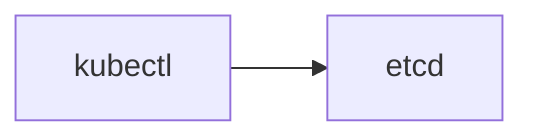
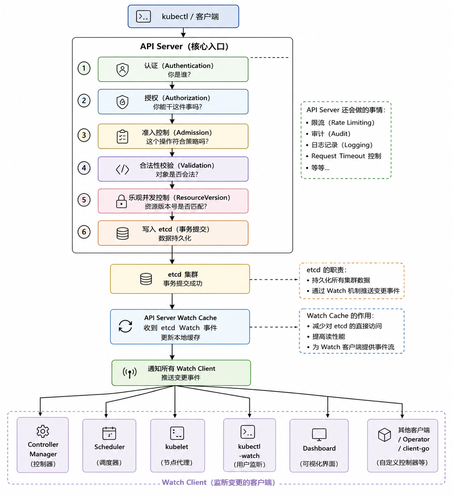
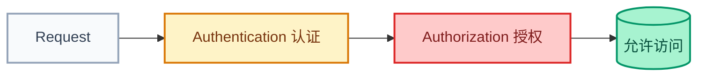
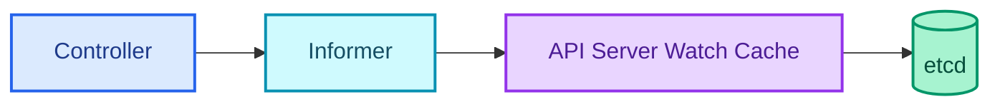
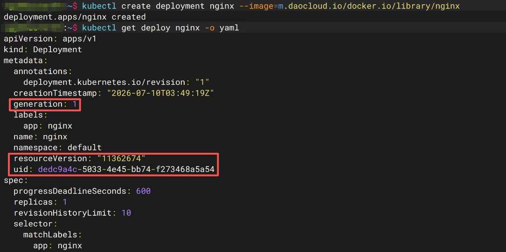
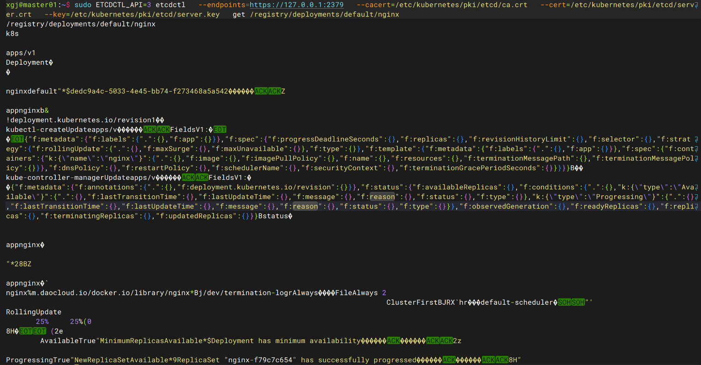
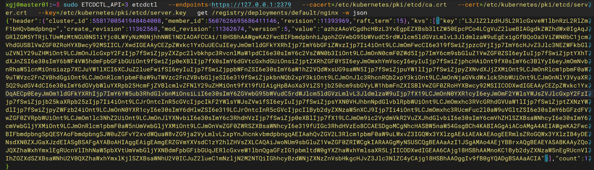

# 为什么 Kubernetes 不允许直接修改 etcd？——API Server 存在的真正意义

## 文章摘要

在 Kubernetes 架构中，**etcd** 是一个分布式键值存储（Key-Value Store），负责持久化整个集群的所有状态数据——包括 Pod、Deployment、Service、ConfigMap 等一切资源对象，以及节点信息、租约、RBAC 策略。

可以说，etcd 就是 Kubernetes 的 **"唯一真实数据源"（Single Source of Truth）**。

但有一个问题常常困扰着接触 Kubernetes 不久的同学：**既然所有资源最终都保存在 etcd 里，为什么不能直接修改 etcd？**

本文将深入解析 **API Server** 在 Kubernetes 架构中的核心地位，从安全校验、准入控制、乐观锁、Watch 机制、控制器设计等七个维度，讲清"为什么必须通过 API Server 操作集群资源"这一设计背后的深层逻辑，并通过一个实验直观展示直接修改 etcd 的风险。

## 学习目标

阅读本文后，你将能够：

- 理解 Kubernetes 真实的**数据流**，而非表面的 `kubectl → etcd` 简化模型
- 掌握 API Server 的**七大核心职责**及其在控制面中的不可替代性
- 理解 **Watch 机制**与 **Informer** 模式如何依赖 API Server 的 Watch Cache
- 通过实验直观认识 etcd 中存储的 **protobuf 二进制格式**与 YAML 的本质区别
- 建立"API Server 是业务中心，etcd 是状态数据库"的正确架构认知

---

## 一、一个常见的误解

刚接触 Kubernetes 的同学了解了 etcd 的角色后，可能会冒出一个疑问：

> Kubernetes 的所有资源最终不都保存在 etcd 里吗？

顺着这个思路，似乎可以：

- 自己直接连 etcd，修改 Deployment；
- 甚至直接用 `etcdctl put ...` 写入数据。

这样还能绕过 API Server，不是更快吗？

答案是：

> **理论上可以。**
> **实际上绝对不要这么做。**

几乎每一份官方文档都会强调：**不要直接操作 Kubernetes 使用的 etcd。** 这背后究竟藏着什么设计考量？

本文从 Kubernetes 控制面的设计思想出发，把这个问题彻底讲清楚。

---

## 二、Kubernetes 真实的控制面架构

很多人误以为数据流是这样的：



但真实的数据流远比这复杂。在继续深入之前，建议先回顾站内两篇前置文章：

- [Kubernetes API Server 详解](./api-resources.md)：集群的神经中枢与统一入口 —— 理解 API Server 在控制面中的核心地位
- [Kubernetes ETCD 工作原理详解](./etcd.md) —— 理解 etcd 的数据存储机制与 Raft 一致性算法

真实的请求链路是这样的：



可以看到，API Server 远不止是一个 HTTP 网关。它承担着 Kubernetes 控制面最核心的职责：认证、鉴权、准入、校验、乐观锁、缓存，以及最终的存储代理。etcd 只是被抽象在存储层之下的一个可靠状态数据库。真正的大脑是 API Server。

理解这一点之后，我们来看：如果直接写入 etcd，究竟会绕过哪些关键机制。

## 三、为什么不能直接修改 etcd？七大核心原因

### 3.1 绕过所有安全校验（Authentication & Authorization）

正常情况下，每次资源变更都要经过：


例如，普通开发人员可能只被允许操作 default 命名空间下的资源。而直接连 etcd 执行 etcdctl put ...，整个 RBAC 体系完全被绕过——任何数据都可以被随意修改。这是官方严禁直接连 etcd 的重要原因之一。

### 3.2 跳过 Admission Controller 链

API Server 内置了多层 Admission Controller，例如：

- LimitRange —— 限制命名空间内资源配额
- ResourceQuota —— 资源配额管理
- PodSecurity —— Pod 安全策略
- MutatingWebhook —— 资源变更前自动修改
- ValidatingWebhook —— 资源变更前自动校验

假设企业要求所有 Pod 必须带有 `team=backend` 标签，MutatingAdmissionWebhook 会自动补齐这个标签。如果直接写 etcd，这些规则全部失效，集群中甚至可能出现大量非法状态的资源。

!!! info "Admission Controller 作用"
    Admission Controller 是 Kubernetes 安全与治理的“闸门”，它拦截请求并决定是否允许其执行，分为变更（Mutating）和验证（Validating）两类，可以在资源持久化前进行修改或校验。

### 3.3 失去合法性校验（Validation）

Kubernetes 对各种资源有严格的字段校验，例如：

- Deployment 要求 `replicas >= 0`
- Pod 要求 `containers` 不能为空
- Service 的 ClusterIP 不能重复

这些校验全部由 API Server 完成。绕过 API Server 直接写入 etcd，你甚至可以写进 `replicas: -100` 这种完全非法的数据，而底层的键值存储本身不会做任何检查。

!!! tip "数据合法性"
    API Server 是 Kubernetes 数据合法性的守护者。它确保存入 etcd 的每一个资源都符合 API 规范，防止非法数据进入集群。

### 3.4 破坏乐观锁（ResourceVersion）

`ResourceVersion` 是 Kubernetes 实现乐观锁的关键机制。当两个用户同时修改同一个 Deployment 时，API Server 会检查 `ResourceVersion`：

- 如果版本已经变更，请求会返回 Conflict 错误，要求用户重新获取最新资源后再修改。

这样可以防止覆盖他人更改。直接修改 etcd 会彻底绕开这套版本控制，导致并发更新被悄然覆盖，集群状态出现难以排查的错乱。

!!! note "乐观锁机制"
    Kubernetes 采用乐观并发控制，通过 `ResourceVersion` 字段实现，该字段取自 etcd 的修改修订版本（mod_revision），在更新时进行比对，不一致则返回冲突错误（409），避免并发写入导致数据覆盖。

### 3.5 Watch 机制失去一致性保证

Kubernetes 的核心运转模式不是"存数据"，而是持续同步。整个控制面由以下组件组成：

- Deployment Controller 持续 Watch Deployment 资源
- Scheduler 持续 Watch 未被调度的 Pod
- kubelet 持续 Watch 与自己相关的 Pod

这套体系的核心模式是：

```text
Watch → Informer → Controller → Reconcile
```

更为关键的是，**Controller 并不是直接轮询 etcd**，真正的数据流是：

API Server 内部维护了一套 Watch Cache，大量控制器实际上从未直连 etcd。直接修改 etcd 会使得 Watch Cache 出现短时间不一致，导致控制器基于过期快照做出错误决策，最终破坏集群的最终一致性。

!!! info "Watch Cache 与 Informer"
    API Server 的 Cacher 组件在内存中维护了资源的 watchCache，并通过 Reflector 从 etcd 进行 watch 操作，避免为每个组件都创建一个 etcd watch，并实现了事件缓冲、序列化缓存、bookmark 机制等优化。

### 3.6 控制器无法保证最终一致性

Kubernetes 是声明式系统。当用户声明 Deployment 期望 `replicas=3` 时，对应的 Controller 会不断地执行 Reconcile Loop，直到现实世界中确实运行着 3 个 Pod。

如果绕过 API Server 直接修改 etcd，控制器可能无法获取完整的上下文信息，甚至可能触发异常恢复流程。最终，系统状态会变得不可预测，而这恰恰是 Kubernetes 声明式设计意图竭力避免的局面。

!!! tip "声明式系统"
    Kubernetes 的核心是声明式 API。用户声明期望状态，控制器不断工作，使实际状态最终达到期望状态。直接修改 etcd 会破坏这一闭环，使系统状态偏离预期。

### 3.7 存储版本与未来兼容性

很多人不知道，Kubernetes 存入 etcd 的数据并非原始 YAML，而是经过序列化的 protobuf 格式，并且封装了 Storage Version 机制。不同版本的 Kubernetes 存储格式可能会发生变化。

官方升级时，API Server 会自动完成存储版本转换。如果曾经直接向 etcd 写入过数据，未来集群升级时就极有可能遭遇数据损坏，甚至导致集群无法启动。

!!! danger "升级风险"
    直接向 etcd 写入数据可能绕过了 API Server 的存储版本转换逻辑，在未来 Kubernetes 版本升级时，这些数据可能无法被正确解码，导致集群数据损坏或服务中断。

> 💡 **补充说明**：下一节的实验中你会亲眼看到，通过 etcdctl get 拿到的并不是可读的 YAML 文本，正是一段 protobuf 序列化后的二进制数据。这正是 API Server 在存储层之上所做的一层抽象——它将 Kubernetes 原生资源对象编码为紧凑的二进制格式存入 etcd，读回时再解码还原。绕过这一层，你等于越过所有编解码逻辑，直接操作原始字节流，这正是升级时数据损坏的根源。

## 四、一个实验：直接修改 etcd 会怎样？

!!! danger "⚠️ 生产环境警告"
    仅建议在实验环境操作，生产环境严禁尝试。以下操作可能导致集群不可恢复的损坏。

实验环境：

- Kubernetes v1.36，3 Master 节点
- 容器运行时 containerd
- etcd 3.6

### 步骤 1：创建 Deployment
```bash
kubectl create deployment nginx --image=nginx
```

### 步骤 2：查看 Deployment 信息
```bash
kubectl get deploy nginx -o yaml
```



### 步骤 3：使用 etcdctl 直接读取对应键
```bash
ETCDCTL_API=3 etcdctl \
  --endpoints=https://127.0.0.1:2379 \
  --cacert=/etc/kubernetes/pki/etcd/ca.crt \
  --cert=/etc/kubernetes/pki/etcd/server.crt \
  --key=/etc/kubernetes/pki/etcd/server.key \
  get /registry/deployments/default/nginx
```



可以看到，返回的内容不是熟悉的 YAML，而是一段经过序列化的二进制数据（如果你用 -w json 会看到 base64 编码的字节，同样不可读。下图所示）。这说明 etcd 对外暴露的并不是 Kubernetes 原生资源接口，只是被 API Server 内部使用的一个状态存储而已。直接从 etcd 写入数据，就等于绕过了所有业务逻辑，直接修改底层二进制存储——这当然是极度危险的。



!!! tip "💡 实验总结"
    这个实验直观地展示了：etcd 中存储的数据格式（protobuf）与用户交互的 API 格式（YAML/JSON）是完全不同的两层抽象。API Server 正是这两层之间的"翻译官"和"守门人"。

## 五、Kubernetes 为什么一定需要 API Server？

现在再回顾前面的问题：

> 为什么所有请求都必须经过 API Server？

答案已经非常清晰了。API Server 并不仅仅增加一次网络跳转，它承担着整个控制面的核心职责：

| 职责|	说明|
|---|---|
| 身份认证（Authentication）	|验证请求发起者的身份|
| 权限控制（Authorization）|	通过 RBAC 实现细粒度访问控制|
| 准入控制（Admission）	|资源变更前后的拦截与修改|
| 数据合法性校验（Validation）|	确保写入数据的字段合法性|
| 乐观锁（ResourceVersion）|	防止并发更新冲突|
| Watch Cache 与事件分发	|为控制器提供高效的事件推送|
| 存储版本转换（Storage Version）|	保证集群升级时数据兼容性|
| API 聚合（Aggregation）与 CRD 管理|	支持自定义资源扩展|
| 审计（Audit）	|集中记录所有操作日志|

而 etcd 在整个架构中的定位始终是：

> **安全、可靠地保存集群状态。**

## 六、总结

很多人初学 Kubernetes 时会误以为：

    Kubernetes = API Server + etcd

但真正的架构关系更接近下图——API Server 是控制面的业务中心，etcd 则是其底层的状态数据库：

```mermaid
flowchart TD
    CP[Kubernetes Control Plane] --> API[API Server / 业务中心]
    API --> AuthN[Authentication]
    API --> AuthZ[Authorization]
    API --> Admission[Admission]
    API --> Validation[Validation]
    API --> WatchCache[Watch Cache]
    API --> RV[ResourceVersion]
    API --> Aggregation[API Aggregation]
    API --> StorageVer[Storage Version]
    API --> Audit[Audit]
    API --> etcd[(etcd / 状态数据库)]

    %% 1. 顶层控制平面（中性灰，代表承载一切的容器）
    style CP fill:#f1f5f9,stroke:#64748b,stroke-width:2px,color:#334155

    %% 2. 核心中枢（沉稳蓝，与系列文章中 API Server 主色保持一致）
    style API fill:#dbeafe,stroke:#2563eb,stroke-width:2px,color:#1e3a8a

    %% 3. 安全管控链（暖色渐变：黄 -> 橙 -> 红，代表层层拦截与收紧）
    style AuthN fill:#fef3c7,stroke:#d97706,stroke-width:2px,color:#78350f
    style AuthZ fill:#fed7aa,stroke:#ea580c,stroke-width:2px,color:#7c2d12
    style Admission fill:#fecaca,stroke:#dc2626,stroke-width:2px,color:#7f1d1d

    %% 4. 校验与并发控制层（黄 -> 绿，代表逻辑判断与锁定通过）
    style Validation fill:#fef08a,stroke:#ca8a04,stroke-width:2px,color:#713f12
    style RV fill:#bbf7d0,stroke:#16a34a,stroke-width:2px,color:#14532d

    %% 5. 内部基础设施与抽象层（冷色调渐变：紫 -> 靛蓝 -> 蓝灰，代表不同内部服务）
    style WatchCache fill:#e9d5ff,stroke:#9333ea,stroke-width:2px,color:#4c1d95
    style Aggregation fill:#c7d2fe,stroke:#4f46e5,stroke-width:2px,color:#1e1b4b
    style StorageVer fill:#bfdbfe,stroke:#3b82f6,stroke-width:2px,color:#1e40af
    style Audit fill:#e0e7ff,stroke:#6366f1,stroke-width:2px,color:#3730a3

    %% 6. 底层持久化存储（生态绿，代表数据基石，与全系列 etcd 配色一致）
    style etcd fill:#a7f3d0,stroke:#059669,stroke-width:2px,color:#064e3b
```



etcd 从来不是 Kubernetes 对外暴露的接口，只是控制面的底层状态存储。

所有资源都必须经过 API Server，这并非在"增加一次网络跳转"，而是为了确保整个集群在安全性、一致性、可扩展性以及最终一致性（Reconciliation） 方面的设计目标能够成立。

## 七、系列文章导航

本文是 Kubernetes 控制面系列文章的一部分，建议按以下顺序阅读：

|序号|	文章|	说明|
|---|---|---|
|1	|[Kubernetes API Server 详解：集群的神经中枢与统一入口](api-server.md)	|理解 API Server 的六大核心职责|
|2	|[Kubernetes ETCD 工作原理详解](etcd.md)	|理解 etcd 的数据存储与 Raft 算法|
|3	|[为什么 Kubernetes 不允许直接修改 etcd？（本文）](why-not-directly-modify-etcd.md)|	API Server 存在的真正意义|
|4	|如果 API Server 挂了，整个 Kubernetes 集群会发生什么？|（敬请期待）	API Server 的容灾边界实验|

## 参考资料

- [Kubernetes 官方文档 - API Server](https://kubernetes.io/docs/reference/command-line-tools-reference/kube-apiserver/)
- [etcd 官方文档](https://kubernetes.io/docs/tasks/administer-cluster/configure-upgrade-etcd/)
- [Kubernetes 控制面架构设计](https://kubernetes.io/zh-cn/docs/concepts/architecture/)
