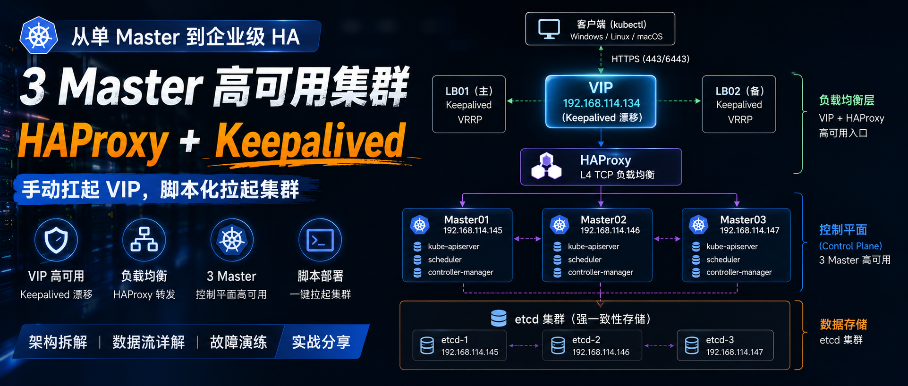
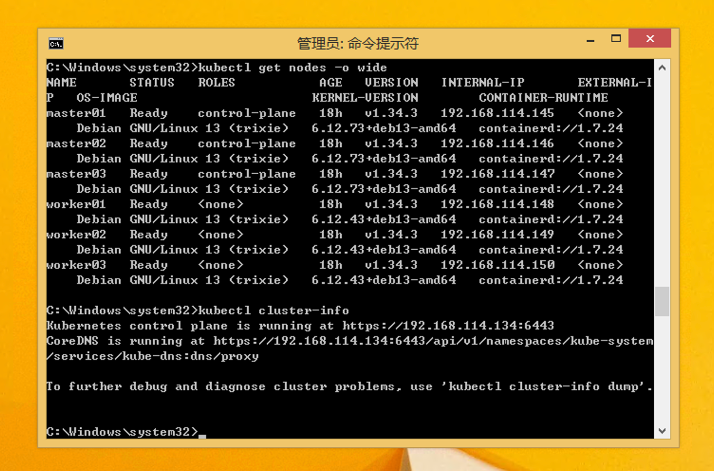

# 从单 Master 到企业级 HA：我用 HAProxy + Keepalived 手动扛起 VIP，脚本化拉起 3 Master Kubernetes 集群



> 本文约2000字，阅读约10分钟。
>
> 这一篇不是“安装说明书”，而是把 **Kubernetes 高可用控制平面的访问链路**彻底拆出来。
>
> 搞明白三件事：
>
> - `kubectl` 到底连的是谁？
> - VIP 在整个架构里究竟是什么角色？
> - 3 Master 解决了什么问题，又留下了什么坑？

---

## 一、为什么我必须重搭一套 3 Master 集群

之前的实验环境，我已经一步步搭完了：

- 单 Master Kubernetes
- 容器网络、Ingress
- Prometheus / Grafana 监控
- Loki / Tempo 可观测性
- 私有镜像仓库、存储等企业基础能力

看起来已经很“企业级”了。

---

但随着实验越来越深入，一个问题开始越来越明显：

**单 Master 是整个集群唯一的命门**

| 故障场景     | 直接后果                     |
| -------------- | ------------------------------ |
| Master 宕机  | `kubectl`彻底不可用                   |
| `kube-apiserver`挂掉         | 控制平面瘫痪                 |
| 节点意外重启 | 集群变成“无人驾驶”         |
| `etcd`损坏         | 集群状态高风险，甚至不可恢复 |

虽然：

- Pod 可能还在跑
- 业务短时间可能不受影响

但 Kubernetes 已经失去了：**控制能力**

你无法：

- 调度
- 变更
- 排障
- 扩缩容

---

所以这次，我正式进入：**Kubernetes 控制平面高可用（HA）**

最终架构：

```text
3 Master + 3 Worker + HAProxy + Keepalived
```

通过 VIP 统一 API Server 入口，让控制平面真正扛住单点故障。

---

## 二、实验环境一览

| 角色                   | IP              |
| ------------------------ | ----------------- |
| VIP（Keepalived 漂移） | 192.168.114.134 |
| Master01               | 192.168.114.145 |
| Master02               | 192.168.114.146 |
| Master03               | 192.168.114.147 |
| Worker01               | 192.168.114.148 |
| Worker02               | 192.168.114.149 |
| Worker03               | 192.168.114.150 |

> 注意：VIP 并不属于任何一台 Master，它是“漂浮”在负载均衡器上的。

---



---

## 三、VIP 最容易让人误解的地方

一开始我也踩过坑：

> “VIP 是不是直接登录 Master 用的？”

实际上完全不是。

VIP：

> 只负责 Kubernetes API

它不是：

- SSH 登录入口
- Linux 主机入口
- 某台 Master 本身

对我而言：

```text
https://192.168.114.134:6443
```

本质上代表：** Kubernetes Control Plane Endpoint **

理解这一点之后：

整个 Kubernetes HA 架构才会真正串起来。

---

## 四、HAProxy + Keepalived：手动搭建，把每一层都搞清楚

这一部分我特意没有脚本化。

而是：

`手工一步步部署`

原因很简单：

> 我想真正理解：
>
> Kubernetes 前面的“高可用层”到底在干什么。

很多时候：

教程会告诉你：

```bash
apt install haproxy
```

但不会告诉你：**为什么一定要有它?**

---

### 4.1 架构总览


---

### 4.2 Keepalived 解决什么？

Keepalived 解决的是：**负载均衡器自身高可用**

我在两台 LB 节点都部署了：

```text
Keepalived
```

通过：

```text
VRRP
```

让 VIP 永远只在一台 LB 上激活。

例如：

| 场景      | VIP 所在        |
| ----------- | ----------------- |
| LB01 正常 | VIP 在 LB01     |
| LB01 宕机 | VIP 漂移到 LB02 |

因此：

客户端永远访问：

```text
192.168.114.134
```

完全无感知。

---


---

### 4.3 HAProxy 做什么？

HAProxy 工作在：`TCP 四层`

它根本不理解 `Kubernetes`。

它只做一件事：

```text
收到 6443 请求
→ 转发到后端 API Server
```

例如：

```text
134:6443
    ↓
145:6443
146:6443
147:6443
```

HAProxy 的核心：

其实就是一组：

```cfg
server master01 192.168.114.145:6443 check
```

---


---

## 五、`kubectl` 到底连接的是谁？完整数据流拆解

这一部分。

是我这次实验里最大的收获。

以前虽然会：

```bash
kubectl get nodes
```

但从来没有真正理解：

> kubectl 到底在连接谁？

直到做完 HA。

整个 Kubernetes 的访问链路才真正清晰。

---

## 六、以我的 Windows 8.1 管理端为例

是的。

我甚至专门用了：

Windows 8.1

作为 Kubernetes 管理终端。

原因很简单：

> kubectl 本质只是 API Client。

和系统老不老关系并不大。

---


---

## 七、完整数据流拆解（本文核心）

我的 kubeconfig：

```yaml
server: https://192.168.114.134:6443
```

也就是：

```text
VIP
```

因此：

```bash
kubectl get pods
```

真正的数据流如下：


---

## 八、数据流每一层到底在干什么

### 1、kubectl

kubectl 本质是： **Kubernetes API Client**

例如：

```bash
kubectl get pods
```

底层其实是：

```http
GET /api/v1/pods
```

它并不关心：

- 单 Master
- 还是 3 Master

只要：

```text
有 API Server 响应即可
```

---

### 2、VIP（Keepalived）

VIP 保证： **负载均衡入口永远可用**

即使：

```text
LB01 宕机
```

VIP 也会自动漂移。

客户端完全无感知。

---

### 3、HAProxy

HAProxy 负责： `请求转发`

并检测：

```text
后端 kube-apiserver 是否健康
```

只把请求发给：

```text
健康节点
```

---

### 4、kube-apiserver

真正的： **Kubernetes 控制入口**

整个 Kubernetes：

- kubectl
- scheduler
- controller
- kubelet

本质上： `都在和 kube-apiserver 通信`

---

### 5、etcd

etcd 是： **Kubernetes 的数据库**

所有：

```bash
kubectl create deployment
```

最终都会写入：

```text
etcd
```

---

## 九、为什么高可用必须是 3 Master？

因为： **etcd 必须保证多数派（Quorum）**

所以：

| Master 数量 | 容错能力      |
| ------------- | --------------- |
| 1           | 0             |
| 2           | 不推荐        |
| 3           | 容忍 1 台故障 |
| 5           | 容忍 2 台故障 |

因此：

`企业最经典就是 3 Master`

这并不是巧合。

---

## 十、为什么 Worker 不需要高可用？

因为 Worker：

`本身就是无状态资源节点`

即使：

```text
worker01 宕机
```

Pod 也会：

- 被重新调度
- 漂移到其他 Worker

这是 Kubernetes 天生具备的：

`自愈能力`

---

不过这里有一个容易被误解的点：

> “无状态”并不代表 Worker 上不能运行有状态应用。

例如：

- MySQL
- PostgreSQL
- Redis
- Elasticsearch

这些都属于：

**有状态服务（Stateful Application）**

它们：

- 有持久化数据
- 有固定身份
- 有数据一致性要求

因此：

Kubernetes 会通过：

- StatefulSet
- PVC（持久卷）
- StorageClass

来解决：

```text
Pod 漂移后数据如何保留
```

的问题。

也就是说：

`Worker 可以挂`

**但数据不能丢**

真正不能挂的是：

**Control Plane**

因为：

一旦控制平面失效：

- 无法调度
- 无法创建 Pod
- 无法更新状态
- 无法管理整个集群

即使 Worker 还活着：

```text
整个 Kubernetes 也已经“失控”
```

---

## 十一、脚本化部署 Kubernetes 集群

虽然：

```text
HAProxy + Keepalived
```

我选择手动部署。

但：

**Kubernetes 集群本身**

我已经全部脚本化。

包括：

- Containerd
- kubeadm
- kubelet
- CNI
- sysctl
- 节点初始化
- Worker / Master 自动加入

这样做最大的价值：

| 能力   | 价值               |
| -------- | -------------------- |
| 可重复 | 一键重建实验环境   |
| 可维护 | 配置统一标准化     |
| 可迁移 | 更换环境成本极低   |
| 工程化 | 更接近企业真实运维 |

---


---


---

> 我已经把 Kubernetes HA 部署脚本整理好了。
>
> 包括：
>
> - deploy.sh
> - k8s.conf
> - 初始化说明等
>
> 需要参考的同学：
>
>  **关注文末的公众号，后台回复：**
>
> ```text
> K8SHA
> ```
>
> 即可获取。
> 目前仅支持debian 13系列，12、11应该也支持，但是并未做测试。

---

## 十二、这次实践让我真正理解的事

以前我总觉得：

```text
Kubernetes = 一堆 Pod
```

但真正做完 HA 后，认识完全变了。

Kubernetes 本质上是：

`API 驱动系统`

真正重要的是：

- API Server
- etcd
- scheduler
- controller-manager

而：

```text
kubectl
```

只是：

**一个 API Client**

当你真正看到：

- Keepalived 漂移
- HAProxy 转发
- Master 宕机
- kubectl 无感知

之后。

你才会真正理解：

`什么叫高可用控制平面`

---

## 十三、下一篇：故意打挂一台 Master

这一篇主要解决：

`HA 架构到底是什么`

下一篇开始：

`真正的故障演练`

包括：

- Keepalived 漂移验证
- API Server 健康检查
- kubectl 是否掉线
- Pod 是否迁移
- etcd 多数派是否正常
- 哪些服务真正高可用
- 哪些“HA”只是看起来像 HA

这部分会真正进入：

`企业级 Kubernetes 故障演练阶段`

也是整个私有云实验里：

`最核心的一部分`

---

