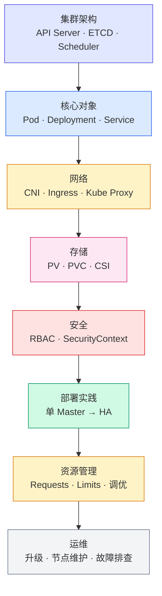

# Kubernetes

从实验环境到生产集群，记录 Kubernetes 的学习、实践与故障处理过程。

Kubernetes 是当前云原生领域最重要的基础设施平台之一，也是现代平台工程的核心。本专题涵盖集群部署、架构原理、高可用设计、资源管理、故障排查与生产环境实践。

---

## 快速入门

刚接触 Kubernetes？不确定从哪里开始？

👉 [K8s 从入门到上线完整路线](K8s-beginner-to-production.md) — 一篇讲清从"听说过 K8s"到"能独立上线项目"的完整路径，包含学习顺序、实战路线和避坑指南。

按阶段选择阅读：

| 你的阶段 | 推荐阅读 |
|---|---|
| 新手（第 1~3 阶段） | Linux 基础 → Docker → K8s 核心对象（Pod / Deployment / Service） |
| 进阶（第 4~5 阶段） | ConfigMap / Ingress / HPA / Prometheus 监控 |
| 提升（第 6~7 阶段） | 实战项目 → 高可用架构 → 生产上线 |

---

## 内容索引

### 控制平面
理解控制平面是理解 Kubernetes 工作机制的第一层入口，核心在于“集群如何做决策和维护期望状态”。

| 文章 | 说明 |
|---|---|
| [Control Plane 专题](architecture/control-plane/index.md) | API Server、Scheduler、Controller Manager、ETCD 的统一入口 |
| [API Server](architecture/control-plane/api-server.md) | 集群统一入口，所有操作经过这里 |
| [ETCD](architecture/control-plane/etcd.md) | 集群状态存储，唯一有状态组件 |
| [Scheduler](architecture/control-plane/scheduler.md) | Pod 调度决策 |
| [Controller Manager](architecture/control-plane/controller-manager.md) | 控制循环与状态协调 |
 | [Control Plane 专题](architecture/control-plane/index.md) | API Server、Scheduler、Controller Manager、ETCD 的统一入口 |
 | [API Server](architecture/control-plane/api-server.md) | 集群统一入口，所有操作经过这里 |
 | [ETCD](architecture/control-plane/etcd.md) | 集群状态存储，唯一有状态组件 |
 | [Scheduler](architecture/control-plane/scheduler.md) | Pod 调度决策 |
 | [Controller Manager](architecture/control-plane/controller-manager.md) | 控制循环与状态协调 |
| 文章 | 说明 |
|---|---|
| [Node & Runtime 专题](architecture/node/index.md) | Worker Node、Pod 生命周期、kubelet 与运行时的统一入口 |
| [Worker Node 架构](architecture/node/worker-node.md) | 节点层的职责与整体执行链路 |
| [Pod 生命周期](architecture/node/pod-lifecycle.md) | 从 Pending 到 Running 的完整生命周期 |
| [Kubelet](architecture/node/kubelet.md) | 节点代理，管理 Pod 生命周期 |
| [Kubelet SyncLoop](architecture/node/kubelet-syncloop.md) | kubelet 如何持续调谐 Pod 状态 |
 | [Node & Runtime 专题](architecture/node/index.md) | Worker Node、Pod 生命周期、kubelet 与运行时的统一入口 |
| [CRI gRPC 调用详解](architecture/node/cri-grpc-deep.md) | kubelet 与运行时之间的接口细节 |
| [containerd 创建容器全过程](architecture/node/containerd-from-cri-to-runc.md) | 从 CRI 到 runc 的完整执行路径 |
| [Kube Proxy](architecture/network/kube-proxy.md) | 服务发现与流量转发 |

### 网络

Kubernetes 网络是很多问题的根源，也是理解 Service、Ingress、CNI 的基础。
 | [Network 专题](architecture/network/index.md) | 网络模型、CNI、Service 与 Ingress 的统一入口 |
 | [Kubernetes 网络模型](architecture/network/index.md) | Pod 网络、Service 网络与节点网络 |
|---|---|
| [Network 专题](architecture/network/index.md) | 网络模型、CNI、Service 与 Ingress 的统一入口 |
| [Kubernetes 网络模型](architecture/network/index.md) | Pod 网络、Service 网络与节点网络 |
| [CNI](architecture/network/cni.md) | 容器网络接口与主流插件 |
| [Ingress](architecture/network/ingress.md) | 七层流量入口与 Ingress Controller |

### 存储

| 文章 | 说明 |
|---|---|
| [Storage 专题](architecture/storage/index.md) | PV / PVC / StorageClass / CSI 的统一入口 |
| [存储系统](architecture/storage/index.md) | PV / PVC / StorageClass |
| [CSI](architecture/storage/csi-nfs-components.md) | 容器存储接口与驱动 |

### 资源与安全

| 文章 | 说明 |
|---|---|
| [Workloads](architecture/resources/workloads.md) | Pod / Deployment / StatefulSet / DaemonSet |
| [API Resources](architecture/resources/api-resources.md) | 集群 API 资源全景 |
| [Server Resources](architecture/resources/server-resources.md) | 节点资源与容量管理 |
| [Other Resources](architecture/resources/other-resources.md) | 其他集群资源 |
| [安全机制](architecture/resources/security.md) | RBAC / SecurityContext / Pod Security |

### 最佳实践

| 文章 | 说明 |
|---|---|
| [单 Master 集群部署](practice/single-master-deployment.md) | 从零搭建第一套 K8s 集群 |
| [Docker 与 K8s](practice/docker.md) | 容器运行时与 K8s 的关系 |
| [从单 Master 到 HA](practice/single-master-to-ha.md) | 单 Master 升级高可用 |
| [HA 集群实践](practice/ha-cluster.md) | HAProxy + Keepalived + 3 Master 部署 |
| [Requests vs Limits](practice/requests-vs-limits.md) | 调度信号与运行时限制的区别 |
| [资源优化](practice/resource-optimization.md) | 集群资源调优方法 |
| [集群升级](practice/cluster-upgrade.md) | K8s 版本升级流程与风险 |
| [kubectl drain](practice/kubectl-drain.md) | 节点维护操作 |
| [10 条实战经验](practice/10-takeaways.md) | 生产环境踩坑总结 |

### 工具

| 文章 | 说明 |
|---|---|
| [K9s](tools/k9s.md) | 终端 K8s 管理工具 |
| [Headlamp](tools/headlamp.md) | Web UI 集群管理工具 |
| [KYAML](tools/kyaml.md) | K8s 更安全的 YAML 方言与格式化工具 |

---

## 学习顺序

详细的分阶段学习路线 → [Kubernetes 学习路线](roadmap.md)

---

## 后续计划

| 方向 | 规划内容 |
|---|---|
| 网络 | 网络流量全链路解析、NetworkPolicy 实践、Service Mesh |
| 存储 | 本地存储 vs 网络存储、存储性能测试 |
| 运维 | ETCD 备份与恢复演练、集群灾备方案 |
| 安全 | Pod Security Standards、镜像扫描、OPA Gatekeeper |
| 可观测性 | 与 Prometheus / Grafana / Loki 集成实践 |
