# Kubernetes 1.34 升级到 1.36 实战指南：生产环境零停机升级全过程

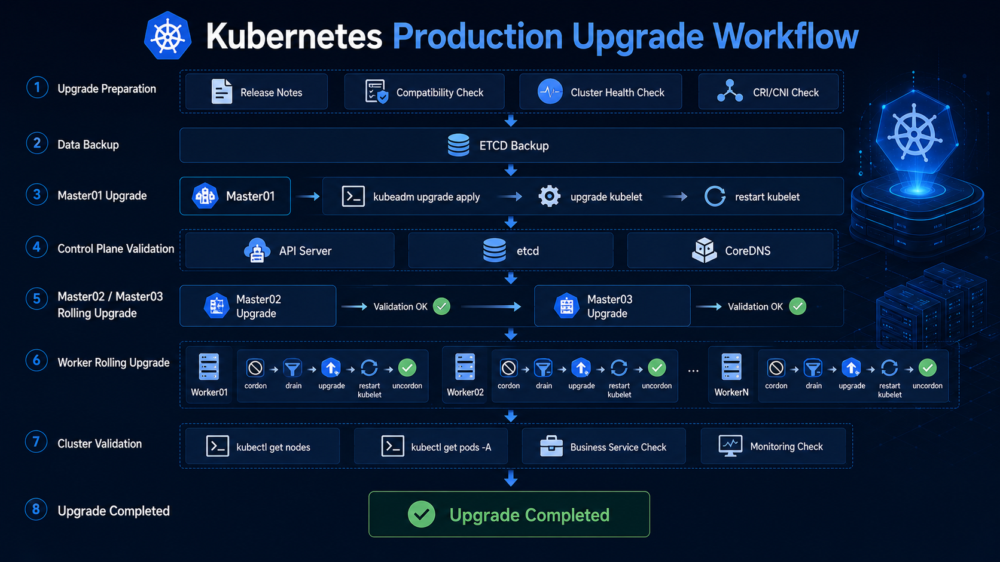

!!! warning "升级过程中发现的问题"

    本次从 Kubernetes 1.34 升级到 1.35 的过程中，
    kubeadm 提示了 `ContainerRuntimeVersion` 警告。

    经过排查发现：

      - containerd 1.7.24
      - systemd cgroup
      - 集群运行正常

    该警告属于 Kubernetes 1.36 的兼容性预警，不会影响 Kubernetes 1.35 的升级。

很多同学搭建 Kubernetes 集群后，往往很少进行版本升级。

一方面担心升级过程中业务中断，另一方面担心升级失败导致集群不可用。

但 Kubernetes 每年都会发布多个版本，新版本通常会带来：

- 更稳定的功能
- 更好的性能
- 更多安全修复
- API 生命周期更新
- 新特性支持

因此，掌握 Kubernetes 升级能力，是平台工程师和运维工程师的必备技能之一。

本文将以 kubeadm 部署的高可用 Kubernetes 集群为例，演示：

- 升级前检查
- ETCD 数据备份
- Kubernetes 1.34 → 1.35 升级
- Kubernetes 1.35 → 1.36 升级
- Worker 节点滚动升级
- 升级后验证
- 升级失败回滚思路

---

## 为什么不能直接升级到 1.36？

很多同学第一次升级时都会产生一个疑问：

> 当前是 Kubernetes 1.34，能否直接升级到 1.36？

答案是：**不能**

Kubernetes 官方规定：

```text
仅支持跨一个 Minor Version 升级
```

例如：

1.34 -> 1.35 -> 1.36

而以下方式是不支持的：

1.34 -> 1.36

因此必须逐级升级。

## 实验环境

本次测试环境如下：

|节点	|IP	|角色|
|---|---|---|
|master01|	192.168.11.145|	Control Plane
|master02|	192.168.11.146|	Control Plane
|master03|	192.168.11.147	|Control Plane
|worker01|	192.168.11.148	|Worker
|worker02|	192.168.11.149	|Worker
|worker03|	192.168.11.150	|Worker

当前版本：
```bash
kubectl get nodes
```

输出：
```txt
NAME       STATUS   ROLES           AGE   VERSION
master01   Ready    control-plane   41d   v1.34.3
master02   Ready    control-plane   41d   v1.34.3
master03   Ready    control-plane   41d   v1.34.3
worker01   Ready    <none>          41d   v1.34.3
worker02   Ready    <none>          41d   v1.34.3
worker03   Ready    <none>          41d   v1.34.3
```

## Kubernetes 升级整体流程

整个升级流程如下：
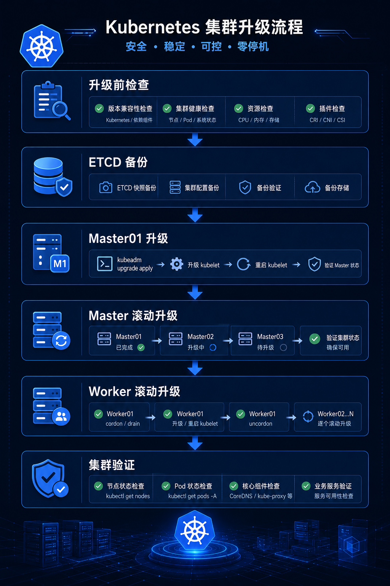

### 第一步：升级前检查
**检查节点状态**
```bash
kubectl get nodes
```
确保所有节点：`Ready`

**检查 Pod 状态**
```bash
kubectl get pods -A
```
确保不存在：
```bash
CrashLoopBackOff
ImagePullBackOff
Error
ContainerCreating
```
**检查集群事件**
```bash
kubectl get events -A --sort-by=.lastTimestamp
```
查看近期是否存在异常事件。

**查看版本信息**
```bash
kubectl version
kubeadm version
kubelet --version
```

**检查 API 废弃项**

升级前推荐检查 API 是否已经废弃。

安装 Pluto：
```bash
curl -L -O https://github.com/FairwindsOps/pluto/releases/download/v5.19.0/pluto_5.19.0_linux_amd64.tar.gz
tar -xvf pluto_5.19.0_linux_amd64.tar.gz

sudo mv pluto /usr/local/bin/
```

扫描：
```bash
pluto detect-all-in-cluster
```
如果发现：
```
extensions/v1beta1
policy/v1beta1
networking.k8s.io/v1beta1
```
等资源，需要提前处理。

### 第二步：备份 ETCD

这一部分是整个升级过程中最重要的一步。

如果升级失败：
```
ETCD 快照 = 最后的救命稻草
```
**查看 ETCD Pod**
```bash
kubectl get pod -n kube-system | grep etcd
```
示例：
```bash
etcd-master01                              1/1     Running   0              15d
etcd-master02                              1/1     Running   0              15d
etcd-master03                              1/1     Running   0              15d
```

etcd-master01 创建快照
```bash
sudo ETCDCTL_API=3 etcdctl snapshot save \
/backup/etcd-$(date +%F).db \
--cacert=/etc/kubernetes/pki/etcd/ca.crt \
--cert=/etc/kubernetes/pki/etcd/server.crt \
--key=/etc/kubernetes/pki/etcd/server.key
```
输出：
```bash
Snapshot saved at /backup/etcd-2026-06-23.db
```

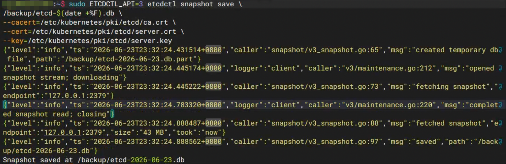

验证快照
```bash
sudo etcdctl snapshot status /backup/etcd-2026-06-23.db
-------
Deprecated: Use `etcdutl snapshot status` instead.

60a44d6b, 7808809, 1507, 43 MB
```

### 第三步：升级到 Kubernetes 1.35

#### 准备工作：安装官方公钥（若未添加过）

Kubernetes 官方自 v1.28 起使用新的 APT 仓库（pkgs.k8s.io），其签名公钥与旧版不同。如果系统尚未导入该公钥，请先执行以下命令：
bash

**下载并安装官方公钥**
```bash
curl -fsSL https://pkgs.k8s.io/core:/stable:/v1.35/deb/Release.key | sudo gpg --dearmor -o /etc/apt/keyrings/kubernetes-apt-keyring.gpg
```
!!! info "说明"
    公钥对所有版本通用（v1.35、v1.36 等），只需执行一次。如果 /etc/apt/keyrings/kubernetes-apt-keyring.gpg 已存在，可跳过此步骤。

**添加 v1.35 的 APT 源**

使用以下命令添加 Kubernetes v1.35 的稳定仓库：
```bash
echo "deb [signed-by=/etc/apt/keyrings/kubernetes-apt-keyring.gpg] https://pkgs.k8s.io/core:/stable:/v1.35/deb/ /" | sudo tee /etc/apt/sources.list.d/kubernetes-1.35.list

# 更新 APT 缓存
sudo apt-get update
```
可通过 `apt-cache madison kubeadm | grep 1.35 ` 查看可用的 v1.35 版本包。

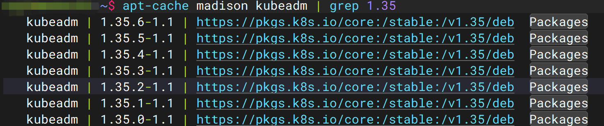

**添加 v1.36 的 APT 源（用于后续第二阶段的升级）**

当所有节点都成功升级到 v1.35 并确认集群稳定后，再添加 v1.36 的源以进行下一轮升级。也可以提前添加，但必须等完成 v1.35 升级后再使用。

```bash
# 添加 v1.36 源（密钥已存在，无需重复下载）
echo "deb [signed-by=/etc/apt/keyrings/kubernetes-apt-keyring.gpg] https://pkgs.k8s.io/core:/stable:/v1.36/deb/ /" | sudo tee /etc/apt/sources.list.d/kubernetes-1.36.list

# 更新 APT 缓存
sudo apt-get update
```
!!! warning "注意事项与常见问题"
    - 源文件命名：建议按版本号命名（如 kubernetes-1.35.list），便于管理。
    - 多个源共存：可以同时保留多个版本源，APT 会按版本号选择安装包。升级时务必指定明确的版本号，避免误装。
    - 清理旧源（可选）：为避免混淆，升级完成后可注释或移除不再使用的源文件（例如升级到 v1.36 后，可移除 v1.34 和 v1.35 源）。
    - 密钥文件路径：确保 signed-by 指向正确的公钥文件路径，否则 apt-get update 会报错。

**验证源配置**

执行以下命令确认源已正确添加且可用：
```bash
# 列出所有源
ls -l /etc/apt/sources.list.d/kubernetes-*.list

# 查看各版本 kubeadm 可用版本
apt-cache madison kubeadm
```
若输出中包含 1.35.x 和 1.36.x 的条目，表示源配置成功。

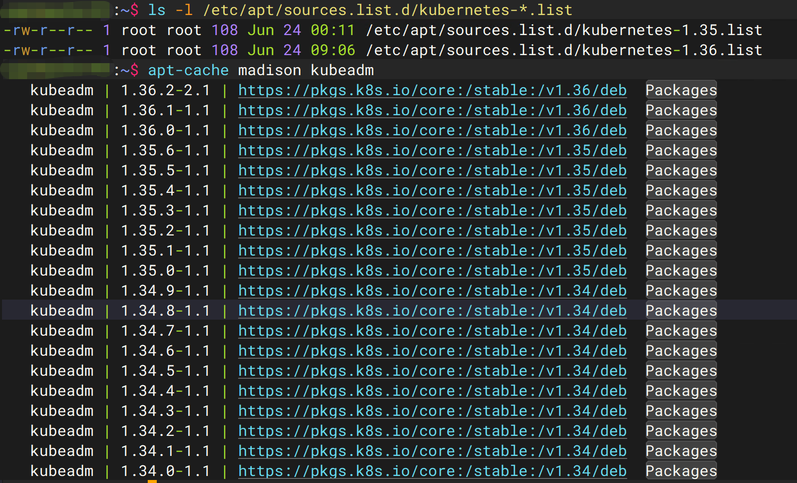

#### 升级 kubeadm

安装：
```bash
sudo apt-mark unhold kubeadm
sudo apt install -y kubeadm=1.35.0-1.1
sudo apt-mark hold kubeadm
```
验证：
```bash
kubeadm version
```

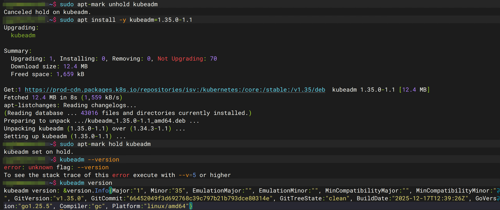

查看升级计划
```bash
kubeadm upgrade plan
```
输出类似：
```bash
#...
[upgrade] Running cluster health checks
[upgrade] Fetching available versions to upgrade to
[upgrade/versions] Cluster version: 1.34.0
[upgrade/versions] kubeadm version: v1.35.0
I0624 10:06:55.928510 2277143 version.go:260] remote version is much newer: v1.36.2; falling back to: stable-1.35
[upgrade/versions] Target version: v1.35.6
[upgrade/versions] Latest version in the v1.34 series: v1.34.9
#...
```

**升级第一个 Control Plane**

在 master01 上执行：
```bash
sudo kubeadm upgrade apply v1.35.0
```
确认：`yes`

`kubeadm` 升级成功后将输出类似如下：
```bash
[upgrade] SUCCESS! A control plane node of your cluster was upgraded to "v1.35.0".
```

**升级过程中出现 ContainerRuntimeVersion 警告怎么办？**

在升级 Kubernetes 1.35 时，可能会看到类似的警告：

```text
[WARNING ContainerRuntimeVersion]:
You must update your container runtime to a version that supports the CRI method RuntimeConfig.

Falling back to using cgroupDriver from kubelet config will be removed in 1.36.
```

第一次看到这个提示时，很多人会误认为：

* containerd 版本过低
* Kubernetes 无法继续升级
* 必须先升级容器运行时

实际上，大部分情况下并非如此。

**为什么会出现这个警告？**

从 Kubernetes 1.35 开始，Kubelet 正在逐步调整 cgroupDriver 的获取方式。

过去：

```text
Kubelet
    ↓
读取自身配置文件
    ↓
获取 cgroupDriver
```

未来：

```text
Kubelet
    ↓
通过 CRI RuntimeConfig 接口
    ↓
从容器运行时获取 cgroupDriver
```

如果当前容器运行时没有实现 RuntimeConfig 接口，kubeadm 就会输出该警告。

---

**当前版本的处理机制**

目前 Kubernetes 1.35 仍然保留兼容逻辑：

```text
读取 RuntimeConfig 失败
        ↓
回退到 kubelet 配置
        ↓
继续运行
```

因此：

> 这只是 Warning，并不会阻止升级。

---

**如何确认环境是否正常？**

查看 containerd 版本：

```bash
containerd --version
```

例如：

```text
containerd 1.7.24
```

查看 kubelet 配置：

```bash
sudo grep cgroupDriver /var/lib/kubelet/config.yaml
```

输出：

```yaml
cgroupDriver: systemd
```

查看 containerd 配置：

```bash
sudo crictl info
```

如果能够看到：

```json
"SystemdCgroup": true
```

则说明：

* kubelet 使用 systemd cgroup
* containerd 使用 systemd cgroup
* 当前运行状态正常

---

**本次实验环境**

| 组件           | 版本      |
| ------------ | ------- |
| Kubernetes   | 1.34.0  |
| kubeadm      | 1.35.0  |
| containerd   | 1.7.24  |
| cgroupDriver | systemd |

升级过程中虽然出现了 Warning：

```text
[WARNING ContainerRuntimeVersion]
```

但实际升级和集群运行均正常。

---

**Kubernetes 1.36 是否会受到影响？**

根据目前社区测试情况：

* containerd 1.6.x：建议升级
* containerd 1.7.x：通常没有问题
* containerd 2.x：官方推荐

如果当前环境已经使用：

```text
containerd 1.7+
systemd cgroup
```

则大多数情况下可以安全升级到 Kubernetes 1.36。

---

**建议**

生产环境升级前建议提前检查：

```bash
containerd --version

sudo crictl info

sudo grep cgroupDriver /var/lib/kubelet/config.yaml
```

确认：

* containerd ≥ 1.7
* cgroupDriver = systemd
* Runtime 正常运行

这样可以有效降低 Kubernetes 1.36 升级过程中的兼容性风险。


#### 升级 kubelet 与 kubectl
```bash
sudo apt-mark unhold kubelet kubectl
sudo apt install -y kubelet=1.35.x-1.1 kubectl=1.35.x-1.1 
sudo apt-mark hold kubelet kubectl
```
重启：
```bash
sudo systemctl daemon-reload
sudo systemctl restart kubelet
```

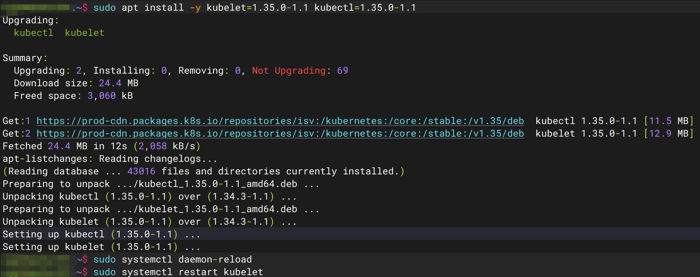

#### 升级其他 Master
```bash
sudo apt-mark unhold kubeadm
sudo apt install -y kubeadm=1.35.0-1.1
sudo apt-mark hold kubeadm
```
**在 master02、master03 配置仓库**
```bash
# 添加官方密钥
curl -fsSL https://pkgs.k8s.io/core:/stable:/v1.35/deb/Release.key | sudo gpg --dearmor -o /etc/apt/keyrings/kubernetes-apt-keyring.gpg
# 添加官方源
echo "deb [signed-by=/etc/apt/keyrings/kubernetes-apt-keyring.gpg] https://pkgs.k8s.io/core:/stable:/v1.35/deb/ /" | sudo tee /etc/apt/sources.list.d/kubernetes-1.35.list
# 上面是1.35的源，下面是1.36的源
echo "deb [signed-by=/etc/apt/keyrings/kubernetes-apt-keyring.gpg] https://pkgs.k8s.io/core:/stable:/v1.36/deb/ /" | sudo tee /etc/apt/sources.list.d/kubernetes-1.36.list
# 更新缓存
sudo apt update
```

**升级组件**
```bash
# 安装 kubeadm kubelet kubectl 组件
sudo apt-mark unhold kubeadm kubelet kubectl
sudo apt install -y kubeadm=1.35.0-1.1 kubelet=1.35.0-1.1 kubectl=1.35.0-1.1

# 升级 kubeadm 
sudo kubeadm upgrade node

sudo systemctl daemon-reload
sudo systemctl restart kubelet
sudo apt-mark hold kubeadm kubelet kubectl
```

✅ 判断是否真正升级成功

以节点状态为准，而不是 kubeadm 输出：
```bash
kubectl get nodes
```
如果输出类似：
```bash
master01   Ready   v1.35.0
master02   Ready   v1.35.0
master03   Ready   v1.35.0
```

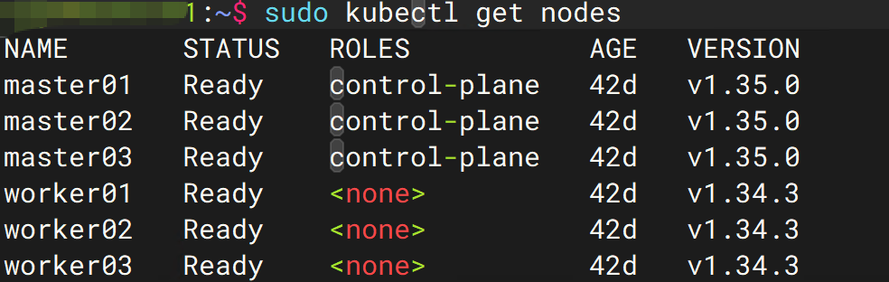

则说明：

🎉 集群已成功完成升级

### 第四步：升级 Worker 节点

采用滚动升级方式，一次只升级一个节点。

**驱逐节点**
```bash
# master 执行
kubectl drain worker01 --ignore-daemonsets --delete-emptydir-data
```

#### 添加 Kubernetes 源
```bash
sudo mkdir -p /etc/apt/keyrings

curl -fsSL https://pkgs.k8s.io/core:/stable:/v1.35/deb/Release.key | sudo gpg --dearmor -o /etc/apt/keyrings/kubernetes-apt-keyring.gpg

echo "deb [signed-by=/etc/apt/keyrings/kubernetes-apt-keyring.gpg] https://pkgs.k8s.io/core:/stable:/v1.35/deb/ /" | sudo tee /etc/apt/sources.list.d/kubernetes.list
echo "deb [signed-by=/etc/apt/keyrings/kubernetes-apt-keyring.gpg] https://pkgs.k8s.io/core:/stable:/v1.36/deb/ /" | sudo tee /etc/apt/sources.list.d/kubernetes-1.36.list

sudo apt update
```

#### 升级 kubeadm
```bash
sudo apt-mark unhold kubeadm kubelet kubectl 
sudo apt install -y kubeadm=1.35.0-1.1
```
**升级节点配置**
```bash
sudo kubeadm upgrade node
```

**升级 kubelet**
```bash
sudo apt install -y kubelet=1.35.0-1.1 kubectl=1.35.0-1.1
```

**重启服务**
```bash
sudo systemctl daemon-reload
sudo systemctl restart kubelet
sudo apt-mark hold kubeadm kubelet kubectl 
```
**恢复调度**
```bash
# master 执行
kubectl uncordon worker01
```
**验证**
```bash
kubectl get nodes
```
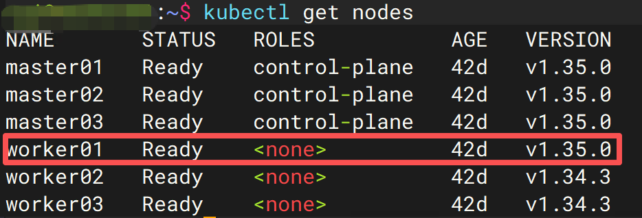

**确认：**
```bash
worker01   Ready   v1.35.x
```
然后继续升级下一台 Worker。

### 第五步：验证 1.35 集群

查看版本：
```bash
kubectl get nodes
```
全部应为：
```
v1.35.x
```

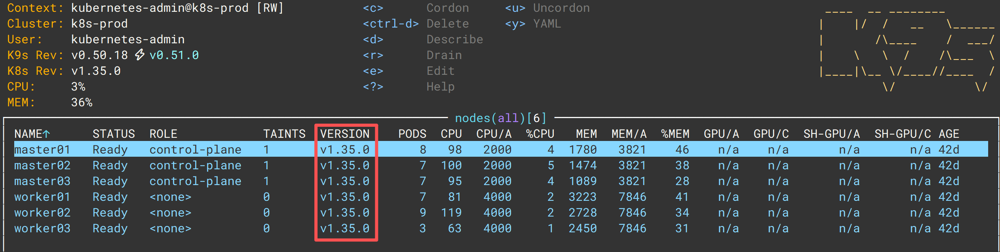

检查系统组件：
```bash
kubectl get pod -n kube-system
```
确保：
```
coredns
etcd
kube-apiserver
kube-controller-manager
kube-scheduler
kube-proxy
```
全部 Running。

### 第六步：升级到 Kubernetes 1.36

升级过程与 1.35 完全一致。

升级顺序仍然保持：
```
Master01
 ↓
Master02
 ↓
Master03
 ↓
Worker01
 ↓
Worker02
 ↓
Worker03
```

**升级 kubeadm**
```bash
sudo apt-mark unhold kubeadm
sudo apt install -y kubeadm=1.36.1-1.1
sudo apt-mark hold kubeadm
```

查看升级计划
```bash
sudo kubeadm upgrade plan
```

升级 Control Plane
```bash
sudo kubeadm upgrade apply v1.36.1
```

升级 kubelet
```bash
sudo apt-mark unhold kubelet kubectl
sudo apt install -y kubelet=1.36.1-1.1 kubectl=1.36.1-1.1
sudo apt-mark hold kubelet kubectl

sudo systemctl daemon-reload
sudo systemctl restart kubelet
```

**升级 Worker**
```bash
# master 执行 worker 节点驱逐
kubectl drain worker01 --ignore-daemonsets --delete-emptydir-data

# 升级 kubeadm
sudo apt-mark unhold kubeadm kubelet kubectl 
sudo apt install -y kubeadm=1.36.1-1.1

# 升级节点配置
kubeadm upgrade node

# 升级 kubelet kubectl 组件
sudo apt install -y kubelet=1.36.1-1.1 kubectl=1.36.1-1.1

# 重启
sudo systemctl daemon-reload
sudo systemctl restart kubelet
sudo apt-mark hold kubeadm kubelet kubectl

# master 解除封锁
kubectl uncordon worker01
```

### 第七步：升级后验证
检查节点
```bash
kubectl get nodes
```
确认：
```
v1.36.x
```

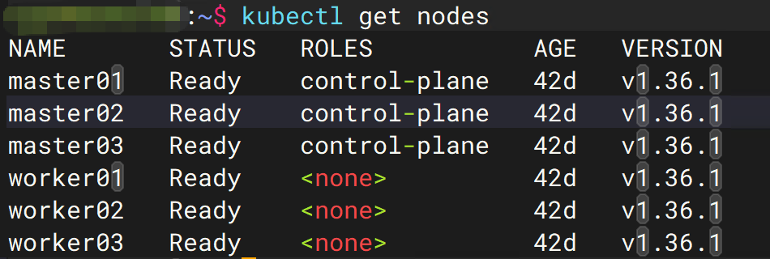

检查组件状态
```bash
kubectl get pods -A
```

确保没有：
```bash
CrashLoopBackOff
Error
```

检查集群事件
```bash
kubectl get events -A --sort-by=.lastTimestamp
```

检查 API Server
```bash
kubectl cluster-info
```

检查证书
```bash
kubeadm certs check-expiration
```

## 升级失败如何回滚？

生产环境必须提前规划回滚方案。

推荐保留：
```
ETCD Snapshot
+
虚拟机快照
+
节点镜像备份
```

如果升级后 API Server 无法启动：

恢复 ETCD：
```bash
etcdctl snapshot restore etcd.db
```
然后重新创建静态 Pod。

如果升级后 Worker 异常：

可以直接降级 kubelet：
```bash
sudo apt install kubelet=<旧版本>
```
然后重启：
```bash
sudo systemctl restart kubelet
```

## 生产环境升级建议

实际生产环境升级时，建议遵循以下原则：

**原则一：一次只升级一个节点**

错误示例：

同时升级全部 Master

正确方式：
```
Master01
↓
验证
↓
Master02
↓
验证
↓
Master03
```

**原则二：升级前必须备份**

至少保留：

  - ETCD Snapshot
  - VM Snapshot

**原则三：重点关注 CNI 和 CSI**

升级事故往往不是 Kubernetes 本身导致的。

重点检查：

  - Calico
  - Cilium
  - Flannel
  - Longhorn
  - Rook-Ceph
  - CSI Driver

## 总结

本次升级路径如下：
```text
Kubernetes 1.34
      │
      ▼
Kubernetes 1.35
      │
      ▼
Kubernetes 1.36
```

整个过程中最重要的三个原则：

  - 不跨版本升级
  - 升级前必须备份 ETCD
  - Worker 节点采用滚动升级

掌握 Kubernetes 升级流程后，后续从 1.36 升级到 1.37、1.38，甚至未来版本，都可以按照相同思路进行操作。

## 相关阅读
  - [kubectl drain 到底做了什么？](../practice/kubectl-drain.md)
  - [Kubernetes 架构详解：从 API Server 到 ETCD](../architecture/control-plane/etcd.md)
  - [Kubernetes Control Plane 组件详解](../architecture/control-plane/controller-manager.md)
  - [Kubernetes ETCD 备份与恢复实战](../../lab/failover-test-1.md)
  - [Kubernetes Pod OOM 故障排查指南](../../lab/pod-oom-test.md)
