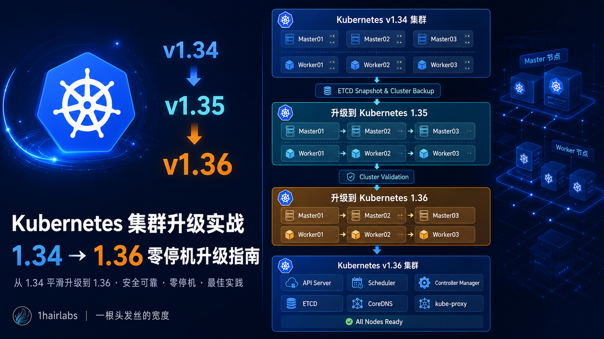

# Kubernetes 1.34 升级到 1.36 实战指南：生产环境零停机升级全过程



很多同学搭建 Kubernetes 集群后，往往很少进行版本升级。

一方面担心升级过程中业务中断，另一方面担心升级失败导致集群不可用。

但 Kubernetes 每年都会发布多个版本，新版本通常会带来：

- 更稳定的功能
- 更好的性能
- 更多安全修复
- API 生命周期更新
- 新特性支持

因此，掌握 Kubernetes 升级能力，是平台工程师和运维工程师的必备技能之一。

本文将以 kubeadm 部署的高可用 Kubernetes 集群为例，演示：

- 升级前检查
- ETCD 数据备份
- Kubernetes 1.34 → 1.35 升级
- Kubernetes 1.35 → 1.36 升级
- Worker 节点滚动升级
- 升级后验证
- 升级失败回滚思路

---

## 为什么不能直接升级到 1.36？

很多同学第一次升级时都会产生一个疑问：

> 当前是 Kubernetes 1.34，能否直接升级到 1.36？

答案是：**不能**

Kubernetes 官方规定：

```text
仅支持跨一个 Minor Version 升级
```

例如：

1.34 -> 1.35 -> 1.36

而以下方式是不支持的：

1.34 -> 1.36

因此必须逐级升级。

## 实验环境

本次测试环境如下：

|节点	|IP	|角色|
|---|---|---|
|master01|	192.168.11.145|	Control Plane
|master02|	192.168.11.146|	Control Plane
|master03|	192.168.11.147	|Control Plane
|worker01|	192.168.11.148	|Worker
|worker02|	192.168.11.149	|Worker
|worker03|	192.168.11.150	|Worker

当前版本：
```bash
kubectl get nodes
```

输出：
```txt
NAME       STATUS   ROLES           AGE   VERSION
master01   Ready    control-plane   41d   v1.34.3
master02   Ready    control-plane   41d   v1.34.3
master03   Ready    control-plane   41d   v1.34.3
worker01   Ready    <none>          41d   v1.34.3
worker02   Ready    <none>          41d   v1.34.3
worker03   Ready    <none>          41d   v1.34.3
```

## Kubernetes 升级整体流程

整个升级流程如下：

```bash
升级前检查
      │
      ▼
ETCD 备份
      │
      ▼
升级 kubeadm
      │
      ▼
升级 Control Plane
      │
      ▼
升级 kubelet
      │
      ▼
升级 Worker
      │
      ▼
验证集群
      │
      ▼
升级下一版本
```

### 第一步：升级前检查
**检查节点状态**
```bash
kubectl get nodes
```
确保所有节点：`Ready`

**检查 Pod 状态**
```bash
kubectl get pods -A
```
确保不存在：
```bash
CrashLoopBackOff
ImagePullBackOff
Error
ContainerCreating
```
**检查集群事件**
```bash
kubectl get events -A --sort-by=.lastTimestamp
```
查看近期是否存在异常事件。

**查看版本信息**
```bash
kubectl version
kubeadm version
kubelet --version
```

**检查 API 废弃项**

升级前推荐检查 API 是否已经废弃。

安装 Pluto：
```bash
curl -sL https://github.com/FairwindsOps/pluto/releases/latest/download/pluto_linux_amd64.tar.gz | tar -xz
mv pluto /usr/local/bin/
```

扫描：
```bash
pluto detect-all-in-cluster
```
如果发现：
```
extensions/v1beta1
policy/v1beta1
networking.k8s.io/v1beta1
```
等资源，需要提前处理。

### 第二步：备份 ETCD

这一部分是整个升级过程中最重要的一步。

如果升级失败：
```
ETCD 快照 = 最后的救命稻草
```
**查看 ETCD Pod**
```bash
kubectl get pod -n kube-system | grep etcd
```
示例：

etcd-master01 创建快照
```bash
ETCDCTL_API=3 etcdctl snapshot save \
/backup/etcd-$(date +%F).db \
--cacert=/etc/kubernetes/pki/etcd/ca.crt \
--cert=/etc/kubernetes/pki/etcd/server.crt \
--key=/etc/kubernetes/pki/etcd/server.key
```
输出：
```bash
Snapshot saved at /backup/etcd-2026-06-18.db
```

验证快照
```bash
etcdctl snapshot status /backup/etcd-2026-06-18.db
```

### 第三步：升级到 Kubernetes 1.35
#### 升级 kubeadm

查看可用版本：
```bash
apt-cache madison kubeadm
```
安装：
```bash
apt-mark unhold kubeadm

apt install -y kubeadm=1.35.0-1.1

apt-mark hold kubeadm
```
验证：
```bash
kubeadm version
```
查看升级计划
```bash
kubeadm upgrade plan
```
输出类似：
```
Current version: v1.34.x
Target version:  v1.35.x
```

##### 升级第一个 Control Plane

在 master01 上执行：
```bash
kubeadm upgrade apply v1.35.x
```
确认：`yes`

##### 升级开始

升级 kubelet 与 kubectl
```bash
apt-mark unhold kubelet kubectl

apt install -y \
kubelet=1.35.x-1.1 \
kubectl=1.35.x-1.1

apt-mark hold kubelet kubectl
```
重启：
```bash
systemctl daemon-reload

systemctl restart kubelet
```

##### 升级其他 Master

在 master02、master03：
```bash
kubeadm upgrade node
```
然后：
```bash
apt install -y kubelet=1.35.x-1.1 kubectl=1.35.x-1.1

systemctl restart kubelet
```
### 第四步：升级 Worker 节点

采用滚动升级方式。

一次只升级一个节点。

**驱逐节点**
```bash
kubectl drain worker01 --ignore-daemonsets --delete-emptydir-data
```

#### 升级 kubeadm
```bash
apt install -y kubeadm=1.35.x-1.1
```
##### 升级节点配置
```bash
kubeadm upgrade node
```

##### 升级 kubelet
```bash
apt install -y kubelet=1.35.x-1.1 kubectl=1.35.x-1.1
```

**重启服务**
```bash
systemctl daemon-reload
systemctl restart kubelet
```
**恢复调度**
```bash
kubectl uncordon worker01
```
**验证**
```bash
kubectl get nodes
```
**确认：**
```bash
worker01   Ready   v1.35.x
```
然后继续升级下一台 Worker。

### 第五步：验证 1.35 集群

查看版本：
```bash
kubectl get nodes
```
全部应为：
```
v1.35.x
```
检查系统组件：
```bash
kubectl get pod -n kube-system
```
确保：
```
coredns
etcd
kube-apiserver
kube-controller-manager
kube-scheduler
kube-proxy
```
全部 Running。

### 第六步：升级到 Kubernetes 1.36

升级过程与 1.35 完全一致。

升级顺序仍然保持：
```
Master01
 ↓
Master02
 ↓
Master03
 ↓
Worker01
 ↓
Worker02
 ↓
Worker03
```

#### 升级 kubeadm
```bash
apt install -y kubeadm=1.36.x-1.1
```

查看升级计划
```bash
kubeadm upgrade plan
```

升级 Control Plane
```bash
kubeadm upgrade apply v1.36.x
```

升级 kubelet
```bash
apt install -y \
kubelet=1.36.x-1.1 \
kubectl=1.36.x-1.1
systemctl restart kubelet
```

升级 Worker
```bash
kubectl drain worker01 \
--ignore-daemonsets \
--delete-emptydir-data
kubeadm upgrade node
systemctl restart kubelet
kubectl uncordon worker01
```

### 第七步：升级后验证
检查节点
```bash
kubectl get nodes
```
确认：
```
v1.36.x
```

检查组件状态
```bash
kubectl get pods -A
```

确保没有：
```bash
CrashLoopBackOff
Error
```

检查集群事件
```bash
kubectl get events -A --sort-by=.lastTimestamp
```

检查 API Server
```bash
kubectl cluster-info
```

检查证书
```bash
kubeadm certs check-expiration
```

## 升级失败如何回滚？

生产环境必须提前规划回滚方案。

推荐保留：
```
ETCD Snapshot
+
虚拟机快照
+
节点镜像备份
```

如果升级后 API Server 无法启动：

恢复 ETCD：
```bash
etcdctl snapshot restore etcd.db
```
然后重新创建静态 Pod。

如果升级后 Worker 异常：

可以直接降级 kubelet：
```bash
apt install kubelet=<旧版本>
```
然后重启：
```bash
systemctl restart kubelet
```

## 生产环境升级建议

实际生产环境升级时，建议遵循以下原则：

**原则一：一次只升级一个节点**

错误示例：

同时升级全部 Master

正确方式：
```
Master01
↓
验证
↓
Master02
↓
验证
↓
Master03
```

**原则二：升级前必须备份**

至少保留：

  - ETCD Snapshot
  - VM Snapshot

**原则三：重点关注 CNI 和 CSI**

升级事故往往不是 Kubernetes 本身导致的。

重点检查：

  - Calico
  - Cilium
  - Flannel
  - Longhorn
  - Rook-Ceph
  - CSI Driver

## 总结

本次升级路径如下：

Kubernetes 1.34
      │
      ▼
Kubernetes 1.35
      │
      ▼
Kubernetes 1.36

整个过程中最重要的三个原则：

  - 不跨版本升级
  - 升级前必须备份 ETCD
  - Worker 节点采用滚动升级

掌握 Kubernetes 升级流程后，后续从 1.36 升级到 1.37、1.38，甚至未来版本，都可以按照相同思路进行操作。

## 相关阅读
  - Kubernetes 架构详解：从 API Server 到 ETCD 一次讲透
  - Kubernetes Control Plane 组件详解
  - Kubernetes ETCD 备份与恢复实战
  - Kubernetes Pod OOM 故障排查指南
  - Kubernetes 节点 NotReady 故障分析
  - Kubernetes Service 详解：ClusterIP、NodePort、LoadBalancer 一次讲透