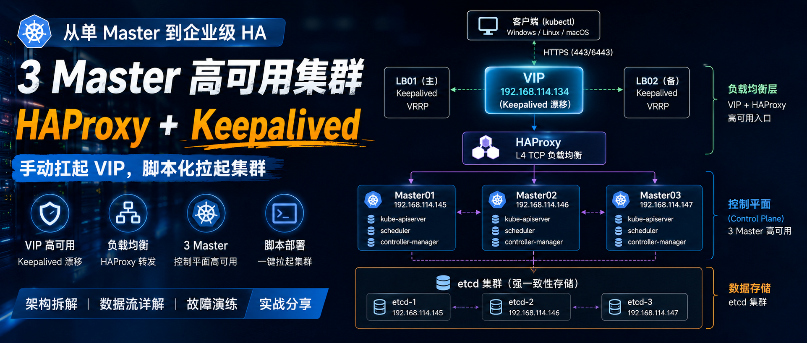
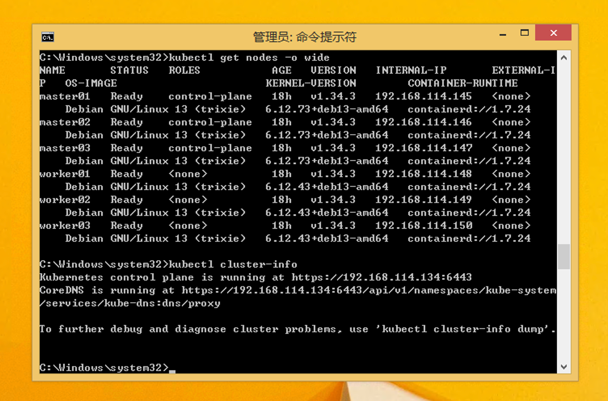
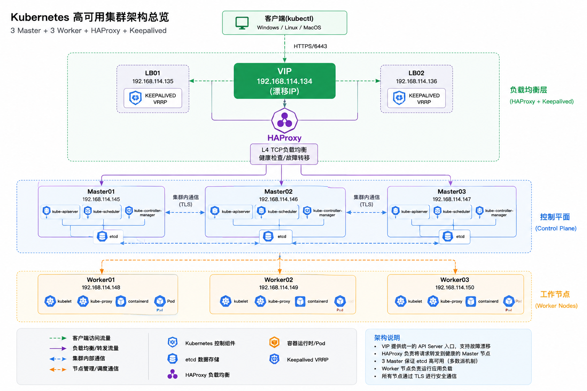
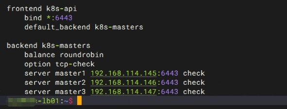
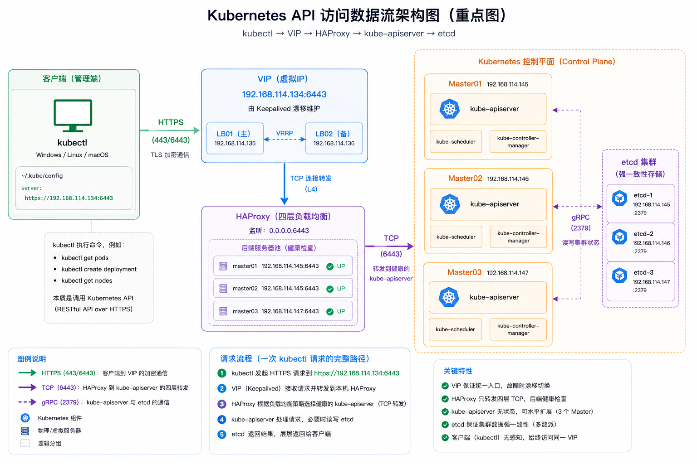

# Kubernetes HA 集群实践：HAProxy、Keepalived 与 3 Master



> 本文约2000字，阅读约10分钟。
>
> 这一篇不是“安装说明书”，而是把 **Kubernetes 高可用控制平面的访问链路**彻底拆出来。
>
> 搞明白三件事：
>
> - `kubectl` 到底连的是谁？
> - VIP 在整个架构里究竟是什么角色？
> - 3 Master 解决了什么问题，又留下了什么坑？

文中的部分图示和截图目前尚未完善，相关示意将在未来的更新中补足；现阶段请以文字说明、地址表和实际配置为准。本文是实验环境记录，不代表生产级 HA 的完整设计或 SLA。

---

## 一、为什么我重搭一套 3 Master 集群

之前的实验环境，我已经一步步搭完了：

- 单 Master Kubernetes
- 容器网络、Ingress
- Prometheus / Grafana 监控
- Loki / Tempo 可观测性
- 私有镜像仓库、存储等企业基础能力

看起来已经很“企业级”了。

---

但随着实验越来越深入，一个问题开始越来越明显：

**单 Master 是整个集群唯一的命门**

| 故障场景 | 可能影响 |
| --- | --- |
| 唯一 Master 宕机 | 通常无法通过控制面执行新的管理操作；已运行的工作负载不一定立即停止 |
| `kube-apiserver` 不可用 | Kubernetes API 请求失败，调度和控制器无法正常协调 |
| 节点意外重启 | 该节点上的组件或工作负载中断，恢复情况取决于控制面、工作负载控制器和存储 |
| `etcd` 数据损坏或失去多数派 | 控制面状态可能无法正常读写；必须依赖经过验证的备份和恢复流程 |

即使：

- Pod 可能还在跑
- 业务短时间可能不受影响

但若控制面不可用，Kubernetes 会失去正常的：**管理与协调能力**

此时通常无法通过 API 正常：

- 调度
- 变更
- 排障
- 扩缩容

---

单 Master 的适用边界和 HA 设计动机，可延伸阅读[从单 Master 到高可用：架构演进思考](single-master-to-ha.md)。基于本次实验的目标，我搭建了以下**控制平面高可用**架构：

实验目标架构：

```text
3 Master + 3 Worker + HAProxy + Keepalived
```

通过 VIP 为 API Server 提供统一入口。此方案覆盖了部分节点故障场景，但实际可用性还取决于 LB、网络、etcd、多数派、Worker 容量和恢复流程，不能仅凭“3 Master”断言没有单点。

---

## 二、实验环境一览

| 角色 | IP | 说明 |
| --- | --- | --- |
| VIP | `192.168.114.134` | Keepalived 管理的 API 入口地址 |
| LB01 | `192.168.114.135` | HAProxy + Keepalived，当前主节点示例 |
| LB02 | `192.168.114.136` | HAProxy + Keepalived，备用节点示例 |
| Master01 | `192.168.114.145` | 控制平面节点 |
| Master02 | `192.168.114.146` | 控制平面节点 |
| Master03 | `192.168.114.147` | 控制平面节点 |
| Worker01 | `192.168.114.148` | 工作节点 |
| Worker02 | `192.168.114.149` | 工作节点 |
| Worker03 | `192.168.114.150` | 工作节点 |

这里的 VIP 不配置为 Master 的管理地址，而是由负载均衡节点上的 Keepalived 按 VRRP 状态接管。客户端把它作为 Kubernetes API 的稳定访问地址。

---



---

## 三、VIP 最容易让人误解的地方

一开始我也踩过坑：

> “VIP 是不是直接登录 Master 用的？”

实际上完全不是。

VIP：

> 本实验中只作为 Kubernetes API 的入口地址。

它不是：

- SSH 登录入口
- Linux 主机入口
- 某台 Master 本身

对我而言：

```text
https://192.168.114.134:6443
```

本质上代表：
**Kubernetes Control Plane Endpoint**

理解这一点之后：

整个 Kubernetes HA 架构才会真正串起来。

---

## 四、HAProxy + Keepalived：手动搭建，把每一层都搞清楚

这一部分我特意没有脚本化。

而是：

`手工一步步部署`

原因很简单：

> 我想真正理解：
>
> Kubernetes 前面的“高可用层”到底在干什么。

很多时候：

教程会告诉你：

```bash
apt install haproxy
```

但不会告诉你：**负载均衡和 VIP 分别解决什么问题？**

---

### 4.1 架构总览



---

### 4.2 Keepalived 解决什么？

Keepalived 解决的是：**负载均衡器自身高可用**

我在两台 LB 节点都部署了：

```text
Keepalived
```

通过配置：

```text
VRRP
```

让 VIP 在正常情况下由一台 LB 持有；具体接管行为取决于 VRRP、接口、优先级和健康检查配置。

例如：

| 场景      | VIP 所在        |
| ----------- | ----------------- |
| LB01 正常且优先级较高 | VIP 通常由 LB01 持有 |
| LB01 故障且 LB02 健康 | LB02 按 VRRP 状态接管 VIP |

因此：

客户端永远访问：

```text
192.168.114.134
```

配置正确时，客户端通常不需要更换 API 地址；主备切换期间仍可能出现短暂连接中断或重试，不能保证完全无感知。

---

### 4.3 HAProxy 做什么？

HAProxy 工作在：`TCP 四层`

它根本不理解 `Kubernetes`。

本实验中它主要负责 TCP 层转发：

```text
收到 6443 请求
→ 转发到后端 API Server
```

例如：

```text
134:6443
    ↓
145:6443
146:6443
147:6443
```

HAProxy 配置中的后端通常类似：

```cfg
server master01 192.168.114.145:6443 check
```



示例中的 `check` 通常只能说明后端 TCP 端口可连接，不等于已经验证 API Server 的 `/readyz` 状态或整个控制面健康。若需更强的健康判断，应根据部署方式配置受支持的 TLS/HTTP 检查，并验证证书和检查语义。若使用 TCP 透传，TLS 通常由 API Server 终止；若在 LB 终止 TLS，则还需正确处理证书、SAN、信任链和后端加密。

---

## 五、`kubectl` 到底连接的是谁？完整数据流拆解

这一部分是我这次实验里最大的收获。

以前虽然会：

```bash
kubectl get nodes
```

但从来没有真正理解：

> kubectl 到底在连接谁？

直到做完 HA。

整个 Kubernetes 的访问链路才真正清晰。这里的关键是 kubeconfig 中的 `server` 地址指向统一 API endpoint，而不是固定连到某一台 Master。

---

## 六、以 Windows 管理端为例

本次实验使用 Windows 8.1 作为 Kubernetes 管理终端，用它来说明客户端不必与控制平面运行在同一台主机。`kubectl` 本质上是 API Client。

不过，`kubectl` 仍需与 API Server 版本保持在官方支持的版本偏差范围内。Windows 8.1 已停止支持，不建议用于日常或生产管理；优先使用仍受支持的系统，并妥善保护 kubeconfig 中的凭据。

---


---

## 七、完整数据流拆解（本文核心）

我的 kubeconfig：

```yaml
server: https://192.168.114.134:6443
```

也就是：

```text
VIP
```

因此：

```bash
kubectl get pods
```

真正的数据流如下：



图示中 Master02 的后端地址标注与实验地址表不一致；正确地址为 `192.168.114.146:6443`，请以本文地址表和实际 HAProxy 配置为准，图示将在后续更新中校正。

---

## 八、数据流每一层到底在干什么

### 1、kubectl

kubectl 本质是： **Kubernetes API Client**

例如：

```bash
kubectl get pods
```

例如，查询当前命名空间 Pod 时，请求路径类似：

```http
GET /api/v1/namespaces/<namespace>/pods
```

它并不需要知道：

- 单 Master
- 还是 3 Master

在认证、授权、TLS 和网络检查都通过的前提下，只要：

```text
有 API Server 响应即可
```

---

### 2、VIP（Keepalived）

VIP 提供： **固定的负载均衡入口地址**

即使：

```text
LB01 宕机
```

VIP 也会自动漂移。

主备切换可维持同一个目标地址，但已有连接可能断开；客户端或工具需要按实际错误行为重试。

---

### 3、HAProxy

HAProxy 负责： `请求转发`

配置了后端检查时，也会检测后端的：

```text
后端 kube-apiserver 是否健康
```

并将新请求转发给：

```text
通过相应检查的后端
```

---

### 4、kube-apiserver

真正的： **Kubernetes 控制入口**

控制平面组件和节点代理会通过各自的连接与 API Server 协作，例如：

- kubectl
- scheduler
- controller
- kubelet

但并不是所有组件都通过同一种路径或每次操作都直接请求 API Server。关于 API Server 的职责和请求处理链路，可参阅 [Kubernetes API Server 原理](../architecture/api-server.md)。

---

### 5、etcd

etcd 是 Kubernetes 集群状态的持久化存储。API Server 接受需要持久化的状态变更后，会将其写入 etcd，例如：

```bash
kubectl create deployment web --image=nginx
```

这并不表示 `kubectl` 直接连接 etcd：客户端请求先到 API Server，由 API Server 完成认证、授权、准入等处理。更多原理见 [etcd 在 Kubernetes 中的作用](../architecture/etcd.md)。

---

## 九、为什么实验采用 3 个控制平面节点？

当 kubeadm 使用 stacked etcd（etcd 与控制面组件共置）时，多个控制平面节点通常也承载 etcd 成员。etcd 通过多数派（Quorum）决定是否可提交写入：

所以：

| etcd 成员数 | 形成多数派所需成员数 | 可容忍的成员故障数 |
| ---: | ---: | ---: |
| 1 | 1 | 0 |
| 2 | 2 | 0 |
| 3 | 2 | 1 |
| 5 | 3 | 2 |

多数派仅说明 etcd 的投票成员数量条件。只有在采用 stacked etcd 且 Master/etcd 成员拓扑对应时，表中数字才可直接映射为 Master 故障数；etcd 写入可用还取决于网络、磁盘延迟和成员健康。更多多数派和备份背景可参阅 [etcd 架构与运维说明](../architecture/etcd.md)。

3 成员 etcd 在失去 1 个成员后仍可维持多数派，失去 2 个则不能正常提交写入。增加成员会增加资源与运维成本，节点数不是越多越好。

`3 个控制平面节点是常见的小型 HA 起点`

但这不自动代表整个集群没有单点故障：还需保障 API 接入层、网络、存储、证书和备份。

---

## 十、Worker 故障与工作负载恢复

Worker 节点不是“天然无状态资源”。节点宕机后，控制面会观察节点状态；只有由 Deployment、StatefulSet 等控制器管理、且满足调度条件的工作负载，才可能在其他节点重新创建或调度。

恢复还依赖：

- 集群剩余节点是否有足够 CPU、内存和 Pod 容量；
- Pod 是否受 PodDisruptionBudget、亲和性、污点/容忍等约束；
- 持久卷能否在目标节点挂载，存储系统是否健康；
- 应用是否实现数据复制、选主和故障恢复。

StatefulSet、PVC 和 StorageClass 提供工作负载身份及存储声明机制，但不会自动保证数据库数据一致、存储跨节点可用或备份可恢复。MySQL、PostgreSQL、Redis、Elasticsearch 等有状态服务仍需单独设计其 HA 和备份方案。

控制面不可用时，已经运行的容器可能继续运行一段时间，但集群无法正常接受新的管理请求，调度和控制器协调也会受影响。Worker 故障恢复能力与控制面 HA 是相关但不同的问题。

---

## 十一、脚本化部署 Kubernetes 集群

虽然：

```text
HAProxy + Keepalived
```

我选择手动部署。

但：

**Kubernetes 集群本身**

我已经全部脚本化。

包括：

- Containerd
- kubeadm
- kubelet
- CNI
- sysctl
- 节点初始化
- Worker / Master 自动加入

这样做最大的价值：

| 能力   | 价值               |
| -------- | -------------------- |
| 可重复 | 一键重建实验环境   |
| 可维护 | 配置统一标准化     |
| 可迁移 | 更换环境成本极低   |
| 工程化 | 更接近企业真实运维 |

---

> 我已经把 Kubernetes HA 部署脚本整理好了。
>
> 包括：
>
> - deploy.sh
> - k8s.conf
> - 初始化说明等
>
> 需要参考的同学：
>
> 脚本目前仅在 Debian 13 环境测试；Debian 12 和 11 尚未验证，不应假定可直接使用。
>
> **关注文末的公众号，后台回复：**
>
> ```text
> K8SHA
> ```
>
> 即可获取。使用前先检查脚本内容、变量和目标主机列表，在隔离环境验证后再用于自己的集群。

---

## 十二、这次实践让我真正理解的事

以前我总觉得：

```text
Kubernetes = 一堆 Pod
```

但真正做完 HA 后，认识完全变了。

Kubernetes 本质上是：

`API 驱动系统`

真正重要的是：

- API Server
- etcd
- scheduler
- controller-manager

而：

```text
kubectl
```

只是：

**一个 API Client**

当你在受控演练中验证：

- Keepalived 漂移
- HAProxy 转发
- Master 宕机
- API 请求在故障切换时是否需要重试

之后。

才能评估：

`这个控制平面在特定故障下是否达到预期可用性`

---

## 十三、下一篇：故意打挂一台 Master

下一步应在隔离环境进行有计划的故障演练，而不是只根据架构图推断可用性。演练前确认数据备份、维护窗口、恢复步骤和影响范围，再逐项验证：

包括：

- Keepalived 漂移验证
- API Server 健康检查
- kubectl 是否掉线
- Pod 是否迁移
- etcd 多数派是否正常
- 哪些服务真正高可用
- 哪些“HA”只是看起来像 HA

这些结果应与预期故障边界、告警和恢复目标一并记录。

---

## 推荐阅读

| 主题 | 文章 |
| --- | --- |
| **单 Master 到 HA 的架构演进** | [从单 Master 到高可用：架构演进思考](single-master-to-ha.md)——了解控制平面高可用的设计取舍。 |
| **API 请求处理** | [Kubernetes API Server 原理](../architecture/api-server.md)——深入理解 kubectl 请求的认证、授权和处理链路。 |
| **etcd 与多数派** | [etcd 架构与运维说明](../architecture/etcd.md)——了解集群状态存储、Quorum 和备份恢复。 |
| **集群升级与维护** | [Kubernetes 集群升级实战](cluster-upgrade.md)——了解 HA 集群的升级检查与节点维护流程。 |

---

