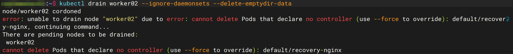
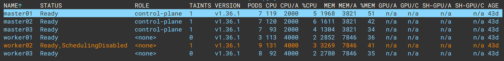
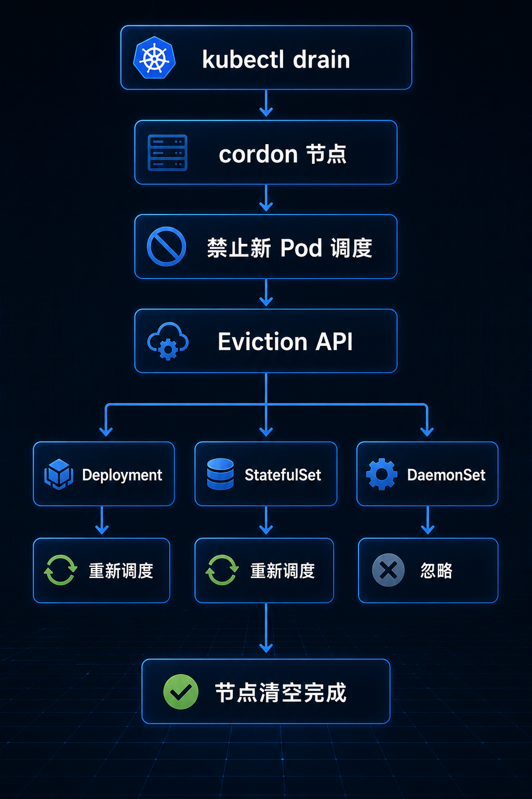

# kubectl drain 到底做了什么？解析理解 drain 原理

> 你以为 drain 只是删除 Pod？它其实是在“安全地清空一台节点”。

这两天[升级 Kubernetes 集群](../practice/cluster-upgrade.md)时，在升级 Worker 节点阶段执行了下面这条命令：

```bash
kubectl drain worker02 --ignore-daemonsets --delete-emptydir-data
```

结果直接报错：

```text
cannot delete Pods that declare no controller

default/recovery-nginx
```



可能不少人第一次看到这个报错都和我一样懵：

- drain 为什么不直接删 Pod？
- 为什么 Deployment 的 Pod 能删，裸 Pod 就不行？
- 升级节点为什么必须先 drain？

本篇文章，理一理 `kubectl drain` 的来龙去脉。

---

## 为什么需要 drain？

假设你的集群里有一台 worker01，上面跑着这些 Pod：

```text
worker01
├── nginx
├── redis
└── mysql
```

如果这时候你图省事，直接执行：

```bash
systemctl stop kubelet
# 或者直接 reboot
```

会发生什么？

- Pod 突然消失
- 业务中断
- Service 转发失败
- 用户请求报 500

这就是典型的“暴力下线”。

而 `kubectl drain` 就是用来解决这个问题的。它的目标很明确：**让节点上的工作负载平滑迁移，尽量减少对业务的影响。**

!!! tip "什么时候应该使用 drain？"

    - 节点维护（内核升级、硬件更换）
    - 集群升级（Worker 节点滚动升级）
    - 节点缩容或替换
    - 节点故障隔离

---

## drain 的执行流程

`kubectl drain` 其实干了四件事：

```text
1. 禁止调度（Cordon）
        ↓
2. 驱逐 Pod（Eviction）
        ↓
3. 等待新 Pod 启动
        ↓
4. 节点清空完成
```

我们一步步拆解。

---

## 第一步：Cordon——先关门

执行 drain 时，它会先调用：

```bash
kubectl cordon worker02
```

节点状态会变成：

```text
worker02   Ready,SchedulingDisabled
```



效果是：

- 新的 Pod 不会再调度到这台节点上
- 已有的 Pod 继续运行，不受影响

你可以理解为：**先把门关上，不再接待新客人。**

!!! note "cordon 可以单独使用"

    有时候你只想禁止调度，但不驱逐现有的 Pod（例如观察节点负载），可以单独执行 kubectl cordon <node>。

---

## 第二步：Eviction——不是删除，是“请离开”

它调用的是 Kubernetes 的 **Eviction API**（驱逐 API），而不是直接 DELETE Pod。

两者的区别在于：

- **DELETE Pod**：强行删除，不管业务死活
- **Eviction API**：向 API Server 发起驱逐请求，由系统判断是否可以安全删除

Eviction 会检查：

- Pod 是否受控制器管理（Deployment / StatefulSet 等）
- 是否满足 PDB（PodDisruptionBudget）
- 优雅终止时间（terminationGracePeriodSeconds）

只有条件满足，才会真正删除 Pod，并让控制器在其他节点重建。

!!! warning "Eviction 可能失败"
    如果 PDB 阻止或节点处于异常状态，Eviction 请求会被拒绝，drain 会卡住并报错。

---

## 不同 Pod 类型，drain 的处理方式不同

### ✅ 受控制器管理的 Pod（Deployment / StatefulSet）

例如：

```yaml
replicas: 3
```

驱逐前：

```text
worker01 ─── nginx-abc
worker02 ─── nginx-def
worker03 ─── nginx-ghi
```

驱逐 worker01 后：

```text
worker02 ─── nginx-def
worker03 ─── nginx-ghi
worker02 ─── nginx-new   # 自动重建
```

**业务几乎无感知。**

!!! tip "确保副本数 ≥ 2"
    如果副本数只有 1，驱逐期间可能会有短暂中断，建议生产环境至少保持 2 个副本。

---

### ⚠️ DaemonSet（Calico / kube-proxy / node-exporter）

这些 Pod 的设计就是“每个节点必须运行一个”。

drain 默认会报错：

```text
cannot delete DaemonSet-managed Pods
```

因此需要加上：

```bash
--ignore-daemonsets
```

表示：**这些我确认保留，不用管。**

!!! note "为什么 DaemonSet 不会被驱逐？"
    因为 DaemonSet 控制器会立即在同一个节点上重建 Pod，驱逐毫无意义，所以 drain 默认拒绝操作，需要你显式确认。

---

### ⚠️ 挂载 emptyDir 的 Pod

如果 Pod 使用了 `emptyDir` 卷：

```yaml
volumes:
- emptyDir: {}
```

drain 会阻止驱逐，因为：

```text
节点删除 → emptyDir 数据永久丢失
```

需要加上：

```bash
--delete-emptydir-data
```

表示：**这些数据我可以接受丢失。**

!!! warning "emptyDir 数据丢失风险"
    如果 emptyDir 中存有重要临时数据（如缓存），请确保业务可以容忍数据丢失，或者提前迁移数据。

---

### ❌ 裸 Pod（没有控制器的 Pod）

这就是我遇到的那个坑。

```bash
kubectl run nginx --image=nginx
```

这个 Pod 没有 Deployment / ReplicaSet / StatefulSet 管理。

drain 的报错是：

```text
cannot delete Pods that declare no controller
```


原因很简单：**删了就真的没了，没有人会帮它重建。**

Kubernetes 拒绝帮你做这个危险操作。

---

## 裸 Pod 的解决方案

两种处理方式：

### 方案一：先删再 drain

```bash
kubectl delete pod nginx
kubectl drain worker02 ...
```

### 方案二：强制驱逐

```bash
kubectl drain worker02 --ignore-daemonsets --delete-emptydir-data --force
```

!!! danger "慎用 --force"
    `--force` 会跳过保护检查，直接删除 Pod，可能导致业务中断。生产环境请务必评估影响，并确保有备份或恢复方案。

---

## drain 会等待什么？

drain 不是一刀切，它会等待：

- Pod 进入 Terminating 状态
- 应用收到 SIGTERM 信号
- 优雅退出（默认 30 秒）
- 新 Pod 在其它节点变成 Running
- ReadinessProbe 探测成功

例如：

```yaml
terminationGracePeriodSeconds: 30
```

drain 会等待最多 30 秒让应用完成收尾工作，而不是直接杀死。

!!! tip "调大优雅终止时间"
    对于需要长时间处理请求的应用（如消息队列消费者），可以适当增大 `terminationGracePeriodSeconds`，避免连接中断。

---

## PDB 为什么会导致 drain 卡住？

PDB（PodDisruptionBudget）是用来保护业务可用性的。

例如：

```yaml
minAvailable: 2
```

如果某个应用当前只有 3 个 Pod：

- 驱逐第 1 个 → 剩 2 个 ✅
- 驱逐第 2 个 → 剩 1 个 ❌（违反 PDB）

此时 drain 会**卡住**，等待新 Pod 启动后再继续。

有的人以为 drain 出 bug 了，实际上是 PDB 在保护你的业务。
!!! note "查看 PDB 状态"
    使用 `kubectl get pdb` 和 `kubectl describe pdb <name>` 可以查看当前 PDB 的允许驱逐情况。

---

## drain vs delete：一张表看懂

| 功能            | drain | delete 节点 |
| ----------------- | ------- | ------------- |
| 禁止新 Pod 调度 | ✅    | ❌          |
| 优雅驱逐 Pod    | ✅    | ❌          |
| 等待 Pod 迁移   | ✅    | ❌          |
| 考虑 PDB        | ✅    | ❌          |
| 保护业务        | ✅    | ❌          |

所以记住：**drain ≠ 删除节点，而是安全下线节点。**

---

## 完整的节点维护流程

```text
cordon
   ↓
drain
   ↓
升级节点 / 维修硬件 / 替换系统
   ↓
重启 kubelet
   ↓
检查节点状态
   ↓
uncordon
```

命令示例：

```bash
# 1. 驱逐负载
kubectl drain worker01 --ignore-daemonsets --delete-emptydir-data

# 2. 执行升级操作
apt install kubelet kubeadm kubectl
systemctl restart kubelet

# 3. 恢复调度
kubectl uncordon worker01
```

!!! warning "升级前检查"
    升级前务必确认节点上无关键业务，或业务已通过其它方式备份。

---

## uncordon 做了什么？

`uncordon` 是 `cordon` 的逆操作：

```text
SchedulingDisabled
        ↓
Ready
```

节点恢复调度能力，新 Pod 可以再次调度上来。

---

## 一张图看懂 drain



---

## 总结

实际上：

```text
kubectl drain = 安全下线节点
```

它做的事情包括：

- 禁止调度（cordon）
- 驱逐 Pod（Eviction）
- 等待迁移完成
- 检查 PDB 约束
- 保护业务连续性

所以，在以下场景中：

- 节点维护
- 集群升级
- 节点替换
- 硬件维修
- 操作系统更新

`drain` 都是必不可少的一步。

因为 Kubernetes 的设计理念从来不是简单地“关掉一台机器”，而是：

> **在保证业务连续运行的前提下，让节点安全退出集群。**

---

## 相关阅读

- [Kubernetes 升级实录：1.34 → 1.36，我踩过的多个坑](../practice/cluster-upgrade.md)
- [Kubernetes 为什么必须先升级 Master？]()
- [etcd 为什么是 Kubernetes 的命门？](../architecture/control-plane/etcd.md)
- [一个废弃参数导致整个节点 NotReady]()
- [升级完成后必须检查的 10 项指标]()
