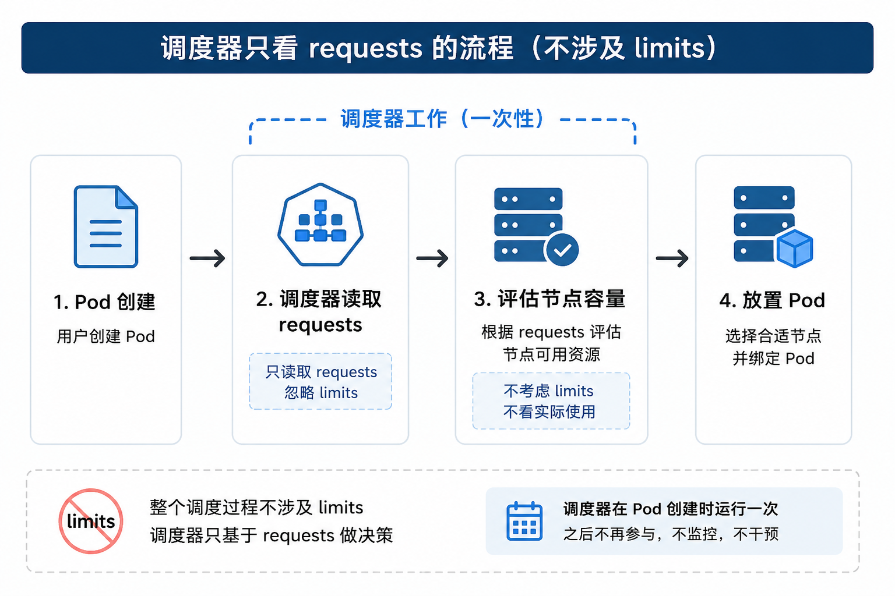
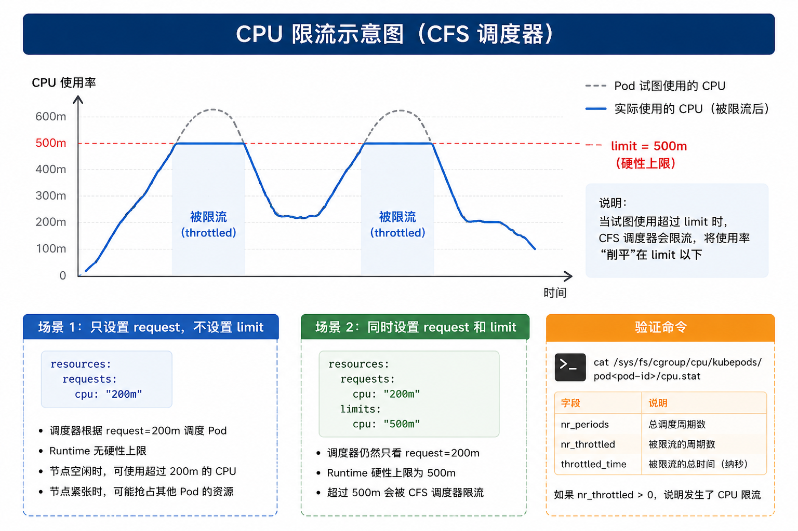
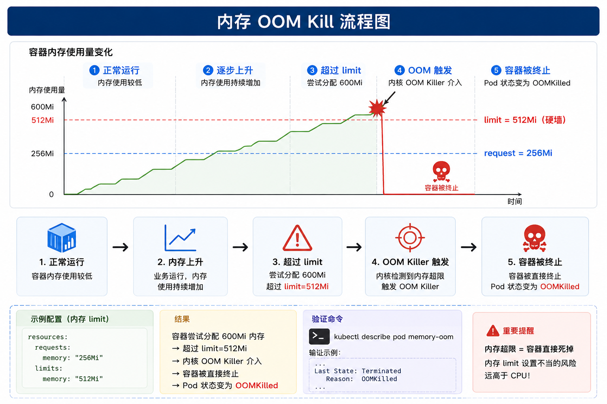

# Kubernetes 资源 Requests vs Limits：调度器保证的是调度，内核保证的是限制

> 你给 Pod 设置了 requests，也设置了 limits。Pod 还是被限流了，或者被杀了。  
> 不是 Kubernetes 有问题，而是大多数团队对这两个字段的理解有问题。

**核心结论：requests 和 limits 不是资源配置，它们是调度信号和运行时故障触发器。调度器用一个，内核强制执行另一个，它们之间从不交互**。

---

## 一、一个错误的心智模型

大多数工程师把 requests 和 limits 当成简单的 min/max 对——requests 是预留的资源，limits 是能用的上限。  
这个理解很直观，**但也错得恰到好处**。

Requests 和 limits 运行在完全不同的两个层面，由完全不同的两个系统执行，在ß完全不同的两种条件下生效。搞不清这个区别，生产环境的 Pod 就会在半夜莫名其妙地消失。

### Requests 不是“预留”

设置一个 500m CPU 的 request，并不意味着这 500m 毫核被独占保留给这个 Pod。  
它的意思是：**调度器只会把这个 Pod 放到它的账本里还有 500m CPU 可用的节点上**。  
节点可能正承受着真实的 CPU 压力，但只要调度器的账本上还有额度，它就会认为这个节点“合格”。

!!! tip "技巧"
    Request 是一个**调度信号**，不是一个性能保证。它帮助调度器做放置决策，但不参与运行时资源分配。

### Limits 也不是“上限”（至少对 CPU 和内存不一样）

对于 CPU，limit 是 cgroups 施加的一个**限流上限**——Pod 继续运行，只是变慢了。  
对于内存，limit 是内核 OOM Killer 施加的一堵**硬墙**——一旦越过，容器直接被干掉。

!!! warning "警告"
    CPU 超限 → 变慢；内存超限 → 死掉。**内存 limit 设置不当的风险远高于 CPU**。生产环境中请务必谨慎设置内存 limits。

---

## 二、两层系统，零协调

对 requests 和 limits 的困惑，源于把 Kubernetes 控制平面当成一个单一系统。实际上，**调度和强制执行由完全不同的组件处理**，它们拥有不同的信息、承担不同的职责。

### 第一层：调度器的放置决策

**使用的是：requests only**  
**忽略的是：limits entirely**

调度器在 Pod 创建时运行一次。它查看待调度的 Pod，根据 resource requests 评估节点容量，然后做出放置决策。之后，**调度器的工作就结束了**。它不会监控 Pod，不会在节点过载时介入，**它甚至不知道 limits 被设置成了什么**。



### 第二层：Kubelet + 内核的运行时执行

**使用的是：limits only**  
**强制执行的是：在资源压力下**

Kubelet 在每个节点上持续运行。它监控容器的资源使用情况，与内核的 cgroup 子系统协作，在运行时强制执行 limits。**Kubelet 不知道调度器做了什么决定**，它也不会把 requests 纳入执行逻辑。它只关注 usage 是否超过了 limits。


!!! note "注意"
    这两个系统**不共享任何状态**。一个 Pod 可能被调度器完美放置——requests 满足、节点容量充足——但在运行时仍然被限流或杀掉。

---

## 三、Kubernetes 1.36 中的新变化

在深入实验之前，先了解一下 1.36 版本中与资源管理相关的重要更新。

### Pod 级别的资源设置（Beta）

在 Kubernetes 1.36 中，如果集群启用了 `PodLevelResources` feature gate，你可以在 **Pod 级别** 设置 resource requests 和 limits，而不必为每个容器单独设置。

目前 Pod 级别只支持 `cpu`、`memory` 和 `hugepages` 这三种资源类型。设置后，Pod 内的所有容器共享同一个资源池。

例如：

```yaml
apiVersion: v1
kind: Pod
metadata:
  name: shared-resources-pod
spec:
  containers:
  - name: app
    image: nginx
  - name: sidecar
    image: envoy
  resources:
    requests:
      cpu: "2"
      memory: "4Gi"
    limits:
      cpu: "4"
      memory: "8Gi"
```

这个 Pod 中的所有容器共享 2 CPU / 4Gi 的 request 和 4 CPU / 8Gi 的 limit。

!!! tip "技巧"
    对于有多个容器的 Pod（比如主容器加 sidecar），你不再需要分别为每个容器估算资源，可以统一管理整个 Pod 的资源边界。而且，在 1.36 中，你还可以动态调整这个聚合边界，无需重建 Pod。

### 挂起 Job 的可变容器资源（Beta）

Kubernetes 1.36 将“在挂起 Job 的 Pod 模板中修改容器资源请求和限制”的能力提升到了 Beta。

这意味着队列控制器和集群管理员可以在 Job 处于挂起状态时，在其启动或恢复运行之前，调整 CPU、内存、GPU 以及扩展资源的配置。对于批处理任务和队列系统来说，这是一个非常实用的改进。

!!! info "适用场景"
    适合批处理任务、队列系统、以及需要根据队列积压动态调整资源的情况。

### 分层内存保护 / Memory QoS（Alpha）

Kubernetes 1.36 引入了更新的 Alpha 版 Memory QoS 特性，基于 Pod 的 QoS 类实现了分层内存保护：

- Guaranteed Pod：获得 memory.min 保护，最高优先级
- Burstable Pod：获得 memory.low 保护，在正常压力下受保护，极端压力下可被回收部分内存以避免系统级 OOM
- BestEffort Pod：没有任何保护

!!! warning "告警"
    Memory QoS 仍处于 Alpha 阶段，不建议在生产环境依赖，但可以提前了解其设计思路，为未来版本做准备。

## 四、实验验证

光说不练假把式。下面我们用实际的实验来验证上面的理论。
实验环境

- Kubernetes 版本：v1.36
- 节点配置：2 CPU / 8Gi 内存
- 实验工具：stress 压力测试工具

### 实验一：CPU Request vs Limit —— 调度 vs 限流

目标：验证 CPU request 影响调度，CPU limit 影响运行时限流。

**场景 1：设置 request=200m，不设置 limit**

```yaml
apiVersion: v1
kind: Pod
metadata:
  name: cpu-no-limit
spec:
  containers:
  - name: stress
    image: polinux/stress
    command: ["stress"]
    args: ["--cpu", "1", "--timeout", "600"]
    resources:
      requests:
        cpu: "200m"
      # 没有设置 limits
```
预期行为：

- 调度器看到 request=200m，会把 Pod 调度到有足够容量的节点上
- 运行时，如果节点 CPU 空闲，这个 Pod 可以使用超过 200m 的 CPU（最多用到节点上所有的可用 CPU）
- 如果节点 CPU 紧张，这个 Pod 没有硬性上限，可能会抢占其他 Pod 的 CPU

**场景 2：设置 request=200m，limit=500m**

```yaml

apiVersion: v1
kind: Pod
metadata:
  name: cpu-with-limit
spec:
  containers:
  - name: stress
    image: polinux/stress
    command: ["stress"]
    args: ["--cpu", "1", "--timeout", "600"]
    resources:
      requests:
        cpu: "200m"
      limits:
        cpu: "500m"
```

预期行为：

- 调度器仍然只看 request=200m，把 Pod 调度到合适的节点
- 运行时，无论节点是否空闲，这个 Pod 都不能使用超过 500m 的 CPU
- 如果 Pod 试图使用超过 500m 的 CPU，CFS 调度器会对其进行限流（throttling）

验证命令：

```bash

# 查看 Pod 的 CPU 使用情况
kubectl top pod cpu-with-limit

# 查看 CPU 限流统计（需要进入节点查看 cgroup）
cat /sys/fs/cgroup/cpu/kubepods/pod<pod-id>/cpu.stat
# nr_periods: 总调度周期数
# nr_throttled: 被限流的周期数
# throttled_time: 被限流的总时间（纳秒）
```



!!! tip "技巧"
    在生产环境中，如果发现 CPU 使用率被“削平”，很可能是 limit 设置过低导致频繁限流。可以通过监控 container_cpu_cfs_throttled_seconds_total 指标来观察限流情况。

### 实验二：Memory Request vs Limit —— 调度 vs OOM Kill

目标：验证内存 request 影响调度，内存 limit 触发 OOM Kill。

**场景 1：设置 request=256Mi，limit=512Mi**
```yaml

apiVersion: v1
kind: Pod
metadata:
  name: memory-with-limit
spec:
  containers:
  - name: stress
    image: polinux/stress
    command: ["stress"]
    args: ["--vm", "1", "--vm-bytes", "300M", "--timeout", "60"]
    resources:
      requests:
        memory: "256Mi"
      limits:
        memory: "512Mi"
```

预期行为：

- 调度器根据 request=256Mi 进行调度
- 容器尝试分配 300Mi 内存，小于 limit=512Mi → Pod 正常运行

**场景 2：内存使用超过 limit**
```yaml

apiVersion: v1
kind: Pod
metadata:
  name: memory-oom
spec:
  containers:
  - name: stress
    image: polinux/stress
    command: ["stress"]
    args: ["--vm", "1", "--vm-bytes", "600M", "--timeout", "60"]
    resources:
      requests:
        memory: "256Mi"
      limits:
        memory: "512Mi"
```

预期行为：

- 容器尝试分配 600Mi 内存，超过 limit=512Mi
- 内核 OOM Killer 介入 → 容器被直接终止
- Pod 状态变为 OOMKilled

验证命令：
```bash

# 查看 Pod 状态
kubectl describe pod memory-oom
# 在 Events 中会看到: "OOMKilled"

# 查看容器退出状态
kubectl get pod memory-oom -o yaml | grep -A 5 "lastState"
# 会显示: reason: OOMKilled
```



!!! warning "警告"
    内存 OOM 是生产环境中最常见的故障之一。务必根据应用实际内存使用量合理设置 limits，并配置 Pod 的 restartPolicy 以决定 OOM 后是否重启。

### 实验三：QoS 类 —— 谁先被杀？

Kubernetes 根据 requests 和 limits 的设置方式，将 Pod 划分为三个 QoS 类：

|QoS 类|	条件	|驱逐优先级|
|---|---|---|
|Guaranteed	|每个容器的 CPU 和内存都同时设置了 request 和 limit，且两者相等|	最低（最后被驱逐）|
|Burstable	|至少一个容器设置了 request 或 limit，但不满足 Guaranteed 条件|	中等|
|BestEffort	|没有任何容器设置了任何 request 或 limit	|最高（最先被驱逐）|

实验设置：在同一个节点上部署三个不同 QoS 类的 Pod，然后制造内存压力，观察驱逐顺序。

验证：

```bash
# 查看 Pod 的 QoS 类
kubectl get pod <pod-name> -o yaml | grep qosClass
```
预期结果：当节点内存不足时，BestEffort Pod 最先被驱逐，然后是 Burstable，最后才是 Guaranteed。

!!! tip "技巧"

    关键服务（如数据库、核心 API）应设置为 Guaranteed（request = limit），确保最稳定的资源保障和最低的驱逐优先级。

### 实验四：Kubernetes 1.36 Pod 级别资源设置

目标：**验证 1.36 中 Pod 级别资源设置的效果。**

前提条件：集群需启用 PodLevelResources feature gate。

```yaml
apiVersion: v1
kind: Pod
metadata:
  name: pod-level-resources
spec:
  containers:
  - name: app
    image: nginx
  - name: sidecar
    image: envoy
  resources:
    requests:
      cpu: "1"
      memory: "2Gi"
    limits:
      cpu: "2"
      memory: "4Gi"
```
验证：

```bash
# 查看 Pod 的资源分配
kubectl describe pod pod-level-resources
# 在输出中会看到 Pod 级别的 requests 和 limits
```
!!! note "注意"
    Pod 级别资源设置目前是 Beta 功能，需要显式启用 feature gate。在启用前请确认集群版本和兼容性。

## 五、最佳实践

基于以上理论和实验，总结以下最佳实践：
### 永远同时设置 requests 和 limits

- 只设置 request 而不设置 limit → 单个容器可能耗尽节点所有资源。
- 只设置 limit 而不设置 request → 调度器无法合理调度。

!!! warning "告警"
    不要只设置其中一个，否则可能引发不可预测的生产故障。

### 理解 CPU 和内存的不同行为
|资源类型	|Request 作用	|Limit 作用	|超限后果|
|---|---|---|---|
|CPU	|调度决策	|CFS 限流|	限流（性能下降）|
|内存	|调度决策	|OOM Kill|	容器被杀（服务中断）|

!!! tip "技巧"
    内存 limit 设置不当的风险远高于 CPU。对于内存，建议设置合理的 limits 并配置优雅退出（graceful shutdown）机制，以降低 OOM 对业务的影响。

### 基于实际使用量设置 requests

Requests 应该反映容器在正常负载下的典型资源使用量，而不是峰值。过高的 requests 浪费集群资源；过低的 requests 导致调度器过度订阅，运行时资源争抢。
推荐做法：

- 先不设置 limits（或设置一个很高的值），运行一段时间
- 通过监控工具（如 Prometheus + Grafana）观察实际使用量
- 将 requests 设置为 P50 或 P75 分位数
- 将 limits 设置为 P95 或 P99 分位数，或设置为 requests 的 1.5-2 倍

### 根据 QoS 类规划关键服务

- 关键服务（如数据库、核心 API）：设置为 Guaranteed（request = limit），确保最稳定的资源保障和最低的驱逐优先级
- 一般服务：设置为 Burstable，允许在资源空闲时 burst
- 批处理/非关键任务：可以设置为 BestEffort，利用闲置资源

### 利用 1.36 的新特性（如果适用）

- 对于有多个容器的 Pod，考虑使用 Pod 级别的资源设置，简化管理
- 对于批处理任务，利用 挂起 Job 的可变容器资源 特性，在调度前调整资源配置
- 关注 Memory QoS 特性的进展，它将在未来版本中提供更精细的内存保护

!!! tip "前瞻"
    Memory QoS 虽然 Alpha，但设计方向明确，未来将成为标准功能，提前了解有助于规划集群升级。

## 六、总结
|概念|	谁在用|	什么时候用|	用在哪	|超限后果|
|---|---|---|---|---|
|Requests	|调度器|	Pod |创建时|	节点选择	|调度失败（Pending）|
|Limits	|Kubelet + 内核|	运行时持续|	CPU限流 / OOM Kill	|限流或被杀|

记住：**requests 保证调度，limits 保证限制。它们各司其职，从不交互。**

!!! note "最后提醒"
    理解 requests 和 limits 的本质区别，是 Kubernetes 资源管理的基础。希望本文的实验和最佳实践能帮助你在生产环境中更稳定地运行应用。

## 相关阅读：
- [Kubernetes 故障模拟实战：Pod OOM（内存溢出）之后会发生什么？](../../lab/pod-oom-test.md)
- [kubectl drain 到底做了什么？解析理解 drain 原理](../../kubernetes/practice/kubectl-drain.md)