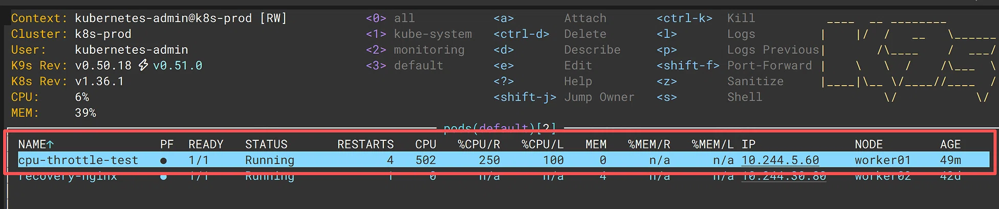
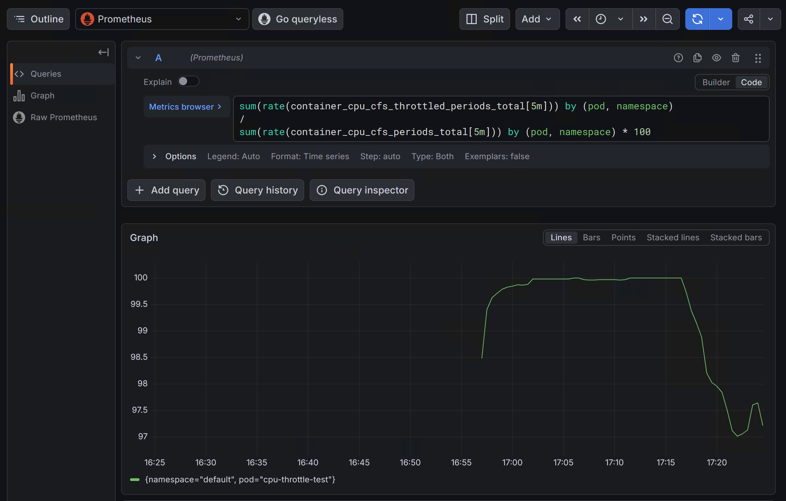
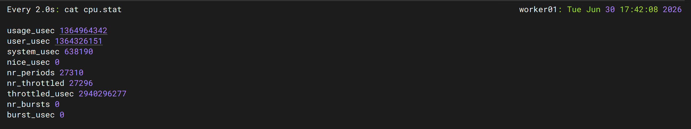
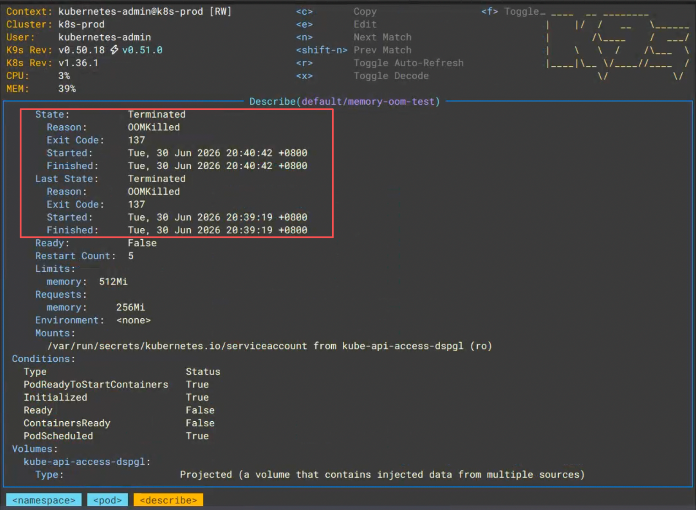
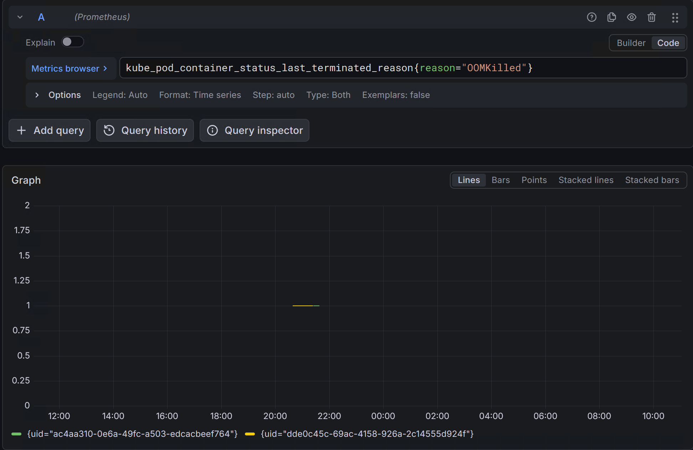
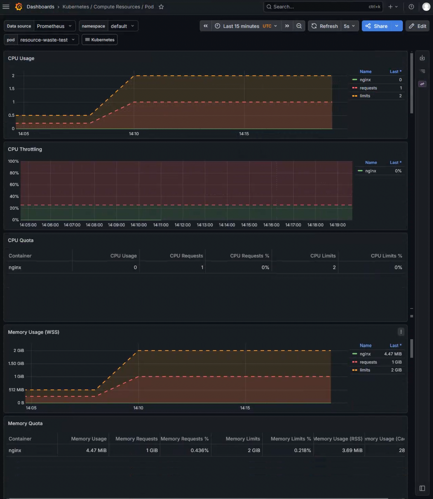
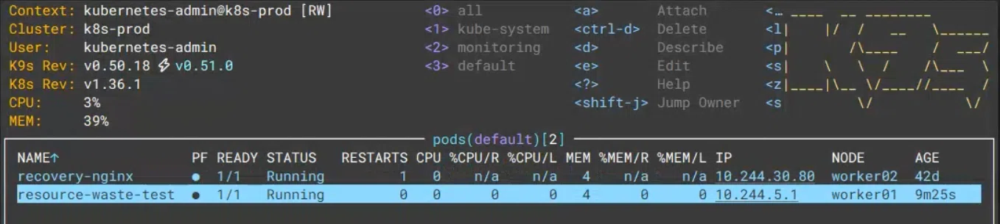
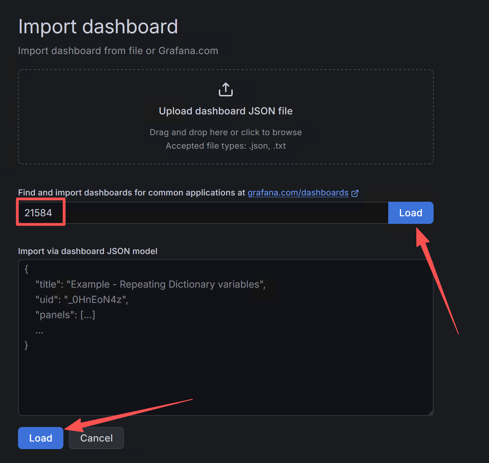
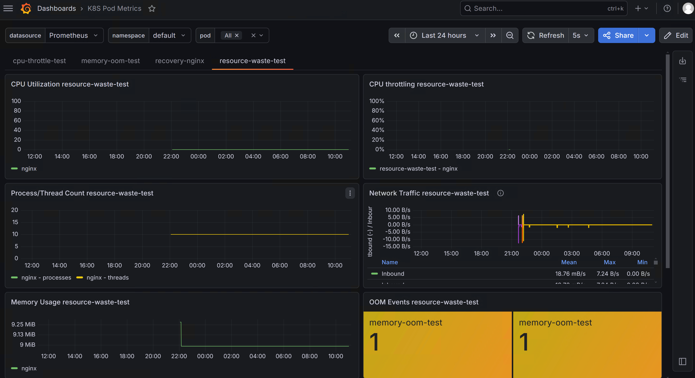

# Kubernetes 资源优化实战：用监控数据精准配置 Requests 和 Limits

## 概述

在 Kubernetes 中，`requests` 和 `limits` 的配置直接影响着集群的稳定性和成本效率。配置过高导致资源浪费，配置过低则可能引发 CPU 限流或 OOM Kill。

然而，很多团队在配置资源时缺乏数据支撑，往往凭经验或感觉拍脑袋。开发倾向于“往大了配”，运维则希望“往省了配”，两边的拉锯战耗费了大量精力。

本文从三个实战维度出发，教你利用 Prometheus 和 Grafana 构建一套完整的资源监控体系：

1. **CPU Throttling**：揪出被限流卡住脖子的“刺头”
2. **内存 OOM**：锁定游走在 OOM 边缘的“高危分子”
3. **资源浪费**：曝光占着茅坑不拉屎的“败家子”

通过这套监控体系，运维和开发可以在数据面前达成共识，实现**用数据驱动资源决策**。

## 前置条件

在开始之前，请确保你的 Kubernetes 集群满足以下条件：

- Kubernetes 集群（v1.28+，本文实验基于 v1.36）
- 已部署 **Prometheus** 监控栈（包含 node-exporter、kube-state-metrics）
- 已部署 **Grafana** 可视化平台
- `kubectl` 命令行工具已配置
- 集群中有足够的资源用于创建测试 Pod

如果你还没有部署监控体系，可以参考后续的监控系列文章完成部署后再回来继续。

## 实验环境

本文所有实验均在以下环境中完成：

| 组件 | 版本 / 配置 |
|------|------------|
| Kubernetes | v1.36.1 |
| Prometheus | v2.55.0 |
| Grafana | v13.0.1 |
| kube-state-metrics | v2.14.0 |
| 测试工具 | `polinux/stress` 镜像 |

## 一、CPU 限流：看不见的性能杀手

### 1.1 问题现象

很多开发会遇到这样的场景：

> “我的接口响应怎么变慢了？我看 Grafana 上的 CPU 使用率曲线，连 Limit 的 50% 都没到，是不是网络有问题？”

**这其实是一个极具欺骗性的表象。**

Kubernetes 限制容器 CPU 采用的是 Linux 内核的 **CFS（完全公平调度器）周期机制**。即使在 1 分钟的平均周期内 CPU 使用率看起来很安全，但如果在某个微秒级别的时间窗口内流量突增，容器的 CPU 就会瞬间触顶，触发内核的 **CPU Throttling（CPU 节流/限流）**，导致业务响应延迟（Latency）飙升。

### 1.2 原理详解

CFS 通过配额（quota）和周期（period）来控制 CPU 使用：

```text
容器 CPU 使用率上限 = quota / period
```

默认 `period` 为 100ms，`quota` 由 `limits.cpu` 决定。当容器在一个 period 内的 CPU 使用量超过 quota 时，内核会对该容器进行限流，剩余时间片内的任务会被强制等待下一个 period。

限流导致的直接后果就是**应用响应延迟飙升**，而平均 CPU 使用率看起来却很正常。这就是为什么我们不能只看 CPU 使用率，必须直接监控 **CPU 节流时间比例**。

### 1.3 核心 PromQL

计算容器在过去 5 分钟内，被限流的周期占总周期的比例：

```promql
sum(rate(container_cpu_cfs_throttled_periods_total[5m])) by (pod, namespace)
/
sum(rate(container_cpu_cfs_periods_total[5m])) by (pod, namespace) * 100
```

**指标含义说明：**

| 指标 | 含义 |
|------|------|
| `container_cpu_cfs_periods_total` | CFS 调度周期的总数，每个周期默认 100ms |
| `container_cpu_cfs_throttled_periods_total` | 被限流的周期数 |
| 比值 | 容器有多少比例的调度周期被限流 |

**调优建议：** 如果该比例持续超过 **10%**，说明该 Pod 已经遭遇了严重的 CPU 饥饿。哪怕整体 CPU 使用率不高，也必须立刻**调大它的 Limits**，或者优化代码中的多线程并发逻辑。

### 1.4 实验验证

#### 步骤一：创建测试 Pod

创建一个会触发 CPU Throttling 的测试 Pod：

```yaml title="cpu-throttle-test.yaml" linenums="1"
apiVersion: v1
kind: Pod
metadata:
  name: cpu-throttle-test
  namespace: default
spec:
  containers:
  - name: stress
    image: polinux/stress
    command: ["stress"]
    args: ["--cpu", "2", "--timeout", "600"]
    resources:
      requests:
        cpu: "200m"
      limits:
        cpu: "500m"
```

**这个 Pod 的配置逻辑：**

- 容器尝试用 2 个 CPU 核心满负荷运算（`--cpu 2`）
- CPU Limit 只有 500m（0.5 核），仅为实际需求的 1/4
- Request 设置为 200m，用于调度决策

#### 步骤二：部署并观察

```bash
# 创建 Pod
kubectl apply -f cpu-throttle-test.yaml

# 查看 Pod 状态
kubectl get pod cpu-throttle-test

# 查看实时 CPU 使用情况
kubectl top pod cpu-throttle-test
```

**预期结果：**

- `kubectl top` (k9s)显示 CPU 使用量稳定在 500m 左右
- Pod 的 CPU 使用率被 Limit 卡死，无法突破



#### 步骤三：在 Grafana 中查看限流数据

在 Grafana 的 Explore 页面执行以下查询：

```promql
sum(rate(container_cpu_cfs_throttled_periods_total[5m]{pod="cpu-throttle-test"})) by (pod, namespace)
/
sum(rate(container_cpu_cfs_periods_total[5m]{pod="cpu-throttle-test"})) by (pod, namespace) * 100
```

**预期结果：** 限流比例持续在 99% 以上，说明该 Pod 几乎在每个调度周期都被限流。



*上图： CPU Throttling 限流曲线，限流比例长期维持在 99% 以上。*

#### 步骤四：在节点上验证 cgroup 数据

在 Pod 所在的节点上，查看 cgroup v2 的限流统计：

```bash
# 获取 Pod 的 UID（在集群外执行）
kubectl get pod cpu-throttle-test -n default -o jsonpath='{.metadata.uid}'

# 在节点上查看限流统计（替换 <pod-uid> 为实际值）
cat /sys/fs/cgroup/kubepods.slice/kubepods-burstable.slice/kubepods-pod<pod-uid>.slice/cpu.stat
```

**输出解读：**

```text
usage_usec 1364964342
user_usec 1364326151
system_usec 638190
nr_periods 27310
nr_throttled 27296        # ← 被限流的周期数，几乎等于 nr_periods
throttled_usec 2940296277 # ← 被限流的总时间（微秒）
```

重点关注 `nr_throttled` 字段——如果它持续增长且接近 `nr_periods`，说明 Pod 正在被严重限流。



*上图：在节点上执行 `cat cpu.stat` 的输出，`nr_throttled` 持续增长，验证了 CPU Throttling 的存在。*

### 1.5 生产环境排查建议

在生产环境中，建议通过以下方式持续监控 CPU Throttling：

1. **配置告警**：当限流比例持续超过 10% 时触发告警
2. **定期 Review**：每周查看 Top 5 限流最严重的 Pod
3. **容量规划**：结合业务增长趋势，提前调整资源配额

## 二、内存 OOM：超了就死

### 2.1 问题现象

如果说 CPU 设小了只是“变慢”，那内存（Memory）设小了就是“直接暴毙”。当容器内存超过 Limits 时，会被内核的 OOM Killer 直接杀死，Pod 状态变为 `OOMKilled`。

### 2.2 指标选型误区

很多同学在配置内存监控大盘时，经常选错指标，用了 `container_memory_usage_bytes`。

这个指标**包含了 Cached 缓存内存**。在 Linux 的内存管理机制下，缓存文件页（inactive file cache）不会被主动释放，导致监控曲线看起来永远接近 100%，从而频繁误报。

**真正决定 Pod 生死的指标是：工作集内存（Working Set）。**

工作集内存排除了可回收的缓存，是容器真实使用的内存量，也是 OOM Killer 判断是否杀容器的依据。当 Working Set 触及 Limit 的那一刻，OOM 就会降临。

### 2.3 实验验证

#### 步骤一：创建测试 Pod

创建一个会触发 OOM Kill 的测试 Pod：

```yaml title="memory-oom-test.yaml" linenums="1"
apiVersion: v1
kind: Pod
metadata:
  name: memory-oom-test
  namespace: default
spec:
  containers:
  - name: stress
    image: polinux/stress
    command: ["stress"]
    args: ["--vm", "1", "--vm-bytes", "600M", "--timeout", "60"]
    resources:
      requests:
        memory: "256Mi"
      limits:
        memory: "512Mi"
```

**这个 Pod 的配置逻辑：**

- 容器尝试分配 600Mi 内存（`--vm-bytes 600M`）
- Memory Limit 只有 512Mi，低于实际需求
- 容器将在启动后很快触发 OOM

#### 步骤二：部署并观察

```bash
# 创建 Pod
kubectl apply -f memory-oom-test.yaml

# 实时观察 Pod 状态变化
kubectl get pod memory-oom-test -w
```

**预期结果：**

Pod 启动后不久，状态会变为 `CrashLoopBackOff`，原因是 OOMKilled。

#### 步骤三：查看 OOM 详情

```bash
# 查看 Pod 状态
kubectl get pod memory-oom-test

# 查看详细事件
kubectl describe pod memory-oom-test
```

**输出关键信息：**

```text
  Last State:     Terminated
    Reason:       OOMKilled
    Exit Code:    137
  Restart Count:  5
  Ready:          False
```



*上图：在 K9s 中查看 memory-oom-test Pod 的状态，显示 OOMKilled。*

#### 步骤四：验证 OOM 事件

在 Grafana 的 Explore 中执行以下查询，查看 OOM 事件：

```promql
kube_pod_container_status_last_terminated_reason{reason="OOMKilled"}
```


ß
*上图：Grafana OOM Events 面板，显示 memory-oom-test 的 OOM 事件。*

### 2.4 生产环境排查建议

1. **告警规则**：当内存工作集使用率持续超过 85% 时触发预警
2. **监控指标**：使用 `container_memory_working_set_bytes` 而非 `container_memory_usage_bytes`
3. **排查步骤**：
   - 确认 OOM 发生时间：`kubectl describe pod`
   - 查看内存使用趋势：Grafana 中查看 Working Set 曲线
   - 判断是否内存泄漏：结合业务流量和内存使用趋势

## 三、资源浪费：占着茅坑不拉屎的大户

### 3.1 问题现象

说完了被压榨的 Pod，我们再来看看公司最头疼的**资源隐形杀手**。

由于调度器在放置 Pod 时，只看 **Requests**。如果开发为了图省心，把 Requests 设得极大（比如 8 核），但平时业务实际连 0.5 核都用不到。这就导致节点明明还很空闲，但因为 Requests 被占满了，调度器再也无法把其他 Pod 塞进来。

**这种现象叫“资源空转”，是企业 IT 成本居高不下的罪魁祸首。**

### 3.2 核心 PromQL

#### CPU 资源浪费 Top 10

```promql
topk(10,
  sum(kube_pod_container_resource_requests{resource="cpu"}) by (pod, namespace, container)
  -
  sum(rate(container_cpu_usage_seconds_total[5m])) by (pod, namespace, container)
)
```

#### 内存资源浪费 Top 10

```promql
topk(10,
  sum(kube_pod_container_resource_requests{resource="memory"}) by (pod, namespace, container)
  -
  sum(container_memory_working_set_bytes{container!=""}) by (pod, namespace, container)
)
```

### 3.3 实验验证

#### 步骤一：创建测试 Pod

创建一个 Requests 远大于实际用量的“浪费型” Pod：

```yaml title="resource-waste-test.yaml" linenums="1"
apiVersion: v1
kind: Pod
metadata:
  name: resource-waste-test
  namespace: default
spec:
  containers:
  - name: nginx
    image: nginx:alpine
    resources:
      requests:
        cpu: "1"
        memory: "1Gi"
      limits:
        cpu: "2"
        memory: "2Gi"
```

**这个 Pod 的配置逻辑：**

- Nginx 是轻量级服务，实际 CPU 使用通常不到 100m，内存不到 100Mi
- Requests 申请了 1 核 CPU + 1Gi 内存，远超实际需求
- 产生明显的资源浪费数据

#### 步骤二：部署并观察

```bash
# 创建 Pod
kubectl apply -f resource-waste-test.yaml

# 查看配置的 Requests
kubectl describe pod resource-waste-test | grep -A 5 "Requests"

# 查看实际资源使用
kubectl top pod resource-waste-test
```

#### 步骤三：在 Grafana 中查看浪费数据



*上图：resource-waste-test Pod 的 CPU/Memory 使用情况。实际使用量（蓝线）远低于 Requests（红线）和 Limits（黄线）。*

#### 步骤四：在 K9s 中验证



*上图：在 K9s 中查看 resource-waste-test Pod 的状态，`CPU/R` 和 `MEM/R` 均为 0%，说明实际使用远低于 Requests。*

### 3.4 生产环境优化建议

1. **定期 Review**：每周查看资源浪费 Top 10，指导开发下调 Requests
2. **优化目标**：将 Requests 下调到历史峰值的 **1.2 - 1.5 倍**
3. **使用 VPA**：考虑部署 VPA（Vertical Pod Autoscaler）推荐合适的资源值

## 四、搭建“K8s 资源能效看板”

通过以上三个维度的分析，我们已经掌握了发现集群资源问题的方法。但每次手动执行 PromQL 查询不够高效，更好的方式是将这些核心指标固化到一个统一的 Grafana 看板中。

### 4.1 导入社区 Dashboard

我们使用社区 Dashboard `21584`（K8S Pod Metrics）作为基础，它包含了 CPU Utilization、Memory Usage、CPU Throttling、OOM Events、Network Traffic 等核心面板。

1. 登录 Grafana，在左侧菜单栏点击 **`Dashboards`**
2. 点击 **`New`** 按钮，选择 **`Import`**
3. 在 **`Import via grafana.com`** 输入框中填入 Dashboard ID：**`21584`**
4. 点击 **`Load`**
5. 选择你的 **Prometheus** 数据源，点击 **`Import`**



*上图：在 Grafana 中导入 Dashboard 21584（K8S Pod Metrics）。*

### 4.2 配置筛选器

导入后，在 Dashboard 顶部可以通过筛选器查看特定命名空间或 Pod 的数据：

- **`namespace`** 下拉框：选择目标命名空间
- **`pod`** 下拉框：选择特定 Pod 或 All



*上图：Dashboard 顶部的 namespace 和 pod 筛选器，方便切换查看不同资源。*

### 4.3 补充“资源浪费”面板

社区 Dashboard 21584 默认不包含“资源浪费”类面板，如需要可手动添加：

#### 步骤一：进入编辑模式

在 Dashboard 页面点击右上角 **`Edit`** 按钮。

#### 步骤二：添加新面板

点击 **`Add new element`** → 选择 **`Configure visualization`**。

#### 步骤三：配置查询

在查询编辑器中粘贴以下 PromQL：

```promql
topk(10,
  sum(kube_pod_container_resource_requests{resource="cpu"}) by (pod, namespace)
  -
  sum(rate(container_cpu_usage_seconds_total[5m])) by (pod, namespace)
)
```

#### 步骤四：配置可视化

- 可视化类型选择 **`Bar gauge`** 或 **`Table`**
- Legend 填入 `{{namespace}}/{{pod}}`
- 在 **`Standard options`** → **`Unit`** 中选择 **`m`**（毫核）

#### 步骤五：保存

点击 **`Apply`**，然后保存 Dashboard。

### 4.4 Dashboard 使用建议

| 面板 | 监控目标 | 业务价值 |
|------|---------|---------|
| CPU Throttling | 限流比例最高的 Pod | 帮助开发定位性能瓶颈 |
| OOM Events | 被 OOM Kill 的 Pod | 提前发现内存风险 |
| Memory Usage | 内存使用趋势 | 评估内存是否需要扩容 |
| 资源浪费 Top 10 | Requests 与实际使用差值最大的容器 | 指导资源回收和降本 |

## 五、总结

### 5.1 核心要点回顾

本文从三个维度构建了一套完整的 Kubernetes 资源监控体系：

| 监控维度 | 监控目标 | 核心指标 | 调优建议 |
|---------|---------|---------|---------|
| **CPU Throttling** | 揪出被限流的 Pod | 限流比例 > 10% | 调大 Limits 或优化代码 |
| **内存 OOM** | 锁定 OOM 高危 Pod | 工作集 > Limit 的 85% | 加内存或排查泄漏 |
| **资源浪费** | 曝光过度申请的 Pod | Requests - 实际使用 > 阈值 | 下调 Requests 到合理值 |

### 5.2 最佳实践

1. **永远同时设置 requests 和 limits**：只设一个可能导致资源争抢或浪费
2. **基于实际使用量设置**：先用监控观察，再用数据决策
3. **关键服务用 Guaranteed QoS**：`request = limit`，获得最低驱逐优先级
4. **定期做资源水位 Review**：每周看限流 Top 5，每月看浪费 Top 10

### 5.3 延伸阅读

- [Kubernetes 资源 Requests vs Limits 深度解析](./requests-vs-limits.md)
- [kubectl drain 到底做了什么？](./kubectl-drain.md)
- [Prometheus 监控 Kubernetes 集群部署指南](./prometheus-k8s-deploy.md)（待发布）

## 附录：常见问题排查

### Q1：为什么我的 CPU Throttling 面板没有数据？

**可能原因：**

1. 集群中没有 Pod 被限流（限流比例为 0）
2. Prometheus 未采集到 `container_cpu_cfs_throttled_periods_total` 指标
3. Grafana 数据源配置错误

**排查步骤：**

```bash
# 在 Grafana Explore 中执行
container_cpu_cfs_throttled_periods_total{namespace="default"}
```

如果有数据返回，说明指标正常；如果返回空，检查 Prometheus 的 cAdvisor 采集配置。

### Q2：memory-oom-test Pod 被删除后，OOM 指标看不到了怎么办？

`container_oom_events_total` 是瞬态指标，Pod 被删除后指标也随之消失。建议：

1. 使用 `kube_pod_container_status_last_terminated_reason{reason="OOMKilled"}` 查看历史记录
2. 或者重新创建 Pod，在 OOM 发生前及时查看 Grafana

### Q3：`kube_pod_container_resource_requests` 指标在查询时显示为空？

**可能原因：**

1. `kube-state-metrics` 未正常运行
2. 指标名称在您的环境中略有不同

**排查步骤：**

```bash
# 查看 kube-state-metrics 状态
kubectl get pods -n kube-system -l app.kubernetes.io/name=kube-state-metrics

# 在 Grafana Explore 中搜索可用指标
{__name__=~".*resource_requests.*", resource="cpu"}
```

根据实际存在的指标名称调整查询语句中的指标名即可。

### Q4：资源浪费面板一直显示 No Data？

**可能原因：**

1. `resource-waste-test` Pod 已被删除
2. `kube_pod_container_resource_requests` 和 `container_cpu_usage_seconds_total` 的标签不一致

**解决方法：**

1. 确认 Pod 仍在运行：`kubectl get pod resource-waste-test -n default`
2. 分别查询两个指标，确认都有数据返回
3. 如果标签不一致，调整 `by` 中的字段使其匹配

### Q5：我的节点只有 8Gi 内存，跑不动这些实验怎么办？

可以调低测试 Pod 的资源请求：

```yaml
resources:
  requests:
    cpu: "200m"
    memory: "256Mi"
  limits:
    cpu: "500m"
    memory: "512Mi"
```

这样同样能展示资源浪费的效果，但不会对节点造成过大压力。
