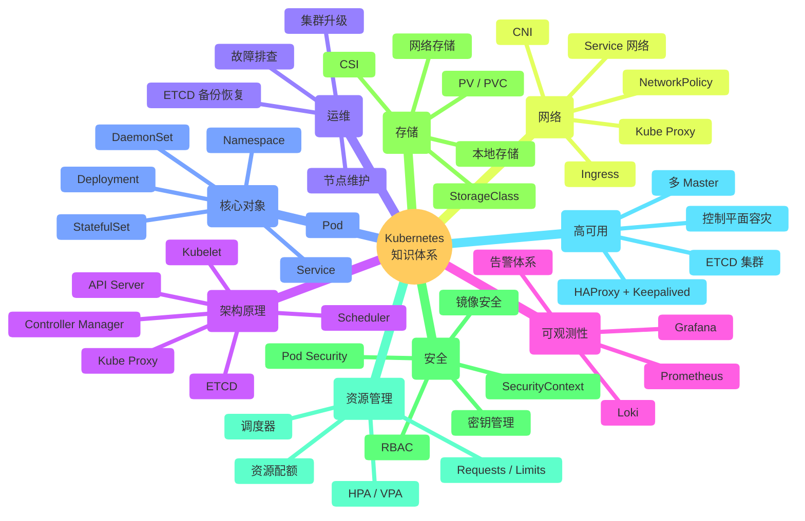
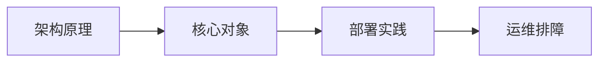
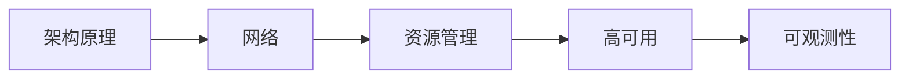

# Kubernetes 学习路线

从"听说过 K8s"到"能独立上线生产项目"的完整路径。

Kubernetes 的知识体系庞大，很多人学了概念不会用，能跑 Demo 不会做项目。核心原因是没有路径，只是在碎片学习。这份路线把零散的知识串成一条递进路径，每一步都有明确的验证标准。

> 如果你刚接触云原生，建议先完成 [Linux 学习路线](../linux/roadmap.md) 和 [Docker 安装教程](../deployment/docker&k8s/docker.md)，再来这里。

---

## 知识全景

---

## 快速导引

不确定从哪里开始？先看这篇：

👉 [K8s 从入门到上线完整路线](K8s-beginner-to-production.md) — 7 个阶段，每阶段附"今日任务"，直接照着做。

按你的阶段选择入口：

| 阶段 | 你是 | 从这里开始 |
|---|---|---|
| 1~3 | 新手 | 第一阶段：核心架构 |
| 4~5 | 进阶 | 第四阶段：部署实践 |
| 6~7 | 提升 | 第六阶段：生产就绪 |

---

## 七阶段详解

### 第一阶段：架构原理

不理解组件职责，排障时只能瞎猜。

**学习内容：**

- API Server：集群统一入口
- ETCD：集群状态存储
- Scheduler：Pod 调度决策
- Controller Manager：控制循环与状态协调
- Kubelet：节点代理
- Kube Proxy：服务发现与流量转发

**推荐阅读：**

| 文章 | 说明 |
|---|---|
| [API Server](architecture/control-plane/api-server.md) | 所有操作的唯一入口 |
| [ETCD](architecture/control-plane/etcd.md) | 集群的"大脑记忆" |
| [Scheduler](architecture/control-plane/scheduler.md) | Pod 放到哪个节点，谁决定 |
| [Controller Manager](architecture/control-plane/controller-manager.md) | 声明式状态如何收敛 |
| [Kubelet](architecture/node/kubelet.md) | 节点上的 Pod 管家 |
| [Kube Proxy](architecture/network/kube-proxy.md) | Service 背后的流量转发 |

**学完后你应该能够：**

- ✅ 画出 kubectl 命令的完整链路（kubectl → API Server → ETCD → Scheduler → Kubelet）
- ✅ 理解每个组件挂掉会发生什么
- ✅ 从组件日志中定位问题

---

### 第二阶段：核心对象

这是"能在 K8s 中跑一个完整应用"的阶段。

**学习内容：**

- Pod：最小调度单元
- Deployment：无状态应用管理
- StatefulSet：有状态应用管理
- DaemonSet：节点级守护进程
- Service：服务发现与负载均衡
- Namespace：逻辑隔离
- ConfigMap / Secret：配置与密钥

**推荐阅读：**

| 文章 | 说明 |
|---|---|
| [Workloads](architecture/resources/workloads.md) | Pod / Deployment / StatefulSet / DaemonSet |
| [API Resources](architecture/resources/api-resources.md) | 集群 API 资源全景 |

**学完后你应该能够：**

- ✅ 用 YAML 编写 Deployment + Service 部署应用
- ✅ 理解 StatefulSet 和 Deployment 的适用场景
- ✅ 使用 ConfigMap 管理应用配置

---

### 第三阶段：网络

Kubernetes 网络是问题的重灾区。Service 不通、Pod 间无法通信、Ingress 404——根因都在这一层。

**学习内容：**

- Kubernetes 网络模型（Pod 网络 / Service 网络 / 节点网络）
- CNI 插件（Calico / Flannel / Cilium）
- Service 类型（ClusterIP / NodePort / LoadBalancer）
- Ingress 与 Ingress Controller
- Kube Proxy 工作模式（iptables / IPVS）
- NetworkPolicy

**推荐阅读：**

| 文章 | 说明 |
|---|---|
| [Kubernetes 网络模型](../linux/network/network.md) | 三层网络的关淤 |
| [CNI](architecture/network/cni.md) | 容器网络接口与主流插件对比 |
| [Ingress](architecture/network/ingress.md) | 七层流量入口 |
| [Kube Proxy](architecture/network/kube-proxy.md) | iptables vs IPVS |

**学完后你应该能够：**

- ✅ 理解 Pod 间通信的完整链路
- ✅ 排查 Service 不通的问题
- ✅ 配置 Ingress 实现域名路由

---

### 第四阶段：存储

存储在 K8s 中容易被忽视，但在生产环境中出问题最难收拾。

**学习内容：**

- PV / PVC / StorageClass 三层抽象
- CSI 驱动机制
- 本地存储 vs 网络存储
- 有状态应用的存储规划
- 存储性能与容量管理

**推荐阅读：**

| 文章 | 说明 |
|---|---|
| [存储系统](architecture/storage/index.md) | PV / PVC / StorageClass |
| [CSI](architecture/storage/csi.md) | 容器存储接口 |

**学完后你应该能够：**

- ✅ 为有状态应用选择合适的存储方案
- ✅ 理解 PVC 绑定和回收机制
- ✅ 排查 Pod 挂载失败的问题

---

### 第五阶段：部署实践

从单节点到高可用，这是"能部署"和"能上线"的分水岭。

**学习内容：**

- 单 Master 集群部署
- 容器运行时（Docker / Containerd）
- 从单 Master 升级到 HA
- HAProxy + Keepalived + 多 Master
- 生产环境部署注意事项

**推荐阅读：**

| 文章 | 说明 |
|---|---|
| [单 Master 集群部署](practice/single-master-deployment.md) | 第一套 K8s 集群 |
| [Docker 与 K8s](practice/docker.md) | 容器运行时选型 |
| [从单 Master 到 HA](practice/single-master-to-ha.md) | 升级路径 |
| [HA 集群实践](practice/ha-cluster.md) | HAProxy + Keepalived + 3 Master |
| [K8s 从入门到上线完整路线](K8s-beginner-to-production.md) | 全局视角的实战路线 |

**学完后你应该能够：**

- ✅ 独立部署生产级 K8s 集群
- ✅ 理解 VIP 在 HA 架构中的角色
- ✅ 处理控制平面单点故障

---

### 第六阶段：资源管理与安全

资源管不好，半夜被叫醒；安全做不好，出事就是大事。

**学习内容：**

- Requests / Limits 的真实语义
- 调度器如何使用 Requests
- 内核如何执行 Limits
- HPA / VPA 自动扩缩容
- RBAC 权限体系
- SecurityContext 与 Pod Security Standards

**推荐阅读：**

| 文章 | 说明 |
|---|---|
| [Requests vs Limits](practice/requests-vs-limits.md) | 调度信号 ≠ 运行时限制 |
| [资源优化](practice/resource-optimization.md) | 集群资源调优方法 |
| [安全机制](architecture/resources/security.md) | RBAC / SecurityContext |
| [10 条实战经验](practice/10-takeaways.md) | 生产环境踩坑总结 |

**学完后你应该能够：**

- ✅ 合理设置 Requests / Limits 避免 Pod 被杀
- ✅ 配置 HPA 实现自动扩缩容
- ✅ 设计最小权限的 RBAC 策略

---

### 第七阶段：运维与故障排查

生产环境的日常：升级、维护、排障。

**学习内容：**

- 集群版本升级流程
- 节点维护（drain / uncordon）
- ETCD 备份与恢复
- 常见故障排查思路
- 集群监控与告警

**推荐阅读：**

| 文章 | 说明 |
|---|---|
| [集群升级](practice/cluster-upgrade.md) | 版本升级流程与风险控制 |
| [kubectl drain](practice/kubectl-drain.md) | 节点维护操作详解 |

> 后续补充：ETCD 备份与恢复演练、集群灾备方案、Prometheus + Grafana 监控集成。

**学完后你应该能够：**

- ✅ 安全地升级集群版本
- ✅ 维护节点不影响业务
- ✅ 从 ETCD 备份恢复集群
- ✅ 建立集群监控与告警体系

---

## 学习路径

不同角色关注不同阶段，但底层体系一致。

### 运维工程师

重点关注：集群部署、节点维护、故障排查。

### SRE / 平台工程师

重点关注：高可用架构、资源调优、监控告警。

---

## 学习原则

**1. 先理解架构，再学操作**

不理解 API Server → ETCD → Kubelet 的链路， `kubectl apply` 出错时你只能搜 Google。理解架构后，你能从日志中直接定位问题在哪一层。

**2. 从单节点到高可用**

先跑通单 Master，再升级 HA。不要一上来就搭 3 Master 集群——复杂度会掩盖你对基础概念的理解。

**3. 资源管理是生产化的门槛**

Requests 和 Limits 不是"配一下就行"。调度器用 Requests 做放置决策，内核用 Limits 做运行时强制——两个系统零协调。搞不清这个区别，Pod 就会在半夜消失。

**4. 从 K8s 到 Linux**

K8s 的很多概念直接映射到 Linux：

| K8s 概念 | Linux 对应 |
|---|---|
| Namespace | Linux namespace |
| Resource Limits | cgroup |
| Kube Proxy iptables | iptables / nftables |
| Pod SecurityContext | UID/GID / capabilities |
| PV / PVC | mount / fstab |

理解 Linux 这一层，K8s 的很多设计就不再是黑盒。

---

> K8s 不是终点，是平台工程的起点。先把集群跑稳，再往上构建可观测性、CI/CD 和应用平台。
>
> —— 1HairLabs
