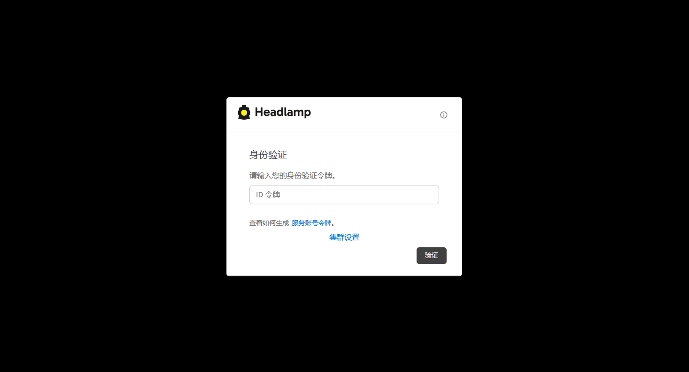
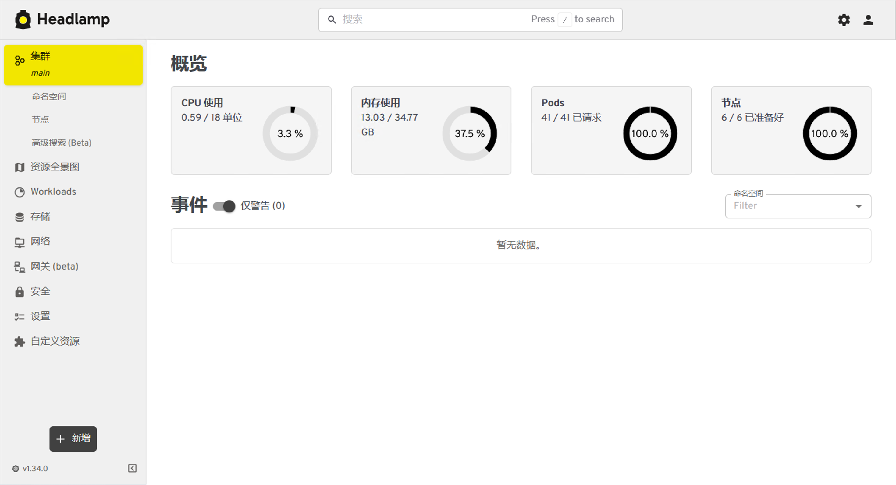
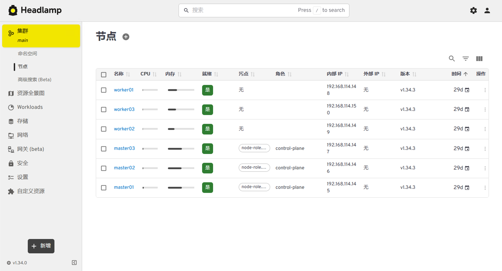
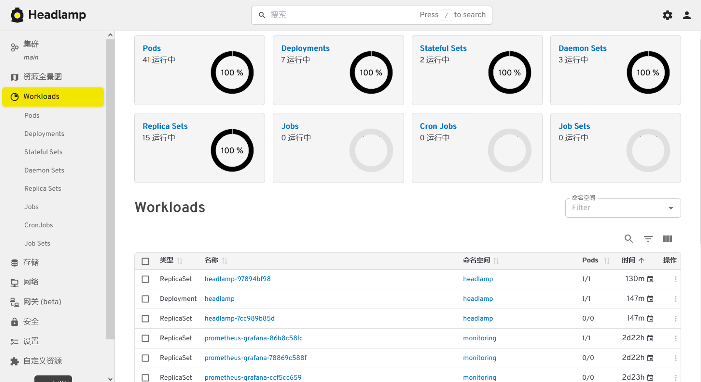
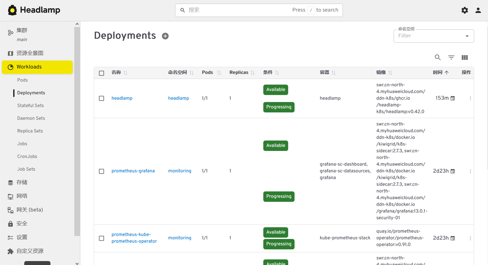

# Headlamp 部署实战：Kubernetes 新一代图形化管理工具体验

> 告别陈旧的 Dashboard，拥抱现代化 K8s 管理新体验

在 [之前](../../news/kubernetes/dashboard.md) 的文章中，分析了 Kubernetes Dashboard 被官方归档的原因，以及 Headlamp 成为推荐替代方案的背景。那么问题来了：**Headlamp 到底怎么部署？与 Dashboard 相比体验如何？是否适合日常运维使用？**

本文将在真实 Kubernetes 集群中完整部署 Headlamp，通过图文形式带你体验安装、访问、权限配置以及核心功能，帮助你快速判断是否值得迁移。

---

## 什么是 Headlamp？

Headlamp 是一个开源、跨平台的 Kubernetes 图形化管理工具，由 Kubernetes SIGs 维护。相比传统 Dashboard，它的核心优势包括：

- 🎨 **现代 UI 设计**：基于 Material-UI，交互流畅、信息层级清晰
- 🔌 **插件化架构**：支持自定义扩展页面、主题和功能
- 🌍 **多集群管理**：一个界面统一管理多个 K8s 集群
- 💻 **桌面客户端**：支持 Windows / macOS / Linux 原生应用
- 🔄 **持续维护**：社区活跃，版本迭代快，官方推荐

目前，Headlamp 已成为 CNCF 生态中备受关注的图形化管理方案。

---

## 环境配置

本文使用的测试环境如下：

| 组件                | 版本                          |
|-------------------|------------------------------|
| Kubernetes        | v1.34.3  0                   |
| Container Runtime | containerd 1.7.24            |
| 网络插件            | Calico v3.27                 |
| Ingress Controller| Nginx Ingress v1.9.6         |
| Headlamp          | v0.22.1（最新稳定版）          |

> 实际部署时请根据自身集群版本选择兼容的 Headlamp 版本。Helm Chart 通常会自动适配。

---

## Headlamp 架构简介

Headlamp 采用前后端分离的轻量架构。其后端是一个 Node.js 服务，负责与 Kubernetes API Server 交互，前端则是一个 React 单页应用。

**调用链路**：

```text
浏览器/桌面客户端
       │
       ▼
 Ingress / NodePort
       │
       ▼
 Headlamp Service (ClusterIP)
       │
       ▼
 Headlamp Pod (Node.js)
       │
       ▼
 Kubernetes API Server
```

关键点：

- Headlamp **不直接操作** 节点或容器运行时，所有数据来源均为 API Server
- **权限完全由 Kubernetes RBAC 控制**，不存储任何用户凭证
- 支持通过 `kubeconfig` 或静态 Token 进行认证

---

## 安装 Headlamp

[官方](https://headlamp.dev/) 提供多种安装方式：Helm、YAML 清单、桌面客户端、Docker 等。对于集群环境，**Helm 是最推荐的方式**，便于版本管理和配置定制。

### 添加 Helm 仓库

```bash
helm repo add headlamp https://kubernetes-sigs.github.io/headlamp/
helm repo update  # 更新仓库
```

查看可用版本：

```bash
helm search repo headlamp  # 查找仓库内的headlamp
```

示例输出：

```
NAME                    CHART VERSION   APP VERSION     DESCRIPTION                                       
headlamp/headlamp       0.42.0          0.42.0          Headlamp is an easy-to-use and extensible Kuber...
```

### 创建命名空间

```bash
kubectl create namespace headlamp
```

### 使用 Helm 安装

执行安装（基础配置）：

```bash
helm install headlamp headlamp/headlamp \
  --namespace headlamp \
  --set service.type=ClusterIP
```

!!! tip "离线安装"
    如果在线无法拉取，下载 [离线的Chart包](https://pan.quark.cn/s/8f2ad5b41dae?pwd=g63U) 到本地安装部署。 解压后运行命令：`helm install headlamp ./headlamp-0.42.0.tgz --namespace headlamp --set service.type=ClusterIP`

安装完成后，检查 Pod 状态：

```bash
kubectl get pods -n headlamp
```

预期输出：

```
NAME                       READY   STATUS    RESTARTS   AGE
headlamp-97894bf98-g8dhn   1/1     Running   0          5m16s
```

> 如果想在安装时就暴露服务（例如 NodePort），可以在 `--set` 中指定，我们将在下文单独配置。

---

## 查看部署资源

查看 Deployment 和 Service：

```bash
kubectl get deploy,svc -n headlamp
```

输出示例：

```
NAME                       READY   UP-TO-DATE   AVAILABLE   AGE
deployment.apps/headlamp   1/1     1            1           24m

NAME               TYPE        CLUSTER-IP      EXTERNAL-IP   PORT(S)   AGE
service/headlamp   ClusterIP   10.106.104.61   <none>        80/TCP    24m
```

所有资源一览：

```bash
kubectl get all -n headlamp
```

---

## 暴露访问入口

Headlamp 默认创建的是 `ClusterIP` 类型的 Service，集群外部无法直接访问。生产环境推荐使用 **Ingress**，测试环境可用 **NodePort** 或 **Port-forward**。

### 方法一：NodePort（快速测试）

修改 Service：

```bash
kubectl edit svc headlamp -n headlamp
```

将 `type: ClusterIP` 改为 `type: NodePort`，保存退出。查看映射的端口：

```bash
kubectl get svc -n headlamp
```

示例输出：

```
NAME       TYPE       CLUSTER-IP      EXTERNAL-IP   PORT(S)        AGE
headlamp   NodePort   10.106.104.61   <none>        80:31152/TCP   65m
```

然后通过 `http://任意节点IP:31152` 访问。注意：Headlamp 默认使用 HTTP，如需 HTTPS 需配合 Ingress 或反向代理。



### 方法二：Ingress（生产推荐）

创建 Ingress 资源，假设域名 `headlamp.example.com` 已解析到 Ingress Controller 的入口 IP：

```yaml
apiVersion: networking.k8s.io/v1
kind: Ingress
metadata:
  name: headlamp
  namespace: headlamp
  annotations:
    nginx.ingress.kubernetes.io/backend-protocol: "HTTP"
spec:
  ingressClassName: nginx
  tls:
  - hosts:
    - headlamp.example.com
    secretName: headlamp-tls   # 需提前创建 TLS Secret
  rules:
  - host: headlamp.example.com
    http:
      paths:
      - path: /
        pathType: Prefix
        backend:
          service:
            name: headlamp
            port:
              number: 80
```

应用配置：

```bash
kubectl apply -f ingress.yaml
```

查看 Ingress 状态：

```bash
kubectl get ingress -n headlamp
```

之后即可通过 `https://headlamp.example.com` 安全访问。

### 方法三：kubectl port-forward（临时调试）

```bash
kubectl port-forward -n headlamp svc/headlamp 8080:80
```

然后访问 `http://localhost:8080`。仅适合本地测试。

---

## 配置登录权限

Headlamp 本身不提供独立的用户管理系统。

它完全依赖 Kubernetes 的认证与授权机制（Authentication & Authorization），因此用户在 Headlamp 中看到的资源范围与 Kubernetes RBAC 权限完全一致。

常见认证方式包括：

* ServiceAccount Token
* kubeconfig
* OIDC（企业环境）
* 外部身份认证系统

本文以 ServiceAccount Token 为例进行演示。

---

### 创建 ServiceAccount

创建专用于 Headlamp 登录的 ServiceAccount：

```yaml
apiVersion: v1
kind: ServiceAccount
metadata:
  name: headlamp-admin
  namespace: kube-system
```

应用配置：

```bash
kubectl apply -f sa.yaml
```

查看：

```bash
kubectl get sa -n kube-system
```

输出示例：

```text
NAME              SECRETS   AGE
headlamp-admin    0         5s
```

> Kubernetes v1.24+ 默认不会自动创建 ServiceAccount Token Secret，因此看到 SECRETS 为 0 属于正常现象。

---

### 绑定权限

测试环境可以直接授予集群管理员权限：

```yaml
apiVersion: rbac.authorization.k8s.io/v1
kind: ClusterRoleBinding
metadata:
  name: headlamp-admin
roleRef:
  apiGroup: rbac.authorization.k8s.io
  kind: ClusterRole
  name: cluster-admin
subjects:
- kind: ServiceAccount
  name: headlamp-admin
  namespace: kube-system
```

应用配置：

```bash
kubectl apply -f crb.yaml
```

验证：

```bash
kubectl get clusterrolebinding headlamp-admin
```

示例输出：

```
NAME             ROLE                        AGE
headlamp-admin   ClusterRole/cluster-admin   35s
```

---

### 生产环境权限建议

实际生产环境中，不建议直接使用：

```text
cluster-admin
```

因为该权限拥有整个集群的完全控制能力。

推荐根据实际需求创建专用 Role 或 ClusterRole。

例如只允许查看资源：

```yaml
apiVersion: rbac.authorization.k8s.io/v1
kind: ClusterRole
metadata:
  name: headlamp-viewer
rules:
- apiGroups: [""]
  resources:
  - pods
  - services
  - configmaps
  - namespaces
  verbs:
  - get
  - list
  - watch
```

然后通过 ClusterRoleBinding 或 RoleBinding 绑定到对应 ServiceAccount。

Headlamp 会根据用户权限自动显示可访问资源。

---

### 获取登录 Token

#### Kubernetes v1.34+ 推荐方式

从 Kubernetes v1.24 开始，官方已经不再推荐依赖长期 ServiceAccount Secret Token。

在 Kubernetes v1.34 中，推荐直接使用：

```bash
kubectl create token headlamp-admin -n kube-system
```

执行后会输出类似内容：

```text
eyJhbGciOiJSUzI1NiIsImtpZCI6...
```

复制保存即可。

---

#### 自定义 Token 有效期

默认 Token 有效期由集群配置决定。

如果需要指定有效时间，可以使用：

```bash
kubectl create token headlamp-admin -n kube-system --duration=24h
```

例如：

```bash
kubectl create token headlamp-admin -n kube-system --duration=168h
```

表示生成一个有效期 7 天的 Token。

---

#### 验证权限

生成 Token 后，可验证当前账号权限：

```bash
kubectl auth can-i '*' '*' --as=system:serviceaccount:kube-system:headlamp-admin
```

如果返回：

```text
yes
```

说明权限配置正常。

---

!!! tip "关于长期 Token"

    在较早版本的 Kubernetes 中，可以通过创建：

    ```yaml
    type: kubernetes.io/service-account-token
    ```

    类型的 Secret 来获取长期 Token。

    但在 Kubernetes v1.24+（包括 v1.34）环境中，该方式已经不再作为官方推荐方案。

    因此本文后续内容均采用：

    ```bash
    kubectl create token
    ```

    方式进行演示，以符合当前 Kubernetes 官方最佳实践。

---

## 首次登录 Headlamp

浏览器访问你的 Headlamp 地址（比如我的是 `http://192.168.114.150:31152`），会看到登录界面：


需要提供：

- **认证 Token**：上面获取的 Token。

填写后点击 `验证`，即可进入主控制台。

> 💡 如果 Headlamp 与 API Server 之间的证书不可信（例如自签名证书），你需要在 Helm 安装时添加 `--set extraVolumes[0].name=ca-cert,...` 配置，或在界面中勾选“跳过证书验证”（仅测试用）。

---

## Headlamp 界面深度体验

登录成功后，首先映入眼帘的是**集群概览页面**。相比 Dashboard，Headlamp 的布局更加现代化，信息密度适中，暗色主题默认开启，视觉疲劳度明显降低。



下面我们逐步体验几个核心功能模块。

### 节点管理

路径：`集群 → 节点`

节点列表展示了每个节点的状态、角色、内核版本、容器运行时、CPU/内存容量及使用率（需要 metrics-server 支持）。点击任意节点可查看详细标签、污点、条件以及该节点上的 Pod 列表。



**亮点**：支持按 CPU/内存使用率排序，快速定位热点节点。

### Pod 管理

路径：`Workloads → Pods`

Pod 列表支持多维度过滤（命名空间、状态、节点）。点击某个 Pod 进入详情页，可查看：

- 容器日志（支持实时流式输出）
- 终端（直接在浏览器中 `exec` 进入容器）
- YAML 定义（可编辑并更新）
- 事件列表（与 Pod 相关的 Warning/Normal 事件）
- 资源使用趋势图（需 metrics-server）



**对比 Dashboard**：日志查看支持语法高亮和关键词搜索；终端访问响应更快，且支持多标签页。

### Deployment 管理

路径：`Workloads → Deployments`

列表显示副本数、可用副本、更新策略等信息。详情页提供：

- 副本扩缩容滑块
- 滚动更新历史（支持回滚）
- Pod 模板可视化编辑
- 关联的 ReplicaSet 和 Pod 拓扑




### 插件扩展能里

相比 Kubernetes Dashboard，Headlamp 的一大优势在于其插件化架构（Plugin System）。

通过插件机制，开发者可以扩展：

 - 集群监控能力
 - 应用目录管理
 - 多集群管理
 - 自定义资源展示
 - 企业内部功能集成

这使得 Headlamp 不再只是一个简单的 Kubernetes 可视化工具，而是具备持续扩展能力的平台。

#### 关于插件功能的说明

需要注意的是：

Headlamp 的插件支持与部署方式有关。

##### Desktop 模式

如果使用官方桌面客户端（Headlamp Desktop），可以直接在客户端中管理插件。

常见插件包括：

 - Prometheus 指标展示
 - 应用目录（App Catalog）
 - 多集群管理增强
 - 自定义资源扩展

用户可以通过客户端界面安装和管理插件。

##### In-Cluster 模式

本文采用的 Kubernetes 集群内部署（In-Cluster）方式，默认并未提供插件市场或插件安装界面。

因此部署完成后，你不会看到 Desktop 版本中的：

 - Plugins
 - 插件管理
 - Marketplace

等菜单。

这是 Headlamp 当前设计上的正常行为，并非部署异常。

**In-Cluster 是否支持插件？**

支持。

但与 Desktop 版本不同。

In-Cluster 模式下，插件通常需要在部署阶段提前集成，例如：

 - 自定义构建镜像
 - 修改 Helm Values
 - 挂载插件目录
 - 在前端构建过程中打包插件

因此无法像 Desktop 客户端那样通过界面一键安装插件。

对于大多数学习环境、测试环境和中小规模集群而言，默认功能已经能够满足日常使用需求。

插件的加入使得 Headlamp 的功能边界远大于 Dashboard。

---

## 与 Kubernetes Dashboard 全面对比

| 对比维度         | Kubernetes Dashboard                     | Headlamp                                   |
| ---------------- | ---------------------------------------- | ------------------------------------------ |
| **项目状态**     | 已归档（Archived），仅安全更新           | 活跃维护，SIGs 项目                        |
| **安装复杂度**   | 简单，单一 YAML                          | 同样简单，Helm 更灵活                      |
| **UI/UX**        | 较陈旧，类似早期 GCP 风格                | 现代化 Material Design，暗色主题，响应快    |
| **资源可视化**   | 基础列表 + 详情                          | 类似，但信息组织更清晰，支持拓扑视图（插件） |
| **多集群管理**   | 需部署多实例，手动切换                   | 原生支持，单一界面聚合所有集群              |
| **插件生态**     | 无                                       | 丰富，可扩展性强                           |
| **终端访问**     | 支持，但需额外 RBAC                      | 支持，且体验更流畅                         |
| **认证方式**     | Token / Kubeconfig                       | Token / Kubeconfig / OIDC（插件）          |
| **资源占用**     | 约 100Mi 内存                            | 约 150Mi 内存（含 Node.js 后端）           |
| **官方推荐**     | 否                                       | 是                                         |

从维护状态和社区活跃度来看，**新部署的环境应直接选择 Headlamp**。已部署 Dashboard 的环境可根据需求平滑迁移，两者可并存。

---

## 实际运维体验总结

经过部署后的实际使用（包括日常查看 Pod 日志、排查 Deployment 更新失败、观察节点资源等），我对 Headlamp 的几个印象深刻的地方：

- **响应速度**：页面切换几乎无白屏等待，日志加载使用分页流式传输，大日志也不卡死。
- **智能过滤**：在 Pod 列表搜索框输入 `status!=Running` 即可快速筛选非 Running 状态的 Pod，这比 Dashboard 需要手动点选菜单高效得多。
- **错误提示友好**：当某个操作因 RBAC 权限不足失败时，Headlamp 会明确提示缺少哪个 API Group/Resource/Verb，极大方便了权限调优。
- **多集群切换**：在左上角集群下拉菜单可以无缝切换不同集群（需提前添加 kubeconfig），非常适合同时管理开发、预发、生产环境的运维人员。

当然，Headlamp 也并非完美无缺：

- **文档尚不完善**：某些插件的配置方式散落在 GitHub Issues 中。
- **默认不开启持久化**：多集群配置存储在浏览器 localStorage，换设备后需重新添加（可通过后端存储插件解决）。
- **API Server 公网暴露风险**：Headlamp 本身不代理 API 请求，浏览器直接请求 API Server，因此 API Server 必须对 Headlamp 前端可访问（这在使用桌面客户端或公网访问时需要特别注意网络策略）。

---

## 最佳实践与建议

基于部署和运维经验，提供几点建议：

1. **生产环境务必启用 Ingress + TLS**：避免明文传输 Token。
2. **不直接使用 cluster-admin**：为不同角色的运维人员创建独立的 ServiceAccount，授予最小必要权限。可借助 Headlamp 的“错误提示”逐步完善权限。
3. **结合 metrics-server**：Headlamp 的图表依赖 metrics-server，安装后即可在界面看到 CPU/内存趋势。
4. **定期更新**：Headlamp 迭代快，新功能（如 OIDC 登录、Pod 副本数建议等）只在最新版提供。使用 Helm 管理升级非常方便：
   ```bash
   helm upgrade headlamp headlamp/headlamp -n headlamp
   ```
5. **为 Headlamp 配置资源请求和限制**：默认安装未设置，建议根据集群规模调整，例如：
   ```yaml
   resources:
     requests:
       memory: "128Mi"
       cpu: "100m"
     limits:
       memory: "512Mi"
       cpu: "500m"
   ```

---

## 总结

随着 Kubernetes Dashboard 正式归档，Headlamp 凭借现代的设计理念、活跃的社区和强大的插件机制，已成为官方推荐的图形化管理工具。

通过本文的实战部署，我们看到：

- ✅ **安装简单**：一条 Helm 命令即可启动
- ✅ **资源占用低**：适合 Homelab 和生产环境
- ✅ **权限原生**：与 Kubernetes RBAC 无缝集成
- ✅ **体验优秀**：界面流畅，功能实用，扩展性强

无论你是 Kubernetes 初学者需要一个可视化学习平台，还是运维工程师希望提升日常管理效率，Headlamp 都是一个值得投入的选择。
