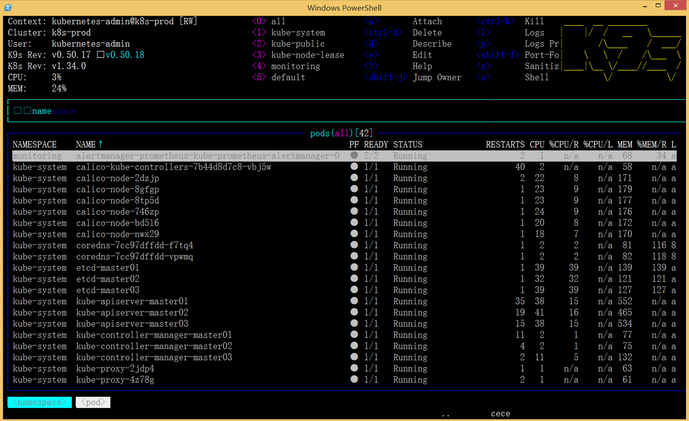
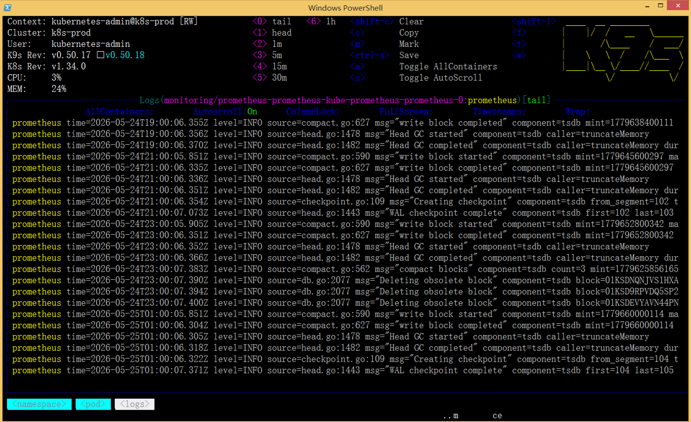
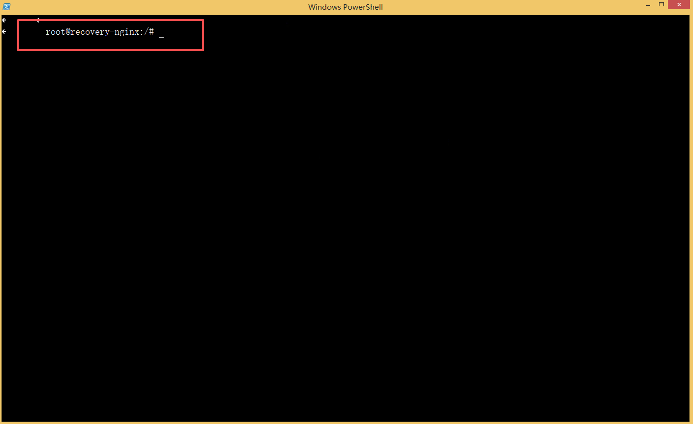
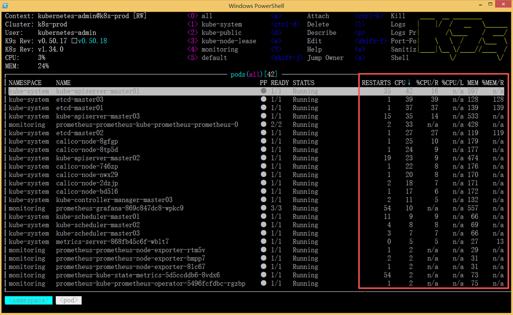

# K9s：Kubernetes 运维的真正「现场之眼」


> 你还在用 `kubectl get pods -A` 一遍遍刷状态吗？  
> 你可能还没意识到，K9s 能把你从“发短信指挥”变成“直接走进机房”。

很多刚接触 Kubernetes 的人都会有一个疑问：

> kubectl 已经这么强了，为什么还有那么多人天天挂着 K9s？

以前我也觉得：

```bash
kubectl get pods -A
kubectl describe pod
kubectl logs -f
kubectl top node
```

这些命令已经够用了。

直到我开始**长期维护自己的 Kubernetes 集群**之后，才慢慢理解：

> **K9s 真正解决的，不是“能不能管理集群”，而是“如何更高效地观察集群”。**

这两者，完全不是一个层级的问题。

---

## 什么是 K9s？

K9s 是一个 **Kubernetes 的 Terminal UI 工具**。

简单理解：

- **kubectl 的增强交互版**
- **终端里的集群实时驾驶舱**
- **运维现场的“热感雷达”**

它不是 GUI，也不是 Web Dashboard，而是一种非常典型的 Linux 运维风格工具。

如果你用过：

- `htop` / `btop`
- `lazydocker`
- `ncdu`

你会秒懂 K9s 的设计哲学：**把高频操作压缩成一个按键，把信息密度压缩成一屏。**

---

## 安装 K9s（真的很简单）

在继续之前，先给个最简单的 [安装](https://k9scli.io/topics/install/) 方式，方便你立刻体验。

=== "macOS (Homebrew)"

    ```bash
    brew install derailed/k9s/k9s
    ```

=== "Linux"

    ```bash
    curl -sSfL https://github.com/derailed/k9s/releases/latest/download/k9s_Linux_amd64.tar.gz | tar xz
    sudo mv k9s /usr/local/bin/
    ```

=== "Windows (Scoop)"

    ```bash
    scoop install k9s
    ```

安装后，只要你的 `~/.kube/config` 正确，直接输入 `k9s` 就能连上当前集群。

---

## 我第一次打开 K9s 时的感受

以前我查看 Pod：

```bash
kubectl get pods -A
```

看到的是：

```text
NAMESPACE     NAME                          READY   STATUS
monitoring    prometheus-0                  1/1     Running
kube-system   coredns-xxxxx                 1/1     Running
default       nginx-xxxxx                   1/1     Running
```

信息是有了，但是：

> Kubernetes 的真实运行状态，远远不止这些。

而 K9s 打开之后：

- Pod 状态**实时刷新**（2 秒一次，可调）
- CPU / MEM **动态变化（需要安装 Metrics Server）**
- 异常状态（CrashLoopBackOff / ImagePullBackOff）**自动高亮**
- 重启次数、年龄一目了然
- 按 `:` 输入 `ns` 可以秒切 Namespace

整个集群一下“活了起来”。



---

## Kubernetes 最大的问题：信息密度过高，碎片化严重

这是我运维越久越深的一个感受。

Kubernetes 本身没问题，问题在于：

> 它的信息太碎了。

比如一个 Pod 出问题时，你可能需要这样来回切换：

```bash
kubectl get pods -A
kubectl describe pod <name>
kubectl logs -f <name>
kubectl top pod <name>
kubectl get events
kubectl exec -it <name> -- sh
```

而且：

- Pod 名是随机字符串，很难记
- Namespace 一多，命令参数越来越长
- 信息不连续，上下文反复丢失

运维体验并不舒服。尤其是当集群开始变复杂、业务开始混部之后。

---

## K9s 真正强的地方：实时观察

K9s 最大的提升，并不是“操作更快”（虽然确实快），而是：

> **它把“观察集群”这件事，从“被动查询”变成了“主动感知”。**

下面我用三个最常用的场景，告诉你它有多顺。

### 场景一：看日志 —— 按一个键

**以前：**

```bash
kubectl logs -f <pod-name> -n <namespace>
```

需要：

- 复制 Pod 名（很长）
- 确认 Namespace
- 敲完整命令

**在 K9s 里：**

1. 用方向键选中 Pod
2. 按 **`l`**
3. 直接进入日志流，自动跟随

整个过程不到 1 秒，顺滑得像桌面应用。



### 场景二：进入容器 —— 按一个键

**以前：**

```bash
kubectl exec -it <pod-name> -- /bin/bash
```

**现在：**

选中 Pod → 按 **`s`** → 直接进入 shell。

对于排障来说，这种感觉就像：

> 从“发短信指挥”变成了“直接走进机房”。

尤其适合：

- 查看配置文件
- 检查环境变量
- 测试网络连通性
- 看进程和文件系统状态



### 场景三：资源用量 —— 一键排序

在 K9s 的 Pod 视图里：

- 按 **`Shift + C`**：按 CPU 使用量排序
- 按 **`Shift + M`**：按内存使用量排序

你会发现：

- 哪个 Pod 偷偷吃了 CPU
- 哪个 Pod 内存 leak 了
- 哪个 Node 压力最大

很多生产问题的根源，其实就是资源竞争。

> K9s 把资源热点，直接怼到你眼前。



---

## 当我开始删除 Pod 做故障演练时，K9s 的价值真正体现

有一次我做 Kubernetes 高可用演练，手动删除一个 Pod：

```bash
kubectl delete pod nginx-xxxxx
```

原生 kubectl 只返回一行：

```text
pod "nginx-xxxxx" deleted
```

然后你只能再敲 `kubectl get pods` 去轮询状态。

但在 K9s 里，整个过程是 **动态连续** 的：

你会亲眼看到：

1. Pod 状态变为 `Terminating`
2. 终止完成，列表暂时减少一个
3. 新 Pod 出现，状态 `Pending`
4. `ContainerCreating`
5. `Running`
6. `Ready`

整个生命周期，**实时刷新**。

那一刻你会突然理解：

> Kubernetes 原来真的是“活”的——自愈、调度、重建，都在眼前发生。

---

## 但 K9s 不是替代 Grafana

很多人会问：

> “有了 Grafana，还需要 K9s 吗？”

这是一个很关键的问题。

**它们不是替代关系，而是互补关系。**

| 维度     | Grafana                  | K9s                        |
| -------- | ------------------------ | -------------------------- |
| 数据范围 | 历史趋势、长期指标       | 实时状态、当前现场         |
| 交互方式 | 鼠标、Dashboard          | 键盘、终端                 |
| 适用场景 | 容量规划、事后分析       | 即时排障、日常巡检         |
| 信息密度 | 宏观图表                 | 微观表格 + 日志 + 终端     |

简单说：

- **Grafana 是“看过去”**
- **K9s 是“进现场”**

一个运维人员的最佳姿势通常是：

> 左边终端挂着 K9s，右边浏览器开着 Grafana。

---

## K9s 最适合谁？不适合谁？

### ✅ 非常适合

- Kubernetes 日常运维、SRE
- 平台工程师、On-Call 值班
- 正在学习 K8s 的人（比 kubectl 直观太多）
- 任何“经常需要快速排查 Pod 问题”的人

### ❌ 不适合

- 完全不了解 Pod / Deployment / Service 概念的纯新手（你依然需要先学基础）
- 需要严格变更审计、RBAC 细粒度只读控制的场景（可配合 `--readonly` 启动）
- 需要长期历史数据聚合分析的场景（那是 Prometheus + Grafana 的活）

> K9s 是 **放大你 K8s 运维能力的工具**，不能替代你对 K8s 本身的理解。

---

## 现在的理解

以前觉得：

> Kubernetes 的核心是部署。

后来发现不是。

真正困难的是：

> **如何长期、稳定、高效地观察和维护集群。**

而 K9s 恰好解决了：

这个过程中最痛苦的那一部分——**信息碎片化**。

它不是炫技工具，而是一个：

> 真正会影响你日常运维效率、甚至会让你“上瘾”的工具。

---

## 最后

现在我的终端里，长期挂着两个窗口：

- 一个屏幕跑 **Grafana**（看趋势）
- 另一个屏幕跑 **K9s**（看现场）

两者加在一起，基本覆盖了一个运维人员 80% 的日常需求。

如果你还没试过 K9s，我真心建议你：

**花 5 分钟装一下，连上你的测试集群或 minikube，随便翻翻。**

你大概率也会慢慢理解：

> 为什么那么多运维工程师，一旦用上 K9s，就再也回不去了。

---

## 扩展阅读

- [K9s 官方 GitHub](https://github.com/derailed/k9s)
- [K9s 官方文档](https://k9scli.io/)
- [Metrics Server 安装指南](https://github.com/kubernetes-sigs/metrics-server)

---

如果你已经用上了 K9s，欢迎在评论区分享你最喜欢的快捷键或排障小技巧。

*本文基于 K9s v0.50+ 版本，截图仅为示意，实际效果以你的集群为准。*
