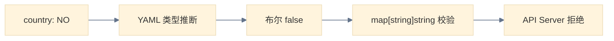

# KYAML 实测：Kubernetes 1.36 给 YAML 加的约束药

## YAML 的 Norway Bug

先看一行 YAML：

```yaml
country: NO
```

你觉得解析出来是什么类型？字符串 `"NO"`？

不是。标准 YAML 1.1 把 `NO` 当布尔值 `false`。`YES`、`NO`、`ON`、`OFF` 都逃不掉。这个坑有个名字叫 Norway Bug——挪威的国家缩写恰好是 `NO`，在 YAML 里被吃成了 `false`。

在 Kubernetes 里踩到这个坑会怎样？我在集群上试了一下。写一个 ConfigMap，`labels` 和 `data` 里都放一个 `country: NO`：

```bash
cat <<'EOF' > /tmp/norway-test.yaml
apiVersion: v1
kind: ConfigMap
metadata:
  name: norway-test
  labels:
    country: NO
data:
  country: NO
  enabled: yes
EOF

kubectl apply -f /tmp/norway-test.yaml
```

结果：

```
error: unable to decode "/tmp/norway-test.yaml": json: cannot unmarshal bool
into Go struct field ObjectMeta.metadata.labels of type string
```

API server 直接拒绝了。YAML 解析器把 `NO` 转成布尔值 `false`，然后 Go 的 `labels map[string]string` 类型校验发现你往字符串字段里塞了个 bool，报错。

那 `data` 字段呢？去掉 `labels` 再试：

```bash
cat <<'EOF' > /tmp/norway-test2.yaml
apiVersion: v1
kind: ConfigMap
metadata:
  name: norway-test2
data:
  country: NO
  enabled: yes
EOF

kubectl apply -f /tmp/norway-test2.yaml
```

```
Error from server (BadRequest): error when creating "/tmp/norway-test2.yaml":
ConfigMap in version "v1" cannot be handled as a ConfigMap: json: cannot
unmarshal bool into Go struct field ConfigMap.data of type string
```

一样被拒。`data` 字段也是 `map[string]string`，同样的类型校验。

加引号试试：

```bash
cat <<'EOF' > /tmp/norway-test3.yaml
apiVersion: v1
kind: ConfigMap
metadata:
  name: norway-test3
  labels:
    country: "NO"
data:
  country: "NO"
  enabled: "yes"
EOF

kubectl apply -f /tmp/norway-test3.yaml
kubectl get configmap norway-test3 -o yaml
```

```
configmap/norway-test3 created
apiVersion: v1
data:
  country: "NO"
  enabled: "yes"
kind: ConfigMap
metadata:
  labels:
    country: "NO"
  name: norway-test3
  namespace: default
  ...
```

成功。注意一个细节：`kubectl get -o yaml` 的输出里，`country: "NO"` 和 `enabled: "yes"` **带着引号**。kubectl 的 YAML 序列化器是聪明的——它知道这些值不加引号会被 YAML 解析器误判，所以输出时自动加引号。

这就有了一个有意思的割裂：**输出端帮你兜底，输入端靠你自觉。** kubectl 导出 YAML 时会自动给危险值加引号，但你手写 YAML 时没人帮你检查。在 ConfigMap 这个 case 里 API server 还能拦住（因为 `map[string]string` 类型校验），但如果换个场景——CRD 的某个字段类型是 `interface{}`，或者你的 YAML 被 Helm 模板处理后传给其他工具——`NO` 可能就静静地变成了 `false`，没人报错。



YAML 的毛病不止类型推断。缩进定义结构，多一个空格就是另一个对象；字符串引号可选，直到你踩到类型转换的坑；Helm 模板操作缩进，本质上是在字符串拼接里维护语义层级——这件事就不该靠人来做。

JSON 也不是替代品。没有注释、不允许尾逗号、每个 key 都要加引号——写配置的体验更差。

Kubernetes 社区给了一个答案：KYAML。

## KYAML 是什么

KYAML 是 SIG CLI 在 [KEP 5295][kep] 中提出的概念。它不是新格式，不是新解析器，而是 YAML 的一个严格子集——用官方的话说叫"方言"。

[kep]: https://github.com/kubernetes/enhancements/tree/master/keps/sig-cli/5295-kyaml

核心思路一句话能说明白：YAML 给了太多选择（block style / flow style / 引号或不引号 / 各种类型推断），Kubernetes 其实只需要其中一小部分。KYAML 就是把这部分固定下来。

**所有合法的 KYAML 都是合法的 YAML。** 现有的 kubectl、CI 流水线、Helm，都不需要改。你甚至可以把 KYAML 格式的内容直接 `kubectl apply -f` 传给任何版本的 kubectl——因为它本质上就是 YAML。

## KYAML 的规则

KYAML 用的是 YAML 的 flow style（流式写法），和我们习惯的 block style（块式写法）不同。规则就几条：

| 规则 | 做了什么 |
|------|----------|
| 以 `---` 开头 | 和 JSON 区分；同时向后兼容 1.33 之前的 kubectl（老版本需要这个 header 才能识别） |
| 字符串值必须双引号 | 消除类型推断，`NO` 就是 `"NO"`，不会再变成 `false` |
| map 用 `{}` | 结构不依赖缩进 |
| list 用 `[]` | 同上 |
| 允许尾逗号 | 比 JSON 友好，删字段不用管上一个逗号 |
| 允许注释 | 比 JSON 友好 |

同一个 Pod，两种写法并排看：

```yaml title="Standard YAML (block style)"
apiVersion: v1
kind: Pod
metadata:
  name: my-pod
  labels:
    app: demo
spec:
  containers:
  - name: nginx
    image: nginx:1.20
```

```yaml title="KYAML (flow style)"
---
{
  apiVersion: "v1",
  kind: "Pod",
  metadata: {
    name: "my-pod",
    labels: {
      app: "demo",
    },
  },
  spec: {
    containers: [{
      name: "nginx",
      image: "nginx:1.20",
    }],
  },
}
```

第一眼看到 KYAML，大部分人的反应是：**这比原来更难读了。** 大括号套中括号，像 JSON 但又不是。

这个直觉是对的。KYAML 牺牲了可读性，换的是确定性。它不是"更好看的 YAML"，是"更不容易出错的 YAML"。这个 trade-off 要不要接，是后面的核心问题。

## 在集群上试试：kubectl -o kyaml

Kubernetes 1.34 开始 kubectl 原生支持 KYAML 输出，1.35 进入 Beta 默认开启。我的集群是 1.36.1，应该直接能用。

!!! note "版本对应关系"
    - **1.34**：alpha，需要 `export KUBECTL_KYAML=true` 显式开启
    - **1.35**：beta，默认开启，但仍需 `-o kyaml` 参数；设 `export KUBECTL_KYAML=false` 仍可关闭
    - **1.36+**：beta（持续中），用法同 1.35
    - **GA 条件**：KEP 规定了三件事——环境变量 gate 移除、正式 KYAML 规范发布、Kubernetes 官方 org 大多数示例完成转换且无新 bug 报告。满足这些才谈 GA，官方暂无时间表

跑一个看看。我集群上正好有个 nginx Pod：

```bash
kubectl get pod nginx-test -o kyaml
```

输出很长，截一段看格式：

```yaml
---
{
  apiVersion: "v1",
  kind: "Pod",
  ...
  spec: {
    containers: [{
      image: "m.daocloud.io/docker.io/nginx:alpine",
      imagePullPolicy: "IfNotPresent",
      name: "nginx",
      resources: {},
      terminationMessagePath: "/dev/termination-log",
      terminationMessagePolicy: "File",
      volumeMounts: [{
        mountPath: "/var/run/secrets/kubernetes.io/serviceaccount",
        name: "kube-api-access-rlm4r",
        readOnly: true,
      }],
    }],
    dnsPolicy: "ClusterFirst",
    enableServiceLinks: true,
    nodeName: "worker02",
    preemptionPolicy: "PreemptLowerPriority",
    priority: 0,
    restartPolicy: "Always",
    ...
  },
  status: {
    conditions: [{
      lastProbeTime: null,
      lastTransitionTime: "2026-08-11T07:42:38Z",
      observedGeneration: 1,
      status: "True",
      type: "PodReadyToStartContainers",
    }, ...],
    ...
    phase: "Running",
    podIP: "10.244.30.119",
    qosClass: "BestEffort",
    ...
  },
}
```

几个值得注意的细节：

**key 不加引号，string 值加双引号。** `image: "m.daocloud.io/docker.io/nginx:alpine"`——key `image` 裸写，值带双引号。`apiVersion: "v1"`、`kind: "Pod"` 都是如此。这和官方博客示例一致。但要补一句：key 只在「明显安全」时才不加引号，像 `no` 这种 YAML 会误判成布尔值的词，即使作为 key 也会被强制加引号。

**非字符串类型不加引号。** `priority: 0` 是整数，`readOnly: true` 是布尔，`lastProbeTime: null` 是空值——都裸写。KYAML 只对字符串类型强制加引号，数值和布尔值保持原样。这意味着你一眼就能区分一个字段是字符串 `"true"` 还是布尔值 `true`——在标准 YAML 里这俩长得一模一样。

**空集合用 `{}`。** `resources: {}`、`securityContext: {}`、`lastState: {}`——空 map 直接写 `{}`，不换行展开。

**尾逗号到处都是。** 每个 `{` 和 `[` 的最后一个元素后面都有逗号。这在 JSON 里不合法，在 KYAML 里允许——删字段不用操心前一个逗号。

**多行字符串是个明显变化。** block style 里常用的 `|` / `>` 块在 KYAML 里写不了（flow style 不支持），KYAML 改用双引号字符串里的 `\n` 转义表示换行，长行用行尾 `\` 做 flow-folding：

```yaml
data: {
  script: "echo hello\necho world\n",
}
```

对 ConfigMap / Secret 里的多行脚本、配置来说，这是从 block style 切到 KYAML 后最先撞上的差异，值得提前习惯。

对比标准 YAML 输出：

```bash
kubectl get pod nginx-test -o yaml
```

信息完全一样，差别只在格式：KYAML 版所有字符串值带双引号，map 用 `{}`，list 用 `[]`，文件以 `---` 开头。

如果想存成文件：

```bash
kubectl get pod nginx-test -o kyaml > nginx-test.yaml
```

## 转换现有文件：yamlfmt

`kubectl -o kyaml` 只管输出，手头一堆 YAML 文件怎么办？官方博客提了两个工具。

### 方式一：sigs.k8s.io/yaml 的 yamlfmt

Kubernetes 自己的 YAML 库附带一个 yamlfmt 命令行工具：

```bash
# 需要 Go 环境
go install sigs.k8s.io/yaml/yamlfmt@latest
```

转换单个文件（输出到 stdout，不改原文件）：

```bash
yamlfmt -o=kyaml my-deployment.yaml
```

看 diff 而不是完整输出：

```bash
yamlfmt -o=kyaml -d my-deployment.yaml
```

接受目录参数，批量转换：

```bash
yamlfmt -o=kyaml ./manifests/
```

### 方式二：Google 的 yamlfmt

Google 维护的 [yamlfmt][google-yamlfmt] 在 v0.21.0 加了 kyaml formatter，功能更丰富一些。

[google-yamlfmt]: https://github.com/google/yamlfmt

```bash
go install github.com/google/yamlfmt/cmd/yamlfmt@latest
```

!!! warning "国内环境需要换 Go 代理"
    `go install` 默认走 proxy.golang.org，国内会超时。换国内代理：
    ```bash
    go env -w GOPROXY=https://goproxy.cn,direct
    ```

yamlfmt 默认不启用 kyaml formatter，需要配置文件指定。在项目根目录或 `/tmp/` 建 `.yamlfmt`：

```yaml
formatter:
  type: kyaml
```

用 `-conf` 指定配置路径，直接转换文件（会修改原文件）：

```bash
~/go/bin/yamlfmt -conf /tmp/.yamlfmt my-deployment.yaml
```

我在集群上试了一下。写一个标准 block style 的 Pod YAML：

```yaml
apiVersion: v1
kind: Pod
metadata:
  name: my-pod
  labels:
    app: demo
    country: NO
spec:
  containers:
  - name: nginx
    image: nginx:1.20
```

转换后：

```yaml
---
{
  apiVersion: "v1",
  kind: "Pod",
  metadata: {
    name: "my-pod",
    labels: {
      app: "demo",
      country: "NO",
    },
  },
  spec: {
    containers: [{
      name: "nginx",
      image: "nginx:1.20",
    }],
  },
}
```

diff 对比：

```diff
- apiVersion: v1
- kind: Pod
- metadata:
-   name: my-pod
-   labels:
-     app: demo
-     country: NO
- spec:
-   containers:
-   - name: nginx
-     image: nginx:1.20
+ ---
+ {
+   apiVersion: "v1",
+   kind: "Pod",
+   metadata: {
+     name: "my-pod",
+     labels: {
+       app: "demo",
+       country: "NO",
+     },
+   },
+   spec: {
+     containers: [{
+       name: "nginx",
+       image: "nginx:1.20",
+     }],
+   },
+ }
```

注意 `country: "NO"` —— yamlfmt 自动给 `NO` 加了双引号。这就是 KYAML 的核心价值：**工具帮你加引号，不靠人自觉。** 回想前面 Norway Bug 的实验，手写 `country: NO` 会被 API server 拒绝，而 yamlfmt 转换后自动解决了这个问题。

还有一个细节：如果文件已经是 KYAML 格式（比如之前手动加过引号），yamlfmt 不会重复修改——转换是幂等的。

另外两个边界要知道：一是**注释是「尽力保留」**，go-yaml 对注释处理并不完善，个别位置的注释可能错位甚至丢失；二是**不是所有 YAML 都能转 KYAML**——KYAML 底层先经过 JSON 序列化，非字符串 key、复合 key、anchor / alias 这类「JSON 表达不了」的 YAML 会被简化或直接转换失败。

批量转换整个目录：

```bash
~/go/bin/yamlfmt -conf /tmp/.yamlfmt ./k8s/
```

!!! tip
    Google yamlfmt 还支持 pre-commit hook 和 Docker 镜像，适合接进 CI 流水线。

### Go 环境：没装怎么办

两个工具都靠 `go install` 安装。我在 master01 上跑了 `go version`，结果是：

```
-bash: go: command not found
```

Debian 13 上装 Go：

```bash
# 包名是 golang-go，不是 go
sudo apt install -y golang-go
```

!!! note
    Debian 13 的 Go 包名是 `golang-go`。`apt install go` 会报 `Unable to locate package go`。

如果不想装 Go，替代方案：

- **直接下二进制**：Google yamlfmt 的 [releases 页面][releases] 提供 Linux amd64 二进制，下载解压就能用
- **Docker 镜像**：Google yamlfmt 官方提供 Docker 镜像，`docker run` 一下就行

[releases]: https://github.com/google/yamlfmt/releases

!!! note
    两个工具同名冲突：都叫 `yamlfmt`，`$GOPATH/bin` 里后装的会覆盖先装的。建议只装一个，或者分别放到不同路径。官方说 kyaml formatter 不和 default formatter 共享配置，混用会报错。

## 设为默认输出：kuberc

每次都敲 `-o kyaml` 太长。Kubernetes 1.36+ 支持通过 kuberc 设默认输出格式：

```bash
# Kubernetes 1.36+（不需要 alpha 前缀）
kubectl kuberc set --section defaults --command get --option output=kyaml
```

```bash
# Kubernetes 1.33–1.35（需要 alpha 前缀）
kubectl alpha kuberc set --section defaults --command get --option output=kyaml
```

我在 1.36.1 上验证了，直接 `kubectl kuberc set` 就行，不需要 `alpha` 前缀。

`kubectl kuberc --help` 的输出：

```
Manage user preferences (kuberc) file.

Available Commands:
  set           Set values in the kuberc configuration
  view          Display the current kuberc configuration
```

只有 `set` 和 `view` 两个子命令——**没有 `unset`**。如果想取消默认输出格式，得手动编辑 kuberc 配置文件。`kubectl kuberc view` 可以看当前配置内容。

设完之后，`kubectl get pods` 默认就输出 KYAML 了。

## KYAML 能不能当输入用

能。这是 KYAML 设计上比较聪明的地方——它是合法的 YAML，所以你可以把 KYAML 格式的内容直接 `kubectl apply -f` 传给任何版本的 kubectl，不只是 1.34+。

这意味着你可以做这样的循环：

```bash
# 导出为 KYAML
kubectl get deployment my-app -o kyaml > my-app.yaml
# 手动改一些字段
# 再 apply 回去（任何版本的 kubectl 都行）
kubectl apply -f my-app.yaml
```

导出和导入的格式一致，中间不经过格式转换，减少了因转换引入 bug 的可能。

## 值不值得用

我自己的判断分几个场景。

**读场景有用。** `kubectl get -o kyaml` 看资源的时候，双引号和显式结构能帮你避免一些误解——至少你一眼能看出哪个是字符串哪个是数字。特别是 debug 的时候，类型混淆是最难查的 bug 之一。

**写场景看情况。** 如果你在一个团队里，YAML 风格经常不统一，有人加引号有人不加，有人缩进两格有人四格——KYAML 至少能把这个变量消掉。但如果你一个人维护几个 manifest，习惯了 block style 且很少踩坑，没必要手写 KYAML。flow style 写起来比 block style 累，满屏大括号和逗号，维护 200 行的 Deployment 不会比 JSON 好多少。

**CI 场景最值。** 在 CI 里跑 yamlfmt 检查 YAML 是否符合 KYAML 规范，比人工 review 靠谱。尤其对 Helm chart 这种模板生成 YAML 的场景——生成的 YAML 如果不符合 KYAML 规范，说明模板里可能有类型安全隐患。

但有个反直觉的坑要拎清楚：KEP 官方在 Drawbacks 里明确写了「在 Helm chart 里对 KYAML 做文本补丁几乎必然失败，flow / block 混排是灾难」。也就是说，**别试图在 Helm 模板里手写 KYAML**——模板本身仍用 block style，只对最终渲染出的 YAML 做 KYAML 校验，才是安全用法。

官方博客的原话是 "less of a migration and more of a better habit"——不是迁移，是个更好的习惯。但老实说，这个习惯的门槛不低。block style 已经统治了 K8s 生态十年，所有文档、教程、示例都是 block style。KYAML 要真铺开，得看工具链支持到什么程度。

我打算先把 `kubectl get -o kyaml` 用一阵，感受日常导出资源时的体验。如果你在 1.36 集群上，也可以跑一下 `kubectl get pod -o kyaml` 看看输出长什么样——第一眼可能会皱眉，但想想 Norway Bug，也许这个 trade-off 没那么差。

## 相关阅读

- [yq 命令详解](../../linux/shell/yq-command-guide.md) — YAML 处理的另一件利器，同样在 K8s 1.36.1 集群实测，与 KYAML 互补：一个管「格式与类型安全」，一个管「查询与改写」
- [jq 命令详解](../../linux/shell/jq-command-guide.md) — JSON 输出的处理参照，读完「为什么 JSON 不是 YAML 的替代品」，处理 `-o json` 时它更顺手
- [Kubernetes API 资源详解](../architecture/resources/api-resources.md) — ConfigMap 等核心资源的统一结构，Norway Bug 之所以被 API Server 拦住，根源就在字段类型
- [kubectl drain 到底做了什么？](../practice/kubectl-drain.md) — 同样是 kubectl 行为层面的深挖
- [K9s](k9s.md) / [Headlamp](headlamp.md) — 同属工具生态，对比不同的集群交互方式
