# Kubernetes Cluster HA 故障演练 EP.4：API Server 全挂，集群还能活多久？

## 📌 文章摘要

API Server 是 Kubernetes 控制平面的核心入口，也是所有资源操作的统一访问层。

一个非常容易产生误解的问题是：**如果 API Server 挂了，整个 Kubernetes 集群是不是就瘫痪了？**

答案是否定的。API Server 故障后：

- kubectl 无法访问集群；
- Controller Manager 无法继续调谐资源状态；
- Scheduler 无法调度新的 Pod；
- kubelet 无法同步新的 Pod 或更新节点状态；
- 但已经运行的 Pod 不会停止，已存在的业务流量仍然可以正常转发。

本文将从架构原理出发，深入分析 API Server 完全不可用后，集群内各组件的真实行为，并通过一次完整的实验——**直接停掉所有 API Server 实例**——来验证故障期间的各项表现。

你将看到：

- Controller Manager 是否会退出？
- Scheduler 是否还能工作？
- kubelet 能否独立管理容器？
- Pod 会不会被 Kubernetes 主动杀掉？
- API Server 恢复后，集群如何重新收敛到正常状态？

!!! tip "系列文章"
    本文是 **Kubernetes Cluster HA 故障演练** 系列的第四篇。

    - [EP.1：一台 Master 宕机](failover-test-1.md) —— 验证单 Master 故障下集群是否无感知
    - [EP.2：LB 节点整机宕机](failover-test-2.md) —— 验证 VIP 漂移与 kubectl 中断时间
    - [EP.3：ETCD 多数派失效](failover-test-3.md) —— 验证控制面瘫痪与数据面存活
    - **EP.4：API Server 全挂**（本文）—— 验证控制面入口消失后各组件的降级行为

---

## 🎯 学习目标

阅读本文后，你将掌握：

- API Server 在 Kubernetes 控制面中的真实职责与故障边界；
- API Server 发生故障后的准确影响范围；
- Controller Manager 中 Informer、Watch、Reconcile 的工作机制与故障行为；
- Scheduler 为什么无法创建新的 Pod，且这并非崩溃；
- kubelet 本地状态的意义以及其独立维护容器的原理；
- 通过实验验证控制面与数据面隔离的设计；
- API Server 故障后的排查思路和应对策略。

---

## 👥 适用人群

- Kubernetes 运维工程师与 SRE
- 云原生平台管理员
- 希望深入理解控制面架构的开发者
- CKA/CKS 考试准备人员

---

## 一、先搞清楚：API Server 挂了到底是什么意思？

### 1.1 "API Server 挂了"并不只有一种情况

在生产环境中，"API Server 挂了"这个说法过于笼统，实际可能对应多种不同严重级别的问题。

**场景一：单个 API Server 实例故障**

以典型的三 Master 高可用部署为例：

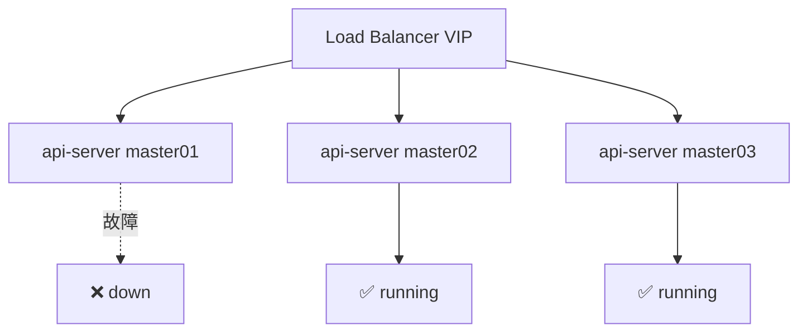

如果 `master01` 上的 API Server 进程异常退出，但负载均衡器的健康检查正常且其余两个实例正常运行，那么用户几乎无感知——`kubectl` 请求会自动转发到 `master02` 或 `master03`，集群功能不受任何影响。这正是 [EP.1 故障演练](failover-test-1.md) 中验证过的场景。

**场景二：所有 API Server 实例不可用**

这是本文实验模拟的极端情况：

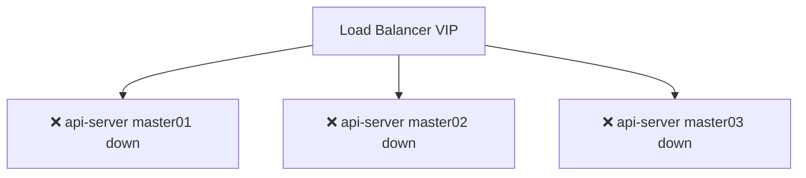

此时 Kubernetes API 入口完全消失。任何依赖 API Server 的操作都会失败：

```bash
kubectl get nodes
# Unable to connect to the server: EOF
# 或（直连时）: The connection to the server was refused
```

集群进入"失聪失明"状态，无法响应任何新的请求。

**场景三：API Server 进程正常，但无法访问 etcd**

这是一种更隐蔽的故障：API Server 进程仍在监听 `6443` 端口，可以接受连接，但其与 etcd 之间的链路出现问题（比如网络分区或 etcd 过载）。此时，所有需要读写持久化状态的请求都会失败，典型的报错如：

```text
etcdserver: request timed out
```

这种场景下，部分"只读"且能被 Watch Cache 响应的请求可能短暂成功，但任何写操作或需要从 etcd 获取最新版本的请求都会报错。其影响与 API Server 全宕类似，但故障现象更"诡异"。这正是 [EP.3：ETCD 多数派失效](failover-test-3.md) 中验证过的场景。

本文重点讨论的是**场景二：所有 API Server 实例同时不可用**，这也是最能帮助我们理解控制面与数据面边界的场景。

### 1.2 API Server 在 Kubernetes 中到底负责什么？

许多人下意识地将 API Server 视为 Kubernetes 的"核心大脑"，认为一旦它宕机，整个集群便会立即崩溃。但实际上，**API Server 是集群的"控制入口"而非"运行时执行者"**。

它的核心职责可以归结为：

1. **Kubernetes API 的统一入口**  
   任何资源操作——无论来自 `kubectl`、Client SDK、还是集群内部组件——都会被转换为对 API Server 的 HTTPS 请求，经认证、鉴权、准入后，最终写入 etcd。

2. **集群状态的声明式管理中枢**  
   控制器通过 Watch API Server 获知资源变化，在本地缓存的基础上进行 Reconcile，并将修正动作写回 API Server，形成闭环。

3. **组件间松耦合的信息交换中心**  
   Kubernetes 组件之间极少直接通信。例如 Controller 从不直接命令 kubelet 启动容器，而是通过 API Server 更新 Pod 对象，再由 kubelet 自行发现并执行。这种模式使得整个系统具备极高的扩展性与容错性。

!!! note "延伸阅读"
    关于 API Server 的六大核心职责、请求处理流水线以及 Watch 机制的深入解析，请参阅 [Kubernetes API Server 详解：集群的神经中枢与统一入口](../kubernetes/architecture/control-plane/api-server.md)。

下表总结了各组件对 API Server 的依赖关系及故障影响：

| 组件                 | 依赖 API Server 的主要操作              | 全宕后的影响                      |
| ------------------- | ------------------------------------ | ------------------------------- |
| kubectl             | CRUD 所有资源                           | 完全无法操作集群                    |
| Controller Manager  | Watch 资源变化、通过 API 更新资源状态        | 停止调谐，自动修复能力停摆               |
| Scheduler           | Watch 待调度 Pod、通过 API 写入 Node 绑定结果 | 新 Pod 永远处于 Pending 状态        |
| kubelet             | 获取 Pod 清单、上报节点和 Pod 状态           | 已有容器继续运行，但无法感知新 Pod 或状态变更  |
| kube-proxy          | Watch Service 和 EndpointSlice 对象   | 已有转发规则继续生效，无法更新             |
| etcd                | 仅作为存储后端，通过 API Server 被动访问      | 自身不受影响，但无新数据写入              |

---

## 二、原理推演：API Server 挂掉以后，各组件会怎样？

!!! info "注释说明"
    实际表现可能因组件版本和部署方式不同而异，详见第三部分实验

在正式进入实验之前，我们必须先理解每个组件的工作机制，这样在观察故障现象时才能知其所以然。

### 2.1 Controller Manager：进程不会退出，但调谐完全停止

Controller Manager 是 Kubernetes 中最核心的控制循环集合，其设计哲学是：

> **持续观察集群当前状态，并将其驱动至用户声明的期望状态。**

以 Deployment 为例，控制器一旦发现"期望副本数 3"与"实际运行副本数 2"之间存在差异，就会执行"创建 Pod"的调谐动作。

**正常工作流：**

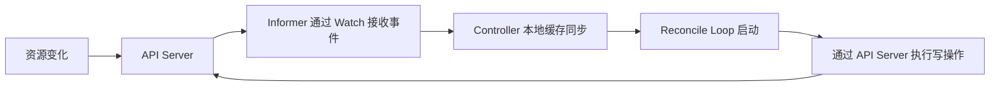

控制器并非不断地轮询 API Server，而是借助 **client-go 的 Informer 机制** 建立长连接 Watch。Informer 一方面会将资源对象缓存到本地内存中，另一方面会将资源变化事件放入工作队列，触发 Reconcile。这种设计大幅降低了对 API Server 和 etcd 的压力。

**全宕后发生什么？**

当所有 API Server 实例不可用时：

1. **Watch 连接中断**  
   所有 Informer 的长连接立即断开，不再收到任何新增或修改事件。

2. **本地缓存定格**  
   内存中保留的全量资源快照停留在故障前最后一刻，不会继续更新。控制器仍然可以读取这些缓存数据，但它们只代表过去的状态。

3. **Reconcile 尝试全部失败**  
   如果控制器根据缓存判断出需要执行某些操作（例如需要创建 Pod 以补足副本数），它会尝试调用 API Server 的 `Create` 或 `Update` 接口。这些请求会立刻失败（connection refused），然后由 client-go 的重试机制根据指数退避策略不断尝试重连。

4. **进程不会崩溃**  
   Controller Manager 本身作为独立进程，会持续运行并输出类似如下的日志：

   ```bash
      leaderelection.go: Error retrieving lease lock
   ```

   它并不会因为 API Server 不可达而退出，只是进入一种"休眠"状态，等待 API Server 恢复。

**各控制器的具体影响：**

- **Deployment / ReplicaSet Controller**  
  无法创建或删除 Pod。即使某些 Pod 被意外删除（比如被用户手动 kill），控制器也无法补足副本数。

- **StatefulSet Controller**  
  无法创建新的 Stateful Pod 或更新其状态。

- **Node Controller（特别关键）**  
  正常情况下，kubelet 每隔 10 秒向 API Server 发送节点心跳。当心跳丢失超过 40 秒（`node-monitor-grace-period`），Node Controller 会将该节点标记为 `NotReady`。  
  但**当 API Server 全宕时，Node Controller 自身也无法通过 API Server 更新 Node 对象**，因此节点状态会永远停留在最后一次成功心跳时的状态，而不会被标记为 `NotReady`。  
  这意味着：**整个集群在故障期间对节点状态的观察是"冻结"的，即便某个 Worker 节点此时真的宕机，外部也看不到任何变化。**

!!! summary "结论"
    Controller Manager 进程保持运行，但完全丧失获取新状态和修改资源的能力。所有依赖控制器的自动修复（自愈）功能全部暂时停摆。已有 Pod 不会被控制器主动删除，但也不会被恢复。

### 2.2 Scheduler：无法调度任何新 Pod，但不会崩溃

Scheduler 的工作相对单纯：观察所有 `spec.nodeName` 为空的 Pod（即 Pending 状态），为它们挑选一个最优的 Node，并将绑定结果（Binding）写入 API Server。

**正常调度流程：**

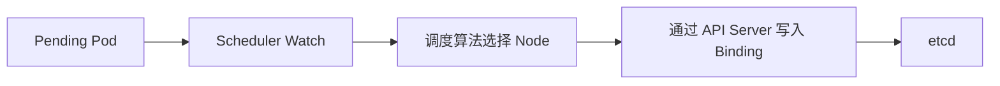

与控制器类似，Scheduler 也基于 Informer Watch 待调度的 Pod，并会在本地缓存所有 Node 和 Pod 信息。

**全宕后发生什么？**

- **Watch 断开**：无法再收到新的 Pending Pod 事件。
- **调度决策无法落盘**：即使缓存中存在尚未调度的 Pod，Scheduler 也无法执行 Binding 操作，因为该操作必须通过 API Server 写入 etcd。
- **进程保持运行**：Scheduler 不会退出，持续尝试重连。

此时，如果用户试图创建一个新的 Deployment（或者任何会生成 Pod 的资源），由于 API Server 不可用，`kubectl` 这一步就已经失败了，连 Deployment 对象都无法创建。因此，实际上在 API Server 全宕期间，**根本不会有新的 Pod 对象产生**。但若故障前已有部分 Pod 处于 Pending 状态，它们将一直保持该状态，直到 API Server 恢复后 Scheduler 才能重新进行调度。

!!! summary "结论"
    Scheduler 自身不崩溃，但由于无法从 API Server 获取新任务，也无法将调度结果写回，所有调度行为完全停滞。已运行的 Pod 不受影响。

### 2.3 kubelet：已有 Pod 会不会停止？

这是整个话题中最容易产生误解，也最值得用实验来验证的部分。

很多人直觉上认为：**API Server 挂了，kubelet 失去了与集群的联络，自然也就无法继续管理 Pod，因此 Pod 应该会立即停止。**

事实恰恰相反——**不会停止**。

原因在于 kubelet 并不是一个"远程遥控"的代理，它是运行在每个节点上的自主管理进程，拥有独立的本地状态和对容器运行时的直接控制权。

**kubelet 的核心职责：**

1. 从 API Server 获取本节点应当运行的 Pod 清单（PodSpec）；
2. 调用容器运行时（CRI）确保这些容器处于期望状态；
3. 执行探针（liveness / readiness / startup）并触发重启；
4. 上报节点和 Pod 的状态到 API Server。

**正常运行时的数据链路：**

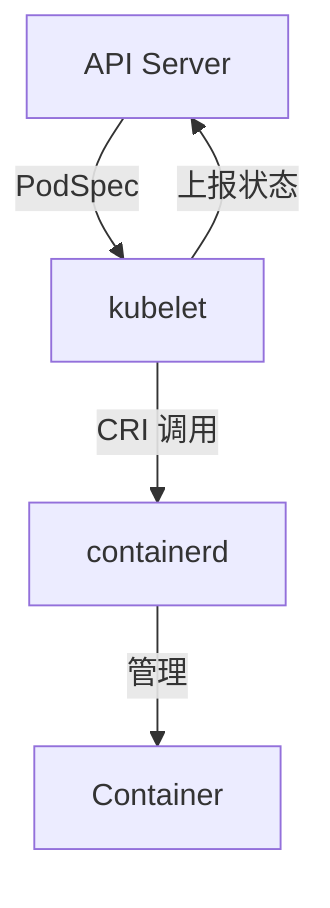

**kubelet 是否一直依赖 API Server？**

不是。虽然 kubelet 在启动和正常运行过程中，会通过 API Server 获取 Pod 清单、Secret、ConfigMap 等对象，但它并不会把这些获取路径当成容器维持运行的必要条件。

一旦某个 Pod 被调度到该节点并且 kubelet 成功启动了对应的容器，这个 Pod 的运行状态就存在于一条**完全的本地链路**中：

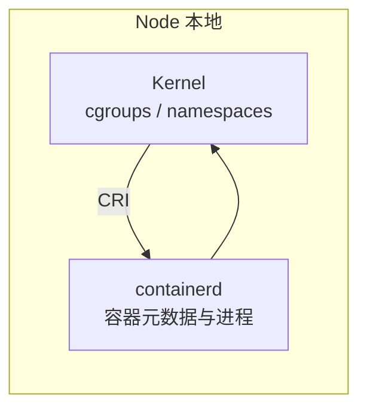

这条链路不再需要与 API Server 实时通信即可维持容器进程的存活。

**API Server 全宕后，kubelet 会发生什么？**

假设 worker01 上正在运行一个 `nginx` Pod，此时所有 API Server 实例全部停止。从控制面视角看，一切陷入黑暗；但在 worker01 上：

- **nginx 容器继续运行**，不会收到任何终止信号；
- kubelet 内存中保存了该 Pod 的完整 PodSpec，知道应当维持这个容器；
- 即使容器因故退出（例如进程崩溃），只要 Pod 的 `restartPolicy` 为 `Always` 或 `OnFailure`，kubelet 仍然能够通过 CRI 感知到退出事件，并**在本地重新拉起容器**，整个过程无需 API Server 参与。

这是因为 kubelet 内部有一个关键的组件——**PLEG (Pod Lifecycle Event Generator)**。PLEG 通过定期调用 CRI 检查容器状态，然后将事件发送给 kubelet 的其他模块（如 SyncLoop）。只要容器运行时正常运行，PLEG 就能独立工作，不依赖 API Server。

**kubelet 也不是完全不受影响：**

API Server 不可用后，kubelet 的以下功能会受到影响：

1. **节点心跳无法上报**  
   kubelet 会周期性地向 API Server 发送节点状态（`NodeStatus`）。此时这些上报会失败，日志中可能出现Lease 续约、Node Status、Webhook 认证、Event 写入四类错误。
   但由于 API Server 本身不可用，节点状态也无法被更新。

2. **新 Pod 无法被调度到本节点**  
   新 Pod 的创建和调度链路完全依赖 API Server，因此 API Server 全宕期间，不可能有新 Pod 被分配到任何 Worker 节点。

3. **Pod 状态无法同步**  
   如果某个容器崩溃并进入 `CrashLoopBackOff`，kubelet 知晓这一状态，但无法将其上报给 API Server。因此外部通过 `kubectl get pods` 看到的状态将永远定格在故障前一刻。

!!! summary "结论"
    API Server 故障期间，kubelet **仍然能够继续维护已运行的容器**，执行本地探针与重启策略。但它无法获取新的 Pod 配置，也无法向控制面同步节点及 Pod 的最新状态。节点上的业务容器不会因为 API Server 宕机而终止。

!!! tip "延伸阅读"
    关于 kubelet 的完整工作原理、PLEG 机制与 Pod 生命周期管理，请参阅 [Kubelet 工作原理详解：Node 节点上的核心管家](../kubernetes/architecture/node/kubelet.md)。

### 2.4 kube-proxy：已有网络规则不会立即消失

许多关于控制面故障的讨论往往忽略了 kube-proxy，但在生产环境中，它直接关系到**业务流量是否还能保持连通**。

kube-proxy 的职责是维护节点上的 Service 到 Pod 的流量转发规则。以最常见的 iptables 模式为例：

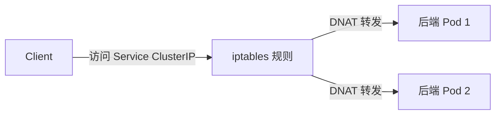

kube-proxy 通过 Watch API Server 获取 Service、Endpoints（或 EndpointSlice）对象的变化，并在本地 Linux 内核中同步对应的 iptables 或 IPVS 规则。

**API Server 全宕后，网络规则如何处理？**

当 API Server 不可用时：

- **已经刷入内核的 iptables/IPVS 规则仍然存在**，Linux 内核不会主动删除它们。因此，针对已有 Service 的访问流量照常可以匹配规则并转发到后端 Pod。
- 但是 kube-proxy 无法再收到任何更新事件。如果在此期间发生 Service 的新增、修改，或 Pod 副本数的变化（扩容、缩容、Pod 重启导致 IP 改变），kube-proxy 无法同步这些变化，会导致流量出现不一致（例如部分新 Pod 无法接收流量，或旧 Pod IP 已不可达但规则未移除）。

!!! summary "结论"
    API Server 故障期间，**已有 Service 的流量转发通常不受影响**，但网络规则将"冻结"在故障前最后一刻。任何 Service 或 Endpoint 的变化都不会被同步，可能导致部分服务访问异常。

### 2.5 etcd：完全不受影响

很多初学者容易产生一个误解：API Server 挂了，是不是 etcd 也会跟着挂掉？

**不会。**

从架构上看，etcd 仅与 API Server 通信，它并不感知上层的 Kubernetes 资源（Pod、Deployment 等），也不知道集群中运行着哪些组件。它唯一的工作是安全、一致地存储 API Server 写入的键值数据，并响应读取请求。

当所有 API Server 进程停止时，etcd 集群本身仍然可以对外服务（只是客户端全部断开了）。在 Master 节点上执行 `etcdctl endpoint health`，依然会返回 `healthy`。

!!! summary "结论"
    etcd 的运行完全独立于 API Server。API Server 只是 etcd 的一个客户端，API Server 宕机不会导致 etcd 停止。只要 etcd 集群自身满足法定人数（quorum），它就会继续运行，直到 API Server 恢复。

!!! tip "延伸阅读"
    关于 etcd 在 Kubernetes 中的角色、Raft 一致性协议以及为什么不能直接修改 etcd 数据，请参阅 [为什么 Kubernetes 不允许直接修改 etcd？](../kubernetes/architecture/control-plane/why-not-directly-modify-etcd.md) 和 [etcd 架构详解](../kubernetes/architecture/control-plane/etcd.md)。

### 2.6 已有 Pod 的生命周期：为什么 Pod 不会被杀？

现在可以回答本文最核心的问题：**已有的 Pod 为什么不会被 Kubernetes 主动杀掉？**

许多人的脑海中存在一个错误的控制模型：

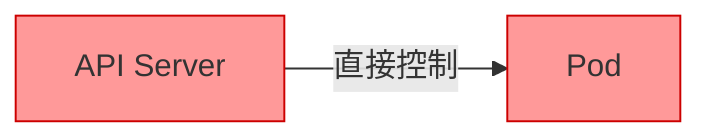

但实际上，Pod 的删除需要经历一个完整的请求链路：

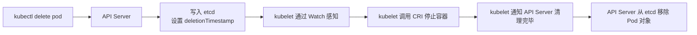

当 API Server 全宕时，**删除请求根本无法被接收和处理**。因此，已在运行的 Pod 永远不会收到删除指令。

**特殊情况：删除操作恰好在宕机前一刻开始**

如果某个 Pod 的 `deletionTimestamp` 已经由 API Server 成功写入 etcd，并且 kubelet 在 API Server 宕机前已经收到了这个事件，那么 kubelet 依然可以继续执行清理流程。但这只是极端边界情况，且清理完成后，kubelet 无法向 API Server 汇报结果，Pod 对象会一直停留在 `Terminating` 状态（在 API Server 恢复前无法被最终移除）。

总体而言，**控制面故障本身并不会导致 Pod 被杀死**。Pod 的生死仅由节点上的 kubelet 和容器运行时决定，而它们并不需要实时 API Server 连接来维持容器进程。

---

## 三、实验：直接停止 API Server，观察集群真实反应

原理分析已经足够清晰，接下来通过一组完整的实验，来验证上述所有结论。实验将模拟**所有 API Server 实例同时不可用**的极端场景。

### 3.1 实验环境

- Kubernetes 版本：v1.36
- 集群规模：3 Master（控制面组件为静态 Pod）+ 3 Worker
- 容器运行时：containerd
- CNI 插件：Calico
- 负载均衡：HAProxy（VIP 方式访问 API Server）

集群架构示意图：

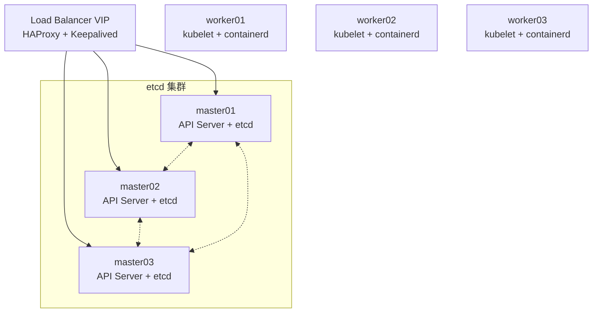

### 3.2 实验前检查：建立健康基线

在动手之前，最重要的一件事就是：**确认整个集群当前完全健康，并记录下每一个关键状态。** 没有基线，后面的所有"正常"都缺乏说服力。

**节点状态检查：**

```bash
kubectl get nodes -o wide
```

预期输出：

```
NAME       STATUS   ROLES           AGE   VERSION
master01   Ready    control-plane   10d   v1.36.x
master02   Ready    control-plane   10d   v1.36.x
master03   Ready    control-plane   10d   v1.36.x
worker01   Ready    <none>          10d   v1.36.x
worker02   Ready    <none>          10d   v1.36.x
worker03   Ready    <none>          10d   v1.36.x
```

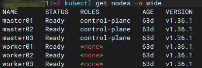

**核心组件 Pod 状态：**

```bash
kubectl get pods -n kube-system | grep -E 'apiserver|controller|scheduler|etcd'
```

确认所有控制面组件均为 `Running`。

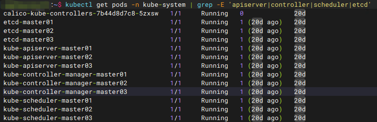

**部署测试业务：**

```bash
kubectl create deployment nginx --image=m.daocloud.io/docker.io/library/nginx --replicas=3
kubectl expose deployment nginx --port=80 --type=NodePort
```

记录 Service 暴露的端口，并验证访问正常：

```bash
kubectl get pod,svc
curl http://<WorkerIP>:<NodePort>
```

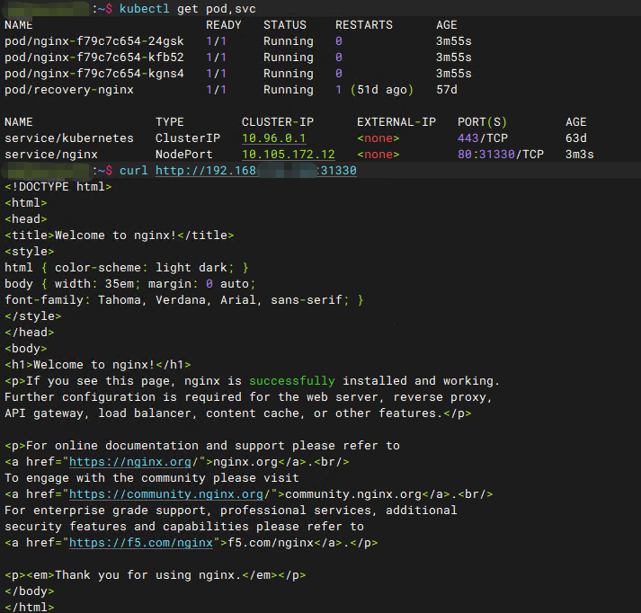

### 3.3 停止所有 API Server 实例

由于 kubeadm 默认将 API Server 作为静态 Pod 运行，停止方法是将 `kube-apiserver.yaml` 移出 kubelet 的监控目录。

**在所有 Master 节点上执行：**

```bash
mv /etc/kubernetes/manifests/kube-apiserver.yaml /tmp/
```

kubelet 会在几秒内检测到 manifest 文件消失，并停止对应的 API Server 容器。

验证 API Server 已不可达：

```bash
kubectl get nodes --request-timeout=5s
```

返回：

```bash
client rate limiter Wait returned an error: context deadline exceeded - error from a previous attempt: EOF
```

再试不带 timeout 的：
```bash
kubectl get nodes
```
返回:
```bash
Unable to connect to the server: EOF
```

这两个报错值得留意。直觉上可能预期会看到 connection refused，但实际输出是 EOF——无论带不带 timeout。

原因是本实验中 kubectl 并不直连 API Server，而是经过 HAProxy 负载均衡器。API Server 容器被停止后，HAProxy 的后端健康检查有短暂的窗口期尚未更新，它会尝试向后端建立连接，后端在 TLS 握手阶段就断开了，HAProxy 随即将这个 EOF 透传给了 kubectl。

- 带 --request-timeout=5s 时，client-go 的客户端限流器在重试退避等待中先一步超时，报 context deadline exceeded；
- 不设 timeout 时，重试跑完最终返回 Unable to connect to the server: EOF。

如果是直连 API Server（不经 LB），或者等 LB 健康检查更新后重试，才会看到更熟悉的 connection refused。这个差异在排障时容易让人困惑——看到 EOF 不要误以为是网络配置问题，它就是后端不可达时 LB 的正常表现。

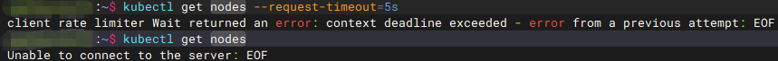

### 3.4 确认 API Server 不可达与业务容器存活

虽然 kubectl 已无法使用，但可以登录 Worker 节点直接查看容器运行时。

**查看正在运行的容器：**

```bash
sudo crictl ps | grep nginx
```

返回：

```text
e6cac9a74deae       8870c81b28342       41 minutes ago      Running             nginx               0                   5ba6bc7ee0411       nginx-f79c7c654-kfb52                       default
```

容器仍在运行，启动时间停留在 41 分钟前——API Server 的消失对已经运行的容器没有任何影响。
> 💡 如果你的 crictl 没有配置 /etc/crictl.yaml，命令会输出两条 WARN 提示使用默认 endpoint。这不影响功能，但建议在节点上创建配置文件消除告警：
> ```bash
> sudo tee /etc/crictl.yaml << 'EOF'
> runtime-endpoint: unix:///run/containerd/containerd.sock
> image-endpoint: unix:///run/containerd/containerd.sock
> EOF
> ```

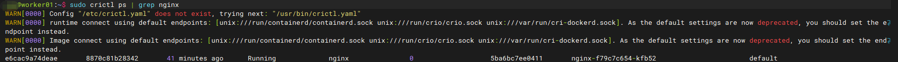

**验证业务流量：**

```bash
curl http://<WorkerIP>:<NodePort>
```

返回 `Welcome to nginx!`，说明已有 Service 转发规则依然有效。

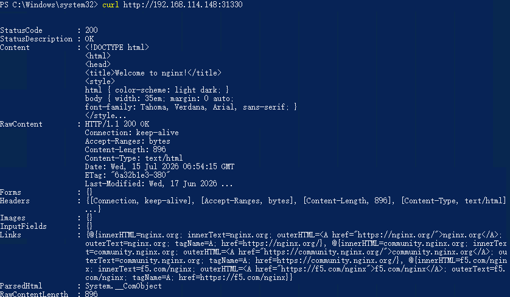

### 3.5 控制面组件降级行为与 kubectl 操作验证

API Server 全宕后，最先受到影响的就是控制面两大核心组件：Controller Manager 和 Scheduler。它们不会崩溃，但会立即陷入"失联"状态。

**Controller Manager 日志观察**

由于 kubeadm 将 controller-manager 作为静态 Pod 运行，通过 `crictl` 查看日志：

```bash
# 在 master01 上找到 controller-manager 容器
CM_ID=$(sudo crictl ps | grep kube-controller-manager | awk '{print $1}')
sudo crictl logs --tail=30 $CM_ID
```

> ⚠️ sudo 必须放在子 shell 内部（$(sudo crictl ps ...)），写成 sudo CM_ID=$(crictl ps ...) 会导致 crictl 无权限访问 containerd socket，变量为空。

日志中会高频出现 Leader Election 租约获取失败的错误：

```text
E0715 06:59:22.378288  1 leaderelection.go:461] "Error retrieving lease lock" err="Get \"https://192.168.114.145:6443/apis/coordination.k8s.io/v1/namespaces/kube-system/leases/kube-controller-manager?timeout=5s\": dial tcp 192.168.114.145:6443: connect: connection refused" lock="kube-system/kube-controller-manager"
E0715 06:59:26.642985  1 leaderelection.go:461] "Error retrieving lease lock" err="..." lock="kube-system/kube-controller-manager"
E0715 06:59:29.362319  1 leaderelection.go:461] "Error retrieving lease lock" err="..." lock="kube-system/kube-controller-manager"
...（持续输出，每 2-3 秒一条）
```

这里看到的不是之前预想的 Failed to watch 或 Reconcile 错误，而是 Leader Election 租约续期失败。这更符合实际情况：Controller Manager 通过 Lease 对象维持主身份，API Server 消失后它无法续约 lease，因此不断重试。这意味着：

- 当前 leader 仍会继续工作——它不会因为续约失败就立即放弃 leader 身份，而是在 lease 租期（默认 15 秒）内仍尝试履行职责；
- 但所有需要访问 API Server 的操作全部失败——无论是 Watch 事件、List 资源、还是 Create/Update 操作，都因为 connection refused 而无法完成；
- 非 leader 实例完全闲置——多 master 环境下，只有 leader 在尝试续约，其余实例本就在等待获取 lease，更不会做任何操作。

Controller Manager 进程本身从未退出，它的核心事件循环依然在运行。一旦 API Server 恢复，lease 续约成功，Reconcile 循环会立即恢复正常工作。但在 API Server 不可用期间：

- 无法获取任何资源的增量变化；
- 无法创建新的资源（例如补足副本数）；
- 无法更新现有资源的状态。

整个控制面处于"冻结"状态，而非崩溃。

另外注意一个细节：这里日志里的 connection refused 和之前 kubectl 看到的 EOF 不同——因为 Controller Manager 是 Pod 内部直连 API Server 的 Pod IP，不经过 HAProxy，所以后端容器一停就是干干脆脆的 connection refused。

**Deployment 扩容测试**

尝试对之前创建的 `nginx` Deployment 进行扩容：

```bash
kubectl scale deployment nginx --replicas=5
```

会直接失败,返回：

```text
Unable to connect to the server: EOF
```

与之前 kubectl get nodes 一样，经过 HAProxy 的请求在 API Server 容器停止后收到的是 EOF。扩容请求的第一步——通过 API Server 修改 Deployment 对象的 spec.replicas——就已经被阻断。即便后续控制器还存活，也永远收不到这一变更事件。


**Scheduler 日志观察**

与 Controller Manager 类似，查看 Scheduler 日志：

```bash
SCHED_ID=$(sudo crictl ps | grep kube-scheduler | awk '{print $1}')
sudo crictl logs --tail=30 $SCHED_ID
```

返回：

```text
W0715 06:22:02.960950  1 authentication.go:397] Error looking up in-cluster authentication configuration: Get "https://192.168.114.145:6443/api/v1/namespaces/kube-system/configmaps/extension-apiserver-authentication": dial tcp 192.168.114.145:6443: connect: connection refused
W0715 06:22:02.960969  1 authentication.go:398] Continuing without authentication configuration. This may treat all requests as anonymous.
I0715 06:22:02.972566  1 server.go:178] "Starting Kubernetes Scheduler" version="v1.36.1"
I0715 06:22:02.978292  1 shared_informer.go:402] "Waiting for caches to sync"
I0715 06:22:02.983653  1 secure_serving.go:214] Serving securely on 127.0.0.1:10259
```

这里的日志和 Controller Manager 不同——Controller Manager 是在运行中失去与 API Server 的连接，而 Scheduler 的日志显示它在启动阶段就遇到了 connection refused。关键行是 Waiting for caches to sync：Scheduler 的 Informer 需要从 API Server List 全量资源来完成初始缓存同步，API Server 不可用时这一步永远无法完成。

这意味着 Scheduler 卡在启动流程中，既没有完成缓存同步，也没有进入正常的调度循环。它不会崩溃，但也无法执行任何调度动作：
- 无法感知新创建的 Pod（Informer 从未启动）；
- 无法将调度结果写回 API Server（写入本身也会失败）；
- 任何处于 Pending 状态的 Pod 将永远停留在该状态，直到 API Server 恢复后 Scheduler 完成缓存同步并开始调度。

> 💡 如果你的 Scheduler 是在 API Server 宕机前就已经启动完成的，日志尾部的表现会不同——你会看到类似 Controller Manager 的 leaderelection 租约续约失败，而非启动阶段的 cache sync 卡住。两种情况的本质相同：Scheduler 进程存活，但无法与 API Server 通信，调度功能完全停滞。

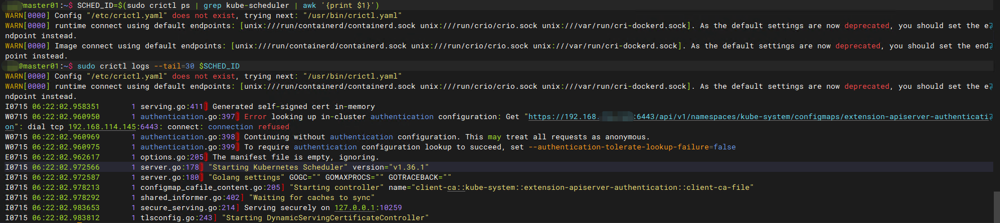

**创建新 Pod 测试**

尝试直接创建一个临时 Pod：

```bash
kubectl run test-nginx --image=m.daocloud.io/docker.io/library/nginx
```

返回：
```bash
Unable to connect to the server: EOF
```

与之前所有 kubectl 命令一样，经过 HAProxy 的请求收到 EOF。新 Pod 对象根本无法进入集群——请求在到达 API Server 之前就被阻断了。

!!! note "小结"
    在 API Server 全宕期间，Controller Manager 与 Scheduler 均保持进程运行，持续尝试重连，但完全丧失对集群状态的读写能力。整个控制面的自动修复与调度行为彻底停滞，然而这并非崩溃——只是暂时性的"沉默"。

### 3.6 kubelet 心跳失败与节点状态冻结

这一阶段最能体现"数据面与控制面分离"的设计优势。

**kubelet 心跳上报失败**

登录任意 Worker 节点，观察 kubelet 日志：

```bash
sudo journalctl -u kubelet -f
```

会高频出现多类错误：

```text
# 1. 节点状态更新失败
E0715 15:31:14.832894  1 controller.go:201] "Failed to ensure lease exists, will retry" err="Get \"https://192.168.114.134:6443/apis/coordination.k8s.io/v1/namespaces/kube-node-lease/leases/worker01?timeout=10s\": context deadline exceeded - error from a previous attempt: EOF" interval="7s"

E0715 15:31:16.573978  1 kubelet_node_status.go:479] "Error updating node status, will retry" err="failed to patch status \"...\" for node \"worker01\": Patch \"https://192.168.114.134:6443/api/v1/nodes/worker01/status?timeout=10s\": EOF"

# 2. Webhook 认证失败
E0715 15:31:10.027574  1 webhook.go:154] Failed to make webhook authenticator request: Post "https://192.168.114.134:6443/apis/authentication.k8s.io/v1/tokenreviews": EOF
E0715 15:31:10.027654  1 server.go:376] "Unable to authenticate the request due to an error" err="Post \"https://192.168.114.134:6443/apis/authentication.k8s.io/v1/tokenreviews\": EOF"

# 3. Event 写入失败
E0715 15:31:11.261407  1 event.go:368] "Unable to write event (may retry after sleeping)" err="Patch \"https://192.168.114.134:6443/api/v1/namespaces/kube-system/events/kube-proxy-npt2l.18c2637da6484028\": EOF"
```

实际日志比预想的要"热闹"得多。kubelet 与 API Server 的交互远不止心跳上报，至少涉及三类独立请求：

- Lease 续约（controller.go）——kubelet 每 7 秒向 kube-node-lease 命名空间更新节点 Lease 对象，这是节点心跳的轻量级实现。注意这里的报错是 context deadline exceeded - error from a previous attempt: EOF，和之前 kubectl 经过 HAProxy 的表现一样——worker01 的 kubelet 也是通过 LB 地址（192.168.114.134）访问 API Server，所以收到的是 EOF 而非 connection refused。

- Node Status 上报（kubelet_node_status.go）——kubelet 周期性 PATCH 节点的 Conditions（MemoryPressure、DiskPressure、PIDPressure、Ready 等），同样因 EOF 失败。

- Webhook 认证（webhook.go）——kubelet 的 API 请求需要通过 TokenReview 向 API Server 做认证，API Server 不可用时认证直接失败，导致 kubelet 无法响应任何经过认证的 API 请求。

- Event 写入（event.go）——kubelet 检测到异常（如 FailedMount）时尝试向 API Server 写入 Event 对象，同样失败。这意味着故障期间 kubelet 的所有告警事件都堆积在本地内存中，无法被 kubectl get events 看到。

> 💡 注意 IP 区别：Controller Manager 日志里连的是 192.168.114.145（Pod IP，直连），而 kubelet 日志里连的是 192.168.114.134（LB VIP），所以前者报 connection refused，后者报 EOF。这个差异完全取决于客户端是否经过 HAProxy。

但这里有一个容易被误解的关键点：由于 API Server 本身已宕机，Node Controller 同样无法通过 API Server 读取节点状态或写入任何更新。 因此：

- 节点的心跳更新时间会永远定格在故障发生前的最后一刻；
- Node Controller 无法将节点标记为 NotReady；
- 基于节点 NotReady 触发的 Pod 驱逐、重新调度等动作一概不会发生。

**为什么 Pod 不会被驱逐？**

很多人误以为"心跳一断，Pod 就会被驱逐"。实际的驱逐链路非常长：

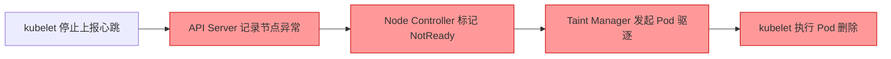

当 API Server 全宕时，图中标红的第 2、3、4 步全部无法执行，因此 **Pod 根本不会被驱逐**。这是 Kubernetes 架构中一个极为重要的容错特性。

### 3.7 分钟：验证 kubelet 的本地容器自愈能力

现在进行本次实验中最关键的一个验证：**API Server 宕机后，kubelet 是否还能自动重启异常退出的容器。**

步骤如下：

1.  登录 Worker 节点，查看当前运行中的 nginx 容器：

    ```bash
    sudo crictl ps | grep nginx
    ```
记录下某个容器的 ID。

2.  手动停止该容器，模拟进程崩溃：

    ```bash
    sudo crictl stop <container-id>
    ```

3. 稍等片刻后，再次查看容器列表：

    ```bash
    sudo crictl ps | grep nginx
    ```

你会看到一个**全新的容器 ID**，且启动时间就在最近几秒。这说明即使完全无法与 API Server 通信，kubelet 依然通过 PLEG 机制检测到了容器退出，并按照 Pod 的 `restartPolicy` 在本地重新拉起了容器。整个过程完全不需要控制面的参与。

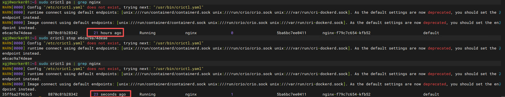

**这个实验直接证明了：kubelet 对已调度到本节点的 Pod 拥有完整的本地自治能力，容器的存活与 API Server 无关。**

### 3.8 恢复 API Server

实验最后一步，将所有 Master 节点上的 `kube-apiserver.yaml` 静态 Pod 清单文件移回原位：

```bash
mv /tmp/kube-apiserver.yaml /etc/kubernetes/manifests/
```

kubelet 会立刻检测到文件变化，并重新创建 API Server 容器。等待约 30 秒至 1 分钟，API Server 就会完全就绪。

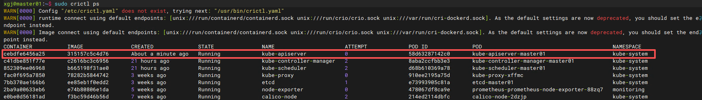

### 3.9 API Server 恢复后，集群如何自愈？

控制面恢复后，各组件会迅速重新建立 Watch 连接，并基于 etcd 中保存的期望状态启动 Reconcile 流程。

**Controller Manager：**

- 重新 List/Watch 所有资源，更新本地 Informer 缓存；
- 发现期望状态与实际状态的不一致（例如，某些 Deployment 的副本数不足）；
- 立即通过 API Server 创建缺失的 Pod。

如果此前你曾尝试将 nginx 扩容到 5 个副本但失败（实际未写入 etcd），恢复后 Deployment 的 `replicas` 仍然为 3，控制器不会主动创建额外 Pod；但如果某些 Pod 在故障期间被手动删除（例如在 Worker 节点上通过 `crictl stop` 强行移除容器但保留 Pod 对象），那么控制器会检测到 Pod 仍存在但容器已消失，从而触发重建。

**Scheduler：**

- 重新 Watch 所有 Pending Pod；
- 立即对它们执行调度，并将 Binding 结果写回 API Server；
- 此前卡在 Pending 的 Pod 会在短时间内被分配到可用节点。

**kubelet：**

- 重新与 API Server 建立连接；
- 上报本节点的 `NodeStatus` 和所有 Pod 的最新状态；
- 如果发现新的 Pod 被绑定到本节点，立即拉取镜像并启动容器。

**验证集群恢复：**

执行：

```bash
kubectl get nodes
kubectl get pods -A
```

所有节点应快速恢复为 `Ready`，系统 Pod 和测试 Pod 均为 `Running` 状态。

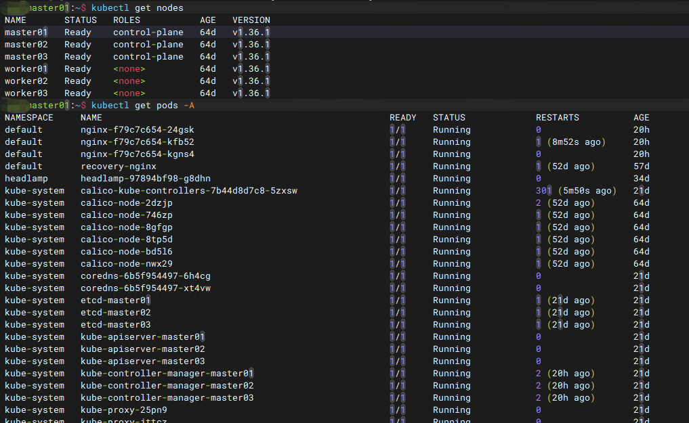

---

## 四、实验结果总结：API Server 故障影响一览

| 组件/资源              | 故障期间表现                                   | 恢复后                                   | 影响等级 |
| ---------------------- | ---------------------------------------------- | ---------------------------------------- | -------- |
| kubectl                | 所有命令失败，连接被拒                         | 立即恢复                                 | ⚠️ 中   |
| API Server             | 完全不可用                                     | 容器重建后恢复服务                       | 🔴 高   |
| etcd                   | 正常运行，数据完整                             | 无影响                                   | ✅ 无   |
| Controller Manager     | Watch 中断，无法调谐，持续重连                 | 重新同步状态，继续 Reconcile             | ⚠️ 中   |
| Scheduler              | 无法调度新 Pod，持续重连                       | 立即处理积压的 Pending Pod               | ⚠️ 中   |
| kubelet                | 本地维护已有容器，可重启退出容器               | 恢复状态上报，获取新 Pod                 | ✅ 低   |
| containerd             | 容器进程继续运行                               | 无影响                                   | ✅ 无   |
| 已有 Pod               | 正常运行，不受影响                             | 无影响                                   | ✅ 无   |
| 已有 Service 流量      | iptables/IPVS 规则仍在内核中，转发正常         | 恢复后同步最新的规则变更                 | ✅ 无   |
| 新 Pod 创建            | 完全失败                                       | 恢复后控制器按需创建                     | ⚠️ 中   |
| Node 状态              | 冻结在最后心跳状态，不会被标记 NotReady        | 心跳恢复，状态更新为 Ready               | ⚠️ 中   |

---

## 五、为什么 Kubernetes 能做到"控制面挂了，业务不停"？

这背后是 Kubernetes 架构设计中四个核心原则的集中体现。

**1. 控制面与数据面严格分离**

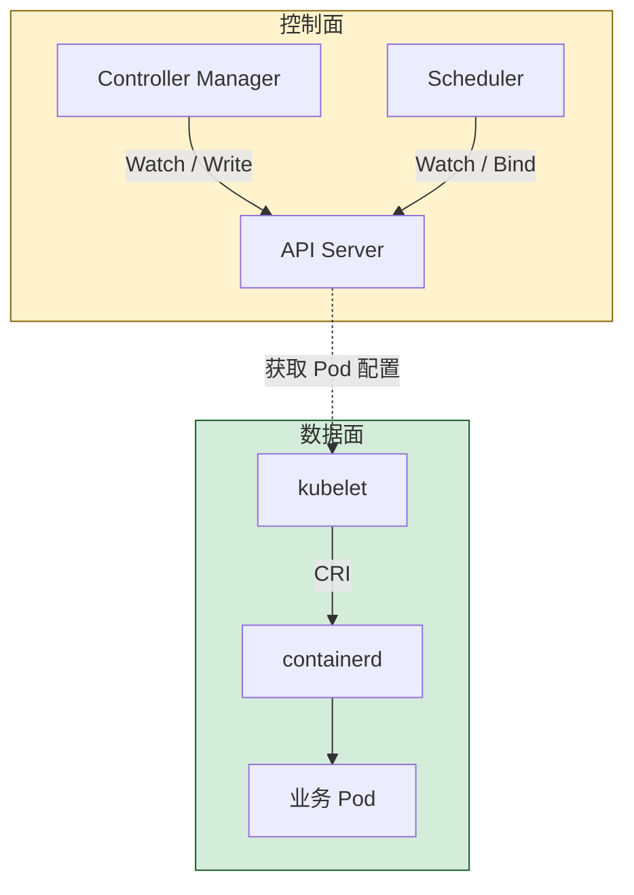

控制面负责全局调度和状态管理，数据面负责本地容器运行。两者通过异步的 API 调用解耦，而非实时心跳强关联。控制面消失后，数据面的本地链路依然完整。

**2. 声明式模型**

用户只声明期望状态（如 `replicas: 3`），控制器持续驱动实际状态向期望状态靠拢。短暂的 API Server 中断只会暂停驱动过程，而不会破坏状态本身。一旦控制面恢复，Reconcile 逻辑会立即修复任何偏差。

**3. Informer 与本地缓存**

Controller、Scheduler、kubelet 等组件都维护了从 API Server Watch 同步过来的本地资源缓存。即使 Watch 连接中断，缓存依然保留着最后一刻的全量快照，使组件在重连后有上下文可循，降低状态振荡。

**4. etcd 独立持久化**

所有期望状态被安全地保存在 etcd 中，与 API Server 的生命周期完全解耦。只要 etcd 集群存活且数据完整，Kubernetes 集群就拥有"恢复记忆"的能力。

---

## 六、生产环境启示：如何降低 API Server 故障风险？

虽然 Kubernetes 自身具备一定容错能力，但在生产环境中仍必须主动防范。

**1. 部署高可用 API Server**

至少 3 个 Master 节点，前端通过 HAProxy 或云负载均衡器提供统一 VIP，并配置合理的健康检查（不要仅依赖 TCP 检查，应使用 `/healthz` 或 `/readyz` 端点）。

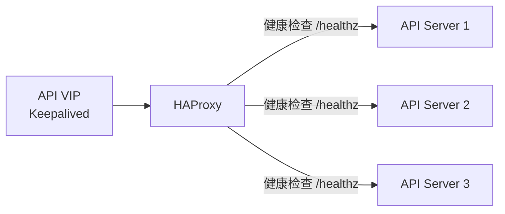

**2. 监控关键指标**

密切关注：

- `apiserver_request_duration_seconds` 及请求错误率（5xx）
- `etcd_request_duration_seconds`（API Server 与 etcd 之间的延迟）
- API Server 内存与 CPU 使用量，防止 OOM

**3. 防范常见故障诱因**

- **etcd 性能下降**：导致 API Server 请求超时；
- **证书过期**：如 `x509: certificate has expired` 会导致 TLS 握手失败；
- **准入 Webhook 阻塞**：若 Mutating/ValidatingWebhook 后端服务不可用且无超时保护，会拖垮整个 API Server；
- **资源竞争**：控制面节点资源不足时，API Server 可能被 OOM Kill。

**4. 定期进行故障演练**

模拟 API Server 宕机、etcd 故障、节点失联等场景，验证监控告警、应急响应流程及集群自愈的实际表现。只有经过真实演练，才能确认集群在面对控制面全宕时的真正承受能力。

!!! tip "故障演练系列"
    本站的故障实验室已经完成了多轮演练，欢迎结合阅读：

    - [EP.1：一台 Master 宕机](failover-test-1.md) —— 单 Master 故障，集群无感知
    - [EP.2：LB 节点整机宕机](failover-test-2.md) —— VIP 漂移，kubectl 短暂卡顿
    - [EP.3：ETCD 多数派失效](failover-test-3.md) —— 控制面瘫痪，数据面存活

---

## 七、常见问题 FAQ

**Q1：API Server 全宕后，Pod 会被 Kubernetes 杀掉吗？**

**A：不会。** Pod 的删除必须由 API Server 下发 `deletionTimestamp` 并由 kubelet 执行。API Server 不可用时，删除命令根本无法生成。

**Q2：API Server 挂了还能创建 Pod 吗？**

**A：不能。** 创建 Pod 的请求第一步就是访问 API Server，API Server 不可达则整个流程中断。

**Q3：API Server 挂多久才算危险？**

**A：没有绝对阈值。** 短期中断业务通常无感，但随着时间拉长，自动扩容、故障自愈、状态同步等能力全部丧失，运维操作也无法进行。对业务的影响取决于这段时间内是否发生其他意外（如 Pod 崩溃、节点故障等）。建议 5 分钟内恢复，超过 15 分钟需要人工介入。

**Q4：多 Master 环境下只有一个 API Server 挂了有影响吗？**

**A：正常无影响。** 负载均衡器会自动将流量导向健康的 API Server 实例。这正是 [EP.1 故障演练](failover-test-1.md) 中验证过的场景。

**Q5：API Server 恢复后，故障期间的数据会丢失吗？**

**A：不会。** 集群期望状态完整保存在 etcd 中，恢复后控制器会根据 etcd 中的数据进行 Reconcile，使集群恢复一致。kubelet 在本地缓存了 Pod 状态，API Server 恢复后会重新上报。Controller 会重新同步 Watch Cache，追上所有 missed events。

**Q6：节点在 API Server 宕机期间重启了，Pod 会怎样？**

**A：** 节点重启后 kubelet 启动时需要从 API Server 获取最新 Pod 清单。如果此时 API Server 仍然不可用，kubelet 将无法恢复该节点上的 Pod，即使容器镜像存在于本地。Pod 会丢失，直到 API Server 恢复后由控制器在其他节点上重新创建。

**Q7：故障期间 kubelet 会驱逐 Pod 吗？**

**A：不会。** Pod 驱逐由控制器（Taint Manager）通过 API Server 发起，API Server 不可用时驱逐无法发生。

---

## 八、总结

通过本次理论分析与实验验证，我们可以清晰地得出以下结论：

1. **API Server 是 Kubernetes 控制面的唯一入口，但不是容器运行时的依赖。**
2. **API Server 全宕后，业务 Pod 不会立即停止，数据面继续运行。**
3. **Controller Manager 和 Scheduler 进程不会退出，但会暂停所有控制能力。**
4. **kubelet 能够独立维护已调度的 Pod，甚至可以在本地重启崩溃的容器。**
5. **已有 Service 的网络规则通常不受影响，流量转发依然正常。**
6. **API Server 恢复后，集群会通过声明式控制模型自动修复所有偏差，重新回到期望状态。**

理解这些行为，也就掌握了 Kubernetes 高可用架构设计的核心思想：**控制面可以短暂"失聪失明"，但只要 etcd 数据完好、数据面组件健壮，业务就能持续运行，系统终将自愈。**

---

## 系列文章导航

| 文章 | 故障场景 | 核心验证 |
| --- | --- | --- |
| [EP.1：一台 Master 宕机](failover-test-1.md) | 强制关闭一台 Master 节点 | kubectl 是否中断、etcd 多数派是否保持、业务是否受影响 |
| [EP.2：LB 节点整机宕机](failover-test-2.md) | 打挂 Keepalived + HAProxy | VIP 能否自动漂移、kubectl 是否中断 |
| [EP.3：ETCD 多数派失效](failover-test-3.md) | 停掉 3 个 etcd 中的 2 个 | 控制面是否瘫痪、数据面是否存活 |
| **EP.4：API Server 全挂（本文）** | 停止所有 API Server 实例 | 各组件降级行为、Pod 是否存活、集群如何自愈 |

## 参考资料

- [Kubernetes 官方文档：Kubernetes Components](https://kubernetes.io/docs/concepts/overview/components/)
- [Kubernetes 官方文档：Control Plane-Node Communication](https://kubernetes.io/docs/concepts/architecture/control-plane-node-communication/)
- [Kubernetes 官方文档：Kubelet](https://kubernetes.io/docs/reference/command-line-tools-reference/kubelet/)
- [client-go Informer 工作机制](https://github.com/kubernetes/sample-controller/blob/master/docs/controller-client-go.md)
- [API Server 详解](../kubernetes/architecture/control-plane/api-server.md)
- [Controller Manager 详解](../kubernetes/architecture/control-plane/controller-manager.md)
- [Kubelet 详解](../kubernetes/architecture/node/kubelet.md)
- [为什么不能直接修改 etcd](../kubernetes/architecture/control-plane/why-not-directly-modify-etcd.md)
