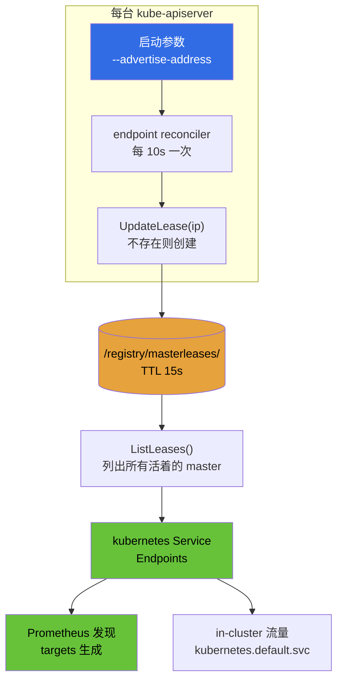
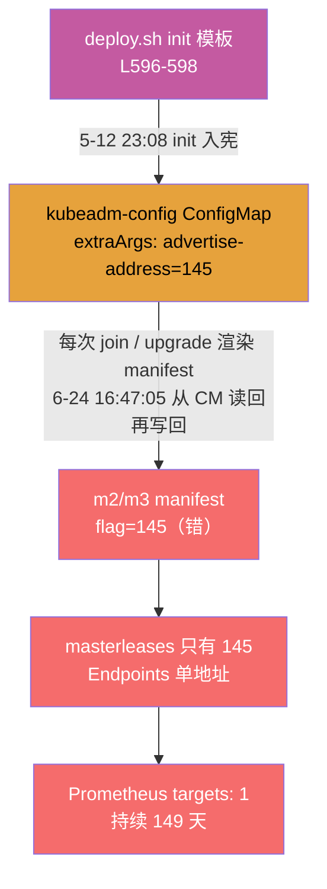

# apiserver 盲区：三台 master，Prometheus 只看得见一台——149 天的修复实录

> **实测声明**：本文全部命令与输出于 2026-10-09 至 2026-10-10 在我的测试集群上实际运行采集（3 master + 3 worker + 外置双机负载均衡，K8s v1.36.1，kubeadm 部署）。所有终端输出逐字存档，源码引用标注 kubeadm v1.36.1 / kube-apiserver v1.36.1 具体行号，可复核。

上一篇排查 P99 的时候，我顺手翻了一眼 `/api/v1/targets`，结果看到一件很扎心的事：这个三 master 的集群里，Prometheus 的 `apiserver` job 只有 1 个 target。其余两台 apiserver 呢？

```console
$ curl -s http://localhost:$PROM_PORT/api/v1/targets | python3 -c "
...
print('apiserver targets:',len(ts))
for t in ts: print(' ',t['scrapeUrl'],'| health:',t['health'],'| lastError:',t.get('lastError',''))"
apiserver targets: 1
  https://192.168.114.145:6443/metrics | health: up | lastError: 
```

三台 apiserver，只有一个 target，而且它还是 `up` 的。没有报错，没有红叉，也没有告警——仿佛整个集群从来只有一台 master。这个故事就是从这一处“表面正常但不对劲”的症状开始的：我沿着 `targets -> Endpoints -> etcd lease -> kubeadm 源码 -> 部署脚本` 这条链一路排查，最后在一个完全意想不到的配置点上找到了真正的根因。

## 结论速览

先把结论放在前面：**三台 apiserver 都活着、都健康、都自认为在服务，但其中两台从第一天起就是把心跳写到了错误的地址上，149 天里系统没有对这件事发出任何声音。**

- 不是 `target` 挂了，因为 `up=1`，而且序列没有波动；
- 也不是 apiserver 服务本身坏了，因为 `readyz` 全绿，日志里没有同步相关错误；
- 真正的问题是：`kubernetes.default.svc` 的 Endpoints 只有一个地址，而它正是 Prometheus 生成 `apiserver` target 的来源；
- 末端根因在 `kubeadm-config` 里的 `advertise-address` override，被错误写成了 `192.168.114.145`，导致 m2/m3 在错误的 IP 上续租，永远没有出现在 Endpoints 里。

## 现场勘查：表面正常，异常却藏在 Endpoints

案发现场第一眼，到处都正常。

三台 apiserver pod 都是 Running：

```console
$ kubectl -n kube-system get pods -o wide | grep kube-apiserver
kube-apiserver-master01   1/1   Running   11 (25d ago)   107d
kube-apiserver-master02   1/1   Running    2 (46d ago)   107d
kube-apiserver-master03   1/1   Running   10 (25d ago)   107d
```

三台节点全 Ready，readyz 全绿：

```console
$ kubectl --server=https://192.168.114.146:6443 get --raw '/readyz?verbose' | tail -2
[+]shutdown ok
readyz check passed
```

（147、145 同样 passed，输出略。直连姿势沿用上一篇的 `--server`，绕过 LB 走 flannel 直达。）

三台的日志里，跟 Service 同步相关的错误一个都没有：

```console
$ kubectl -n kube-system logs kube-apiserver-master02 --since=30m 2>&1 | grep -cE "unable to sync kubernetes service|Found stale data|Error removing old endpoints"
0
```

readyz 里甚至有一行专门的角色证明——端点协调器自己的健康检查：

```console
[+]poststarthook/peer-endpoint-reconciler-controller ok
```

协调器在跑，它说它很健康。

但看 `kubernetes` 这个 Service 的 Endpoints：

```console
$ kubectl get endpoints kubernetes -n default -o yaml
apiVersion: v1
kind: Endpoints
metadata:
  creationTimestamp: "2026-05-12T15:08:28Z"
  ...
subsets:
- addresses:
  - ip: 192.168.114.145
```

**只有一个地址：145。**  creationTimestamp 是 2026-05-12——从这个对象诞生到今天，它就没变过。

再看 Prometheus 的十天窗口（`up{job="apiserver"}`，每小时一个点）：

```console
$ # 10 天窗口的 up 序列盘点
192.168.114.145:6443 points: 241 up值集合: ['1']
--- instance 序列数: 1
```

241 个点，十天，只有 145 一个序列，全程 `up=1`。没有序列消失过——因为另外两台**从来没进过这个序列**。

到这里，案子的性质已经很清楚：

- 不是“目标挂了”，因为挂了会出现 `up=0`；
- 也不是“服务坏了”，因为 `readyz` 全绿、日志里也没有同步错误；
- 真正的问题是：**名单上从来就没那两台**。Prometheus 的 `apiserver` target 是从 `Endpoints` 发现的，而 `kubernetes` Service 的 `Endpoints` 只有 145 这一条地址，所以只有 145 会出现在监控里。

这就把问题收敛成一个更核心的问题：**`kubernetes` Service 的 `Endpoints` 到底是谁在维护？**

## 机制剥洋葱：没有 selector 的 Service

正常的 Service 都有 selector，endpoints controller 看着 selector 找到匹配的 pod，把地址填进 Endpoints。但 `kubernetes` 这个 Service 是个特例，它没有 selector：

```console
$ kubectl get svc kubernetes -o yaml | grep -A2 selector
$ # 空——没有 selector
```

没有 selector，endpoints controller 就不管它。那地址从哪来？

答案：**apiserver 自己填。**  集群里的每个 kube-apiserver 启动时都会带一个 endpoint reconciler，它做三件事：

1. 拿自己的 `--advertise-address`，去 etcd 里写一个"心跳 key"
2. 每 10 秒列一遍所有 master 的 key（`ListLeases`）
3. 把 key 列表灌进 Endpoints

每台 master 一个 key，key 的名字就是它广播的 IP：

```console
$ # etcd 里的 master leases（修正后的完整前缀）
/registry/masterleases/192.168.114.145
```

案发时 etcd 里就这一个 key。146 和 147 的 key **不存在**——不是过期了，是从未被创建过。

源码上，这条链在 kube-apiserver 的 `lease-reconciler.go` 里：

```go
// lease-reconciler.go L97-98
// UpdateLease will create a new key if it doesn't exist.
func (s *storageLeases) UpdateLease(ip string) error {
        key := path.Join(s.baseKey, ip)
```

心跳的写入点是这里——**key 不存在就创建**。所以 146/147 的 key 缺失，只有一个解释：这两台 apiserver 从来没有用 146/147 这个 IP 调用过 UpdateLease。

每 10 秒一次的 reconcile 主循环（`DefaultEndpointReconcilerInterval = 10 * time.Second`，lease TTL 是 15 秒，都在 `pkg/controlplane/instance.go` L111-115 定义）：

```go
// lease-reconciler.go L217
masterIPs, err := r.masterLeases.ListLeases()
```

列表是啥，Endpoints 就是啥：

```go
// lease-reconciler.go L249-253
if !formatCorrect || !ipCorrect {
        // repopulate the addresses according to the expected IPs from etcd
        e.Subsets[0].Addresses = make([]corev1.EndpointAddress, len(masterIPs))
        for ind, ip := range masterIPs {
                e.Subsets[0].Addresses[ind] = corev1.EndpointAddress{IP: ip}
        }
```

还有个值得记一笔的保护：如果 ListLeases 返回空，apiserver 拒绝把 Endpoints 清空（L227-229 的注释写着"assume that zero endpoints returned from storage indicates an issue"）——所以哪怕 etcd 抽风，这个 Service 也不会瞬间变成空名单。

顺带一个源码彩蛋：那个心跳对象每次续租 `Generation` 都 +1，不是装饰。`GuaranteedUpdate` 发现对象没变化就不写库，**不改字段就续不了 TTL**（lease-reconciler.go L111-115 的注释原文就是这么说的），所以代码里 `existing.Generation++`——一个为了续命而制造的假变化。

整条机制串起来：



广告地址（advertise-address）决定了心跳 key 的名字，key 名单决定了 Endpoints，Endpoints 决定了监控目标和 in-cluster 流量的去向。**这条链的第一环，就是案子的突破口。**

于是查三台的 manifest：

```console
$ # master01
$ sudo grep -nE "advertise-address" /etc/kubernetes/manifests/kube-apiserver.yaml
5:    kubeadm.kubernetes.io/kube-apiserver.advertise-address.endpoint: 192.168.114.145:6443
41:    - --advertise-address=192.168.114.145
$ # master02
$ sudo grep -nE "advertise-address" /etc/kubernetes/manifests/kube-apiserver.yaml
5:    kubeadm.kubernetes.io/kube-apiserver.advertise-address.endpoint: 192.168.114.146:6443
41:    - --advertise-address=192.168.114.145
$ # master03
$ sudo grep -nE "advertise-address" /etc/kubernetes/manifests/kube-apiserver.yaml
5:    kubeadm.kubernetes.io/kube-apiserver.advertise-address.endpoint: 192.168.114.147:6443
41:    - --advertise-address=192.168.114.145
```

**三台机器，L41 的 flag 全是 145。**  m2 和 m3 每次心跳都在 145 这个 key 上续命——和 m1 的心跳挤在同一个 key 上。三台 master，一个 key，一个 Endpoints 地址。

但注意那个分裂：annotation（L5）是对的——m2 是 146，m3 是 147；flag（L41）是错的——全是 145。**一个文件里，两个来源记录了两个不同的答案。**  这个分裂就是破案的钥匙。

!!! note "为什么没有任何告警"
    这套机制里没有任何一环做"交叉验证"。m2 的心跳写的 key 名 = 自己的 flag 值 = 145，全程自洽；m1 的心跳也是 145，也自洽；三台在同一 key 上碰头，谁的逻辑都没错——**系统在忠实执行一个错误的决定**。readyz 检查的是"协调器活着"，不是"名单完整"。

## 修复：改一行，等六十秒

修复方案现在 obvious 得可笑：把 m2/m3 manifest 里的 flag 改成各自的 IP。改之前做两件事：备份（备份放在 kubelet 监视目录之外——`sed -i.bak` 在 manifests 目录里留下的 .bak 本身是合法 manifest，这个坑我两个月前踩过）和留下修复前证据。

```console
$ # master02 上
$ sudo grep -n 'advertise-address' /etc/kubernetes/manifests/kube-apiserver.yaml | tee ~/apiserver-eye-lab-logs/31-m2-precheck.txt
5:    kubeadm.kubernetes.io/kube-apiserver.advertise-address.endpoint: 192.168.114.146:6443
41:    - --advertise-address=192.168.114.145
$ sudo cp /etc/kubernetes/manifests/kube-apiserver.yaml ~/apiserver-eye-lab-logs/kube-apiserver-m2-before.yaml
$ sudo sed -i 's/--advertise-address=192.168.114.145/--advertise-address=192.168.114.146/' /etc/kubernetes/manifests/kube-apiserver.yaml
$ sudo grep -n 'advertise-address' /etc/kubernetes/manifests/kube-apiserver.yaml | tee ~/apiserver-eye-lab-logs/32-m2-postcheck.txt
5:    kubeadm.kubernetes.io/kube-apiserver.advertise-address.endpoint: 192.168.114.146:6443
41:    - --advertise-address=192.168.114.146
```

注意 sed 只动 flag 行——annotation 里的值是 `146:6443` 格式，不匹配替换串，天然安全。

kubelet 检测到 manifest 变化，重建 pod：

```console
$ kubectl -n kube-system get pod kube-apiserver-master02 -w
NAME                      READY   STATUS    RESTARTS      AGE
kube-apiserver-master02   1/1     Running   2 (47d ago)   107d
kube-apiserver-master02   1/1     Terminating   2 (47d ago)   107d
kube-apiserver-master02   1/1     Terminating   2 (47d ago)   107d
kube-apiserver-master02   0/1     Pending       0             0s
kube-apiserver-master02   1/1     Running       0             1s
```

新 pod 起来，带着正确的 146。几秒后 etcd 里出现第二个 key：

```console
$ # etcd
/registry/masterleases/192.168.114.145

/registry/masterleases/192.168.114.146
```

**149 天来，这个 Service 第一次知道集群里有两台 master。**

m3 同法修复（147）。三台全改完后：

```console
$ kubectl get endpoints kubernetes -n default -o jsonpath='{.subsets[0].addresses[*].ip}'
192.168.114.145 192.168.114.146 192.168.114.147
$ # etcd
/registry/masterleases/192.168.114.145
/registry/masterleases/192.168.114.146
/registry/masterleases/192.168.114.147
```

Prometheus 那边：

```console
$ curl -s http://localhost:$PROM_PORT/api/v1/targets | python3 -c "..."
apiserver targets: 3
  https://192.168.114.145:6443/metrics | health: up | lastError: 
  https://192.168.114.146:6443/metrics | health: up | lastError: 
  https://192.168.114.147:6443/metrics | health: up | lastError: 
```

up 序列的起点，就是两台 apiserver 被 Prometheus "看见"的时刻：

```console
$ # query_range 1h step=60
192.168.114.145:6443 序列起点: 09:30:43 点数: 61
192.168.114.146:6443 序列起点: 09:33:43 点数: 58
192.168.114.147:6443 序列起点: 10:17:43 点数: 14
```

146 的睁眼时刻是 09:33:43，147 是 10:17:43（两次修复之间隔了我确认上一轮结果的时间）。序列起点都落在整分钟的 :43 上——对齐 Prometheus 的抓取网格。

!!! note "睁眼的六十秒"
    修复后 m2 的 live pod 里留了一整套出生证明，把"从改文件到被监控看见"的全程钉在了秒表上：
    `    09:32:42.827  sed 写入 manifest（stat mtime）     09:32:42.837  kubelet config.seen（+9.6 毫秒——kubelet 对监视目录的反应速度）     09:33:30      mirror pod creationTimestamp（+47 秒，容器拉起+对象注册）     09:33:43      up 序列首点（+13 秒，readyz 通过+抓取网格对齐）    `
    从改文件到 Prometheus 看见它，**60.6 秒**。其中 kubelet 只用了 9.6 毫秒就"看到"了文件变化——后面的 47 秒全在等容器。

## 宪法条款：ConfigMap 里的雷

修复已经完成了，但一个正确的运维直觉仍然要保留：**先别急着庆祝，先问一句——这个错误配置究竟是怎么来的。** 因为如果某个源头继续在产出错误配置，那么今天的修复只不过是把问题暂时压住，而不是彻底结束它。

m2/m3 的 manifest 是谁写的？kubeadm。它写 manifest 时 flag 的值从哪来？拉源码。

kubeadm 生成 apiserver 命令行的地方（`cmd/kubeadm/app/phases/controlplane/manifests.go`）：

```go
// controlplane-manifests.go L184-187
// getAPIServerCommand builds the right API server command from the given config object and version
func getAPIServerCommand(cfg *kubeadmapi.ClusterConfiguration, localAPIEndpoint *kubeadmapi.APIEndpoint) []string {
        defaultArguments := []kubeadmapi.Arg{
                {Name: "advertise-address", Value: localAPIEndpoint.AdvertiseAddress},
```

flag 的默认值来自 `localAPIEndpoint`——**节点自己的正确地址**。kubeadm 本来知道 m2 是 146。

但往下走 70 行（L256）：

```go
command = append(command, kubeadmutil.ArgumentsToCommand(defaultArguments, cfg.APIServer.ExtraArgs)...)
```

`extraArgs` 作为 overrides 参与 合并。合并规则在 `cmd/kubeadm/app/util/arguments.go`：

```go
// arguments.go L31-35
// ArgumentsToCommand takes two Arg slices, one with the base arguments and one
// with optional override arguments. In the return list, base arguments will precede
// override arguments. If an argument is present in the overrides, it will cause
// all instances of the same argument in the base list to be discarded, leaving
// only the instances of this argument in the overrides to be applied.
```

翻译成人话：**override 里出现了某个参数，base 里同名的参数全部作废。**  如果 `extraArgs` 里有一条 `advertise-address=145`，kubeadm 给 m2 生成的正确值 146 会被整行丢弃，manifest 里只剩 145。

而 annotation 呢？`controlplane-manifests.go` L80：

```go
map[string]string{kubeadmconstants.KubeAPIServerAdvertiseAddressEndpointAnnotationKey: endpoint.String()},
```

annotation 直接从 endpoint 生成，**不走 ArgumentsToCommand，不受 extraArgs 影响**。annotation 对 / flag 错的分裂，机制上就是这里分岔的。

那么 extraArgs 里到底有没有那条毒？看集群的"宪法"——kubeadm-config ConfigMap：

```console
$ kubectl -n kube-system get cm kubeadm-config -o yaml | grep -n -i 'advertise'
6:      - name: advertise-address
```

有。展开看（修复前存的档）：

```yaml
# 51 号存档，ClusterConfiguration 片段
apiServer:
  extraArgs:
  - name: advertise-address
    value: 192.168.114.145
  - name: max-requests-inflight
    value: "1000"
  - name: max-mutating-requests-inflight
    value: "500"
```

**三条 extraArgs，毒藏在两条正经的调优参数中间。**  `max-requests-inflight` 从默认 400 调到 1000、`max-mutating` 从 200 调到 500，都是有人认真调过优的痕迹——然后顺手把 advertise-address 钉死成了 145。

这个案子送了我一个之后会反复用到的心智模型：**kubeadm-config ConfigMap 是集群的宪法，manifest 是宪法的判例。**  你手改 manifest 是改判例，宪法不改，下一次 `kubeadm upgrade` 重新生成 manifest 时，判例就会被宪法覆盖回去。

逻辑上还有个推论值得单独说：为什么说毒在宪法而不是别处？`kubeadm upgrade node` 的 endpoint 来自哪里？`cmd/kubeadm/app/util/config/cluster.go` L324——**从 kube-apiserver pod 的 annotation 读回来**。m2 的 annotation 一直是 146（对的），upgrade 读到了 146，渲染出来的 flag 却是 145——唯一的路径就是 extraArgs 的 override 把它吃了。masterleases 那边还有个反证：etcd 里 stale 的 key 没有回收机制，如果 m2 曾经以 146 起过一次，key 就会残留——案发前 etcd 里只有 145 一个 key，说明 **m2 和 m3 从第一次呼吸开始就在 145 上**。

## 生日夜：考古五个月前

宪法条款是哪天写进去的？managedFields 只记最后一笔：

```yaml
managedFields:
- manager: kubeadm
  time: "2026-06-24T08:47:05Z"    # = 北京时间 16:47:05
```

6 月 24 日——升级日（1.34→1.35→1.36 一天双跳）。但最后一笔不等于第一笔。要找第一笔，得回到集群的生日。

node 对象不会撒谎：

```console
$ kubectl get nodes master01 master02 master03 -o custom-columns=NAME:.metadata.name,CREATED:.metadata.creationTimestamp
NAME       CREATED
master01   2026-05-12T15:08:26Z
master02   2026-05-12T15:13:08Z
master03   2026-05-12T15:13:17Z
```

UTC 时间，换算过来：**5 月 12 日 23:08 init，23:13 两台 join，一个深夜，五分钟，三台 master 齐活。** （Endpoints 的 creationTimestamp 也是 23:08:28——和 init 同步诞生。）

那台机器的 journal 居然还留着那晚的记录（boot 记录跨 5-10 到 5-15）。捞出来看：

```
May 12 22:34:46 master01 kubelet[895160]: E0512 22:34:46.053172  895160 certificate_manager.go:596] "Failed while requesting a signed certificate from the control plane" err="cannot create certificate signing request: Post \"https://192.168.114.145:6443/apis/certificates.k8s.io/v1/certificatesigningrequests\": dial tcp 192.168.114.145:6443: connect: connection refused"
May 12 22:34:46 master01 containerd[873]: time="2026-05-12T22:34:46.749415610+08:00" level=info msg="CreateContainer within sandbox \"b0bbcefae4c87886cab9817c4a8911ec5d272ec7b20627f97c024fb6d15ec488\" for container &ContainerMetadata{Name:kube-apiserver,Attempt:7,}"
May 12 23:08:24 master01 containerd[873]: time="2026-05-12T23:08:24.243236409+08:00" level=info msg="CreateContainer within sandbox \"6ff5bc1f902dc2f7d0b5d247981b00e2321dff7210ddc61116ced31969f712fd\" for container &ContainerMetadata{Name:kube-apiserver,Attempt:8,}"
May 12 23:08:26 master01 kubelet[912891]: E0512 23:08:26.816492  912891 kubelet.go:3222] "Failed creating a mirror pod" err="pods \"kube-apiserver-master01\" is forbidden: no PriorityClass with name system-node-critical was found" pod="kube-system/kube-apiserver-master01"
May 12 23:08:30 master01 kubelet[913279]: I0512 23:08:30.228573  913279 kubelet.go:3220] "Creating a mirror pod for static pod" pod="kube-system/kube-apiserver-master01"
```

22:34 那轮是失败的：kubelet 的 CSR 请求连不上 apiserver（它自己还没起来），containerd 在做 kube-apiserver 容器的**第 7 次尝试**（crashloop 中），mirror pod 创建被拒——`no PriorityClass with name system-node-critical`，apiserver 没 ready 的时候连系统级 PriorityClass 都还没建，这是个先有鸡还是先有蛋的死结。

23:08 那轮成功了。有意思的细节：**containerd 的尝试计数从 7 涨到了 8**。中间隔着一轮失败的 init、一次脚本修改、kubelet 换了 pid（895160→912891→913279）、sandbox 都换了（b0bbcefa→6ff5bc1f），但这个计数器还在往前走。我在上一篇写 kubelet startTime 的时候见过这种"跨世代连续性"——这里又是一个：**底层组件的记忆比上层世界重启的次数长。**

（22:34 那轮失败的根因已不可考——kubeadm init 的 stdout 没有落盘，journal 里只有 kubelet 视角。可以确定的是那轮失败与 advertise-address 无关：145 对 m1 来说是正确值。）

m2 那边的考古互相印证：家目录里躺着五份 OS 初始化日志（init_debian_20260508_*.log，时间戳从 22:27 一路排到 23:44）、bash history 里 `./deploy.sh master-join` 跑了六次以上、中间还夹着把 `cp root@145:...` 改成 `scp` 的修正记录。那个晚上，每台机器都在反复重启。

## 雷源：部署脚本里的单 master 假设

生日夜用的是一套部署脚本（m1 家目录 `~/k8s-deploy/deploy.sh`，5 月 12 日 22:54 最后修改——init 前 14 分钟）。脚本质量不低：VIP（controlPlaneEndpoint=192.168.114.134:6443）、证书上传、join 命令生成和分发都做对了。

然后是这一段，init 时喂给 `kubeadm init --config` 的模板：

```bash
# deploy.sh L575
local advertise_ip=$(hostname -I | awk '{print $1}')
# deploy.sh L596-598（kubeadm init 配置模板）
apiServer:
  extraArgs:
  - name: "advertise-address"
    value: "${advertise_ip}"
  - name: "max-requests-inflight"
    value: "${API_SERVER_MAX_REQUESTS_INFLIGHT}"
  - name: "max-mutating-requests-inflight"
    value: "${API_SERVER_MAX_MUTATING_REQUESTS_INFLIGHT}"
```

`${advertise_ip}` 取的是 **init 节点的第一个 IP**——master01 的 145。init 跑在 m1 上，145 被写进 extraArgs，随 init 进了宪法。



这个配置在单 master 语境下**毫无问题**——甚至可以说是深思熟虑：inflight 调优是真功夫，advertise-address 钉死也是很多教程推荐的"稳定"做法。问题在它被焊死在一个**可复用的部署脚本**里：

- master01 用它 init：extraArgs=145，而 m1 的正确值恰好就是 145——**雷隐形**
- master02/03 join 进来：manifest 由 kubeadm 生成，extraArgs 的 override 把正确的 146/147 吃掉——**雷引爆**
- 6 月 24 日升级：upgrade apply 从宪法读回再写回，override 继续生效——**雷续期**

三层事故，149 天：

1. **5 月 12 日**：部署脚本把单 master 假设写进宪法（对 m1 无害，所以全绿）
2. **同日深夜**：join 的六次失败重试救的是 join 本身（scp 过去的 join-cmd 脚本、证书分发），join 最终成功——但 manifest 一生成就是错的
3. **6 月 24 日**：1.34→1.35→1.36 一天双跳升级，三台 readyz 全过、pod 全 Running、日志零报错——升级流程**没有任何环节检查"三台 master 是否都在服务名单上"**
4. **10 月 9 日**：查 P99 顺手翻 targets，盲区暴露

我自己的记忆在这个案子里也翻过车，记两次：第一次记得"是复制 master01 的 join 命令加进来的"，后来又想起"join 失败后复制了 145 的文件过去才解决"。考古结果是：scp 过去的确实是文件——`/tmp/k8s-cluster-info/master-join-cmd.sh`，join 命令脚本本身，带着 `--certificate-key`，和 manifest 无关。**apiserver manifest 从头到尾都是 kubeadm 生成的。**  物证没否定记忆，只是把记忆的边界圈了出来：救火救的是 join 通道，不是配置。

## 断根：清宪法，改脚本

到这里，修复的完整清单其实是三件事，前两件已经做完：

**第一件：manifest（治标）** ——sed 改 m2/m3 的 flag，done。这就是让 Endpoints 变三地址的那个修复。

**第二件：ConfigMap（治本）** ——宪法里的毒源不清，下一次 `kubeadm upgrade node` 重新生成 manifest，145 原样复活。清法不是手编辑（grep 的锚点可能咬到别处），用锚点删除 + 预检：

```console
$ # 1. 备份 + python 锚点删除 + assert 守卫
$ kubectl -n kube-system get cm kubeadm-config -o yaml > ~/apiserver-eye-lab-logs/kubeadm-cm-before.yaml
$ python3 - <<'PYEOF'
src = open('/home/xgj/apiserver-eye-lab-logs/kubeadm-cm-before.yaml').read()
anchor = '''      - name: advertise-address
        value: 192.168.114.145
'''
n = src.count(anchor)
assert n == 1, f'锚点出现 {n} 次（期待 1），STOP——不生成文件'
open('/tmp/kubeadm-cm-fixed.yaml','w').write(src.replace(anchor, ''))
print('OK: 锚点唯一，已生成 /tmp/kubeadm-cm-fixed.yaml（恰好删除那两行）')
PYEOF
OK: 锚点唯一，已生成 /tmp/kubeadm-cm-fixed.yaml（恰好删除那两行）
$ # 2. 先看 diff——server dry-run，只读
$ kubectl diff -f /tmp/kubeadm-cm-fixed.yaml
       extraArgs:
-      - name: advertise-address
-        value: 192.168.114.145
       - name: max-requests-inflight
```

diff 只删两行，inflight 原样。然后 `kubectl replace -f` 写入，验证：

```console
$ kubectl replace -f /tmp/kubeadm-cm-fixed.yaml
configmap/kubeadm-config configured
$ kubectl -n kube-system get cm kubeadm-config -o yaml | grep -A4 extraArgs
      extraArgs:
      - name: max-requests-inflight
        value: "1000"
      - name: max-mutating-requests-inflight
        value: "500"
```

**第三件：部署脚本**——同一套锚点法，把 deploy.sh 模板里那两行删掉（下次部署新集群时，advertise-address 交给 kubeadm 默认逻辑自己算）。两条 inflight 调优保留。已删，验证过模板区只剩那两条。

最后是验收：宪法清了，怎么证明"下一次 upgrade 会生成正确的东西"？`kubeadm upgrade node --dry-run` 会把**将要写入**的 manifest 渲染出来打印到 stdout（渲染目录在 `/etc/kubernetes/tmp/` 下且进程退出即删——`upgrade-staticpods.go` L656 的 `defer os.RemoveAll`，找目录找不到是正常的，看 stdout）。

判别实验有个讲究：dry-run 必须跑在 m2 上。因为 m1 的正确值就是 145——宪法有毒没毒，渲染出来都是 145，**不可判别**；m2 上毒是 145、清是 146，两个假说的预测不同，才叫判别。

```console
$ # master02 上
$ sudo kubeadm upgrade node --dry-run 2>&1 | grep -n 'advertise-address'
595:      kubeadm.kubernetes.io/kube-apiserver.advertise-address.endpoint: 192.168.114.146:6443
612:            f:kubeadm.kubernetes.io/kube-apiserver.advertise-address.endpoint: {}
866:      - --advertise-address=192.168.114.146
```

**146。**  宪法清干净之后，kubeadm 为 m2 渲染的就是它自己的地址。（同一份输出的另外几组匹配里，145 只配 m1 的块、147 只配 m3 的块——那是 dry-run 顺带回显的 live pods，全自洽。）

!!! warning "dry-run 目录的两个坑"
    一是我先入为主以为渲染目录在 `/tmp/`，grep 落空——实际在 `/etc/kubernetes/tmp/`，而且警告信息第一行就写了；二是就算找对路径也白找，进程退出时目录已被删除。看 stdout 才是正解。

至此，从部署脚本那一行 `${advertise_ip}` 开始的因果链，每一环都有了物证，每一环都被处理。

## 回勾上一篇：P99 变了吗

上一篇的结尾留了个问题：全局 P99=60 秒（histogram 的钳位），排掉 WATCH 后是 16.8ms——那是"独眼"时代的数字。现在三台都在监控里了，数字应该变吗？

预注册的预测：**全局 P99 仍然是 60**。理由：每台 apiserver 各自被自己的 WATCH 流量喂着 `le="+Inf"` 桶，`sum by (le)` 合并三台的桶，+Inf 桶的速率依然远超总数的 1%——钳位纹丝不动。新 master 加入改变不了"WATCH 是长连接、计数在慢桶"这个事实。

```console
$ curl -s --data-urlencode 'query=histogram_quantile(0.99, sum by (le) (rate(apiserver_request_duration_seconds_bucket[5m])))' http://localhost:$PROM_PORT/api/v1/query | python3 -c "..."
全局 P99 = 60 秒
```

命中。非 WATCH 呢？

```console
$ curl -s --data-urlencode 'query=histogram_quantile(0.99, sum by (le) (rate(apiserver_request_duration_seconds_bucket{verb!="WATCH"}[5m])))' ...
非 WATCH P99 = 0.019971134020618543 秒
```

16.8ms → 19.97ms，漂了 19%。漂移的原因是什么？我的第一反应是"新加了两台，合桶把数字抬高了"——这个解释很顺，顺到我差点直接写进文章。按台分解验证一下：

```console
$ # by (instance) 分解
192.168.114.145:6443 P99 = 0.019604651162790702 秒
192.168.114.146:6443 P99 = 0.01862727272727273 秒
192.168.114.147:6443 P99 = 0.02053999999999996 秒
```

**假设翻车。**  三台挤在同一带宽里（m1 自己从 16.8 漂到 19.6，+17%），今早刚回来的 m2 反而最快。漂移的归因是时段流量差异，不是"新两台抬高了指标"——加了两台监控目标，指标的世界观变宽了，但数字并没有被它们改变。

这个翻车值得留着：**监控视角变了（1 台 → 3 台），同一个查询的含义就变了，这时候任何"顺手"的解释都值得怀疑一遍。**  上一篇说 P99 是"查询时拿当下桶快照现算"的，这里算是又交了一次学费。

## 带走清单

这个案子如果只能记一件事：**readyz 全绿和"都在服务"是两个命题。**  readyz 检查的是组件自己的健康，不检查它在不在集群的服务名单上。名单（Endpoints）和健康（readyz）是两条独立的线，断一条，另一条毫发无损。

如果你也想审一遍自己的集群，按顺序三条命令：

```bash
# 1. Endpoints 里有几个地址？（master 数量对得上吗）
kubectl get endpoints kubernetes -n default -o jsonpath='{.subsets[0].addresses[*].ip}'

# 2. etcd 里有几个 masterleases key？（每台 master 一个，缺=从未以正确 IP 运行过）
kubectl -n kube-system exec etcd-$(hostname) -- etcdctl \
  --endpoints=https://127.0.0.1:2379 \
  --cacert=/etc/kubernetes/pki/etcd/ca.crt \
  --cert=/etc/kubernetes/pki/etcd/server.crt \
  --key=/etc/kubernetes/pki/etcd/server.key \
  get /registry/masterleases/ --prefix --keys-only

# 3. 宪法里有没有钉死的 advertise-address？
kubectl -n kube-system get cm kubeadm-config -o yaml | grep -B2 -A6 'extraArgs'
```

如果你手工修过 advertise-address（sed manifest），去查你的 kubeadm-config ConfigMap——手改的是判例，宪法里的毒会撑到下一次 upgrade 才发作。如果你的部署脚本里 grep 得到 `advertise-address`，想想它是不是也把某台机器的 IP 焊死在了所有未来的 master 身上。

第二战役的下一篇轮到 Grafana。这篇挖出来的另一个话题我记下了：三台的 apiserver 指标现在才刚汇合 24 小时，等它们积累一周，`topk` 的世界里 147 那台 20.5ms 会不会重新洗牌——到时候见分晓。

## 相关阅读

这篇文章和站内其他几篇内容是同一条技术主线：监控盲区、apiserver 的真实可见性、alert 一直没红但其实已经红了。推荐一起看：

- [apiserver 请求 P99 60s：从 60s 到 16.8ms 的排查记录](./p99-apiserver-latency-60s.md)
- [kube-apiserver 绑定地址修复实录](./k8s-bind-address-fix.md)
- [监控从开局就红了：一条告警、三次错判、一次被忽略的 25 天](./k8s-monitoring-red-from-day-one.md)
- [这次告警被忽略 25 天了：排查记录](./k8s-alerts-ignored-for-25-days.md)
- [Prometheus 观测体系：从 scrape 到 alert 的一点理解](../observability/prometheus.md)
