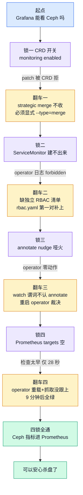
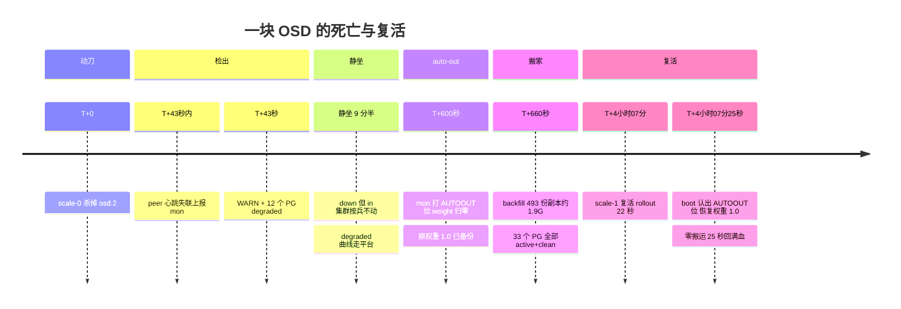

!!! abstract "实测声明"

    本文所有命令与输出均来自真实集群实测（非预测、非模拟）：

    - **时间**：2026-11-08 20:00 ~ 2026-11-09 14:15
    - **集群**：K8s 1.36.1，3 master + 3 worker（Debian 13）
    - **存储栈**：rook v1.18.1 + ceph v19.2.3 + cephcsi v3.14.0，manifest 直装
    - **Ceph 拓扑**：9 OSD（每 worker 3×50G），3 mon 钉在 master，size=3，33 PG
    - **数据规模**：RBD 池 1.31k objects / 5.0 GiB（L2 实验灌入）
    - 标注 `📥 回填` 的输出为写作时待补的原始记录，其余数据块均逐字复制自终端落盘文件（`~/ceph-l0/`）

---

# Ceph OSD 故障恢复实测：600 秒静待、快速回填与零字节回迁

先看这次实验的三个结果：

1. **约 600 秒**：OSD 下线后，集群等待 auto-out 定时器到期，再开始重新布局。这段等待不是卡住，而是在给短暂故障留出恢复时间。
2. **不到 1 分钟**：auto-out 触发后，约 1.9 GiB 副本完成回填，33 个 PG 恢复为 `active+clean`。
3. **0 字节回迁**：约 4 小时后重新启动 OSD，25 秒内它恢复 `up/in`、reweight 回到 1.0；实验中没有观察到第二轮 backfill。

第三个结果最出乎预料。我原以为 OSD 恢复后会再触发一轮 backfill，把副本搬回去；实际观察到的是：**原盘上的数据仍在，OSD 重新加入后可以继续使用这些副本**。

这是"生产化改造"存储篇的收官实验：在运行真实应用的 Rook/Ceph 集群里，观察 OSD 下线与恢复，并通过 [Prometheus 历史指标](../observability/prometheus.md)记录状态变化。实验顺序很重要：**先确认指标已采集，再注入故障**。

## 动刀之前先接线

实验顺序是这次最重要的决定之一。故障和恢复过程只有十几分钟，如果中间状态没有被采集，事后就难以还原；Prometheus 历史曲线能帮助复盘，前提是相关指标已提前进入时序库。

而"指标进库"这件事本身，折腾了一个晚上。起点是我想确认 Grafana 能不能看 Ceph，结果从 CRD 开关一路拆到 ServiceMonitor 抓取链，共四把锁、四次翻车：



四把锁的细节每一条都值得单独写，这里只讲对杀盘实验最关键的两条经验：

**第一，CRD 上的 patch 永远显式 `--type=merge`。** 给 CephCluster 开 `monitoring.enabled` 时，不带 `--type` 的 patch 走 strategic merge，而 CRD 不支持这个策略，整块拒收。CRD 家族的坑在这之前已经踩过三回（apiVersion 的组、字段位置、patch 类型），这是第四回。

**第二，annotate 不触发 operator 的 reconcile。** 想让 operator 重读配置，往 CR 上打时间戳 annotation 是无效动作——operator 的 watch 谓词按 `generation` 过滤，annotation 不动 generation。裁决手段是重启 operator pod：无状态、启动即全量 reconcile、数据面零波及。

!!! tip "接线完成态"

    最终抓取链：`rook-ceph-mgr`（instance `192.168.114.148:9283`）+ 全节点 ceph-exporter DaemonSet，`ceph_health_status` 等指标 15s 进一次 Prometheus。顺带被数据打脸的一课：**`ceph_health_status` 里 0 才是 HEALTH_OK**——我预注册时写的是"1=OK"，Ceph 的枚举是 `HEALTH_OK=0 / WARN=1 / ERR=2`，跟 Linux 惯例正好相反。

还有一个当时差点误判的细节：打完 ServiceMonitor 标签后 28 秒去查 targets，空的——**不是没接上，是查得太早**。operator 重载配置、Prometheus 发现并开始抓取，整条链要几十秒。9 分钟后再查全绿。慢故障实验的第一课在动手前就来了：**时序敏感的检查要留出足够等待时间，也要能回放历史数据**。

## 杀掉 osd.2

选 osd.2 不是随机的：它是 worker03 的第一块盘，上面落着全集群 33 个 PG 里的 12 个。数学先算好，动手才有底：

```text
33 PG × 3 副本 = 99 份副本
每块盘的期望份额 = 99 / 9 = 11 份
CRUSH 不是完美均匀 → 12 份，正常散布
每份约 4MB → osd.2 上约 1.9G 数据
```

预注册写在杀盘之前：**degraded PG 数 10-12 个；RBD 应用全程无感；auto-out 在 600 秒左右触发**。前两条命中，第三条精确命中——但"operator 会把 deployment 副本拉回 1"这条押错了，后面细说。

动手方式是最温和的故障注入——不删盘、不擦数据，只把 OSD pod 缩到零：

```bash
# T0 = 01:22:17Z
kubectl -n rook-ceph scale deploy rook-ceph-osd-2 --replicas=0
```

25 秒后（首个采样点）：

```text
📥 回填点 1：l3c-kill-osd2.txt 首轮 ceph -s
（判读记录：HEALTH_WARN / 1 osds down / 12 pgs degraded / active+undersized+degraded）
```

## 九分半的静坐

接下来发生的事，是这次实验最反直觉的部分——**什么都没发生**。

从 01:23:00 到 01:32:30，Prometheus 的 `ceph_pg_degraded` 曲线是一条笔直的平台：

```text
时间(UTC)     pg_degraded   health_status   事件
01:22:00        0              0            kill 前最后采样
01:23:00       12              1            WARN，kill 后首个采样点
01:23:30       12              1            │
01:24:00       12              1            │
   ...          ...           ...           │ 静坐 9.5 分钟，曲线纹丝不动
01:32:00       12              1            │
01:32:30       12              1            ┘
~01:32:36     （auto-out 触发）
01:33:00        2              1            out 后 ~24s，10/12 PG 已回满
01:33:30        0              0            HEALTH_OK，搬家结束
```

（数据来自 `ceph_pg_degraded` 与 `ceph_health_status` 的 30s step 历史回放）

!!! note "down ≠ out"

    OSD 挂掉（down）和 OSD 被移出集群（out）是两个独立的事件。down 只意味着"这块盘失联了"；CRUSH 的拓扑没变，PG 的副本位置没有重算，**集群不搬任何数据**。为什么？因为搬数据很贵——静坐期间集群在赌这块盘会自己回来。生产上瞬态故障（内核 panic 后重启、宿主机维护、网络抖动）占大头，为每次失联都搬一遍数据会把集群自己的 IO 打爆。

    等待的价码是一个定时器：`mon_osd_down_out_interval`，默认 **10 分钟**（600 秒）。600 秒内盘回来了，什么都没发生过；600 秒没回来，mon 才认为它真死了，标记 out，触发重新布局。

这个设计哲学翻译成人话：**等 600 秒的成本是零，搬 1.9G 数据的成本是真实的 IO——先用便宜的，再用贵的**。

## 六百秒整：auto-out 的源码

实测的 auto-out 触发时刻可以从两个独立证据反推，互相印证：

- `ceph osd stat` 显示 `8 in (since 2m)`，采样时刻 01:34:36，反推 out ≈ 01:32:36
- `ceph_osd_in{osd="2"}` 指标序列的终止点在 01:32:00-01:33:00 采样之间

kill 在 01:22:17，600 秒定时器到期是 01:32:17，实测 out ≈ 01:32:36——**误差 19 秒**，来自 down 的检出时刻（peer 心跳失联需要十几秒）加上 mon tick 的扫描周期。

拉 v19.2.3 源码看这 600 秒里 mon 到底做了什么（`src/mon/OSDMonitor.cc`，tick 内 `down_pending_out` 扫描）：

```cpp
// OSDMonitor.cc L5204-5226（节选，v19.2.3）
if (osdmap.is_down(o) && osdmap.is_in(o) && can_mark_out(o)) {
  utime_t orig_grace(g_conf()->mon_osd_down_out_interval, 0);  // 默认 10_min
  // ... 定时器未到，跳过 ...
  pending_inc.new_weight[o] = CEPH_OSD_OUT;              // L5211 权重归零
  pending_inc.new_state[o] |= CEPH_OSD_AUTOOUT;          // L5216 打 AUTOOUT 位
  pending_inc.new_xinfo[o].old_weight =
      osdmap.osd_weight[o];                              // L5219-21 备份原权重
  mon.clog->info() << "Marking osd." << o << " out (has been down for "
                   << int(down.sec()) << " seconds)";
}
```

三件事，每一件都有后文：

1. **权重归零**——这就是 `ceph osd tree` 里看到的 REWEIGHT 0，CRUSH 从此不再把数据映射到这块盘；
2. **打 AUTOOUT 位**——一个"这是 mon 自动标的 out"的身份标记，与手动 `ceph osd out` 的关键区别就在这一位，第九章会用到；
3. **备份原权重到 xinfo.old_weight**——为复活时的自动恢复埋的伏笔。

还有两道多数人不知道的保险（同样在源码里）：

```yaml
# src/common/options/mon.yaml.in（v19.2.3，节选）
- name: mon_osd_down_out_subtree_limit
  default: rack      # 整个 subtree 全 down 时不自动 out——默认 rack 级
- name: mon_osd_min_in_ratio
  default: 0.75      # in 的 OSD 比例低于 75% 时停止自动 out
```

subtree 保险的语义：如果整个 rack 的 OSD 同时 down，那多半是机架级网络/电源故障，盘大概率还活着，此时**重置定时器、不搬数据**。注意默认值是 `rack` 而不是 `host`——**单台 worker 三块盘全死，600 秒后照常 auto-out**，只有整机架故障才停手。min_in_ratio 则是雪崩闸：in 的盘已经少于 75% 时再 out 只会加速崩盘，mon 拒绝执行。

## 不到一分钟的搬家

auto-out 落地的瞬间，静坐结束，backfill 开始。493 份副本（12 个 PG × 平均 41 份）从其余 8 块盘的现有副本复制到 CRUSH 新算出的位置——实测**不足 1 分钟全部完成**：

```text
~01:32:36  auto-out，CRUSH 重算，12 个 PG 进入 backfill
01:33:00   degraded 12 → 2（out 后 ~24 秒，10/12 PG 已回满）
01:33:30   degraded 0，33 个 PG 全部 active+clean，HEALTH_OK
```

我实验前预期需要"小时级"。这次明显更快，主要因为需要搬运的数据只有约 1.9 GiB，且环境是本地虚拟盘。生产环境的恢复时间还取决于数据量、集群吞吐、并发与恢复限速；例如单盘 4 TiB、使用率 80% 时，潜在搬运量远大于本次实验，不能直接套用这里的分钟级结果。

对实验设计本身还有一个教训：01:23:00 到 01:33:30 之间我们只有 30 秒粒度的 Prometheus 曲线，backfill 的中间态（`active+remapped+backfilling`）在终端上一眼都没见过——**关键时刻窗内要用 15-30 秒间隔轮询**。好在曲线数据一分不丢，这就是先接线的回报。

auto-out 后 12 分钟的终局采样，逐字复制：

```text
2026-11-09T01:34:36Z
  cluster:
    id:     a9a364ff-9398-48e2-9b92-b6afd368616f
    health: HEALTH_OK

  services:
    mon: 3 daemons, quorum b,a,c (age 2d)
    mgr: a(active, since 34h)
    osd: 9 osds: 8 up (since 12m), 8 in (since 2m)

  data:
    pools:   2 pools, 33 pgs
    objects: 1.31k objects, 5.0 GiB
    usage:   15 GiB used, 385 GiB / 400 GiB avail
    pgs:     33 active+clean

9 osds: 8 up (since 12m), 8 in (since 2m); epoch: e110

 2    hdd  0.04880          osd.2        down         0  1.00000
```

（osd tree 最后一行：osd.2 状态 `down`、REWEIGHT 已归零、crush weight 仍是 1.0——**盘还在集群拓扑里，只是不再承载数据**）

全程时间线一张图收束：



插曲：押错的预注册。我原以为 rook operator 会发现 osd-2 的 deployment 副本被改成 0，然后把它拉回 1——实测 12 分钟纹丝不动，operator 日志里 osd-2 零匹配。原因翻文档才知道：**手动 scale-0 恰好是 rook 官方移除 OSD 流程的第一步**，operator 尊重这个用户意图。分界线很清晰：CephCluster CR 归 operator 管，Deployment 副本数归用户管。

## 消失与复活：absent 不等于 0

杀盘全程里最值得单独立传的，是一条 Prometheus 序列的生与死。

复盘时我想画 `ceph_osd_in` 的曲线，验证 in 状态翻转的时刻。第一次查询用了我猜的 label（`osd="2"`）——空的。换成 `ceph_daemon="osd.2"` 再查，曲线出来了，但形态出乎意料：

```text
📥 回填点 2：l3d-osd2curve.txt（up/in 双曲线完整 JSON）
（判读记录：
  ceph_osd_up{osd="2"}   01:22 采样=1 → 01:23:00 翻 0，此后保持 0
  ceph_osd_in{osd="2"}   全 1 直至 01:32:00 采样 → 01:33:00 起序列不存在）
```

in 线不是 1→0，是**整条序列消失了**。被 out 的 OSD 从 mgr 的指标输出里除名——查询侧看到的是"没有这个序列"，而不是"这个序列值为 0"。

这在 Prometheus 里是个经典陷阱：`absent` 和 `0` 是两回事。`sum(ceph_osd_in) == 8` 不代表集群只该有 8 块 in 的盘——它代表"当前存在于指标里的 in 盘恰好 8 块"，被除名的序列不参与任何聚合。如果告警规则写成 `ceph_osd_in{osd="2"} == 0`，**永远不会触发**，因为根本没有这条序列。

同一类现象也出现在 [Mimir 长期存储实战](mimir-from-zero.md)：Pod 被删除后，`up{job="..."}` 整组序列消失，`count(up)` 从 53 降到 48——不是某个 target 变成 down，而是相关序列退出了当前指标集合。Ceph OSD 是同一类问题在存储指标中的表现。

而这条序列还有下半场——4 小时后 osd.2 复活，序列在 05:30:20 重新出现，首点即 1。一条序列，两段生命，中间 4 小时是空白。对监控的意义：**判断"东西还在不在"要警惕序列粒度**，用 `absent()` 函数或 `count()` 基线对比，不要对一条可能不存在的序列做等值断言。

## 老家家具一件没动

复活实验的设计很简单：把 deployment 缩回 1，看会发生什么。预注册了三个走向：A. 自动回 in，数据回流，第二轮 backfill；B. up 但停在 out，需要手动 `ceph osd in`；C. pod 起不来。经典口径（"out 的 OSD 重启后停在 out，要手动拉 in"）让我押了 B 侧。

实测走向 A，而且干脆到离谱——**rollout 22 秒，25 秒内 up + in + reweight 1.0，33 个 PG 全程 clean，全程 12×15s 采样没有捕捉到任何 degraded/remapped/backfilling**。

疑点随之而来：如果 1.9G 副本真的在复活后从其他盘搬回 osd.2，按上一轮的速度也要几十秒的 backfill 过程态；一点没看到，那数据到底回没回来？两条证据合围：

**证据一**，`ceph osd df`——osd.2 当前持有约 1.9G 数据、12 个 PG，与杀盘前完全一致（📥 回填点 3：l3f-backflow.txt 的 `ceph osd df` 九行明细）。数据在盘上。

**证据二**，10 秒粒度的 Prometheus 回放（05:29:40 ~ 05:33:00），`ceph_pg_degraded` 与 `ceph_pg_backfilling` **全窗口为零**。没有搬运发生。

两个事实放在一起，最符合观测的解释是：**osd.2 原盘上的副本没有被清除**。过程可以拆成三步：

1. auto-out 时，backfill 给那 12 个 PG 在其他盘上补了新副本——但 osd.2 盘上的**旧副本一个字节没被删**（pod 只是停了，盘没动）；
2. 复活后 reweight 回 1.0，CRUSH 用**同样的权重拓扑**重新计算——算出的映射与杀盘前完全一致，那 12 个 PG 的副本位置又轮回到 osd.2；
3. peering 时发现 osd.2 上的副本还在（只差 out 期间约 20MB 的增量写入，走 recovery 秒级补齐），直接采用。

可以把它理解为：集群在其他位置补足副本时，原盘上的旧副本仍留着；OSD 回来后，CRUSH 映射恢复，Ceph 检查并复用已有数据，因此无需把整份数据再搬回来。

因此，故障恢复不一定意味着完整数据回迁：副本仍在且可用时，Ceph 可以通过 peering 和必要的增量 recovery 恢复服务。本次实验中未观察到第二轮 backfill；这不代表所有 OSD 重启都零成本，盘损坏、数据缺失或映射变化都可能触发实际数据恢复。

## reweight 谁改回去的：源码定案

复活后 reweight 从 0 自动回 1.0，这不符合"经典口径"。翻 v19.2.3 源码，在 OSD boot 的处理路径里找到了确切机制（`OSDMonitor.cc` `prepare_boot`）：

```cpp
// OSDMonitor.cc L3732-3751（节选，v19.2.3）
// mark in?
if ((g_conf()->mon_osd_auto_mark_auto_out_in &&
     (oldstate & CEPH_OSD_AUTOOUT)) ||          // 只认 AUTOOUT 位
    (g_conf()->mon_osd_auto_mark_new_in && (oldstate & CEPH_OSD_NEW)) ||
    (g_conf()->mon_osd_auto_mark_in)) {
  if (can_mark_in(from)) {
    if (xi.old_weight > 0) {
      pending_inc.new_weight[from] = xi.old_weight;   // 恢复备份的原权重
      xi.old_weight = 0;
    } else {
      pending_inc.new_weight[from] = CEPH_OSD_IN;
    }
  }
}
```

与 auto-out 侧的三件事严丝合缝地对上：

| auto-out 时（L5204-5226） | 复活 boot 时（L3732-3751） |
|---|---|
| 打 AUTOOUT 位 | 条件 `oldstate & CEPH_OSD_AUTOOUT`——**只认这个位** |
| 备份 old_weight = 1.0 | `new_weight = xi.old_weight`——**恢复备份** |

开关本身：

```yaml
# src/common/options/mon.yaml.in L916-926（节选）
- name: mon_osd_auto_mark_auto_out_in
  type: bool
  default: true
  desc: mark any OSD that comes up that was automatically marked 'out' back 'in'
```

**默认开**。整条机制链定案：

- **mon 自动 out 的 OSD，重启后自动回 in 并恢复原权重**——实测（25 秒内 up+in+1.0）与源码（AUTOOUT 位 + old_weight 恢复）双证；
- **手动 `ceph osd out` 的 OSD，重启后停在 out**——手动路径不打 AUTOOUT 位，boot 的 mark in 条件不满足，必须 `ceph osd in` 手动拉回。

"经典口径"没有错，错的记忆是把它套在了 auto-out 上。两个"out"是不同的东西：一个是 mon 的观察性判断（可逆），一个是管理员的拓扑决策（不可逆，除非再手动改）。另外 `prepare_boot` 里还有一行 `down_pending_out.erase(from)`（L3655）——600 秒窗口**内**盘就回来的话，连 out 都不会发生，pending 直接撤销。瞬时故障的最优路径是什么都不做。

## 数据面视角：用户的十一分钟

控制面的变化最终要回答一个问题：**使用 RBD 卷的应用感知到了什么？**若要了解 Kubernetes 如何通过 CSI 接入 Ceph 等存储系统，可参阅 [CSI 工作原理](../kubernetes/architecture/csi.md)；PV、PVC 与 StorageClass 的关系见 [Kubernetes 存储资源说明](../kubernetes/architecture/storage.md)。

答案是：什么都没感知到。`rbd-app` 是个跑在 default ns 的裸 pod，挂着 10Gi 的 RBD PVC（`/dev/rbd0` 挂在 `/data`），整个杀盘-静坐-out-搬家-复活全程零重启（pod 的最近一次重启发生在杀盘前 31 分钟），复活后写路径实测正常：

```text
POD=rbd-app
Filesystem                Size      Used Available Use% Mounted on
/dev/rbd0                 9.8G      5.0G      4.8G  51% /data
MNT=/data
20+0 records in
20+0 records out
20971520 bytes (20.0MB) copied, 0.012449 seconds, 1.6GB/s
-rw-r--r--    1 root, root     20.0M Nov  9 01:58 /data/l3c-probe
```

为什么无感？RBD 的客户端（worker01 内核里的 rbd 模块）持有的是**到主副本 OSD 的连接**，而 primary OSD 挂掉时 PG 会把 primary 角色切到存活的副本——客户端重连新 primary，IO 短暂停顿后恢复，卷和文件系统从头到尾没变。对 pod 来说，世界始终是 `/dev/rbd0`，9.8G，装着 5G 数据。

!!! note "白捡的素材：sleep 3600 指纹"

    复盘时发现 rbd-app 有 13 次重启、约每小时一次，一度怀疑与实验有关。查 lastState 定案：

    ```text
    restarts=14
    lastState={"terminated":{...,"exitCode":0,"finishedAt":"2026-11-09T01:50:19Z","reason":"Completed","startedAt":"2026-11-09T00:50:19Z"}}
    ```

    startedAt 到 finishedAt **精确相差 3600 秒**，exitCode 0。再看 pod 定义：`command=["sh","-c","sleep 3600"]`——容器主进程就是个一小时的 sleep，睡满退出，restartPolicy: Always 把它拉起来再睡一小时。杀盘无关，纯属保活设计的指纹。顺带它还是个活样本：**容器每小时轮回一次，`/data` 的数据纹丝不动**——RBD 卷的生命周期比容器长，这是 PVC 存在意义的最好注脚。

## 读者自查三件事

如果你的集群也跑着 Rook/Ceph，拿这三条命令做个体检：

```bash
# 1. auto-out 的定时器是多少？（默认 10 分钟，生产按维护节奏权衡）
kubectl -n rook-ceph exec $(kubectl -n rook-ceph get pod -l app=rook-ceph-tools -o name | head -1) -- \
  ceph config get mon mon_osd_down_out_interval

# 2. 雪崩闸在不在？in 比例低于多少 mon 会拒绝继续 auto-out
kubectl -n rook-ceph exec $(kubectl -n rook-ceph get pod -l app=rook-ceph-tools -o name | head -1) -- \
  ceph config get mon mon_osd_min_in_ratio

# 3. 你的告警规则里有没有对"可能不存在的序列"做等值断言？
#    ceph_osd_in{ceph_daemon="osd.X"} == 0 这类规则在 OSD 被 out 时是哑的，
#    应改用 count(ceph_osd_in) < <期望值> 或 absent() 形态
```

第三条展开一句：这次实验里 OSD 被 out 后序列直接消失，如果你的 OSD 掉线告警写成 `== 0`，它在你最需要它的时候沉默。**告警规则要为"序列不存在"的形态设计，而不是只为"值变化"设计**。

## 附：预注册对账表

预注册 11 条，命中 5 条，翻车 6 条。翻车条目比命中的更有价值，全部如实记录：

| # | 预注册（杀盘/接线前写下） | 结果 | 复盘 |
|---|---|---|---|
| 1 | degraded PG 10-12 个 | ✅ 12 | 命中上沿 |
| 2 | rbd-app 全程无感 | ✅ | 零重启 + 写路径正常 |
| 3 | auto-out ~600s | ✅ 615s | `mon_osd_down_out_interval` 默认 10_min |
| 4 | operator 会把副本拉回 1 | ❌ | scale-0 是 rook 移除流程第一步，operator 尊重用户意图 |
| 5 | heal 预期"小时级" | ❌ <1 分钟 | heal 时间 ∝ 数据量；"小时级"是 TB 盘口径 |
| 6 | `ceph_health_status` 1=OK | ❌ 0=OK | Ceph 枚举 HEALTH_OK=0，与 Linux 惯例相反 |
| 7 | `ceph_osd_in` 会 1→0 | ❌ 序列消失 | absent≠0；被 out 的 OSD 从 mgr 指标除名 |
| 8 | kps nsSelector 未设（要补） | ❌ 已是 {} | 免了一道 helm 税；谁设的待考 |
| 9 | 复活押 B（停在 out 要手动 in） | ❌ 走向 A | auto-out 可逆是源码默认行为，经典口径说的是手动 out |
| 10 | rbd-app 重启=一次性命令退出循环 | ✅ | `sleep 3600`，精确 1h 指纹 |
| 11 | 指标 label 是 `osd="2"` | ❌ `ceph_daemon="osd.2"` | v19 mgr 指标用 ceph_daemon label |

预注册的意义不是猜对——是**把"我以为"钉在实验之前**，让实验有机会打脸。这轮打出来的四条（#4 #5 #7 #9）每一条都比猜对值钱：它们各自对应一个下次能直接复用的机制判断。

本次配置还说明一个小集群风险：9 个 OSD 的 `mon_osd_min_in_ratio=0.75`，当 in 的 OSD 数降到 6 个时比例为 6/9，低于阈值，auto-out 会被阻止。故障连续发生时，自动摘除可能提前停下；应结合实际 OSD 数量和配置检查这个保护阈值。

## 推荐阅读

- [Mimir 长期存储实战：Prometheus remote_write 与 MinIO 对象存储](mimir-from-zero.md)：从另一场指标迁移实验理解序列消失、时序数据保留与长期存储。
- [Prometheus 监控体系：架构、PromQL 与服务发现](../observability/prometheus.md)：了解本文使用的指标采集、PromQL 查询与告警基础。
- [Kubernetes CSI 工作原理](../kubernetes/architecture/csi.md)：理解 Kubernetes 如何通过 CSI 驱动对接 Ceph 等外部存储。
- [Kubernetes 存储资源：PV、PVC、StorageClass 与 VolumeSnapshot](../kubernetes/architecture/storage.md)：从应用侧了解 PVC 如何关联持久卷，以及 Pod 与数据生命周期的区别。

本篇属于[测试集群生产化改造系列](index.md)的存储篇。

下一步的问题留给读者也留给我自己：**min_in_ratio 0.75 的雪崩闸，在 9 OSD 的集群上意味着什么？** 答案是 out 到第 3 块盘时闸门落下（6/9 = 0.667 < 0.75）——小集群的 auto-out 会在连环故障时提前"装死"。这个数字值得每个 9 盘以下的小集群管理员知道。
