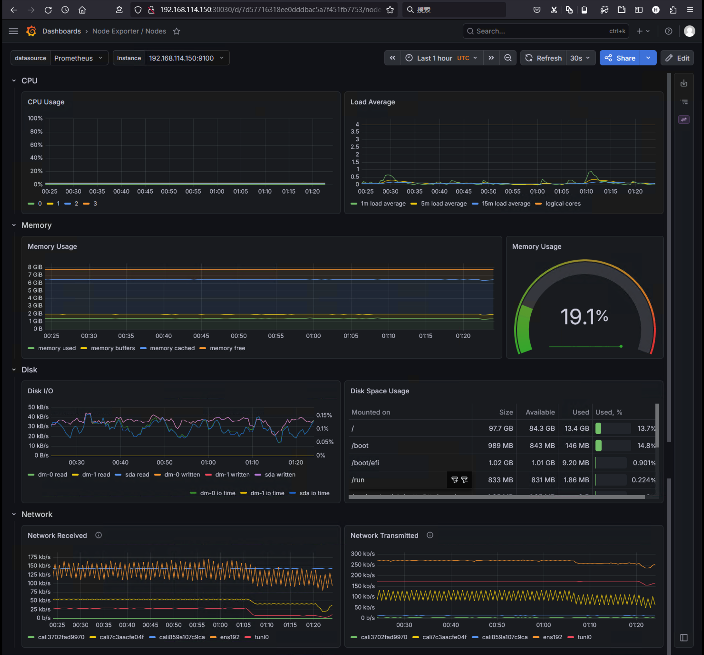
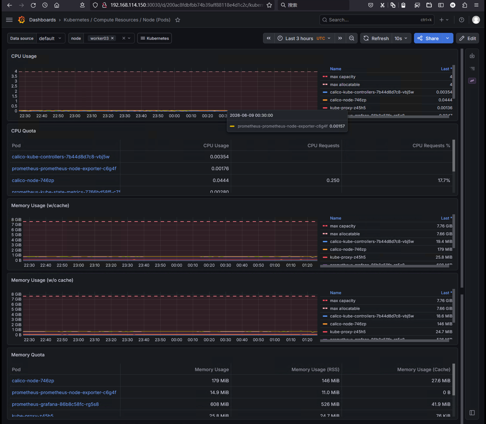
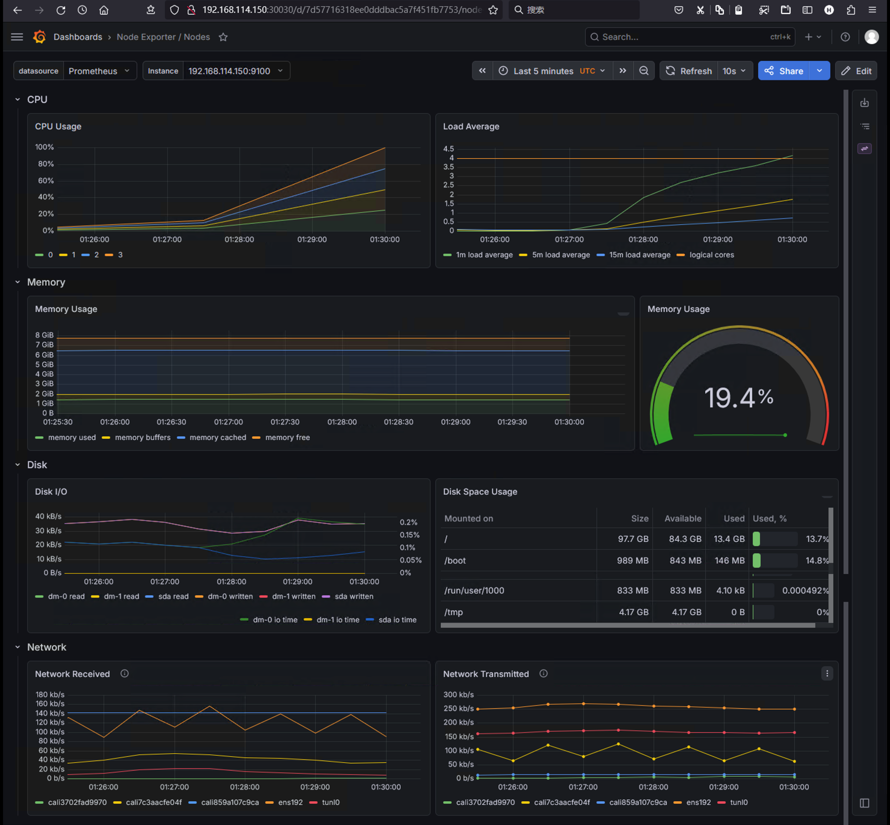
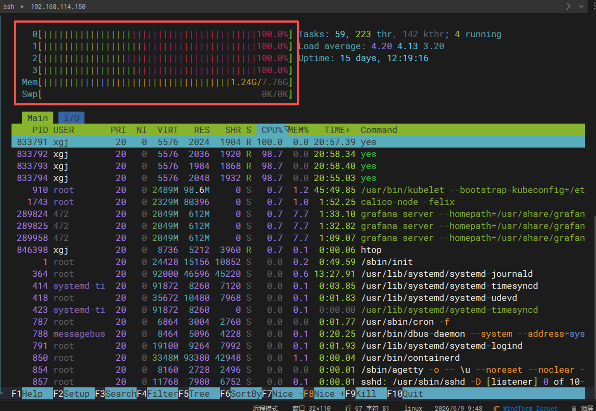
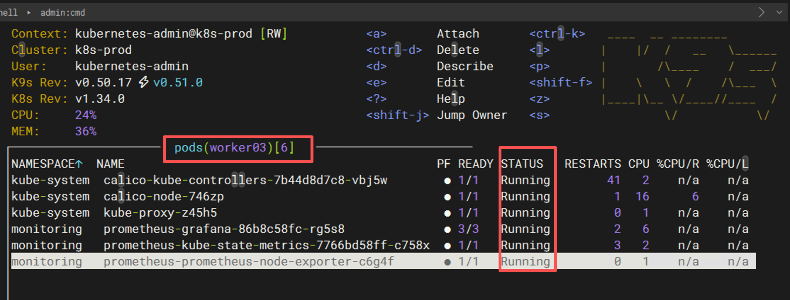
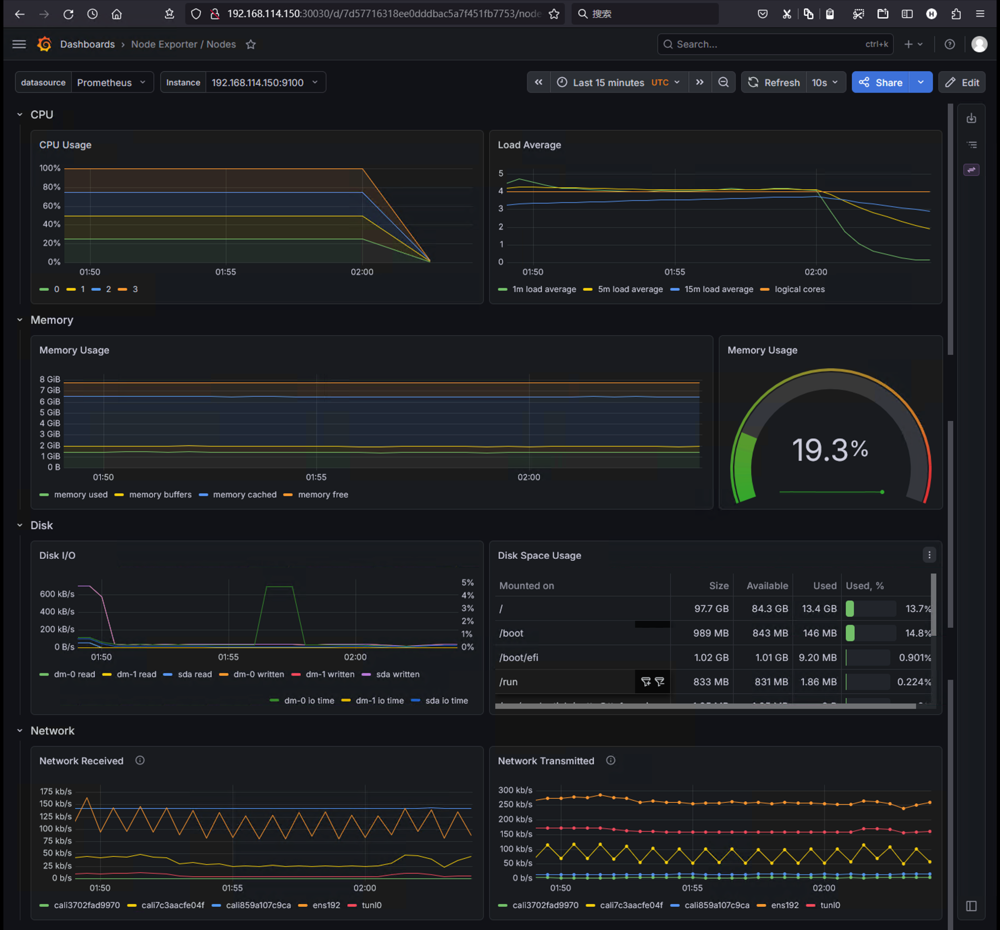

# Kubernetes 节点 CPU 打满故障演练：从现象到根因的全流程解析

在前一篇文章中，我们梳理了 Kubernetes 集群健康检查的核心监控指标。  
其中 **CPU 使用率** 是最基础、也最容易引发误解的指标之一。

当某个节点 CPU 被打满时：  

  - Prometheus + Grafana 会如何展示？  
  - 为什么有时看到每个核心只显示 25%？  
  - Load Average 达到 5 意味着什么？  
  - Pod 会立刻挂掉吗？  

今天我在实验环境里真实制造一次 CPU 压力，通过验证监控指标的变化过程，彻底理解 CPU 异常对集群的影响。

---

## 实验目标

通过本次演练，希望验证以下内容：

  1. 节点 CPU 被打满时，Grafana 关键指标的具体变化  
  2. 如何正确解读分核心 CPU 使用率与整体 CPU 使用率  
  3. Load Average 的含义及告警阈值判断  
  4. Pod 调度与运行状态是否受影响  
  5. 告警系统是否能够触发  
  6. 快速定位故障的方法  

---

## 实验环境

- **Kubernetes 集群**：HA 模式，v1.34.0  
  - Master 节点 × 3  
  - Worker 节点 × 3  
- **监控栈**：Prometheus + Grafana + Alertmanager  
- **测试节点**：worker03（4 逻辑核心）

---

## 故障制造

登录目标节点：

```bash
kubectl get nodes -o wide
```

选择 worker03，执行压力测试。为了压满 **所有 CPU 核心**（而不是单核），我们根据节点核心数启动相同数量的 `yes` 进程：

```bash
# 查看核心数
nproc

# 对每个核心启动一个无限循环任务
for i in {1..4}; do
    yes > /dev/null &
done
```

> 小提示：`yes > /dev/null` 会持续输出字符并立即丢弃，能够有效消耗单核 CPU。循环启动与核心数相等的进程，即可打满整机。

执行后返回进程 PID：

```
[1] 833791
[2] 833792
[3] 833793
[4] 833794
```

此时节点已处于 4 核满载状态。

---

## 故障发生前的状态





在施加压力前，Grafana 显示：

- **CPU 使用率（整体）**：< 1%  
- **Load Average**：接近 0
- **Pod 状态**：全部 Running  

一切正常。

---

## 故障发生后的指标变化

我们持续观察 Grafana 的几个关键面板。

### ① CPU Usage（分核心视图）

最直观的变化是 **每个逻辑核心的 CPU 使用率** 从接近 0% 上升至 **25%**（见下图）。



**这里就出现了一个常见误区**：  
很多人会问：“我明明压满了所有核心，为什么每个核心只显示 25%？”

**解释**：  
这个 Grafana 面板展示的是 **单个核心的利用率**，但它的 Y 轴最大值是 **100% 对应单个核心满载**。当节点有 4 个核心且全部满载时，**每个核心的真实使用率应该是 100%**。  
然而，某些 Dashboard 的面板配置可能采用了 **“按核心数平均后的整体使用率”** 来展示每个系列，导致 100% / 4 = 25% 的显示效果。  
也就是说，你看到的 **25% 并不是单核心的真实负载，而是图表展示方式造成的“假象”**。

**如何验证真实情况？**  
直接在节点上执行 `top(或者 htop)` 并按 `1` 键展开每个 CPU：



从上图可以看到，每个 CPU 核心的 `%Cpu` 都是 100.0%。同时进程列表中有 4 个 `yes` 进程，每个的 `CPU%` 也接近 100%。  
因此，**以节点内系统命令的输出为准，不要被 Grafana 的图形渲染误导**。如果你希望 Grafana 准确展示，可以改用 `CPU Usage (total)` 面板，它会直接显示整机 CPU 使用率（此时应为 100%）。

---

### ② Load Average（系统负载）

Load Average 表示 **平均活跃进程数**（包含正在运行 + 不可中断等待的任务）。  
对于 4 核节点：

- Load < 4.0：有闲置 CPU  
- Load = 4.0：所有核心刚好饱和，无排队  
- Load > 4.0：有任务在排队，性能开始下降  

在我们的实验中，Load Average 迅速上升，最高达到 **5.0** 左右：


**为什么会超过 4？**  
除了 4 个 `yes` 进程外，节点上还运行着 kubelet、containerd、node_exporter、calico 等系统组件。这些进程也在争抢 CPU 时间，导致可运行队列长度超过核心数，因此 Load 会略高于 4。  
从 `top` 截图也能看到，除了 4 个 `yes`，还有 `kubelet`、`calico-node-felix`、`grafana-server` 等进程也占用了少量 CPU。  
所以 Load ≈ 5 表示 **轻度过载**：平均每个核心有 1.25 个任务等待，系统响应会变慢，但尚未完全崩溃。

**告警建议**：  
对于 4 核节点，可以设置：

- 警告：Load > 4.5 持续 5 分钟  
- 严重：Load > 8  持续 2 分钟  

---

### ③ 其他值得关注的指标

除了 CPU 和 Load，以下几个指标在 CPU 压力场景下同样重要：

- **CPU Throttling（容器限流）**  
  如果 Pod 设置了 `limits.cpu`，当节点 CPU 紧张时，内核会限制该 Pod 的 CPU 时间片。  
  指标：`container_cpu_cfs_throttled_seconds_total`。如果该值持续增长，说明 Pod 被流控，性能受损早于节点完全饱和。

- **节点就绪状态（Node Condition）**  
  持续高负载可能触发节点心跳超时，导致 `NodeReady` 状态变为 `Unknown` 或 `NotReady`。  
  监控项：`kube_node_status_condition`。

- **Pending Pods 数量**  
  当节点 CPU 资源不足时，新创建的 Pod 将无法调度，停留在 `Pending` 状态。  
  指标：`kube_pending_pods`。

在我的实验中，由于压力时间较短且未超出资源请求（`requests`），节点仍然保持 `Ready`，也没有新的 Pending Pod。

---

## Kubernetes 自身的表现

使用 `kubectl get pods -A` 或者直接在 `k9s` 观察：



- 大部分 Pod 依然处于 `Running` 状态  
- 没有出现因 CPU 满载而直接删除 Pod 的情况  

**原因**：Kubernetes 的 CPU 资源属于 **可压缩资源**。当节点 CPU 饱和时，内核只会对容器进行限流（CPU Throttling），而不会像内存 OOM 那样直接杀掉进程。  
因此，**CPU 打满不会导致 Pod 消失，但会让容器内的进程响应变慢**。

---

## 对业务的影响

尽管 Pod 依然在运行，但业务可能已经出现：

- 接口响应时间急剧上升（从毫秒级变成秒级）  
- 健康检查（liveness/readiness probe）超时失败  
- 如果探针连续失败，Pod 会被标记为 `Unhealthy`，最终触发重启或流量摘除  

这一点可以通过分布式追踪系统（如 Jaeger、SkyWalking）观察调用链耗时，快速定位到受影响的服务。

---

## 如何快速定位 CPU 异常？

当用户反馈“系统变慢”时，建议按以下顺序排查：

1. **全局视图**：查看 Grafana 的 Node CPU Usage（整体）和 Load Average，确认哪个节点异常。  
2. **节点内排查**：登录该节点执行 `top -1`，确认每个核心使用率及高 CPU 进程。  
3. **进程归属**：根据高 CPU 进程的 PID，查找它属于哪个容器：  
   ```bash
   # 找到进程的 cgroup
   cat /proc/<PID>/cgroup | grep kubepods
   ```
   然后使用 `crictl ps` 或 `docker ps` 定位到具体 Pod。  
4. **Pod 级别排序**：在 Grafana 中使用 `Pod CPU Usage` 面板，按 CPU 使用率倒序，直接找到消耗最高的 Pod。  
5. **根因分析**：检查该 Pod 的日志和监控，判断是业务逻辑问题（如死循环、大量计算）还是外部流量突增。

---

## 恢复故障

停止压力进程：

```bash
pkill yes
```



观察 Grafana：  
- CPU 整体使用率逐步下降至 1% 以下  
- Load Average 在几分钟内回落至 1.0 以内  
- 如果配置了告警，Alertmanager 会发送恢复通知  

---

## 本次演练结论

通过这次真实压力测试，我们得到以下关键结论：

| 现象 | 正确理解 |
|------|----------|
| Grafana 分核心视图显示 25% | 可能为“整体 CPU 平均”的渲染方式，实际单核已是 100% |
| Load Average 达到 5（4核节点） | 轻度过载，任务排队，性能下降 |
| Pod 仍然 Running | CPU 是可压缩资源，不会直接杀 Pod，但会被限流 |
| 业务变慢 | 是 CPU 压力最直接的业务体现，探针可能失败 |

**监控平台的核心价值**：在业务完全不可用之前，通过指标趋势变化提前发现问题。

---

## 下一篇预告

**故障演练 02：Pod OOM（内存溢出）之后会发生什么？**

届时将验证：  
- OOMKill 指标的触发  
- Pod 重启策略及 `restartPolicy` 的影响  
- Grafana 中内存使用量的突变  
- Kubernetes 自愈机制（NodePressure Eviction）

欢迎继续关注。

