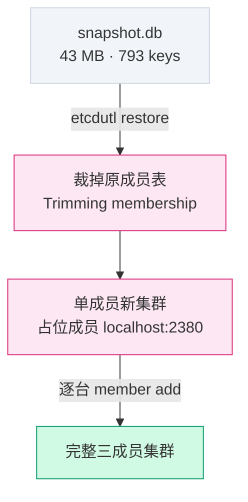
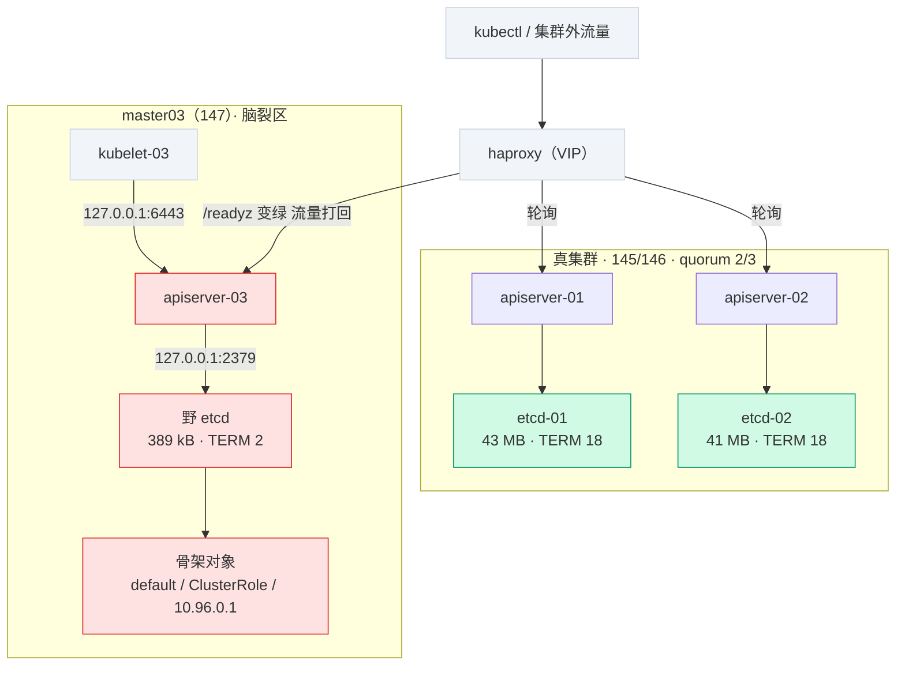
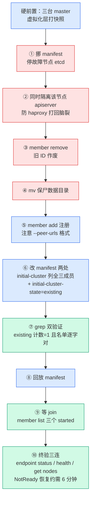

# K8s 1.36 etcd 备份与恢复：删掉一台 master 的数据后如何救回集群

> **实测声明**：本文所有命令与输出实测于 2026-09-10 ~ 09-11，3 master + 3 worker 集群（K8s 1.36.1 / kubeadm / etcd 静态 Pod，运行 120 天）。终端输出有裁剪，内容未修改——时间戳、ID、字节大小均保持原样。

我的集群跑了 120 天。写这篇之前我干了三件事：查 etcd 成员状态、查数据目录、查证书到期时间。三个数字摆在一起，我的第一反应是"这集群裸奔了多久"：

- `/var/lib/etcd/` 下没有任何快照文件——**120 天，零备份**
- endpoint status 报 DB SIZE 43MB，但 IN USE 只有 7.9MB——**82% 是碎片空洞**
- 全部证书 2027-06-24 到期——**还剩 287 天**

3 个 etcd 成员跑在 3 台 master 上，看起来高可用。但高可用防的是"挂一台"，防不了"数据坏了"——三副本同步的是同一份错误。这篇是生产化改造系列第一篇：先把备份做出来，再亲手删掉一台 master 的 etcd 数据，把它救回来。

读前提醒：**这次演练翻了两次车**——起了一个假集群、脑裂了一个半小时、CrashLoop 了半小时。翻车过程全部保留在正文里，它们比成功案例值钱。

## 审计：跑了 120 天的集群，一份 etcd 备份都没有

先看家底。etcd 是静态 Pod，`-o wide` 能看到它落在哪：

```bash
kubectl get pod -n kube-system -o wide | grep etcd
```

```
etcd-master01   1/1   Running   2 (17d ago)   77d   192.168.114.145   master01   <none>   <none>
etcd-master02   1/1   Running   2 (17d ago)   77d   192.168.114.146   master02   <none>   <none>
etcd-master03   1/1   Running   2 (17d ago)   77d   192.168.114.147   master03   <none>   <none>
```

两处值得停一下。一是 Pod IP 就是节点 IP——静态 Pod 走 hostNetwork，不经过 Pod 网络，这是后面所有操作都能直连 2379/2380 端口的前提。二是 RESTARTS 列：三台都是 `2 (17d ago)`，三台同时重启过。17 天前是 8 月 24 日，`/var/lib/etcd` 目录的 mtime 也停在那一天——这是那阵子某次集群级操作留下的痕迹，具体是哪次操作，我的 journal 已经翻不到了。**RESTARTS 列就是集群的伤疤档案**，审计时值得多看一眼。

etcdctl 不用装——直接 exec 进容器跑，证书路径是容器内的 hostPath 挂载。先确认版本：

```bash
kubectl -n kube-system exec etcd-master01 -- etcdctl version
```

```
etcdctl version: 3.6.8
API version: 3.6
```

**3.6.8**。记住这个数字，它和网上绝大多数 etcd 备份教程（etcd 3.5 时代写的）之间隔了一次 CLI 断代，后面专门开一节讲。现在先看成员：

```bash
kubectl -n kube-system exec etcd-master01 -- etcdctl \
  --endpoints=https://127.0.0.1:2379 \
  --cacert=/etc/kubernetes/pki/etcd/ca.crt \
  --cert=/etc/kubernetes/pki/etcd/server.crt \
  --key=/etc/kubernetes/pki/etcd/server.key \
  member list -w table
```

```
+------------------+---------+----------+------------------------------+------------------------------+------------+
|        ID        | STATUS  |   NAME   |          PEER ADDRS          |         CLIENT ADDRS         | IS LEARNER |
+------------------+---------+----------+------------------------------+------------------------------+------------+
| 3e0910d00af3153f | started | master03 | https://192.168.114.147:2380 | https://192.168.114.147:2379 |      false |
| 4dd24ac4ed62d38a | started | master01 | https://192.168.114.145:2380 | https://192.168.114.145:2379 |      false |
| 956f919e0d6cbe5c | started | master02 | https://192.168.114.146:2380 | https://192.168.114.146:2379 |      false |
+------------------+---------+----------+------------------------------+------------------------------+------------+
```

三个成员都 started，ID 是 16 位十六进制——**抄下 master03 的 ID 和 PEER ADDR，后面演练要用**。

再看数据状态。注意 `--endpoints` 要把三台全传，只传一台看到的是单台视角：

```bash
kubectl -n kube-system exec etcd-master01 -- etcdctl \
  --endpoints=https://192.168.114.145:2379,https://192.168.114.146:2379,https://192.168.114.147:2379 \
  --cacert=/etc/kubernetes/pki/etcd/ca.crt \
  --cert=/etc/kubernetes/pki/etcd/server.crt \
  --key=/etc/kubernetes/pki/etcd/server.key \
  endpoint status -w table
```

```
+------------------------------+------------------+---------+-----------------+---------+--------+-----------------------+--------+-----------+------------+-----------+------------+--------------------+--------+--------------------------+-------------------+
|           ENDPOINT           |        ID        | VERSION | STORAGE VERSION | DB SIZE | IN USE | PERCENTAGE NOT IN USE | QUOTA  | IS LEADER | IS LEARNER | RAFT TERM | RAFT INDEX | RAFT APPLIED INDEX | ERRORS | DOWNGRADE TARGET VERSION | DOWNGRADE ENABLED |
+------------------------------+------------------+---------+-----------------+---------+--------+-----------------------+--------+-----------+------------+-----------+------------+--------------------+--------+--------------------------+-------------------+
| https://192.168.114.145:2379 | 4dd24ac4ed62d38a |   3.6.8 |           3.6.0 |   43 MB | 7.9 MB |                   82% | 2.1 GB |     false |      false |        16 |   35401710 |           35401710 |        |                          |             false |
| https://192.168.114.146:2379 | 956f919e0d6cbe5c |   3.6.8 |           3.6.0 |   41 MB | 7.9 MB |                   81% | 2.1 GB |      true |      false |        16 |   35401710 |           35401710 |        |                          |             false |
| https://192.168.114.147:2379 | 3e0910d00af3153f |   3.6.8 |           3.6.0 |   41 MB | 7.9 MB |                   81% | 2.1 GB |     false |      false |        16 |   35401710 |           35401710 |        |                          |             false |
+------------------------------+------------------+---------+-----------------+---------+--------+-----------------------+--------+-----------+------------+-----------+------------+--------------------+--------+--------------------------+-------------------+
```

这张表比看上去有料：DB SIZE 43MB，但 IN USE 只有 7.9MB——**82% 的空间是碎片**。这是我 120 天里创建又删除的几万个对象（Event 占大头）在 bbolt 的 B+ 树页里留下的洞。db size "虚胖"就是这么来的，也是将来做 defrag 的理由。QUOTA 2.1GB 是默认配额，43MB 离警戒线还远。RAFT INDEX 3540 万、三行完全一致——集群这 120 天跑过 3540 万条 raft 日志，全部三副本同步。当前 leader 在 master02（146）。

最后是那个难堪的确认：

```bash
sudo ls -la /var/lib/etcd/
```

```
total 12
drwx------  3 root root 4096 Aug 24 08:16 .
drwx------ 32 root root 4096 Sep  2 14:34 ..
drwx------  4 root root 4096 Aug 24 08:16 member
```

只有 `member/` 目录，没有任何快照文件。顺带注意 `member/` 的 mtime 停在 **Aug 24 08:16**——和上面三个 Pod 的 `2 (17d ago)` 对上了：8 月 24 日早上发生过一次三台同步重启，目录时间戳就是那天的伤疤。**跑了 120 天、写入 3540 万次变更的集群，备份是零。**

审计最后一步，看一眼 kubeadm 给 etcd 的静态 Pod manifest 写了什么：

```bash
sudo grep -nE 'image:|initial-cluster|peer-urls|advertise|listen' /etc/kubernetes/manifests/etcd.yaml
```

```
5:    kubeadm.kubernetes.io/etcd.advertise-client-urls: https://192.168.114.145:2379
15:    - --advertise-client-urls=https://192.168.114.145:2379
20:    - --initial-advertise-peer-urls=https://192.168.114.145:2380
21:    - --initial-cluster=master01=https://192.168.114.145:2380
23:    - --listen-client-urls=https://127.0.0.1:2379,https://192.168.114.145:2379
24:    - --listen-metrics-urls=http://127.0.0.1:2381
25:    - --listen-peer-urls=https://192.168.114.145:2380
34:    image: registry.aliyuncs.com/google_containers/etcd:3.6.8-0
```

两个细节当时没在意，事后都要了我半天时间：**`--initial-cluster` 只写了 master01 自己一个成员**（没有全集群名单），而且**没有 `--initial-cluster-state` 这一行**。这两行"缺失"平时完全无害，等我清空数据目录重新拉 etcd 时，它们变成了野集群的出生证明。这里先埋个伏笔。

## 决策：为什么是 etcdctl snapshot，而不是 VM 快照

动手前先做决策记录。etcd 备份的候选方案我比了三个：

**VM 快照**（虚拟化层对磁盘打点）——最省事，但它是"整机状态冷冻"：恢复时整个节点回滚到过去，etcd 之外的一切也跟着回去。而且它依赖虚拟化平台，物理机上没这条路，跨环境恢复更是没戏。我的集群恰好是 VM，但把备份策略建立在"恰好在虚拟机上"上，不是生产思路。

**rsync 数据目录**——直接复制 `/var/lib/etcd/member/`。看起来是"文件级备份"，但 etcd 正在写入时复制出来的 db 文件，不保证是某个一致的时间点——raft 日志和快照文件可能互相矛盾。要保证一致得先停 etcd，停 etcd 就要动集群。

**etcdctl snapshot save**——etcd 自己提供的快照接口，从任一成员拿一致性视图（走 raft 读），不用停任何进程，拿到的文件可以在任何机器上恢复出一个新集群。这条是官方文档的灾备路径，也是我最终选的。

备份落地位置的决策：**存到集群外的另一台物理机**。我有一台独立的 NFS 服务器（192.168.114.155，50G 数据盘），三台 master 同时故障（机房级事故、误操作波及）时，本地备份跟着陪葬，NFS 上的那份还活着。备份文件和集群的物理隔离，是这次演练里我个人最看重的一条决策。

频率和保留：日备、保留 7 天。凌晨 3 点跑，错开白天实验的高峰。43MB 一份，7 份连 1G 都不到——容量根本不是约束，保留天数取决于"你想回滚到多远"。

## 第一次快照：43MB，482 毫秒

快照命令本身一句话，讲究在保存路径：

```bash
kubectl -n kube-system exec etcd-master01 -- etcdctl \
  --endpoints=https://127.0.0.1:2379 \
  --cacert=/etc/kubernetes/pki/etcd/ca.crt \
  --cert=/etc/kubernetes/pki/etcd/server.crt \
  --key=/etc/kubernetes/pki/etcd/server.key \
  snapshot save /var/lib/etcd/snapshot.db
```

```
{"level":"info","ts":"2026-09-10T02:15:32.787886Z","caller":"snapshot/v3_snapshot.go:83","msg":"created temporary db file","path":"/var/lib/etcd/snapshot.db.part"}
{"level":"info","ts":"2026-09-10T02:15:32.796148Z","logger":"client","caller":"v3@v3.6.8/maintenance.go:236","msg":"opened snapshot stream; downloading"}
{"level":"info","ts":"2026-09-10T02:15:32.801959Z","caller":"snapshot/v3_snapshot.go:96","msg":"fetching snapshot","endpoint":"https://127.0.0.1:2379"}
{"level":"info","ts":"2026-09-10T02:15:33.157314Z","logger":"client","caller":"v3@v3.6.8/maintenance.go:302","msg":"completed snapshot read; closing"}
{"level":"info","ts":"2026-09-10T02:15:33.270023Z","caller":"snapshot/v3_snapshot.go:111","msg":"fetched snapshot","endpoint":"https://127.0.0.1:2379","size":"43 MB","took":"482.035091ms","etcd-version":"3.6.0"}
{"level":"info","ts":"2026-09-10T02:15:33.271379Z","caller":"snapshot/v3_snapshot.go:121","msg":"saved","path":"/var/lib/etcd/snapshot.db"}
Snapshot saved at /var/lib/etcd/snapshot.db
Server version 3.6.0
```

43MB、482 毫秒。保存路径写的是容器内的 `/var/lib/etcd/`——它是 hostPath 挂载，**容器里写的文件直接出现在宿主机上**，不需要 `kubectl cp` 导出：

```bash
sudo ls -lh /var/lib/etcd/snapshot.db
```

```
-rw------- 1 root root 42M Sep 10 10:15 /var/lib/etcd/snapshot.db
```

42M（MiB 口径）对上日志里的 43MB（十进制口径），是同一个文件。

快照拿来了，下一件事是**验证它是一份能恢复的备份**——没验证过的快照只是心理安慰。这一步我撞上了这篇的第一个坑，单独开一节讲。

---

## 老教程在这里翻车：etcd 3.6 的 CLI 断代

快照文件在手，下一步是"体检"——校验它是完整的、可恢复的。我按记忆里的命令走：

```bash
kubectl -n kube-system exec etcd-master01 -- etcdctl \
  snapshot status /var/lib/etcd/snapshot.db -w table
```

按网上教程的剧本，这里应该出一张表格：HASH、REVISION、TOTAL KEYS、TOTAL SIZE。我实际拿到的是一份 help 文本：

```bash
NAME:
  snapshot - Manages etcd node snapshots

USAGE:
  etcdctl snapshot <subcommand> [flags]

API VERSION:
  3.6

COMMANDS:
  save  Stores an etcd node backend snapshot to a given file

OPTIONS:
  -h, --help[=false]    help for snapshot
```

注意 `COMMANDS:` 部分——**只剩 `save` 一个子命令**。`status` 和 `restore` 不在里面。

这不是命令打错了。etcd 3.5 把 `etcdctl snapshot status` / `snapshot restore` 标记为 deprecated，提示你改用新的 `etcdutl` 工具；到了 3.6，这两条命令**直接从 etcdctl 里移除**。传入不认识的子命令，etcdctl 的反应不是报错退出，而是打印这个子命令组的 help——看起来像"成功"。我顺手测了它的退出码，**exit code 是 0**。在自动化脚本里，这条命令永远"成功"：`set -e` 兜不住，日志里也看不出异常——静默失败的最完整形态。

这类断代在 3.6 里不止一处。这次实验我踩到的、以及老教程里最常见的：

| 老教程写法（etcd 3.5 时代） | etcd 3.6 的实际行为 |
|---|---|
| `etcdctl snapshot status` | 子命令已移除，打 help 不报错——改用 `etcdutl snapshot status` |
| `etcdctl snapshot restore` | 同上——改用 `etcdutl snapshot restore` |
| `etcdctl member add ... --peerURLs=...` | 报 `unknown flag`，3.6 统一成 `--peer-urls` |

etcdctl 还在、还在 etcd 容器镜像里，但它的 snapshot 组只剩 save。而 `etcdutl` 就在同一个镜像里，直接 exec 就能用——快照体检的正确姿势：

```bash
kubectl -n kube-system exec etcd-master01 -- etcdutl \
  snapshot status /var/lib/etcd/snapshot.db -w table
```

```
+----------+----------+------------+------------+---------+
|   HASH   | REVISION | TOTAL KEYS | TOTAL SIZE | VERSION |
+----------+----------+------------+------------+---------+
| 1f4fe61b | 25172444 |        793 |      43 MB |   3.6.0 |
+----------+----------+------------+------------+---------+
```

逐格读这份体检报告：HASH 是快照内容的校验和，验证文件没在传输中损坏；REVISION 2517 万是 KV 修改的累计版本号，每次写操作 +1；**TOTAL KEYS 793 是快照时刻的活跃对象总数**；TOTAL SIZE 43MB 是数据全量；VERSION 3.6.0 是存储格式版本（3.6 的 status 输出比 3.5 多了这一列）。

793 这个数字值得停下来想一下。审计节里 RAFT INDEX 是 3540 万——集群 120 天跑过 3540 万条 raft 日志，最终"活下来"的对象只有 793 个。中间隔着两个换算关系：RAFT INDEX 记录所有日志条目（含选举、member 变更这些内部操作，所以它比 REVISION 的 2517 万还高），而 KV 层面上，绝大多数写入是改了又删——Event 对象来了又走、实验 Pod 建了又拆，它们没留下 key，只在 db 文件里留下了 82% 的碎片空洞。**写入量和存量之间隔着一个清理周期的距离**。判断 db 健康度时该有的参照系：看 IN USE 和 TOTAL KEYS，别只看 DB SIZE。

## 恢复演练：整个集群躺在 /registry 里

体检过了还不够——**验证过能恢复的快照才叫备份**。恢复分两档，先来轻量档：不动集群，把快照恢复到一个独立目录，眼见为实。

```bash
kubectl -n kube-system exec etcd-master01 -- etcdutl \
  snapshot restore /var/lib/etcd/snapshot.db \
  --data-dir /var/lib/etcd/restore-verify
```

```
2026-09-10T03:10:55Z    info    snapshot/v3_snapshot.go:305     restoring snapshot      {"path": "/var/lib/etcd/snapshot.db", "wal-dir": "/var/lib/etcd/restore-verify/member/wal", "data-dir": "/var/lib/etcd/restore-verify", "snap-dir": "/var/lib/etcd/restore-verify/member/snap", "initial-memory-map-size": 10737418240}
2026-09-10T03:10:55Z    info    bbolt   backend/backend.go:203  Opening db file (/var/lib/etcd/restore-verify/member/snap/db) with mode -rw------- and with options: {Timeout: 0s, NoGrowSync: false, NoFreelistSync: true, PreLoadFreelist: false, FreelistType: , ReadOnly: false, MmapFlags: 8000, InitialMmapSize: 10737418240, PageSize: 0, NoSync: false, OpenFile: 0x0, Mlock: false, Logger: 0xc0000a2840}
2026-09-10T03:10:55Z    info    bbolt   bbolt@v1.4.3/db.go:321  Opening bbolt db (/var/lib/etcd/restore-verify/member/snap/db) successfully
2026-09-10T03:10:55Z    info    schema/membership.go:138        Trimming membership information from the backend...
2026-09-10T03:10:56Z    info    membership/cluster.go:424       added member    {"cluster-id": "cdf818194e3a8c32", "local-member-id": "0", "added-peer-id": "8e9e05c52164694d", "added-peer-peer-urls": ["http://localhost:2380"], "added-peer-is-learner": false}
2026-09-10T03:10:56Z    info    snapshot/v3_snapshot.go:333     restored snapshot       {"path": "/var/lib/etcd/snapshot.db", "wal-dir": "/var/lib/etcd/restore-verify/member/wal", "data-dir": "/var/lib/etcd/restore-verify", "snap-dir": "/var/lib/etcd/restore-verify/member/snap", "initial-memory-map-size": 10737418240}
```

两行日志值得逐字读，它们解释了"全集群恢复"的正确姿势：



**`Trimming membership information from the backend`**——恢复时会**把成员信息从数据里裁掉**。快照里有我 3 台 master 的成员表，但恢复出来的数据不带它，接着 `added member ... peer-urls: http://localhost:2380`——恢复程序往数据里塞了一个指向 localhost 的占位成员。合起来读：**快照恢复出来的是一个"单成员新集群"，不是原样复刻 3 成员集群**。所以真实的全集群恢复流程是：用快照在某台机器上恢复出单成员 etcd → 启动它 → 用 `member add` 把其余节点逐台加回来。这就是为什么 etcd 官方灾备文档的恢复章节比备份章节长得多。

目录结构长这样（hostPath 挂载，容器内写的目录宿主机直接可见）：

```bash
sudo find /var/lib/etcd/restore-verify -maxdepth 3 | sort
```

```
/var/lib/etcd/restore-verify
/var/lib/etcd/restore-verify/member
/var/lib/etcd/restore-verify/member/snap
/var/lib/etcd/restore-verify/member/snap/0000000000000001-0000000000000001.snap
/var/lib/etcd/restore-verify/member/snap/db
/var/lib/etcd/restore-verify/member/wal
/var/lib/etcd/restore-verify/member/wal/0000000000000000-0000000000000000.wal
```

和现役的 `/var/lib/etcd/member/` 完全同构——`snap/db` 是数据文件，`wal/` 是 raft 日志。这个目录可以直接拿来启动一个 etcd。

最后一步"眼见为实"最有意思。etcd 底层是 bbolt KV 存储，所有 key 是明文存进 B+ 树页里的，`strings` 能直接捞出来：

```bash
sudo strings /var/lib/etcd/restore-verify/member/snap/db | grep -c '^/registry'
sudo strings /var/lib/etcd/restore-verify/member/snap/db | grep '^/registry' | head -5
```

```
235
/registry/namespaces/default
/registry/minions/worker02
/registry/minions/master01
/registry/minions/worker01
/registry/minions/worker03
```

**K8s 里所有对象，都是 etcd 里一条以 `/registry/` 开头的 key**——Pod 是 `/registry/pods/<ns>/<name>`，ConfigMap 是 `/registry/configmaps/...`。而 Node 对象的 key 前缀是 `/registry/minions/`——**Node 在 etcd 里叫 minion**，这是 K8s 早期命名的历史活化石，平时在 kubectl 层根本看不到。

235 这个计数也值得一句注脚：体检报告说 TOTAL KEYS 793，strings 只捞到 235——bbolt 的页里 key 和 value 混排，`strings` 只能识别出连续可读的那部分，约三成。两个数字量级一致，说明快照的数据在恢复目录里是完整的。

整个恢复演练期间，集群零感知——三个 etcd Pod 的 RESTARTS 一动不动。restore 是纯本地操作，不碰任何正在运行的进程。轻量档到这里就够了，演练产物挪去 `/root/` 留档。

---

## 硬核演练开始：删掉 master03 的 etcd

轻量档证明了快照可用，接下来是重头戏：**模拟真实故障**——master03 的 etcd 数据损坏，把它从集群除名、清空数据、重新拉回，看数据能不能从另外两台同步回来。

动手前的硬前置，缺一不可：

1. **虚拟化层对三台 master 全部打快照**——演练也要有回滚方案，这是生产思维的一部分
2. 确认第一份快照已经躺在 NFS 上（`ls -lh /mnt/etcd-backup/`）
3. 记录当前 member list 里 master03 的 ID 和 peer URL

牺牲者选 master03（操作主力在 master01，别动它）。第一步：停掉它的 etcd。静态 Pod 的开关就是 manifest 目录——**把文件挪出去，kubelet 就会拆掉容器**：

```bash
# master03 上执行
sudo mv /etc/kubernetes/manifests/etcd.yaml /root/etcd-master03.yaml
```

!!! warning "挪出目录，不是改名 .bak"
    备份 manifest 必须挪出 `/etc/kubernetes/manifests/`——kubelet 会解析目录里**所有非隐藏文件**，把 `etcd.yaml.bak` 留在目录里等于给 kubelet 塞了第二份 etcd 清单，两个同名 Pod 定义互相打架。

回到 master01 验证，预期是"只剩两个 etcd Pod"。实际拿到的是：

```bash
kubectl get pod -n kube-system | grep etcd
```

```
Error from server (Timeout): the server was unable to return a response in the time allotted, but may still be processing your request (get pods)
```

再试 get nodes：

```
NAME       STATUS     ROLES           AGE    VERSION
master01   Ready      control-plane   120d   v1.36.1
master02   Ready      control-plane   120d   v1.36.1
master03   NotReady   control-plane   120d   v1.36.1
worker01   Ready      <none>          120d   v1.36.1
worker02   Ready      <none>          120d   v1.36.1
worker03   Ready      <none>          120d   v1.36.1
```

master03 **NotReady** 了。这不是预期——我预判的是"集群无感"。实际机制比预判有意思：

- kubeadm 集群里，**每个 kubelet 的状态上报连的是本节点的 apiserver**（从后面 journalctl 的报错能看到 kubelet 在请求 `https://192.168.114.147:6443`）
- 每个 apiserver 默认只连**本机的 etcd**（`--etcd-servers` 指向 localhost）
- 所以 master03 的 etcd 停了 → 本地 apiserver 还活着但查询全挂 → kubelet-03 的心跳上报不出去 → 节点 NotReady
- 而 VIP 流量经 haproxy 轮询，打不到坏的 apiserver 时会重试到健康后端——所以外部用集群"感觉还行"，**间歇性 Timeout**

此时集群还能响应轻量查询（`kubectl get pods` 能回），重查询（kube-system 全量 Pod 列表）超时。**"时好时坏"是负载均衡掩盖单点故障的典型形态**——如果你在生产上见到 kubectl 一会儿超时一会儿正常、还伴着某个节点 NotReady，第一怀疑对象就是某台 master 的控制面组件。

继续正题。把 master03 从 etcd 集群除名（member ID 用审计时抄下的那个）：

```bash
kubectl -n kube-system exec etcd-master01 -- etcdctl \
  --endpoints=https://127.0.0.1:2379 \
  --cacert=/etc/kubernetes/pki/etcd/ca.crt \
  --cert=/etc/kubernetes/pki/etcd/server.crt \
  --key=/etc/kubernetes/pki/etcd/server.key \
  member remove 3e0910d00af3153f
```

```
Member 3e0910d00af3153f removed from cluster 4d762f11dd718b88
```

remove 后 member list 只剩两行（master01/02）。**风险窗口从此刻开始**：3 成员集群剩 2 个，quorum 还是 2——能读写，但再挂任何一台 master，整个控制面停摆。这个窗口里不做任何其他操作，是演练纪律，也是生产的维护窗口纪律。

然后是"毁尸"环节——master03 上把数据目录挪走（用 mv 保尸，不用 rm，损坏现场也是证据）：

```bash
sudo mv /var/lib/etcd /var/lib/etcd.broken.20260910-1141
```

## 野集群诞生：一次回放引发的脑裂

重新注册 member。这里先撞一次 3.6 的 CLI 断代：

```bash
kubectl -n kube-system exec etcd-master01 -- etcdctl ... \
  member add master03 --peerURLs=https://192.168.114.147:2380
```

```
Error: unknown flag: --peerURLs
```

3.6 统一成了 kebab-case，`--peer-urls`。改完重跑：

```
Member e624b231ea8236ab added to cluster 4d762f11dd718b88

ETCD_NAME="master03"
ETCD_INITIAL_CLUSTER="master01=https://192.168.114.145:2380,master02=https://192.168.114.146:2380,master03=https://192.168.114.147:2380"
ETCD_INITIAL_ADVERTISE_PEER_URLS="https://192.168.114.147:2380"
ETCD_INITIAL_CLUSTER_STATE="existing"
```

注意 etcd 打印的这四行——**它把"新成员该怎么配"完整答案给了你**：三成员名单、existing 状态。我当时看了一眼，纠结要不要照着改 manifest，最后判断"manifest 本来就是集群跑起来的配置，应该不用动"，**把 manifest 原样放了回去**。

这个判断错了。一小时四十分后我才知道代价。

回放后 etcd-master03 容器确实起来了，但去查集群状态时看到的是这种东西：

```
+------------------------------+------------------+---------+-----------------+---------+--------+-----------------------+--------+-----------+------------+-----------+------------+--------------------+--------+--------------------------+-------------------+
|           ENDPOINT           |        ID        | VERSION | STORAGE VERSION | DB SIZE | IN USE | PERCENTAGE NOT IN USE | QUOTA  | IS LEADER | IS LEARNER | RAFT TERM | RAFT INDEX | RAFT APPLIED INDEX | ERRORS | DOWNGRADE TARGET VERSION | DOWNGRADE ENABLED |
+------------------------------+------------------+---------+-----------------+---------+--------+-----------------------+--------+-----------+------------+-----------+------------+--------------------+--------+--------------------------+-------------------+
| https://192.168.114.145:2379 | 4dd24ac4ed62d38a |   3.6.8 |           3.6.0 |   43 MB | 7.8 MB |                   82% | 2.1 GB |      true |      false |        18 |   35430582 |           35430582 |        |                          |             false |
| https://192.168.114.146:2379 | 956f919e0d6cbe5c |   3.6.8 |           3.6.0 |   41 MB | 7.8 MB |                   81% | 2.1 GB |     false |      false |        18 |   35430582 |           35430582 |        |                          |             false |
| https://192.168.114.147:2379 | baedeee2908b9e29 |   3.6.8 |           3.6.0 |  389 kB |  389 kB |                    0% | 2.1 GB |      true |      false |         2 |        382 |                382 |        |                          |             false |
+------------------------------+------------------+---------+-----------------+---------+--------+-----------------------+--------+-----------+------------+-----------+------------+--------------------+--------+--------------------------+-------------------+
```

逐列读 147 那一行，每一项都在报警：

- **ID 是 `baedeee2908b9e29`**——不是我 member add 注册的 `e624b231ea8236ab`。147 端口上跑的根本不是注册的那个成员
- **DB SIZE 389 kB**——真集群 43MB，它是 389kB
- **RAFT TERM 2 / INDEX 382**——真集群 TERM 18 / INDEX 3543 万，它自己是 TERM 2 第 382 条
- **IS LEADER = true**——它自己是"自己那个集群"的 leader

**147 上 bootstrap 出了一个全新的单节点野集群**，和真集群（145/146）并存，两套 etcd 各自为政。member list 里注册的 `e624b231ea8236ab` 永远等不来认领——状态停在 unstarted。

回头看审计节埋的伏笔就清楚了。kubeadm 给 master03 的 manifest 写的是：

```
21:    - --initial-cluster=master03=https://192.168.114.147:2380
```

**只列了 master03 自己**，而且没有 `--initial-cluster-state` 行。这些 bootstrap 参数平时完全无害——**etcd 带着数据目录重启时，initial-\* 参数一律被忽略**，成员凭 WAL 里的身份直接归队。这就是为什么 master02/03 平时重启从来没出过事，也是为什么 kubeadm 敢写一份"不完整"的 manifest。

但这次我把数据目录清空了。空目录 + `--initial-cluster` 只写自己 + 没写 state（默认 `new`）——etcd 逐字执行这份配置：**起一个只有我自己的新集群**。manifest 没骗它，是我没读懂 manifest。



更麻烦的在后面。master03 的 apiserver 一直连着本地 2379——野集群起来后，它连上了。**一个空的 etcd + 一个 apiserver = apiserver 自动做骨架初始化**：default 命名空间、默认 ClusterRole、FlowSchema、kubernetes service 的 IP 对象……这些都被写进了野库。半小时后再查，野库 INDEX 从 382 涨到 601、DB SIZE 496 kB——**它在持续写入**。

而 haproxy 看到apiserver-03 的 /readyz 变绿（它能连上"本地 etcd"了），把流量打了回来。从此打到 apiserver-03 的请求读写的是野库。最阴险的症状出现了——同一命令，一次 Forbidden 一次成功：

```
Error from server (Forbidden): pods "etcd-master01" is forbidden: User "kubernetes-admin" cannot get resource "pods" in API group "" in the namespace "kube-system"
```

打给健康 apiserver 的请求成功，打给 apiserver-03 的请求在空野库里查不到 kubernetes-admin 的 RBAC 绑定、直接拒绝。**间歇性 Forbidden——脑裂最隐蔽的症状**。第一反应十有八九是怀疑自己 RBAC 配错了，而不是"集群里有两个数据库"。

一小时四十分后（13:33），我确认了野集群的存在并开始救火：挪走 manifest 停掉野 etcd、数据目录保尸成 `etcd.wild.1333`。停掉之后做了件后来看很值的事——解剖野库：

```bash
# master03 上（strings 来自 binutils，默认没装：apt install -y binutils）
sudo strings /var/lib/etcd.wild.1333/member/snap/db | grep '^/registry' | head -10
```

```
/registry/namespaces/default
/registry/flowschemas/probes
/registry/flowschemas/exempt
/registry/flowschemas/catch-all
/registry/ipaddresses/10.96.0.1
/registry/clusterroles/view
/registry/clusterroles/edit
/registry/clusterroles/admin
```

382 个 raft index 的去向有了物证：**脑裂窗口里，apiserver-03 在野库里种出了一个"骨架集群"**——default 命名空间、三个默认 ClusterRole、流控 schema、kubernetes service 的 ClusterIP（10.96.0.1，service 网段的第一个地址）。如果那段时间有写请求经它落库，两条时间线就真的分叉了。

## CrashLoop：对了一半的 existing

救火第二轮，这次把 member add 打印的答案抄进去——在 manifest 里加一行 `--initial-cluster-state=existing`。改完做了次 diff 验证，没有输出，我以为验证通过了（这里有个小坑：我先改后备份，diff 的是两个相同文件，**验证时序错了等于没验证**——后面细说）。member 重新 remove/add 注册，manifest 回放。

然后 etcd 容器开始循环崩溃。master03 上翻 kubelet 日志（journalctl 是多机实验里唯一能看清静态 Pod 真实状态的窗口）：

```bash
sudo journalctl -u kubelet --since "13:30" | grep -iE 'etcd' | tail -30
```

同类报错刷屏，挑代表性的四行：

```
Sep 10 13:45:16 master03 kubelet[949]: E0910 13:45:16.642518     949 status_manager.go:1164] "Failed to get status for pod" err="Get \"https://192.168.114.147:6443/api/v1/namespaces/kube-system/pods/etcd-master03\": dial tcp 192.168.114.147:6443: connect: connection refused" podUID="12429c311e0aed1110f2d8d60a5f498c" pod="kube-system/etcd-master03"
Sep 10 13:45:25 master03 kubelet[949]: I0910 13:45:25.641978     949 kubelet.go:3482] "Trying to delete pod" pod="kube-system/etcd-master03" podUID="ed44487f-1994-4099-ab02-fa7d697e218d"
Sep 10 13:45:25 master03 kubelet[949]: E0910 13:45:25.644584     949 mirror_client.go:139] "Failed deleting a mirror pod" err="Delete \"https://192.168.114.147:6443/api/v1/namespaces/kube-system/pods/etcd-master03\": dial tcp 192.168.114.147:6443: connect: connection refused" pod="kube-system/etcd-master03"
Sep 10 13:45:25 master03 kubelet[949]: E0910 13:45:25.644810     949 pod_workers.go:1324] "Error syncing pod, skipping" err="failed to \"StartContainer\" for \"etcd\" with CrashLoopBackOff: \"back-off 5m0s restarting failed container=etcd pod=etcd-master03_kube-system(12429c311e0aed1110f2d8d60a5f498c)\"" pod="kube-system/etcd-master03" podUID="12429c311e0aed1110f2d8d60a5f498c"
```

最后一行是主角：**CrashLoopBackOff，back-off 已经到 5 分钟**——容器崩了一阵了。前三行是两个后续要用的证据：kubelet 报错的目标全是 `192.168.114.147:6443`——**本机 apiserver**（上一节"本地耦合"的直接实锤）；以及 mirror pod 删除失败——apiserver 不可达时，kubelet 连"删除静态 Pod 的投影"都做不到，**kubectl 里那个 etcd-master03 显示 77d/Running，其实是个删不掉的幽灵投影**。

为什么加了 existing 还是崩？先破一个悬案：existing 到底加进去没有。diff 无输出证明不了任何事——用 grep 直接验：

```bash
# master03 上
sudo grep -n 'initial-cluster' /etc/kubernetes/manifests/etcd.yaml
```

```
21:    - --initial-cluster=master03=https://192.168.114.147:2380
22:    - --initial-cluster-state=existing
```

**existing 一直在，是编辑成功的**。悬案的真相是 diff 的时序：我先 nano 改、后 cp 备份，diff 对比的两个文件都带着 existing，自然无差异——**"先改后备份"的 diff 永远是摆设**。验证编辑正确与否，要么改之前先备份原件，要么用 grep 数行数（改前 0、改后 1）。

那 CrashLoop 的根因就是第二处配置：manifest 的 `--initial-cluster` **还是只写了 master03 自己**。现有的两行合起来是一份自相矛盾的配置：

```
--initial-cluster=master03=https://192.168.114.147:2380    ← 集群里只有我自己
--initial-cluster-state=existing                             ← 我是已有集群的成员
```

"我是老集群的成员，但我只认识我自己"——etcd 启动时从 initial-cluster 列表发现同伴，列表里只有它自己，没有人可联系、没有数据可同步，起不来，退出，CrashLoop。

对照 member add 的输出就能看出差距：`ETCD_INITIAL_CLUSTER` 列的是**三成员全名单**。野集群翻车教会我要加 existing，CrashLoop 教会我名单要抄全——**两处都要改，抄 etcd 自己打印的答案**。两次翻车是同一份 manifest 里两个独立的坑。

---

## 照抄答案，第四轮才 join 上

第三轮救火的操作顺序：停掉 CrashLoop 的容器 → CrashLoop 期间 etcd 自己重建的空数据目录也挪走保尸（`etcd.junk.1412`）→ 这一次 manifest 的修改带验证闭环：

```bash
# 改之前，先看要抄的答案长什么样（member add 输出的第一行）
# ETCD_INITIAL_CLUSTER="master01=https://192.168.114.145:2380,master02=https://192.168.114.146:2380,master03=https://192.168.114.147:2380"

# 改 manifest：--initial-cluster 列全三成员 + --initial-cluster-state=existing
# 改完用 grep 验证，不靠手感：
sudo grep -c 'initial-cluster-state=existing' /root/etcd-master03.yaml
sudo grep -o 'initial-cluster=master01=.*' /root/etcd-master03.yaml
```

```
1
initial-cluster=master01=https://192.168.114.145:2380,master02=https://192.168.114.146:2380,master03=https://192.168.114.147:2380
```

grep 数出 1、三成员名单逐字对上，才回放 manifest。两分钟后，等了三轮的东西终于来了：

```bash
kubectl -n kube-system exec etcd-master01 -- etcdctl \
  --endpoints=https://127.0.0.1:2379 \
  --cacert=/etc/kubernetes/pki/etcd/ca.crt \
  --cert=/etc/kubernetes/pki/etcd/server.crt \
  --key=/etc/kubernetes/pki/etcd/server.key \
  member list -w table
```

```
+------------------+---------+----------+------------------------------+------------------------------+------------+
|        ID        | STATUS  |   NAME   |          PEER ADDRS          |         CLIENT ADDRS         | IS LEARNER |
+------------------+---------+----------+------------------------------+------------------------------+------------+
| 4dd24ac4ed62d38a | started | master01 | https://192.168.114.145:2380 | https://192.168.114.145:2379 |      false |
| 53d5d68958075613 | started | master03 | https://192.168.114.147:2380 | https://192.168.114.147:2379 |      false |
| 956f919e0d6cbe5c | started | master02 | https://192.168.114.146:2380 | https://192.168.114.146:2379 |      false |
+------------------+---------+----------+------------------------------+------------------------------+------------+
```

三个 started。53d5d68958075613 认领成功。数据同步的验证更直接：

```
+------------------------------+------------------+---------+-----------------+---------+--------+-----------------------+--------+-----------+------------+-----------+------------+--------------------+--------+--------------------------+-------------------+
|           ENDPOINT           |        ID        | VERSION | STORAGE VERSION | DB SIZE | IN USE | PERCENTAGE NOT IN USE | QUOTA  | IS LEADER | IS LEARNER | RAFT TERM | RAFT INDEX | RAFT APPLIED INDEX | ERRORS | DOWNGRADE TARGET VERSION | DOWNGRADE ENABLED |
+------------------------------+------------------+---------+-----------------+---------+--------+-----------------------+--------+-----------+------------+-----------+------------+--------------------+--------+--------------------------+-------------------+
| https://192.168.114.145:2379 | 4dd24ac4ed62d38a |   3.6.8 |           3.6.0 |   43 MB | 7.8 MB |                   82% | 2.1 GB |      true |      false |        18 |   35460357 |           35460357 |        |                          |             false |
| https://192.168.114.146:2379 | 956f919e0d6cbe5c |   3.6.8 |           3.6.0 |   41 MB | 7.8 MB |                   81% | 2.1 GB |     false |      false |        18 |   35460357 |           35460357 |        |          false |
| https://192.168.114.147:2379 | 53d5d68958075613 |   3.6.8 |           3.6.0 |   43 MB | 7.8 MB |                   82% | 2.1 GB |     false |      false |        18 |   35460357 |           35460357 |        |                          |             false |
+------------------------------+------------------+---------+-----------------+---------+--------+-----------------------+--------+-----------+------------+-----------+------------+--------------------+--------+--------------------------+-------------------+
```

147 行：**DB SIZE 43MB、RAFT TERM 18、INDEX 35460357——和另外两台逐列一致**。两小时前这个成员的数据目录还是空的，现在 3540 万条 raft 日志一条不差地追了回来。这就是"三副本"的真正含义：数据不属于任何一台机器，任一成员空手入队，集群把全部历史补给它。**整个过程不需要"恢复数据"这个动作——加入即同步**。

`endpoint health` 三个 healthy（12-15ms 提交延迟）。leader 已经换到 master01（145）——member remove/add 期间 quorum 变更触发的选举，正常现象，也是为什么演练要选维护窗口。

还剩最后一个环：master03 的节点状态。join 成功后立刻 `get nodes`，master03 还是 NotReady——**这是预期的，别急着修**。恢复是一条链：etcd join → apiserver-03 的 /readyz 变绿 → haproxy 把 147 后端加回 → kubelet-03 恢复状态上报 → Node lease 刷新。这条链走完要几分钟。6 分钟后再查：

```
NAME       STATUS   ROLES           AGE    VERSION
master01   Ready    control-plane   120d   v1.36.1
master02   Ready    control-plane   120d   v1.36.1
master03   Ready    control-plane   120d   v1.36.1
worker01   Ready    <none>          120d   v1.36.1
worker02   Ready    <none>          120d   v1.36.1
worker03   Ready    <none>          120d   v1.36.1
```

全绿。至此**member 换血完成**。

最后一个细节收尾——kubectl 里 etcd-master03 显示的还是 `Running 2 (17d ago) 77d`。**这是幽灵投影的最后一面**：容器明明是今天刚换血的新进程，mirror pod 却还挂着 77 天前的旧状态。静态 Pod 的 kubectl 视图是 kubelet 写进 apiserver 的投影，控制面故障期间投影删除失败、状态更新卡住，都算正常残留。**验证 etcd 的真实状态，永远用 member list / endpoint status，不要信 Pod 那行输出**。

## 代价账单：2 小时 41 分钟，四轮迭代

把这次演练的完整时间线摊开（时刻来自操作日志的文件时间戳）：

| 时刻 | 事件 | 性质 |
|------|------|------|
| 09:55-10:24 | 审计、快照、NFS 隔离 | 顺利 |
| 11:03-11:13 | etcdutl 体检、恢复演练、strings 验证 | 顺利 |
| 11:32 | 停 master03 etcd（挪 manifest） | 预期流程 |
| 11:41 | member remove + 数据保尸 | 预期流程 |
| 11:45 | member add（--peerURLs 坑×1） | 小坑 |
| 11:53 | **manifest 原样回放 → 野集群 bootstrap** | 翻车 #1 |
| 11:53-13:33 | 脑裂 1 小时 40 分：Timeout / Forbidden / NotReady 三联症，野库 INDEX 涨到 601 | 事故持续 |
| 13:33-13:34 | 停野库、加 existing、member 重注册 | 救火 #1 |
| 13:35-14:12 | **CrashLoop 37 分钟**（existing + 名单不全 = 矛盾配置） | 翻车 #2 |
| 13:47-13:55 | grep 破悬案、隔离 apiserver、再次重注册 | 救火 #2 |
| 14:12 | manifest 列全三成员 + existing，grep 双验证 | 真修复 |
| 14:15 | join 成功，三 started，数据追平 | 目标达成 |
| 14:22 | master03 Ready，恢复链走完 | 收口 |

**总账：2 小时 41 分钟，4 轮迭代，4 具数据目录"尸体"**（原始损坏模拟、野库、两次 CrashLoop 残骸——都在 master03 上留着，命名可查）。



如果重来一次、每步都配对，全程大概 20 分钟。多出来的两个小时买了什么？三条写进肌肉记忆的机制：

**1. bootstrap 参数的"冬眠"特性。** `--initial-cluster` / `--initial-cluster-state` 这些参数只在**数据目录为空**时生效；带数据的重启一律忽略。这个设计让 kubeadm 敢写一份"只列自己"的精简 manifest，也让"清空数据重拉"变成一个必须理解 bootstrap 语义的操作。翻车 #1 和 #2 都是这一个机制的两种死法。

**2. member ID 是集群身份证，remove 即作废。** 这次演练里 master03 的 etcd 先后有过四个 ID：`3e0910d00af3153f`（原始）→ `e624b231ea8236ab` → `c750607b9f0d1011` → `53d5d68958075613`（最终）。每次 member remove 后重新 add，都是"换发新身份证"，不是"原账号解封"。注册了没人认领的成员永远停在 unstarted。

**3. 排错优先怀疑什么。** 这次最迷惑的两个症状，都不是它们看起来的样子：间歇 Forbidden 看起来像 RBAC 配错，实际是脑裂；kubectl 显示 Pod 运行 77 天，实际是新进程。**负载均衡 + 投影机制会替你把故障"美颜"掉**，排错时要找的是不经美颜的数据源：journalctl、member list、etcd 的 endpoint status。

## 把备份变成每天凌晨 3 点的事

手动快照是演练，cron 才是生产。完整链路四件事：NFS 挂载进 fstab（加 `_netdev`，开机等网络就绪）、备份脚本、crontab、验证。

脚本全文（master01，root 运行）：

```bash
#!/usr/bin/env bash
# /usr/local/bin/etcd-backup.sh
# cron: 0 3 * * * /usr/local/bin/etcd-backup.sh
set -euo pipefail

KUBECTL=/usr/bin/kubectl
POD=etcd-master01
BACKUP_DIR=/mnt/etcd-backup
STAMP=$(date +%Y%m%d-%H%M)
SRC=/var/lib/etcd/snapshot-latest.db
DEST=$BACKUP_DIR/snapshot-$STAMP.db
MIN_SIZE=$((5 * 1024 * 1024))   # 正常快照几十 MB，低于 5MB 视为异常

[ -x "$KUBECTL" ] || { echo "[$STAMP] kubectl not found" >&2; exit 1; }

if ! mountpoint -q "$BACKUP_DIR"; then
  echo "[$STAMP] $BACKUP_DIR not mounted, abort" >&2
  exit 1
fi

$KUBECTL -n kube-system exec "$POD" -- etcdctl \
  --endpoints=https://127.0.0.1:2379 \
  --cacert=/etc/kubernetes/pki/etcd/ca.crt \
  --cert=/etc/kubernetes/pki/etcd/server.crt \
  --key=/etc/kubernetes/pki/etcd/server.key \
  snapshot save /var/lib/etcd/snapshot-latest.db

mv "$SRC" "$DEST"

ACTUAL=$(stat -c%s "$DEST")
if [ "$ACTUAL" -lt "$MIN_SIZE" ]; then
  echo "[$STAMP] snapshot too small: $ACTUAL bytes, something wrong" >&2
  exit 2
fi

# 保留 7 天
find "$BACKUP_DIR" -maxdepth 1 -name 'snapshot-*.db' -mtime +6 -delete

echo "[$STAMP] backup ok, size=$(numfmt --to=iec "$ACTUAL")"
```

几个设计决策，每个都有来历：

- **kubectl 路径写死为 `/usr/bin/kubectl`**——第一版我写了 `/usr/local/bin`（kubeadm 文档的默认位置），cron 环境下直接 `kubectl not found`。我的集群用 apt 装的 kubectl，在 /usr/bin。**写死路径之前，先 `which` 确认**。cron 的 PATH 只有 /usr/bin:/bin，这也是不用裸 `kubectl` 的原因
- **mountpoint 检查**：NFS 服务器挂了的时候，宁可备份失败退出，也别把快照写进本地目录冒充"已有备份"
- **大小下限校验**：备份最大的谎言是"跑成功了但文件是坏的"。完整校验（etcdutl status）是下一步的事，先用大小阈值兜底
- **凌晨 3 点**：错开业务窗口和日志高峰。频率日备、保留 7 天——43MB 一份，7 份不到 300MB，容量不是约束，保留天数取决于"你想回滚到多远"

crontab 的挂法有个语义坑值得单独说：`echo '...' | sudo crontab -` 是**全量替换**——root 的 crontab 里如果还有别的任务，这么写会把它们清光。幂等的写法是一条管道完成"过滤旧行 + 追加新行"：

```bash
(sudo crontab -l 2>/dev/null | grep -v etcd-backup; \
 echo '0 3 * * * /usr/local/bin/etcd-backup.sh >> /var/log/etcd-backup.log 2>&1') | sudo crontab -
```

部署当天手动触发一次，通过。但**手动跑成功和 cron 自己跑成功是两回事**——cron 环境、PATH、挂载时序都是它自己的。真正的验收在第二天早上：

```bash
sudo cat /var/log/etcd-backup.log
```

```
{"level":"info","ts":"2026-09-10T19:00:01.907718Z","caller":"snapshot/v3_snapshot.go:83","msg":"created temporary db file","path":"/var/lib/etcd/snapshot-latest.db.part"}
{"level":"info","ts":"2026-09-10T19:00:02.386088Z","caller":"snapshot/v3_snapshot.go:111","msg":"fetched snapshot","endpoint":"https://127.0.0.1:2379","size":"43 MB","took":"478.237724ms","etcd-version":"3.6.0"}
{"level":"info","ts":"2026-09-10T19:00:02.386181Z","caller":"snapshot/v3_snapshot.go:121","msg":"saved","path":"/var/lib/etcd/snapshot-latest.db"}
Snapshot saved at /var/lib/etcd/snapshot-latest.db
Server version 3.6.0
[20260911-0300] backup ok, size=42M
```

凌晨 03:00:01 触发（日志里的 ts 是 UTC，19:00Z 就是本地 03:00），43MB / 478ms。NFS 服务器上：

```bash
# 192.168.114.155 上
ls -la /nfs/k8s/etcd-backup/
```

```
total 126420
drwxr-xr-x  2 root root     4096 Sep 11 03:00 .
drwxr-xr-x 10 root root     4096 Sep 10 10:22 ..
-rw-r--r--  1 root root     3275 Sep 10 15:10 etcd-lab-logs-20260910.tar.gz
-rw------- 1 root root 43143200 Sep 10 15:08 snapshot-20260910-1508.db
-rw------- 1 root root 43143200 Sep 11 03:00 snapshot-20260911-0300.db
-rw------- 1 root root 43143200 Sep 10 10:24 snapshot-manual-20260910-1024.db
```

三份快照，43143200 字节一份，一字节不差。**自动化链路端到端闭环**：cron → exec → 快照 → 跨机落盘 → 大小校验 → 日志留痕。

## 还剩 287 天

备份做完，最后查一眼集群的另一笔账：

```bash
sudo kubeadm certs check-expiration
```

```
CERTIFICATE                EXPIRES                  RESIDUAL TIME   CERTIFICATE AUTHORITY   EXTERNALLY MANAGED
admin.conf                 Jun 24, 2027 08:42 UTC   287d            ca                      no
apiserver                  Jun 24, 2027 08:42 UTC   287d            ca                      no
apiserver-etcd-client      Jun 24, 2027 08:42 UTC   287d            etcd-ca                 no
apiserver-kubelet-client   Jun 24, 2027 08:42 UTC   287d            ca                      no
controller-manager.conf    Jun 24, 2027 08:42 UTC   287d            ca                      no
etcd-healthcheck-client    Jun 24, 2027 08:42 UTC   287d            etcd-ca                 no
etcd-peer                  Jun 24, 2027 08:42 UTC   287d            etcd-ca                 no
etcd-server                Jun 24, 2027 08:42 UTC   287d            etcd-ca                 no
front-proxy-client         Jun 24, 2027 08:42 UTC   287d            front-proxy-ca          no
scheduler.conf             Jun 24, 2027 08:42 UTC   287d            ca                      no
super-admin.conf           Jun 24, 2027 08:42 UTC   287d            ca                      no

CERTIFICATE AUTHORITY   EXPIRES                  RESIDUAL TIME   EXTERNALLY MANAGED
ca                      May 09, 2036 15:08 UTC   9y              no
etcd-ca                 May 09, 2036 15:08 UTC   9y              no
front-proxy-ca          May 09, 2036 15:08 UTC   9y              no
```

11 张叶子证书，2027-06-24 集体到期，**287 天倒计时**——含 etcd 的 peer/server 证书（它们过期，etcd 成员间通信就废了）。三个 CA 是 10 年的锚（2036-05），不用管；叶子证书的轮换是 2027 年上半年的日程。顺带一提 `super-admin.conf` 是 kubeadm 1.36 的新增文件，1.35 之前的教程里没有它。

至此备份这一课闭环了：快照有了、验证过能恢复、member 换血演练过、每天凌晨 3 点自动续命、证书账单心里有数。

但实验过程中我反复想起另一件事：7 月份我为了写 [NodePort 的文章](../kubernetes/architecture/network/snat-three-scenarios.md)停过 master01 的 kubelet，忘了重启——那个节点**NotReady 挂了 4 周**，最后是 8 月做 [NFS 实验](../kubernetes/architecture/storage/csi-nfs-components.md)时、csi-nfs-node 调度不上去才撞见的。备份解决的是"数据没了"，解决不了"集群瞎了"。这次的野集群脑裂了 1 小时 40 分我才发现——如果有一条告警在 11:53 就响，救火能提前一个半小时。

所以下一篇做[监控告警](../observability/alertmanager.md)。第一条告警规则我已经想好了：[节点 NotReady](../observability/k8s-cluster-health-check.md)——把那 4 周变成一条 30 秒的告警。

---

## 推荐阅读

- [HA 故障演练 EP.3：让 etcd 多数派失效](failover-test-3.md) —— 同样是动 etcd 的演练，看多数派失效后控制平面如何瘫、如何救
- [HA 故障演练 EP.1：一台 Master 宕机](failover-test-1.md) —— 本文停掉 master03 时 NotReady 现象的姊妹实验
- [SNAT 三种场景：从 hairpin 到 NodePort 的源地址改写](../kubernetes/architecture/network/snat-three-scenarios.md) —— 正文提到的 NodePort 实验原文
- [CSI 到底拆了什么：部署一个 NFS 驱动](../kubernetes/architecture/storage/csi-nfs-components.md) —— NFS 实验里揪出 kubelet 静默死亡 4 周的破案全过程
- [Prometheus 监控体系](../observability/prometheus.md) —— 下一篇监控系列，把"NotReady 挂 4 周"变成一条 30 秒告警
- [Alertmanager 告警体系](../observability/alertmanager.md) —— 告警路由、分组与噪音治理
