# Kubernetes Cluster HA 故障演练 EP.1：一台 Master 宕机，Kubernetes 居然毫无感知

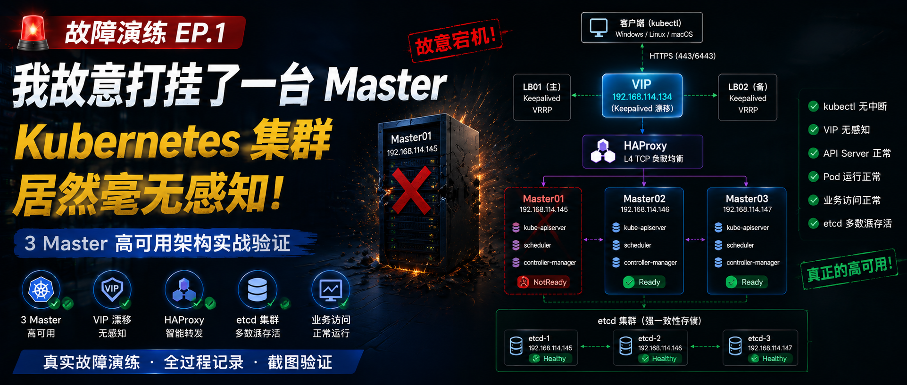

> 很多人都说自己搭的是“Kubernetes 高可用集群”。
> 但真正的问题是：**你真的验证过它“高可用”吗？**
>
> 这一篇，我不再讲安装，而是**真正开始故障演练**。
> 我会直接：
>
> - 打挂一台 Master
> - 验证 kubectl 是否中断
> - 确认业务是否受影响
> - 检查 etcd 是否保持多数派
> - 观察整个控制平面的表现
>
> 看看这套 **3 Master + HAProxy + Keepalived** 的架构，到底是真 HA，还是只是“看起来像 HA”。

---

## 一、故障开始前，我必须先建立一条“基线”

在动手之前，最重要的一件事就是：
**确认整个集群当前完全健康，并记录下每一个关键状态。**

这就像做医学实验前的体检报告，没有它，后面的所有“正常”都缺乏说服力。

### 1.1 确认所有节点 Ready

```bash
kubectl get nodes -o wide
```

我要确保 3 个 Master 和 3 个 Worker 全部处于 `Ready` 状态，版本一致，并且角色正确。

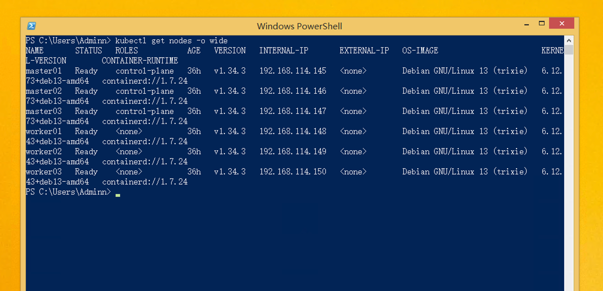

这张图是 **故障前的健康基线**，后面 Master 挂掉后，你能直接对比出 `Ready → NotReady` 的变化。

### 1.2 确认所有系统 Pod 正常运行

```bash
kubectl get pods -A
```

重点关注 `kube-system` 下的 CoreDNS、kube-proxy、CNI 插件，以及监控命名空间下的 Prometheus、Grafana 等。它们必须全部 `Running`，且没有异常重启。

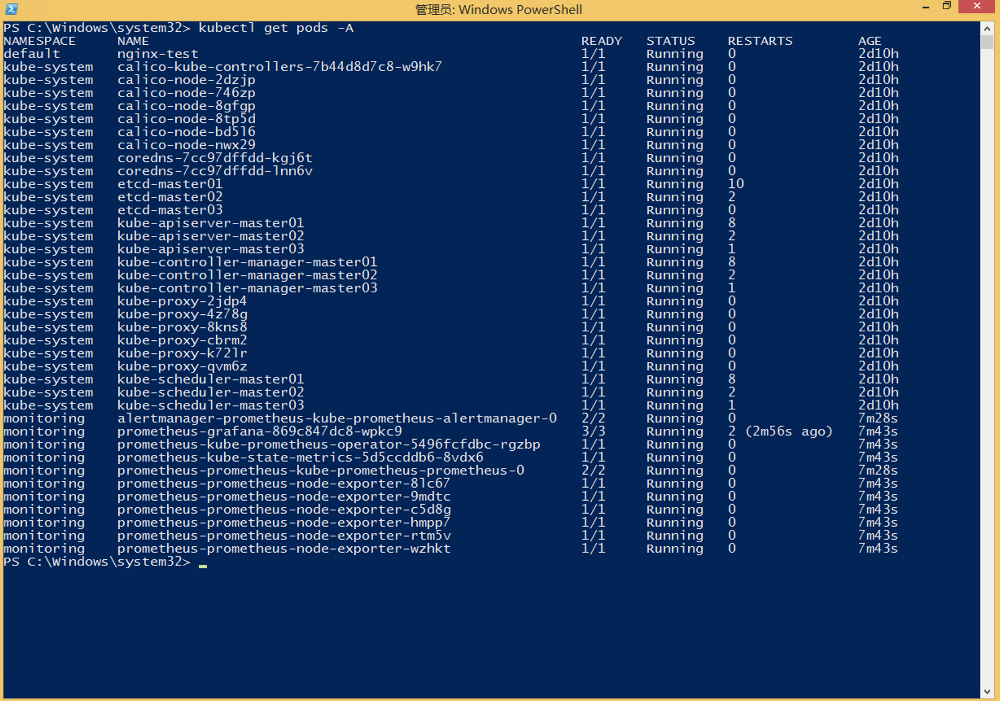

这张图是 **控制面与业务 Pod 的基线**，后面我们要看哪些 Pod 会在 Master 宕机后受到影响。

### 1.3 确认 etcd 集群的多数派状态（这步很容易被忽略）

要验证高可用，光看节点不够，还必须直接检查 etcd 集群的健康状况。因为是 kubeadm 部署的堆叠式 etcd，我可以进入任意一个 etcd 容器执行命令：

```bash
kubectl -n kube-system exec -it etcd-master01 -- etcdctl \
  --endpoints=https://127.0.0.1:2379 \
  --cacert=/etc/kubernetes/pki/etcd/ca.crt \
  --cert=/etc/kubernetes/pki/etcd/server.crt \
  --key=/etc/kubernetes/pki/etcd/server.key \
  endpoint health --cluster
# Windows下推荐写成一行
```

理想的输出应该是 3 个 endpoint 全部 `healthy`，集群处于正常状态。

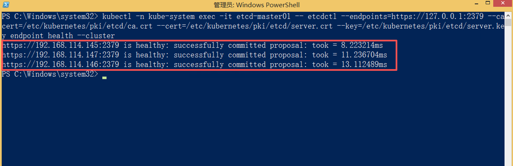

这张图是 **etcd 集群的基线**。后面打挂一台 Master，我们还要回来看 etcd 是否仍然满足多数派。

### 1.4 确认 HAProxy 后端健康状态

因为我手动部署了 HAProxy，我需要知道它当前把流量转发到了哪些 API Server。可以这样查看 HAProxy 的统计信息：

```bash
echo "show stat" | sudo socat stdio /var/run/haproxy.sock | grep -E "^kube-api|^#"
```

或者直接观察后端健康检查日志。我要确认 `master01`、`master02`、`master03` 的 6443 端口全部 `UP`。

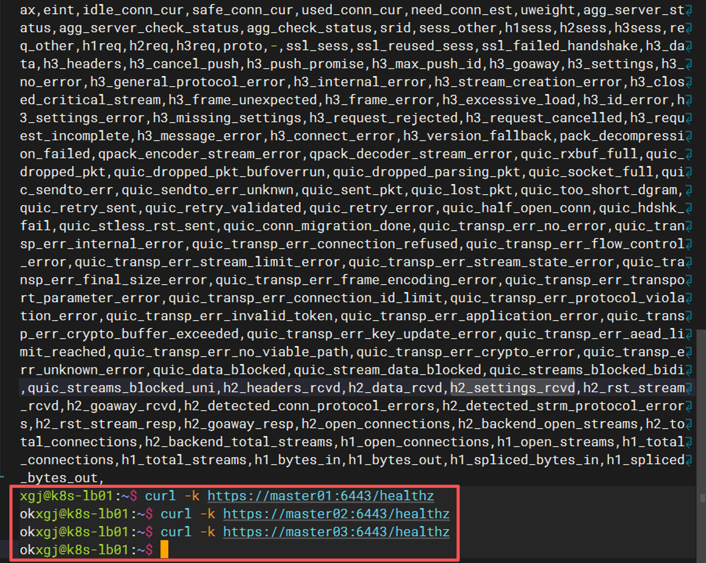

这能帮助我们理解：**为什么 Master 挂掉后，kubectl 仍然可以工作。**

### 1.5 持续观察 kubectl 实时状态

为了捕捉控制平面的“瞬间反应”，我在另一个终端运行：

```bash
watch -n 1 kubectl get nodes
```

让它每秒刷新一次节点列表。这样一旦 Master 宕机，我能第一时间看到 `kubectl` 的响应变化。

---

## 二、动手：直接强制关闭一台 Master

很多教程喜欢用 `systemctl stop kubelet` 来模拟节点故障，但我认为那不够真实。在生产环境里，更常见的是宿主机断电、内核 panic、虚拟机强制关机。所以这一次，我直接采用了最暴力、最接近真实故障的方式：**强制关闭一台 Master 虚拟机**。

### 2.1 故障目标

我选择关闭 `Master01`，IP 为 `192.168.114.145`。在关机前，它承担着 API Server 和 etcd 成员的角色。

### 2.2 执行强制关机

在 Master01 上以 root 执行：

```bash
# shutdown -h now
sudo init 0
```

或者直接使用虚拟化平台的“强制关闭电源”功能，模拟突然断电。

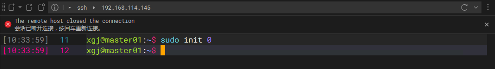

---

## 三、Master 挂掉后，集群居然还活着

关机完成后，我立刻回到管理终端，观察各个维度的表现。

### 3.1 kubectl 完全没有掉线

最直观的现象是：`watch -n 1 kubectl get nodes` 的刷新没有卡死，也没有报错。大约 40 秒后，`master01` 的状态从 `Ready` 变成了 `NotReady`，但其它 5 个节点一切正常，并且 **kubectl 命令本身始终能够正常返回结果**。

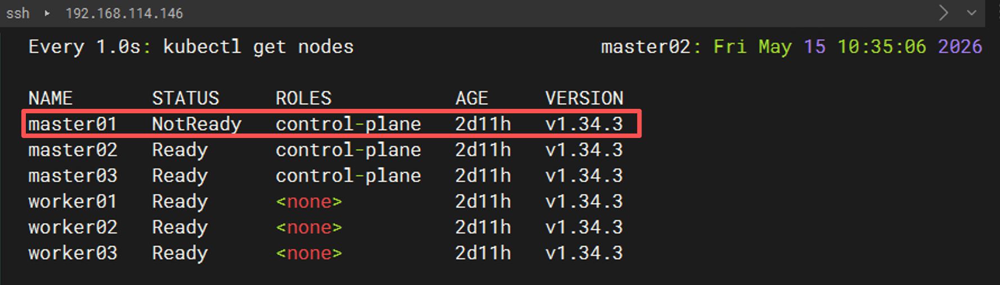

### 3.2 API Server 依然健康响应

我紧接着执行：

```bash
kubectl cluster-info
```

返回的信息依然显示 `Kubernetes control plane is running at https://192.168.114.134:6443`，没有任何报错。

```bash
kubectl get ns
```

同样瞬间返回。这说明 **API Server 没有因为单台 Master 宕机而中断服务**。

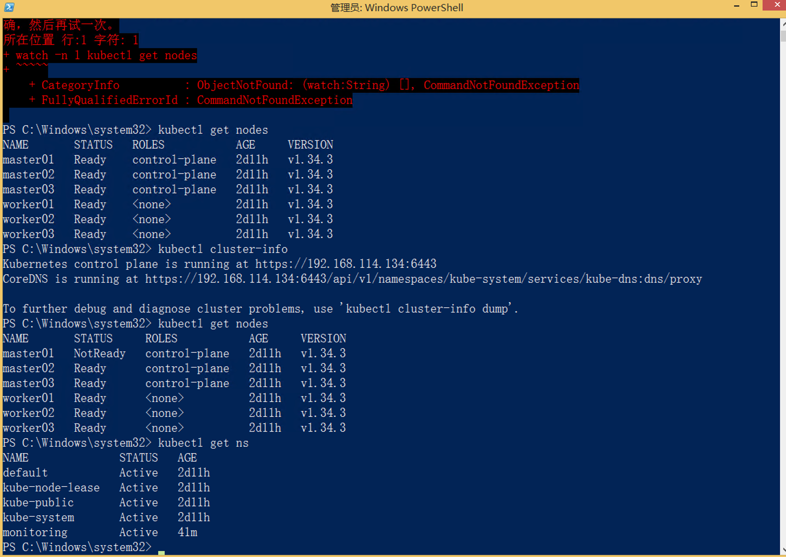

### 3.3 HAProxy 自动踢掉了故障节点

登录到 LB 节点，再次查看 HAProxy 状态：

```bash
curl -k https://master01:6443/healthz
curl -k https://master02:6443/healthz
curl -k https://master03:6443/healthz
```

此时 `master01` 对应的后端已经显示 `DOWN`，而 `master02` 和 `master03` 仍然 `UP`，客户端的请求被无缝切换到了健康的 API Server 上。**这就是 kubectl 没有掉线的原因。** 

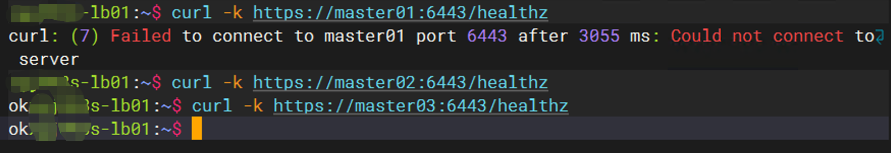

### 3.4 VIP 没有发生漂移（这一点很多人会误解）

这里必须澄清一个关键点：**本次故障中，VIP 并没有漂移。** 
因为 VIP 是由 Keepalived 绑定在 LB 节点上的，只要 LB 节点本身不挂，VIP 就会稳稳地待在原地。我们打挂的是 Master，不是 LB，因此 VIP 纹丝不动，也不需要漂移。

这也说明：**控制平面的高可用是由“API Server 冗余 + HAProxy 转发”共同保障的，而不是仅靠 VIP 漂移。**

---

## 四、业务到底受不受影响？这才是高可用的终极检验

控制面没挂，不代表业务没问题。很多“伪高可用”集群，控制节点一宕机，Ingress 就炸，DNS 就断。我必须亲自验证业务入口。

### 4.1 所有业务 Pod 依然正常运行

```bash
kubectl get pods -A -o wide
```

所有非 Master 节点上的 Pod（包括 Nginx、测试应用、监控组件）全部保持 `Running`，没有发生重启。这是因为 Pod 的运行时是由 Worker 上的 kubelet 维护的，只要 kubelet 不重启、容器不崩溃，Pod 就一直存在。

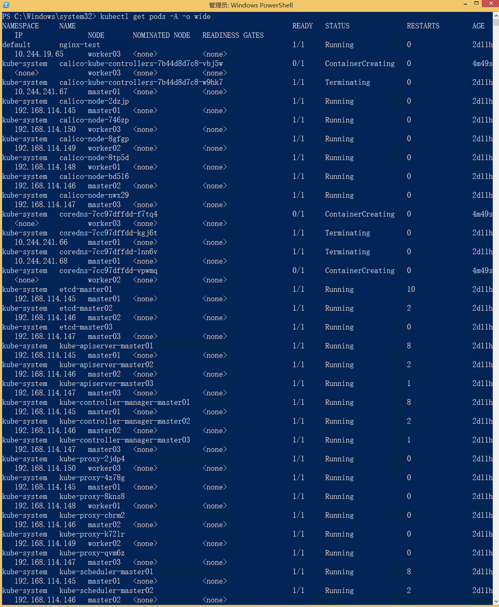

### 4.2 直接访问浏览器，业务完全无感知

我打开浏览器，分别访问：

- 通过 NodePort 暴露的 Nginx 测试页面
- Grafana 仪表盘

结果：**全部秒开，响应时间没有任何异常**。即使在我关闭 Master01 的那一瞬间，也没有出现丢包或连接拒绝。

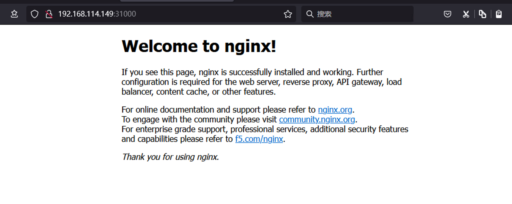

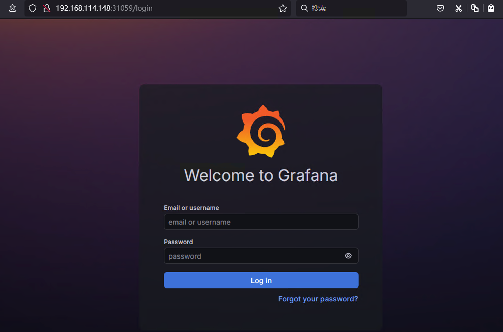

---

## 五、为什么这套架构能扛住单台 Master 宕机？

演练不是目的，理解原理才是。下面我从三个层面拆解“为什么没事”。

### 5.1 API Server 是多副本的

在我的集群中，`kube-apiserver` 以静态 Pod 的形式同时运行在三台 Master 上。前面有一个 HAProxy 作为四层负载均衡器，VIP 对外统一暴露 `192.168.114.134:6443`。

当 Master01 关机后：

1. HAProxy 的健康检查探测到 `192.168.114.145:6443` 不可达。
2. 自动将其标记为 `DOWN`，不再转发请求。
3. 所有 `kubectl` 请求被路由到 Master02 或 Master03 的 API Server。

因此，只要**至少还有一台 Master 上的 API Server 存活**，控制平面的入口就不会消失。

### 5.2 etcd 多数派依然成立

比 API Server 更关键的是 etcd。Kubernetes 的所有集群状态都存储在 etcd 里，而 etcd 使用 Raft 协议保证一致性，必须满足  **（N/2 + 1）**  的多数派才能正常写入。

我的集群是 3 台 Master 堆叠 etcd：

- 总成员数：3
- 挂掉 1 台，剩余 2 台
- 多数派要求：2（因为 3/2+1=2.5 向下取整为 2）
- 多数派成立，etcd 依然可以正常读写。

可以通过以下命令再次确认 etcd 状态：

```bash
kubectl -n kube-system exec -it etcd-master02 -- etcdctl \
  --endpoints=https://127.0.0.1:2379 \
  --cacert=/etc/kubernetes/pki/etcd/ca.crt \
  --cert=/etc/kubernetes/pki/etcd/server.crt \
  --key=/etc/kubernetes/pki/etcd/server.key \
  endpoint health --cluster
```

虽然此时会显示 master01 的成员 `unhealthy`，但整体集群 `is healthy`。


### 5.3 如果同时挂两台呢？

那就会**真崩**。因为 3 台 etcd 挂掉 2 台后，只剩 1 台，无法形成多数派，etcd 进入只读甚至不可用状态。届时即使 API Server 还活着，所有写操作（如创建 Pod、更新配置）都会失败，集群实际上已经瘫痪。

这也解释了 **为什么企业最常见的是 3 Master，而不是 2 Master**：2 Master 的情况下，挂掉 1 台后只剩 1 台，同样不满足多数派，完全没有容错能力。

---

## 六、这次演练让我彻底想明白了一件事

以前我也觉得“Kubernetes HA 就是多几台 Master”，但真正手动打挂一台节点，再亲眼看着 kubectl 毫发无伤地继续工作，这种认知才从“知道”变成了“理解”。

高可用的关键，不是简单的节点堆叠，而是一条 **完整且自愈的控制平面访问链路**：

- **VIP** 统一入口
- **Keepalived** 保障 LB 自身高可用
- **HAProxy** 做四层转发和健康检查
- **API Server** 多副本冗余
- **etcd** 保证数据层多数派

只有当这条链路上的每个环节都经过故障验证，你才能说： **“我拥有的是一个真正的 HA 控制平面”** 。

---

## 七、下一篇预告：直接打挂负载均衡层

这一篇只验证了“Master 宕机”场景，但高可用还有最后一关：**如果负载均衡器自己挂了呢？**

下一篇，我会故意打挂 LB 节点，亲身验证：

- VIP 会不会自动漂移？
- Keepalived 的接管速度有多快？
- HAProxy 恢复后，后端列表是否自愈？
- kubectl 在那瞬间会不会闪断？
- 已有长连接会不会中断？

这是整个高可用链路里最关键、也最容易被低估的一环。

[继续阅读](failover-test-2.md){ .md-button .md-button--primary }