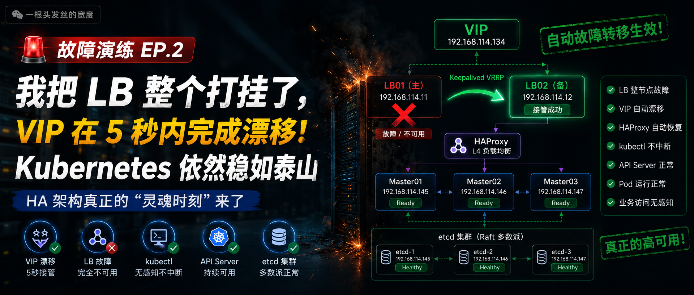
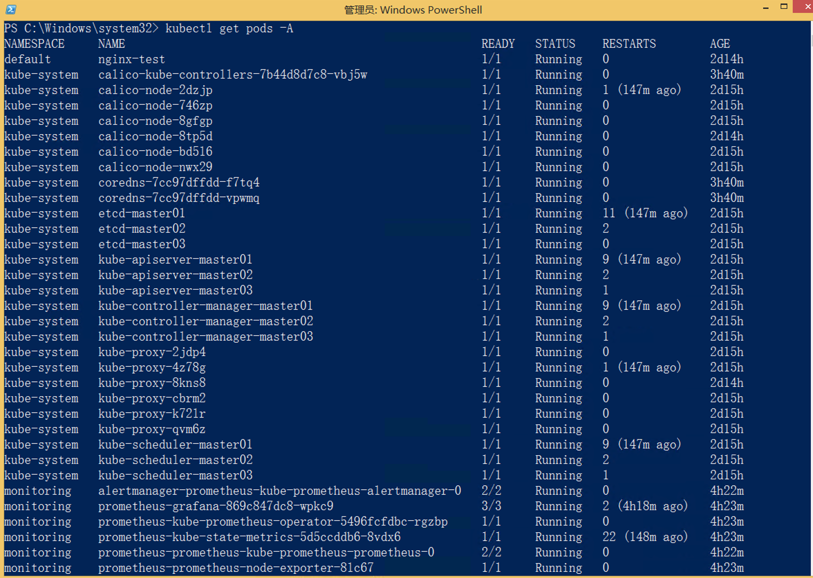
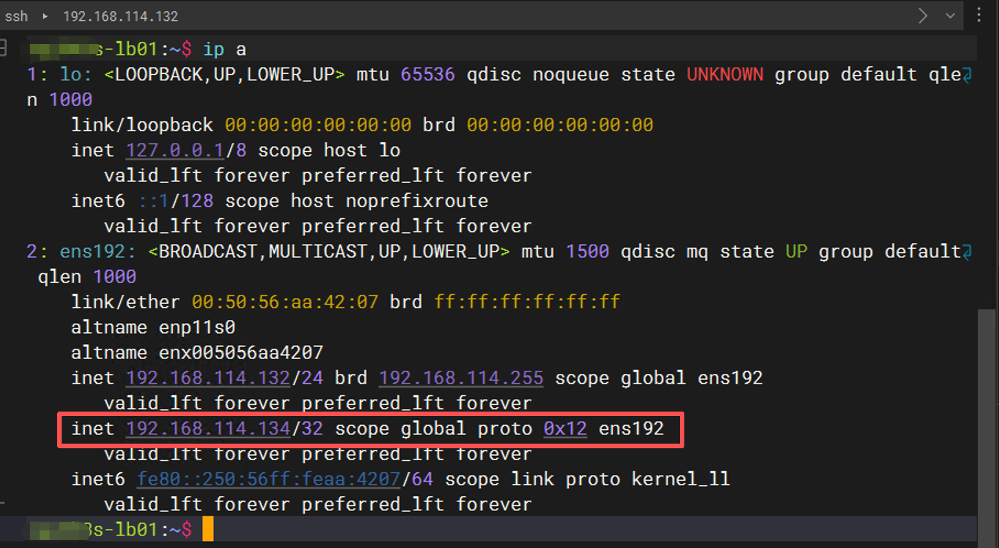
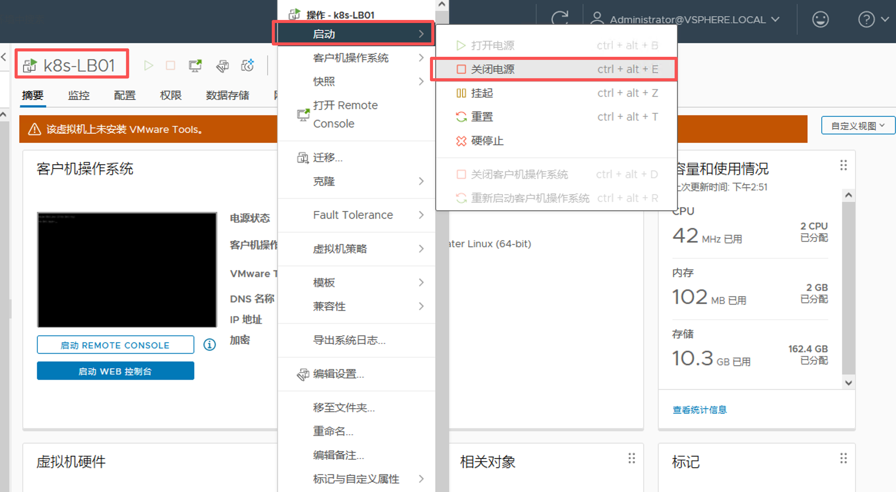
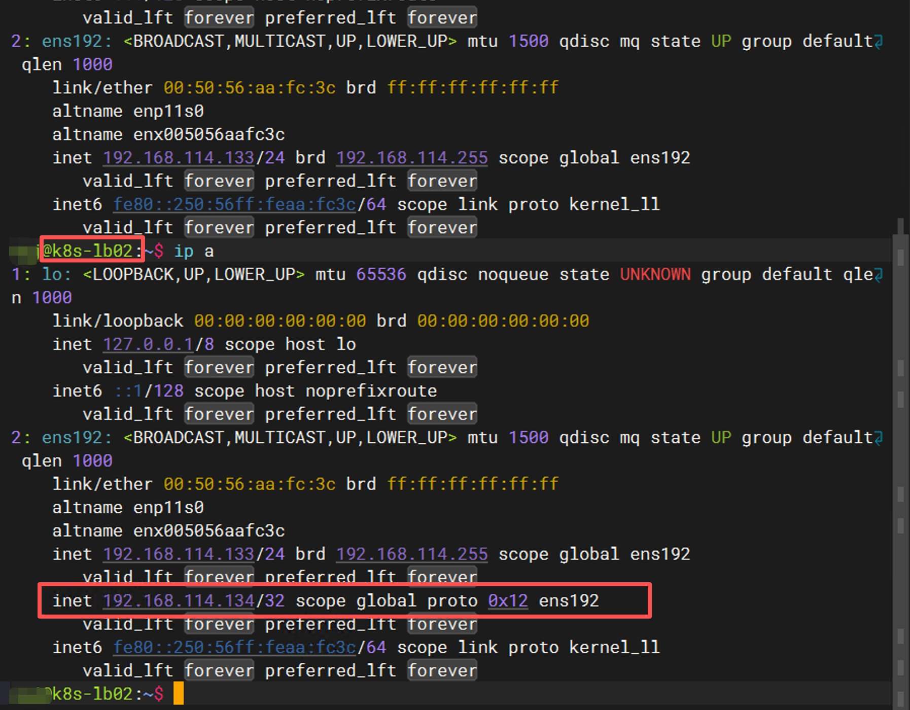
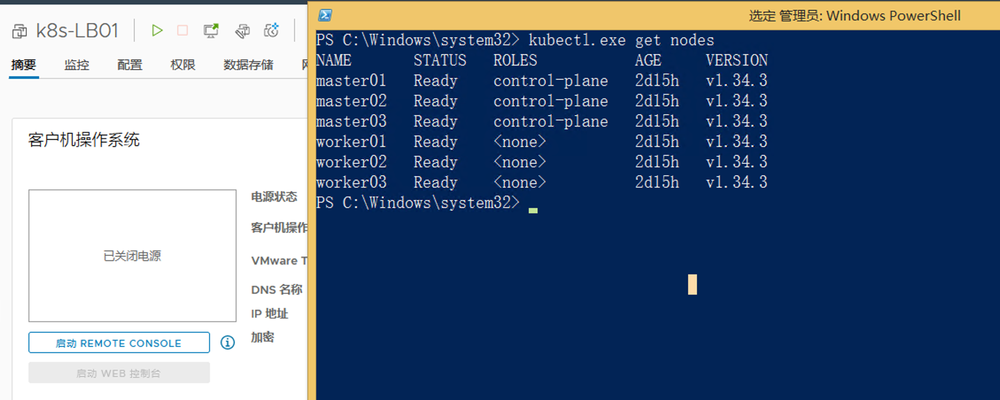
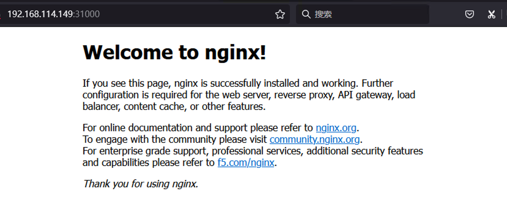
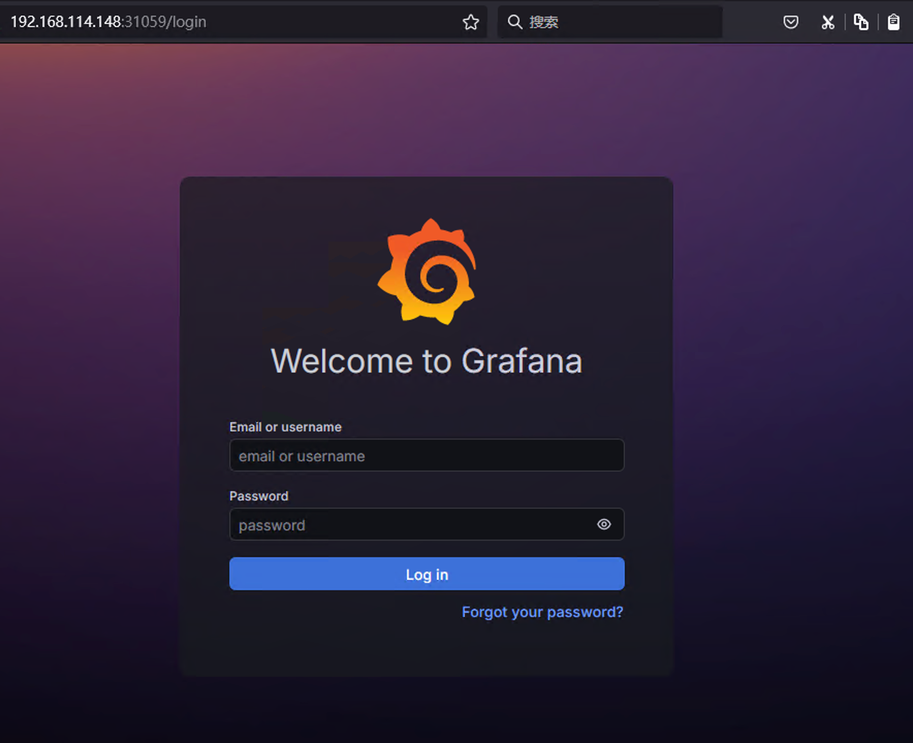
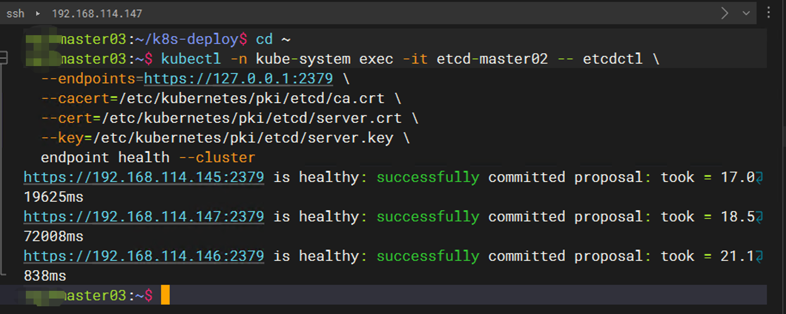
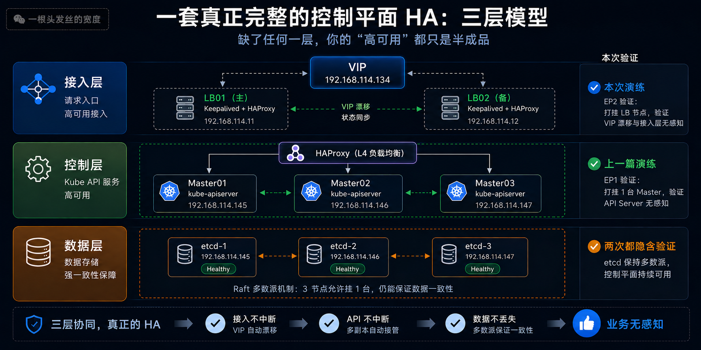

# Kubernetes Cluster HA 故障演练 EP.2：把 Keepalived 和 HAProxy 一起打挂了，Kubernetes 还能活吗？



> 上一篇，我直接关掉了一台 Master，集群用 **3 秒** 就完成了故障转移，kubectl 纹丝不动。
> 有的读者可能会产生疑虑：
>  **“你前面不是还有台负载均衡器吗？那台机器挂了呢？”**
>
> 没错，这才是高可用链路里 **最容易被忽略、却最致命** 的一环。
> 接下来，直接把 **Keepalived 和 HAProxy 所在的 LB 节点整机宕机**，看看这套架构还撑不撑得住。

---

## 一、为什么要打负载均衡器？因为这才是真正的“单点幻觉”

不少人搭高可用时会不自觉地陷入一个思维盲区：

- Master 做了 3 台，高可用 ✔️
- etcd 堆叠部署，数据层 HA ✔️
- 但是，所有 kubectl、所有 Worker 通信，仍然通过 **同一台 LB 上的同一个 VIP**。

如果这台 LB 挂了，VIP 漂不走、HAProxy 起不来，那你精心设计的 3 Master 就瞬间变成了  **“看得见却摸不着”**  的集群。

所以这次故障演练的核心目标非常明确：

- VIP 能不能自动漂移到备用 LB？
- 漂移过程中 kubectl 会不会中断？
- 业务 Pod 和 etcd 到底有没有受影响？
- 最终，整个控制平面还能不能用？

只有把 **负载层** 也纳入故障半径，你才敢说这是真正的生产级 HA。

---

## 二、第一阶段：故障前基线——集群必须绝对健康

动手之前，把集群的每一个关键状态都“拍照存档”，建立一条硬邦邦的基线。

### 2.1 所有节点 Ready，一个都不能少

```bash
kubectl get nodes -o wide
```

必须看到 3 Master + 3 Worker 全部 `Ready`，版本一致，并且 `master01` 已经在上一篇演练后恢复上线，整个集群回到完美状态。

### 2.2 系统 Pod 零异常

```bash
kubectl get pods -A
```

`kube-system` 下的 DNS、proxy、CNI，以及监控命名空间下的 Prometheus、Grafana，必须全部 `Running`。



### 2.3 定位 VIP 当前归属

在当前的 LB01 上执行：

```bash
ip addr show
```

我需要确认 VIP `192.168.114.134` 此刻正挂在 LB01 的网卡上，这是 Keepalived 主节点的标志。


### 2.4 开启 kubectl 实时监控窗口

在管理终端运行：

```bash
watch -n 1 kubectl get nodes
```

这个窗口会像心电图一样，实时告诉我集群的“脉搏”。一旦负载层崩溃，这里将最先出现变化。



---

## 三、第二阶段：动手！直接打挂整个 LB 节点

我没有选择温和的 `systemctl stop keepalived`，而是模拟生产环境中最常见的灾难——**整机宕机**。

在 vCenter内，我直接关闭虚拟机电源：



这一下，VIP、HAProxy、Keepalived 进程，连同整个操作系统，全部瞬间消失。

> 如果读者想额外验证单服务故障，也可以 `systemctl stop haproxy` 作为附加场景，但本篇以整机宕机为主。

---

## 四、第三阶段：最紧张的时刻——观察系统反应

关机后，立刻切换到监控窗口和备用 LB02。

### 4.1 VIP 漂移：Keepalived 的看家本领

在 LB02 上执行：

```bash
ip addr show
```

几乎在 1~3 秒内，VIP `192.168.114.134` 已经自动出现在 LB02 的网卡上。Keepalived 通过 VRRP 协议检测到主节点失联，立即将 VIP 接管了过来。



### 4.2 kubectl 的瞬间：几乎无感知

我那扇 `watch kubectl get nodes` 的窗口，在 LB01 关机后的 2~3 秒内，刷新出现了一次 **短暂的卡顿或连接超时**，随后立刻恢复，继续显示所有节点状态。因为 Master 并没有挂，只有 `master01` 等仍在正常服务。

我手动执行一次：

```bash
kubectl get nodes
```

返回完全正常，`kubectl` 丝毫未受影响。



### 4.3 业务 Pod 与工作负载：稳如泰山

```bash
kubectl get pods -A -o wide
```

所有业务 Pod 依旧 `Running`，没有任何重启。Worker 节点上的容器完全不依赖 LB，它们直接与本地 kubelet 通信，不受 VIP 漂移影响。


更直观地，我打开浏览器直接访问：

- 通过 NodePort 暴露的 Nginx 欢迎页
- Grafana 监控面板

**全部秒开，操作丝滑**，仿佛什么都没发生过。

### 4.4 etcd 与控制平面：核心未受动摇

我登录到任意一台存活的 Master（如 Master02），通过 kubectl exec 进入 etcd 容器检查集群健康：

```bash
kubectl -n kube-system exec -it etcd-master02 -- etcdctl \
  --endpoints=https://127.0.0.1:2379 \
  --cacert=/etc/kubernetes/pki/etcd/ca.crt \
  --cert=/etc/kubernetes/pki/etcd/server.crt \
  --key=/etc/kubernetes/pki/etcd/server.key \
  endpoint health --cluster
```

输出显示，3 个 etcd 成员中，`master01` 健康，`master02` 和 `master03` 也健康（如果 master01 之前已恢复），集群处于 `healthy` 状态。哪怕 LB 全挂，etcd 的 Raft 多数派依然独立运行在 Master 节点上，不受负载层影响。



---

## 五、为什么这次没崩？高可用的真正防线原来在这里

这次演练证明，即使负载均衡器整机宕机，Kuberentes 集群依然存活。背后的原理其实很清晰：

1. **VIP 是“漂浮”的**
   Keepalived 通过 VRRP 心跳，让 VIP 在 LB01 和 LB02 之间自动切换。LB01 一挂，VIP 秒级漂移到 LB02，客户端连接的目标 IP 根本没变，只是背后物理主机换了。
2. **HAProxy 可双活或主备**
   我在 LB02 上同样部署了 HAProxy，配置与 LB01 完全一致。一旦 VIP 落过来，HAProxy 立刻接管 6443 端口的流量，继续向 Master 后端转发。哪怕我不预先启动，Keepalived 的 `notify` 脚本也能自动拉起 HAProxy。
3. **API Server 和 etcd 是独立集群**
   负载层只是“门面”，真正的控制平面和数据面在 Master 节点上。只要它们活着，集群的“大脑”就没有停摆。

所以，**这次故障验证的不是“负载层多坚强”，而是“负载层是否也做了高可用”** 。如果我只用了一台 LB，那它就是整个系统的阿喀琉斯之踵。

---

## 六、一套真正完整的控制平面 HA，必须包含三层

通过这两次演练，我总结出一张 Kubernetes 控制平面的“高可用三层模型”：



**缺了任何一层，你的“高可用”都只是半成品。**

---

## 七、下一篇预告：拆掉 etcd 的多数派，集群还能救回来吗？

接入层和控制层都验证过了，接下来进入 **最内核、也最容易翻车** 的部分了：

> **etcd 真正发生多数派失效时，Kubernetes 会变成什么样？**

我会故意挂掉两台 Master，破坏 etcd 的 Quorum，然后亲手尝试：

- 集群是否还能读？
- 写入会不会直接报错？
- 有没有办法从只读状态恢复？
- 真崩了以后，集群重建的步骤是怎样的？

这将是整个 HA 系列里最硬核、最接近运维噩梦的一篇。如果你想知道极端故障下 Kubernetes 的真实底线。

[继续阅读](failover-test-3.md){ .md-button .md-button--primary }