# Kubernetes Cluster HA 故障演练 EP.3：让 etcd 多数派失效，Kubernetes 控制平面还能恢复吗？

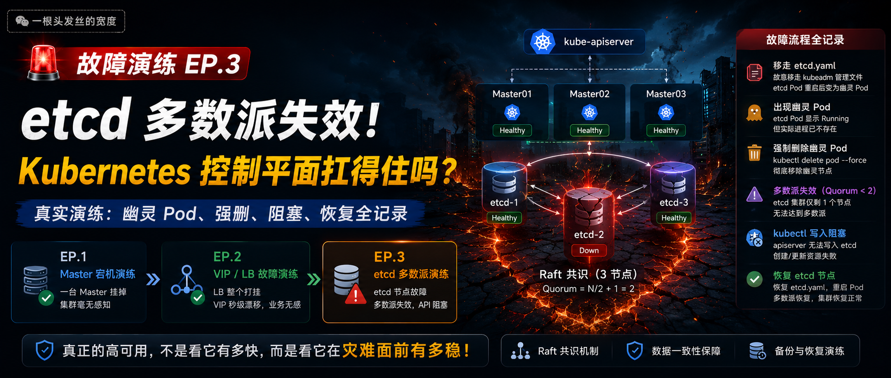

前两篇演练，我分别演示了Master和负载均衡器的故障，K8s集群都稳如老狗。今天，我对整个集群的“命脉”——**etcd** 下手了！

我将带你模拟一次 **etcd多数派失效** 的灾难场景。当3个etcd节点倒下2个，K8s控制平面会经历怎样的“脑中风”？最重要的是，**我们还能把它救回来吗？**

**本文全程实战截图！**

---

## 🧠 思维导图 & 架构图

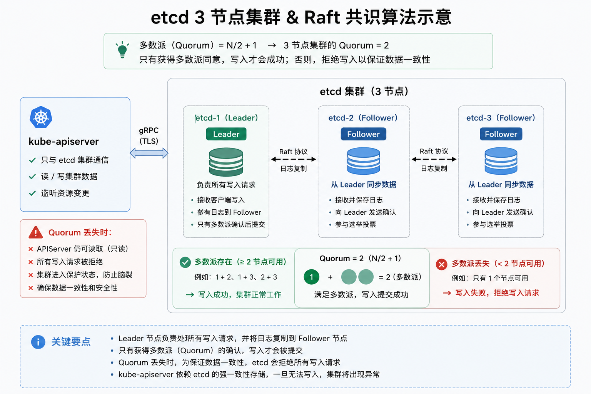

---

## 一、第一阶段：演练前基线确认

动手之前，必须给集群拍一张“CT 照”，记录最健康的样子。

### 操作 1：确认集群节点状态

```bash
kubectl get nodes -o wide
```

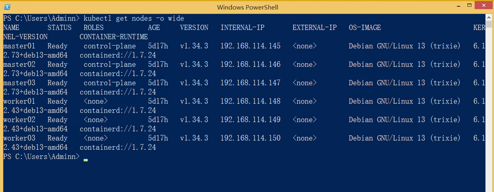

### 操作 2：确认 Pod / 核心服务状态

```bash
kubectl get pods -A
```

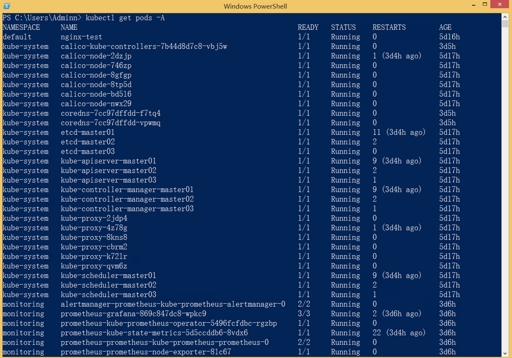

### 操作 3：确认 etcd 节点健康状态（完整 endpoints）

```bash
sudo ETCDCTL_API=3 etcdctl endpoint health \
  --endpoints=https://192.168.114.145:2379,https://192.168.114.146:2379,https://192.168.114.147:2379 \
  --cacert=/etc/kubernetes/pki/etcd/ca.crt \
  --cert=/etc/kubernetes/pki/etcd/server.crt \
  --key=/etc/kubernetes/pki/etcd/server.key
```

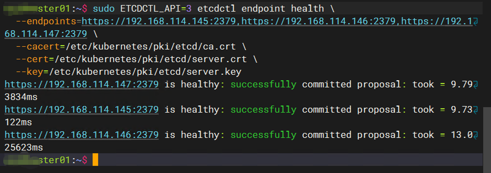

---

## 二、第二阶段：单节点故障注入

我们先停掉 **master01** 上的 etcd，看看集群会不会慌。

### 操作 1：移走 etcd 静态 Pod 清单文件

```bash
# 在 master01 上执行
sudo mv /etc/kubernetes/manifests/etcd.yaml /tmp/
```

### 操作 2：查看 Pod 状态 —— 咦？怎么还在？

```bash
kubectl get pods -n kube-system
```

输出竟然还是：

```
etcd-master01    1/1   Running   11   6d
```

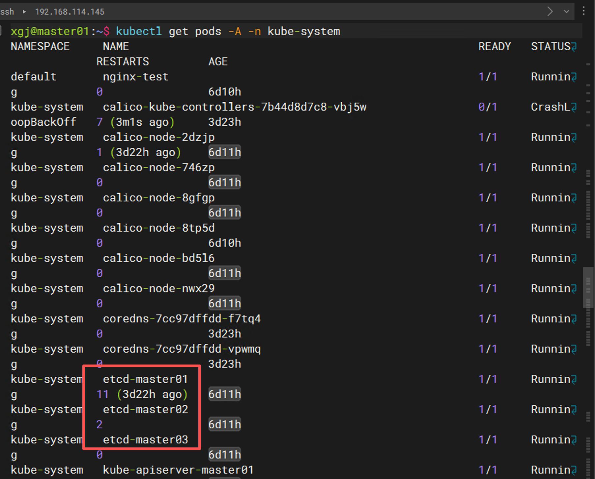

为什么 **？**  我已经移走了 YAML 文件，为什么 Pod 还在？
赶紧用 `etcdctl` 检查一下端口：

```bash
sudo ETCDCTL_API=3 etcdctl endpoint health \
  --endpoints=https://192.168.114.145:2379,https://192.168.114.146:2379,https://192.168.114.147:2379 \
  --cacert=... --cert=... --key=...
```

输出：

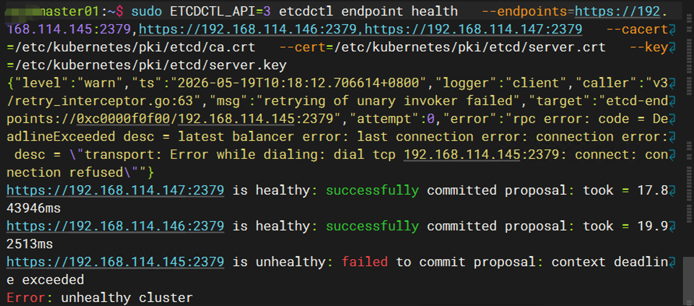

---

## ⚠️ 踩坑实录：静态 Pod 的“幽灵”

**现象**：静态 Pod 的 YAML 文件已经移走，`kubectl` 却显示 Pod 还在 `Running`，但实际 etcd 进程早已退出了（端口不通）。

**原因分析**：
`kubelet` 监视 `/etc/kubernetes/manifests` 目录，正常情况下移走文件会立即删除 Pod。但在某些情况下（例如容器运行时响应慢、kubelet 缓存未刷新），Pod 对象会残留在 API Server 中，变成一个“幽灵 Pod”。由于静态文件已不存在，kubelet 也不会再管理它，只能手动删除。

**解决方案**：
强制删除这个“幽灵 Pod”：

```bash
kubectl delete pod -n kube-system etcd-master01 --force --grace-period=0
```

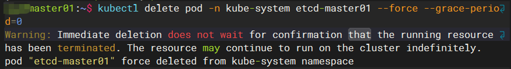

再次查看：

```bash
kubectl get pods -n kube-system | grep etcd
```

只看到 `etcd-master02` 和 `etcd-master03`，**幽灵消失**。

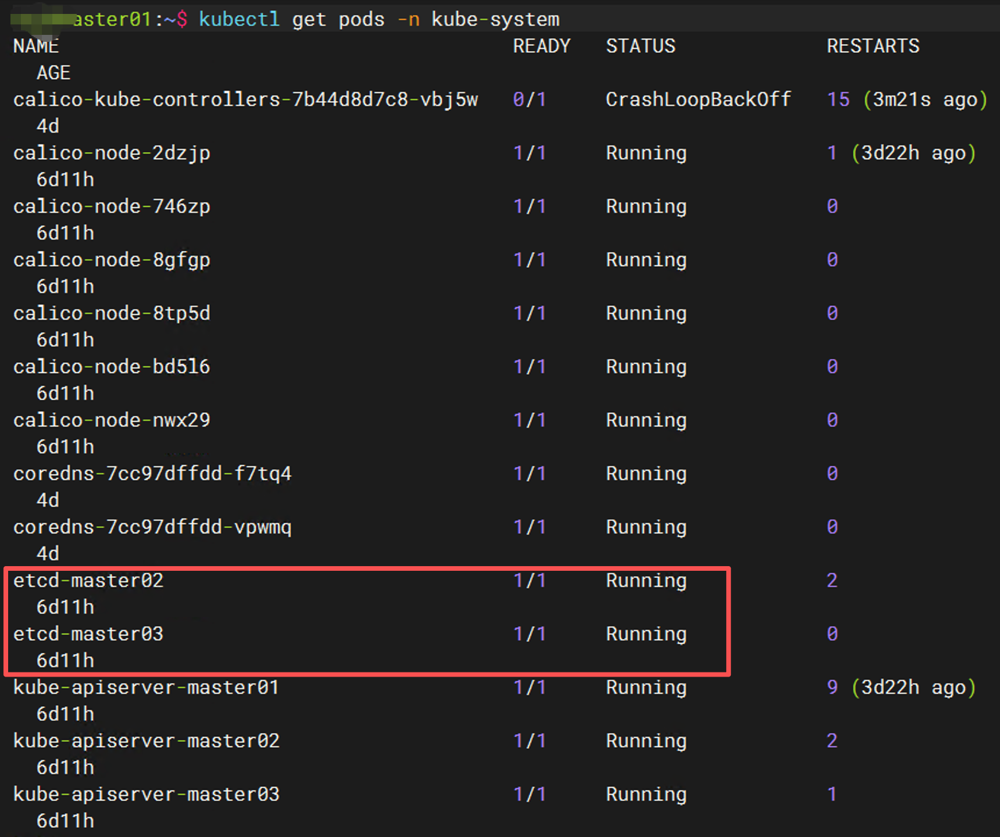

>  **💡 小贴士**：
> 在使用静态 Pod 进行故障模拟时，如果移走 YAML 后 Pod 没有自动消失，不要慌。直接 `kubectl delete pod --force` 即可，因为清单文件已经不在，kubelet 不会重建。

---

## 三、第三阶段：多数派失效

现在集群还剩 2 个 etcd（master02 和 master03），多数派依然成立（2/3）。我们要继续停掉 **master02** 的 etcd。

### 操作 1：停掉第二个 etcd 节点

```bash
# 在 master02 上执行
sudo mv /etc/kubernetes/manifests/etcd.yaml /tmp/
sudo systemctl restart kubelet
```

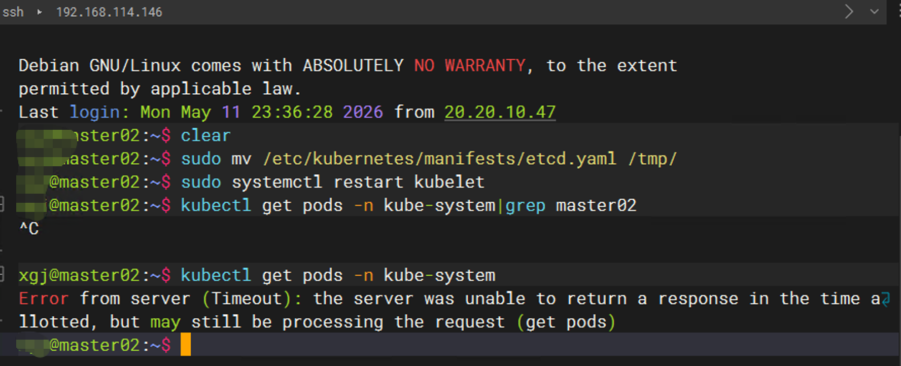

此时集群仅剩 `etcd-master03` 一个节点，多数派失效（1/3 < 2）。

### 操作 2：观察控制平面行为

执行任意 `kubectl` 命令：

```bash
kubectl get pods
```

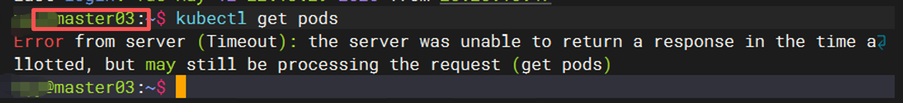

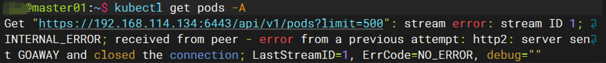

均显示超时。

**但已经运行的业务 Pod 呢？** 
登录 Master 和 Worker 节点查看容器：

bash

```bash
sudo ctr -n k8s.io task ls
```

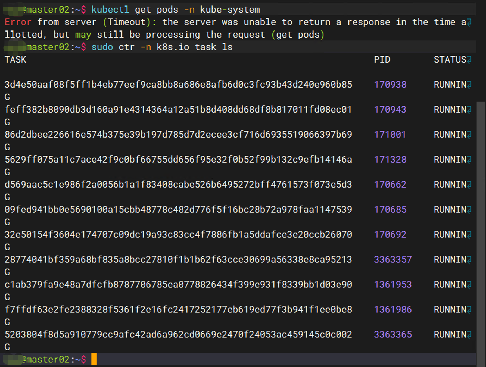

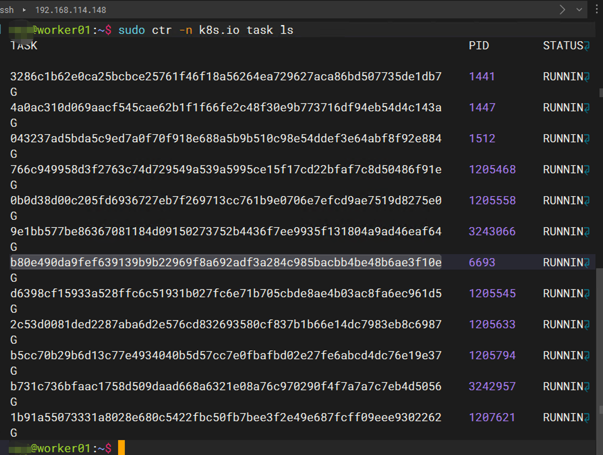

> 图中显示容器依然正常运行当中。

**结论**：

- etcd 多数派失效 → `kube-apiserver` 拒绝写入（只读缓存可能还能读，但不保证一致性）。
- 已调度的 Pod 继续运行（数据平面独立）。
- 无法进行任何变更操作（扩缩容、滚动更新、创建/删除资源全部失败）。

---

## 四、第四阶段：恢复集群

### 操作 1：移回 etcd 清单文件

在 master01 & master02 执行：

```bash
sudo mv /tmp/etcd.yaml /etc/kubernetes/manifests/
sudo systemctl restart kubelet
```

### 操作 2：等待 Pod 自动重建并验证健康

稍等 30 秒，检查 etcd Pod：

```bash
kubectl get pods -n kube-system | grep etcd
```

所有三个 etcd Pod 重新变为 `Running`。

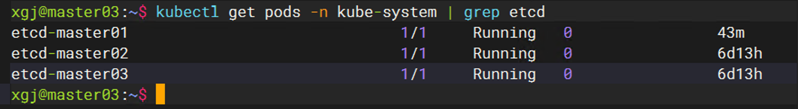

执行健康检查：

```bash
sudo ETCDCTL_API=3 etcdctl endpoint health \
  --endpoints=https://192.168.114.145:2379,https://192.168.114.146:2379,https://192.168.114.147:2379 \
  --cacert=... --cert=... --key=...
```

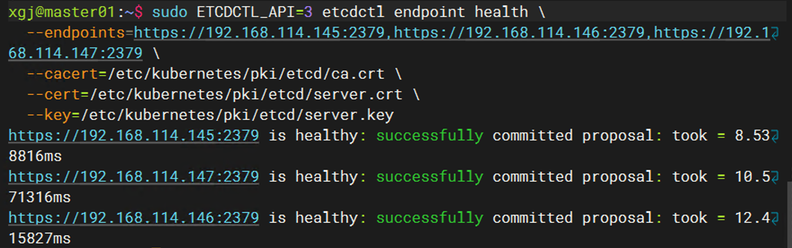

### 操作 3：验证 kubectl 恢复

```bash
kubectl get nodes
kubectl run recovery-nginx --image=nginx
```

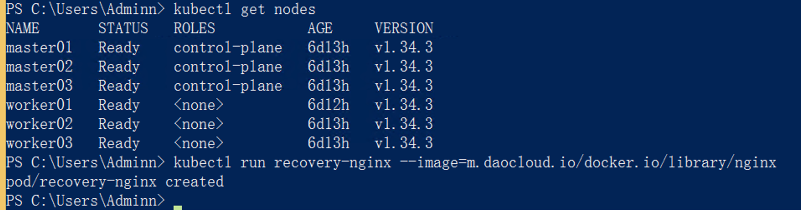

**集群复活！**

> 在恢复节点的过程中：
>
> 当我只恢复了 **master01** 的 etcd（将 YAML 文件移回），集群中 etcd 节点从 1 个变为 2 个（master01 + master03），**多数派重新成立**，`kubectl` 立刻恢复了正常！
>
> **为什么？** 
> Raft 协议要求 `存活节点数 > N/2`。3 节点集群中，2 个节点存活即可满足多数派（Quorum\=2），**无需等待第三个节点恢复**。
> 这就是分布式系统中“多数派”的优雅之处：部分节点恢复即可让整个集群复活。
>
>
>  **💡 扩展思考**：如果 etcd 集群是 5 个节点，最少需要恢复几个节点才能让集群重新可用？

---

## 五、第五阶段：总结与架构展示

### 📊 核心结论：K8s 三层高可用模型

| 层级 | 核心组件           | 高可用手段                       | 验证结果                                  |
| :----- | :------------------- | :--------------------------------- | :------------------------------------------ |
| **接入层**     | VIP + LB (HAProxy) | Keepalived 主备 + HAProxy 多节点 | ✅ **EP.2 已验证**：VIP 漂移丝般顺滑                     |
| **控制层**     | kube-apiserver     | 多副本（3 Master 轮询）          | ✅ **EP.1 已验证**：干掉一个 Master 服务继续             |
| **数据层**     | **etcd**                   | **Raft 共识 + 多数派（3 节点）**                                 | ✅ **EP.3 已验证**：多数派失效 → 集群不可写，恢复即重生 |

> **一句话总结：**
>
> - **接入层**没了 → 外面进不来，里面照样转。
> - **控制层**没了 → 只能维持现状，无法变化。
> - **数据层**没了 → **彻底瘫痪，无法读写**。
>
> **etcd 是 K8s 真正的心脏起搏器，Quorum 就是它的心律。**

---

### 🎉 系列收官：一张图看懂 K8s 控制平面 HA 全貌

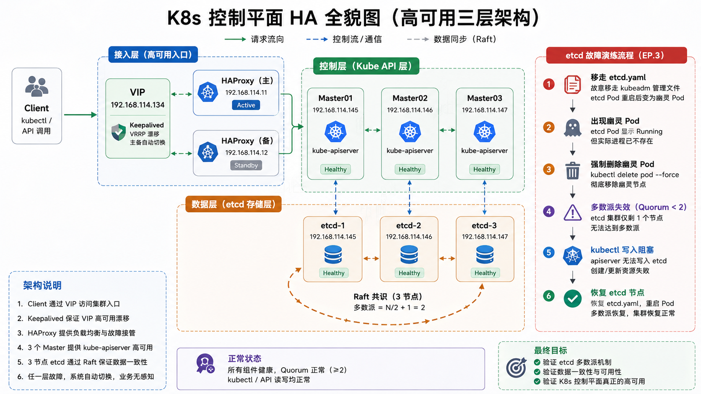

---

## 🎬 写在最后

这次从：

- Master 宕机
- VIP 漂移
- LB 故障
- 到 etcd 多数派失效

一路演练下来，我最大的感受是：**Kubernetes 最怕的，不是节点挂掉。**

而是：**运维人员根本不知道“挂掉之后会发生什么”，尤其 etcd。**

很多人知道：

```
etcd 很重要
```

但真正进入生产后你会发现：

- 多数派为什么会失效
- apiserver 为什么突然卡死
- kubectl 为什么开始超时
- 为什么 Pod 还在，但控制面已经“失明”
- 为什么恢复顺序不对，会把整个集群彻底搞崩

这些问题，如果你没亲手踩过。

到真正出故障时，心理压力可能会非常大。

---

而这次“幽灵 Pod”的排障，也让我对 Kubernetes 有了更深的理解。

理论里：

```
删除 YAML
→ Pod 消失
```

但真实环境里：

你可能会遇到：

- Pod 卡在 Terminating
- etcd 数据没同步
- kubelet 状态异常
- apiserver 与实际状态不一致
- YAML 没了，但 Pod 还“活着”

这些东西，文档通常只会一句带过。

但在真实生产环境里：

**每一个“诡异现象”，都可能意味着一次线上事故。**

---

所以现在我越来越认同一句话：

> 从来不是“你会不会部署”，
>
> 而是：
>
> **你有没有真正做过故障演练。**

因为：

- 架构可以复制
- YAML 可以抄
- 脚本可以下载

但：**故障经验，是只能靠自己踩出来的。**

---

## 💡 这三次演练后，个人认为最重要的三件事

### 1. 不要只堆机器，要理解共识机制

3 Master 不是重点。

真正的核心是：

```
Raft Quorum
```

你必须知道：

- 为什么必须是奇数节点
- 为什么 2 Master 没意义
- 为什么 etcd 才是真正的“命门”

否则：

你的 HA 很可能只是：

```
“心理上的高可用”
```

---

### 2. 不要只做备份，要真的演练恢复

很多人有：

```
etcd snapshot.db
```

但从没恢复过。

真实事故里：

最危险的不是：

```
没有备份
```

而是：

# 你以为自己的备份能恢复。

---

### 3. Kubernetes 最大的风险，往往来自“未知状态”

生产环境里最可怕的通常不是：

```
节点直接挂掉
```

而是：

- 半存活
- 半同步
- 半恢复
- 部分组件异常
- 控制面与实际状态不一致

因为这种状态：*最难排查。*

也是：*最容易误操作的阶段。*

---

!!! success "这次真实的`幽灵 Pod`排障经历也告诉我"
    理论是枯燥的，但实战中的每一个坑，都是你成长的阶梯。
