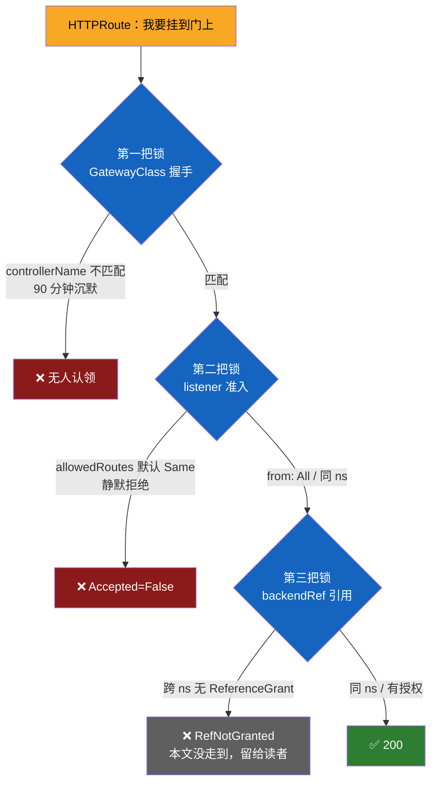
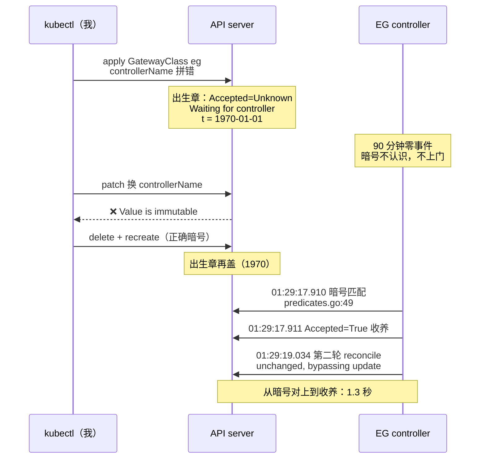
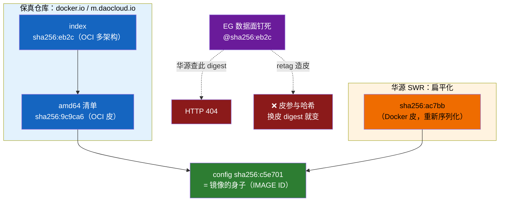
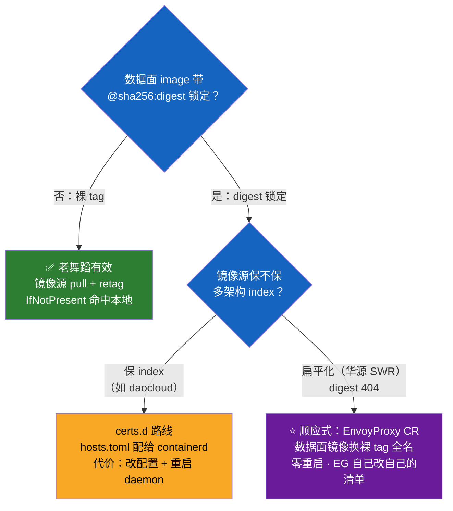
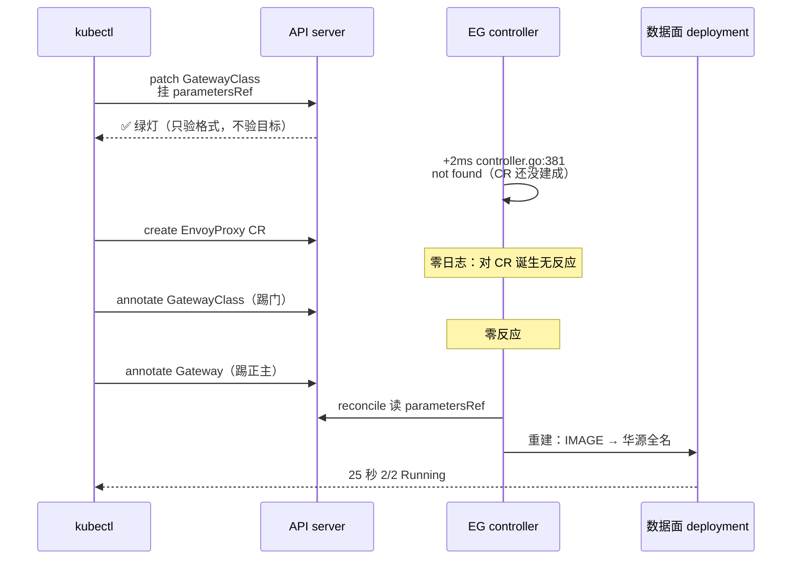
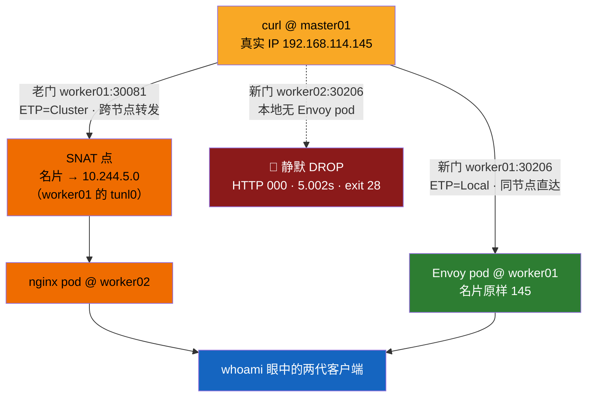
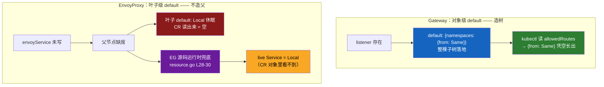

# Gateway API 装机实录：错的暗号沉默 90 分钟，换门只用了 1.3 秒

!!! note "实测声明"
    本文所有命令与输出全部来自真实环境实测：K8s 1.36.1，3 master + 3 worker（Debian 13，Calico IPIP），2026-10-20 至 10-21 两天共十二批实验（E1-E12）。终端输出逐字回填，源码与 CRD 引用均从对应版本原文件核对过行号。镜像源环境：registry-1.docker.io 整域不可达，稳定源为华为云 SWR 镜像站。

## 从一个没人回答的问题开始

装 Envoy Gateway 之前，我以为最难的是概念——GatewayClass、Gateway、HTTPRoute 一堆新对象。装完才知道，概念是最简单的部分，真正给我上课的是三件小事：一个拼错的暗号、一张换过皮的镜像、一行没人写过的状态。

先看这两行输出的对比：

```
# 暗号错的 GatewayClass，等了 90 分钟：
Accepted=Unknown  Waiting for controller

# 暗号对了，日志里 1.3 秒完成收养，读到时是：
Accepted=True  The Gateway has been scheduled by Envoy Gateway
```

同一个集群，同一个对象，唯一区别是 `spec.controllerName` 的值。错了，90 分钟零反应；对了，1.3 秒完成收养。**沉默不是慢，是不认识你**——这句话是这两天所有实验的题眼。

背景交代一下：CKA 考纲里 Services & Networking 域同时考 Ingress 和 Gateway API。而社区版的 ingress-nginx 已经在 2026 年 3 月终止维护，官方钦定 Gateway API 是继任者。如果想先了解 Ingress Controller 如何承接域名、证书和流量入口，可参考 [Kubernetes Ingress 工作原理详解](../kubernetes/architecture/network/ingress.md)。所以这次实验把两扇门都装了——老门（ingress-nginx v1.15.1，绝版）和新门（Envoy Gateway v1.9.2）——同一个后端、同一个域名，最后让它们同框对比。

## 两扇门，三把锁

先把对象模型捋清楚，用这两天踩的坑当锚点。GWAPI 比 Ingress 多出来的核心对象就三个：

- **GatewayClass**：锁匠的资质。声明"哪种 controller 负责实现这类门"。名字无所谓，`spec.controllerName` 必须和 controller 自己认领的值严丝合缝——这是第一把锁。
- **Gateway**：门本身。声明监听哪个端口、什么协议、**允许哪些 namespace 的路由挂上来**——allowedRoutes，第二把锁。
- **HTTPRoute**：钥匙。hostnames 匹配、path 匹配、backendRef 指向 Service——如果后端在别的 namespace，还需要 ReferenceGrant 授权，第三把锁。

Ingress 模型里这三样是揉在一起的：一个 Ingress 资源 + controller 的 annotation 魔法。GWAPI 把它们拆开，每一层都有自己的准入检查。好处是权限边界清楚，代价是——每一层默认都是锁着的，你不去开，它就沉默。



三把锁我撞了前两把。第三把（ReferenceGrant）这次实验没走到——后端和路由在同一个 namespace，不需要授权。留给下一篇。

## 一个错的暗号，九十分钟没人告诉你错在哪

第一把锁的翻车过程。装完 EG 之后我建了 GatewayClass：

```yaml
apiVersion: gateway.networking.k8s.io/v1
kind: GatewayClass
metadata:
  name: eg
spec:
  controllerName: gateway.envoyproxy.io/envoy-gateway   # ← 这个值是错的
```

apply 绿灯，然后 `Accepted=Unknown, Waiting for controller`——等着吧。等了 30 秒，没动；换官方 controllerName 重新 patch，报错：

```
The GatewayClass "eg" is invalid: spec.controllerName: Invalid value:
  "gateway.envoyproxy.io/gatewayclass-controller": Value is immutable
```

两个发现一次到手：

1. **controllerName 是 immutable 的**。它是 GatewayClass 的身份本体，改门牌等于身份欺诈，API server 直接拒绝。唯一的修复路径是整门换掉：`kubectl delete gatewayclass eg` 再用正确的值重建同名对象。Gateway 按名字引用，不受影响。
2. **那个错误的值是我自己拼的**。复盘时我把 install.yaml 完整拉下来 grep 了一遍：全文件 33 处 controllerName，唯一的真实值躺在 `envoy-gateway-config` 这个 ConfigMap 里——

```yaml
# install.yaml L62323（eg-install.yaml 本地同源文件复核）
gateway:
  controllerName: gateway.envoyproxy.io/gatewayclass-controller
```

而我写的 `gateway.envoyproxy.io/envoy-gateway`——把 API 组名（`gateway.envoyproxy.io`）和 deployment 名（`envoy-gateway`）缝在一起，全文件零命中。**握手暗号从来不是秘密，就写在 ConfigMap 里，是我没去读**。

换门重建之后，收养在 1.3 秒内完成。EG 的 controller 日志把账记得很清楚：`01:29:17.910` 是 `predicates.go:49` 的暗号匹配事件，同秒 `.911` 完成状态写入；一秒后的第二轮 reconcile 直接报 `status unchanged, bypassing update`——controller 连状态写入都有去抖，没变化就不碰 API。

### "Waiting for controller" 这张纸条是谁写的

等的那 90 分钟里，状态一直挂着 `Waiting for controller`。我一开始以为是某个 controller 写的——后来发现**根本没有人写过这个字符串**。它在 install.yaml 的 CRD schema 里：

```yaml
# GatewayClass CRD 的 status 段（install.yaml L1577 起）
status:
  default:
    conditions:
    - lastTransitionTime: "1970-01-01T00:00:00Z"
      message: Waiting for controller
      reason: Pending
      status: Unknown
      type: Accepted
```

`Waiting for controller` 是 CRD 的 status default——**API server 在对象出生那一刻就盖上的章**，时间戳是 Unix 纪元零点。我实测读了一下这个时间戳：

```
# kubectl get gatewayclass eg -o jsonpath=...lastTransitionTime
1970-01-01T00:00:00Z
```

1970 年——CRD 作者的诚实：这个时间戳是假的，因为什么都还没发生过。暗号对上之后，这个出生章被真实收养秒覆盖（实测 `2026-10-21T01:29:17Z`）。所以那 90 分钟里"Waiting for controller"的意思不是"controller 正在来的路上"，而是"**出生章从没被任何人碰过**"。



## 镜像拉不下来，这次连 retag 都救不了

门装好了，数据面（真正跑 Envoy 代理的 pod）却起不来——`ImagePullBackOff`。这个集群在镜像上的老问题：registry-1.docker.io 整域不可达。但这次的解法不一样，先看 events 里的报错：

```
Failed to pull and unpack image
  "docker.io/envoyproxy/envoy@sha256:eb2c01c13125d1629637cb4e4cce7207009fb7cc2c8027f9742758549d15b6f4":
  failed to resolve reference ...:
  Head "https://registry-1.docker.io/v2/envoyproxy/envoy/manifests/sha256:eb2c...":
  dial tcp 128.242.245.189:443: i/o timeout
```

两个值得停一下的细节。

第一，**EG 给数据面镜像钉了 digest**（`@sha256:eb2c...`），不是裸 tag。这是我这个集群上第一个这么干的组件——之前装的 Loki、Mimir、Grafana 全是裸 tag。供应链安全的讲究，撞上了最草根的镜像环境。

第二，报错里每次超时的 IP 都不一样。我把五次重试的 IP 挨个查了查：`31.13.94.10`、`31.13.87.34` 是 Meta/Facebook 的 ASN 段——registry-1.docker.io 的 DNS 被污染成了 Facebook 的地址；`104.16.251.55` 是 Cloudflare（真 CDN，但连不通）；剩下是杂牌。五次重试，五张假地图。events 里躺着一幅"墙的可视化"。

### 老办法为什么失灵

这个集群的十三次装机，一直是"华为源 pull + ctr retag 回 docker.io 名"的舞蹈：镜像源拉下来，本地打个 docker.io 的标签，IfNotPresent 策略命中本地缓存，kubelet 就不用出门了。这次照做，三台 worker 全拉全 retag，闸门也过了——`ctr images ls` 里能看到完整的四件套（华源名、docker.io 裸名、tag@digest、digest 名）。

然后 pod 重建，照样 ImagePullBackOff。**四件套名字全在账本上，kubelet 就是不认**。

我预测的验证姿势也翻车了：我的闸门是 `grep sha256:eb2c`——匹配的是 ctr 的名字列，证明"这个名字存在"，不证明"内容是这个 digest"。一个假绿灯。让真正的裁判（kubelet/CRI）来判，它给出了不同的答案。

### 三个 digest，三张皮，一个身子

真正的原因在 registry 协议层。我带着 token 把两个镜像源的 manifest 都拉了一遍，对比出这么一组关系：

| digest | 是什么 | 谁那里有 |
|---|---|---|
| `eb2c01c1...` | **OCI image index**（多架构清单，EG 钉的就是它） | docker.io / daocloud |
| `9c9ca6be...` | index 里的 **amd64 清单**（OCI manifest 皮） | daocloud 的 index 成员 |
| `ac7bb293...` | 同一镜像的 **Docker manifest 皮**（重新序列化） | **华源 SWR 的 tag 指向它** |
| `c5e70134...` | **config**（镜像的"身子"） | 两边完全一致 |

关键证据是最后两行：华源的 ac7bb 和 daocloud 的 9c9ca6，manifest 皮不同（mediaType 参与哈希计算，皮换了 digest 就变），但 config digest **逐字符相同**——同一个身子，换了张皮。而华源把多架构镜像**扁平化**了：tag 直接指向 amd64 的 Docker manifest，原始 index（eb2c）在它那里是 404。

所以 retag 失效的机制一句话：**retag 只能给名字化妆，换不了皮**。kubelet 拿着 `@sha256:eb2c` 这个内容寻址的钥匙去开本地仓库，仓库里有同一个身子，但没有那张皮（OCI index）。皮在 daocloud 有（digest 直供 200），但那是另一条修复路线了。



## 顺应式修复：让它自己改自己的清单



修这个问题的正路不是跟 digest 较劲，而是 EG 自己留的扩展点：**EnvoyProxy CR**。数据面 deployment 是 EG 的"私有财产"——你直接 kubectl edit 它的镜像，下次 reconcile 就被静默还原，可能还是三天后，比不修更阴险。正确姿势是告诉 EG："数据面镜像用这个"：

```yaml
apiVersion: gateway.envoyproxy.io/v1alpha1
kind: EnvoyProxy
metadata:
  name: lab-envoyproxy
  namespace: envoy-gateway-system
spec:
  provider:
    type: Kubernetes          # ← 这行我第一次漏了，required 字段
    kubernetes:
      envoyDeployment:
        container:
          image: swr.cn-north-4.myhuaweicloud.com/ddn-k8s/docker.io/envoyproxy/envoy:distroless-v1.39.1
```

然后用 `parametersRef` 把 GatewayClass 和这个 CR 连起来。裸 tag + 华源全名——tag 引用走名字匹配，本地缓存就命中，绕开整张皮的问题。

### 两次翻车才走到生效

这个修复我翻了两车。

第一车：CR apply 直接被打回——`spec.provider.type: Required value`。少写了 `type: Kubernetes`（从 CRD schema 解析确认：required + enum 只有 `Kubernetes`/`Host` 两个值）。但更阴的是：**我 patch GatewayClass 挂 parametersRef 的那一步是绿灯通过的**。API server 只验引用格式，不验目标存不存在——引用悬空指向一个没建成的 CR，绿灯照给。EG 那边其实在 patch 后 2 毫秒就报了 not found（controller 日志里 `02:53:56.341 controller.go:381`，时间正好是 patch 那一秒），但那之后——**一条日志都没有了**。

第二车：CR 建成之后，我以为它会生效。没动。又给 GatewayClass 打了个 annotate（想触发 reconcile），还是没动。最后踢的 Gateway 本体：

```
# kubectl -n envoy-gateway-system annotate gateway lab-gateway lab.kick/20261021=1
# 25 秒后：
envoy-envoy-gateway-system-lab-gateway-b9e977d4-5f69467655mzzdt   2/2   Running
```

数据面立刻重建，IMAGE 换成华源全名，25 秒 2/2 Running。

所以这轮的机制结论：**EG 对 GatewayClass 的更新是即时读的（patch 后 2ms 就去解析），但对 EnvoyProxy CR 的诞生毫无反应（零日志）。参数 CR 变更不推 Gateway——改了等于没改，得碰一下 Gateway 让它重新 reconcile**。后来复盘，官方姿势应该是先建 CR 再挂 parametersRef，那样 patch 事件本身就带着生效；我顺序做反了，才多出后面两级火箭。

!!! warning "两层假绿灯的共性"
    这次连吃两个：`parametersRef` 格式合法（API server 不管目标存在与否）+ 我的 grep digest 闸门（名字列存在≠内容正确）。共性是**绿灯只证明本层格式合法，不证明链路通**。链路要一环一环验到效果端——这也是为什么最后是"踢 Gateway 看 IMAGE 变不变"才算数。



顺带一提，数据面 pod 是**双容器**：`envoy`（真身，digest 锁定）+ `shutdown-manager`（优雅关闭管理器）。shutdown-manager 用的镜像是 `envoyproxy/gateway:v1.9.2`——EG 控制面自己的镜像，一个二进制翻个身当数据面的配件。这也是为什么 ImagePullBackOff 时 pod 显示 1/2：裸 tag 的 shutdown-manager 本地命中了，digest 钉死的 envoy 没命中。同一个 pod 里，两种镜像引用策略，两种命运。

## 第二把锁：你没说开门，就是关着

数据面 2/2 Running 之后，上 HTTPRoute——挂在 default namespace（后端 whoami 也在这），Gateway 在 envoy-gateway-system：

```yaml
apiVersion: gateway.networking.k8s.io/v1
kind: HTTPRoute
metadata:
  name: whoami-route
spec:
  parentRefs:
  - name: lab-gateway
    namespace: envoy-gateway-system
  hostnames: ["lab.1hairlabs.cn"]
  rules:
  - backendRefs:
    - name: whoami
      port: 80
```

apply 绿灯。状态：

```
Accepted=False  No listeners included by this parent ref allowed this attachment.
ResolvedRefs=True  Resolved all the Object references for the Route
```

`ResolvedRefs=True`（后端引用没问题）但 `Accepted=False`——**没有任何一个 listener 允许你挂上来**。hostnames 匹配、protocol 匹配都排除了，最后定罪的是 listener 的 `allowedRoutes`——从 Gateway CRD 的 schema 解析出来的：

```yaml
allowedRoutes:
  namespaces:
    from: Same      # ← 默认值
```

listener 默认只接受**同 namespace** 的路由。我的路由在 default，Gateway 在 envoy-gateway-system——静默拒绝。这个默认值很讲究：GWAPI 的安全模型是"跨 namespace 就是要显式授权"，方向上跟 ReferenceGrant 一致。开锁：

```bash
kubectl -n envoy-gateway-system patch gateway lab-gateway --type='merge' -p '
spec:
  listeners:
  - name: http
    port: 80
    protocol: HTTP
    allowedRoutes:
      namespaces:
        from: All'
```

（merge patch 会整组替换 listeners，所以把 listener 的字段带全了。生产环境用 `Selector` 比 `All` 精确。）

再读路由状态，双绿。打真流量：

```
$ curl -s -H 'Host: lab.1hairlabs.cn' http://192.168.114.148:30206/
...
Host: lab.1hairlabs.cn
X-Envoy-External-Address: 192.168.114.145
X-Forwarded-For: 192.168.114.145
...
```

200。`X-Envoy-External-Address` 和 `X-Forwarded-For` 里是我的真实来源 IP（master01 的 145）——记住这个细节，后面它有戏。（echo 全文见 master01 上的 T3-curl.txt / U3-both.txt。）

### `from: Same` 是谁写的

有个插曲。验证时我想读一下 listener 现状，预期"字段为空、读时回退默认值"，实际读出来：

```
{"namespaces":{"from":"Same"}}
```

**默认值被实体化写进了对象**。CRD 的 structural defaulting 是写入时盖章，不是读取时兜底——所以你看到的 `from: Same` 分不清是我写的还是 API server 填的。这是这个集群上第三次撞见这一族：Mimir 的 helm 默认值、Loki StatefulSet 的 `Retain`（get 输出里的显式值实为 API defaults.go 填充）、这次的 `from: Same`。一句话：**对象里写着的，不一定是人写的**。

## 双门同框：66 毫秒与 1.3 秒

老门那边，ingress-nginx 36 小时前已经装好（v1.15.1，绝版终版，NodePort 30081）。给它挂同一家后端：

```yaml
apiVersion: networking.k8s.io/v1
kind: Ingress
metadata:
  name: whoami-ingress
spec:
  ingressClassName: nginx
  rules:
  - host: lab.1hairlabs.cn
    http:
      paths:
      - path: /
        pathType: Prefix
        backend:
          service:
            name: whoami
            port:
              number: 80
```

controller 日志记录了接单全程：`04:25:02.901` 校验配置，`04:25:02.967` 后端 reload 完成——**66 毫秒**。对比新门的 1.3 秒收养，两代控制面的"反应速度"都有了实测数字（数量级相同，都是"秒都没到"，放一起看主要是好玩）。

真正的分野在转发行为的指纹上。同一个 curl、同一个 Host、同一家 whoami，两扇门递过去的东西不一样：

```
=== 新门（30206 → Envoy）===
X-Request-Id: ...
X-Envoy-External-Address: 192.168.114.145
X-Forwarded-For: 192.168.114.145

=== 老门（30081 → nginx）===
X-Real-Ip: 10.244.5.0
X-Forwarded-For: 10.244.5.0
X-Forwarded-Proto: http
X-Scheme: http
```

Envoy 门带 `X-Envoy-External-Address`、没有 `X-Real-Ip`；nginx 门相反。这些指纹头是谁加的，一眼就能分辨流量过了哪扇门。但最值得注意的是那个 IP 值：**新门递的是真实客户端（145），老门递的是 `10.244.5.0`——一个 pod CIDR 地址，我的真实 IP 被吃掉了**。

`10.244.5.0` 是什么？worker01 上查的：

```
$ ip addr show tunl0
    inet 10.244.5.0/32 scope global tunl0
```

worker01 的 Calico 节点地址（pod CIDR /26 的第一个地址，落在 IPIP 隧道设备上）。我的 curl 打的是 worker01 的 30081，而 nginx pod 在 worker02——跨节点转发触发了 SNAT，源地址被改写成 worker01 的"pod 世界身份证"。
关于 NodePort 在哪些场景触发 SNAT，以及 `externalTrafficPolicy` 如何影响客户端源地址，可继续阅读 [SNAT 三种场景：从 hairpin 到 NodePort 的源地址改写](../kubernetes/architecture/network/snat-three-scenarios.md)。

## 名片与装死：一个被自己实验击毙的结论

看到"Envoy 递真实 IP、nginx 吃 IP"，我第一反应是写了个漂亮结论：Envoy 比 nginx 诚实，因为是同节点投递所以没 SNAT（Envoy pod 恰好在 worker01，和 curl 打的 nodePort 同节点）。

然后我设计了一个判别实验：去打 worker02 的 30206，让 Envoy 也跨一次节点——预测 XFF 变成 10.244.x。结果 curl 跑完，**零输出**。不是 404 不是 503，是连 echo 都没回来。

我的命令翻车在先（`curl -s` 不带 `-w` 不带错误输出，连接失败时一言不发——观察类命令吞输出是低级失误）。用错误可见版重打，拿到判决：

```
$ curl -sS --connect-timeout 5 --max-time 12 -o /dev/null \
    -w 'worker02:30206 → HTTP %{http_code} 用时 %{time_total}s\n' ...
curl: (28) Connection timed out after 5002 milliseconds
worker02:30206 → HTTP 000 用时 5.002301s
curl-exit=28

$ # 同一块里的 worker01：
worker01:30206 → HTTP 200 用时 0.002577s
curl-exit=0
```

5 秒静默超时，恰好等于我设的 connect-timeout——对面从头到尾没说过一个字。我的"同节点所以没 SNAT"假说当场被击毙：worker02 有 nodePort（kube-proxy 全节点都有），Envoy Service 也活着，但包进去就消失了。

真凶是 `externalTrafficPolicy`。看两扇门的 Service：

```
NAME                                              ETP      TYPE
envoy-envoy-gateway-system-lab-gateway-b9e977d4   Local    LoadBalancer
NAME                                           ETP       TYPE
ing-nginx-ingress-nginx-controller             Cluster   NodePort
```

**EG 的数据面 Service 默认是 Local，nginx 的是 Cluster。**这是两种策略、两种代价：

- **Cluster**（老门）：谁来都开，流量可以转发到任意节点上的 pod——代价是没有本地端点时做 SNAT，客户端 IP 被换掉。
- **Local**（新门）：只转发给本节点上的 pod，源地址保持原样——代价是**本节点没有 pod 时，包直接 DROP**。不是 REJECT，不是回 RST，是静默蒸发。

所以那句"漂亮结论"重写成对仗句才算数：

> **老门（Cluster）：谁来都开，但把你的名片换成自己的。**
> **新门（Local）：名片一分不少，但没人的房子装死到底。**



U3 那次"Envoy 递真实 IP"根本不是 Envoy 的功劳，是 Local 策略 + Envoy pod 恰好落在 worker01 的合谋。可证伪性也验证了：把 Envoy 挪到别的节点，它一样吃 IP；而 Local 的 5 秒装死，是 ingress-nginx 文档里著名的生产坑（Local + 无本地 pod = 健康检查全绿但 curl 挂死）。

端口扫描视角还有个冷知识：worker01:30206 是 closed（有 RST 可回），worker02:30206 是 **filtered**——同一个 Service，两种扫描语义。

### EG 为什么默认 Local

源码给答案。EG 的 EnvoyProxy CRD 里 `envoyService.externalTrafficPolicy` 的 schema default 是 `Local`（install.yaml L45573），构建 Service 的代码里还有一层兜底：

```go
// internal/infrastructure/kubernetes/resource/resource.go L28-30
if service.ExternalTrafficPolicy == nil {
    service.ExternalTrafficPolicy = egv1a1.DefaultKubernetesServiceExternalTrafficPolicy()
}
```

官方意图就是保住客户端真实 IP——对 API Gateway 这个角色来说，IP 是限流、审计、风控的本钱。这个选择在生产环境配 MetalLB 或真 LB 时是合理的（LB 会把流量只发给有端点的节点）；在裸 NodePort 的测试集群里，就变成了"只有 Envoy pod 所在那台节点能进门"的隐蔽行为。

## 默认值第四案：同一个问题，两个相反的答案

最后一块金子，是把 `from: Same` 和 `Local` 这两个默认值放在一起时挖出来的。

同一个问题："我没写的字段，对象里会有默认值吗？"问两次，答案相反：

```
# Gateway：读 allowedRoutes
{"namespaces":{"from":"Same"}}     # ← 凭空长出来了

# EnvoyProxy：读 envoyService
(空)                                # ← 死活不出现，但 live Service 里是 Local
```



把两份 CRD 的 schema 机械解析对比，分歧的根源在 default 挂在哪一层：

- **Gateway 的 `allowedRoutes` 是对象级 default**：`default: {namespaces: {from: Same}}` 整棵子树。listener 在 → 子树全落地。
- **EnvoyProxy 的 `envoyService` 对象本身没有 default**，只有叶子字段 `externalTrafficPolicy: default: Local`。**父节点缺席时，叶子的默认值是休眠的**——CR 对象里永远看不到它，直到 EG 的构建代码在运行时把它激活。

规则浮出来：**对象级 default 造树，叶子级 default 不造父**。所以同一个 `Local`，在三处各有影子：CRD schema（休眠）、EG 源码（运行时激活）、live Service（结果）——唯独 CR 对象里看不到。

这是"默认值实体化"系列的第四案，也是比前三案深一层的一案：**默认值的可见性取决于它住在哪一层。你没写的不一定长出来，长出来的不一定是人写的，没长出来的不代表没有默认值。**

## 自查三件事

如果你也要在类似环境装 Gateway API，这三条是我用翻车换来的：

**1. 装机前先把 controllerName 从源头读出来。**别信记忆别信直觉，grep 装机文件：

```bash
grep -n 'controllerName:' eg-install.yaml
```

错了的代价是无限期的沉默，而沉默不会告诉你它为什么不说话。

**2. 镜像环境受限时，先问组件钉没钉 digest。**看数据面的 image 字段有没有 `@sha256` 后缀。裸 tag 用"镜像源 pull + retag"永远有效；digest 引用这条路在扁平化的镜像源上是死的，走 EnvoyProxy CR 换镜像名，或者上 certs.d 把保真的源配给 containerd。

**3. 改完参数，踢一脚 Gateway 看效果端。**中间所有绿灯（apply 成功、patch 成功、annotate 成功）都不算数，`get deploy -o ...IMAGE...` 变了才算数。链路要一环一环验到最后一环。

## 挂账收尾

两个没结的案子，都不阻塞使用：EG 到底 watch 不 watch EnvoyProxy（这次所有证据都来自"CR 先于/后于引用"的特殊顺序，改一下 CR 里的 image 看 30 秒内传不传播就能定案）；`DefaultKubernetesServiceExternalTrafficPolicy` 这个函数的函数体在哪个文件（机制链已经 CRD default + 源码调用点 + live Service 三方闭合，就差这一块拼图）。

下一个问题是现成的：第三把锁 ReferenceGrant 还没撞过。把 whoami 挪到一个专门的 namespace，HTTPRoute 跨 ns 引用它——按这两天的经验，八成又是一扇默认锁着的门。

## 推荐阅读

- [Kubernetes 网络资源详解：Service、Ingress、NetworkPolicy、Gateway API 一文讲透](../kubernetes/architecture/network.md)——从网络资源全景理解 Gateway API 与 Ingress 的定位和区别。
- [Kubernetes Ingress 工作原理详解](../kubernetes/architecture/network/ingress.md)——补齐 Ingress Controller、域名访问与流量转发的背景知识。
- [SNAT 三种场景：从 hairpin 到 NodePort 的源地址改写](../kubernetes/architecture/network/snat-three-scenarios.md)——深入理解 NodePort 的源地址改写，以及 `externalTrafficPolicy` 的影响。
