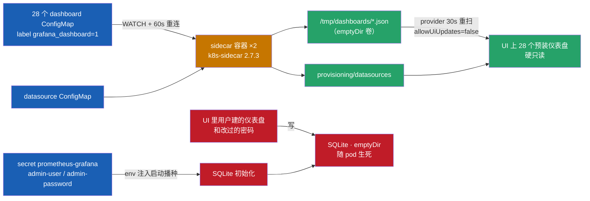
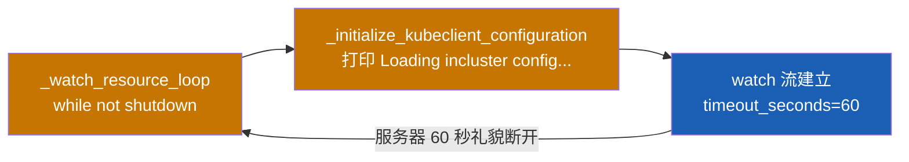
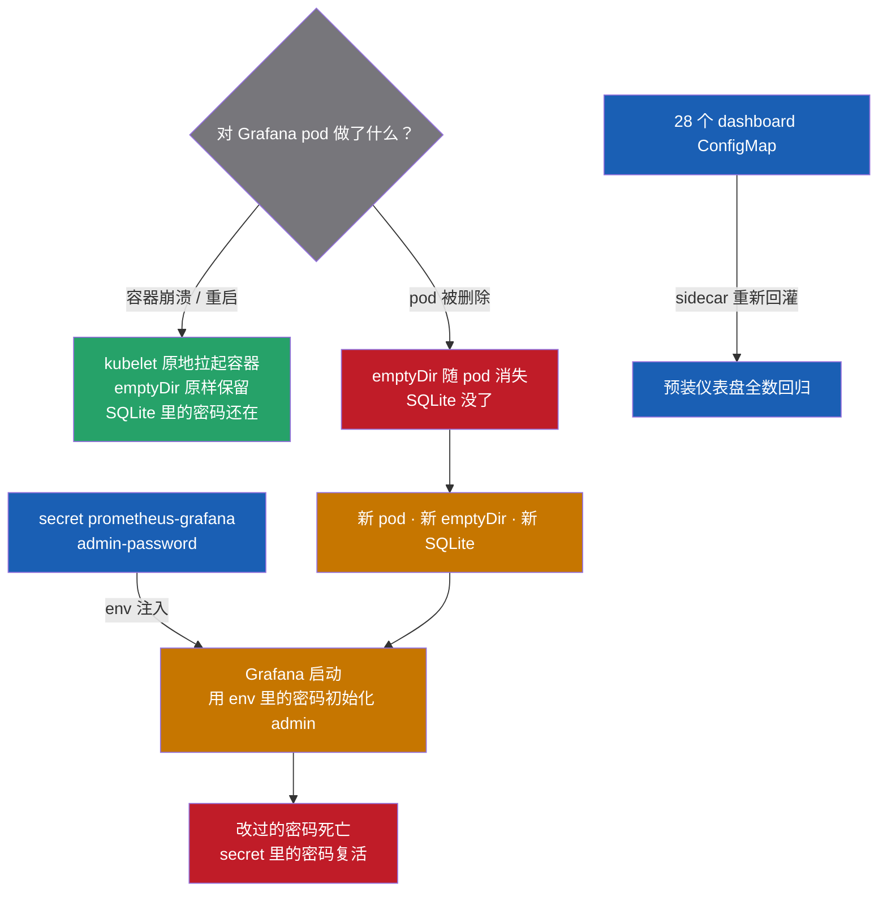

# Grafana 第一次认真打开：盲区期间照样绿的 28 个仪表盘

> **实测声明**：3 master + 3 worker + 外置双机负载均衡，kubeadm 1.36.1，Debian 13。Grafana 13.0.1-security-01（kube-prometheus-stack 部署，NodePort 30030），双 sidecar 为 kiwigrid/k8s-sidecar 2.7.3，Prometheus v3.12.0（NodePort 30090）。实验窗口 2026-10-11 22:15 至 10-12 10:06，一个晚上加一个上午共五批，全部命令输出 `tee` 落盘（编号 01–67），本文数字与日志逐字引自落盘文件。涉及源码为 k8s-sidecar v2.7.3 与 grafana v10–v13 tag 的 GitHub 实拉存档（jsdelivr 镜像核对，行号可查）。实验含两次 Grafana pod 删除（各约一分钟 UI 闪断），是全部写操作；预注册预测写在删除动作之前。

Grafana 仪表盘在 Prometheus 漏采两台 apiserver 时，为什么仍然一片绿色？本文基于 Kubernetes 1.36.1 集群实测，追踪 28 个 Dashboard 从 ConfigMap、k8s-sidecar 到 Grafana Provisioning 的加载链路，解释监控盲区在变量下拉框中的表现，并验证 PromQL 经 Grafana 代理与直连 Prometheus 的结果一致。同时，实验还揭示了 SQLite 使用 emptyDir 时，UI 修改的密码和自建仪表盘为何会随 Pod 删除而丢失。

第二战役的顺序我定的是 Prometheus → Grafana → Loki → Mimir。[P99 篇](p99-apiserver-latency-60s.md)把“指标怎么读”做了扎实，[apiserver 盲区修复篇](apiserver-blind-spot.md)则给独眼监控补上了另外两台。轮到 Grafana 的时候我得先承认一件事：这个组件在集群里跑了四个多月，我从来没有认真打开过它。装监控的时候顺手就有它，告警实验的时候隔着 API 摸过它，但“打开 Grafana，看看它到底给我看的是什么”，一次都没有。

盲区修好之后，这个问题突然变得具体了：那 149 天里，Prometheus 只看得见 145 一台 apiserver——Grafana 仪表盘上画的是什么？是空白，是报错，还是……正常？

第一个 API 请求就撞了墙。

## 401 撞墙：我以为 Grafana 13 改了 API 形状

Grafana 的管理员密码在 secret 里，取出来直接查仪表盘列表：

```text
$ curl -s -u "$GRAF_USER:$GRAF_PWD" http://localhost:30030/api/search?type=dash-db | python3 -c "
import json,sys
d=json.load(sys.stdin)
print('dashboards:',len(d))
for x in sorted(d,key=lambda i:i.get('folderTitle','')):
    print(' ', x.get('folderTitle','(root)'), '|', x['title'], '| uid:', x['uid'])" | tee 10-dashboard-list.txt
Traceback (most recent call last):
  File "<string>", line 5, in <module>
    for x in sorted(d,key=lambda i:i.get('folderTitle','')):
                                   ^^^^^
AttributeError: 'str' object has no attribute 'get'
dashboards: 5
```

脚本崩了一半——`sorted()` 在迭代那个"仪表盘列表"的时候撞上 `'str' object has no attribute 'get'`（迭代 dict 吐出来的是字符串键），但 `len(d)` 还是先打了 5。folders 接口同样配方：TypeError 加 `folders: 5`。

`/api/search` 返回了个 dict，不是文档里说的数组。我当时的第一反应：Grafana 13 的 API 形状变了，仪表盘列表从数组改成了带信封的对象，五个键里应该有一个装着列表。第二天早上照这个思路写了个自适应解析器去 dict 里翻找数组字段，翻出来 `dashboard hits: 0`——一个都没有。

这个判断错了。错在哪，下一节说。先记下当时的处境：API 路子走不通，但勘查不能停——Grafana 不只有 API，它跑在 Kubernetes 上，`kubectl` 就是第二条路。供给链、存储、面板定义，全都可以从集群对象侧拿。

## 信封里写着答案，我没读它

第二天早上重跑，folders 接口把那个 dict 原样吐了出来：

```text
$ curl -s -u "$GRAF_USER:$GRAF_PWD" "http://localhost:30030/api/folders" -o 13-folders-raw.json
$ python3 - <<'EOF'
import json
d=json.load(open('13-folders-raw.json'))
print(json.dumps(d, ensure_ascii=False)[:600])
EOF
{"extra": null, "message": "Invalid username or password", "messageId": "password-auth.failed", "statusCode": 401, "traceID": ""}
```

`message` 字段就明明白白写着：**用户名或密码错误**。这从来不是什么 Grafana 13 的新 API 形状，这是一个 401 的错误信封。我头天晚上的解析器打印了每个键的**类型**，唯独没打印**值**——答案在响应里躺了一整晚，我没读它。

回头看清全貌：那个 dict 有五个键（extra / message / messageId / statusCode / traceID），第一晚的脚本 `len(d)` 了一下打出 "dashboards: 5"——**5 是错误对象的键数，不是面板数**。一个没有守卫的解析器，把 401 幻觉成了 5 个仪表盘。

但真正的谜题这才浮出来：密码为什么是错的？我没改过 secret。做个对照实验排除干扰项——form login 接口用同一对凭据试一次：

```text
$ curl -s -X POST http://localhost:30030/login -H 'Content-Type: application/json' \
    -d "{\"user\":\"$GRAF_USER\",\"password\":\"$GRAF_PWD\"}" -w "\nlogin -> HTTP %{http_code}\n"
{"statusCode":401,"messageId":"password-auth.failed","message":"Invalid username or password"}
login -> HTTP 401
```

basic auth 和 form login 双双 401，`password-auth.failed`——不是"basic auth 被禁"，就是密码本身不匹配。再给凭据拍个指纹：

```text
$ echo "user=[$GRAF_USER] len=$(echo -n "$GRAF_USER" | wc -c)"
$ echo "pwd_len=$(echo -n "$GRAF_PWD" | wc -c) md5_8=$(echo -n "$GRAF_PWD" | md5sum | cut -c1-8)"
user=[admin] len=5
pwd_len=40 md5_8=a7d8e2aa
```

用户名没毛病，密码是从 secret 里刚取出来的 40 个字符。然后我想起来一件小事，问了自己一句：我是不是……在 UI 里改过密码？

改过。几个月前打开 UI 玩的时候改过一次，后来一直用改过的那个登录。

这就对上了：**UI 改密码，写进的是 Grafana 自己的数据库；secret 里的密码，只在启动播种的时候用一次。** 两边各存各的，早就分叉了。这个解释听起来自洽，但它依赖一个前提——Grafana 的数据库在哪、活多久。往下看就知道，这个前提是整篇文章最大的坑。

## 28 个仪表盘是从哪来的

先从 `kubectl` 侧把供给链摸清。三容器形态：

```text
$ kubectl -n monitoring get deploy prometheus-grafana -o jsonpath='{range .spec.template.spec.containers[*]}{.name}{" = "}{.image}{"\n"}{end}'
grafana-sc-dashboard = .../kiwigrid/k8s-sidecar:2.7.3
grafana-sc-datasources = .../kiwigrid/k8s-sidecar:2.7.3
grafana = .../grafana/grafana:13.0.1-security-01
```

一个 grafana 主容器加两个 k8s-sidecar。挂载关系：

```text
CONTAINER grafana-sc-dashboard
  /tmp/dashboards  <-  sc-dashboard-volume
CONTAINER grafana-sc-datasources
  /etc/grafana/provisioning/datasources  <-  sc-datasources-volume
CONTAINER grafana
  /etc/grafana/grafana.ini  <-  config
  /var/lib/grafana  <-  storage
  /var/lib/grafana-search  <-  search
  /tmp/dashboards  <-  sc-dashboard-volume
  /etc/grafana/provisioning/dashboards/sc-dashboardproviders.yaml  <-  sc-dashboard-provider
  /etc/grafana/provisioning/datasources  <-  sc-datasources-volume
```

六个卷，来源只有两种：两个 ConfigMap 卷（grafana.ini 和 provider 配置），四个 **emptyDir**——包括 `/var/lib/grafana` 和 `/var/lib/grafana-search`。grafana.ini 里没有 `[database]` 段，Grafana 用默认的 SQLite，数据库文件就在 paths.data 指向的 `/var/lib/grafana` 里。搜索索引也一样，`[unified_storage] index_path = /var/lib/grafana-search/bleve`。

也就是说：**这个跑了四个多月的 Grafana，数据库、搜索索引、一切用户态数据，全都长在 emptyDir 上。** 这个事实的后果先按下不表，先把供给链走完。

28 个预装仪表盘的真实来源是一堆 ConfigMap：

```text
$ kubectl -n monitoring get cm -l grafana_dashboard=1 | wc -l    # 28 个
$ kubectl -n monitoring get cm -l grafana_datasource=1            # 1 个
```

两个 sidecar 的 env 说清了它们的工作方式：

```text
# grafana-sc-dashboard
METHOD=WATCH
LABEL=grafana_dashboard
LABEL_VALUE=1
FOLDER=/tmp/dashboards
RESOURCE=both
NAMESPACE=ALL
REQ_URL=http://localhost:3000/api/admin/provisioning/dashboards/reload
REQ_METHOD=POST

# grafana-sc-datasources
LABEL=grafana_datasource
FOLDER=/etc/grafana/provisioning/datasources
（其余同上）
```

watch 整个集群所有 namespace 里带 `grafana_dashboard=1` 标签的 ConfigMap，把里面的 json 落成 `/tmp/dashboards/` 下的文件。grafana 主容器再通过 provisioning 机制扫这个目录，provider 配置长这样：

```yaml
apiVersion: 1
providers:
  - name: 'sidecarProvider'
    orgId: 1
    folder: ''
    type: file
    disableDeletion: false
    allowUiUpdates: false
    updateIntervalSeconds: 30
    options:
      foldersFromFilesStructure: false
      path: /tmp/dashboards
```

注意 `allowUiUpdates: false`——**28 个预装仪表盘是硬只读的**，在 UI 里改了保存会被直接拒绝，不是"改了又被覆盖"。你在 UI 里新建的仪表盘走的是另一条路：写进 SQLite。两类仪表盘，两种持久化命运，这正是后面 G5 实验要验证的东西。

datasource 那条线一模一样：一个 CM、一个 sidecar、一个 provisioning 目录，里面两条数据源——Prometheus（uid `prometheus`，URL 指向集群内 Service `prometheus-kube-prometheus-prometheus.monitoring.svc.cluster.local:9090`，access proxy，httpMethod POST，timeInterval 30s）和 Alertmanager。

整条供给链画出来：



左半边蓝绿是**供给链**：从 ConfigMap 出发，经 sidecar 和文件，最后在 UI 上呈现——这条链上每一环都是集群里的持久对象或可重建的文件，pod 死多少次它都原地满血。右下角红色是**用户数据**：SQLite 长在 emptyDir 上，随 pod 生死。改的密码、建的仪表盘、调过的面板，全在红色那边。

这套结构和[静态 Pod 修复实录](k8s-bind-address-fix.md)里见过的 kubelet 监视 `/etc/kubernetes/manifests` 是同构的：一个控制器盯着一个目录（或 API），文件来了就生效。区别在于 kubelet 监视的是静态 Pod 清单，sidecar 监视的是带标签的 ConfigMap。

## 每分钟两条心跳

sidecar 的日志里有个很规律的东西：

```text
{"time": "2026-10-12T00:04:09.081709+00:00", "level": "INFO", "msg": "Loading incluster config..."}
{"time": "2026-10-12T00:04:09.170053+00:00", "level": "INFO", "msg": "Loading incluster config..."}
{"time": "2026-10-12T00:05:09.095125+00:00", "level": "INFO", "msg": "Loading incluster config..."}
{"time": "2026-10-12T00:05:09.178213+00:00", "level": "INFO", "msg": "Loading incluster config..."}
```

每个 sidecar 容器每分钟固定打两条，两条之间差 90 毫秒，下一对精确落在 60 秒之后（00:04:09.08 → 00:05:09.09，间隔 60.01 秒）。两个容器相位还不同：dashboard sidecar 心跳在每分钟的第 9 秒，datasource sidecar 在第 56 秒。

为什么是每分钟两条？拉 k8s-sidecar v2.7.3 源码看：

- `resources.py` L493-506：每个 (resource, namespace) 组合起一个**线程**。`RESOURCE=both` 意味着 ConfigMap 和 Secret 各一条流，两个线程
- `resources.py` L431：`while not shutdown_event.is_set()` 无限循环
- `resources.py` L358-361：每轮循环第一件事是 `_initialize_kubeclient_configuration()`——它在 `client.py` L32 打印那句 `"Loading incluster config..."`
- `resources.py` L366-376：watch 流带 `timeout_seconds=WATCH_SERVER_TIMEOUT`，默认值在 `helpers.py` L49：

```python
# 60 is a polite request to the server, asking it to cleanly close the connection after that.
# If you have a network outage, this does nothing.
WATCH_SERVER_TIMEOUT = os.environ.get("WATCH_SERVER_TIMEOUT", 60)
```

60 秒是"请服务器到点礼貌断开"的请求——不是异常，是设计。服务器每 60 秒关一次连接，`_watch_resource_iterator` 返回，`while` 循环再进一轮，重新初始化客户端（打一条心跳），重新建 watch。每个线程每 60 秒一条日志，两个线程，每分钟两条。观测和源码严丝合缝。



`RESOURCE=both` → 每个容器两个线程各跑一遍这个环 → 每分钟两条日志。

顺带一提，sidecar 还配了 `REQ_URL=http://localhost:3000/api/admin/provisioning/dashboards/reload`——文件变化时回调 Grafana 的 reload 接口。但 `REQ_USERNAME` 是空的，而且观测窗口内的日志里除了心跳什么都没有：28 个 CM 自安装以来没变过，reload 从未触发过。这个回调配上空凭据能不能真跑通，我没实测，不下结论。

## 盲区在仪表盘上的形状

回到开头的问题：149 天盲区期间，仪表盘在画什么？

仪表盘本体就是集群里的 ConfigMap，直接解剖最有信息量的那个——"Kubernetes / API server"（CM `prometheus-kube-prometheus-apiserver`，data key `apiserver.json` 12360 字节）。面板树和查询（节选）：

```text
[text] Notice
[stat] Availability (30d) > 99.000%
    Q: apiserver_request:availability30d{verb="all", cluster="$cluster"}
[timeseries] ErrorBudget (30d) > 99.000%
[timeseries] Read SLI - Duration
    Q: cluster_quantile:apiserver_request_sli_duration_seconds:histogram_quantile{verb="read", cluster="$cluster"}
[timeseries] Work Queue Add Rate
    Q: sum(rate(workqueue_adds_total{job="apiserver", instance=~"$instance", cluster="$cluster"}[$__rate_interval])) by (instance, name)
[timeseries] Memory
    Q: process_resident_memory_bytes{job="apiserver",instance=~"$instance", cluster="$cluster"}
[timeseries] CPU usage
    Q: rate(process_cpu_seconds_total{job="apiserver",instance=~"$instance", cluster="$cluster"}[$__rate_interval])
[timeseries] Goroutines
    Q: go_goroutines{job="apiserver",instance=~"$instance", cluster="$cluster"}
variables:
  VAR datasource | prometheus
  VAR cluster | label_values(up{job="apiserver"}, cluster)
  VAR instance | label_values(up{job="apiserver", cluster="$cluster"}, instance)
```

面板分两类，命运完全不同。

**第一类：全局聚合面板。** 顶部的 Availability (30d) 用的是 recording rule `apiserver_request:availability30d`，这条规则在 Prometheus 侧就是 `sum by (cluster)` 起手的聚合——没有 instance 维度。盲区期间，聚合的输入里只有 145 一台 apiserver 的数据，但聚合照样算、ErrorBudget 照样画、绿色照样绿。**少了两台的数据源，仪表盘不会变红，只会"少了两份输入"。** 30 天可用性本来就是滚动聚合，连"突然掉了一台"这种瞬时事件都会被 30 天的窗口抹平。

**第二类：instance 维度面板。** Work Queue、Memory、CPU、Goroutines 全带 `instance=~"$instance"` 过滤，而 `$instance` 变量的定义是 `label_values(up{job="apiserver", cluster="$cluster"}, instance)`——**下拉框的选项来自 `up` 指标本身**。盲区期间 Prometheus 里 `up{job="apiserver"}` 只有一个 target，下拉框里就只有 145 一行。

所以盲区在 UI 上的形状是：不是红叉，不是空面板，不是报错横幅——**是实例下拉框里少两行**。如果你不点开下拉框数一数，这块仪表盘在盲区期间和健康期看起来没有区别。

盲区修好之后的对照（经 Grafana 代理查 `up{job="apiserver"}`）：

```text
$ curl -sG -u admin:$ORIG_PWD "http://localhost:30030/api/datasources/proxy/uid/prometheus/api/v1/query" \
    --data-urlencode 'query=up{job="apiserver"}' | python3 ...
192.168.114.145:6443 1
192.168.114.146:6443 1
192.168.114.147:6443 1
```

三行了。这个"after"来之不易——before 长什么样，只有经历过 149 天的人知道。

还有一个细节值得单独说：这块仪表盘唯一的 text 面板叫 Notice，内容是官方写的免责声明——"The SLO (service level objective) and other metrics displayed on this dashboard are for informational purposes only." 连官方都预感到这些绿色数字会被当真，提前打了预防针。

另外注意 "Read SLI - Duration" 面板：它查询的 recording rule，展开后是 `histogram_quantile(0.99, sum by (cluster, le, resource) (rate(apiserver_request_sli_duration_seconds_bucket{job="apiserver",subresource!~"proxy|attach|log|exec|portforward",verb=~"LIST|GET"}[5m])))`——剔掉 watch 和 exec 类请求的 SLI 口径。[P99 实测篇](p99-apiserver-latency-60s.md)里那个 16.8 毫秒，画的就是这块面板。当时的结论在仪表盘层得到了印证：这块面板在盲区期间同样“正常”，因为它压根不区分数据来自哪台。

## 仪表盘是查询的皮肤

把"仪表盘到底是什么"这件事说穿：**面板 = 保存起来的 PromQL + 渲染选项，数据源 = 转发查询的代理。** 仪表盘是查询的皮肤。这个命题可以被最直接地验证——同一个查询，一个走直连 Prometheus，一个走 Grafana 的 datasource proxy，背靠背跑：

```text
$ Q='histogram_quantile(0.99, sum by (le) (rate(apiserver_request_duration_seconds_bucket[5m])))'
$ curl -sG "http://localhost:30090/api/v1/query" --data-urlencode "query=$Q" | python3 ...
direct    : 60
$ curl -sG -u admin:$ORIG_PWD "http://localhost:30030/api/datasources/proxy/uid/prometheus/api/v1/query" --data-urlencode "query=$Q" | python3 ...
via-grafana: 60
```

分毫不差，都是 60——P99 篇那个著名的"精确等于 60 秒整"。仪表盘上的每个数字，理论上都能用一条 `curl` 复现。

有意思的是这个对账实验的第一次尝试也吃了 401——经 Grafana 代理的请求先过认证门。错误信封这次第一时间就认出来了：提取层的坑，踩过一次之后至少认得出形状。

### 49.5 毫秒的地板

皮肤论验证顺手带出一个小发现。仪表盘 Duration 面板读的 recording rule 现值，几乎所有的 resource 都是一样的数：

```text
$ curl -sG "http://localhost:30090/api/v1/query" \
    --data-urlencode 'query=cluster_quantile:apiserver_request_sli_duration_seconds:histogram_quantile' | python3 ...
read | endpoints | 0.0495
read | clusterinformations | 0.0495
read | endpointslices | 0.0495
write | leases | 0.04950000000000001
read | services | 0.04950000000000001
write | subjectaccessreviews | 0.0495
read | nodes | 0.0495
...（省略，全部同值）
```

十几行 49.5 毫秒，连浮点噪声 `0.04950000000000001` 都懒得藏。SLI 直方图的桶边缘查出来：

```text
$ curl -sG "http://localhost:30090/api/v1/query" \
    --data-urlencode 'query=count by (le) (apiserver_request_sli_duration_seconds_bucket{job="apiserver"})' | python3 ...
0.05 -> 234
0.1 -> 234
1.0 -> 234
5.0 -> 234
10.0 -> 234
30.0 -> 234
60.0 -> 234
+Inf -> 234
```

最低的有限桶边缘是 0.05 秒。算一下：`0.99 × 0.05 = 0.0495`。**分毫不差。**

当几乎全部请求都落进最低桶（≤50ms）时，P99 的线性插值会饱和在“最低桶边缘的 99% 处”——从 0 到 0.05 的区间上均匀假设，rank 在 99% 的位置就是 0.0495。这不是测量值，是**桶分辨率的地板**。[P99 实测篇](p99-apiserver-latency-60s.md)讲过 60 秒是天花板（上钳位：请求慢到超出最后一个有限桶），49.5 毫秒是同一枚硬币的另一面——快到全部挤进第一个桶，插值贴着桶底走。同一套 histogram，两个方向都能给你“看起来很精确、其实不是测量”的值。

实用推论：在仪表盘上看到一列齐刷刷相同的小数，先查桶边缘，再谈别的。

## 23 次重启、三种死法

pod 的容器状态值得逐行读：

```text
$ kubectl -n monitoring get pod prometheus-grafana-86b8c58fc-zl96n -o json | python3 ...
pod startTime: 2026-06-25T02:24:04Z
grafana | restarts: 1
  lastState: {"terminated": {"containerID": "containerd://2a10c632...", "exitCode": 255, "finishedAt": "2026-08-24T00:17:50Z", "reason": "Unknown", "startedAt": "2026-06-25T02:24:06Z"}}
grafana-sc-dashboard | restarts: 11
  lastState: {"terminated": {"containerID": "containerd://6d20a3e7...", "exitCode": 1, "finishedAt": "2026-09-14T03:00:12Z", "reason": "Error", "startedAt": "2026-09-14T02:59:34Z"}}
grafana-sc-datasources | restarts: 11
  lastState: {"terminated": {"containerID": "containerd://140582b4...", "exitCode": 1, "finishedAt": "2026-09-14T03:00:13Z", "reason": "Error", "startedAt": "2026-09-14T02:59:34Z"}}
```

总重启次数 23，但它是三种完全不同的历史叠在一起的：grafana 主容器 1 次 + 两个 sidecar 各 11 次。

**grafana 的唯一一次死**，exit 255、reason Unknown——教科书级的节点级事件签名。finishedAt 2026-08-24T00:17:50Z，换算成北京时间 8 月 24 日 08:17:50。上 worker03 查：

```text
$ ssh worker03 'uptime -s; last -x reboot | head -3'
2026-08-24 08:17:24
reboot   system boot  6.12.43+deb13-am Mon Aug 24 08:17 - still running
reboot   system boot  6.12.43+deb13-am Sun May 24 21:29 - crash
reboot   system boot  6.12.43+deb13-am Tue May 12 22:46 - crash
```

worker03 在 08:17:24 重启，grafana 容器的死亡时间戳是 08:17:50——**节点起来之后 26 秒，kubelet 完成状态对账，把这个被重启杀死的容器记成 exit 255**。时间线闭合。顺带一提我在 vCenter 里没找到这次重启的记录：guest OS 内部的 reboot 不进 vCenter 的电源事件视图，只有 `uptime` 和 `last` 这种系统内的账本记得它。`last` 的账本里还有一条彩蛋——5 月 12 日 22:46 有一次 crash 启动，比集群生日（当天 23:08 init）早 22 分钟。

**两个 sidecar 的 11 次死**，exit 1、reason Error，最后一代的生存时间是 2026-09-14T02:59:34Z → 03:00:12Z，38 秒一代的 crashloop。北京时间 9 月 14 日 10:59——对上号了：[监控故障实录](k8s-monitoring-red-from-day-one.md)记过这条时间线：9 月 13 日夜里手抄 etcd manifest 手滑，第二天早上修，master01 的 apiserver 停机窗口 10:33→11:03。sidecar 最后一轮 38 秒的死，正好落在窗口里。sidecar 源码里能找到两条死亡路径：`healthz.py` 里 `K8S_CONTACT_THRESHOLD_SECONDS = 60`（60 秒联系不上 Kubernetes 就报不健康）；以及 `resources.py` L442-447，watch 遇到 ApiException 500 会直接 raise，线程死掉后主循环 5 秒内发现，整个进程 `sys.exit(1)`。具体走的哪条，当时的容器日志已经随容器消失——但无论哪条，根因都是同一个：**apiserver 停机，把监控栈自己的组件搞重启了**。监控者和被监控者住在一个集群里，就是这个下场。

这里要修正一个我自己想当然的概念：**emptyDir 的生存期是 pod，不是容器。** 容器崩溃重启，emptyDir 原样保留（所以 grafana 容器 8-24 死那一次、sidecar 死 11 次，都没有清空过 SQLite）；pod 被删除重建，emptyDir 才随之清空。这个区分是下一个实验的设计基础。

## 密码之死与复活

现在可以设计那个实验了。预注册三条预测，写在删除 pod 之前：

1. 删 pod 后，`lab-memento`（用户建的仪表盘，存 SQLite）会 404
2. 删 pod 后，UI 里改过的密码失效（SQLite 随 pod 死了），**secret 里的原始密码复活**——新 emptyDir、新 SQLite、启动时从 env 重新播种
3. 删 pod 后，28 个预装仪表盘全数回归（它们在供给链上，CM → sidecar → 文件，跟 SQLite 无关）

第 2 条是核心：如果密码复活，就同时证明了"UI 改密写 SQLite"和"SQLite 长在 emptyDir 上"两件事。

动手前还有个小插曲。密码对不上，标准的修复路是 `grafana-cli admin reset-admin-password`：

```text
$ kubectl -n monitoring exec deploy/prometheus-grafana -c grafana -- grafana-cli admin reset-admin-password xxx
error: Internal error occurred: ... failed to start exec "83649491...": OCI runtime exec failed: exec failed: unable to start container process: exec: "grafana-cli": executable file not found in $PATH: unknown
```

Grafana 13 的镜像里根本没有这个二进制。考古一下（GitHub 各 tag 探针）：v10 时代 `pkg/cmd/` 下还是 `grafana-server` 和 `grafana-cli` 两个二进制；**v11.0.0 出现了统一入口 `pkg/cmd/grafana/main.go`**，Usage 字段自白 "Grafana server and command line interface"——server 和 CLI 合成一个二进制，`grafana-cli` 目录退化成三行垫片（`os.Exit(cmd.RunGrafanaCmd("cli"))`）；**v12.5.0 垫片移除**；v13.0.1 只剩 `grafana` 一个二进制（`ls /usr/share/grafana/bin/` 实锤，目录里只有它）。当代等价物是 `grafana cli admin reset-admin-password`（子命令形式，未在本集群实测，标注在此）。

但就算这条路能走通也不该走：`reset-admin-password` 写的还是 SQLite——**emptyDir 上的 SQLite**。pod 下次一删，重置的密码照样死。绕了一圈，唯一的持久改密配方是反过来的：**改 secret，然后删一次 pod，让新密码随播种生效**。只改 secret 不删 pod 是没用的，运行中的 SQLite 不会回头看 env。

实验执行。第一刀删 pod，复活后四连验：

```text
new pod: prometheus-grafana-86b8c58fc-kqx6p
a) lab-memento -> HTTP 401          ← 凭据已失效（此时还没有有效密码，改日重做）
b) reset-pwd auth -> HTTP 401        ← grafana-cli 重置从未成功，此密码从未存在过
c) orig-secret-pwd auth -> HTTP 200  ← secret 里的密码，复活了
d) total after (try 1): 28          ← 预装全回
```

关键的 c 行。同一把 secret 密码，删除前 401（上面的指纹实验），删除后 200。**我在 UI 里改的那个密码，随 pod 死了；几个月没用的 secret 原始密码，随 pod 活了回来。** 预注册第 2 条命中。

第 1 条当轮没测干净——建 `lab-memento` 时用的凭据已失效，401 分不清是"仪表盘没了"还是"密码不对"。用复活的有效密码重做一遍：建 `lab-memento`（version 1，总数 29，GET 200），再删一次 pod（这是实验里第二次也是最后一次删除），验证：

```text
$ curl -s -u admin:$ORIG_PWD -X POST http://localhost:30030/api/dashboards/db -d '{...lab-memento...}'
{"folderUid":"","id":1776994336555008,"slug":"lab-memento","status":"success","uid":"lab-memento","url":"/d/lab-memento/lab-memento","version":1}
$ # 总数 29，GET lab-memento -> HTTP 200，然后删 pod
new pod: prometheus-grafana-86b8c58fc-hts6f
a) lab-memento after -> HTTP 404
b) total after (try 1): 28
```

404——这次凭据有效，"仪表盘真没了"才成立。预注册 3/3 全中：**用户建的随 pod 死（SQLite），预装的随供给链生（CM），改过的密码死、播种的密码活。**



### 一个上午，三代 Grafana

两次删除留下了一份世代志，正好用 [Pod startTime 实测篇](pod-starttime-stuck-for-a-month.md)的方法读：

- **zl96n**：6-25 02:24:04Z 出生（集群升级次日重建），活到今天上午第一刀，**108 天 23 小时**
- **kqx6p**：第一刀的继任，活了二十来分钟，死在第二次实验里
- **hts6f**：现任，12 秒拉起到 3/3（上一代 kqx6p 是 22 秒）

一个上午，三代。如果哪天给这套监控做存储改造，这份世代志就是 before 的存档。

## 四次翻车的总账

这篇文章里我自己的提取层翻车记了四笔：

1. `len(dict)` 出 "dashboards: 5"——错误信封的键数，当成了面板数
2. sidecar 容器名凭直觉写成 `grafana-dashboard`，实际是 `grafana-sc-dashboard`——猜的，没查
3. `message` 字段就躺在 401 信封里，我打印了键的类型、没打印值——**先怪 API 形状，后读错误内容，顺序反了**
4. 最讽刺的一笔：诊断完 1 和 3 之后写的下一个脚本，`len()` 又把同一个信封打成了 "total before: 5"——**刚出完坑，下一步又踩回去**

四笔凑出一个教训：**知道坑在哪里，不等于免疫。** 守卫必须长在每一个解析器里——现在的脚本第一行都是 `assert isinstance(d, list), f'错误信封: {d}'`，数据不是预期形状就当场掀桌，宁可不输出也不输出幻觉数字。这跟[监控故障实录](k8s-monitoring-red-from-day-one.md)的教训同族：命令跑通了不等于结论对了，提取层的范围、键名、形状，每一层都能撒谎，关键结论要过第二个独立来源。

## 你可以在自己集群上做的三件事

一，查你的 Grafana 存储卷：`kubectl -n monitoring get deploy prometheus-grafana -o jsonpath='{.spec.template.spec.volumes}'`——数一数 emptyDir 几个。如果 `/var/lib/grafana` 也是 emptyDir，你的 UI 密码、用户、自建仪表盘同样活不过任意一次 pod 重建。想改密：改 secret，再删一次 pod，让播种生效。

二，数你的实例下拉框：在任意 instance 维度面板点开变量下拉，行数应该等于你的 master 数。或者直接查 `up{job="apiserver"}`——三个 master 的集群如果只出来一行，你的监控也是独眼，先修 targets 再看仪表盘。

三，验证皮肤论：挑一个仪表盘数字，抄下面板的查询，用 `curl` 直连 Prometheus 复现一遍。两边对得上，你对仪表盘的理解就升了一级——面板是皮肤，查询才是本体。顺便看看有没有齐刷刷的相同小数，那是桶分辨率在说话。

---

盲区篇留了个一周之约：三台 apiserver 的指标汇合满一周（10-17 前后），topk 的世界里那台 20.5 毫秒会不会重新洗牌。到时候揭晓。第二战役按计划轮到 Loki——日志这条线，先看看它跟 Prometheus 的指标线在架构上差的那一格到底是什么。

## 推荐阅读

- [apiserver 盲区：三台 master，Prometheus 只看得见一台](apiserver-blind-spot.md)：追查 target 缺失、master lease 与 kubeadm 配置根因。
- [Prometheus P99 实测：apiserver 延迟 60 秒整的背后](p99-apiserver-latency-60s.md)：理解直方图分桶、WATCH 长连接与 P99 读数。
- [K8s 监控装了 98 天：9 个 Prometheus target 从第一天就是红的](k8s-monitoring-red-from-day-one.md)：从 target、采集配置和告警链路复盘监控故障。
- [Grafana 可视化：Dashboard 设计与数据源配置](../observability/grafana.md)：延伸了解数据源、变量、面板和 Provisioning。
- [Prometheus 监控体系：架构、PromQL 与服务发现](../observability/prometheus.md)：补齐 Prometheus 查询、服务发现和 recording rule 背景。
