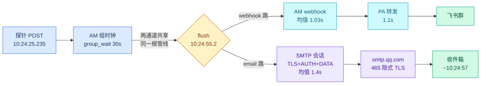
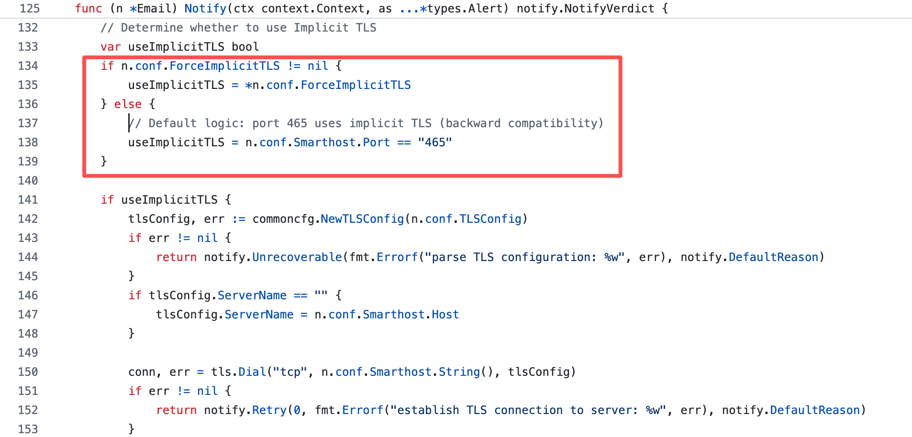
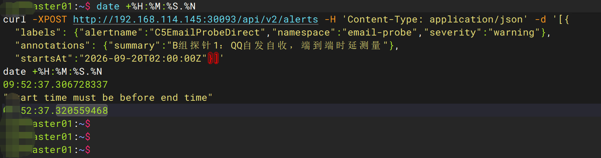
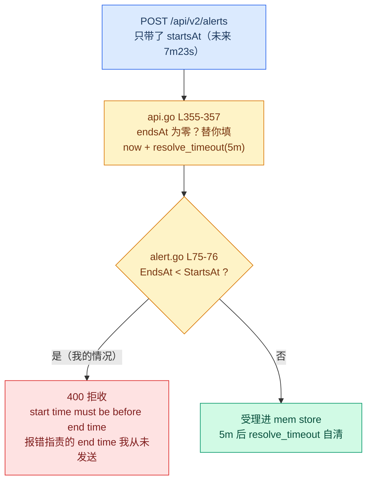
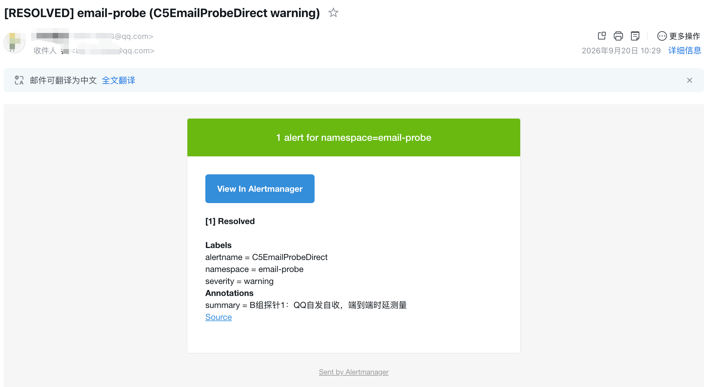
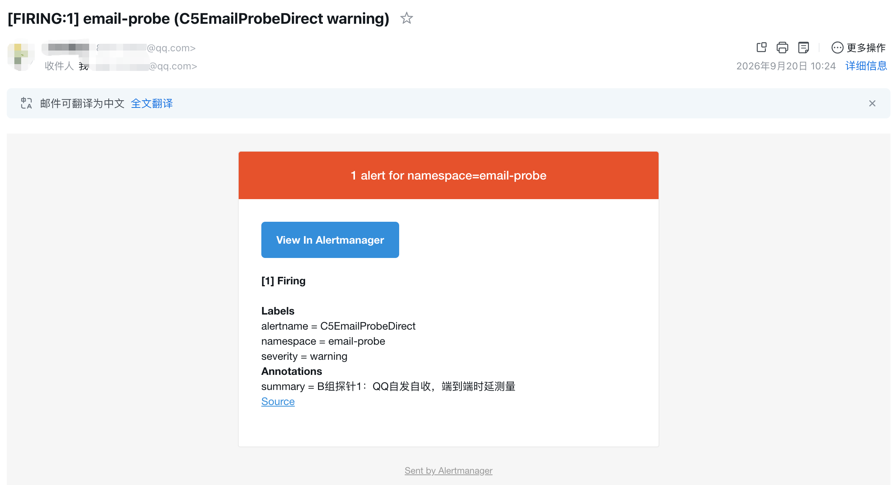
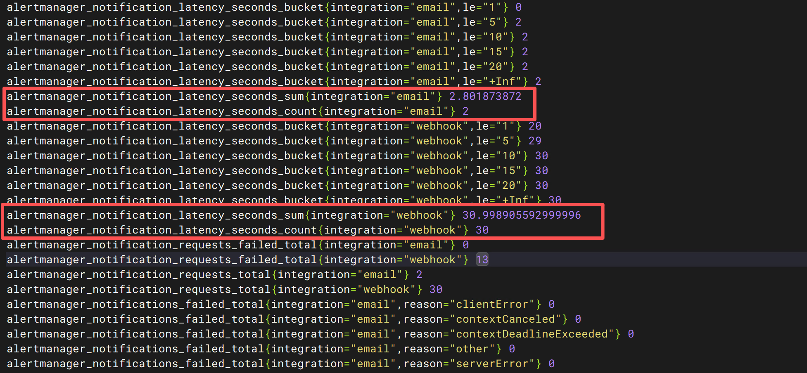
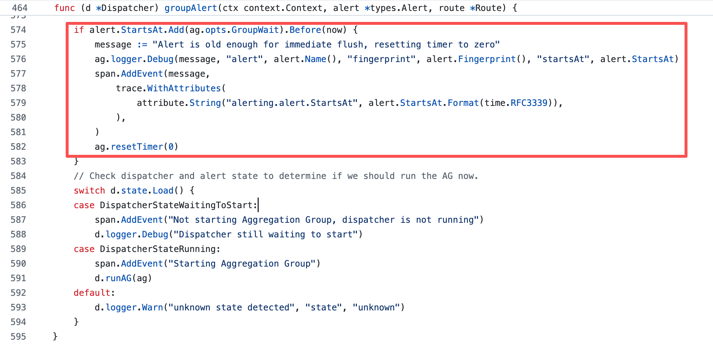
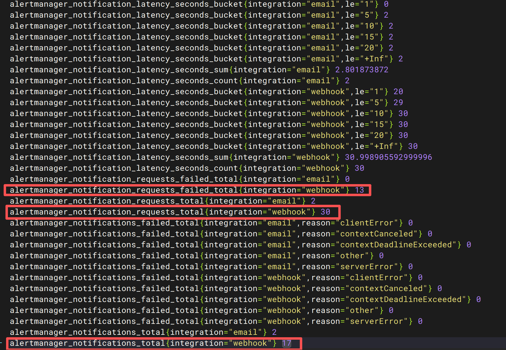
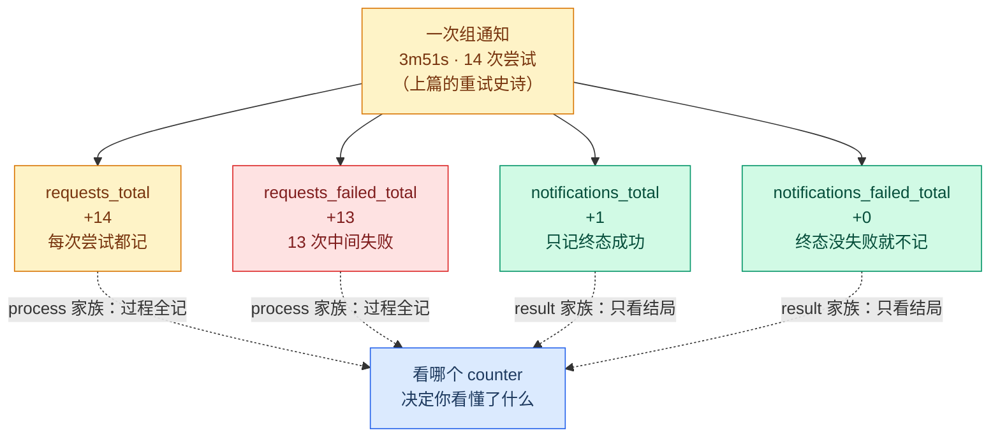

---

title: Alertmanager SMTP 邮件告警实测：QQ 邮箱只慢 1.4 秒
description: 实测 Alertmanager 接入 QQ 邮箱的 SMTP、send_resolved 和通知计时，验证邮件端到端只比飞书慢 1.4 秒，并解释 counter 与 nflog 语义。
series: 测试集群生产化改造
series_order: 4

---

# Alertmanager SMTP 邮件告警实测：QQ 邮箱只慢 1.4 秒

> **实测声明**：3 master + 3 worker，kubeadm 1.36.1，Debian 13。kube-prometheus-stack（chart 86.2.0 / Alertmanager v0.32.2）。本篇实验全部在 2026-09-20 一天内完成，输出 tee 落盘（`~/alert-lab-logs/`，19 号文件为主）。终端块为逐字摘录（仅裁剪与 JSON 省略号）；源码引用全部来自 v0.32.2 tag 的 GitHub raw，行号可查。AM 日志 UTC（首现处折算 CST），PA 日志与邮箱时刻为 CST。QQ 邮箱地址与授权码已打码（实验后已作废轮换）。
>
> 系列上一篇：[K8s 告警响了 25 天没人收到：我给 Alertmanager 接了个飞书机器人](k8s-alerts-ignored-for-25-days.md)。本篇是第三篇（下）：邮箱通道、源码深读、counter 对偶。

上一篇结尾留了个钩子："邮件比飞书慢多少"这个问题本身翻车了。这篇就来证明——QQ 邮箱通道从配置到落箱的全过程。

先说下结论：**SMTP 全程只要 1.4 秒，邮件和飞书是同一个量级**。慢的不是邮箱，是我脑子里的常识。而证明这个结论的路上，撞出来四样比结论值钱的东西：一次误导性的 400 报错、一场我亲手制造又亲手翻案的悬案、一个自带"通知原因自白"的字段、还有两个对同一件事记两种账的 counter。



## 邮箱选型：这不是技术题，是变量控制题

动手前先回答一个合理质疑：飞书已经通了，为什么还要邮箱？两个理由。一是**通道冗余**——飞书 webhook 挂了（限流、token 失效、群被误删），手机不会一无所知；二是**通道分层**的底子——生产环境里即时消息和邮件承担不同紧急级别，测试集群先把两条路都走通，分层策略是将来某一天的事。当然还有第三个不好意思写进理由的理由：飞书 31.1 秒的实测摆在那，"邮件到底慢多少"这个问题本身就有实验价值。

上篇定过方向用邮箱做第二通道，但"哪家邮箱"卡了一晚。候选两个：QQ 邮箱和 163。我选了 QQ，理由按重要性排：

1. **变量要少**。163 的 SMTP 层反垃圾出了名的凶（554 DT:SPM 拒信），会在"AM 投递"和"收件箱"之间凭空多出一层行为——做双通道对比实验，这层变量会把数据搅浑。QQ 自发自收（发件人收件人同域）信誉路径最干净；
2. 163 新注册账号有"客户忠诚度"门槛，SMTP 服务的开通条件比 QQ 多一道；
3. 我手上正好有现成的 QQ 号。

打开 QQ 邮箱的 SMTP 服务要的是**授权码**（不是登录密码，是设置里单独生成的 16 位凭证）。这里有个安全纪律先立好，后面配置时要用到：

!!! warning "授权码的三条纪律"
    ① 它等同于邮箱密码的投递权限，只填进集群里的临时文件，不进聊天记录、不进文章；② 实验结束在 QQ 邮箱设置里随时可作废轮换；③ 引用任何含它的输出必须打码。本文所有相关输出已处理。

## 配置：12 行，和一道源码送分题

email receiver 的配置长这样（打码版）：

```yaml
- name: "email-qq"
  email_configs:
  - to: "****@qq.com"
    from: "****@qq.com"
    smarthost: "smtp.qq.com:465"
    auth_username: "****@qq.com"
    auth_password: "<16位授权码>"
    require_tls: false
    send_resolved: true
```

外加上篇同款的套路：一个探针子路由（`alertname =~ "C5EmailProbe.*"` 指到 email-qq），从磁盘现行配置用 python 锚点替换派生，diff 验证恰好 +12 行（email 块 9 行 + 路由块 3 行），回写 secret。09:51:22.528（UTC 日志 = CST）AM 打出 Loading，`PrometheusOperatorSyncFailed` 保持 False——operator 校验过结构合法性。

两个配置项背后各有一段源码故事，先说 `require_tls: false`。

**网上教程的标配答案，在 v0.32.2 的代码路径里根本没人看。**  通行说法是："465 是隐式 SSL 端口，AM 的 require_tls 管的是 STARTTLS，直连 465 必须配 `require_tls: false`，否则握手失败。"我派实验清单之前照例去核源码，结果被打脸。`notify/email/email.go` L134-140：

```go
// Determine whether to use Implicit TLS
var useImplicitTLS bool
if n.conf.ForceImplicitTLS != nil {
    useImplicitTLS = *n.conf.ForceImplicitTLS
} else {
    // Default logic: port 465 uses implicit TLS (backward compatibility)
    useImplicitTLS = n.conf.Smarthost.Port == "465"
}
```

端口写了 465，**隐式 TLS 自动开启**；更狠的是 L185 那个条件——`require_tls` 只在 `!useImplicitTLS` 的分支里才参与判断。也就是说在 465 上，这行配置写 true 写 false 跑起来一模一样。社区教程那句"必须关"是对老版本（gomail 时代）的记忆，新代码早就把这坑填了。



我最后还是把 `require_tls: false` 留在了配置里（哪天换成 587 端口它依然正确），但这件事的方法论价值比配置本身大： **"怎么写都能跑"的教程型答案，是没法证伪的坏知识**。派实验清单前先核源码，是把这个答案变成可证伪知识的唯一手段。

另一个配置项 `send_resolved: true` 是真·生死攸关——上篇源码定案过：**email 集成的 send_resolved 默认是 false**（notifiers.go L66-68，和 webhook 的默认 true 恰好相反）。不显式写 true，恢复邮件就静默消失，连报错都没有。同字段、两集成、相反默认值——这种地方就是坑的窝。

## 探针被拒：一条会指鹿为马的报错

配置生效，counter 基线全零。按上篇的老配方打探针——照抄 C4 探针的格式，`startsAt` 填了个当天 `02:00:00Z`（我本意是"今天上午 10 点 CST"，图省事直接写了 UTC 零点）。然后：

```text
$ date +%H:%M:%S.%N
curl -XPOST http://192.168.x.145:30093/api/v2/alerts -H 'Content-Type: application/json' -d '[{
  "labels": {"alertname":"C5EmailProbeDirect","namespace":"email-probe","severity":"warning"},
  "annotations": {"summary":"B组探针1：QQ自发自收，端到端时延测量"},
  "startsAt":"2026-09-20T02:00:00Z"}]'
date +%H:%M:%S.%N
09:52:37.306728337
"start time must be before end time"
09:52:37.320559468
```

**400，拒收。**  15 毫秒就被轰出来了。

这条报错的误导性值得单独讲一课：**它指责的 end time，我压根没发过**。请求体里只有 startsAt，哪来的 end time？答案在 API 层的源码里，`api/v2/api.go` L353-357：

```go
// If no end time is defined, set a timeout after which an alert
// is marked resolved if it is not updated.
if alert.EndsAt.IsZero() {
    alert.Timeout = true
    alert.EndsAt = now.Add(resolveTimeout)
}
```

没传 endsAt？AM 替你填一个：**now + resolve_timeout（默认 5 分钟）** 。我 09:52:37 发的请求，endsAt 被填成 01:57:37Z（UTC）——而我那个 startsAt 是 02:00:00Z，未来 7 分 23 秒。于是 `alert/alert.go` L75-76 的校验一票否决：

```go
if !a.EndsAt.IsZero() && a.EndsAt.Before(a.StartsAt) {
    return fmt.Errorf("start time must be before end time")
}
```



判定链一张图收拢（源码行号都在 v0.32.2 可查）：



有效规则一句话：**API 注入的 startsAt 最多伸到 now + 5m 的未来**，超了就拒。而上一篇文章里 C4 探针为什么带着同样"未来"的 startsAt 成功了？因为我设计时写的是"当晚 23:30"，实际是第二天早上 09:15 才跑的——那个"未来"已经变成了过去 10 个小时。**同一个时区马虎，一次因为迟到侥幸通过，一次因为准时执行当场翻车。**  这两句放在一起，比十遍"注意时区"都管用。

修正版探针干脆**省略 startsAt**——api.go L346-348 会替你填 now，时区免疫，行为可预测。这个"省略反而更稳"的结论，下文还有第二层收益。

## 双投落箱：1.4 秒的真相

修正版探针 10:24:25.235 发出（空响应即受理）。观察清单是实验前就定好的四项——这个设计比结果重要：**观察项在投递前预注册，才有资格当证据**：

1. 首封邮件到达时刻（端到端时延的终点）
2. 进收件箱还是垃圾箱（同域信誉假说的检验点）
3. ~5 分钟后恢复邮件到没到（send_resolved: true 的实证——不写就是静默消失）
4. AM 日志里的 Notify 行（上篇结论：成功默认不打 INFO，所以"没有"是正常的）

四项的答案依次是：~10:24:57、收件箱、到了、没有（正常）。时间线全程：

```text
10:24:25.235  探针 POST（date 串联钉死）
10:24:55.2    group_wait 30s 到期，组 flush，SMTP 会话开始
~10:24:57     firing 邮件落箱（收件箱）
10:29:25.2    endsAt 到期（resolve_timeout 5m），探针自动 resolve
10:29:55.2    下一个 group_interval tick，恢复通知 flush
~10:29:57     resolved 邮件落箱
```





counter 的账很干净：

```text
alertmanager_notifications_total{integration="email"} 2
alertmanager_notifications_failed_total{integration="email",reason="..."} 0（全零）
```

两封（firing + resolved）都投出、终态成功、零重试、零失败。两封都进了**收件箱**而不是垃圾箱——QQ 自发自收的同域信誉，预测应验。有个可爱的细节：发件人显示的是我自己的 QQ 昵称——from 没配 display_name 时 QQ 侧的默认渲染。

现在算时延。**AM 自带了一个我事先不知道的指标**：

```text
alertmanager_notification_latency_seconds_count{integration="email"} 2
alertmanager_notification_latency_seconds_sum{integration="email"} 2.8018...
```

count 2、sum 2.8 秒——**SMTP 会话（TLS 握手 + AUTH + DATA）平均 1.4 秒**。对照组 webhook 的同一指标：count 30、sum 30.998 秒，均值 1.03 秒/次。也就是说 AM 侧的投递耗时，邮件 1.4s vs webhook 1.03s，差 400 毫秒。



而端到端呢？firing 邮件从 POST 到落箱约 31 秒——上篇飞书通道实测 31.1 秒，**同一个量级，甚至分不出胜负**。因为两边共享同一根管线：

| 层         | 耗时    | 谁负责             | 仪器              |
| ------------ | --------- | -------------------- | ------------------- |
| group_wait | 30s     | AM 聚组            | 配置文件          |
| AM 投递    | ~1-1.4s | integration        | latency 直方图    |
| 传输到端   | 0-5s    | SMTP/HTTP + 客户端 | 收件箱时刻/群消息 |

**通道之间的差异，被管线延迟稀释到可以忽略。**  "邮件慢"的直觉来自人类世界（邮件=异步、慢慢来），但 SMTP 会话本身是秒级的 TCP 事务，和一次 webhook POST 没有本质区别。

## 一场自我纠错：那个"2 分 40 秒的延迟"从未存在

接下来这段是全篇我最想写的，因为出丑的主角是我自己。

上篇结尾留了个悬案：C4 探针（飞书侧）从"预期 30-90 秒进群"变成实测"慢了 2 分 40 秒以上"，当时没解。写这篇的当天早上，我先给出了一个模型： **"老组进新告警要等下一个 group_interval tick"** ——听起来自洽，时间也对得上，我甚至把它写进了实验记录。

下午，邮箱探针的数据回来，这个模型塌了。

证据是 resolved 载荷里的一个字段。C4 探针（飞书侧）的恢复通知 body 里有：

```json
"startsAt": "2026-09-19T15:30:00Z",
"endsAt":   "2026-09-20T01:21:21.250082833Z"
```

startsAt 是探针自己写的（昨天 23:30 CST）。endsAt 呢？结合上面的源码（api.go L355-357）： **= 插入时刻 + resolve_timeout**。也就是说，这行 JSON 是一枚免费的机器时间戳，把探针的真实插入时刻钉死到了微秒——**09:16:21.250082**。而 PA 收到通知的时刻是 09:16:21.250。

**POST 即通知，零延迟。"2 分 40 秒"从未存在。**

那为什么我早上会以为有延迟？因为我不知道具体是几点打的探针，**估了一个**——估成 09:13:45。数据对不上（通知 09:16:21 来了），我就需要解释这 2 分 40 秒，于是"等 tick"模型应运而生。**不是数据骗我，是我用错误的输入得出一个看起来合理的模型。**

真正的机制在 dispatch.go L574-583，注释写得明明白白：

```go
if alert.StartsAt.Add(ag.opts.GroupWait).Before(now) {
    message := "Alert is old enough for immediate flush, resetting timer to zero"
    ...
    ag.resetTimer(0)
}
```

**新组创建时，startsAt 比现在老超过 group_wait 的告警，定时器直接归零、立即 flush。**  C4 探针带着昨天 23:30 的 startsAt（10.5 小时老），命中这条快路径，秒进群。而邮箱探针省略了 startsAt（AM 填 now），不够老，老老实实等了 30 秒 group_wait。两条探针的行为差异，全部由 **startsAt 的年龄**解释。



复盘这轮翻案，教训比机制本身值钱：

!!! tip "没钉死的墙钟会主动养出错误模型"
    丢数据只是丢数据；**错误的估计值 + 合理的解释欲 = 一个自洽的错误理论**。解法不是"下次估得小心点"，而是不估——要么命令前后 `date` 串联钉死墙钟，要么找载荷里的机器时间戳（endsAt 就是免费的那个，比拍脑袋精确六个数量级）。

## 载荷里的两个隐藏字段

这轮实验顺带把 AM 载荷的语义挖透了两个，都是"字段一直在那儿，含义没人告诉你"的类型。

**endsAt 的双面人生。**  对比两份载荷：firing 通知里 `endsAt` 永远是 `"0001-01-01T00:00:00Z"`（Go 的零值），resolved 通知里才是真实时间。为什么 firing 不带？dispatch.go L819 在 flush 时显式清零：

```go
if a.ResolvedAt(now) {
    ...
} else {
    a.EndsAt = time.Time{}
}
```

注释解释了动机：**确保告警不会因为时间推进被当成已恢复**。firing 载荷里的 endsAt 是"尚未可知"，不是"没有"。**API 注入的告警什么时候死，只有你收到 resolved 通知的那一刻才知道**。

**notification_reason 是个五态状态机。**  上篇见过它三个值，这次源码找齐了全家福（notify.go L690-707）：

| reason 字符串 | 触发条件                                 |
| --------------- | ------------------------------------------ |
| `first notification`              | nflog 里查无此组的记录                   |
| `new alerts added`              | 有记录，且本次 firing 告警不是上次的子集 |
| `some alerts resolved`              | 部分告警恢复                             |
| `all alerts resolved`              | 全部恢复                                 |
| `repeat interval elapsed`              | 没有任何新东西，纯粹到点重发             |

判定逻辑在 needsUpdate（L709-727），每次 flush 前查一遍 nflog（通知日志）。还顺手解开了一个上篇的谜：**为什么两个探针一个拿到 "new alerts added"、一个拿到 "first notification"** ——因为配置 reload 会重建 dispatcher，但 **nflog 跨 reload 存活**。kube-system 组键下躺着旧账三波的记录，所以新探针进去是"组里加了新告警"；而 email-probe 是全新组键，查无记录，"首次通知"。查账的账本，比查账的官员活得久。

实测已经集齐五态里的四态（缺"部分恢复"）。

reason 的价值不止是素材：**它是 nflog 状态机唯一的可观测面**。nflog 本身没有查询 API，你无法直接问"AM 记得哪些组"；但每份通知载荷里的 reason 字符串，就是这个账本的查询结果被顺手抄在了小票上。看到 `repeat interval elapsed` 就知道这是纯重发，看到 `new alerts added` 就知道组里进了新人——不用猜。

endsAt 还有一层应用价值，上一节的翻案已经用过它了，这里把原理补齐：**resolved 载荷里的 endsAt = 插入时刻 + resolve_timeout**。反着用，它就是一枚免费的、微秒精度的插入时刻证据——比人盯着手表记"我大概几点发的探针"精确六个数量级。

## counter 对偶：同一件事的两种记法

上篇留过一个尾巴：webhook 成功计数 17，PA 台账对不上那么多。这次把两个 counter 家族放在一起，账算清了。

AM 的 /metrics 里躺着两套名字很像的指标：

- `alertmanager_notifications_total`——**终态**：一组通知最终送达（不管中间重试多少次）+1
- `alertmanager_notifications_requests_total`——**过程**：每一次 HTTP 尝试 +1

实测读数：requests 30 = 成功 17 + 失败 13。**那 13 次失败，正是上篇那场 3m51s 重试史诗的精确回声**——14 次尝试里 13 次中间失败，全部进了 requests_failed_total，一个都没污染 notifications_failed（那个至今是 0）。源码也对得上：notify.go L953-955，每次尝试先 `requests_total.Inc()`，失败再 `requests_failed_total.Inc()`；而 `notifications_total` 只在循环退出、终态判定时记。



把上篇那场重试史诗放进这两套账本里，记法差异一目了然：



那 17 里的差额呢？逐条对账后：**治理后的账目是干净的**（12→15→17 与 PA 台账逐条吻合）；缺口全部落在打通当天的调试窗口——直连时代的 19024 假成功、PA 参数异常假成功，都按"终态成功"计了数。而且这笔回头账**不可再分是 by design**：首试成功的日志是 Debug 级（默认不可见），重试后的成功才升 Info（notify.go L974-978，`i<=1 → Debug, i>1 → Info`）——档案里唯一一条可见的成功日志恰好是 attempts=14 那次，就是这个机制的直接后果。nflog 没有查询 API，事后无法逐条回放。

所以 counter 17 里混着三种"成功"：真投递、飞书 19024 假成功、PA 参数异常假成功。这句话是上篇"四层假成功"的 counter 层收口，现在有完整的源码支撑：

**AM 的"成功"只到 HTTP 200 为止，counter 数不到你的口袋。**

## 毫秒级彩蛋：收据比发送还早 5.5 毫秒

最后一个彩蛋，纯观赏性，但值得写——因为它展示了"对表"这件事的极限在哪。

KS 探针恢复通知的 PA 收据时刻是 09:21:21.**245**。AM 侧最早可能的发送时刻呢？组的首次 flush 完成于 09:16:21.**2505**（插入时刻的微秒记录），group_interval 5 分钟，下一个 tick 最早 09:21:21.**2505**——比 PA 收据**晚 5.5 毫秒**。收据早于发送，因果倒置。

先排除一个嫌疑人：边界判定。ResolvedAt 的语义是 `!a.EndsAt.After(ts)`（prometheus/common model/alert.go L70-75）——**小于等于都算恢复，边界是包含的**。有意思的地方在这：本文开头的 tick 触发边界却是 exclusive 的（repeat 到期时刻恰好是 tick 点时那个 tick 不发）。**同一个 5 分钟边界，一处包含一处不包含**——这两个判定活在不同的代码路径里，没有任何协调义务。

那 5.5ms 怎么回事？静态钟偏解释不了：firing 事件隐含 AM/PA 钟差约等于 0，resolved 事件却要求 -6ms。唯一自洽的解释是**两事件之间发生过毫秒级钟步进（NTP 校时）或时间戳源差异**。AM 的 endsAt 用墙钟（微秒）、定时器用单调钟、PA 日志又是另一口墙钟（毫秒精度）——**三口钟各走各的**，秒级结论纹丝不动，微秒级对表必露馅。

## 这一篇动了什么

**集群侧（还是那个 secret，+12 行）**

```text
alertmanager-prometheus-kube-prometheus-alertmanager（secret/alertmanager.yaml）
+ receiver email-qq          # email_configs → smtp.qq.com:465（授权码已作废）
+ C5EmailProbe.* 探针子路由   # → receiver: "email-qq"
```

**验证命令（只读，拿来即用）**

```bash
curl -s http://<AM-NodePort>/metrics | grep -E 'alertmanager_notifications'   # 两套 counter 家族
curl -s http://<AM-NodePort>/metrics | grep notification_latency_seconds     # 时延直方图
curl -XPOST http://<AM-NodePort>/api/v2/alerts -H 'Content-Type: application/json' \
  -d '[{"labels":{"alertname":"<探针名>","namespace":"probe"},"annotations":{"summary":"..."}}]'
# 注意：省略 startsAt——时区免疫 + 行为可预测（见正文）
```

**回滚**：删掉 email-qq 块和探针路由即回到上篇的纯飞书状态。**收尾动作**：实验完成后 QQ 邮箱设置里作废授权码（本文配置里的那枚已作废）。

## 收口：两条通道，一根管线

把两天的双通道数据放在一起：

|                      | 飞书（经 PA 转发）     | 邮件（QQ 直投）                       |
| ---------------------- | ------------------------ | --------------------------------------- |
| 端到端（POST→到端） | 31.1s                  | ~31s                                  |
| AM 投递段            | 1.03s（webhook）       | 1.4s（SMTP）                          |
| 管线大头             | group_wait 30s         | group_wait 30s                        |
| 恢复通知             | 默认发（webhook true） | 必须显式开（email false）             |
| 假成功层             | 19024 / 参数异常       | 200≠落箱（垃圾箱行为未测，是下一步） |

最后一行交代：垃圾箱行为只测了同域自发自收这一种（进了收件箱），跨域投递的反垃圾行为是另一个实验，数据空着就不写结论。

四层假成功的方法论走到 counter 层收了口；节奏定律用"该来的没来"完成了治理验证；源码锚了十处。但别忘了那个最初的源头——**8 条旧账的根因，那 6 个红 target 的 bind-address，一个字还没动**。null 路由只是让它们安静了，没有让它们消失。下一篇，去修根因。

## 推荐阅读

- [Alertmanager 告警 25 天没人收到：从 null receiver 到飞书推送](k8s-alerts-ignored-for-25-days.md) —— 系列上一篇，先理解 webhook 通道与假成功
- [Alertmanager 告警体系](../observability/alertmanager.md) —— 了解路由、分组、抑制与通知渠道
- [K8s 监控装了 98 天：9 个 Prometheus target 从第一天就是红的](k8s-monitoring-red-from-day-one.md) —— 从监控异常到通知闭环的起点

---

