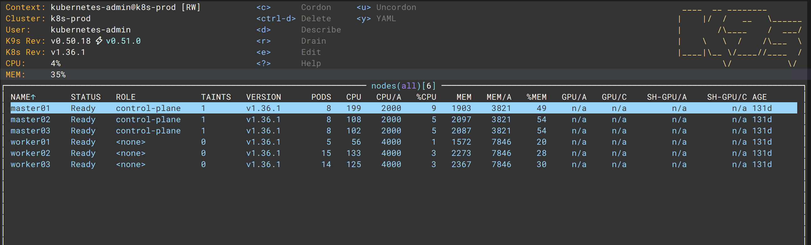
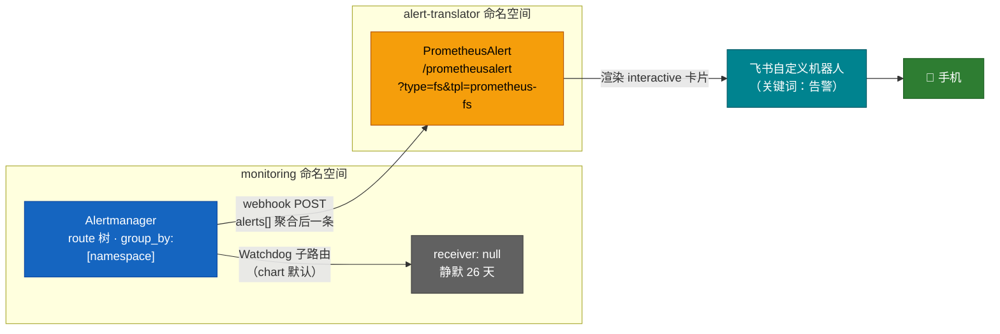
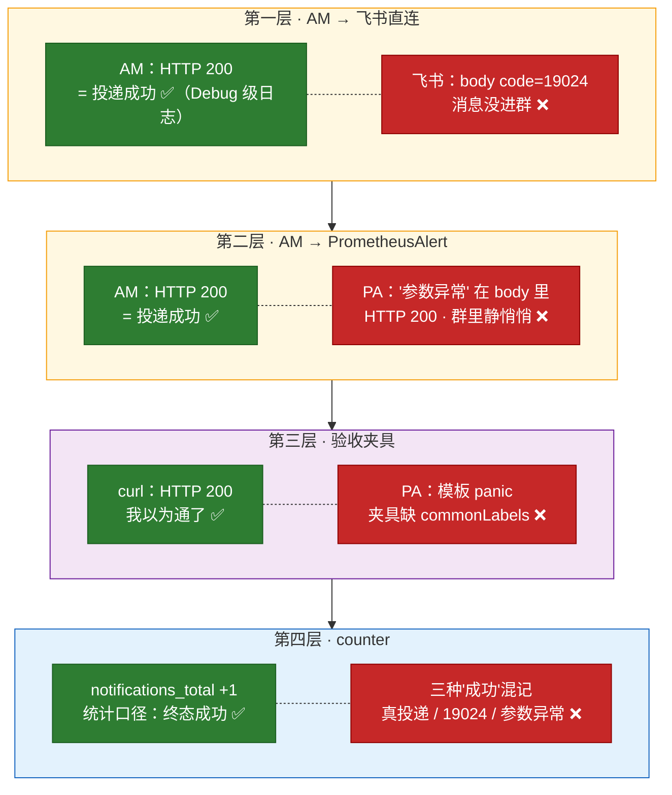
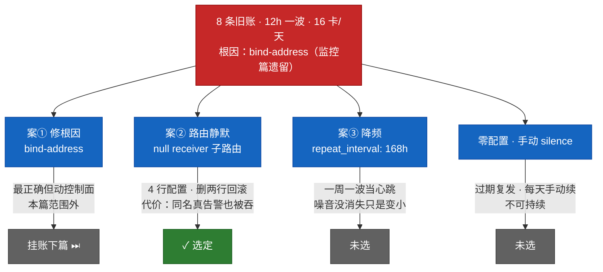

---

title: Alertmanager 告警 25 天没人收到：从 null receiver 到飞书推送
description: 实测 Kubernetes Alertmanager 到飞书的 webhook 通知链路，排查 null receiver、协议不兼容与 HTTP 200 假成功，并用指标和回执验收。
series: 测试集群生产化改造
series_order: 3
tags:
    - Kubernetes
    - Alertmanager
    - Prometheus
    - 飞书告警
    - 可观测性
    - 故障排查

---

# Alertmanager 告警 25 天没人收到：从 null receiver 到飞书推送

这是一篇从故障现场出发的告警通知实战：Alertmanager 已经持续接收告警，却因为 `null` receiver 让它们 25 天没有到达任何人手中。文章记录从直连飞书失败，到接入 PrometheusAlert 转换消息格式，再到用日志、指标和飞书消息完成闭环验收的全过程。

读完本文，你可以得到三类可复用的方法：

- 用 receiver、路由和 `group_by` 快速判断告警到底停在哪一层；
- 区分 HTTP 200、通知计数器、转发层日志和最终消息之间的不同“成功”；
- 用重试、`group_wait`、`repeat_interval` 和路由级静默治理存量告警，避免把噪音重新推回手机。

> **实测声明**：3 master + 3 worker，kubeadm 1.36.1，Debian 13。kube-prometheus-stack（chart 86.2.0 / Alertmanager v0.32.2）2026-06-08 部署。全部命令 2026-09-18 ~ 09-20 在该集群实测，输出 tee 落盘（`~/alert-lab-logs/`，00-19 号文件）。文中终端块为逐字摘录（仅裁剪行数与 JSON 省略号，不改一字）；标注"台账摘要"的为落盘文件蒸馏，数值逐条核对过。AM 侧日志时间戳为 UTC（首次出现处标注 CST 折算），PA 侧为 CST。webhook URL、集群 IP 中段、QQ 邮箱已打码。
>
> 系列上一篇：[K8s 监控装了 98 天，9 个 target 从第一天就是红的](/lab/k8s-monitoring-red-from-day-one/)。本篇是第三篇（上），只讲飞书通道；邮箱双通道和源码深读在（下）。



承接上一篇：Alertmanager 的 receivers 里躺着一个字面意义的 `"null"`，98 天里所有告警只活在一个没人看的网页里。

飞书 webhook，从零到手机收到第一条推送，预计半小时。

这个半小时，实测花了两天半。不是因为难，是因为**每走一步都有东西在骗我**。先看这条链路的最终形态，再回到起点：



AM 深蓝、转发层琥珀、飞书青、成功绿、静默灰——这张图上每一个彩色的节点，都骗过我至少一次。

## 静悄悄的 25 天

先确认起点。secret 解码出来，receiver 部分就这几行：

```text
receivers:
- name: "null"
route:
  group_by:
```

一个 receiver，名字叫 `"null"`。注意这是**字符串名字**，不是关键字——它跟叫 `"webhook"`、`"feishu"` 没有任何语义区别，恰好起了个叫 null 的名字而已。但它确实是空的：没有任何 webhook、email 配置挂在上面。

!!! note "一个名字的语义"
    `receiver: "null"` 里的 null 是带引号的字符串。第一次读到时我愣了几秒才确认它不是什么特殊语法——这个名字起得实在太有误导性了。

它静默到什么程度？AM 的日志从 08-24 之后**零增长**：

```bash
kubectl -n monitoring logs statefulset/alertmanager-prometheus-kube-prometheus-alertmanager --tail=5
# 09-18 实测：最后几条日志的时间戳全部停在 2026-08-24
```

而 AM 里躺着 9 条 firing 告警（上一篇的遗产）：

```text
KubeControllerManagerInstanceUnreachable ×3   startsAt 2026-08-24T00:34
KubeSchedulerInstanceUnreachable       ×3   startsAt 2026-08-24T00:33~00:34
TargetDown                             ×2   startsAt 2026-08-24T00:28
Watchdog                               ×1   startsAt 2026-08-24T00:18（永远 firing 的死信信号）
```

从 08-24 到 09-18，25 天。这些告警每 30 秒被 Prometheus 的规则评估重新确认一次，AM 忠实地收下、分组、然后扔进 null——**它不是没响，是响了 25 天没人听得见。**

上一篇做过决定：KCM/scheduler 的六个红 target 有意留红（bind-address 要动控制面，单独立篇）。所以现在的问题不是告警该不该存在，而是：**假设它们有资格被推送，通知链路通不通。**

## 直连翻车：第一层假成功

预测先行（这个系列的规矩）：AM 的 webhook 发的是 `{"version":"4","alerts":[...]}`，而飞书自定义机器人的 API 只认 `{"msg_type":"text",...}` 这类格式。两边协议对不上，我预测两种结局——要么 4xx 被拒，要么更阴险的**假成功**：HTTP 200 但消息根本没进群。

飞书侧准备三件事：建群（普罗米修斯测试告警）、添加自定义机器人、安全设置选关键词"告警"。第二件在我这儿卡了一阵，两个坑叠着：机器人市场的默认列表全是"应用"——**应用和哑管道 webhook 是两种东西**，得在搜索框里搜"自定义机器人"才出得来；找到了入口之后还有一层——**我在手机端翻了一圈没找到添加入口，最后是回到 PC 端才加上的**。想省事，直接上 PC。

然后改 AM 配置。这里翻了三个跟头，每个都值得记：

**跟头一：字段名手误。**  vi 手改 YAML，把 `webhook_configs` 敲成了 `webhook-configs`（连字符）。AM 对未知字段是**严格校验**：拒载新配置，继续跑旧的。也就是说——坏配置打不死告警系统，但会静默骗过你：你以为改了，其实什么都没变。

**跟头二：生效链有四道关。**  secret 回写只是第一道，后面还有 operator 重新生成、kubelet 卷同步、config-reloader 触发 AM reload。实测方差大到离谱：快的一次 **1.1s**（17:16:12.5 apply → 17:16:13.6 日志出现 Loading），慢的一次接近 **60s**。

!!! warning "生效四道关"
    user secret → operator 校验生成 → kubelet 卷同步（最慢 ~1min）→ config-reloader → AM reload。任何一关没走完，都是"改了没生效"。

**跟头三：bash 的波浪号。**  回滚命令里 `--from-file=~/x` 的 `~` 不展开（`=` 后面必须是合法标识符）——命令"成功"执行，实际传了个字面量路径。后来统一用 `$HOME/x`。另外从聊天工具复制命令，引号会被替换成中文引号（`'`→`‘`），FEISHU_URL 定义因此翻车一次。

三坑踩完，配置终于生效（日志出现 Loading 行，UTC 时间戳）。先看这次改动本身长什么样——receiver 加 3 行、根路由指过去，diff 预期就两块：

```text
$ diff ~/alert-lab-logs/00-amconfig-before.yaml /tmp/am-current.yaml
# +3 行 receiver 块：
#   - name: "feishu-direct"
#     webhook_configs:
#     - url: "https://open.feishu.cn/****"（打码）
# receiver: "null" → "feishu-direct"
```

30 秒后，该来的来了——**什么都没发生**。群里安静，手机安静。

生效时刻的档案记录：15:07:40 出现 Loading。而同一天晚些的一次变更（修 URL 参数），apply 到 Loading 只隔 1.1 秒——同一条链路，方差从 1 秒到分钟级。

裁决三件套：

```bash
# 1. AM 日志找 Notify 行
kubectl -n monitoring logs statefulset/alertmanager-prometheus-kube-prometheus-alertmanager --tail=200 | grep -iE 'notify'
# 实测：零输出

# 2. 通知计数器
curl -s http://192.168.x.145:30093/metrics | grep '^alertmanager_notification'
# 台账摘要（04 号文件）：requests_total{integration="webhook"} 2 / failed 0，单次延迟 0.78s / 1.23s

# 3. curl 直打飞书 webhook（AM 的 body 原样转发）
# 实测：HTTP 200，body 里 "code":19024——关键词校验未过，消息没有进群
```

三源实锤：**AM 认为自己成功了**（counter +2，failed 0），**飞书认为自己拒绝了**（19024 在 body 里），**我的口袋什么都没收到**。

这就是第一层假成功的机制：飞书 API 的惯例是 HTTP 200 + 错误码放 body 里，而 AM 的 webhook 集成只看 HTTP 状态码。更绝的是关键词校验发生在**飞书把 body 解析成消息之后**——我的测试 body 里同时含"告警"（summary 字段）和"firing"，照样 19024。塞什么内容都救不了直连，协议层面就不兼容。

 **"成功"的所有权边界**——这个概念贯穿全篇：AM 对"拿到 200"负责，飞书对"消息进群"负责。两边的成功之间有一条缝，直连方案把这条缝原样留给了你。

## 零日志之谜：成功根本不打 INFO

三源实锤之后我想找日志佐证，结果发现一件怪事：counter 明明 +2，`Notify success` 日志一条都没有。

翻源码（v0.32.2，jsDelivr 通道），notify.go 里成功明明有日志。再猜"成功打 INFO"——又错了，这次错得更有教学价值：我 grep 行号命中了 L977 的 `l.Info("Notify success")`，就下结论了，**没读分支条件**。完整的 L966-979 是：

```go
if i <= 1 {
    l.Debug("Notify success", "alerts", sent)
} else {
    l.Info("Notify success")
}
```

**一次成功的投递只打 Debug（默认级别下不可见），重试之后才成功的才升 Info。**  三条推论：

1. 默认配置下，成功投递不留任何日志——唯一证人是 metrics；
2. 日志里出现 `Notify success`，恰恰说明这条通知重试过。这行日志是"苦难的勋章"；
3. 我的集群 sts args 里没有 `--log.level`（默认 info），versionInfo 实测 v0.32.2 与源码精确匹配——零日志是**正确行为**，不是故障。

!!! note "Debug 级不是没有日志"
    想看到每次成功的日志，给 AM 加 `--log.level=debug`。但注意代价：Debug 级会带 alerts 明细，日志量暴涨。生产上更稳的做法是把 metrics 当证人。

还有一个当时没解开的谜（后来解开了，在"隔夜旧账"章）：reload 之后存量 8 条没有按 group_wait 30 秒触发首推，日志止于 Loading。机制存疑，先不猜，后面用数据裁决。

## 翻译层与重试史诗

直连死了，需要翻译层。选型两句话说完：PrometheusAlert（PA）现成、模板全、我选了它；备选是自己写个 Go mini 转发器——用现成的，**不自造轮子的边界也是结论**。钉钉没选是因为它的字段差一个下划线（`msgtype`）这类细节差异、加签选项又要多管一个 secret；微信根本不开放个人机器投递入口——**平台收不收机器人的信，决定了它能不能当告警通道**。

部署前先做了源码核验（PA 5.0.0，全部可复现）：

- webhook 端点是 `/prometheusalert`（routers/router.go L53）——老文档写的 `/prometheus/alert` 在 5.0.0 路由表里不存在；
- 配置走 `PA_` 前缀环境变量，`PA_FSURL` 注入飞书地址，不需要 ConfigMap；
- 镜像用 daocloud 代理的 digest 锁定（`:latest` 拉的，`5.0.0` tag 反而 403）；
- 默认飞书模板的 firing 段含 `**[Prometheus告警信息]**`——"告警"关键词直接过。

部署本身很快：

```text
16:20:31.989  kubectl apply（Namespace + Deployment + Service + NodePort 30080）
16:21:55.063  PA Ready
# ②段合计 83.1s，含首拉镜像；imageID digest 与预期精确匹配 ✓
```

Deployment 只有三处非默认值值得看，其余全是默认：NodePort 30080、`PA_FSURL` 环境变量（值打码）、就绪探针走 PA 自带路由。镜像走 daocloud 代理的 `:latest`（`5.0.0` tag 反而 403），apply 后核对了 imageID digest 与预期一致（14 号文件台账）。

**但真正的戏在这里。**  我实际的操作顺序是先切了 AM 的 receiver（16:18:48 生效），再部署 PA——反了。AM 在 PA 还不存在的时候就开始推存量告警，然后：

```text
16:18:48.8   dial tcp: lookup prometheus-alert.alert-translator.svc: no such host
16:21:15     attempt 13: connection refused   # Service 建了，PA 16:21:49.9 才开始监听
16:22:39     attempt 14: 成功                  # PA 已监听，8 条 kube-system 告警送达
```

日志原文（这条就是"苦难的勋章"）：

```text
time=2026-09-18T08:22:39.351Z level=INFO source=notify.go:977 msg="Notify success" component=dispatcher receiver=feishu-pa integration=webhook[0] aggrGroup="{}:{namespace=\"kube-system\"}" attempts=14 duration=6.626625ms numAlerts=8
```

（UTC 08:22:39.351 = CST 16:22:39.351。）

**3 分 51 秒，14 次尝试，指数退避。**  AM 的重试不是"发一次算了"——它按退避策略反复投递，直到对方能收。部署顺序反了，AM 自己爬起来把活干完了。

而这条日志还有一个身份：它是全篇**唯一一条** INFO 级的 Notify success。

!!! warning "fsurl 会在日志里回显"
    PA 容器日志会全量打印 payload 和配置覆盖行（"Config overridden from Environment variable"），**飞书 webhook 地址是明文**。

## 第二层和第三层：连"验收通过"都会骗人

PA 起来了，但故事没完。

**第二层。**  AM 的推送 PA 收到了（remoteIP 是 AM pod），但 PA 报了 `[E] 自定义模板接口参数异常！`——注意，**HTTP 200**。群里依旧安静。源码定位（controllers/prometheusalert.go L214）：双条件判断要求 URL 必须带 query 参数 `?type=fs&tpl=prometheus-fs`，裸的 `/prometheusalert` 等于参数异常。AM 视角：POST 200，成功。飞书视角：压根没收到。**我的口袋：还是空的。**

**第三层，我自己造的。**  修好 URL 参数后做独立验收，curl 直接打 PA。第一轮返回 200 但群里没消息，PA 日志里是 template panic。排查发现：**验收 body 是我自己拼的，缺了** **`commonLabels`** **字段**——真实 AM body 必带，我的夹具不像真话，触发了模板里一个 nil 引用。修好夹具，第二轮通过：200 + success body + 群里收到卡片。

!!! tip "5 秒先手棋"
    复杂机制假设上桌前，先花 5 秒验证输入本身：`cat` 一下 yaml、`diff` 两轮清单、`describe` 看看对象。这一篇里双块事故（下面说）和 template panic 的排查，都被"先查输入"缩短了一半。

双块事故一笔带过但必须记：修配置的 sed 没做防重入设计，第二遍跑时插出了两个重复的 receiver 块，operator 拒绝了这次 apply——16:27:41 那次"生效"其实没生效，AM 日志在 08:22:39 后零 reload。修复靠 diff 行号推算删行。

四层假成功至此集齐三层，先把方法论立起来（第四层在最后）：



每一层的共同结构：**左边视角"我成功了"，右边现实"没送达"** 。每层都认为自己的活干完了，每层都没骗你——但你的口袋是空的。

## 手机第一次震动：31.1 秒

17:18:30，全链路探针（新 namespace，绕开存量组的 12h repeat）：

```text
17:18:30.155  探针 POST（AM API，date 命令钉死时刻）
17:19:00.179  PA 收到（group_wait 30.02s）
17:19:01.287  飞书 success（1.108s，PA 日志时间戳）
# ③段合计 31.1s，预测 ~35s ✓
```

**手机震了。**  两天半的坑，在这一秒兑现。31.1 秒里 30 秒是 group_wait——**通道再快也快不过管线**，这句话在（下）篇会有一个漂亮的对照：邮件通道实测后，"邮件比飞书慢"这个常识本身翻车了。

第一张真告警卡片送到手上，顺手记了五个发现（每条都是治理项或知识点）：

1. PA 发的是 interactive 卡片，不是纯文本——信息密度比想象的高；
2. 卡片里的链接全是集群内地址（externalURL 配置问题），**手机点开全是死链**——留到治理清单；
3. "告警级别：\<no value\>"——默认模板读 `labels.level`，K8s 世界用的是 `severity`，错位如实展示；
4. 默认模板只渲染 `annotations.description`，**summary 被忽略**——写告警规则时，description 才是会被推送的字段；
5. PA 日志全量打印 payload（webhook URL 明文回显）——又一个打码点。

对上一篇的账：承诺"半小时"，实际三段——①手工配置分钟级 ②PA 部署 83.1s ③链路时延 31.1s。**承诺兑现了，过程远比承诺曲折。**

## 意外的主角：监控系统举报了坏配置

双块事故还送了一份大礼。16:27:41 的坏 secret 让 operator reconcile 失败，然后集群做了一件漂亮的事——**用一条真告警举报了我的坏配置**：

```text
16:27:41  双块 secret apply（坏配置）
16:42:41  PrometheusOperatorSyncFailed firing
17:16:13  修复生效（删重复块）
17:16:41  resolved
17:21:13  恢复卡片进群
```

`PrometheusOperatorSyncFailed`——operator 给自己配的告警规则，reconciliation 失败就转红。**监控系统监控了监控系统的误配置**，自举闭环。它同时解释了 16:27 那次 apply 为什么没生效：不是 AM 的问题，是 operator 一直在报错。

有个细节值得一提：这条告警的 firing 卡片**也被第二层假成功吞了**（16:42 那会儿 URL 参数还没修好）——四层假成功连监控系统自己都没放过。直到恢复卡片 17:21:13 进群，我才完整看到这条告警的生死。

顺带两个机制发现，都成了后面的伏笔：

- **恢复卡片为什么不是即时来的？**  operator resolved 17:16:41 → 卡片 17:21:13（4m32s）；另一条探针 resolved 17:23:30 → 卡片 17:24:00（30s）。两个数字统一语义：**距该组上次通知的 group_interval 5m 边界**——恢复通知也要等组的心跳；
- **探针会自动消失。**  API 注入的告警不带 endsAt 的话，`resolve_timeout`（默认 5m）到期自动 resolve（via-pa-1 实证：16:28:44 firing → 16:33:14 auto-resolve）。我之前以为探针会常驻 12 小时，错了。

## 隔夜旧账与节奏定律

第二天凌晨 04:26，手机连震八次。

KCM×3（.145/.146/.147:10257）+ Sched×3（.145/.146/.147:10259）+ TargetDown×2——一波 **8 张独立卡片**，每张自带完整的 header/footer。这就是存量的 kube-system 组：AM 侧一次 POST、alerts 数组 8 条（group_by:[namespace] 聚合），**拆成 8 张卡是 PA 模板干的**。聚合在 AM，展开在 PA——group_by 挡不住手机震 8 次，拆不拆卡是转发层说了算。

卡片内容有个特征后来成了"旧账"的定义：**26 天一个字没变**。startsAt 是故障开始时间（冻结在 08-24），不是发送时间。三波卡片的 startsAt 逐字节相同——它们不是新告警，是同一批旧账按 12 小时节奏重投。

还有一个零：**Watchdog 从未出现**。从打通到现在，它按 4h repeat 走了好几轮，群里零张卡。chart 默认给它配了 null 子路由——**手机从没为 Watchdog 震过，不是没有告警，是有人早就替你做了这个决策**（然后没告诉你）。

而真正的金子是三波到达的时刻：

```text
16:22:39.351  重试史诗成功（nflog 记账起点）
04:26:13.731  第二波 · 8 卡（+12h03m34s）
16:31:13.775  第三波 · 8 卡（+12h05m00.044s）
04:36:13.937  第四波 · 8 卡（+12h05m00.162s）——治理生效前最后一波
```

第一段 +12h03m34s，后两段 +12h05m00s（44ms 与 162ms 的偏差）——**repeat 到期不是闹钟，是取号排队**：12h repeat 到期之后，还要等下一个 5 分钟的 group tick 才真正发送。tick 的相位锚在组上一次 flush 的时刻，17:16 那次 reload 重锚过一次（所以第一段是 +3m34s 不是 +5m00s）。

**预测失败。**  实测 04:36:13.937。模型修正：**repeat 到期时刻恰好是 tick 点时，那个 tick 不发，等下一个**——边界是 exclusive 的。AM 宁可晚一个 tick，也不在边界上赌。三数据点闭环成定律，一次预测失败换来模型精确化，这买卖不亏。

```mermaid
flowchart LR
    T0["16:22:39.351<br/>换 receiver 后首推<br/>nflog 记账起点"] -->|"+12h03m34s<br/>repeat 到期后<br/>等下一个 5m tick"| T1["04:26:13.731<br/>第二波 8 卡"]
    T1 -->|"+12h05m00.044s"| T2["16:31:13.775<br/>第三波 8 卡"]
    T2 -->|"+12h05m00.162s<br/>预注册 04:31:13.775 失败<br/>→ 边界 exclusive 修正"| T3["04:36:13.937<br/>治理前最后一波"]
    T3 -->|"null 路由压制<br/>16:41:13.9 预测无波 ✓"| T4["16:43:32 终读<br/>counter 冻结<br/>盖棺"]
    classDef blue fill:#DBEAFE,stroke:#2563EB,color:#1e3a5f
    classDef amber fill:#FEF3C7,stroke:#D97706,color:#78350f
    classDef green fill:#D1FAE5,stroke:#059669,color:#064e3b
    classDef grey fill:#F3F4F6,stroke:#6B7280,color:#374151
    class T0 blue
    class T1,T2 amber
    class T3 grey
    class T4 green
```



!!! tip "counter 读数必须 tee"
    这两天有个悬案耗了两轮回查：webhook counter 一度对不上台账 +2。最后结案：那个基准读数"8"只在终端 scrollback 里待过，从未落盘——**档案里没有的数字不能当基准**。从此所有 counter 读数一律 `| tee`。

定量算一下不治理的代价：12h 一波 × 8 张 = **16 张/天**，每张内容 26 天没变过。这是活问题，不是理论问题。

## 治理决策：四个方案里选"看见了故意不看"

决策记录（ADR）四段式。Context 上面齐了：8 条旧账、根因在 bind-address（监控篇有意留红）、16 张/天的定量压迫、根因修复要动控制面（单独立篇）。Decision 是四个方案里选一个：



不选的三个，理由写透：

- **案③降频（168h）** ：一周一波当心跳——噪音没消失，只是变小。对"想留脉搏"的人是好方案，但我的场景里这 8 条的脉搏毫无信息量；
- **手动 silence**：卡片上自带"点我屏蔽"链接（AM silence API），零配置。但 silence 有时效，过期复发—— **"每天手动续 silence"不可持续，恰恰是为什么要路由级治理**的论证；
- **inhibit 为什么不用**：inhibit 治的是"衍生告警"（KCM 挂了 TargetDown 跟着挂，抑制次要保主要）。这 8 条全是根因层，互相不是衍生关系——**知道什么时候不该用 inhibit，比会用它更重要**。

选定案②。实施从磁盘现行配置机械派生（python 锚点替换，不手抄全文——手抄会失真，这是被坑过之后的工程化）：

```bash
python3 - <<'PYEOF'
block = '''  - matchers:
    - namespace = "kube-system"
    - alertname =~ "KubeControllerManagerInstanceUnreachable|KubeSchedulerInstanceUnreachable|TargetDown"
    receiver: "null"
'''
src = open('/tmp/am-current.yaml').read()
assert src.count('\ntemplates:\n') == 1, 'templates anchor not unique'
open('/tmp/am-6b.yaml','w').write(src.replace('\ntemplates:\n', '\n' + block + 'templates:\n'))
print('written /tmp/am-6b.yaml')
PYEOF
```

两个设计点：锚点选唯一的 `templates:` 行（assert 保证唯一性，不唯一就拒绝生成）；diff 验证：

```text
$ diff /tmp/am-current.yaml /tmp/am-6b.yaml
44a45,48
>   - matchers:
>     - namespace = "kube-system"
>     - alertname =~ "KubeControllerManagerInstanceUnreachable|KubeSchedulerInstanceUnreachable|TargetDown"
>     receiver: "null"
```

恰好 +4 行，单文档检查 `grep -c '^---'` 为 0，回写 secret，09:13:30.598（UTC 日志）Loading 生效。

!!! warning "null 路由的代价"
    这 4 行吞掉的是**告警名**，不只是这 8 条实例——未来任何同名的真告警也进不了手机。"看见了故意不看"的 tradeoff 要写进决策记录：修好根因之后，删掉这两行 matchers 就恢复推送。别忘了。

防误伤验证用了一对探针（这里只点到为止，`notification_reason` 这个字段的五态分类法在（下）篇展开）。PA 台账原文（裁剪，JSON 省略号处为 commonLabels 等同款字段）：

```text
2026/09/20 09:16:21.250 [I] [value.go:586]  [1789866981249920522] [webhook] [received]
Method: POST | URL: /prometheusalert?type=fs&tpl=prometheus-fs | RemoteIP: 10.244.30.66
| Body: {"receiver":"feishu-pa","status":"firing","alerts":[{"status":"firing",
"labels":{"alertname":"C4RouteProbeKS","namespace":"kube-system","severity":"warning"},
...],"notification_reason":"new alerts added","groupLabels":{"namespace":"kube-system"},...}

2026/09/20 09:17:03.826 [I] ... [webhook] [received]
... "alertname":"C4RouteProbeOther" ...
"notification_reason":"first notification" ...
```

KS 探针是 kube-system 命名空间里的**新告警名**（不在黑名单里），Other 走的是非 kube-system 路径——**双双进群，null 路由只吞名单、不吞 namespace**。快照确认 8 条旧账在 AM 里仍 active：治的是噪音，不是故障。

## 终极裁决

节奏定律给了我们一件武器：它不光能预测下一波，还能**验证治理**。预注册：04:36:13.937 + 12h05m00s = **今天 16:41:13.9**，如果治理失效，这波分秒必到。

验证要等窗口关闭，按顺序来：

1. **16:39:47 我跑了第一遍**——PA 零接收、counter 冻结（webhook 17 / email 2 / failed 全 0）。一切安静。**但不算数**：读数时刻比预测时刻早 86 秒，事件窗口还没关。宣布胜利前必须等到窗口关闭——"观察者时刻 ≠ 事件时刻"，这个系列第五次撞上它；
2. **16:43:32 终读**——窗口已关（预测点之后 2 分钟）：

```text
$ kubectl -n alert-translator logs deploy/prometheus-alert --since=2h | grep '\[received\]'
# 零输出

$ curl -s http://192.168.x.145:30093/metrics | grep -E 'alertmanager_notifications.*integration="(email|webhook)"'
alertmanager_notifications_total{integration="email"} 2
alertmanager_notifications_total{integration="webhook"} 17
```

**零波。盖棺。**  null 路由从生效起，把第三波之后的所有旧账推送全部压掉了。节奏定律五数据点完整：它的最后一份工作，是用"该来的没来"证明"治理在工作"。

## 这一篇动了什么

给想复现的人一张总账（全部可回滚）：

**集群侧（monitoring ns，改的都是一个 secret）**

```text
alertmanager-prometheus-kube-prometheus-alertmanager（secret/alertmanager.yaml）
+ receiver feishu-direct    # 直连时代遗留，现已无路由引用——待清理
+ receiver feishu-pa        # webhook → PA :30080，URL 带 ?type=fs&tpl=prometheus-fs
+ 根路由 receiver: "null" → "feishu-pa"
+ kube-system 旧账子路由 → receiver: "null"（matchers 按 alertname 匹配 8 条）
```

**集群侧（新增，alert-translator ns）**

```text
PA（PrometheusAlert 5.0.0）：Namespace + Deployment(1 副本) + Service(NodePort 30080)
环境变量 PA_FSURL=<飞书机器人地址，打码>
```

**验证可用的只读命令（拿到任何集群上都能跑）**

```bash
kubectl -n monitoring get secret alertmanager-prometheus-kube-prometheus-alertmanager \
  -o jsonpath='{.data.alertmanager\.yaml}' | base64 -d          # 看现行配置
curl -s http://<AM-NodePort>/api/v2/alerts | python3 -m json.tool # AM 视角告警快照
curl -s http://<AM-NodePort>/metrics | grep '^alertmanager_notification'  # counter 家族
kubectl -n <PA-ns> logs deploy/<PA> | grep '\[received\]'        # 转发层收据台账
```

回滚路径：删掉 kube-system 子路由那 4 行，旧账推送立即恢复（同名 matchers 是唯一开关）；整套通知下线 = 根路由 receiver 改回 `"null"`。

## 四层假成功与验证纪律

回头看 counter 的账。webhook 成功计数 17 个，但 PA 台账里能对上的没有那么多——差额落在打通当天的调试窗口：直连时代的 19024 假成功、PA 参数异常假成功，全都按"终态成功"计了数。第四层假成功至此收口：

**AM 的"成功"只到 HTTP 200 为止，counter 数不到你的口袋。**

!!! note "两套 counter 家族"
    `alertmanager_notifications_*` 记**终态**（一组通知最终成没成），`alertmanager_notification_requests_*` 记**过程**（每次 HTTP 尝试）。重试 13 次后第 14 次成功：requests +14、requests_failed +13、notifications +1。看哪个 counter，决定了你能看懂什么。

这个系列两天半攒下的验证纪律，五条，全部被坑验证过：

1. **counter 读数必须 tee**——scrollback 里的数字不进文章；
2. **压缩/截断的输出不下结论**——半截数据猜构成，两次被台账打脸；
3. **实验命令必须** **`date`** **串联**——观察者时刻不是事件时刻；
4. **宣布胜利前等窗口关闭**——86 秒的抢跑能让整个结论作废；
5. **关键结论过第二独立来源**——三源实锤的那次（日志/counter/群）是本篇最稳的结论。

留给下一篇和治理清单的账：

- **bind-address 根因**：6 个红 target 的最终归宿，动控制面，单独成篇；
- **feishu-direct 死配置清理**：直连 receiver 还留在 secret 里，真 webhook token 躺在里面；
- **Watchdog 死信检测**：它被 null 路由静默了 26 天，等于"链路活着"的保险丝从来没接进电路——这是比四层假成功更靠前的"第 0 层"问题；
- **卡片死链与模板错位**：externalURL、`labels.level` vs `severity`、description vs summary。

下一篇（下）把邮箱通道接进来——顺带说一句，"邮件比飞书慢多少"这个问题本身翻车了，实测数字有点意外。

---

## 推荐阅读

- [K8s 监控装了 98 天，9 个 target 从第一天就是红的](k8s-monitoring-red-from-day-one.md) —— 系列上一篇：从监控审计、红 target 到 `null` receiver 的问题起点
- [Alertmanager 告警体系：路由、分组与噪音治理](../observability/alertmanager.md) —— 系统理解路由树、分组、抑制和通知渠道设计
- [Prometheus 监控体系](../observability/prometheus.md) —— 了解 Prometheus、告警规则与 Alertmanager 之间的职责边界
- [Prometheus 搭好了，然后看什么？Kubernetes 集群健康检查指标指南](../observability/k8s-cluster-health-check.md) —— 为告警通知提供可执行的集群健康指标
- [删掉一台 master 的 etcd 数据，我花 2 小时 41 分救回了集群](etcd-backup-restore.md) —— 系列更早一篇：从真实故障看为什么监控和通知必须形成闭环
- [HA 故障演练 EP.1：一台 Master 宕机](failover-test-1.md) —— 用故障演练验证告警规则、通知链路和恢复通知