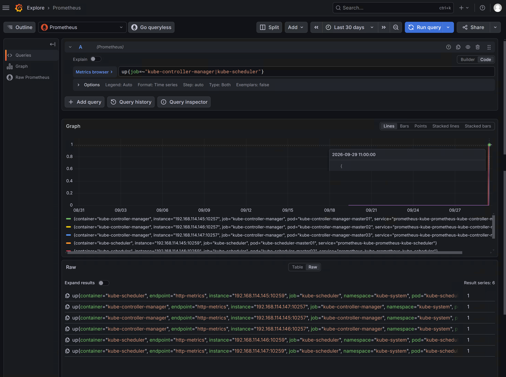
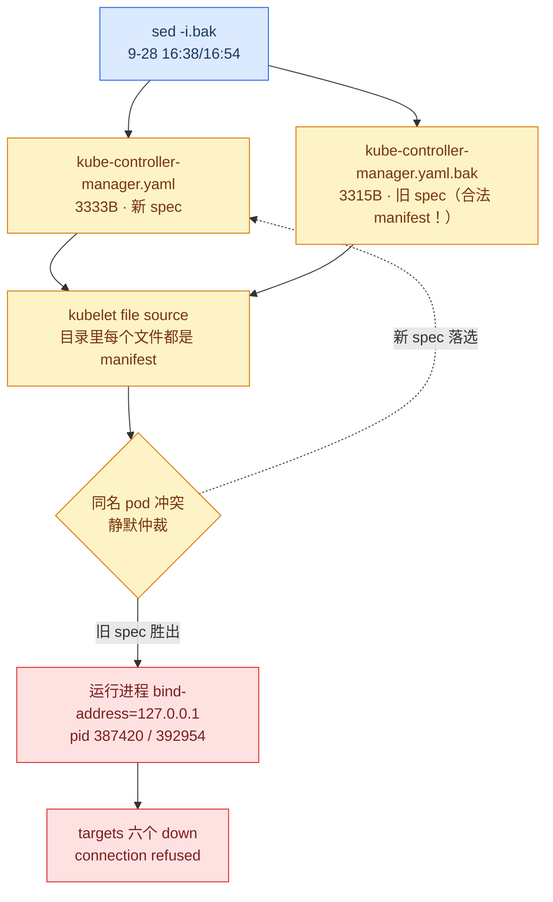
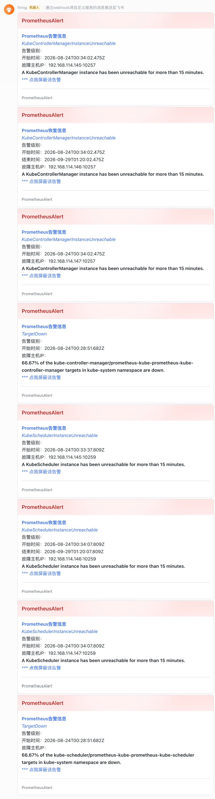
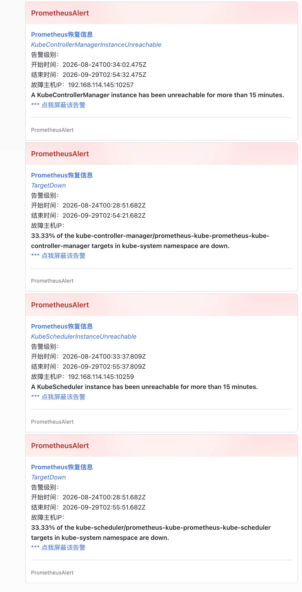
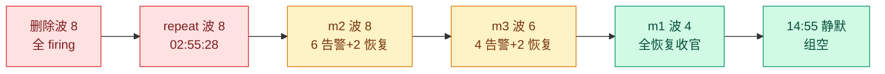
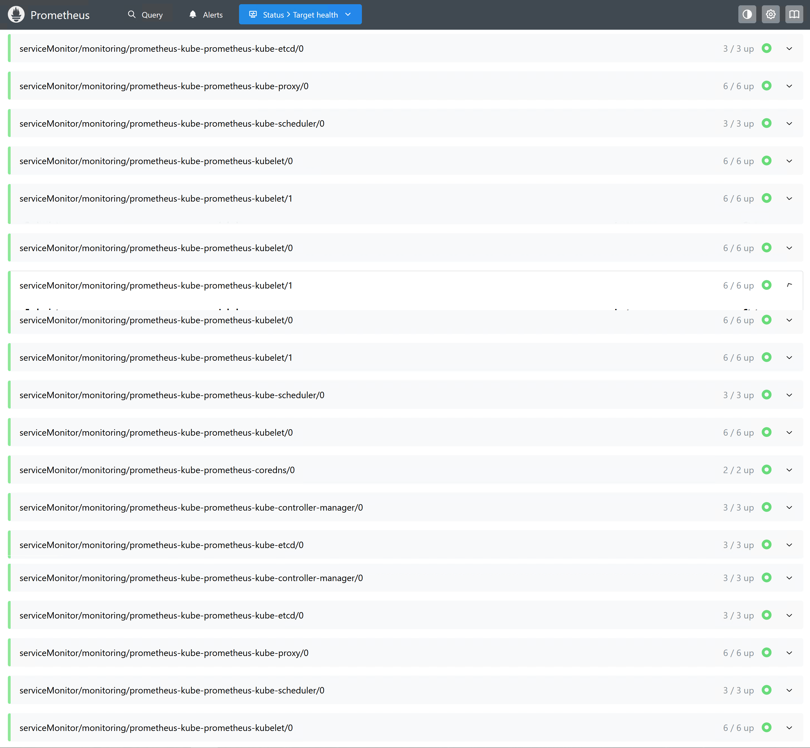

---

title: K8s bind-address 修复实录：sed 改对了没生效，凶手是自己的备份文件
description: K8s 1.36 静态 Pod 修复实录：实测 kube-controller-manager 与 kube-scheduler 的 bind-address 从回环改到节点 IP，记录 sed 备份文件落入 kubelet 监视目录导致修复静默失效、34 张告警卡与 leader lease 切换的完整排查。
series: 测试集群生产化改造
series_order: 5
tags:
    - Kubernetes
    - kubelet
    - 静态 Pod
    - Prometheus
    - 故障排查
    - 生产化改造

---

# K8s bind-address 修复实录：sed 改对了没生效，凶手是自己的备份文件

> **实测声明**：3 master + 3 worker，kubeadm 1.36.1，Debian 13，Calico。实验窗口 2026-09-25 ~ 09-29，全部输出 tee 落盘（`~/bind-lab-logs/`，逐字摘录）。涉及源码为 k8s v1.36.1 与 client-go v1.36.1 的 GitHub raw 实拉存档，行号可查。告警侧组件沿用前两篇：kube-prometheus-stack（Alertmanager v0.32.2）+ PrometheusAlert 转发飞书。时间一律 CST（kubernetes 日志原为 UTC，已折算并标注）。
>
> 系列上一篇：[K8s 告警邮件通道实测：SMTP 只慢 1.4 秒，"邮件慢"翻车了](k8s-alerts-email-channel-test.md)。本篇还那篇文末欠的债：六个红 target 的 bind-address，一个字一个字去修。

sed 改对了，diff 干净，pod 重建了，Prometheus 里还是红的——而这中间没有一条报错。这篇文章从一个"修复失败"开始，最后修完三台 master，飞书一共来了 34 张卡片，其中三波是**修好之后才来的**。

## 三十五天前，六个 target 同时变红

先把债的主文拿出来。监控上线第一天（8 月 24 日）早上，kube-controller-manager 和 kube-scheduler 的六个 target 全部 down。根因在[监控篇](k8s-monitoring-red-from-day-one.md)和[告警篇](k8s-alerts-ignored-for-25-days.md)已经讲过：kubeadm 默认把这两个组件的 `--bind-address` 写成 `127.0.0.1`，Prometheus 从 Pod IP 抓不到——这不是故障，是"出厂设置"和监控假设的错位。

35 天。准确说是多久？首波告警载荷里的 `startsAt` 给了精确到毫秒的答案（全部 8-24 早上，CST）：

```text
TargetDown (kube-controller-manager)   08:28:51.682
TargetDown (kube-scheduler)            08:28:51.682
KubeSchedulerInstanceUnreachable @145  08:33:37.809
KCMInstanceUnreachable ×3 (@145/146/147) 08:34:02.475
KubeSchedulerInstanceUnreachable @146/147 08:34:07.809
```

两个细节值得停一下。一是 **TargetDown 比实例级告警早 5 分 10 秒**——它的 `for` 子句短（10m vs 15m），先熬完出头。二是毫秒尾巴分成两族：`.475` 是 KCM 这条评估管线的相位，`.809` 是 scheduler 的，`.682` 是 TargetDown 的——**每条告警一生里的所有时刻都踩在自己 eval 管线的相位上**，30 秒一格，雷打不动。这个"相位守恒"后面还要用它断案。

动手前的两个决策：

**决策一：bind-address 改成节点 IP，不是 0.0.0.0。**  0.0.0.0 也能让 Prometheus 抓到，但它把监听面扩到所有网卡。节点 IP 是"只多开监控需要的那扇门"。

**决策二：修复前先删掉上一轮的 null 路由（Y 方案）。**  [告警篇](k8s-alerts-ignored-for-25-days.md)里这六条告警曾被一条正则路由到 null receiver 静音。这轮修复前把它删了，理由是预注册的 P5：逐台修复天然制造"部分恢复"，`some alerts resolved` 是这套系统从没发出过的状态——修好了却不让它说话，等于白修。代价明码标价：修复期间每台 master 的每次变更都会把整组告警重发一遍。这个"代价"后来成了本篇最好的素材。



然后是九条预注册（P1-P9，实测裁决后）：

| #   | 预测                                          | 裁决                     |
| ----- | ----------------------------------------------- | -------------------------- |
| P1  | manifest 层改动 3-4 行/台（bind + 探针 host） | ✓ KCM 3 处 / sched 4 处 |
| P2  | 403 来自授权层而非监听层                      | ✓ S-3 三层机制          |
| P3  | 静态 Pod 重建 10-30s/台                       | ✓ 30s/31s/28s           |
| P4  | 修复期间 apiserver 零感知                     | ✓ kubectl 全程可用      |
| P5  | 逐台修复产生部分恢复卡                        | ✓✓ 首批恢复卡 09-29    |
| P6  | 变绿到恢复卡典型 2-4 分钟                     | ✓ 2min（两数据点）      |
| P7  | healthz 200 / metrics 403 双视角              | ✓✓ 回环+节点 IP 十二行 |
| P8' | 删 null 后 6 分钟内首波                       | ✓ 6.74 秒（快了 50 倍） |
| P9  | 修复波次递减 8+6+4                            | ✓✓ 三波全中            |

P8' 那格信息量最大：预测上限 6 分钟，实测 6.74 秒。差距来自一个[上篇](k8s-alerts-email-channel-test.md)没料到的机制——这组 35 天的旧告警在 AM 的通知日志（nflog）里**一条记录都没有**（null 期从不通知），配置 reload 后 dispatcher 重建，查账查无此组，直接按"首次通知"即时 flush，`group_wait 30s` 都没等。上篇的 tick 语义家族又添一员。

## m2 初次修改翻车：改对了，没生效

master02 先动。流程照旧：备份、sed、验证 diff、等重建。

```text
$ sudo sed -i.bak \
  -e 's/--bind-address=127\.0\.0\.1/--bind-address=192.168.x.146/' \
  -e 's/host: 127\.0\.0\.1/host: 192.168.x.146/g' \
  /etc/kubernetes/manifests/kube-scheduler.yaml
$ sudo grep -c '127\.0\.0\.1' /etc/kubernetes/manifests/kube-scheduler.yaml
0
$ sudo diff /etc/kubernetes/manifests/kube-scheduler.yaml.bak /etc/kubernetes/manifests/kube-scheduler.yaml
15c15
<     - --bind-address=127.0.0.1
---
>     - --bind-address=192.168.x.146
23c23 / 38c38 / 50c50
<         host: 127.0.0.1
---
>         host: 192.168.x.146
```

manifest 干净了：4 处替换（1 个 bind + 3 个探针 host），diff 恰好 4 行对，`grep 127` 归零。pod 也重建了——`kubectl get pods` 里 AGE 从天级跳回分钟级。教科书流程走完，去看门禁：

```text
$ sudo ss -tlnp | grep -E ':(10257|10259)'
LISTEN 0 4096   127.0.0.1:10257   0.0.0.0:*   users:(("kube-controller",pid=387420,fd=4))
LISTEN 0 4096   127.0.0.1:10259   0.0.0.0:*   users:(("kube-scheduler",pid=392954,fd=4))
$ curl -sk -o /dev/null -w '%{http_code}\n' --max-time 5 https://192.168.x.146:10257/healthz
000
```

**进程还监听在 127.0.0.1 上。**  pod 明明重建过（AGE 28m/12m），manifest 明明改对了（grep=0）。而 targets API 里六个 target 照旧 `connection refused`。

先说排错路上走对的和差点走歪的。一开始我在内核方向连做了三次纸上推演——busybox cp 的属性缓存、sharecache、delegation——全不沾边。真凶用一条最便宜的命令就能抓到：把运行中进程的 cmdline 和 apiserver 里 mirror pod 的 spec 拉出来对质：

```text
$ sudo tr '\0' ' ' < /proc/$(pgrep -f kube-controller-manager | head -1)/cmdline | grep -o 'bind-address=[^ ]*'
bind-address=127.0.0.1
$ kubectl -n kube-system get pod kube-controller-manager-master02 -o jsonpath='{.spec.containers[0].command}' | tr ',' '\n' | grep bind
"--bind-address=127.0.0.1"
```

磁盘上的 manifest 是新的，**apiserver 里的 pod spec 是旧的，运行中的进程是旧的**。kubelet 用旧 spec 建了新 pod。旧 spec 从哪来？

```text
$ sudo ls -l /etc/kubernetes/manifests/
-rw------- 1 root root 3333 Sep 28 16:38 kube-controller-manager.yaml
-rw------- 1 root root 3315 Aug 30 23:33 kube-controller-manager.yaml.bak
-rw------- 1 root root 1774 Sep 28 16:54 kube-scheduler.yaml
-rw------- 1 root root 1750 Sep  1 22:49 kube-scheduler.yaml.bak
```

`.bak` 就躺在 manifests 目录里。它是 `sed -i.bak` 留下的备份——**一个字节都没改过的、完全合法的静态 Pod manifest**。

## 事故机制：监视目录里没有"备份"这个概念

kubelet 的 file source 会把 `/etc/kubernetes/manifests/` 里**每一个**能解析的文件都当成 manifest。它不关心后缀名。于是目录里同时存在两份 KCM 定义：`kube-controller-manager.yaml`（新）和 `kube-controller-manager.yaml.bak`（旧）。对 kubelet 来说这是两个不同文件名的两份合法 manifest，各自 spawn 一个同名 pod——同名冲突，一份赢。赢的是旧的。



整场事故里最让人后背发凉的是这个：

```text
$ sudo journalctl -u kubelet --since "16:35" --no-pager | grep -iE 'duplicate|conflict|manifest'
（零输出）
```

**kubelet 全程静默。**  没有 duplicate 警告，没有 conflict 日志，没有任何一行字告诉你"我看见两份同名定义、我选了一份"。pod 照常重建（AGE 归零），READY 1/1，探针照常过——因为旧 spec 里的探针 host 也是 127.0.0.1，本地回环上一切正常。35 天里整个集群唯一在坚持报警的，是 Prometheus。



字节算术给这场静默事故补了最后一道铁证：KCM 3315→3333（+18 字节），sched 1750→1774（+24）。每处 `127.0.0.1` → `192.168.x.146` 净增 6 字符，3 处 ×6=18、4 处 ×6=24——替换处数与 diff 行数独立吻合。旧 spec 就是改前的原样，一个字节都没动。

!!! warning "备份纪律的反面教材"
    "改前先备份"这条纪律本身没错，错在**落点**。运行时监视目录里不存在"备份文件"这个概念——每个文件都是活文档。正确姿势：备份放目录外（家目录或专门备份目录），`sed` 用裸 `-i`，改前 `cp` 到监视目录之外。我两个月前在实验记录里给自己写过同一条，这次照样踩——工具笔记写了不等于回了查。

修复也简单得讽刺：把两个 `.bak` 挪出目录（`/root/sed-backups-m2/`），30 秒内双 pod 重建：

```text
$ sudo ls /etc/kubernetes/manifests/
etcd.yaml  kube-apiserver.yaml  kube-controller-manager.yaml  kube-scheduler.yaml
$ kubectl -n kube-system get pod -o wide | grep master02
kube-controller-manager-master02   1/1   Running   0   28s   192.168.x.146
kube-scheduler-master02            1/1   Running   0   28s   192.168.x.146
$ sudo ss -tlnp | grep -E ':(10257|10259)'
LISTEN 0 4096   192.168.x.146:10257   0.0.0.0:*  users:(("kube-controller",pid=724288,fd=4))
LISTEN 0 4096   192.168.x.146:10259   0.0.0.0:*  users:(("kube-scheduler",pid=724281,fd=4))
```

两个新 pid 相邻（724288/724281），成对孵化。门禁四件套全过：ss 只见节点 IP、healthz 200/200、targets 146 up/up、`grep 127`=0。

## m3 与 m1：考古先行

master03 和 master01 修复前，先做一轮"考古"——既然 m2 的 `.bak` 是 8 月底 gate 实验时代埋的，其他两台的 manifests 目录里会不会也有化石？`ls -la` 看三个东西：有没有 `.bak`、每个 manifest 的 mtime、字节数。

m3 干净（bak-count=0）。但 ls 本身挖出了金矿：

```text
m3: kube-controller-manager.yaml  3315B  Aug 30 23:33
m3: kube-scheduler.yaml           1750B  Sep  1 22:49
m2 的 .bak:            （3315B  Aug 30 23:33 / 1750B  Sep 1 22:49）
m1: kube-controller-manager.yaml  3581B  Aug 31 00:19
m1: kube-scheduler.yaml           1750B  Sep  1 22:49
```

m3 现行 manifest 与 m2 起获的 `.bak` **字节相同、mtime 相同**——三台的 bind-address 是同两批 gate 实验改写的，案发时刻三台互证。m1 的 KCM 多 266 字节、晚 46 分钟——那晚在 m1 上多改了一轮（m1 是那场实验的主实验台）。`apiserver.yaml` 三台都停在 6 月 24 日建群日，没动过。

m3 修复一帆风顺（diff 与 m2 完全同构，连行号都一样：KCM 17c17/36/54，sched 15c15/23/38/50），四件套全过。三台 master 的 manifest 同构性，至此有了三组 diff 的实证。

m1 是压轴，因为它握着两个 lease：

```text
$ kubectl -n kube-system get lease kube-controller-manager -o jsonpath='{.spec.holderIdentity} transitions={.spec.leaseTransitions}{"\n"}'
master01_3c5ec1dc-...  transitions=24
$ kubectl -n kube-system get lease kube-scheduler -o jsonpath='{.spec.holderIdentity} transitions={.spec.leaseTransitions}{"\n"}'
master01_8bb795f4-...  transitions=22
```

## Leader 不回家

我预注册里写的是"m1 重启将是集群史上第一次 leader 切换"。before 快照直接把这条打脸：`transitions=24`——历史上已经切过 24 次，8 月底那几轮 gate 折腾全记在计数器里。正确的说法是"**第一次被完整抓拍**"。这也是 before/after 协议的价值：它连我自己的预测一起证伪。

m1 重启窗口内，两个 lease 双双易主：

```text
$ kubectl -n kube-system get lease kube-controller-manager -o jsonpath='...'
master03_2dc6522f-...  transitions=25
$ kubectl -n kube-system get lease kube-scheduler -o jsonpath='...'
master03_09a9af5f-...  transitions=23
$ kubectl -n kube-system logs kube-controller-manager-master01 --since=3m | grep -iE 'acquired|leader|lease'
I0929 02:54:01.894141  1  leaderelection.go:258] "Attempting to acquire leader lease..."  lock="kube-system/kube-controller-manager"
```

`Attempting to acquire`——m1 的新进程回来说的是"我想竞选"。它没选上。KCM 和 scheduler 的领导权都落到了 master03（transitions 各 +1），m1 从 leader 变备胎。**选举没有"物归原主"这回事：重启的那台回来就是候选者，先到先得。**  往后要做 leader 相关的实验，记住 leader 现在在 147。



## 三十四张卡片：修一台，收一整波

修复全部完成的时刻值得单独立传：targets API 六行 up（145/146/147 × 10257/10259），从 8-24 08:28 起红的六个 target，第 35 天下午全部转绿。

但真正的故事是手机上的。决策二（Y 方案）说过代价：修复期间每次组变更都会重发整组。实测的账本这样：

```text
8-24 08:28        六 target 起红，0 通知（null 路由期，nflog 零记录）
      ...         35 天静默
9-28 14:55:28     删除波 8 卡全 firing（patch→波次 6.74s）
9-29 02:55:28     repeat 波 8 卡（12h repeat 精确到秒）
9-29 09:25        m2 修复波 8 卡 = 6 告警 + 2 恢复@146
9-29 10:2x        m3 修复波 6 卡 = 4 告警 + 2 恢复@147
9-29 10:54-55     m1 收官波 4 卡，全部恢复
9-29 14:55:28     （静默——repeat 到点，组已空，无对象可推）
```

机制拆开讲。AM 的 `repeat_interval`（12h）只保护"**组没变**"的世界。组里任何一条 alert resolve（或新增），组成员变了，且距上次通知超过 `group_interval`（5m），AM 就把**整组**重发——包括那些 12 小时 repeat 还没到的 firing。于是：



**修好一台 master 的直接回报，是手机上又一整波告警。**  "为什么我修好了还在收告警"——每个运维都撞过这个困惑，这台集群给了它逐波预注册的完整答案：8+8+8+6+4，34 张卡买回一片安静。P9 的三个数字（6/4/构成）全部提前写死，实测零偏差。

恢复卡里的时间戳还有两层结构。m2 那两张恢复卡：`endsAt 09:20:02.475 / 09:20:07.809`——毫秒尾巴还是那两族（`.475` KCM、`.809` scheduler），与 8-24 的 `startsAt` 同相位，35 天里相位没漂过一格。倒推回去：F 组修复生效 ~09:17，target up 到 alert resolve 走完 scrape+eval 全链约 2 分钟（P6 的"典型 2-4 分钟"第二个数据点）。m1 收官波的 `endsAt 10:54:32.475`（KCM）和 `10:54:21.682`（TargetDown，`.682` 族）——**连"熄灭"都踩在各自的相位上**。

还有一批恢复卡是这套系统 36 天里的头一批——P5 的最终实证：`send_resolved` 从 AM 到 PA 到飞书的整条链路，第一次真实走通。（[告警篇](k8s-alerts-ignored-for-25-days.md)配置时核实过 webhook 的 `send_resolved` 默认 true，当时只是纸面结论。）

!!! tip "预注册不是仪式，是提款机"
    P8' 预测 6 分钟实测 6.74 秒、P9 三个数字全中、P3"集群史上首次切换"被 transitions=24 打脸——预注册的价值恰恰在这三种时刻：**快了 50 倍**逼你去找机制（nflog 查无此组）、**全中**让机制故事有账本背书、**错了**防止你把第 25 次说成第一次。先写数字再跑实验，等于把"我觉得"换成了"账本说"。

## 门开了吗：三层验证与一枚不撒谎的时间戳

监听面从 127.0.0.1 扩到节点 IP，等于多了个能从集群外摸到的端口——安全上开了多少？三层验证。

第一层，节点视角（worker01 上对三台 master 各打四个请求）：

```text
--- master 145/146/147 ×（KCM/Sched）×（healthz/metrics）---
KCM  healthz 200 / metrics 403
Sched healthz 200 / metrics 403     （×3 台，十二行无一例外）
```

healthz 200 是 `always-allow-paths` 白名单放行，metrics 403 是 SAR 授权拒绝（anonymous 无权）。**403 与修复前一模一样**——监听面扩大了，授权层纹丝不动。

第二层，admin 正向证明（403 是"在干活"而不是"没监听"）。从 kubeconfig 抽 admin 客户端证书：

```text
$ openssl x509 -in /tmp/admin.crt -noout -subject
subject=O=kubeadm:cluster-admins, CN=kubernetes-admin
$ curl -sk --cert /tmp/admin.crt --key /tmp/admin.key -o /dev/null -w '%{http_code}\n' https://192.168.x.145:10257/metrics
200
```

admin 200 / 匿名 403，授权链闭环。

第三层是个对照组：etcd 的 2381 明文 HTTP，`curl` 直接 200——同一集群里"有门禁的 10257"和"裸奔的 2381"并排站着，安全债优先级一目了然。

而这次验证顺带撞出一桩小侦探案。admin curl 的**第一跑**没带 `-k`，死于：

```text
curl: (60) SSL certificate problem: self-signed certificate in certificate chain
admin metrics: 000
```

顺着尸检：kubeadm 的 KCM/scheduler **默认不传**  **`--tls-cert-file`**，进程自己生成自签证书（apiserver 侧源码，`serving.go` L365 `MaybeDefaultWithSelfSignedCerts` → L391 把 "localhost" 塞进备用名 → L396 调 client-go 生成自签对）。也就是说 Prometheus 抓取配置里那个 `insecureSkipVerify: true` 从来不是可选项——自签链 + `CN=localhost`，任何严格验证的客户端都会死两次（链不可信 + 名字不匹配）。我们这枚 admin curl 是全集群第一个做严格验证的客户端，所以它第一个撞墙。

证书本体上有两个时间戳，它们**打架**：

```text
$ echo | openssl s_client -connect 192.168.x.145:10257 2>/dev/null | openssl x509 -noout -subject -dates
subject=CN=localhost@1790650441
notBefore=Sep 29 01:54:01 2026 GMT    # = CST 09:54:01
notAfter=Sep 29 01:55:20 2027 GMT    # 对 10259 那张：notBefore=09:55:20
```

`1790650441` 换算是 **10:54:01 CST**——比 notBefore 整整晚一小时。谁在撒谎？拿外部证据对质：m1 KCM 的恢复卡 endsAt 10:54:32、手机到卡 10:55、批 5 的 sed 在 ~10:53。**CN 的时间戳和所有证据互锁，notBefore 谁都对不上。**  源码定案（client-go `util/cert/cert.go`，v1.36.1）：

```go
// L156
validFrom := time.Now().Add(-time.Hour) // valid an hour earlier to avoid flakes due to clock skew
// L219
CommonName: fmt.Sprintf("%s@%d", host, time.Now().Unix()),
```

**notBefore 是故意"撒谎"的**——回拨一小时防集群钟偏；**CN 里那串 Unix 秒是** **`time.Now()`**  **直出的真话**——进程的真实出生时刻，进程自己签名画押。连 notAfter 都严丝合缝：notBefore + 整一年 = L153 的 `maxAge = 365 * 24 * time.Hour`。

所以 m1 KCM 的出生秒 = 10:54:01，比任何日志都硬；10259 那张的 CN 是 `@1790650520` = 10:55:20——两张证书相差 79 秒，**就是我两次 sed 的间隔，被证书顺手记了下来**。取证方法论就一句话：证书自带两个时钟，吵架时信 CN。



## 两个讲不一样故事的字段

收官前最后一轮查询，撞出一个没解开的谜。

`kubectl get pod` 的 watch 输出里，m1 两个 pod 走的是**对象级重建**：sched 旧对象（AGE 27d）Terminating → 新对象 Pending 0s → Running；KCM watch 首行 AGE 30s。三台行为一致（m2 AGE 28s、m3 AGE 31s）。但两小时后查 `.status.startTime`：

```text
$ kubectl -n kube-system get pod kube-controller-manager-master01 -o jsonpath='{.status.startTime}'
2026-08-30T15:07:52Z        # = 8-30 23:07:52 CST，KCM 与 sched 同值
```

startTime 停在**一个月前**。矛盾还不止今天：旧 sched 对象的 AGE 是 27d（≈9-1 22:49 创建，与它 manifest 的 mtime 吻合），而 startTime 说 8-30——**这两个字段在那次重建时就已经各说各话了**。

我的工作假设（未验证）：startTime 是 kubelet 内部的"首次看到这个静态 Pod"时刻，只要 kubelet 自己不重启，它跨对象重建保持粘性；AGE 是 mirror pod 对象的创建时刻，每次重建归零。要钉死它得翻 kubelet 的 pod manager 源码，或者补一条 `containerStatuses[0].state.running.startedAt`（容器真实启动，预期 = 今天 02:54:01Z，与证书 CN 对表）。这题挂账，列为本系列第一个"留给下一篇"的源码考古目标。

!!! note "kubectl 给你的至少三个时钟"
    **AGE** 是 pod 对象年龄（重建归零）、**status.startTime** 是 kubelet 视角的粘性时刻（跨重建）、**containerStatuses 里的 startedAt** 是容器真实启动。三个各说各话的时候，别信任何一个——去找**进程自己签名的东西**（证书 CN、lease 的 renewTime）。证书不会替 kubelet 圆谎。

## 附录：四个乌龙，一个模式

这轮实验我贡献了四个工具层失误，全被 hfei 现场自修或守卫拦下，如实入册：

1. **断言 typo**（空串事故）：AM 配置断言字符串多写一个 `- `，校验失败；但同块交付的 patch 命令照跑，`$(base64 < 缺失文件)` 展开成空串 patch 进了 secret，18 分钟后靠全文备份恢复。教训：校验块与写入块必须分开发，写入命令自带 `[ -n "$X" ]` 守卫。
2. **mkdir 顺序**：三台节点上 `tee ~/bind-lab-logs/...` 都排在 `mkdir` 之前（第四台压根没 mkdir）。GNU tee 打不开文件时仍透传 stdout，取证没丢纯属工具容错。教训：每个节点第一个命令块，第一行永远是 mkdir。
3.  **-k 漏交付**：计划文档里 admin curl 本带 `-sk` 且 openssl 体检在前，聊天里精简复述时丢了——hfei 撞上 curl 60。教训：聊天交付不得偏离计划文档，精简复述是高危动作。
4. **单信号定案**（startTime 之误）：13:35 我拿着 startTime 说"m1 pod 对象今天没重建"，没回去重读 watch 的原始输出——而 watch 明明白白记着 AGE 归零。教训：反常结论上桌前，把手里所有 raw 重读一遍，不是回忆一遍。

四个的公共模式：**没有一个是不懂技术犯的，全是"通用好习惯"在特定语境下的反转**——防御性断言遇上我自己的 typo、备份纪律遇上监视目录、命令精简遇上参数生死、单点证据遇上多源矛盾。生产化改造改的不只是集群，还有肌肉记忆。

## 这一篇动了什么

**集群侧（每台 master，KCM + scheduler 两个 manifest）**

```text
/etc/kubernetes/manifests/kube-{controller-manager,scheduler}.yaml
- --bind-address: 127.0.0.1 → 节点 IP          # 1 处/组件
- liveness/readiness probe host: 127.0.0.1 → 节点 IP   # KCM 2 处 / sched 3 处
+ .bak 全部挪出监视目录（/root/sed-backups-*/）
```

**验证命令（只读，拿来即用）**

```bash
sudo ss -tlnp | grep -E ':(10257|10259)'                      # 期望只出现节点 IP
kubectl -n kube-system get lease kube-controller-manager \
  -o jsonpath='{.spec.holderIdentity} {.spec.leaseTransitions}'  # leader 在哪、切过几次
echo | openssl s_client -connect <节点IP>:10257 2>/dev/null \
  | openssl x509 -noout -subject -dates                          # CN@Unix秒 = 进程出生时刻
curl -sk -o /dev/null -w '%{http_code}\n' https://<节点IP>:10257/metrics   # 403 = 门禁在干活
```

**回滚**：manifest 从 `~/manifest-backups/` 原样 cp 回去（备份在监视目录外），kubelet 30 秒内重建回 127 状态——不过没人会想回滚，红 35 天够了。

## 收口：一条红线的熄灭时间线

8-24 08:28 起红，9-29 10:54 全绿，14:55:28 该响的没响——这条线熄灭的方式，是它 35 天里第一次**安静地准时**。

35 天里它经历过：null 路由的绝对静默（0 通知）、删除路由后的 6.74 秒首波、12 小时 repeat 的分秒不差、三次修复的三次整组重发。全部 34 张卡片，每一张的到达时刻都有预注册数字在等它。回头看，这笔债最值钱的部分不是六个 up，而是它被迫当了一整周的实验对象：nflog 的查无此组、组变更再通知、lease 的不认旧主、证书 CN 的诚实——**每一条都是"正常运行永远看不到"的行为**。

下一篇还没最终定，手上有两个候选：一边是 kubelet 的 pod manager 源码考古（startTime 为什么能活过对象重建）；一边是系列第二战役的开篇（可观测性四件套，从 Prometheus 深读开始）。目前倾向于先把悬案办了——谜面都写好了，不破不立。

---

## 推荐阅读

- [Alertmanager SMTP 邮件告警实测：QQ 邮箱只慢 1.4 秒](k8s-alerts-email-channel-test.md) —— 系列上一篇：nflog 语义、tick 节奏与 counter 对偶，本篇 P8' 的机制出处
- [Alertmanager 告警 25 天没人收到：从 null receiver 到飞书推送](k8s-alerts-ignored-for-25-days.md) —— null 路由与 webhook 通道，本篇删掉的 Y 方案出处
- [K8s 监控装了 98 天：9 个 Prometheus target 从第一天就是红的](k8s-monitoring-red-from-day-one.md) —— 六个红 target 与 bind-address 根因的起点
- [删掉一台 master 的 etcd 数据，我花 2 小时 41 分救回了集群](etcd-backup-restore.md) —— 系列第一篇：备份纪律与故障演练
- [Alertmanager 告警体系](../observability/alertmanager.md) —— 路由、分组、抑制与 repeat_interval/group_interval 语义
- [Kubernetes Worker Node 架构原理：Pod 到底是谁创建的？](../kubernetes/architecture/worker-node.md) —— kubelet 静态 Pod 与监视目录的工作原理
