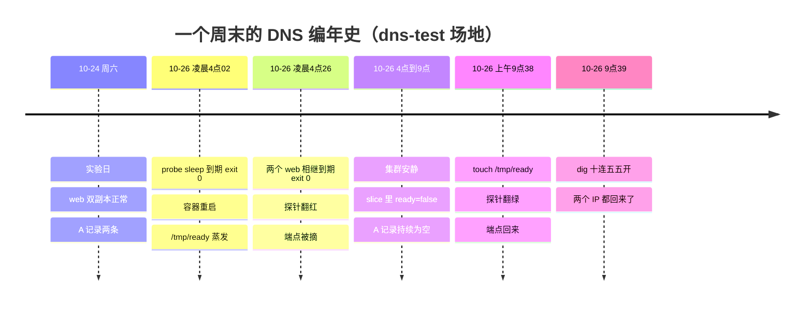
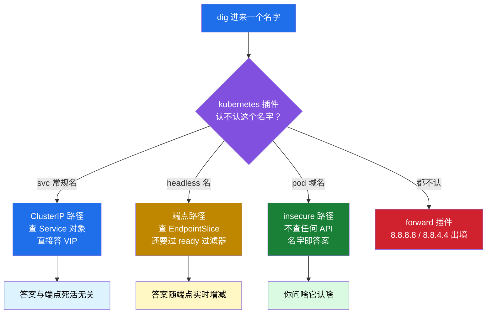
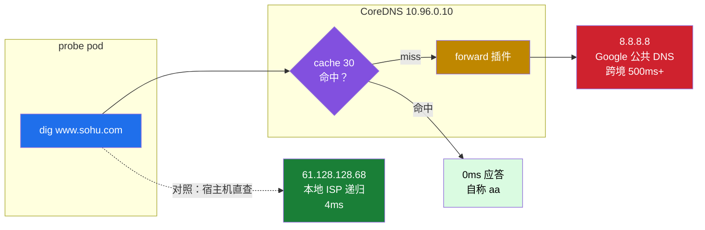

# 一个名字的三种答案：K8s DNS 记录着容器的生与死

!!! abstract "实测声明"
    本文所有命令与输出均在本人测试集群实测：6 节点 Kubernetes 1.36.1（3 master + 3 worker，Calico，集群生于 2026-05-12 23:08，实验时已运行满 164 天），CoreDNS v1.14.2。实验窗口 2026-10-24 ～ 10-26，专用场地 namespace `dns-test`。终端输出为当时落盘原文，仅对超长字段做省略标注；Corefile 为节选，逐行内容文末待核项有说明。

[上一篇 NetworkPolicy 实验](networkpolicy-lockdown.md)留下了一个问题：deny-all egress 后，DNS 也需要显式放行。那次观察的是 DNS 流量能否通过策略；本文进一步检查 CoreDNS 返回什么记录、记录如何受 Service 与端点状态影响。实验起因是一个 headless Service：周六正常，周一早上 A 记录为空。

## 周一早上的空答案

场地很简单：一个两副本的 web deployment，前面挂两个 service——`web-cip` 普通 ClusterIP 型，`web-hl` headless 型，再加一个探针 pod `probe` 用来发查询。headless 的两个副本各起一个 readiness 探针，脚本就一行 `cat /tmp/ready`，文件在就 ready。这个设计是为了随时能把端点摘下来又放回去。

周一早上跑十次 `dig web-hl` 的 A 记录，短格式（`+short`）：

```bash
# probe 容器内，headless 的 A 记录，连查十次
$ for i in $(seq 1 10); do kubectl exec -n dns-test probe -- dig web-hl.dns-test.svc.cluster.local A +short; echo '---'; done

---          # 第 1 次、第 2 次……逐次全空
---
---
---
---
---
---
---
---          # 第 10 次，全空
```

十次全空。headless service 的 A 记录直接没了。

第一反应是 CoreDNS 挂了？同一个 probe、同一个时刻，换 ClusterIP 型再查十次：

```bash
$ for i in $(seq 1 10); do kubectl exec -n dns-test probe -- dig web-cip.dns-test.svc.cluster.local A +short; done
10.97.26.166
10.97.26.166
10.97.26.166
10.97.26.166
10.97.26.166
10.97.26.166
10.97.26.166
10.97.26.166
10.97.26.166
10.97.26.166
```

十发十中，全是 `10.97.26.166`。DNS 链路是活的，CoreDNS 好好地在答。**同一个探针、同一批 CoreDNS，差异只能来自问题本身**——这两个 service 对"端点死活"的敏感度完全不同。

查 Pod 现况后发现：两个 web Pod 仍在，名字没变（`web-74bffbf6fc-6ccnj` / `web-74bffbf6fc-8b68m`）、IP 没变（10.244.19.98 / 10.244.30.83）、AGE 连续——但 RESTARTS 涨到了 3，最近一次退出都发生在周一凌晨：probe 04:02:06，两个 web 双双 04:26:22，退出码 0，reason 是 `Completed`。容器重启与 Pod 重建是不同的生命周期事件；可参考 [Kubernetes Pod 生命周期解析](../kubernetes/architecture/node/pod-lifecycle.md)。

```bash
# c66 批：restarts 与 lastState 逐 pod 对账
$ kubectl get pods -n dns-test -o jsonpath='{range .items[*]}{.metadata.name}{"  restarts="}{.status.containerStatuses[0].restartCount}{"  lastExit="}{.status.containerStatuses[0].lastState.terminated.exitCode}{"  reason="}{.status.containerStatuses[0].lastState.terminated.reason}{"  finished="}{.status.containerStatuses[0].lastState.terminated.finishedAt}{"\n"}{end}'
probe  restarts=3  lastExit=0  reason=Completed  finished=2026-10-25T20:02:06Z
web-74bffbf6fc-6ccnj  restarts=3  lastExit=0  reason=Completed  finished=2026-10-25T20:26:22Z
web-74bffbf6fc-8b68m  restarts=3  lastExit=0  reason=Completed  finished=2026-10-25T20:26:22Z
```

容器是 sleep 到点自然退出的（UTC 时间戳换算北京时间是周一凌晨 04:02 / 04:26 / 04:26），kubelet 随后重启容器。新的容器没有原先写在容器可写层 `/tmp/ready` 中的文件，readiness 探针因此失败；端点转为未就绪后，headless Service 的 A 记录也随之变化。此处是容器重启，Pod 对象和 IP 保持不变；Pod 被删除并重新创建时，名称或 IP 则可能变化。



早上十连空的输出，是这条时间线中间状态的快照。DNS 没坏；接下来从不同类型的 Service 记录入手，检查解析结果为何不同。

## 三张脸

这个开局把 K8s DNS 里三个长得像、性格完全不同的东西摆到了一张桌子上：

- `web-cip.dns-test.svc.cluster.local`——普通 ClusterIP service，答案是一个 VIP
- `web-hl.dns-test.svc.cluster.local`——headless service，答案是一串 pod IP
- `10-244-19-98.dns-test.pod.cluster.local`——pod 域名，答案是名字里那个 IP

CoreDNS 侧的配置就几行关键项（节选）：

```text
kubernetes cluster.local ... {
    pods insecure
    ...
}
forward . 8.8.8.8 8.8.4.4
cache 30 {
    disable success cluster.local
}
loadbalance
```

三种记录形式都由 Kubernetes DNS 插件处理，但查询的数据来源和应答条件不同。关于 kube-dns Service、CoreDNS 与解析路径的基础说明，参见 [CoreDNS：Service 域名解析链路](../kubernetes/architecture/network/service-dns-to-clusterip.md)；本文重点看端点变化、Pod 记录和实际查询结果。



下面一张脸一张脸拆。

## 免疫体质：ClusterIP

先说最淡定的。`web-cip` 是普通 ClusterIP service，DNS 里它的 A 记录指向 VIP `10.97.26.166`。这个 VIP 是 Service 对象创建时就定下的承诺，与后面有多少端点、端点死没死，一点关系没有。

前面已经看到：pod 容器凌晨重启、端点被摘的整个周日，`web-cip` 十查十中。再往前翻周六的对照批也是十发全同。这不难理解，但值得看一眼源码层面长什么样：kubernetes 插件对 ClusterIP 型 service 的 A 查询，只看 Service 对象里的 clusterIP 字段。**Service 是承诺，EndpointSlice 才是现状**——这句话在这轮实验里反复应验。

ClusterIP 的 DNS 免疫体质在生产上是把双刃剑：服务方的 pod 全死了，`dig` 还是好好答 VIP，流量打到 kube-proxy 的 DNAT 规则上才发现没有后端，连接被拒。DNS 说"活着"，只对 Service 这个对象负责，不对后面的负载负责。

## 端点镜像：headless

headless 是另一个物种。`web-hl` 没有 VIP，DNS 直接把 pod IP 列表作为答案——所以它必须实时看端点。这轮实验里它给了三个层层递进的证据。

### 翻车翻出来的实验

本来周六的 C2 批只是想做个对照：把一个副本的 `/tmp/ready` 删掉，看 A 记录多久消失。结果第一批就翻车了——我给的清单里 busybox 探针镜像写的是 `busybox:1.36`，`NotFound` 拉不下来。查了才发现华为源只有 `1.36.0` 这种三段 tag，双 tag 惯例在这种镜像源上不成立。**写进 yaml 的 tag 要先在源上确认存在**。

换成 `busybox:1.36.0` 重跑，toggle 实验四连拍：摘掉一个副本的 ready 文件 → dig，A 记录从 2 条变 1 条；放回 → 2 条；再摘 → 1 条；再放回 → 2 条。四拍全中，每拍之间 DNS 的变化都在探针周期之内。

这里有个非常容易想当然的等式：**pod READY 1/1，端点就一定在名单里吗？** 实测否。toggle 过程中活捉过这样的并存状态：pod 的 `READY 1/1` 好好的，EndpointSlice 里对应端点的 `ready` 却还是 `false`——大概率只是两边更新时点错开，但"两列不是一回事"是实打实的。还有一次 slice 里列着 3 个端点（含一个 not ready 的），dig 只答 2 条 A。**A 记录是 ready 端点的实时镜像**，这句话的每个字都是实测出来的。

### 周一早上再次应验

周末那次"大自然自动做的实验"又加了一证：容器凌晨重启、ready 蒸发，A 记录消失；周一早上 touch 回去，再查：

```bash
# 修复 ready 后，headless 十连（节选前五组，共十组）
$ for i in $(seq 1 10); do kubectl exec -n dns-test probe -- dig web-hl.dns-test.svc.cluster.local A +short; echo '---'; done
10.244.30.83
10.244.19.98
---
10.244.30.83
10.244.19.98
---
10.244.19.98
10.244.30.83
---
10.244.19.98
10.244.30.83
---
10.244.30.83
10.244.19.98
---
```

两个 IP 都回来了。十组里两个 IP 各领跑五次（恰好 5:5），中间夹着连续几发同一顺序的 run 段——不是简单交替，也没有稳定规律。**顺序不保证，这才是 headless 的语义**：A 记录的集合稳定是承诺，先后顺序是运气（`loadbalance` 的轮转指针叠加两个 CoreDNS 后端各自的状态，多因子叠加，不归因单一变量）。

### 同名 pod 的身份问题

顺带一个彩蛋：CoreDNS Pod 8 月更换过 IP。旧记录显示，同名 Pod 的 IP 与现在不同——Pod 对象重建后可以沿用相同名称，但会拥有新的 UID，Pod IP 也可能变化。关于 Pod 名称、UID 与身份的区别，可参考 [Kubernetes Pod 身份与 startTime 实测](pod-starttime-stuck-for-a-month.md)。headless Service 返回的是当前符合条件的端点地址，不保证 IP 长期不变；客户端不应把某次 DNS 查询得到的第一个 IP 当成永久地址。

## 名字即答案：pod 域名

第三张脸最放飞。`pods insecure` 模式下，`10-244-19-98.dns-test.pod.cluster.local` 这样的名字可以直接查到 A `10.244.19.98`。听起来像"给 pod 也发身份证"，但它根本不查 API：

```bash
$ kubectl exec -n dns-test probe -- dig 10-244-99-99.dns-test.pod.cluster.local A +noall +comments +answer
; <<>> DiG 9.11.3 <<>> 10-244-99-99.dns-test.pod.cluster.local A +noall +comments +answer
;; global options: +cmd
;; Got answer:
;; WARNING: .local is reserved for Multicast DNS
;; You are currently testing what happens when an mDNS query is leaked to DNS
;; ->>HEADER<<- opcode: QUERY, status: NOERROR, id: 34470
;; flags: qr aa rd; QUERY: 1, ANSWER: 1, AUTHORITY: 0, ADDITIONAL: 1
;; WARNING: recursion requested but not available

;; ANSWER SECTION:
10-244-99-99.dns-test.pod.cluster.local. 30 IN A 10.244.99.99
```

`10.244.99.99` 这个 IP 在集群里**不存在**，照样 NOERROR、照样权威应答、照样把它"解析"出来还给你。insecure 模式就是"名字即答案"：dash 格式的 IP 编码进名字里，CoreDNS 把名字里的数字抄下来回给你，全程不问 API 有没有这个 pod——官方 README 对 insecure 的原话是 "Always return an A record with IP from request (without checking k8s)"，并且明说它 "is vulnerable to abuse"（配通配符证书可被滥用），保留它只为兼容老的 kube-dns。生产上要用 pod 域名做寻址，得换 `pods verified` 模式——只对真实存在的 pod（同 namespace 同 IP 匹配）应答，代价是 CoreDNS 要 watch 全集群的 pod 来维持这张验证表，官方原话 "requires substantially more memory"。

顺带一个不对称：pod IP 的**反向解析（PTR）没有**。`dig -x 10.244.19.98` 得到 NXDOMAIN——kubernetes 插件只为 service CIDR（本集群 10.96/12）生成 PTR 区，pod CIDR（10.244/16）不在其内。而 `dig -x 10.96.0.10` 老老实实答 `kube-dns.kube-system.svc.cluster.local.`，flags 里带着 `aa` 权威标记。

更有意思的是 pod IP 的 PTR 查询去哪了——这要看 flags：

```bash
# c51：pod IP 的 PTR，flags 摘录（完整输出见 c51-ptr-pod.txt）
$ kubectl exec -n dns-test probe -- dig -x 10.244.19.98 +noall +comments
;; ->>HEADER<<- opcode: QUERY, status: NXDOMAIN, id: ...
;; flags: qr rd ra; QUERY: 1, ANSWER: 0, AUTHORITY: 0, ADDITIONAL: 1
```

`ra` 没有 `aa`，AUTHORITY 段是 0——这不是 CoreDNS 答的，是它**穿过 forward 插件递归出去又回来的**。也就是说，我在 pod 里反查一个内网 IP，这次查询出了集群、出境、到了 8.8.8.8 面前，拿到一个外部递归服务器的否定回答再回来。内网 IP 的 PTR 也会裸奔出境，这个细节大多数人不会想到，但它就是下面"出境之路"一节的预告。

## flags 会说话

这几轮实验下来，最大的心得是 dig 输出里那行 flags 是会说话的。四种应答，四种口音：

| 场景 | flags | 耗时 | 语义 |
|------|-------|------|------|
| 区内权威（service/pod 域名、区内否定） | `qr aa rd` | 0~1ms | CoreDNS 内存应答 |
| 出境递归（外部域名冷查） | `qr rd ra` | 500ms+ | forward 出去的 |
| 出境递归（pod IP 的 PTR） | `qr rd ra` | — | 连 PTR 都出去了 |
| **缓存命中** | `qr aa rd ra` | **0ms** | 下面细说 |

第四行是这轮实验撞出来的新知识。同一个名字，直查 196ms（`ra` 无 `aa`，forward 出境了），加 `+search` 再查却 0ms（`aa` `ra` 都在）——同一秒、同一个 CoreDNS 服务 IP，答案的口音不一样。0ms + `aa` 这个组合就是 **cache 30 命中的签名**。

为什么缓存命中的应答自称权威？翻了源码，CoreDNS v1.14.2 的 `plugin/cache/item.go` L75 写得明明白白：

```go
// v1.14.2 plugin/cache/item.go L72-75
// Set this to true as some DNS clients discard the *entire* packet when it's non-authoritative.
// This is probably not according to spec, but the bit itself is not super useful as this point, so
// just set it to true.
m1.Authoritative = true
```

硬编码 `true`，注释自己承认"probably not according to spec"。往上看 L62-65 的旧注释补全了动机：一些老系统的 glibc `getaddrinfo` 会丢弃不带权威位的应答，为了兼容这些客户端，命中缓存的应答一律自称权威。而最新 master 分支已经改掉了（issue #6185）——AA 位改为继承被缓存的原应答，注释还顺手自白了一句历史行为"只在命中路径生效，miss 的客户端永远看到 AA=0"。

所以缓存命中自称权威——它权威吗？**它只是记得。**

### NXDOMAIN 也带赃物

区内否定应答（NXDOMAIN）的 AUTHORITY 段里有一条 SOA，本集群长这样：

```bash
$ kubectl exec -n dns-test probe -- dig web-hl.dns-test.svc.cluster.local.dns-test.svc.cluster.local +noall +comments +authority
;; ->>HEADER<<- opcode: QUERY, status: NXDOMAIN, id: 31663
;; flags: qr aa rd; QUERY: 1, ANSWER: 0, AUTHORITY: 1, ADDITIONAL: 1
（中段 OPT PSEUDOSECTION / COOKIE 行省略）

;; AUTHORITY SECTION:
cluster.local.          30      IN      SOA     ns.dns.cluster.local. hostmaster.cluster.local. 1792978739 7200 1800 86400 30
```

两个看点。一是末尾的 30：**negative TTL**——"查无此人"这个回答本身也被缓存 30 秒（SOA 的 MINIMUM 字段），和 A 记录的 30、Corefile 的 cache 30 是一族数字。

二是那串 1792978739。它看着像随机数，其实是个 Unix 时间戳——换算过来是查询当天 09:38:59，比查询时刻早 26 分钟。源码里它的身份是 zone serial（`plugin/kubernetes/kubernetes.go` L669 的 `Serial()`，读 `controller.go` L893 的 `updateModified()`——存的是 `time.Now().Unix()`），语义是**这个区最后一次真变化的时间**：Service/EndpointSlice/pod 的 Add/Delete 无条件刷新，Update 走等价过滤（resourceVersion 相同、端点集合等价的都跳过）。也就是说，SOA serial 是 CoreDNS 视角的"我上次看到集群变了是什么时候"。

09:38:59 这个时刻我认得——它就是 26 分钟前我们 `touch /tmp/ready`、探针翻绿、两个 web pod 的 status 随之更新的那一刻（v1.14.2 对 pod 的 Update 是无条件刷 serial 的，controller.go L695-696；最新 master 已改成只在 PodIPs 变化时才刷）。之后到查询为止，集群再没有任何 API 变化，serial 就停在那。**你问它数据多新鲜，它报的是上次变心的时间——而这次变心的是我们自己。**

## 顺序不保证

回到十连 5:5 那个结果。Corefile 里有 `loadbalance`，作用是把应答里的记录行序轮转。同一个查询发十次，`.98` 和 `.83` 轮流领先，还有连续几发同一顺序的 run 段——因为十次查询是 LB 后面两个 CoreDNS pod 各自轮各自的，双层随机叠加。对照 ClusterIP 十发全同（只有一个答案，没有顺序可言），这再次说明：**headless 的答案顺序没有任何稳定性承诺**。客户端拿列表自己轮询，别指望 DNS 帮你负载均衡。

## ndots:5 的税

pod 里 `cat /etc/resolv.conf`：

```bash
$ kubectl exec -n dns-test probe -- cat /etc/resolv.conf
search dns-test.svc.cluster.local svc.cluster.local cluster.local
nameserver 10.96.0.10
options ndots:5
```

search 三件套是"先区内后兜底"的层级，`ndots:5` 是埋在最后那行里的税制。规则：名字里的 dot 数**少于 5**，先挨个拼 search 域查；全失败才当绝对域名直接查。`ndots` 默认值 5 继承自 glibc 的历史值（RFC 1034 建议的是 1），K8s 原样带过来了。

`web-hl.dns-test.svc.cluster.local` 不带尾点是 4 个 dot——**少一个，照交税**。实测走一遍（每跳的 Query time 是 1ms、0ms、0ms、0ms）：

```text
第1跳  web-hl.dns-test.svc.cluster.local.dns-test.svc.cluster.local.  → NXDOMAIN（区内权威否定）
第2跳  web-hl.dns-test.svc.cluster.local.svc.cluster.local.            → NXDOMAIN
第3跳  web-hl.dns-test.svc.cluster.local.cluster.local.                → NXDOMAIN
第4跳  web-hl.dns-test.svc.cluster.local.                              → NOERROR, ANSWER: 2
```

`ndots:5`、search 域和短域名解析在 [CoreDNS 与 Service DNS 查询链路](../kubernetes/architecture/network/service-dns-to-clusterip.md)中有更完整的背景；这里关注本次实验的查询次数和延迟。区内名字也会先产生 search 查询。区内否定通常可以由 CoreDNS 快速返回并缓存；外部名字则可能需要转发到上游。为避免缓存影响读数，这里用尚未查询过的域名做冷查：

```bash
$ kubectl exec -n dns-test probe -- dig @10.96.0.10 www.sohu.com +noall +comments +stats    # 第一发，冷
;; Query time: 587 msec
$ kubectl exec -n dns-test probe -- dig @10.96.0.10 www.sohu.com +noall +comments +stats    # 第二发，cache 30 命中
;; Query time: 0 msec
```

顺带一个方法论坑：dig 默认**不读** resolv.conf 的 search/ndots（要加 `+search` 才读），而且 `+stats` 里的 Query time 只计最后一跳——所以"加 search 的查询总耗时"用 dig 是测不出来的，要 `time` 包整个命令或者开 CoreDNS 的 log 插件数日志行。

可根据业务和集群配置评估几种做法：为特定 Pod 调整 `dnsConfig` 中的 `ndots`（需验证短名称解析行为）、部署 NodeLocal DNSCache，或在应用支持时对外部 FQDN 使用尾点表示绝对域名。它们的效果和副作用不同，应结合实际查询模式与集群 DNS 配置测试，不能不经验证地全局修改。

## 出境之路

最后一张图把出网的路径摊开。三路对照，同一个目标域名 `www.sohu.com`：

| 路径 | 三发耗时 | 说明 |
|------|---------|------|
| pod → CoreDNS → forward → 8.8.8.8 | 587ms / 0ms / 0ms | 冷查一趟 587，之后 cache 30 兜住 |
| pod 直连 8.8.8.8 | 540ms / 610ms / 534ms | 平坦，不递减 |
| 宿主机 → 61.128.128.68（重庆电信） | 4ms / 4ms / 4ms | 本地 ISP 递归 |

直连 8.8.8.8 三发都是 500ms+ 且不递减——慢的不是解析是路远，跨境 RTT 把上游缓存的好处整个吞了。经 CoreDNS 转发的冷查 587ms 和直连几乎一样——因为 **CoreDNS 的 forward 目标就是写死的 8.8.8.8 / 8.8.4.4**，路径等长。宿主机 ISP 4ms，快了两个数量级（587/4 ≈ 147 倍）。

也就是说：这个集群从装机那天起 164 天，所有 pod 的每一次外部域名查询、每一次内网 IP 的 PTR 反查，都在走一条 500ms 起步的跨境路，而楼下就有一条 4ms 的路。修法一行：Corefile 里 `forward . 8.8.8.8 8.8.4.4` 改成 `forward . /etc/resolv.conf`（继承宿主机上游）或直接写 ISP 递归地址。我暂时没改——这是测试集群，这行配置留在原地，等真要优化出网路径时它就是第一个要动的。

（细心的读者会问：宿主机那条 4ms 是 `dig` 从 master01 直接发的，pod 出网还要叠加 overlay 往返——真实差距没有 147 倍那么夸张，但量级差是实打实的。）



### 后端彩票

还有一个与多副本缓存有关的现象：同一秒、同一个名字，`dig +search` 版 0ms，直查版 196ms。前者的 search 查询可能让某个 CoreDNS 后端缓存变热，后续查询命中；后者若到达另一个冷后端，则需要等待上游响应。实际分配取决于 Service 转发和连接行为，不能仅凭一次观测推断固定轮转策略。类似的“统一入口后仍有后端差异”，也出现在 [Kubernetes HA 集群实践](../kubernetes/practice/ha-cluster.md)所讨论的负载均衡链路中。

## 收尾：三个自查动作

这轮实验能带走的可操作检查，就三条：

```bash
# 1. 服务方：你的 headless 端点还活着吗？（数 A 记录条数，跟副本数对账）
dig web-hl.dns-test.svc.cluster.local A +short | wc -l

# 2. 应用方：你交多少 ndots 税？（看名字的 dot 数和 resolv.conf 的 ndots）
cat /etc/resolv.conf | grep -E 'search|ndots'

# 3. 集群方：你的外部查询走哪条路出境？（三路对照，看 Query time）
dig @10.96.0.10 www.sohu.com +stats
dig @8.8.8.8 www.sohu.com +stats
dig @<宿主机上游IP> www.sohu.com +stats
```

最后一个彩蛋留给在节点上调试过 DNS 的同学：用 `nsenter -t <PID> -n` 进 pod 网络命名空间跑 strace，会看到 DNS 查询发给了宿主机的 61.128.128.68 而不是 10.96.0.10，像极了 DNS 配置坏了——其实 `nsenter -n` 只切了网络栈没切挂载，curl 读到的是宿主机的 resolv.conf。加 `-m` 切挂载，strace 二进制又不在容器 rootfs 里了。**nsenter 进得去网络，不等于进得去 pod 的世界观**，交叉验证永远先用 `kubectl exec`。

---

（W2 双篇——NetworkPolicy 的门与 DNS 的脸——至此收官。np 篇里那扇 DNS 例外之门，现在门后是什么也拆完了。）

## 附：待核项与出处

- **Corefile 节选**：`forward . 8.8.8.8 8.8.4.4` / `cache 30 {disable success cluster.local}` / `loadbalance` / `pods insecure` 等行为均经实验佐证。其他集群的实际配置可能不同，应以 `kubectl -n kube-system get cm coredns -o yaml` 的结果为准。
- **源码引用**：CoreDNS v1.14.2（registry.aliyuncs.com/google_containers）——cache/item.go L62-65、L72-75；kubernetes/kubernetes.go L668-669；kubernetes/controller.go L668-670、L673-678、L695-696、L893-896。master 对照件引 GitHub 最新分支。
- **c66 时间戳**：三个 pod 的 finished 为 2026-10-25T20:02:06Z / 20:26:22Z / 20:26:22Z（UTC，即北京时间 10-26 04:02 / 04:26 / 04:26）。
- 落盘原始输出：master01 `~/dns-lab-logs/`（c00-c68），本站引用的终端块均为落盘文件逐字摘录，节选处均已标注。

## 推荐阅读

- [CoreDNS：Service 域名怎么解析成 ClusterIP](../kubernetes/architecture/network/service-dns-to-clusterip.md)：了解 Pod DNS 配置、Service 域名解析、`ndots:5` 与 CoreDNS 查询链路。
- [NetworkPolicy 上锁实录：deny-all 总闸、白名单放行与 DNS 例外](networkpolicy-lockdown.md)：继续看默认拒绝出站流量后，如何为 DNS 查询配置必要的放行规则。
- [Kubernetes Pod 生命周期源码解析](../kubernetes/architecture/node/pod-lifecycle.md)：梳理容器重启、Pod 状态变化与 kubelet 管理流程。
- [Kubernetes Pod 身份与 startTime 实测](pod-starttime-stuck-for-a-month.md)：进一步理解 Pod 名称、UID、对象重建和 `startTime` 的关系。
- [Kubernetes HA 集群实践：HAProxy、Keepalived 与 3 Master](../kubernetes/practice/ha-cluster.md)：了解高可用集群中的 API Server 访问入口与负载均衡链路。
