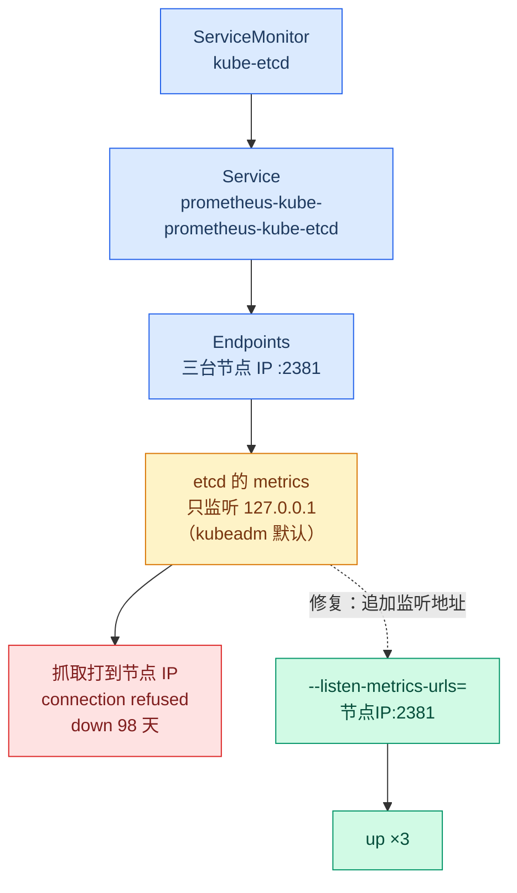
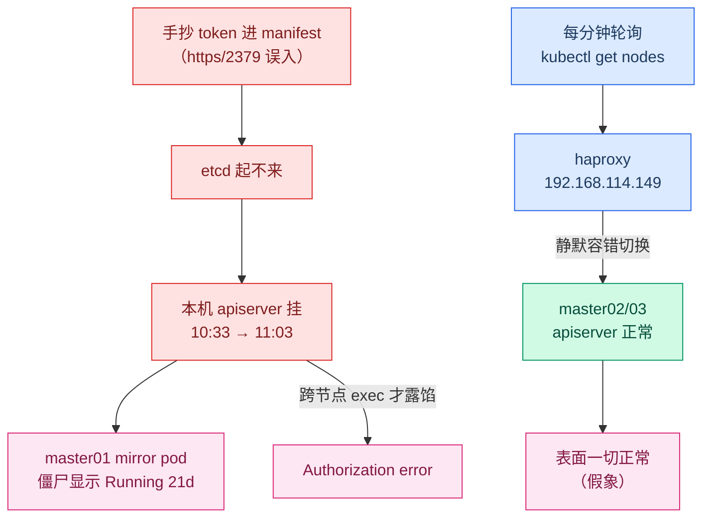
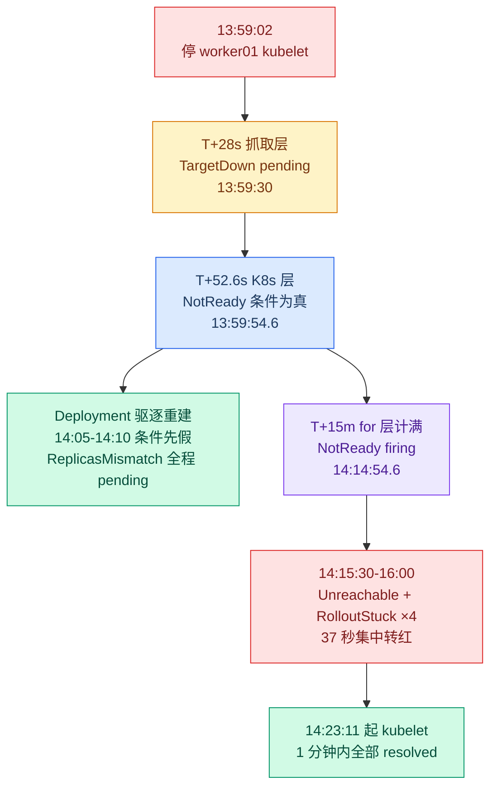
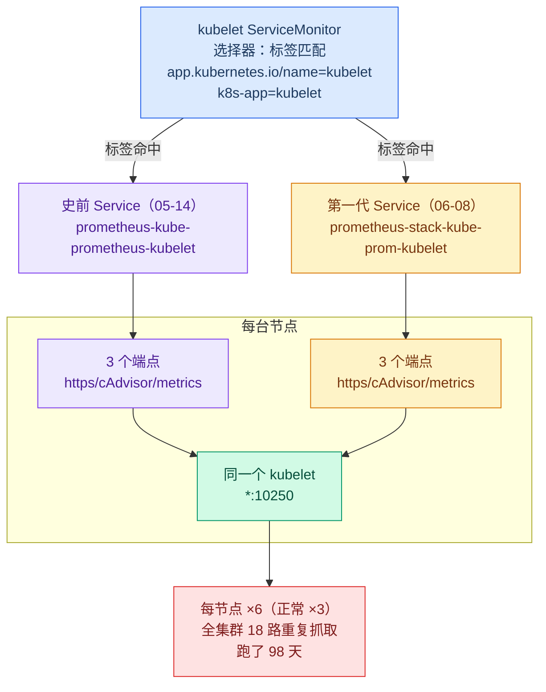

# K8s 监控装了 98 天：9 个 Prometheus target 从第一天就是红的

> **实测声明**：3 master + 3 worker，kubeadm 1.36.1，Debian 13。kube-prometheus-stack（chart 86.2.0 / Prometheus v0.91.0）2026-06-08 部署，至实验日运行 98 天。全部命令 2026-09-13 ~ 09-14 在该集群实测，代码块为终端输出逐字节摘录（仅裁剪行数，未改一字）。
>
> 系列上一篇：[删掉一台 master 的 etcd 数据，我花 2 小时 41 分救回了集群](etcd-backup-restore.md)。本篇是"测试集群生产化改造"第二篇：监控。

这是系列里最难写的一篇——因为它有一半是事故记录，而事故的主角是我自己。

先看三座钟。第一座：节点的 AGE，124 天，集群 5 月中旬搭的。第二座：监控栈的 AGE，98 天，6 月 8 日 helm install 的 kube-prometheus-stack。第三座最扎眼：告警的年龄。Alertmanager 里最老的告警 startsAt 是 8 月 24 日——那是 Prometheus 上次重启的时刻，告警记忆的清零点。**三座钟指着不同的时间，而监控栈自己的账本告诉我：这三座钟期间发生的事，它看见了不少，说出来的方式有问题。**

三件事撑起这一篇：

1. 装了 98 天的监控，控制面九个 target 从部署第一天就是红的，我一直不知道；
2. 修 etcd 监控的路上，我把 master01 的 apiserver 搞挂了半小时——监控栈把这场事故的全过程录了下来，包括我自己没看见的部分；
3. 停掉一台 worker 的 kubelet 做消防演习，验证"从故障到告警"到底要多久、要经过几层。

范围先固定：本篇修到"能看见"，[告警通知（推到手机）](../observability/alertmanager.md)是下一篇。因为审计到最后我才发现，这套栈的 Alertmanager receiver 是 `"null"`——字面意思，98 天里所有告警只活在一个没人看的网页里。

## 审计：58 up 的假象

第一印象是健康的。targets API 拉全量分组一数，67 个 target，61 个 up：

```text
activeTargets: 67 | up: 61
  apiserver: 1
  coredns: 2
  kube-controller-manager: 3
  kube-etcd: 3
  kube-proxy: 6
  kube-scheduler: 3
  kube-state-metrics: 1
  kubelet: 36
  node-exporter: 6
  prometheus-grafana: 1
  prometheus-kube-prometheus-alertmanager: 2
  prometheus-kube-prometheus-operator: 1
  prometheus-kube-prometheus-prometheus: 2
```

> 这个分布快照里还藏着一个雷，最后两章才显现，先记下。

91% 的 up 率，看着像个体面的生产系统。把 6 个 down 的 target 拎出来看：

```text
down: 6
  kube-controller-manager | https://192.168.114.145:10257/metrics
  kube-controller-manager | https://192.168.114.146:10257/metrics
  kube-controller-manager | https://192.168.114.147:10257/metrics
  kube-scheduler | https://192.168.114.145:10259/metrics
  kube-scheduler | https://192.168.114.146:10259/metrics
  kube-scheduler | https://192.168.114.147:10259/metrics
```

这是修完 etcd 之后的状态。修复之前是 9 个——多出来的三个是 `kube-etcd`，`https://192.168.114.14x:2381/metrics`，全 connection refused。

三 master 的 etcd、kube-controller-manager、kube-scheduler，九个 target，全红。**控制面的三个核心组件，监控从部署第一天就一个都没看进去。** 为什么"第一天"敢这么说：这是配置性失明不是故障——组件只监听回环地址，这个配置从集群搭建起没改过；8 月 24 日只是告警记忆的上限，不是问题的起点。

机制一分钟讲完。kubeadm 拉起的控制面组件默认只把 metrics 绑在 127.0.0.1 上，master01 上 `ss -tlnp` 一看便知：

```text
LISTEN 0 4096 127.0.0.1:2381  0.0.0.0:*  users:(("etcd",pid=1878096,fd=28))
LISTEN 0 4096 127.0.0.1:10257 0.0.0.0:*  users:(("kube-controller",pid=1868088,fd=4))
LISTEN 0 4096 127.0.0.1:10259 0.0.0.0:*  users:(("kube-scheduler",pid=4139362,fd=4))
LISTEN 0 4096 192.168.114.145:2381 0.0.0.0:* users:(("etcd",pid=1878096,fd=29))
# （kubelet 的 *:10250 与 kube-proxy 的 *:10249 两行全监听，未列入）
```

> 这份输出是修复后的。修复前的 etcd 只有第一行那个 127.0.0.1:2381，192.168.114.145:2381 是我后来加上去的——怎么加的、加的过程中翻了什么车，请继续阅读。）

而 kube-prometheus-stack 的抓取路径是 ServiceMonitor → Service → Endpoints，端点写的是各节点 IP。节点 IP 上根本没有 10257/10259/2381 在听，connection refused 是必然。kubelet（10250）和 kube-proxy（10249）是 `*` 双栈全监听，所以它们没事。



失明的代价不是"看不见数字"，是"看不见事故"。这个集群 7 月有过一次 4 周的 [NotReady](../observability/k8s-cluster-health-check.md)——master01 的 kubelet 被我停了做实验忘了开，一直到 8 月 21 日被别的实验撞见。那 4 周里监控栈在跑，`KubeNodeNotReady` 规则在库里，但没有任何人任何渠道收到过一个字。它不是没看见，是看见了没人看。

顺带把成本也审了——这套栈自身吃多少：

```text
NAME                                                     CPU(cores)   MEMORY(bytes)
prometheus-kube-state-metrics-7766bd58ff-xnrvt           2m           24Mi
prometheus-prometheus-node-exporter-88zq7                1m           29Mi
prometheus-prometheus-node-exporter-lqpr9                2m           30Mi
prometheus-prometheus-node-exporter-zn94t                2m           30Mi
prometheus-prometheus-node-exporter-95ndd                1m           32Mi
prometheus-prometheus-node-exporter-c6g4f                1m           32Mi
prometheus-prometheus-node-exporter-762nx                1m           33Mi
alertmanager-prometheus-kube-prometheus-alertmanager-0   1m           77Mi
prometheus-kube-prometheus-operator-846bb75ffc-hxknt     2m           82Mi
prometheus-grafana-86b8c58fc-zl96n                       8m           578Mi
prometheus-prometheus-kube-prometheus-prometheus-0       31m          728Mi
```

Prometheus 本体 728Mi，Grafana 578Mi，全家合计约 1.6Gi。三台 master 各 2Gi 内存、已用 52%——监控栈自己占了 master 内存的大头。这个数据留在这里，不做结论，等系列后面做资源规划时再用。

## 决策：为什么这一轮只修 etcd

九个红 target，修复方案不是一样的。

etcd 的 metrics 地址是 `--listen-metrics-urls` 参数管的，kubeadm 默认只给了 `http://127.0.0.1:2381`。要修，给 etcd 的静态 Pod manifest 加一个监听地址就行：`http://192.168.114.145:2381`（各 master 用自己的 IP）。etcd 重启有 quorum 保护，三节点滚一遍，每次只动一台，集群写能力不断。

KCM 和 scheduler 是另一回事。它们的 metrics 跟着 `--bind-address` 走（默认 127.0.0.1），要改成节点 IP 就得动控制面组件的绑定地址——重启全部三台的 controller-manager 和 scheduler。改绑定还牵扯 `--secure-port` 的防火墙语义（10257/10259 从"只有本机可达"变成"节点 IP 可达"）。收益是 6 个绿点，风险是再折腾一轮控制面。

而且这台集群的 etcd 演习刚做完（[上一篇](etcd-backup-restore.md)），我对"重启单台 etcd 成员"的心理水位是实的：quorum 3 取 2，安全边界清楚。KCM/scheduler 没做过这个演练，心理水位是虚的。

所以决策是：**本轮只修 etcd 的三个，KCM/scheduler 六个先留着红**。留红的理由写进文章而不是悄悄略过——生产化改造是分层的，看得见 etcd（集群的命根子）优先于看得见 KCM（可重启的控制面组件）。这不是完美主义的时候。

顺带一句：这六个红 target 会被 `TargetDown` 规则持续捕捉成告警。它们的去留在最后一章还有戏份。

## 补洞：给 etcd 加一个监听地址，顺便搞挂 apiserver

修法上面说了，三台 master 逐台改 `/etc/kubernetes/manifests/etcd.yaml`。以 master01 为例，在 command 里给 `--listen-metrics-urls` 追加节点 IP：

```bash
# 只动 --listen-metrics-urls 一行：127.0.0.1:2381 后面追加 ,http://192.168.114.145:2381
# 改完 grep 验证，不靠手感
sudo grep -n 'listen-metrics-urls' /etc/kubernetes/manifests/etcd.yaml
```

静态 Pod 由 kubelet 监管，manifest 落盘即触发重建，不用手动重启。

我在这步翻了车。改第二台的时候图省事，手 vi 进 manifest 抄 token——把 `https://127.0.0.1:2379`（client URL）的写法带进了 `--listen-metrics-urls`，抄成了 metrics 监听里挂一个 https + 2379 端口。etcd 起不来，容器进入崩溃循环。

接下来发生的事才是教学重点，因为我当时完全没意识到出事了：

- `kubectl get nodes` 一切正常；
- master01 上的 etcd Pod 显示 `Running`——**21 天前**的 AGE，一个僵尸 mirror pod。静态 Pod 的镜像条目在 apiserver 里，本地 etcd 挂了、本机 apiserver 跟着挂了，没有谁去更新那个状态；
- 直到跨节点 exec 才露馅：`Authorization error`——kubectl 走的是 haproxy（192.168.114.149），把请求容错切到了 master02/03 的 apiserver。**kubectl 能用 ≠ 本机 apiserver 活着**，中间隔着一层负载均衡的静默切换。



监控视角的事故记录在下一章——那才是本篇的中心论据。这里先给修复后的人工验证：

```text
LISTEN 0 4096 127.0.0.1:2381  0.0.0.0:*  users:(("etcd",pid=1878096,fd=28))
LISTEN 0 4096 192.168.114.145:2381 0.0.0.0:* users:(("etcd",pid=1878096,fd=29))
```

节点 IP 的 2381 起来了。curl 一下 metrics：

```text
# HELP etcd_cluster_version Which version is running. 1 for 'cluster_version' label with current cluster version
# TYPE etcd_cluster_version gauge
etcd_cluster_version{cluster_version="3.6"} 1
```

三台滚完，down 从 9 掉到 6——剩的就是上一章清单里那六个 KCM/scheduler，符合决策预期：

```text
down: 6
  kube-controller-manager | https://192.168.114.145:10257/metrics
  ...（下略，同上一章清单）
```

修 146/147 那两台期间还有个小插曲：`kube-state-metrics` 的 target 意外闪了一下 down，几分钟后自愈。当时没深究——它的死因留到下一章，因为第二天早上它又死了一次，而且死法很有性格。

## 谁在监控监控：一场事故的三十三分钟全景

9 月 13 日夜里的手滑，第二天早上才修。修复窗口是 09-14 的 10:33 到 11:03——约 30 分钟的 apiserver 停机（master01 的）。这 30 分钟里我在干什么：每分钟轮询 `kubectl get nodes`，盯着一个走了 haproxy 容错的"表面正常"，排查思路绕了远路。

修复完成后，我用 Prometheus 的 `query_range` 回溯了这段窗口的 `ALERTS` 序列（monitoring 命名空间过滤，原始输出按 alertname 字母序，相同序列的重复行有合并，行尾的采样点数标注略）。**监控栈把这场自己的事故，从第一秒录到了最后一秒：**

```text
PrometheusOperatorWatchErrors [None] pending : 10:33:00 → 10:47:00   # ×4 组序列
PrometheusOperatorWatchErrors [None] firing  : 10:48:00 → 11:04:00   # ×3
PrometheusOperatorWatchErrors [None] firing  : 10:48:00 → 11:05:00   # ×1（4 组序列里 3 组 11:04 收、1 组 11:05 收）
KubePodCrashLooping [prometheus-grafana-86b8c58fc-zl96n] pending : 11:05:00 → 11:10:00   # ×2
```

逐行读：

- operator 的 `WatchErrors` 10:33 转 pending、10:48 firing——operator 跟 apiserver 的 watch 断了，四组序列（operator 的四个 watch 对象）同一秒整齐转红，它比我的 kubectl 轮询诚实；
- grafana 的 `CrashLooping` pending 11:05-11:10——apiserver 回来之后它还挣扎了五分钟才缓过来（自愈第二例）。同一窗口还有几条一闪而过的 pending：KSM 自己的 `ReplicasMismatch`、StatefulSet 版的 mismatch，11:05-11:10 各闪一下就灭——监控栈的自愈余震，都没成气候。

监控栈自己的死也在记录里（14 号日志按字母序排在最后的两行）：

```text
TargetDown [ kube-state-metrics ] firing  : 10:43:00 → 11:03:00
TargetDown [ kube-state-metrics ] pending : 10:33:00 → 10:42:00
```

写稿时隔天用 30 秒步长把这个窗口重拉了一遍做交叉验证：pending 末点 10:42:30、firing 末点 11:03:30——分钟粒度与半分钟粒度对得上。TargetDown 这条规则的 for 是 10m：10:33 条件为真 + 10 分钟整 = 10:43 转红；R3 的 kubelet 版互证——13:59:30 pending → 14:09:30 firing，同样 10 分钟。而 firing 的最后一点 11:03:30，KSM 重新 Running 是 11:03:12：**恢复后第一个采样点就把它救活了**。它的死因值得单独讲，下一节。

**人在事故里看到的是状态镜，Prometheus 记的是录像。** 我当时每分钟轮询 kubectl，看到的是 haproxy 挑给我看的那一面；这些序列在 10:33 就开始记了，一条不缺。

### KSM 的死法

那两天 KSM 死了好几次，值得单独说。它的 restart count 是 261 次、81 天——第一眼像慢性病，翻 `--previous` 日志，死因其实简单到粗暴：

```text
I0914 02:58:05.493327       1 wrapper.go:151] "Starting kube-state-metrics"
E0914 02:58:05.494912       1 wrapper.go:211] "failed to create client: ... dial tcp 10.96.0.1:443: connect: connection refused"
```

启动，尝试连 apiserver（10.96.0.1 是 Service 网段的 ClusterIP），连接被拒，直接退出。从 `Starting` 到致命错误，**1.6 毫秒**。Exit Code 1，不是 OOM。describe 里的 Started 和 Finished 是同一秒。

这是一个"启动即依赖 apiserver、零重试"的设计：apiserver 一抖，KSM 死给你看。那 261 次重启不是 261 个独立故障，是 81 天里历次 apiserver 中断窗口的 CrashLoop 累计——包括 9-14 早上这一次。

还有一个容易看错的数字：KSM 末次崩溃 10:58:05，重新 Running 是 11:03:12，间隔 5 分 07 秒。看起来像"apiserver 修了 5 分钟才好"？不是。apiserver 的恢复在 11:03 之前，KSM 的 5 分钟是 **CrashLoopBackOff 的退避顶格**（300 秒）加抖动——退避时钟和恢复时刻是两回事，退避只是让容器别紧贴着死。

### 存量告警：9 条，最老的 21 天

修复完 etcd，我顺手把 Alertmanager 的存量告警全拉了一遍（AM API 直读，不信 UI 转录）：

```text
KubeControllerManagerInstanceUnreachable | 192.168.114.145:10257 | startsAt: 2026-08-24T00:34:02.475Z | endsAt: 2026-09-14T08:06:32.475Z
KubeControllerManagerInstanceUnreachable | 192.168.114.147:10257 | startsAt: 2026-08-24T00:34:02.475Z | endsAt: 2026-09-14T08:06:32.475Z
KubeControllerManagerInstanceUnreachable | 192.168.114.146:10257 | startsAt: 2026-08-24T00:34:02.475Z | endsAt: 2026-09-14T08:06:32.475Z
KubeSchedulerInstanceUnreachable | 192.168.114.145:10259 | startsAt: 2026-08-24T00:33:37.809Z | endsAt: 2026-09-14T08:06:07.809Z
KubeSchedulerInstanceUnreachable | 192.168.114.146:10259 | startsAt: 2026-08-24T00:34:07.809Z | endsAt: 2026-09-14T08:06:37.809Z
KubeSchedulerInstanceUnreachable | 192.168.114.147:10259 | startsAt: 2026-08-24T00:34:07.809Z | endsAt: 2026-09-14T08:06:37.809Z
TargetDown | kube-controller-manager | startsAt: 2026-08-24T00:28:51.682Z | endsAt: 2026-09-14T08:05:51.682Z
TargetDown | kube-scheduler | startsAt: 2026-08-24T00:28:51.682Z | endsAt: 2026-09-14T08:05:51.682Z
Watchdog | None | startsAt: 2026-08-24T00:18:51.682Z | endsAt: 2026-09-14T08:06:21.682Z
```

九条。KCM 三条、scheduler 三条、TargetDown 两条——全是那六个失明 target 的告警化身。外加一条 Watchdog（永远 firing 的死信告警，用来验证通知链路活着——而这套栈的通知链路从没活过）。

注意 endsAt 那列：九条全聚在 16:05-06——那是**查询时刻的墙钟**（每次查询都显示"再过 4 分钟超时"），不是恢复时刻。这个字段后来还误导过我一次，下一章说。

所有 startsAt 都在 8 月 24 日 08:18-08:34 之间——那是我给监控栈做过一次维护重启的时刻。**Prometheus 重启即告警记忆清零**，这批 startsAt 说明这些告警从重启那一刻就 firing 到现在：21 天。再往前推，配置没变过，它们在重启之前也在响，只是更早的记忆已经不可考。

（这批数据里还有个插曲：早晨的 UI 截图我数出来只有 2 条 KCM，AM API 一查 3 条都在，startsAt 与 145/147 逐毫秒一致。146 从第一天就在场，截图识别漏了同一行两次——"两次读数一致"不等于读数正确，同盲区是相关错误。这个教训记进了工具箱：关键读数必须回到 API 交叉核对。）

这就是第一部分审计的完整答案：**装了监控 ≠ 有监控**。九个 target 红、九条告警 21 天、receiver 是 null——三个洞，一个比一个深。etcd 的洞补完了，第二个实验来了：这条链路到底灵不灵？

## 消防演习：停掉 worker01 的 kubelet

实验设计很朴素：停掉 worker01 的 kubelet，看告警什么时候出来。预测先行（打脸与否以实测为准）：

- 停 kubelet 后 lease 40 秒超时 → NotReady；
- 官方 `KubeNodeNotReady` 规则 `for: 15m`——预计 15 分钟后转红；
- 另布一条实验规则 `for: 1m`，对照快慢两条路线。

实验规则先要过 label 关。Prometheus CRD 的 ruleSelector 是什么，不猜，查（06 号日志，节选）：

```text
    ruleNamespaceSelector: {}
    ruleSelector:
      matchLabels:
        release: prometheus
```

`release: prometheus`——release 名。规则清单全文：

```yaml
apiVersion: monitoring.coreos.com/v1
kind: PrometheusRule
metadata:
  name: lab-node-notready
  namespace: monitoring
  labels:
    release: prometheus    # 按 ruleSelector 的实测 label 填，别照抄任何教程的
spec:
  groups:
  - name: lab-node
    rules:
    - alert: LabNodeNotReady
      expr: kube_node_status_condition{condition="Ready",status="true"} == 0 and on (cluster, node) kube_node_spec_unschedulable{job="kube-state-metrics"} == 0
      for: 1m
      labels:
        severity: warning
      annotations:
        summary: "节点 {{ $labels.node }} NotReady（实验规则 for=1m）"
```

expr 照抄在役规则 `KubeNodeNotReady` 的原版，含排除 cordon 节点的 `unschedulable` 子句——只把 for 从 15m 改成 1m，变量只留一个。写稿时我第一遍把 `kube_node_spec_unschedulable` 抄成了"unscaled_unschedulable"——转写清单时每个字段都可能被顺手改写，这正是要用原文件 diff 的原因。

三轮实验，逐轮说。

### R1：两分十秒的完整周期

12:09:31 停 kubelet，12:11:41 起。窗口 2m10s，`for: 1m` 的实验规则刚好走完一个完整周期：

```text
KubeNodeNotReady pending | 12:10:30 → 12:16:30 | 9 个点
LabNodeNotReady firing  | 12:11:30 → 12:12:00 | 2 个点
LabNodeNotReady pending | 12:10:30 → 12:11:00 | 2 个点
```

时间轴拆开：停 kubelet（12:09:31）→ 约 1 分钟后条件为真、pending（12:10:30 首个采样点）→ 再 1 分钟 for 计满、firing（12:11:30）→ 12:11:41 恢复 kubelet → 12:12:00 resolved。**从停到红，2 分钟；从红到绿，几十秒。**

第一行 `KubeNodeNotReady`（官方规则，for: 15m）全程 pending 没转红——停机 2 分钟根本喂不饱 15 分钟的 for。这行数据其实横跨了 R1 和 R2 两个窗口（下面说），9 个点是两段拼接的。

R1 结束后我把实验规则删了。这里有个实验设计的失误要说：删早了没等截图，事后靠 query_range 回溯才确认 firing 完整发生过——**Alerts 页是状态镜，query_range 是录像机**，这个认知在 R1 被迫建立，R3 全靠它兜底。

### R2：空跑轮

12:13:21 再停、12:16:11 起，窗口 2m50s。这轮本意是对照（规则已删），结果只贡献了一件事：`KubeNodeNotReady` 的 pending 又续了一段（12:10:30→12:16:30 那行的后半段）。它跟 R1 一起证明了官方 15m 规则的钝感——两轮加起来 5 分钟的停机，它一动不动。

### R3：二十四分钟，for: 15m 的实弹测试

13:59:02 停，14:23:11 起，24 分 09 秒。这轮的方案又出了个漏洞：计划里要重新 apply 实验规则，实际没 apply 上（两次空查询 + delete NotFound 同源）。但这个漏洞反而成就了更干净的实验——**场上只剩官方规则，15 分钟的 for 第一次实弹**。

完整级联（`query_range` 回溯，10 号日志；原始按 alertname 字母序，这里按叙事重排，行尾采样点数标注略。另有两行 `TargetDown[kube-controller-manager/scheduler]` 全程 firing 的背景噪音未列入——它们 13:58 之前就在响，属于存量，与本次停机无关）：

```text
KubeNodeNotReady [worker01] pending : 14:00:30 → 14:15:00
KubeNodeNotReady [worker01] firing  : 14:15:30 → 14:23:30
KubeNodeUnreachable [worker01] pending : 14:00:30 → 14:15:00
KubeNodeUnreachable [worker01] firing  : 14:15:30 → 14:23:30
KubeDaemonSetRolloutStuck [calico-node] pending : 14:01:00 → 14:15:30
KubeDaemonSetRolloutStuck [csi-nfs-node] pending : 14:01:00 → 14:15:30
KubeDaemonSetRolloutStuck [kube-proxy] pending : 14:01:00 → 14:15:30
KubeDaemonSetRolloutStuck [prometheus-prometheus-node-exporter] pending : 14:01:00 → 14:15:30
KubeDaemonSetRolloutStuck [calico-node] firing : 14:16:00 → 14:24:00
KubeDaemonSetRolloutStuck [csi-nfs-node] firing : 14:16:00 → 14:24:00
KubeDaemonSetRolloutStuck [kube-proxy] firing : 14:16:00 → 14:24:00
KubeDaemonSetRolloutStuck [prometheus-prometheus-node-exporter] firing : 14:16:00 → 14:24:00
KubeDeploymentReplicasMismatch [nginx-np] pending : 14:01:00 → 14:05:30
KubeDeploymentReplicasMismatch [nginx-test] pending : 14:01:00 → 14:05:30
KubeDeploymentReplicasMismatch [csi-nfs-controller] pending : 14:01:00 → 14:10:30
KubeDeploymentReplicasMismatch [local-path-provisioner] pending : 14:01:00 → 14:10:30
KubeDeploymentReplicasMismatch [snapshot-controller] pending : 14:01:00 → 14:10:00
TargetDown [kubelet] pending : 14:00:00 → 14:09:30
TargetDown [kubelet] pending : 13:59:30 → 14:09:00
TargetDown [kubelet] firing : 14:10:00 → 14:23:30
TargetDown [kubelet] firing : 14:09:30 → 14:23:30
```

几个层，从快到慢：



**抓取层 30 秒**：`TargetDown[kubelet]` 13:59:30 就 pending 了（停后 28 秒）——抓取直接失败，快而浅，只知道"抓不到"。

**K8s 层 52.6 秒**：NotReady 条件为真是 13:59:54.601（AM 的 startsAt 毫秒锚点反推，= 停后 52.6 秒：lease 40 秒超时 + 传播）。14:00:30 出现在 ALERTS 采样里。

**for 层 15 分钟**：pending 一直趴着，14:14:54.601 转红——条件为真 + 15 分 00.000 秒整。随后 30 秒内 Unreachable 转红，14:15:30-16:00 四个 DaemonSet 的 RolloutStuck 集中转红。**节点级六条告警，37 秒内集中转红。**

**自愈层**：最有意思的是五个 `ReplicasMismatch`——驱逐 + 重建在 14:05:30（nginx）和 14:10:00-30（其余）就完成了，条件先变假，**for: 15m 从没计满，从未 firing**。可迁移的负载（Deployment）跑赢了 for；节点绑定的负载（DaemonSet）跑不掉，全部转红。

`for` 的本质在这一轮暴露得很干净：**它是一个 15 分钟的自愈窗口**。能不能扛过这个窗口，取决于负载形态——而不是故障严重程度。

还有个尾巴：上面清单里 `TargetDown[kubelet]` 为什么有**两条独立的序列**？一个 kubelet 停机，两条告警。这个问题埋到下一章——它的答案把整篇故事翻了个面。

恢复侧：14:23:11 起 kubelet，全部告警 1 分钟内 resolved。Alertmanager 的条目数从 7 涨到 19（9 条存量 + 10 条瞬态）再回落。快慢两个尺度都验证完了：**坏消息 15 分 53 秒到齐，好消息 1 分钟内清场。**

## 我差点删掉 kubelet 的全部监控

回到 R3 留下的谜：一个 kubelet 停机，`TargetDown[kubelet]` 为什么有两条独立序列？

先交代场景。演习收尾后我做了一轮清理——监控栈跑在集群里 98 天，kube-system 里躺着一批不知道谁创建的 Service，命名跟当代 release 撞型。梳理 Endpoints 之后（这个梳理本身就有 bug，后面说），第一代 `prometheus-stack-` 前缀的六个进了删除名单。16 点 05 分，名单上的第一个——stack-coredns——删掉了。然后我用一条查询去确认战果：

```text
$ kubectl -n monitoring get svc
NAME                                    AGE
prometheus-grafana                      98d
prometheus-kube-prometheus-alertmanager 98d
prometheus-kube-prometheus-operator     98d
prometheus-kube-prometheus-prometheus   98d
prometheus-kube-state-metrics           98d
prometheus-operated                     98d
prometheus-prometheus-node-exporter     98d
```

名单上的六个名字，在这份输出里一个都找不到。当时我的判读：全删没了。再看 Alertmanager UI，8 条控制面告警的 `endsAt` 齐刷刷聚在 16:05-06——第二个判读跟着来了：坏了，删到承重墙了，告警们正在"集体恢复"（误读为 resolve）。

两个判读，全错。而且错误不在命令，在命令外面：

**第一层错：查询范围。** 那六个 Service 全在 kube-system，验证查询却打在 `-n monitoring` 上——它们在这个查询里本来就永远不可见，"不可见"被我读成了"删掉了"。加 `-A` 重查（17 号日志，节选）：

```text
kube-system   prometheus-kube-prometheus-kubelet                  2026-05-14   # 史前，123d
kube-system   prometheus-stack-kube-prom-kubelet                  2026-06-08   # 第一代
kube-system   prometheus-stack-kube-prom-kube-controller-manager  2026-06-08
kube-system   prometheus-stack-kube-prom-kube-etcd                2026-06-08
kube-system   prometheus-stack-kube-prom-kube-proxy               2026-06-08
kube-system   prometheus-stack-kube-prom-kube-scheduler           2026-06-08
kube-system   prometheus-kube-prometheus-coredns                  2026-06-08   # 第二代
kube-system   prometheus-kube-prometheus-kube-controller-manager  2026-06-08
kube-system   prometheus-kube-prometheus-kube-etcd                2026-06-08
kube-system   prometheus-kube-prometheus-kube-proxy               2026-06-08
kube-system   prometheus-kube-prometheus-kube-scheduler           2026-06-08
```

第一代和史前全活着——地图上第一代只剩五个，coredns 是刚才那一刀唯一的战果，而它恰好就是名单里唯一的真孤儿：删对了。"消失"是命名空间盲区制造的幻觉。

**第二层错：endsAt 的语义。** 持续 firing 的告警，endsAt 是随查询墙钟滚动前移的（每次查都显示"再过 4 分钟超时"）——对持续告警**没有任何 resolve 含义**。AM API 直读的原始数据里，那批告警的 `startsAt` 纹丝不动钉在 08-24，`state` 全是 `active`。"8 条同时恢复"是滚动显示制造的聚簇假象。

**第三层错早就埋下了：提取时的过滤。** 我做删除决策用的那份 Endpoints 清单（18 号日志）本身就是病灶现场：10257/10259/10249 的行都在，唯独 2381（etcd）和 10250（kubelet）的行一条没有——不是不存在，是我的 grep 端口过滤漏写了这两个。etcd 和 kubelet 的 Endpoints 被自己的过滤器吃掉，"控制面链路比想象中单薄"的错误印象就是这么来的，它间接支撑了"孤儿"的判断。

三层错误，全部发生在"命令正确、提取层出错"的地方。而真正后怕的在后面：事后盘点 targets 的挂载关系才发现，kubelet 的 36 个 target 恰好挂在两个 Service 上——第一代的 stack-kubelet，和那个查不到出生证明的史前同名款。**两个都在"来历不明"的可疑名单里。** 如果按第一直觉把可疑 Service 一锅端，灾难形状就是 kubelet job 的 36 个 target 归零、控制面监控无恙——最难察觉的那种瘫痪，因为面板上最显眼的 etcd/KCM 都是绿的。

拦住它的不是判断力（判断力已经连错三层了），是**"每删一个、验证一次"的纪律**。恐慌平息、摸清地图、备份落盘之后，剩下的五个是这么删的——这条 for 循环从当天的 shell history 里原样抄出来（单行命令折行排版，targets 计数脚本从略）：

```bash
for S in kube-controller-manager kube-etcd kube-proxy kube-scheduler; do
  echo "=== deleting $S ==="
  kubectl -n kube-system delete svc prometheus-stack-kube-prom-$S
  sleep 20
  curl -s http://192.168.114.145:30090/api/v1/targets | python3 -c "……"
done
```

删一个，sleep 20，数一次 targets。四个删完，targets 纹丝不动——循环里的 curl 输出没有落盘，但删除前后两次计数把它包夹死了：20 号（动手前）67，22 号（全部删完）49，中间只动了 kubelet 一个（-18），四个孤儿对 targets 的净影响是零。会掉数字的 kubelet 放在最后单独删。这条纪律是当天唯一没掉链子的东西。

教学点收拢成一句话：**命令跑通了不等于结论对了**——查询范围、键名、过滤条件，每一层提取都可能撒谎；关键结论（尤其是"删这个没影响"这种安全断言）必须过第二个独立来源，而且要变成一条验证命令的输出，不能停在"我记得它没人引用"。

## 考古：监控栈的 6 月 8 日

虚惊之后我把三套 backbone 的出生证明全调了出来（`kubectl get svc -A` 带 creationTimestamp，17 号日志）。6 月 8 日那 73 分钟的自我推翻史，外加一个 5 月就埋下的伏笔：

```text
2026-05-14   prometheus-kube-prometheus-kubelet                  # 史前伏笔：比整个栈早 25 天
2026-06-08T08:03:19Z   prometheus-stack-kube-prom-kubelet                  # 第一代开工，只建了 kubelet
2026-06-08T08:49:31Z   prometheus-stack-kube-prom-kube-controller-manager  # 46 分钟后补齐四个
2026-06-08T08:49:31Z   prometheus-stack-kube-prom-kube-etcd
2026-06-08T08:49:31Z   prometheus-stack-kube-prom-kube-proxy
2026-06-08T08:49:31Z   prometheus-stack-kube-prom-kube-scheduler
2026-06-08T09:16:55Z   prometheus-kube-prometheus-coredns                  # 第二代：推倒改名重来
2026-06-08T09:16:55Z   prometheus-kube-prometheus-kube-controller-manager
2026-06-08T09:16:55Z   prometheus-kube-prometheus-kube-etcd
2026-06-08T09:16:55Z   prometheus-kube-prometheus-kube-proxy
2026-06-08T09:16:55Z   prometheus-kube-prometheus-kube-scheduler
2026-06-08T09:33:21Z   （monitoring ns 7 个 Service 同秒创建——helm 正主进场）
2026-06-08T09:33:22Z   prometheus-operated
```

早上 8 点开工第一代（`prometheus-stack-` 前缀），只有 kubelet，46 分钟后补齐其余五个——coredns + 控制面四件套。coredns 的出生时刻已经查不回来了：它在清理那天第一个被删，17 号的地图上没有它的身影，从部署节奏看应该与四件套同批。9 点 16 全部推翻，以 `prometheus-kube-prometheus-` 前缀重建了五个——**唯独没有建 kubelet**：因为 5 月 14 日就已经有一个同名的 `prometheus-kube-prometheus-kubelet` 躺在那里。史前那个的命名跟第二代完全同款，但它比整个监控栈还早 25 天——它从哪来的（集群初建时的某次半成品尝试？）已经查不到了，没有 label 没有 annotation，出生证明一片空白。

第一代的 kubelet Service（`stack-kubelet`）在 98 天里一直活着，而它正是那两条 `TargetDown[kubelet]` 的来源之一。验证不靠猜——targets API 按 job 抽样 discoveredLabels（19 号日志，kubelet 那条的原文，labelpresent 系列的键已略）：

```text
kubelet → {"namespace": "kube-system",
  "service_label_app_kubernetes_io_managed_by": "prometheus-operator",
  "service_label_app_kubernetes_io_name": "kubelet",
  "service_label_k8s_app": "kubelet",
  "service_name": "prometheus-stack-kube-prom-kubelet"}
```

控制面五件套（coredns/KCM/etcd/proxy/scheduler）的 service_name 全是第二代——带全套 helm 标签，正路。唯独 kubelet 的样本点名了第一代。另一半的载体在抽样里看不到（一个 job 只抽了一个样本），但算术不给面子：targets API 按 instance 数端点，每节点 ×6 = 2 个 Service × 3 端点——除了 stack-kubelet，集群里只有那个史前同名款也在提供 kubelet 服务发现。

为什么两个年代的 Service 会被同时抓？看 kubelet ServiceMonitor 的选择器（05 号日志，节选）：

```yaml
  namespaceSelector:
    matchNames:
    - kube-system
  selector:
    matchLabels:
      app.kubernetes.io/name: kubelet
      k8s-app: kubelet
```

**标签匹配，不是名字匹配**——谁带着这俩标签谁就被抓。两个年代的 kubelet Service 都带着（stack-kubelet 的标签就在上面那行 discoveredLabels 里），于是都中招。每节点 ×6（正常 ×3），全集群 18 路重复抓取，跑了 98 天。R3 停 worker01 的 kubelet 时，两个 Service 各自的 target 各报各的 TargetDown——**连告警都是双份的**。



冗余的实际代价不算大（kubelet metrics 抓两遍，Prometheus 多吃些内存），但它示范了一个监控栈的隐形病：**面板数字一切正常，账本里一半是重影。** "看起来正常的 36"里，有 18 路是同一份数据抓了两遍。

### 清理：一个实锤删一个

清理顺序按证据强度排：

**E1，幽灵 release 结案。** 第一代那批 Service 里，好几个带着 Helm 渲染的标签（`heritage`、chart 版本）——第一反应是"有没有一个 helm release 拥有它们"。`helm -n kube-system list --all` 为空，kube-system 里也没有 helm 的 release secrets。真正的 release 在 monitoring（就是当代这套，正常运行）。所以第一代没有任何 release 管着：要么是 helm template 渲染出来手工 apply 的，要么是某次早夭尝试的遗物——无论哪种，删了不伤 helm。

**E2，孤儿五连删。** coredns 在恐慌那一刀里已经删了。剩下四个（KCM/etcd/proxy/scheduler 的 stack- Service）就是上面那条 for 循环——每个删完 sleep 20 数一次 targets，四个全删完，67 一个没掉。第一代的 ServiceMonitor 早跟第一代一起消失了，这五个 Service 只是没人认领的空壳Endpoints。

**E3，删 stack-kubelet。** 双源抓取的实锤源，最后动它。删之前 21 号备份 yaml 先落盘（13 个 Service，回滚保险），然后：

```text
targets: 67 | up: 61        # 删前
targets: 49 | up: 43 | kubelet: 18    # 删后
```

67→49，-18；up 61→43，同步 -18（down 的 6 个本来就不在 kubelet 里）。kubelet job 从 36 归到 18，一台节点三端点，正好——剩下的 18 路全部由那个 123 天的史前 Service 承载。

留下的交代清楚：史前 05-14 的 `prometheus-kube-prometheus-kubelet`（无 Helm 标签、命名撞当代 release）**不删**——kubelet 抓取的唯一承重柱就是它了，出生证明查不全就动它，风险大于收益。第一代至此全灭（六个全删），kube-system 里剩下的是第二代五件套 + 史前，各就各位。本轮清理到此为止——**实锤一个，删一个；没有实锤，一个不动。**

## 这一篇动了什么

改动清单（复现者按此回滚/照做）：

- 三台 master 的 `/etc/kubernetes/manifests/etcd.yaml`：`--listen-metrics-urls` 追加各节点 IP:2381（逐台滚动，grep 验证）
- 删除 6 个 Service（第一代全灭，全在 kube-system）：`prometheus-stack-kube-prom-{coredns,kube-controller-manager,kube-etcd,kube-proxy,kube-scheduler}` 五个孤儿（targets 全程 67 不动）+ `prometheus-stack-kube-prom-kubelet`（E3，67→49）
- 部署过又拆掉：`lab-node-notready` PrometheusRule（实验规则，演习后删除）
- 集群里留下的：6 个 KCM/scheduler 红 target（有意留红，理由见决策章）、第二代五件套、1 个 05-14 史前 kubelet Service（现役承重柱，18 路抓取全靠它）

## 还剩一个洞：receiver 是 "null"

这一篇补了两个洞：控制面看得见了（etcd 三绿），链路验证过了（15 分 53 秒从停机到转红、自愈跑赢 for、清理后账本干净）。

第三个洞原封没动：Alertmanager 的 receivers 里躺着一个字面意义的 `"null"`，根路由指向它——**98 天里所有告警，只活在一个没人盯的网页里。** 实测（secret 里藏的是 base64，09-15 补跑）：

```text
$ kubectl -n monitoring get secret | grep alertmanager
alertmanager-prometheus-kube-prometheus-alertmanager                                Opaque    1    98d
alertmanager-prometheus-kube-prometheus-alertmanager-cluster-tls-config             Opaque    1    98d
alertmanager-prometheus-kube-prometheus-alertmanager-generated                      Opaque    1    98d
alertmanager-prometheus-kube-prometheus-alertmanager-tls-assets-0                   Opaque    0    98d
alertmanager-prometheus-kube-prometheus-alertmanager-web-config                     Opaque    1    98d
$ kubectl -n monitoring get secret alertmanager-prometheus-kube-prometheus-alertmanager \
    -o jsonpath='{.data.alertmanager\.yaml}' | base64 -d | grep -A3 'receivers'
receivers:
- name: "null"
route:
  group_by:
```

一个 receiver，名字叫 `"null"`。没有任何 webhook、email、钉钉飞书——告警进了 Alertmanager，就只活在它的网页和 API 里，一个字节也不会发出去。

但这个洞其实是个好钩子。存量告警里有条 Watchdog——从 8 月 24 日 Prometheus 重启起持续 firing 到现在的死信告警，专门用来验证通知链路。它响了 21 天没人理，正好当下一课的测试信号：[飞书 webhook](../observability/alertmanager.md)，从零到手机收到第一条推送，预计半小时。

到时候再回头看这三个数字：7 月那 4 周的 [NotReady](../observability/k8s-cluster-health-check.md)、9-10 那次 [2 小时 41 分的救火](etcd-backup-restore.md)（告警其实 11:49 就在响）、这一篇的 15 分 53 秒——它们都会变成同一件事：口袋震了一下。

---

## 推荐阅读

- [删掉一台 master 的 etcd 数据，我花 2 小时 41 分救回了集群](etcd-backup-restore.md) —— 系列上一篇：etcd 备份恢复与脑裂 1 小时 40 分，本文"7 月 NotReady 4 周"的出处
- [Prometheus 监控体系](../observability/prometheus.md) —— 本文监控栈的原理：架构、PromQL 与服务发现
- [Prometheus 搭好了，然后看什么？Kubernetes 集群健康检查指标指南](../observability/k8s-cluster-health-check.md) —— 把 NotReady 变成一条可盯的指标
- [Alertmanager 告警体系](../observability/alertmanager.md) —— 下一篇告警通知：把 receiver 从 "null" 变成手机推送
- [HA 故障演练 EP.1：一台 Master 宕机](failover-test-1.md) —— NotReady 现象的姊妹实验，看 Master 宕机时控制面如何反应


