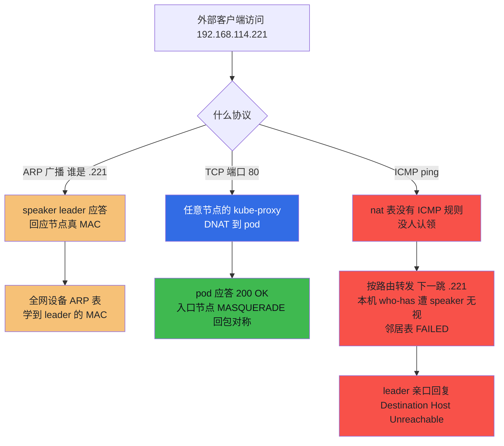
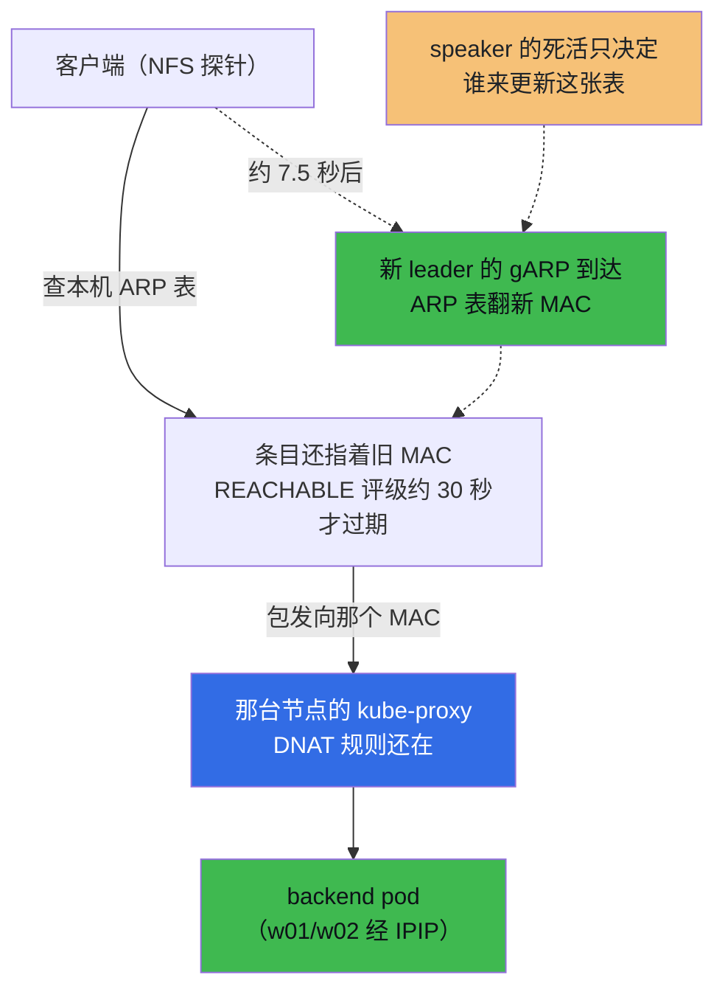

# MetalLB L2 拆机实录：LoadBalancer IP 如何应答与故障切换

!!! abstract "实测声明"
    本文所有命令与输出均在本人测试集群实测：6 节点 Kubernetes 1.36.1（3 master + 3 worker，Calico IPIP 隧道，实验时集群已连续运行约 170 天），MetalLB chart 0.16.1 / speaker v0.16.1，frr-k8s 0.0.25 子 chart 随装。实验窗口 2026-10-27 ～ 10-30，业务场地 namespace `metallb-lab`，组件装在 `metallb-system`。终端输出为当时落盘原文，仅对超长行做省略标注；个别毫秒级时刻来自当日判读记录，精确原文在文末待核项中列明。

两个月前，公众号"从 0 搭建私有云"那篇的留言区躺着一个求助：虚拟机外的局域网设备访问不了 MetalLB 分配的 IP，怀疑地址没广播出来，请大佬解惑。当时我没敢答——一个 LoadBalancer IP 在二层到底经历了什么，我自己也说不完整。这篇就是迟到两个月的回答。

回答着回答着，问题变了。为了看清故障转移的真实行为，我需要故意把"应答这个 IP 的组件"弄死。结果一轮一轮翻车：第一轮 pod 同秒复活，根本没死；第二轮杀成了，但杀得太优雅，遗言毫秒级送达；第三轮上了 `--force --grace-period=0`，以为是无声死亡，kubelet 还是先递了茶。最后动到节点级，才见到真正的死亡税。这篇文章一半讲"一个 IP 如何在没人认领的情况下全网可达"，另一半讲"杀死它的 owner 有多难、杀成之后客户端多久有感"。

## 这个 IP 不在任何网卡上

先说清楚 LoadBalancer IP 和 ClusterIP 的差别。[ClusterIP 转发链路拆解](../kubernetes/architecture/network/clusterip-link-deep.md)说明了虚拟 IP 如何通过 iptables 规则转发：它不配置在网卡上，但 TCP/UDP 访问可以正常工作。MetalLB 的 L2 模式处理的是另一个层次：**一个可在局域网 ARP 表中解析的 IP，却不配置在任何节点网卡上**。

我的实验场地很简单：一个 whoami deployment 挂在 `whoami-lb` 这个 LoadBalancer service 后面，MetalLB 从 pool-l2 这个池子给它分了 **.221**。顺手抓到一个分配侧的现象：同池的 .220 被另一个 service 拿走了——[Gateway API 与 Ingress 安装实录](gateway-api-installation.md)里的 Envoy 网关，其 LoadBalancer Service 在没有可用地址池时 Pending 了七天，池子出现后 controller 才分配到地址。至于补号顺序是否严格按创建时间结算，这次实验没有验证，不据此推断。

L2 模式的核心是三个组件，装机本身十分钟就完事（镜像走华源 retag 老三样，略），值得记的是结构：

- **speaker**：一个 DaemonSet，六台节点各一个，hostNetwork 直通物理网络，单容器；
- **memberlist**：六个 speaker 之间用 hashicorp/memberlist 组成一个 gossip 集群（TCP/UDP 7946），节点死活靠它互相盯；
- **leader 选举**：不是投票，是排名。源码里每个 speaker 拿到服务 IP 后，把所有可用节点按 `sha256(节点名 + "#" + 服务IP)` 排序（speaker_layer2_controller.go L111-119），**排序第一名当选**（L121-127）。

排名制有两个直接推论，后面全是围绕它们展开的。第一，排名对每个服务是独立的——同一个集群里，.220 的第一名是 worker01，.221 的第一名是 worker03，两个服务各认各的 leader。第二，排名是确定性的：成员名单一变，所有节点重排一遍，谁该当选没有任何悬念。

还有一个藏在 `metallb-system` 里的对象要提前认识，它是后面整场戏的主角之一：

```text
$ kubectl get servicel2status -A
NAMESPACE        NAME       ALLOCATED NODE   SERVICE NAME                                      SERVICE NAMESPACE
metallb-system   l2-8bvlg   worker03         whoami-lb                                         metallb-lab
metallb-system   l2-r9dh7   worker01         envoy-envoy-gateway-system-lab-gateway-b9e977d4   envoy-gateway-system
```

`ServiceL2Status` 记录"谁在宣布这个服务"。两个坑我各踩了一次：对象名不是 service 名，是 `generateName: l2-` 前缀生成的随机哈希（所以按名字查永远 NotFound，`-A` 全列才是唯一神谕）；它跟 controller 的 Deployment 没关系，`ownerReferences` 直接指向 speaker **pod**——领导权换人，这个对象就删旧建新换一个名字，等于一个跟随 leader 同生共死的活指针。

至于 frr-k8s：chart 默认把 BGP 那套也装上了，每台节点一个五容器 pod 外加四个 init 容器，在纯 L2 模式下全部闲着——L2 用户交的 BGP 税，十四个 pod 里的六个都这么来的。

## 谁在替 .221 接电话

回到主悬念。外部客户端访问 .221，第一件事是 ARP："谁是 192.168.114.221？"——应答者是谁？

我用了三条独立证据链把答案钉死，过程值得记录，因为它演示了"日志要看到证人级别"这件事。

**证据一，MAC 对号。** NFS 服务器和 master01 的 `ip neigh` 里，.221 对应 MAC 都是 `00:50:56:aa:54:ca`；对节点 MAC 台账，这个 MAC 属于 worker03 的 ens192——它的 altname（`enx005056aa54ca`）直接把 MAC 拼在名字里，归属没有任何歧义。

**证据二，源 IP 指纹。** 两个互相独立的外部客户端（NFS 的 wget、Windows 的 curl）访问 .221，whoami 应答里报告的客户端地址都是 `10.244.19.64`——worker03 的 tunl0 地址。两个客户端殊途同归，说明入口都是 worker03。

**证据三，点名日志。** worker03 上那个 speaker pod 的日志里，`serviceAnnounced ips=["192.168.114.221"]` 白纸黑字。

三条链闭合：**.221 的 ARP 应答者是 worker03 上的 speaker，六台 speaker 里的 leader。**

这里必须插一段方法论，因为它在本轮实验里连坑我三次，全是 `kubectl logs` 的形态问题：

!!! note "kubectl logs 取证三坑"
    1. `kubectl logs ds/xxx` 只挑**一个** pod 的日志，不是全部——我拿单个幸存者的证词当成了全体证词，误判过一次；
    2. `kubectl logs -l selector` 带 selector 时**默认每个 pod 只取最后 10 行**（kubectl 文档原话：no selector 时 -1 全量，有 selector 时 10）——六个 pod 整整齐齐 60 行，看着像全量，其实丢掉了 48 小时里的绝大部分，要全量必须显式 `--tail=-1`；
    3. pod 名拼错时 NotFound 报错走 stderr，被 `2>&1 | grep` 一吞就是 0 行——"0 行"和"没事发生"是两回事。

判读日志前先问一句：这条命令的形状，到底圈了哪些证人、多少行。

顺着证据三往下挖一层，ARP 应答的实现有个值得单独一讲的细节：**speaker 应答时用的是自己节点的真实 MAC**（arp.go L112，`Reply(pkt, a.hardwareAddr, ...)`），不是 keepalived/VRRP 那种虚拟 MAC。这是两种不同的高可用实现方式——VRRP 把虚拟 MAC 与虚拟 IP 绑定；MetalLB L2 则由当前 leader 使用节点真实 MAC 应答，leader 换人后客户端需要更新 ARP 缓存。关于另一种常见的 VIP 高可用方案，可参阅 [Kubernetes HA 集群中的 HAProxy 与 Keepalived](../kubernetes/practice/ha-cluster.md)。`arp.go` L90-93 还能看到这个应答循环只处理被问（OperationRequest），别人发来的 ARP reply 一律忽略；主动教别人的活儿在另一个循环里，就是后面要登场的 gARP 重播。

## 三个协议，三种态度

现在把 .221 当成一个营业窗口，看三个协议分别得到什么待遇。

**ARP：有人答。** 全网设备发"谁是 .221"，leader（worker03 的 speaker）应答自己的真 MAC。非 leader 的 speaker 呢？源码里 `announce()` 会返回 notOwner，进程保持沉默。所以 ARP 层面上全网学到的是同一个 MAC，指向同一个节点。

**TCP：有人转。** 这个 IP 的 TCP 流量根本不要求到达 leader。任何一台节点的 [kube-proxy](../kubernetes/architecture/network/kube-proxy.md) 都有 .221 的 DNAT 规则——PREROUTING 命中 `KUBE-EXT-C6HQVXG7VEBNLTZJ`（whoami-lb 专用链），无条件打上 `KUBE-MARK-MASQ` 标记，DNAT 到 pod IP，POSTROUTING 的 MASQUERADE 吃掉标记做源地址伪装。为什么必须 SNAT：DNAT 连接的回包必须回到做 DNAT 的那台节点完成反向转换，pod 若直接应答外部客户端，就绕开了 worker03 的 conntrack，连接会裂；MASQUERADE 强制造对称。伪装地址取出口接口的主地址——DNAT 后路由走向 IPIP 隧道，所以外部客户端看到的源 IP 是 worker03 的 tunl0 地址 10.244.19.64，证据二里的指纹就是这么来的。三个观察者（master01 本机、NFS、Windows）统一机制，一个解释收编三案。

顺带一块收掉的是 externalTrafficPolicy 的指纹：whoami-lb 是默认的 ETP=Cluster，`KUBE-EXT` 链里是**无条件** MARK-MASQ——外部流量一律 SNAT，源 IP 必失真；而 .220 那个 Envoy Service 是 ETP=Local，同一台节点的 nat 表里写的是 `--src-type LOCAL` **条件**标记——外部流量不标记、不 SNAT，源 IP 保真，代价是无端点节点可能直接 DROP。可对照 [Gateway API 与 Ingress 安装实录](gateway-api-installation.md)中关于 Envoy Service 和源地址的实验，以及 [SNAT 三种场景：从 hairpin 到 NodePort 的源地址改写](../kubernetes/architecture/network/snat-three-scenarios.md)，了解两种策略对转发与客户端源地址的影响。

**ICMP：没人管。** ping .221 的遭遇是全场最有戏剧性的：

包到达 worker03（ARP 指向它），内核一查——.221 不是本机任何网卡上的地址；nat 表里只有 TCP/UDP 规则，ICMP 无人认领；只能按路由表转发，而路由表说 .221 就在本网段（scope link，onlink），下一跳是 .221 自己。转发需要 .221 的 MAC，内核发出 who-has——**本机的 speaker 对自己节点的提问置之不理**。这一点有线上双证：worker03 自己的邻居表里 .221 条目状态是 FAILED，广播查询无人应答（源码里 arp.go 的 processRequest 并没有"不答本机"的过滤，真正的过滤点在更底层的 packet 套接字，库层机制标注待核；但"不答"这个行为本身是被实测钉死的）。ARP 无应答，转发失败，内核按下一跳不可达处理。于是两个外部视角收到的都是：

```text
From 192.168.114.150 Destination Host Unreachable
```

注意这个报文的来源地址：**.150 就是 worker03——VIP 的拥有者亲口告诉你，它到不了这个 VIP。** 讽刺的地方在于：全网所有设备问"谁是 .221"都有人答，唯一问不到答案的，是 leader 自己的内核。这不是故障，是设计使然：kube-proxy 的规则只匹配 TCP/UDP，ICMP 无主。

后面几包更有意思，worker03 回的是 ICMP Redirect："你直接找 .221 就行，别绕我。"方向是好意，问题是 .221 的 ARP 应答者就是 worker03 自己——客户端"直连 .221"，ARP 解析出来的还是 worker03 的 MAC，绕一圈回到原点。这个 IP 只存在于 ARP 层，三层路由的世界里根本没有它，Redirect 指了一条物理上不存在的直连路。

Windows 侧还有两个彩蛋：ping 统计显示"已发送 3 已接收 3 丢失 0%"，看着全通——其实 unreachable 回复也被计成"接收"；`arp -a` 里压根找不到 .221——Windows 到机房走 VPN 网关，114 网段的 MAC 都在网关上，它从来没机会自己学。



开头那个求助帖可以翻案了。当年的现象"虚拟机外设备无法访问、部分节点 ping 不通"，最省事的解释方向是"没广播出来"，但真凶大概率是两个叠加：ICMP 无主（ping 不通是设计使然，不是故障），以及当年 IP 池 192.168.2.100-120 和 node3 的 .100 撞了地址。旧集群无法回测，这半段只能算叙事推断，标注在此。

## 想看它坏掉：预注册与第一次翻车

静态结构看完了，动态问题上场：**拔掉 leader，.221 会断多久？**

动手前先算理论值。memberlist 的死亡检测参数 MetalLB 一个都没改（speakerlist.go L86-116 只覆盖了名字、地址、端口、密钥、事件回调五项），全用库默认：ProbeInterval 1 秒（每秒随机探一个节点）、ProbeTimeout 500ms、SuspicionMult=4，怀疑超时 = 4·ln(N+1)·1 秒（config.go L82 公式，L303-309 默认值）——六个 speaker 时约 7.8 秒。叠上随机探测轮到目标节点的平均时间、新 leader 上台后的 gARP 重播（每 1100ms 一次持续 5 秒，announcer.go L172/L177，这个 1100ms 的出处是官方 issue #172），我预注册的黑窗是 **10-25 秒**，客户端连续探针断几拍后恢复。

第一轮设计：cordon 掉 worker03（阻止调度）→ 删 speaker pod → leader 缺位 → 观察接管。

实测结果：删完 pod，客户端探针流跑了 28 秒，**一拍都没断**。我当时以为是 cordon 生效后 failover 快到无感，还挺高兴。

法医阶段就露馅了。新 speaker pod 的 CREATED 和 STARTED 双戳都是 `2026-10-29T08:23:26Z`——**和我删除旧 pod 的那一秒是同一秒**。cordon 根本没拦住它：

!!! warning "cordon 拦不住 DaemonSet"
    `kubectl cordon` 只是给节点打 `node.kubernetes.io/unschedulable` 污点；而 DaemonSet controller 创建 pod 时**自动带上这个污点的 toleration**（对 DS 来说"节点不可调度"不构成不部署的理由）。cordon 对普通 Deployment 有效，对 DS 是纸糊的。

所以那 28 秒的真相是三层叠加，一层比一层扎心：

1. **秒级复活**——pod 删了当秒就原地重建，leader 从未真正缺位；
2. **隐形双翻转**——这一层是第二天翻案翻出来的（后面细讲），leader 确实眨了两次眼，但客户端完全看不见；
3. **DNAT 兜底**——就算 leader 真缺位，客户端 ARP 表里的 MAC 还指着某个活节点，那台节点的 kube-proxy 照样能把 TCP 流量 DNAT 到 pod。**数据面从来不经过 speaker。**

第一轮实验判无效。但废墟里有块金子：新 pod 的启动日志里有一行我从没见过的东西——

```text
[pod/metallb-speaker-b2njg/speaker] ... "Refuting a dead message (from: worker03)" ...
```

memberlist 的 `Leave()` 实现，是广播一条**关于自己的死亡宣言**。旧 pod 被删时收到 SIGTERM，从容执行 Leave()，临终遗言"我死了"发遍全网；一秒后，同名叫 worker03 的新 pod 上线，收到这条死讯，第一反应是辟谣。死讯 → 除名 → 辟谣 → 复籍 → 接管，五连在 1 秒内走完。这条辟谣日志后来成了全案我最喜欢的展品。

## 门禁不是驱逐令

第二轮改用 taint。选 `metallb-lab=true:NoSchedule`（自定义 key，speaker 的 DS 模板只容忍 master/control-plane 两个具名 key，验过没有通配符），预期：taint 一打，删 pod，replacement 被 taint 挡住，worker03 真空。

taint 打下去 12 秒后看了一眼——**老 pod 纹丝不动**。

这是我给"污点的 effect 语义"交的学费：**NoSchedule 是门禁，不是驱逐令**。它只拦"新来的"，不碰"已入住的"；要驱逐在跑 pod 得用 NoExecute。而我故意不用 NoExecute：worker03 上还跑着 alloy、kube-proxy、csi-nfs 这些 DaemonSet 组件，NoExecute 一开会连坐驱逐一整个节点，实验现场全是噪音。正确姿势是组合拳——NoSchedule 留着挡重建（活着的它不管，但死了就不放新的进来，等于对 DaemonSet 下了一道"停招令"），再手动 delete 做"外科手术"。

下午 15:17，第一台真正的 leader 缺位实验（Phase A）：

```text
15:17:03.545  kubectl delete pod metallb-speaker-b2njg（回显时刻）
15:17:03      五个幸存者同秒打出 NodeLeave(worker03) 日志
15:17:03      xgghz（worker02）serviceAnnounced .221 —— 新 leader 当选并宣布
15:17:03.611  NFS ARP 探针最后一行 54:ca（worker03 的 MAC）
15:17:04.117  NFS ARP 探针第一行 47:90（worker02 的 MAC）
```

```text
# NFS 探针原文（0.5 秒一拍；curl 字段缺失因为这台机器没装 curl——见下）
15:17:02.595572191  192.168.114.221 dev ens192 lladdr 00:50:56:aa:54:ca STALE
15:17:03.102577203  192.168.114.221 dev ens192 lladdr 00:50:56:aa:54:ca STALE
……（翻转拍毫秒级原文见待核项：03.6xx 仍是 54:ca，04.117 起是 47:90）
15:17:15.781273311  192.168.114.221 dev ens192 lladdr 00:50:56:aa:47:90 STALE
15:17:16.287849684  192.168.114.221 dev ens192 lladdr 00:50:56:aa:47:90 STALE
```

全链耗时：**delete 到客户端 ARP 表完成翻转，半秒多**。NodeLeave、announce、gARP 落地，全部挤在同一秒里。预注册的 10-25 秒黑窗对"优雅删除"这个场景彻底作废——SIGTERM → Leave 广播是毫秒级的，7.8 秒的死亡税一分都没收（那是给"无声死亡"准备的，后面验证）。

两个附属发现。第一，gARP 的实证方式很硬：NFS 探针的 curl 字段是空的（这台 Debian 最小安装没有 curl，我设计探针时想当然写了 curl，跑起来才发现——这是我的锅），整段观察期 NFS 对 .221 **零流量**——上一次成功通信还是上午 10:27 的单次验证，此后邻居表一直停在 STALE。零流量意味着 ARP 表不可能因为通信而刷新，它从 54:ca 翻到 47:90 只有一种解释：**主动送上门的 gratuitous ARP 直写了邻居表**。顺带把实验计划里"vCenter vSwitch 会不会吃掉 gARP"的风险项销了案——它转发了。

第二，新条目的状态停在 **STALE**。Linux 内核对 unsolicited ARP 的态度是"先记着，但标记为待验证"，不主动送上门的 MAC 不给 REACHABLE 的信任评级——直到下一次真实通信确认。内核的谨慎本身成了证据链的一环。

还有个一秒钟内发生的细节：NodeLeave 那一秒，worker01 上的 speaker 也打出了一条 `serviceAnnounced`——宣布的是 .220。它不是新当选，是**连任宣言**：成员名单一变，所有 L2 服务重新验票，多数情况下第一名还是原班人马，客户端无感。一次 NodeLeave，全员重新排名，这是排名制选举的日常开销。

## 回来了就收回

Phase B：把 taint 撤掉、节点 uncordon，看 failback。

撤锁的回显时刻是 16:33:19.83，接下来的一秒内：DaemonSet controller 亚秒级建出替补 pod、pod 完成启动、加入 memberlist、打出 announce——每秒一拍的 poller 全程在录：

```text
16:33:18 l2-8cf5g   worker02   whoami-lb;l2-r9dh7   worker01   envoy-envoy-gateway-system-lab-gateway-b9e977d4;
16:33:19 l2-8cf5g   worker02   whoami-lb;l2-r9dh7   worker01   envoy-envoy-gateway-system-lab-gateway-b9e977d4;
16:33:20 l2-8cf5g   worker02   whoami-lb;l2-r9dh7   worker01   envoy-envoy-gateway-system-lab-gateway-b9e977d4;
16:33:21 l2-2f5tm   worker03   whoami-lb;…（同格式，省略）
```

```text
[pod/metallb-speaker-jcmjh/speaker] {"caller":"main.go:481","event":"serviceAnnounced","ips":["192.168.114.221"],"level":"info","msg":"service has IP, announcing","pool":"pool-l2","protocol":"layer2","ts":"2026-10-30T08:33:20Z"}
```

**.221 回到 worker03，failback 全链约 1.1 秒**（untaint → ARP 表翻回 54:ca @16:33:20.9），状态对象换代 l2-8cf5g → l2-2f5tm，客户端探针零失败。这次 NFS 探针换成了 wget 版（工具存在性这回是先探测后使用），每 0.5 秒真实访问，ARP 状态机也因此演了另一出：gARP 落地后先 DELAY，约 5 秒后转 REACHABLE——**有流量喂养，内核才肯给信任评级**。和 Phase A 的零流量 STALE 恰好构成对照组：同一张邻居表，流量是状态机的燃料。

到这里可以亮出那条贯穿全案的规律了。两天的实验里，.221 的领导权在 worker03 和 worker02 之间翻了八次（round-1 隐形双翻转两次、Phase A/B/C 各一次、Phase C 恢复一次、C-v2 两次），**每一次都严格落在排名制预测上：worker03 在场，第一名就是它；worker03 缺席，第一名落到 worker02；worker03 回归，第一名回到它**。八连零违例，"L2 选举不是投票是排名"从源码推断升格为定律级实证。

## 两次死刑逃逸

Phase C 想测真正的死亡：SIGKILL，不给遗言的机会。kubectl 的姿势是 `delete --force --grace-period=0`。

结果五个预注册全灭——同秒 NodeLeave、同秒 announce、ARP 表当秒翻转、探针零失败，**和优雅路径完全同构**。_SIGKILL 实验_从头到尾没发生过。

根因藏在那句 delete 时一闪而过的 Warning 里（"pod may continue to run indefinitely"）。`--force --grace-period=0` 是 **API 侧**语义：对象立即删除、不等 kubelet 确认。但 kubelet 发现"对象没了、容器还活着"之后走的孤儿清理流程，仍然按 pod 自己的 terminationGracePeriodSeconds 来——**先 SIGTERM、等宽限期、才 SIGKILL**。speaker 收到 SIGTERM，从容广播 Leave，遗言毫秒级送达。API 世界里档案已经烧了，kubelet 还是先递了杯茶。

至此"在这个集群里杀死一个 pod 有多难"的收集卡凑了三张：cordon 免疫（DS 自带 toleration）、taint 停招（NoSchedule 只挡新不碰旧）、force-delete 递茶（API 删档案，kubelet 转身先礼后兵）。想跳过遗言，只剩一条路：绕过 kubelet，节点级动手。

## 节点级死刑：约 7.5 秒死亡税

C-v2 的行刑配方，两步，顺序严格：

```bash
# 先停 kubelet——否则它会发现容器死了原地重启，实验白做（都在 worker03 上执行）
sudo systemctl stop kubelet && echo KUBELET_STOPPED_$(date +%H:%M:%S.%N)
# 再 crictl 直接杀容器——--timeout 0 不给优雅期，纯 SIGKILL；CID 为空必须停手回滚
CID=$(sudo crictl ps --name speaker -q)
[ -n "$CID" ] && sudo crictl stop --timeout 0 $CID || echo STOP_NO_CID
```

不需要 taint：pod 对象还活着（kubelet 停了，没人上报状态），DaemonSet 不会建替补，kubelet 也不会重启容器——worker03 上出现了一个 API 视角健康、物理上已经死了的 speaker。**真空，且没有遗言。**

17:36，行刑与接管的全时间线（五个独立记录源互锁：行刑与恢复的命令回显、speaker 日志、poller、NFS 探针、容器状态戳）：

```text
17:36:10.857  kubelet 停（行刑第一步回显）
17:36:11.013  crictl SIGKILL speaker 容器（CID 0ed510ca）——遗言物理断绝
17:36:13      幸存者首批 Suspect 日志："Suspect worker03 has failed, no acks received"
              ——随机探测轮到 worker03，2 秒无应答
17:36:14-16   其余幸存者陆续 Suspect（各节点探测时钟错峰）
17:36:17      "Marking worker03 as failed, suspect timeout reached (2 peer confirmations)"
              ——间接探测 2 个 peer 确认，提前定罪 → NodeLeave
17:36:17      xgghz（worker02）serviceAnnounced .221 —— 新 leader 宣布
17:36:18      poller 显示新对象 l2-kjc72@worker02；NFS ARP 表翻成 47:90
17:36:30.8    kubelet 回来（收工恢复）
17:36:32      kubelet 原地重建容器（同 pod，RESTARTS 0→1，STARTED=2026-10-30T09:36:32Z，UTC）
              新容器启动："Refuting a suspect message (from: worker03)" —— suspect 版辟谣
              xgghz 让位："serviceWithdrawn … reason notOwner"
17:36:33      poller 显示 l2-fkjzt@worker03；NFS ARP 表翻回 54:ca
```

核心读数：**SIGKILL 到新 leader announce 约 6 秒，到客户端 ARP 表完成翻转约 7.5 秒**。这就是死亡税的实测值——理论上限 4·ln(6)≈7.2 秒的怀疑超时，被"2 peer confirmations"的加速定罪机制压短了：间接确认一到位就定罪，不等满全程。对照 Phase A 的同秒交接，两条路径的分野完全清晰：

```mermaid
flowchart LR
    subgraph S1[" "]
        direction TB
        T0["优雅离开<br/>kubectl delete · 全链不到 1 秒"]
        T1["SIGTERM"] --> T2["Leave 广播遗言<br/>毫秒级送达幸存者"] --> T3["同秒 NodeLeave<br/>全员重算名单"] --> T4["argmin 重排<br/>新 leader 当秒 announce"] --> T5["gARP 立即发出<br/>1100ms 重播持续 5 秒"]
        T0 ~~~ T1
    end
    subgraph S2[" "]
        direction TB
        K0["无声死亡<br/>crictl stop --timeout 0 · 约 7.5 秒"]
        K1["SIGKILL"] --> K2["遗言发不出去<br/>幸存者毫不知情"] --> K3["约 2 秒后随机探测无应答<br/>发起 Suspect"] --> K4["间接探测 2 个 peer 确认<br/>提前定罪"] --> K5["约 6 秒 NodeLeave<br/>新 leader announce"] --> K6["约 7.5 秒 gARP<br/>刷新客户端 ARP 表"]
        K0 ~~~ K1
    end

    %% 隐形连线，仅用于锚定左右布局
    T5 ~~~ K1

    classDef titleGreen fill:#116329,stroke:#116329,color:#fff,font-weight:bold
    classDef titleRed fill:#82071e,stroke:#82071e,color:#fff,font-weight:bold
    classDef greenBox fill:#3fb950,color:#0d1117,stroke:#2da44e
    classDef redBox fill:#f85149,color:#fff,stroke:#da3633
    classDef yellowBox fill:#f6c177,color:#1f2328,stroke:#d4a72c

    class T0 titleGreen
    class K0 titleRed
    class T1,T2,T3,T4,T5 greenBox
    class K1,K2 redBox
    class K3,K4 yellowBox
    class K5,K6 greenBox

    style S1 fill:#dafbe1,stroke:#3fb950,stroke-width:2px,padding:14
    style S2 fill:#ffebe9,stroke:#f85149,stroke-width:2px,padding:14
```



差的那六七秒是什么？全是"**没来得及说再见**"。优雅离开时，遗言的传播和接管同步发生；无声死亡时，幸存者要先靠探测发现"人没了"，再走怀疑、确认、除名的全套流程。SWIM 风格的故障检测协议把这个流程做得又快又稳（两秒起疑、两三个间接证人即可定罪），但物理上快不过一条主动广播。

死亡检测日志三件套至此集齐：`Suspect`（起疑）→ `Marking ... failed, suspect timeout reached (2 peer confirmations)`（定罪）→ `Refuting a suspect message`（新容器上线辟谣）。辟谣也是两个变种：上一节见过 dead 版（Leave 主动宣告的死亡），这次是 suspect 版（被怀疑中的死亡）——memberlist 对两种死讯都有对冲机制。

然后是全场最意外的读数：**客户端探针，零失败**。

预注册里我给死亡相位留的预测是"3-8 个坏样本"——黑窗 12 秒、探针 2 秒超时，怎么也该断几拍。实测一拍没断。复盘出双保险：



保险一，**ARP 余荫**：死亡税 7.5 秒，而内核给 REACHABLE 条目的信任期约 30 秒——gARP 赶到时，客户端缓存里的旧条目还新鲜着，内核压根没走到"重新解析"那一步，那个本来预设会看到的 PROBE→INCOMPLETE 悲剧链全程没出场。保险二，**DNAT 兜底**：就算缓存过期了，广播解析无人应答，客户端也只会在新建连接时卡住；已有认知里"旧 MAC 指向的节点"kube-proxy 规则还活着，TCP 流量照转。

所以最终读数就是：**集群死了一个 leader，客户端一无所知，连一毫秒都没多等。** speaker 是应答机，不是转发机——它死掉影响的只是"谁来更新 ARP 表"，而更新窗口（30 秒）远大于死亡税（7.5 秒）。两天所有相位加起来，客户端侧累计失败数：零。

最后一桩悬案是观察方法本身的。三场实验里我三次押注"新旧两个 ServiceL2Status 对象会短暂并存"（双答窗口、僵尸对象），三次都没押中——poller 每秒一拍，看到的永远是干净的单行切换，最窄的缝隙只有两拍之间 2 秒的跳秒。判决：**状态对象的换代是先删后建的原子操作，任何时刻每个服务最多一个对象在世**。至于 round-1 那次 1 秒双翻转里，中间态对象是否存在过——当时 poller 还没开机，观察密度不够，不可考。这也是本轮实验教的方法论：**观察不到的中间态，只能说明观察密度不够，不能说明它不存在**。

## 带走三件事

对着自己的集群，三个可以直接上手的动作：

**1. 找 L2 leader 的正确姿势。** `kubectl get servicel2status -A`。别按 service 名查（对象名是 l2- 哈希），别只盯 `metallb-lab`（对象住在 metallb-system），更别拿 ping 通不通当健康检查——ICMP 无主是设计使然。

**2. 想停一个 DaemonSet 的 pod。** cordon 无效（DS 自带 toleration）；`--force --grace-period=0` 无效（kubelet 孤儿清理仍递 SIGTERM，优雅退出照常发生）；正解是自定义 key 的 NoSchedule taint 挡住重建 + 手动 delete，要真"无声死亡"就停 kubelet 后 crictl stop。反向提醒：**停 kubelet 后记得开回来**——这套集群四个月前有一台节点因为停 kubelet 忘了开，NotReady 了四周才被发现。

**3. 客户端真相只在客户端。** 服务端全绿（pod Running、endpoint 就绪、speaker 健康）不等于客户端无感；反过来，leader 死透了客户端也可能一拍不断。要看真相，就在真实客户端侧挂探针（wget/`/dev/tcp` 都行，先探测工具存在性）同时记 `ip neigh`——ARP 表是这层世界的体检报告。

三句话收拢全案：**一个没人认领的 IP 靠三个角色全网可达——ARP 有人答（speaker），TCP 有人转（kube-proxy），ICMP 没人管（leader 亲口报不可达）；杀死应答机很难（cordon 免疫、taint 停招、force 递茶，节点级才成）；杀成之后客户端也未必知道（死亡税 7.5 秒跑不赢 30 秒的 ARP 信任期，还有 DNAT 兜底）。**

---

（W3 的 service 拼图随 LoadBalancer 这块补齐——前面是 Ingress/Gateway API、NetworkPolicy、DNS。实验期间还顺带办了另一桩大案：一个镜像在节点仓库里躺了 22 小时，kubelet 视而不见、每 5 分钟左右撞一次 401，死循环 77 轮——那案子的主犯在 CRI 的镜像账本里，与 MetalLB 无关，值得单开一篇。）

## 附：待核项与出处

- **源码引用**（v0.16.1，本地存档 `research/metallb/` 逐行核对）：speaker_layer2_controller.go L111-127（sha256 排序、第一名当选、notOwner）；internal/layer2/arp.go L90-93（只应答 Request）、L112（Reply 用节点真 MAC）；internal/layer2/announcer.go L157-192（spamLoop：L172 每 1100ms 重播出自 issue #172、L177 五秒窗口、L181 立即首发）；internal/speakerlist/speakerlist.go L86-116（memberlist 只覆盖 5 项配置、Name=nodeName）、L177-181（pod IP 缓存约 5 分钟刷新）、L225-234（每分钟对账 joinMembers）、L255-283（mlJoin 与 partial join）、L287-300（Rejoin）；memberlist v0.5.0 config.go L82（SuspicionTimeout 公式）、L303-309（默认参数）。
- **待核行**（判读记录级精度，精确原文以落盘文件为准）：Suspect / Marking failed / Refuting suspect / serviceWithdrawn notOwner 四类日志的完整 JSON 行——`~/metallb-lab-logs/m25-speaker-full.txt`（master01）；ARP 翻转的毫秒级行——NFS `~/metallb-probe-l2.txt`（Phase A 窗口 15:17:03-04）与 `~/metallb-probe-l2b.txt`（C-v2 窗口 17:36:11-33）；行刑回显的毫秒戳（KUBELET_STOPPED/SPEAKER_SIGKILLED）；ping 输出原文（From 192.168.114.150 unreachable 与 Redirect 的完整行）；Phase C（force-delete 相位）w02 侧中间状态对象的哈希名。
- **毫秒级时刻声明**：文中 15:17:03.545、16:33:19.83、16:42:43.896、17:36:10.857、17:36:11.013、17:36:30.8 来自各命令回显的当日判读记录；"约 6 秒 / 约 7.5 秒 / 约 1.1 秒"为对应回显与日志秒级时间戳的差值，不到毫秒精度处一律以"约"标注。
- **落盘清单**：master01 `~/metallb-lab-logs/`（m00-m25 全系列）、`~/metallb-lab-logs/m23-l2status-poll.txt`（每秒 poller）；NFS `~/metallb-probe-l2.txt` / `~/metallb-probe-l2b.txt`（客户端探针）。本站引用的终端块均为落盘文件或当日回贴的逐字摘录，节选处已标注。

## 推荐阅读

- [Gateway API 与 Ingress 安装实录](gateway-api-installation.md)：接着看 Envoy Gateway、Ingress 的入口配置，以及 `externalTrafficPolicy` 对源 IP 和流量转发的影响。
- [Service ClusterIP 为什么 ping 不通？](../kubernetes/architecture/network/clusterip-link-deep.md)：理解 Service 虚拟 IP 的 iptables 转发链路，以及 ICMP 与 TCP/UDP 行为为何不同。
- [SNAT 三种场景：从 hairpin 到 NodePort 的源地址改写](../kubernetes/architecture/network/snat-three-scenarios.md)：深入了解外部流量经过 kube-proxy 时的 SNAT 和客户端源地址保留。
- [Kubernetes HA 集群实践：HAProxy、Keepalived 与 3 Master](../kubernetes/practice/ha-cluster.md)：对照了解基于 VIP 的高可用入口与节点故障切换。
