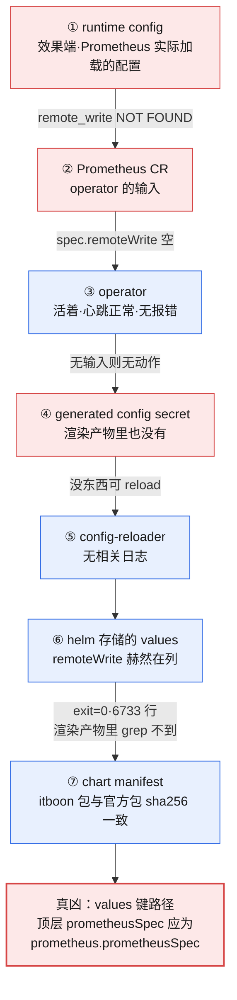
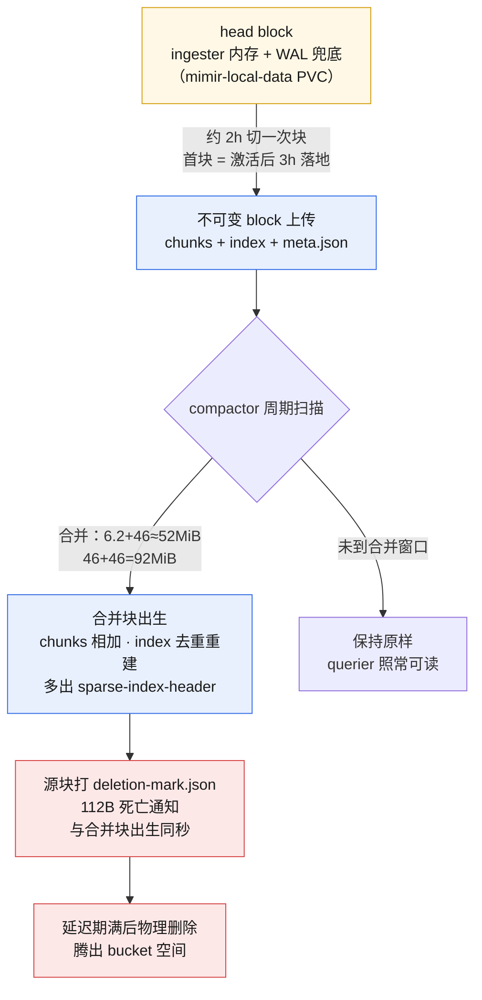
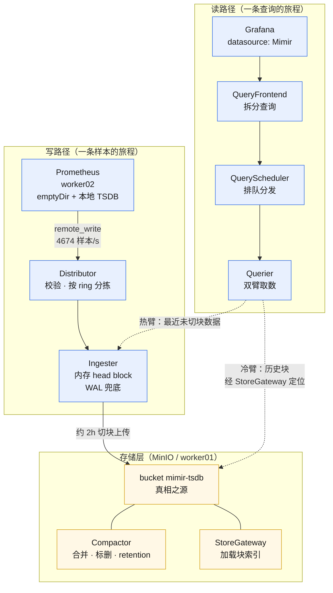

# Mimir 从零装机：114 天的 Prometheus 从来没有过硬盘，而它的默认搭档已经退休一年

> **实测声明**：本文所有命令与输出来自我的测试集群（3 master + 3 worker，K8s 1.36.1，Debian 13，Calico IPIP）。现状审计执行于 2026-10-15 上午，装机、断链排查与修复执行于同日 15:35–18:10，验证批执行于 2026-10-16 上午；Mimir 3.2.2（单副本 monolithic，manifest 手写）、MinIO 2024-10-13 版、kube-prometheus-stack 86.2.0（release 名 prometheus，rev2 → rev4）。文中源码引用已对照 mimir-3.2.2 tag 逐行核实。输出除标注外未做任何改写；叙述中的钟点是北京时间，命令输出里的时间戳是 UTC，差 8 小时。

四件套的最后一篇。前三篇装了 [Prometheus 指标深挖](p99-apiserver-latency-60s.md)、[Grafana](grafana-first-open-blind-spot.md)、[Loki](loki-from-zero.md)，这一篇解决的是整个可观测性栈里最要命的一个悬而未决：**指标的长期记忆**。

先说这次装机挖出来的两件事，一件比一件难受：

第一件：我的 Prometheus 在集群里跑了 114 天（到写这篇为止），它的 TSDB 从来没有过硬盘。不是"硬盘太小"，不是"硬盘满了"，是**从来没有挂载过任何持久卷**——`retention=10d` 只是配置文件里的一行字，真实的记忆长度是"Pod 活多久记多久"。

第二件：等我决定给它接长期存储、选中 Mimir 之后才发现，Mimir 官方 chart 的默认对象存储搭档 MinIO，社区版仓库已经归档了——2026 年 4 月归的档，最后一个 release 停在 2025 年 10 月，README 第一行就是加粗的 **THIS REPOSITORY IS NO LONGER MAINTAINED**。给监控栈装长期存储的当口，默认搭档消失半年多。

这两件事一件是审计挖出来的，一件是选型撞上的。这篇就是从这两个坑出发，把 Mimir 从零装起来、把断掉的双写链修好、再把 bucket 里的块翻个底朝天的完整记录。

## 一次审计挖出的空硬盘

四件套收官，先干的第一件事不是装机，是审计现状：Prometheus 现在到底记着多久的指标？

```console
$ kubectl -n monitoring get prometheus -o jsonpath='{range .items[*]}{.metadata.name}: retention={.spec.retention}{"\n"}{end}'
prometheus-kube-prometheus-prometheus: retention=10d

$ kubectl -n monitoring get pvc | grep -i prom
（无输出）
```

retention 10 天，PVC 列表里过滤 prom 一行都没有。第二行当时让我愣了一下——没有 PVC，那 TSDB 写在哪？

往下查 CRD 的存储根和 StatefulSet 的卷模板，两处都是空：

```console
$ kubectl -n monitoring get prometheus prometheus-kube-prometheus-prometheus -o jsonpath='{.spec.storage}'
（空）

$ kubectl -n monitoring get sts prometheus-prometheus-kube-prometheus-prometheus -o jsonpath='{.spec.volumeClaimTemplates}'
（空）

$ kubectl -n monitoring get sts prometheus-prometheus-kube-prometheus-prometheus \
  -o jsonpath='{range .spec.template.spec.volumes[*]}{.name}: {.emptyDir}{.persistentVolumeClaim}{"\n"}{end}'
config:
tls-assets:
config-out: {"medium":"Memory"}
prometheus-prometheus-kube-prometheus-prometheus-rulefiles-0:
prometheus-prometheus-kube-prometheus-prometheus-rulefiles-1:
prometheus-prometheus-kube-prometheus-prometheus-rulefiles-2:
web-config:
prometheus-prometheus-kube-prometheus-prometheus-db: {}
```

最后一行就是答案。`prometheus-…-db: {}`——TSDB 的家是一个空配置的 emptyDir。装 kps 的时候没配 `prometheusSpec.storageSpec`，operator 就静默给了个内存盘式的默认值，四个月里没有任何告警提醒过这件事。

顺手注意到另一个细节：`config-out: {"medium":"Memory"}`——kps 的配置热加载目录也是内存盘。同一个 emptyDir 家族，两种介质。

然后是最有说服力的一个数字。Prometheus 有个指标 `prometheus_tsdb_lowest_timestamp_seconds`，就是它自己记忆的最老时间戳：

```console
$ curl -s http://localhost:19090/api/v1/query --data-urlencode \
  'query=(time() - prometheus_tsdb_lowest_timestamp_seconds) / 86400'
age_days: ['10.490011134258022']
```

10.49 天。刚好比 retention 的 10 天多出半天不到——**最老样本的时间戳是 1791136800，即 2026-10-04T18:00:00Z，整点，正好是 2 小时 block 的边界**。TSDB 删数据不是按天删的，是按块删的：2 小时一块，加上扫描周期，10 天的 retention 实际执行出来就是"删到最近一个完整块边界为止"。这个 10.49 的尾巴本身就是块粒度的证据。

Pod 的生日是 2026-06-24——比数据老得多。也就是说这 114 天里这个 Pod 侥幸没死过，emptyDir 里的 10 天记忆是"活着的历史"：**它每时每刻都只有 10 天记忆，只是恰好没死过，让人误以为记忆是连续的**。

一句话定案：**retention=10d 是配置上的记忆，真记忆 = min(10d, Pod 寿命)**。而 Pod 寿命这东西，在 114 天的侥幸之后，是统计学上的欠债。

这就有了装机理由。Mimir 的定位一句话：**接收 Prometheus 的 remote_write，把样本写进对象存储，让指标的记忆和 Pod 的生死解耦**。Prometheus 继续当采集器，Mimir 当档案馆。

## 一个退休的默认搭档

选 Mimir 之前先有个小插曲。查 chart 可得性的时候：

```console
$ helm search repo mimir
NAME                                    CHART VERSION   APP VERSION     DESCRIPTION
bitnami/grafana-mimir                   3.0.19          2.17.0          Grafana Mimir is an open source, horizontally s...
grafana/mimir-distributed               6.2.1           3.2.1           Grafana Mimir
```

bitnami 那个 app 版本是 2.17.0，落后一年，排除。grafana 官方的 mimir-distributed 6.2.1 是正主。但拉下来一看默认 values：v3.2 的 ingest-storage 新架构把 Kafka 默认打开，MinIO 子 chart 默认打开，推荐的生产 values（capped-small）对六台机器的 lab 又太重。

真正让我停下的是 MinIO 本身。查它的现状：

```console
$ curl -s https://api.github.com/repos/minio/minio | jq '.archived, .pushed_at'
true
"2026-04-24T17:54:39Z"
```

仓库 archived 字段是 true，最后推送 2026-04-24。README 第一行原话：

> **THIS REPOSITORY IS NO LONGER MAINTAINED.**

最后一个是 2025 年 10 月的 release（修 CVE 的版本），之后归档，社区版转为纯源码分发。也就是说：**Mimir 官方文档里所有拿 MinIO 举例的地方，默认搭档在半年前就止步了**。Mimir 本身支持 S3/GCS/Azure/Swift，生产环境你该接的是云上的对象存储或者自己养的 Ceph RGW；MinIO 是文档里最顺手的示例，而它恰好是死掉的那个。

lab 里怎么办？我的决策是**还是用它，但有几点要知晓**：

1. 死的是"仓库维护"，不是"软件功能"——2024-10-13 的版本跑单副本 lab 完全够，而且它是个静态老版本，不会再变
2. 镜像断网环境里，华为源上恰好有 minio 的缓存（后面细说，这本身就是个故事）
3. 零外部暴露，纯集群内 Service，风险半径可控

!!! warning "生产环境别学"
    这是测试集群的妥协。生产环境选归档的组件要过一遍你自己的风险清单——没有安全补丁是最大的那条。另一个官方禁令也抄在这里，MinIO 博客原句："Do not run MinIO on top of a distributed file system such as NFS, GlusterFS, GPFS, etc."。而我们接下来恰恰要把 MinIO 跑在 NFS 上（见下文 ADR，明知故犯，理由在案）。

## 四个选型决策（ADR）

**决策一：不用 chart，manifest 手写。** mimir-distributed 6.2.x 的默认形态是给生产的：Kafka 默认开、MinIO 子 chart 默认开、拆成 read/write/backend 三组进程。对单节点内存都紧张的 lab，这些默认值全是负担。官方文档留了一份 monolithic 的裸 YAML 模板（single-process），从它出发手写，比跟 chart 的默认值搏斗便宜。这条和 [Loki 篇](loki-from-zero.md)"validate.yaml 清场"是同一个思路：**chart 的默认值是给典型生产的，不是给当前环境的**。

**决策二：monolithic 单副本。** Mimir 三种部署形态（monolithic / 读写分离 / 微服务）只是同一套组件的不同切法，配置可以平移。lab 从 `target=all` 起步，以后要拆不需要换软件。

**决策三：多租户关掉。** Mimir 默认 `multitenancy_enabled: true`，所有请求要带 `X-Scope-OrgID` 头。单管理员的 lab 关掉它，remote_write 和 Grafana datasource 都省一层配置：

```yaml
multitenancy_enabled: false
```

关掉不是"没有租户"，是"全员一个租户"。Mimir 的 `no_auth_tenant` 默认值是 `anonymous`——后面在 bucket 的对象路径里还会遇到它。保留多租户的写法文末提一句：remote_write 的 `headers` 加 `X-Scope-OrgID`，Grafana datasource 对应 `httpHeader`，两处配置点。

**决策四：MinIO 跑在 NFS 上，明知故犯。** 官方禁令上面抄过了。这是 lab，单副本 MinIO，数据是可再生的监控指标，NFS 背后是独立的存储服务器和 50G 数据盘。官方禁令针对的是"拿分布式文件系统当生产对象存储的地基"这种会出一致性事故的用法。这里记录在案的理由是**知道禁令、评估过风险、接受后果**，而不是不知道。

对象存储之外，Mimir 自己还要一块小盘放 WAL 和 compactor 工作目录——两块 PVC 都走已有的 nfs-expand StorageClass。

## 装机：从镜像断网到第一个 bucket

老规矩，registry-1.docker.io 全节点 i/o timeout，先 retag。三个镜像：mimir 本体、minio、mc（MinIO 客户端，用来建 bucket）：

```console
$ sudo ctr -n k8s.io images pull swr.cn-north-4.myhuaweicloud.com/ddn-k8s/docker.io/grafana/mimir:3.2.2 \
  && sudo ctr -n k8s.io images tag \
  swr.cn-north-4.myhuaweicloud.com/ddn-k8s/docker.io/grafana/mimir:3.2.2 \
  docker.io/grafana/mimir:3.2.2
...
docker.io/grafana/mimir:3.2.2    application/vnd.docker.distribution.manifest.v2+json \
  sha256:996c62a84f06db398060da3912ba535cfc3c384123eb96b5de2bbfc2d80d7e22 36.0 MiB
```

六个节点挨个来。有意思的是 minio：

```console
$ sudo ctr -n k8s.io images pull swr.../docker.io/minio/minio:latest \
  && sudo ctr -n k8s.io images tag \
  swr.../docker.io/minio/minio:latest docker.io/minio/minio:2024-10-13
```

华为源上 `minio/minio:latest` 这个 tag 拉下来的是什么？**2024 年 10 月的缓存**。仓库都归档了，镜像源的 latest 还停在那年秋天。断网环境里"版本"这个概念得换个理解：**你能拉到什么，取决于镜像源缓存了什么**——所以 tag 回写的时候我直接把日期写死进 tag 名，`2024-10-13`，让这个事实在镜像名里可见。

然后是 MinIO 本体。两块 PVC（`minio-data`、`mimir-local-data`，各 10Gi，nfs-expand）Bound 之后，Deployment 2 秒 Ready：

```console
persistentvolumeclaim/minio-data created
persistentvolumeclaim/mimir-local-data created
deployment.apps/minio created
service/minio created
deployment.apps/minio condition met
minio-5d478896cd-2b9cl   1/1   Running   0   2s   10.244.5.14   worker01
```

轮到 mc 建 bucket，翻车了：

```console
mc: <ERROR> Unable to initialize new alias from the provided credentials.
Get "http://minio.mimir.svc:9000/probe-bsign-nd95liivhyfhmta5ayl6okj2245ey2/?location=":
dial tcp 10.104.162.185:9000: connect: connection refused.
```

`connection refused`，但 MinIO 明明 Running。这是老朋友了——Service 的 endpoints 还没传播，mc 拿着 ClusterIP 去连，后面还没有就绪的 endpoint。隔了约二十分钟重试：

```console
$ kubectl -n mimir run mc-bootstrap2 --image=docker.io/minio/mc:2025-03-12 --restart=Never --command -- sh -c \
  "mc alias set local http://minio.mimir.svc:9000 mimirlab mimirlab-secret-2026 && mc mb local/mimir-tsdb --ignore-existing && mc ls local/"
Bucket created successfully `local/mimir-tsdb`.
[2026-10-15 06:59:47 UTC]     0B mimir-tsdb/
```

06:59:47，`mimir-tsdb` bucket 诞生。对象存储层就位。

## 第一次 CrashLoop：CLI 前缀不等于 YAML 归属

Mimir 本体是一个 ConfigMap（配置）+ 一个 Deployment + 一个 Service。配置从官方 monolithic 模板改造，核心几段：

```yaml
multitenancy_enabled: false

server:
  http_listen_port: 8080

ingester:
  ring:
    min_ready_duration: 0s
    final_sleep: 0s
    num_tokens: 512
    replication_factor: 1
    kvstore:
      store: inmemory

store_gateway:
  sharding_ring:
    replication_factor: 1
    kvstore:
      store: inmemory

compactor:
  data_dir: /data/compactor
```

单副本，ring 全部 inmemory，`replication_factor: 1`——这是单副本集群的诚实写法，Mimir 从装机第一分钟起就没在复制上撒谎。

apply 下去，CrashLoop：

```console
mimir-d559894d6-bwmh7   0/1   CrashLoopBackOff   5 (2m1s ago)   5m   10.244.5.19   worker01
-- /ready 探测:
ready HTTP 000
-- Mimir 日志尾 15 行:
error loading config from /etc/mimir/mimir.yaml: error parsing config file: yaml: unmarshal errors:
  line 32: field replication_factor not found in type compactor.RingConfig
  line 35: field blocks_retention_period not found in type compactor.Config
```

这两行报错值一个教训。我当时想给 compactor 配置 ring 副本数和块保留期，顺手就写了：

```yaml
compactor:
  sharding_ring:
    replication_factor: 1
  blocks_retention_period: 400d
```

想法很自然：Mimir 的 CLI flag 是 `-compactor.blocks-retention-period`，前缀是 compactor，那 YAML 里就该在 compactor 块下。**错了。**报错说得明明白白：`compactor.RingConfig` 里没有 `replication_factor` 这个字段，`compactor.Config` 里没有 `blocks_retention_period` 这个字段。

真相是：**CLI flag 的前缀和 YAML 的块归属是两套坐标系**。`-compactor.blocks-retention-period` 这个 flag 实际映射的是 `limits` 块下的 `compactor_blocks_retention_period`——一个 per-tenant 的 limit。我拿 flag 前缀类推 YAML 结构，Mimir 的严格 unmarshal 当场拒绝。

!!! note "这不是 Mimir 的刁难"
    严格拒绝反而是好事——错的键直接拒启，比静默忽略好一万倍。后面 kps 那边的对比会让你看到"静默存储错误键"的下场是什么。

删掉这两处错键（保留期后来也没配——lab 先让它无限记，反正 MinIO 里 10Gi 够跑很久），重新 apply：

```console
mimir-5b58d44986-gq62k   1/1   Running   0   2s   10.244.19.86   worker03
mimir-d559894d6-bwmh7    0/1   Terminating   8 (4m46s ago)   21m   10.244.5.19   worker01
-- /ready 探测:
ready HTTP 200
```

从 apply 到第一条查询返回 200，5.77 秒（07:56:13 重启，07:56:18.770 首条查询日志）。启动日志里有两行值得留：

```console
level=info msg="store-gateway is ACTIVE in the ring"
level=info msg="Application started"
```

以及第一条查询的访问日志末尾，一个词：`user=anonymous`。多租户关闭后内部租户叫什么，源码文档里写的 `no_auth_tenant` 默认值，在运行时日志里亲眼看见了。

顺带一个拓扑观察：崩的 Pod 在 worker01（跟 MinIO 同机），重启后的新 Pod 被 Deployment 滚到了 worker03。于是三层各居一台——**Prometheus 在 worker02，MinIO 在 worker01，Mimir 在 worker03**，每台各捏着长期记忆链的一环。

## 绿灯全亮，但数据没有动

装机完成，接下来把 Prometheus 的 remote_write 指到 Mimir。这一段是整个装机日最漫长的部分，也是我觉得最值得写下来的部分——**因为每一层都报了成功，而数据没有动**。

先说我是怎么把坑挖出来的。kps 的 remote_write 配置在 `prometheusSpec.remoteWrite`，我当时的 values 片段：

```yaml
prometheusSpec:
  remoteWrite:
  - url: http://mimir.mimir.svc:8080/api/v1/push
```

看起来没问题。upgrade：

```console
$ helm upgrade prometheus prometheus-community/kube-prometheus-stack \
  --version 86.2.0 -n monitoring --reuse-values -f 49-add-mimir.yaml
...
STATUS: deployed
REVISION: 3

$ kubectl -n monitoring rollout status statefulset/prometheus-prometheus-kube-prometheus-prometheus
statefulset rolling update complete 1 pods at revision ...
```

STATUS: deployed，REVISION: 3，rollout complete。全绿。然后验证双写：

```console
-- E) Prom 侧 remote write 指标:
samples_total: []
failed_total: []
```

空。不是 0，是**这个指标根本不存在**——remote_write 子系统压根没启动过。指标不存在和指标为零是两个世界：前者是"这个功能没在跑"，后者是"在跑但没发出去"。

从此开始逐层定位。下面这张图就是排查的完整路径，七层，我顺着配置的实际旅程从效果端往回走：



红色是断掉的三层（实际执行的效果端到 secret），蓝色是健康的四层。逐层说：

**① 效果端。** runtime config 是 Prometheus 真正加载的配置，`/api/v1/status/config` 一查，`remote_write NOT FOUND`。同时查了真实存在的 remote storage 指标名——流入计数 `samples_in_total` 在，发送计数 `samples_total` 不在。子系统没启动，坐实。

这轮还顺带破了一个自己的预测：我以为 STS 滚动会重建 Pod、emptyDir 清零、本地记忆归零。实际查 Pod 生日：

```console
$ kubectl -n monitoring get pod prometheus-prometheus-kube-prometheus-prometheus-0 \
  -o custom-columns='CREATED:.metadata.creationTimestamp,UID:.metadata.uid' --no-headers
2026-06-24T07:35:50Z   81b30197-3566-49fd-ba04-958ea34c6adf
```

生日还是 6 月 24，UID 没变——**Pod 根本没重建**。`rollout status complete` 是个静止态回显： revision 没有实质变化时它也回你一句 complete。判断 Pod 是否重建，唯一硬证据是 creationTimestamp 和 UID，rollout 状态不算。

**② CR 层。** operator 的输入是 Prometheus 这个 CR。查它的 spec——`spec keys` 列出来 35 个键，从 affinity 到 walCompression 排得整整齐齐，**没有 remoteWrite**。operator 没收到过指令。

**③ operator。** 活着，心跳正常，日志里干干净净——没有报错恰恰因为没有输入，无输入则无动作。

**④⑤ 中间层。** operator 生成的 config secret 里没有 remote_write 段，config-reloader 自然无事可做。两层都"正常"，正常的原因是上游断了。

**⑥ helm 存储层。** 这是最迷惑的一层：`helm get values` 一查，我的 remoteWrite 片段**就明明白白存在 release 的 values 里**。配置存进去了，但没生效——那问题只能在渲染环节。

**⑦ 渲染与 chart。** 沙箱里裸跑 template 复现：`exit=0`，6733 行渲染产物，`grep remoteWrite` 一无所获。**helm 对不认识的 values 键：不报错、不警告、原样存储、渲染时忽略。**再对照 chart 自己的 values，kube-prometheus-stack 86.2.0 的说明文件里写着正确路径：

```console
$ helm show values prometheus-community/kube-prometheus-stack --version 86.2.0 | grep -n -A2 "remoteWrite"
4487:    remoteWrite: []
4488:    # - url: http://remote1/push
```

L4487，`prometheus.prometheusSpec.remoteWrite`——**正确答案从头就写在说明书里**，而我写成了顶层的 `prometheusSpec`。这中间还排除过一个嫌疑：我们的 chart 是从 itboon 镜像源拉的，一度怀疑镜像源改过包——沙箱把两个源的包拉下来对 sha256，一致，chart 无罪。

修复就是把键路径写对：

```yaml
prometheus:
  prometheusSpec:
    remoteWrite:
    - url: http://mimir.mimir.svc:8080/api/v1/push
```

这次先在 CR 层验证：

```console
$ kubectl -n monitoring get prometheus prometheus-kube-prometheus-prometheus \
  -o jsonpath='{.spec.remoteWrite}'
[{"url":"http://mimir.mimir.svc:8080/api/v1/push"}]
```

**这次查对地方了**——上一轮的教训就是验证要在"配置旅程的实际下一站"做，而不是在 helm 层自我确认。runtime config 因为 config-reloader 的热加载延迟，四轮重试都是 NOT-YET，第二天早上复查 FOUND。而 Pod 生日依然没动：配置是热加载的，emptyDir 里那 10 天记忆无恙——**温和接入，零重启**。

最后，Mimir 侧收数验证：

```console
-- G) Mimir 侧数据抵达:
尝试 1: ['48']
```

`count(up)=48`，从 Mimir 查出来的。双写链通了。

!!! tip "沉淀成方法论"
    这次排查后来被我整理成了一条固定路径：**绿灯全亮但没生效时，从效果端往回查**——runtime config → CR → operator → generated secret → values → 渲染产物 → chart 包。每一层都问一句"这一层的输入对吗"。helm 的静默性是特性不是 bug：values 没有强 schema 校验，键路径写错等于对着空气说话，还说得很大声。

## 数字对账：流入、发送和 157 亿悬案

装机次日早上跑验证批，四个方向：Prometheus 侧仪表、MinIO bucket、Mimir 查询、Grafana datasource。

先看这组对拍，我认为是整个装机日最漂亮的一块证据：

```console
-- A2) 两个计数器对拍（_in_ 流入 vs 真发送）:
samples_in_total: ['15959152667']
samples_total: 258386000 | endpoint: http-web

-- A3) 真发送流速（rate 5m）:
rate/s: 4674.074074074074

-- A4) 丢弃计数（期望空或 0）:
dropped: []（无丢弃记录）

-- A5) 队列分片数:
shards: 1
```

两个计数器，名字差一个 `_in_`，相差 60 多倍：15959152667 vs 258386000。破案过程是这样的——起初我看到 157 亿这个量级（接入前一刻读数 15700790298）吓了一跳：15 小时发 157 亿样本？回去翻源码文档才知道，`prometheus_remote_storage_samples_in_total` 是**流入 remote_write 子系统的计数**，Prometheus 3.x 把它标了 deprecated，它从 Pod 启动就开始累计——157 亿是从 6 月 24 日 Pod 出生起累计的流入总量，跟有没有端点没关系。**真正发送成功的是 `prometheus_remote_storage_samples_total`：2.58 亿**。

对账：同一时间窗（remote_write 激活起的 15.3 小时），`_in_` 的涨幅是 15959152667 − 15700790298 = **2.5836 亿**，`samples_total` 是 **2.5839 亿**——流入等于发送，差 0.01%，零积压。再用流速验算：258386000 ÷ 55200 秒 ≈ **4681/s**，和 A3 实测的 rate 4674/s 对上。**两条独立路径算出同一个数。**

!!! warning "预注册翻车记"
    这一轮我预注册的流速预测是 1300–2000/s，实测 4674/s。原因：预测基线用了 114 天全程平均的流入速率 1622/s，但 10 月集群连着装了 alloy（六台）、Loki、MinIO——**流量已经结构性上涨**。
    教训入册：流速预测用近期窗口，不用全程均值。另外预注册 `count(up)=48`，实测 53——接入后新 target（Mimir、MinIO 的服务发现）需要几分钟爬坡，前一晚查的 48 是爬坡瞬时值，不是稳态。两处未中同一个根：拿旧基线或瞬时值当稳态。

流速 4674/s、单队列（shards: 1）、零丢弃——这个量级离 Mimir 的容量上限差着几个数量级，单副本 monolithic 完全胜任。

## 块的一生：bucket 目录里的生老病死

验证批的 B 段，用一次性 mc Pod 把 bucket 整个翻出来（凭据从 Mimir Deployment 的 env 反查 secret 注入，不在命令行里硬编码）。42 个对象，645MiB，时间戳排开就是一部块的一生：

```console
== mimir-tsdb 对象（递归，前 30 行）==
[2026-10-15 07:57:55 UTC]    92B STANDARD __mimir_cluster/mimir_cluster_seed.json
[2026-10-15 12:51:24 UTC] 6.2MiB STANDARD anonymous/01M4ZSTEYNWRYA0KJFKKC053Y4/chunks/000001
[2026-10-15 14:05:19 UTC]   112B STANDARD anonymous/01M4ZSTEYNWRYA0KJFKKC053Y4/deletion-mark.json
[2026-10-15 12:51:24 UTC]  16MiB STANDARD anonymous/01M4ZSTEYNWRYA0KJFKKC053Y4/index
[2026-10-15 12:51:24 UTC]   661B STANDARD anonymous/01M4ZSTEYNWRYA0KJFKKC053Y4/meta.json
[2026-10-15 13:01:27 UTC]  46MiB STANDARD anonymous/01M4ZTCRWNPM3K6YWT3YDG1956/chunks/000001
[2026-10-15 14:05:19 UTC]   112B STANDARD anonymous/01M4ZTCRWNPM3K6YWT3YDG1956/deletion-mark.json
[2026-10-15 14:05:19 UTC]  52MiB STANDARD anonymous/01M4ZY39R9V1SM9CADSCENQJ1E/chunks/000001
[2026-10-15 14:05:18 UTC]  16KiB STANDARD anonymous/01M4ZY39R9V1SM9CADSCENQJ1E/sparse-index-header
...
[2026-10-15 17:53:53 UTC]  92MiB STANDARD anonymous/01M50B5SZHS6SGK4B6R79QP9QR/chunks/000001
...
== 对象总数 ==
42
== 总大小 ==
645MiB  42 objects      mimir-tsdb
```

先看目录结构。所有块都住在 `anonymous/` 下面——多租户关掉后，"全员一个租户"在对象路径里显形，每一条路径都在提醒你这个事实。bucket 里最老的对象不是数据，是 `__mimir_cluster/mimir_cluster_seed.json`，92 字节，时间 07:57:55——Mimir 第一次成功启动那一刻写下的集群身份文件。**bucket 的第一件藏品是自己的出生证明。**

然后是本篇我最想给人看的东西——**compactor 的合并算术**：

- 首块 `01M4ZSTE…`，12:51:24 出生，chunks 6.2MiB
- 次块 `01M4ZTCR…`，13:01:27 出生，chunks 46MiB
- 第三块 `01M4ZY39…`，**14:05:19 出生，chunks 52MiB**

6.2 + 46 ≈ 52。第三块不是新数据，是前两块**合并**的产物——出生时间 14:05:19，恰好也是前两块 `deletion-mark.json`（各 112 字节）的写入时间：合并块出生的同一秒，被合并的源块领到了死亡通知。同一个规律在下午重演：15:00 的 46MiB 和 17:01 的 46MiB，合并成 17:53 的 **92MiB**（46+46=92），deletion-mark 同秒落下。

还有一个更细的：index 的账不是加法。合并块的 index 是 18MiB / 19MiB，而源块的 index 加起来是 33MiB / 34MiB——**chunks 相加，index 重建得更小**。因为同一个序列在两个源块里各有一条索引项，合并时去重成一条。压缩比的另一面。

那 16KiB 的 `sparse-index-header` 只出现在合并块上——给 StoreGateway 预载索引用的迷你头，小而快的目录页。

首块为什么是 12:51？remote_write 激活在 09:50:58（文末有这个时间戳的来历），12:51 − 09:50 ≈ 3 小时：**2 小时的块周期，加上切块和上传的余量**。一个块从内存里的 head 到落进对象存储，旅程大概长这样：



这套机制的妙处在于**读取侧永远不需要停顿**：被标了 deletion-mark 的块在被物理删除前一直可读，合并块又涵盖了同样的数据，querier 拿到两份重复时去重即可。块的生死交替对查询者透明。

42 个对象里能数出 8 个块、4 份 deletion-mark、若干 index/meta/header，再加 1 个 seed 文件——**一个 bucket 目录，把"生、传、并、死"全链演完了**，而且是装机第一天就演完：compactor 的第一次合并发生在数据存在的第五个小时。

## 一个进程里的八个组件

装机收官，回过头补架构课——这次不上课不行，因为排查断链的时候我意识到：**不知道配置旅程的层级，就不知道该在哪一层验证**。

Mimir 是 Cortex 的后代，Loki 的早期架构也大量借鉴了 Cortex——这两个我在三天里先后装上的系统是亲戚，ring 成员发现、多租户、distributor→ingester 写入流水线都是同一套基因。Loki 装机日那个 "at least 2 live replicas required, could only find 1" 的 ring 500，和 Mimir 配置里这些 `sharding_ring` 块，是同一个机制的两张脸。

部署形态有三种：monolithic（`target=all`，所有组件一个进程，本文的这个）、读写分离、微服务。**形态只是部署切法，组件代码同一套**——所以从单进程起步以后要拆，不用换软件。

`target=all` 到底装了哪些组件？这个我没有猜，直接拉源码对实。mimir-3.2.2 的 `pkg/mimir/modules.go` L1770：

```go
All: {QueryFrontend, QueryScheduler, Querier, Ingester, Distributor, StoreGateway, Ruler, Compactor},
```

八个。**没有 AlertManager**——所以单副本装完，alertmanager 相关的组件一个都不存在，告警这块由 kps 里已有的 Alertmanager 继续承担，Mimir 只做存储。Ruler 在名单里但我们没配规则，闲置。剩下七个按职责分三组：写路径两个、读路径三个、存储管理两个，正好对应数据的两条旅程：



写路径：Distributor 收到 push 请求，校验样本，**对每条序列算 hash、在 ring 上定位归哪个 ingester 管**，按 replication_factor 复制分发（我们是 1）。Ingester 写内存 head block，到块周期（默认 2 小时）切成不可变 block 直传 bucket。

读路径：QueryFrontend 把大时间窗查询按片拆小，QueryScheduler 排队分发，Querier 双臂取数——**热臂**问 ingester（最近未切块的数据），**冷臂**经 StoreGateway 定位历史块再去 bucket 拉，两臂结果合并去重后返回。验证批 C3 那次 24 小时 range query（185 个点、无缺口）走的就是完整读路径。

这套架构对"emptyDir 死了全丢"的回答，可以浓缩成**三层的丢失半径**：

| 层 | 载体 | 谁死了丢什么 |
|---|---|---|
| 热数据 | ingester 内存 + WAL（mimir-local-data PVC） | Mimir Pod 死，WAL 回放兜底，丢秒级 |
| bucket | MinIO + minio-data PVC（NFS 之上） | **真相之源**，Pod 是耗材，bucket 是本体 |
| 采集端 | Prometheus emptyDir（worker02） | Prom Pod 死丢本地 10 天，bucket 里的 15 小时+ 不受影响 |

三层分居三台 worker，每台捏一环。单副本意味着这三台各自都是单点——lab 接受，生产就该给 bucket 上多副本纠删、给 ring 上 rf=3（[Loki 篇](loki-from-zero.md)那个 37 分钟拒写，就是 rf 默认 3 而副本只有 1 时 distributor 的"宁可不可用，不可静默丢数"）。

## 读者自查三件事

如果你的集群也是 kube-prometheus-stack 装的，这三条命令值得现在就跑：

```console
# 1) 你的 Prometheus 有没有硬盘（三处任查其一，空 = emptyDir）
kubectl -n monitoring get prometheus -o jsonpath='{range .items[*]}{.metadata.name}: storage={.spec.storage}{"\n"}{end}'
kubectl -n monitoring get pvc | grep -i prom

# 2) 真实记忆边界（有 PVC 的话这就是你的数据年龄）
kubectl -n monitoring port-forward svc/prometheus-kube-prometheus-prometheus 19090:9090 &
curl -s http://localhost:19090/api/v1/query --data-urlencode \
  'query=(time() - prometheus_tsdb_lowest_timestamp_seconds) / 86400' | python3 -m json.tool

# 3) 有没有在双写（remote_write 子系统有没有醒来）
curl -s http://localhost:19090/api/v1/query --data-urlencode \
  'query=prometheus_remote_storage_samples_total' | python3 -m json.tool
# 空结果 = 没有任何 remote_write 在跑；有值才有第二层记忆
```

第三条就是我这次断链案的第一现场：`samples_total: []` 不是零，是不存在。**看监控先看仪表存不存在，再看读数是多少。**

## 最后一环自己无人看守

验证批的最后一段，查 Mimir 自身有没有被监控：

```console
-- C2) Mimir 自己被监控了吗（预期空）:
mimir up: 空——Mimir 自身不在 target 名单里
```

`up{job=~".*mimir.*"}` 在 Prometheus 里是空的。`count(up)` 从 Mimir 自己查出来是 53——**它记得集群里全部 53 个 target 的生死，包括 MinIO、包括 alloy、包括它数据的第一落点，唯独没有它自己**。

四件套到这里闭环：Prometheus 抓取、Grafana 展示、Loki 存日志、Mimir 存长期指标。这个闭环在 Grafana 的 datasource 列表里有了肉眼可见的形态——sidecar 供给链第四次复用（打 `grafana_datasource: "1"` 标签的 ConfigMap，三十秒内被 sidecar 拾取）：

```console
-- D2) Grafana datasources 列表（等 sidecar 拾取，重试 4 次）:
尝试 1 (http 200): Alertmanager; Loki; Mimir; Prometheus
```

四个名字并排，四件套各就各位。而这套系统的盲区名单也齐了——[Grafana 篇](grafana-first-open-blind-spot.md)里是"UI 改的密码活不过一次重启"，[Loki 篇](loki-from-zero.md)里是"探针证明进程活着不等于服务能用"，这一篇是**监控系统自己的最后一环无人看守**。下一个想动它的理由已经写在 C2 的空结果里了。

对了，Mimir 的记忆起点。验证批 C3 对发送仪表做了一次 24 小时 range query，读回来的元数据：

```console
-- C3) 发送仪表的历史回读（Mimir 记忆起点）:
points: 185 | first: 2026-10-15T09:50:58+00:00 | last: 2026-10-16T01:10:58+00:00 | last_value: 258386000
```

185 个点，5 分钟一个，无缺口。第一个点 2026-10-15T09:50:58Z——那是修复后的 remote_write 第一次把样本推进来的时刻，Mimir 的长期记忆从这个秒开始存在。Prometheus 的 Pod 比它老 114 天，但**配置修好的那一刻，才是记忆的生日**。

## 推荐阅读

- [Loki 从零装机：日志的三层记忆，和一把熟悉的新刀](loki-from-zero.md)：四件套的上一篇，从零部署日志栈，看单副本决策与 ring 机制的同类坑。
- [Grafana 第一次认真打开：盲区期间照样绿的 28 个仪表盘](grafana-first-open-blind-spot.md)：了解 Mimir datasource 如何经 sidecar 接入 Grafana，以及 emptyDir 对数据的代价。
- [Prometheus P99 实测：apiserver 延迟 60 秒整的背后](p99-apiserver-latency-60s.md)：延续指标侧的读数与 PromQL 直方图排查思路。
- [Prometheus 监控体系：架构、PromQL 与服务发现](../observability/prometheus.md)：补齐 remote_write、抓取与服务发现的背景知识。
- [K8s 存储毫秒级拆解：一个 PVC 的 563 毫秒全链路时间线](../kubernetes/architecture/storage/pvc-timeline-ms-breakdown.md)：理解本文两块 PVC 从创建到 Bound 的完整链路。
