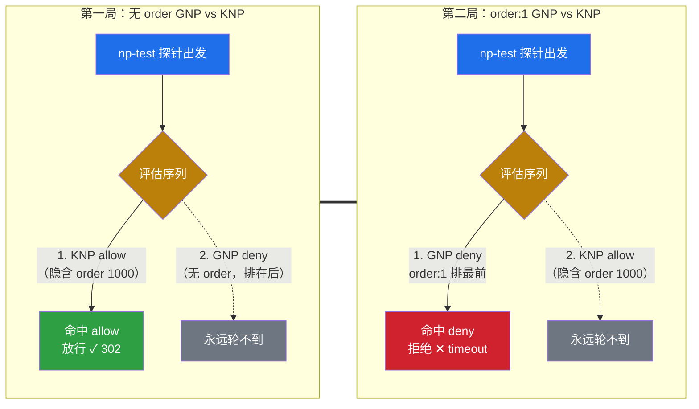
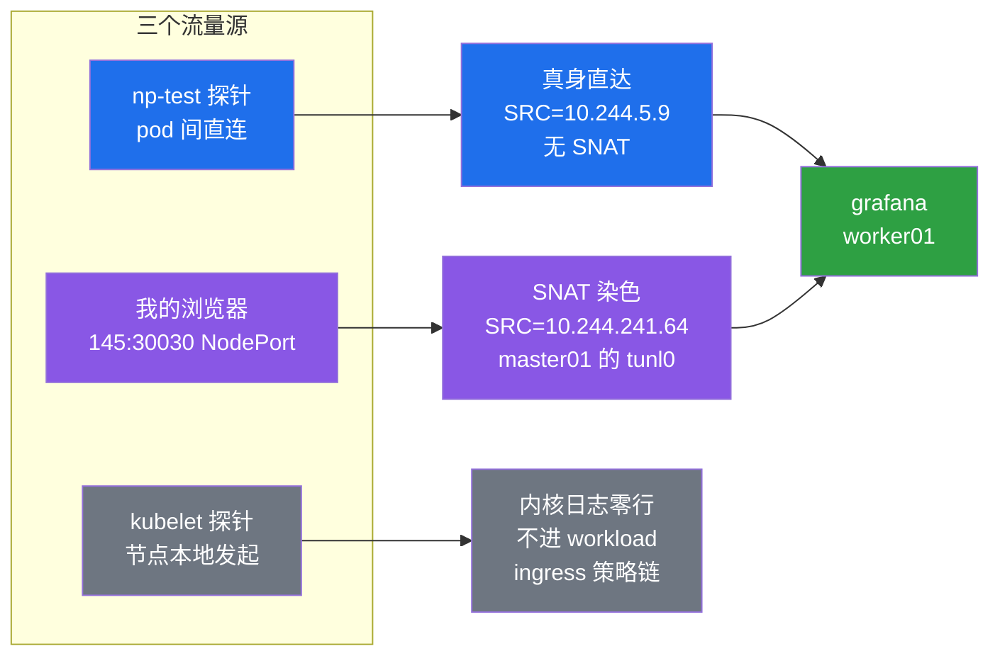
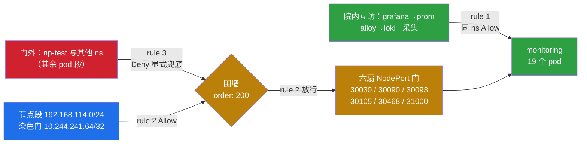

# NetworkPolicy 判断实录：三道筛、order 裁判权与第一把真锁

!!! note "实测声明"
    本文所有命令与输出全部来自真实环境实测：K8s 1.36.1，3 master + 3 worker（Debian 13，Calico 3.28.2，IPIP 模式，natOutgoing=true）。实验跨 2026-11-02 至 11-04 三个工作段：11-02 晚盘点依赖，11-03 一天跑完巡检、对拍与 Log 观测，11-04 落锁并验收。集群已运行 175 天（2026-05-12 建院），此前从未有过一把 NetworkPolicy。终端输出逐字回填自当天落盘文件（master01:~/np-decision-lab-logs/，g01–g05 系列），Log 类内核日志行标注"节选"处为中段字段省略，其余未做改写。涉及 Calico 机制的部分，官方文档与源码引用均在文中给出出处。

## 上一篇教怎么锁，这一篇回答该不该

[上一篇 NetworkPolicy 上锁实录](networkpolicy-lockdown.md)以 deny-all、白名单和 DNS 例外给出了隔离一个 namespace 的做法。但那篇回答的是"怎么锁"，实验做完第二天，我就被一个更前面的问题卡住了：

```
# np 实操篇发布 10 天后，再看一遍这个数字：
$ kubectl get networkpolicy -A
No resources found
```

10 天前是 162 天零 NP，现在是 173 天。集群里 16 个 namespace、93 个 pod，我一把锁都没上。不是忘了——是不敢。

全锁是过度安全：每给一个 ns 上 deny-all，就多一套例外门要维护，锁错一条就是生产事故。不锁是裸奔：任何 pod 可以直连任何 pod，包括 monitoring 里的 Prometheus、Grafana、Loki。前文讲的是手术刀怎么握，这一篇要回答的是**该对谁下刀、切多深**。

两头都有反例。锁太狠的例子，[NetworkPolicy 上锁实录](networkpolicy-lockdown.md)中记录过：egress 白名单需要考虑 DNAT 后的 Pod 地址，写错一个 CIDR，业务就可能中断。不锁的例子更近：我集群 173 天里，任何 ns 里的任何 pod 都能直连 Grafana 的 30030——只是没人试过而已。

所以这篇的实验计划倒过来：先不碰一把锁，先把"该不该锁"这道判断题做出来。

## 三道筛：共享、合规、敏感

判断式的第一版其实很简单，一个 ns 只要过三道筛：

**共享腿**——这个 ns 里住的是不是多人共享的服务。共享意味着租户互相可见风险上升，锁的收益最大。我的集群里 monitoring 是典型：整套监控栈（Prometheus/Grafana/Loki/Alertmanager）都在里面，是全集群的公共设施。

**合规腿**——有没有合规要求强制隔离。生产环境这一腿最常见（PCI-DSS 的支付段、等保的三级边界）。我这测试集群没有正式合规约束，这一腿全集群为空——但真实环境里它经常是一票否决。

**敏感腿**——服务本身敏感不敏感。管理面、密钥、数据库这类"拿到就能横向"的服务，就算单租户也值得锁。

三腿全空，还有一条兜底判断：**出事的时候你多想知道"是谁干的"**。NP 的白名单语义天然带审计性——放行清单就是流量清单。我集群里 alloy（日志采集）+loki（日志存储）都在 monitoring，这条兜底腿居然也指向同一个 ns。

三道筛筛完，16 个 ns 的过筛预判出来了（合计 93 个 pod）：

```
# 16 ns 过筛预判（三腿初筛）：
monitoring（19 pods）       敏感腿全中——Grafana 凭证/Loki 日志/告警栈全在内，强候选
headlamp（1 pod，144d）     K8s 管理 UI，敏感腿——但暴露方式未知，盘点前不下结论
kube-system（37 pods）      锁=自杀判例：静态 pod/kube-proxy/coredns 全在里面
metallb-system（14 pods）   speaker 全 hostNetwork，网络身份=节点，锁它可能是空气
ingress-nginx / envoy-gateway-system / metallb-lab   南北向的门本身，豁免
default（8）/mimir（2）/alert-translator（1）/local-path-storage（1）/ 实验场   默认裸奔
```

结论：**值得现在动手的只有两个**——monitoring（敏感腿全中）和 headlamp（敏感腿、暴露方式待查）。kube-system 是"全锁是过度安全"的最强反例，37 个 pod 里躺着 apiserver 的静态 pod、kube-proxy、CoreDNS，锁上去等于给集群上吊；实验 ns 用完就拆，不值得投资；alert-translator 是弱候选（告警出口，被动接收器，后面会看到它的锁其实要挂在别处）。**判断的输出不是一把万能锁，是一张分级的名单。**

!!! tip "分层替代"
    判断"不过三道筛"的 ns 也不代表裸奔到底。分层替代从 L0 到 L3：L0 裸奔（接受）、L1 只做审计观察（Log 先行，本文后半段的主角）、L2 部分锁（只锁 Ingress 或只锁 Egress）、L3 全锁（deny-all + 白名单）。判断式的输出是档位，不是布尔值。

## 巡检是判断的前置

三道筛是纸面判断，落刀前还得知道集群的真实暴露面——纸面上的 ns 清单和实际的端口暴露是两回事。巡检跑四件事：NodePort 暴露面、管理面 UI 位置、Ingress 数量、重启异常榜。

monitoring 的盘点一跑就心跳加速：13 个 Service，4 个带 NodePort，共 6 个端口对外——Grafana 30030、Prometheus 30090、Alertmanager 30093/30105、Loki 31000，还有一个 30468。全部是"拿到就能横向"的敏感腿服务。

```
$ kubectl -n monitoring get svc | grep -E 'NAME|NodePort'
NAME                          TYPE        ...  PORT(S)
alertmanager-prometheus-...   NodePort    ...  9093:30093/TCP, ...
grafana                       NodePort    ...  30030:30030/TCP
loki                          NodePort    ...  3100:31000/TCP
prometheus-kube-...-prometheus NodePort   ...  9090:30090/TCP, ...
```

第二个发现更扎眼：Headlamp——Kubernetes 管理面 UI——挂在 31152 NodePort 上，全节点可达，就这么裸了 144 天。盘点前我知道它存在，没意识到它以什么姿势存在。关于 Headlamp 的部署与访问方式，可参阅[Headlamp 使用说明](../kubernetes/tools/headlamp.md)。

巡检的重启榜顺带翻出三桩旧账，每一桩都是"RESTARTS 大数不分诊，分诊要用 lastState"的活教材：

**第一桩，pod-src 的 1363 次。** default ns 里一个叫 pod-src 的 pod，RESTARTS 列 1363，全场最高。真凶十分钟结案：describe 一翻，command 是 `sleep 3600`——每小时自然退出一次、重启计数加一，56 天 ≈ 1363 次，除法精确成立。这是一台在合规运转的钟表，不是一起故障。

**第二桩，calico-kube-controllers 的 313 次。** 这个吓人得多——CNI 的控制面。但 describe 里的 lastState 终止于 2026-09-14，exit 1 Error，之后 50 天零复发。上次重启发生在 apiserver 停机窗里（那次实验我亲手停过 apiserver），watcher 断线重连的阵痛，过去了就是过去了。

**第三桩，Grafana 半死 18 天。** 两套 ReplicaSet 并存：新的 2/3 ImagePullBackOff——`grafana:13.0.1-security-01` 这个 tag 从第一天就没拉下来过（Image ID 是空的）；旧的 3/3 Running 硬扛着。也就是说升级失败之后，Grafana 一直靠旧版本撑着，我自己毫无察觉。undo 收官：回滚后 pod 名回滚、revision 回到 5、旧 spec 复用，一次都没真死过。

!!! note "对账的三课"
    同一份重启数据，kubectl 和 Prometheus 的读数对不上是正常的：kubectl 的 RESTARTS 列是**多容器求和**（一个 2/2 的 pod 重启 2 次，kubectl 显示 4，Prometheus 的 `kube_pod_container_status_restarts_total` 是 per-container，显示 2）；pod 被删序列就消失（instant query 查不到已删对象，榜上的"缺席者"本身就是信息）；跨源对账必须先注明双方口径，再谈数字差异。

## 巡检翻出的旧案：8 月 24 日那 14 小时

巡检还干了一件计划外的事：把一桩三个月的悬案办结了。

前史很短：[Grafana 监控盲区实测](grafana-first-open-blind-spot.md)时，我注意到 worker03 在 8 月 24 日有一次容器重启，exit 255、reason Unknown——虚拟化层查无重启记录，悬了两个月。[Kubernetes DNS 实验](k8s-dns-records.md)又补一刀：CoreDNS 双 Pod 同日 exit 255，相隔 15 秒——worker02 也在场。Unknown+255 是容器层能给出的最含糊的死法——进程被外部信号杀死时，容器运行时自己也说不清。

这次巡检把六台节点的 node-exporter 全查了一遍：**8-24 那个早晨，六台全部有同签名的重启记录**。这不是 pod 级事件，是节点级事件。嫌疑自然升级到 containerd——六台同时出问题，共用层只剩它。

往下查撞了第一堵墙：journalctl 查那个时间窗，返回 No entries。反复确认命令没写错之后才反应过来——**journalctl 的 --since/--until 默认吃本地时区，而 K8s 事件时间戳是 UTC**。容器退出时间 00:16Z 不是半夜零点十六，是本地早上八点十六。换算时区重查，条目全在。

然后是定案的一击：

```
$ sudo journalctl --list-boots | head -3
IDX  FIRST ENTRY              LAST ENTRY
 -2  2026-05-23 17:47:xx      2026-05-24 21:29:xx
 -1  2026-05-24 21:29:xx      2026-08-23 18:06:57
  0  2026-08-24 08:16:01     …
```

boot -1 在 8-23 18:06:57 戛然而止，boot 0 从 8-24 08:16:01 开始——**中间是 14 个小时，六台节点全部如此**。这不是故障，这是关机。

人证随后合流：那是个周末，机房做了计划停电。虚拟化层的记录也对上了。开机后 1 分 44 秒，六台的 kubelet 全部起来，node-exporter 的容器清尸上报发生在 08:16:09（kubelet 醒来后替停机期间"失联"的容器补的死亡证明），新容器 08:16:59 就位。容器日志里那个 exit 255/Unknown，是 kubelet 对"我睡着的时候你死了"的官方口径。

两个彩蛋送给较真的读者。其一：master02 的防火墙日志里每 2 分 05 秒一条 IGMP BLOCK，节奏精准，到断电那一秒戛然而止——**计划内断电连遗言都没有**，和故障死法的区别不在日志内容，在你有没有提前知道。其二：master02 的最后一条日志停在 17:17:01，一条 CRON 整点任务——它死在了报时的那个瞬间。机器分不清计划内和意外，人分得清，所以停机窗口要有记录。

这桩案子对判断篇的意义：**K8s 有失忆症，容器只记 Unknown/255，真答案在基础设施层**。巡检的价值不只是盘点暴露面，它还是集群的史官——你以为已经翻篇的事，数据里全留着。

## Calico 的两张脸：一个 apiVersion 引发的 NotFound

判断做完，选工具。CKA 考纲只考原生 NP，但生产里我想要"集群级一把锁"——不用进每个 ns 逐个部署。这正是 Calico GlobalNetworkPolicy（GNP）的定位。

然后我踩了这系列实验里最经典的一个坑。写 manifest 时，apiVersion 我凭文档记忆填了 `projectcalico.org/v3`——这是 Calico 官方文档里所有示例的标准开头。dry-run 一跑：

```
$ kubectl apply --dry-run=server -f gnp.yaml
error: resource mapping not found for name "gnp-deny-nptest-to-monitoring":
no matches for kind "GlobalNetworkPolicy" in version "projectcalico.org/v3"
```

`no matches for kind`——要么 CRD 没装，要么组名不对。而几个小时前的巡检里，我明明用 CRD 全名查到过它。对着 api-resources 一列：

```
$ kubectl api-resources --api-group=projectcalico.org
# （零行）
$ kubectl get crds | grep calico | wc -l
18
$ kubectl get crds | grep globalnetworkpolic
globalnetworkpolicies.crd.projectcalico.org   ...   2026-05-12
```

18 个 Calico CRD 全家都在，但组名是 **crd.projectcalico.org**，不是文档脸的 projectcalico.org。两张脸的分工后来查明白了：`projectcalico.org/v3` 只在装了 calico-apiserver 的集群 served；我这 kubectl 直连 CRD 的集群，活的那张脸是 `crd.projectcalico.org/v1`。

讽刺的是定罪的整个过程：巡检时我敲的命令是 `kubectl get globalnetworkpolicies.crd.projectcalico.org`——全名形态，组名写对了；写 manifest 时却没回头抄自己的作业，凭文档记忆另起炉灶写错。**旧命令里写对过的形态，派生新对象时要回头抄。**这条纪律现在贴在我所有涉及 CRD 的操作前。

修复一行：apiVersion 换成 `crd.projectcalico.org/v1`，dry-run 立即通过。

## 锁不需要目标同意

工具选定，第一个实验要回答一个授权模型的问题：GNP 管 monitoring 的流量，需要 monitoring 侧做任何配合吗？

不需要，而且这是实测出来的。实验场照旧搭在 np-test：一个 busybox 工具 pod src 钉在 worker01，monitoring 侧零改动、零 NP、零知情。然后我从集群级下一把方向锁——注意锁形：**selector 选的是 np-test 的 endpoints，types 是 Egress**——锁装在来源侧，管住 np-test 的手，规则里指名不许去 monitoring：

```yaml
# G2b 一刀流（骨架节选）：
apiVersion: crd.projectcalico.org/v1
kind: GlobalNetworkPolicy
metadata:
  name: gnp-deny-nptest-to-monitoring
spec:
  selector: projectcalico.org/namespace == 'np-test'   # 锁来源侧
  types:
  - Egress
  egress:
  - action: Deny
    destination:
      namespaceSelector: projectcalico.org/name == 'monitoring'
  - action: Allow        # 其余出向放行兜底
```

apply 回执 `created`，三探针（grafana/prometheus/alertmanager）立刻全部 timeout。monitoring 里没有、也不需要有任何一把 NP——**流量被拒的时候，被拒绝的目标侧毫不知情**。官方文档对 GNP 的定义也直说了：applies to workload endpoint resources in all namespaces。锁不需要目标同意，甚至不需要目标察觉。

方向选择本身是个知识点：同一个"np-test 不许进 monitoring"的意图，有两种写法——锁来源的出向（本节，egress 挂 np-test）或锁目标的进向（ingress 挂 monitoring，本篇最后的真锁就是这个形态）。前者精准打一个来源，后者是一堵围墙挡所有来源。选哪种取决于你要"处理一个坏人"还是"保护一个院子"。

这个性质有两面。好的一面：平台团队可以从集群级给流量定规矩，不需要逐 ns 协调。危险的一面：**墙外的锁不经过目标侧的同意，误伤时目标毫无线索**。生产里用它，配一条"谁锁的、为什么、怎么拆"的注释是底线礼仪。

可逆性也验了：delete 这把 GNP，3 秒后三探针全部回到 302/200/200，与锁前基线逐位一致。felix 撤规则没有延迟窗口。装锁快、拆锁快，这对实验是幸运，对生产是提醒——这把锁没有"半开"状态。

小注脚一枚：apply 的回显用单数（`globalnetworkpolicy.crd.projectcalico.org/... created`），delete 要用复数（`kubectl delete globalnetworkpolicies.crd.projectcalico.org <name>`）。CRD 名的两副面孔 kubectl 都吃，但文档里查不到 singular 形态，第一次拆锁的人会在这里卡半分钟。若要先熟悉 Calico GNP 的隔离配置，可从[NetworkPolicy 上锁实录](networkpolicy-lockdown.md)中的逐步实验开始。

## order 是唯一的裁判

下一个问题关系到锁与锁之间的相处：如果 monitoring 侧自己将来上了一把 K8s 原生 NP 放行某流量，而我的 GNP 在 deny 它——谁赢？

这个问题的默认答案和我猜的不一样。实验是单变量对拍，np-test 三探针当裁判：

**第一局，无 order 的 GNP deny vs K8s 原生 NP allow。** monitoring 里上一把原生 NP 放行来自 np-test 的流量（namespaceSelector 用 `kubernetes.io/metadata.name` 选 np-test，np 实操篇 F2 的同款语法）。GNP 维持 deny。结果三探针 302/200/200——**放行赢了**。

先别急着下结论，还记得上一节吗：G2b 里 GNP 单独在的时候，deny 是实打实生效的（三探针 timeout）。所以这不是"GNP 软"，是两把锁同时在场时的排序问题。

**第二局，给 GNP 加一行 `order: 1`，其余全部不动。** 翻转了：三探针全部 timeout，deny 赢回来。

三点连线——GNP 单独在：deny 生效；无 order GNP + KNP：KNP 赢；order:1 GNP + KNP：GNP 赢。变量只有一个：order。

机制的三个钉子，每个都有自己的出处：

**钉子一，官方文档**（v3.28 GNP 参考，order 字段原文）：*"Calico applies the policy with the lowest value first."* order 升序应用，先到的先裁决。

**钉子二，源码**（v3.28.2 libcalico-go 的 k8s conversion 层——kube-controllers 翻译 KNP 时调用的模块，L281 起）：

```go
// We insert all the NetworkPolicy Policies at order 1000.0 after conversion.
// This order might change in future.
order := float64(1000.0)
```

每把 K8s 原生 NP 被 Calico 接管时，都会被注入 order 1000.0。**原生 NP 在 Calico 的世界里有隐含身份，它不是白丁。**顺带注意那条注释——"This order might change in future"，Calico 自己都提醒你别硬编码这个假设。

**钉子三，实测反推**：无 order 的 GNP 输给了 KNP（1000.0），order:1 的 GNP 赢了它——无 order 排在有 order 的之后，这是两局对拍反推出的行为。



生产含义比实验本身更重要：**GNP 不写 order 时，天平倾向 K8s 原生 NP**——ns owner 的本地策略压过平台的全局锁。这个默认对"锁不需要目标同意"是一个漂亮的制衡：平台能上锁，租户能翻案，代价是租户得知道自己被锁了。而当平台真的需要不可翻案的地板线时（合规硬边界），给 GNP 一个小于 1000 的 order——但这时候你锁的就不是"引导"而是"强制"，锁的伦理等级也该升一级。

我最终的真锁用了 order: 200——小于 1000，压得住未来的 KNP；但不是最小值，给将来更底线的锁（比如集群级合规地板）留了往下插的空间。

## 上真锁前的三重困境

真锁 monitoring 之前，最后一轮是依赖盘点：锁上之后，谁会撞墙？

第一翻车当场发生。我最初的锁形里有 egress 锁的设想，理由是"收掉 monitoring 的出向"。对着实际流量一对，方向就错了：alert-translator（告警出口）是**被动接收器**——AM 推告警给它，它翻译转发飞书。要保护它，锁的是它自己的 ingress（谁能不能推告警给它），跟 monitoring 的 egress 没关系。查它 env 只有 TZ、PA_OPEN_FEISHU、PA_FSURL 三个变量，没有任何主动外呼的凭据。**依赖的方向比依赖的存在更重要。**

第二翻车更险。如果锁 monitoring 的 egress，第一个死的是监控自己：Prometheus 的采集目标是**全集群的 exporter**——六台的 node-exporter、各 ns 的 kube-state-metrics、apiserver 的 145——全是从 monitoring 出去的流量。锁出向=监控自杀。这一刀要是上去了，第一批告警会准时到达：monitoring down，发信人是已经死了的 monitoring。**锁 egress 前先数一遍"从这个 ns 出去的箭头"，比数进来的更重要，因为出向箭头里藏着它自己赖以为生的东西。**

于是锁形定型为 Ingress-only：只管进来的，不管出去的。

然后是第三关，也是最有意思的一关：**NodePort 的三重困境**。前面巡检说过，monitoring 有 6 个 NodePort 端口对外。NodePort 流量经 ETP=Cluster 的 kube-proxy 转发时会做 SNAT，源地址变成节点 IP——和 kubelet 健康探针的源同段。也就是说：

- 放行节点段（192.168.114.0/24）→ 浏览器从 NodePort 进来也畅通 → 锁了个寂寞；
- 只放行 pod 段 → 探针和浏览器一起被拒 → 生产事故；
- 都不放 → 同上，只是死得更整齐。

三选一全输。这道题的正确解法不是选，是**先看清楚真实流量的样子再出牌**——下一节。

## Log 先行：先观测，后动刀

Calico 的 GNP 有一个无杀伤的观测动作：`action: Log`。规则命中时往内核日志写一行完整的包头，放行拒绝都不影响。我用它搭了一把"透明锁"挂在 monitoring 的 ingress 上，让真实流量先走一天，看清三件事：探针从哪来、浏览器从哪来、集群内互访长什么样。

第一轮观测就翻车了，翻在我自己的取证姿势上：np-test 探针照常 302（Log 确实无杀伤），但 journalctl 查内核日志，零行。反复检查才想起来一件本该第一时间想起的事：**iptables 的 LOG 落在"评估这条规则的那个节点"的内核日志里**——monitoring 的 pod 都在 worker 上，我在 master01 上读日志，读的是一座空城。master01 上能被 GNP 选中的 workload 端点几乎不存在（node-exporter 是 hostNetwork，不走 workload ingress 链）。换成 worker02 重查，一行金线当场显影：

```
# worker02 内核日志，grafana → prometheus 的新连接（节选，中段字段省略）：
calico-packet: IN=tunl0 OUT=cali676e19a904c SRC=10.244.5.4 DST=10.244.30.124 ... DPT=9090 SYN
```

一行日志四个知识点：SRC=10.244.5.4 是 grafana 的**真身 pod IP**（走 ClusterIP 被 DNAT 后，日志里看到的是解马甲后的真源——这与[Service ClusterIP 的 iptables 转发链路](../kubernetes/architecture/network/clusterip-link-deep.md)相互印证，也复核了[NetworkPolicy 上锁实录](networkpolicy-lockdown.md)中"ipBlock 要按 DNAT 后真身开"的结论）；IN=tunl0/OUT=cali 接口暴露了 IPIP 隧道的进出路径；DPT=9090 是 prometheus；SYN 说明这是新连接的第一包。

然后是三个流量源各自的真身，全部由日志钉死：



**探针的零行是最大的意外收获。**两轮观测窗口、worker02 上的 AM 和 prometheus 被 kubelet 探了 8 分钟（50–100 次 readiness/liveness），内核日志里零行——节点本地发起的探针流量根本不进 workload 的 ingress 策略链。也就是说三重困境的第二条担忧（"只放 pod 段=探针死"）是个**纸老虎**：探针压根不走这扇门。[NetworkPolicy 上锁实录](networkpolicy-lockdown.md)曾观察到 `exec` 流量对 NP 的边界行为；这里通过 GNP 与 kubelet 探针进一步观察到，节点自己发起的流量不受 workload 级策略管辖。

**浏览器的染色是三重困境的另一半答案。**18:02:46，一行 SRC=10.244.241.64 的日志——10.244.241.64 是 master01 的 tunl0 地址。我的浏览器从 145:30030 进来，被 SNAT 染成了 master01 的隧道口颜色。这意味着"放 pod 段=浏览器混进来"从嫌疑变成了实锤反证：**放行整个 pod CIDR 确实会放进浏览器流量，但浏览器只会染成"你走的那台节点的 tunl0"**——它是可预测的单点，不是整个 pod 段。

顺带一个我自己的行为学彩蛋：18:02:52，六条并发连接、源端口 42868–42926 连续递增，目标是 prom——那是我打开某个 dashboard 的瞬间，grafana 一次拉起六个并发查询。关于监控面板、数据源与 Grafana 运维的更多实测，可参阅[Grafana 监控盲区实测](grafana-first-open-blind-spot.md)。**日志里能看到使用者的指纹**，这既是 Log 动作的取证价值，也是它的隐私提醒。

三重困境到此有了完整解法：探针根本不受锁管辖（零行实证）；浏览器染的是固定节点的 tunl0 单点；真正需要放行的只有"同 ns 互访"和"我的固定访问路径"。

## 信任域模型与真锁

最后一步是把观测结果翻译成锁形。我的分界线是**信任域**而不是网段：

- **门内（trusted）**：monitoring 自己的 pod（监控栈内部互访）+ 节点段 192.168.114.0/24（本地直达场景）+ 我固定路径的染色门 10.244.241.64/32（master01 tunl0，实测单点，不猜）
- **门外（untrusted）**：其余所有 pod 段——跨 ns 的任何工作负载

注意染色门为什么是 /32：我只观测过 145 这一条路径，六台节点的 tunl0 值我没有全量数据——**实测到什么程度，放行到什么程度**，不猜全节点。

```yaml
apiVersion: crd.projectcalico.org/v1
kind: GlobalNetworkPolicy
metadata:
  name: gnp-lock-monitoring-ingress
spec:
  order: 200
  selector: projectcalico.org/namespace == 'monitoring'
  types:
  - Ingress
  ingress:
  - action: Allow
    source:
      selector: projectcalico.org/namespace == 'monitoring'   # 门内互访：六连发/采集/alloy→loki
  - action: Allow
    source:
      nets:
      - 192.168.114.0/24     # 节点段：本地直达 + 探针（本来就 bypass，双保险）
      - 10.244.241.64/32     # 染色门：我的固定路径
  - action: Deny              # 显式兜底：不赌隐式默认语义
```

三个设计决定值得展开。**同 ns 放行用 selector 而不是枚举**——alloy、kube-state-metrics、node-exporter 全在 monitoring 里，枚举会漏，selector 一网打尽（差点漏掉采集目标这茬：锁了才知道 prometheus 的眼睛也在院内）。**Deny 兜底显式写**——未匹配流量的默认语义我不赌文档，锁簧看得见比文档翻得对更可靠。**order: 200 显式写**——上一章的裁判权实验说过，order 是唯一的裁判，显式身份证是生产纪律。

落锁顺序照旧：dry-run 先行。server 端模拟创建的回显里，nets 两个值原样收回、order 收下、三规则镜像无损——schema 层三关（字段认不认、类型对不对、静默丢没丢）全部在写入前过完。然后 apply：

```
$ kubectl apply -f gnp-lock.yaml
globalnetworkpolicy.crd.projectcalico.org/gnp-lock-monitoring-ingress created
```

175 天的裸奔到此为止。接下来是四张验收单：

**单 1，恶意侧：三探针全灭。** np-test 的 src 对 grafana（IP 直打 10.110.76.187:80）、prometheus（DNS 名）、alertmanager（DNS 名）三连探，全部 `wget: download timed out`。三个目标两种寻址形态，锁全拦。

中间还有一段自首插曲：alertmanager 那发探针首发写错了名字，`bad address`——我把 STS 名当成了 svc 名（alertmanager- 开头的是 statefulset，它的 pod 叫 …-0；svc 真名不带这个前缀）。预注册的判读规则"bad address=名字错，timeout=锁生效"当场把两类失败分开：名字错不冒充锁生效，正名补发（10.108.239.29:9093 解析一致后 timeout）才算数。

**单 2，主人侧：人证。** 我从浏览器开 145:30030，dashboard panel 出数——这一单双证：我的访问路径没被自己的锁误伤（染色门工作正常），且 grafana→prometheus 的院内六连发在锁下通行（selector 放行工作正常）。

**单 3，院内居民：零误伤。** apply 后半小时复查 monitoring 全部 19 个 pod：READY 满格，RESTARTS 与基线**逐行全同**——alertmanager 2、operator 1、prometheus 2、node-exporter 各 1，全部还是 "72d ago" 的历史戳（8-24 停电那晚的印记，几章以前刚办结的旧案在重启列里留的档案）。锁上前后，院内居民无感。

**单 4，圈外抽查：headlamp。** 在自家 ns，1/1 Running，锁圈外——判断篇给它的"下一站"标记不变。

```
$ kubectl get globalnetworkpolicies.crd.projectcalico.org
NAME                          AGE
gnp-lock-monitoring-ingress   10m
$ kubectl get networkpolicies -A
No resources found
```

终态：**全集群 1 把 GNP、0 把 NP，唯一的策略对象就是这把真锁**。np-test 保留为常备探针源——以后任何对锁的改动，一发探针就能验证锁还活着。

## 围墙不是门，锁是活的

回头看 svc 清单会发现这把锁的一个特性：monitoring 挂着 6 个 NodePort 端口（30030/30090/30093/30105/30468/31000），而锁里没有任何一个端口号。**GNP 圈的是围墙，不是逐门挂锁**——写六条 per-service 规则的思路，在 ns 边界模型面前直接作废。将来 monitoring 加第十扇门，不用回来改锁。



代价是锁需要养。三笔维护账当场记下：

- **换路径访问会撞锁**：染色门只放 241.64（master01 tunl0）。哪天我从 146:30030 进来，染的就是 master02 的色，被锁拒。修法是补对应节点的 tunl0 IP——或者干脆收编成 Ingress 统一入口（那时给 ingress-nginx ns 加一条放行；可参考[Gateway API 与 Ingress 安装实录](gateway-api-installation.md)了解入口组件的部署与流量路径）。
- **重调度会换门**：grafana 若被调度到 master01，我的流量变成本地直达，源从染色 IP 变成节点真身——节点段 114/24 兜得住我，但这是运气不是设计，搬迁时要重审。
- **探针 bypass 是"节点无籍"的另一面**：节点本地流量不受 workload 锁管辖，今天护住了探针，明天同一个机制也可能放进某个以节点身份进来的东西。它是特性也是盲区，记在锁的说明书里。同族的还有 hostNetwork Pod——网络身份就是节点本身，workload 锁对它也是空气（MetalLB speaker 就是这个形态；可参阅[MetalLB L2 模式与故障切换实测](metallb-l2-teardown.md)，此处是基于其 hostNetwork 部署方式的推论，并非该文中的 NetworkPolicy 实测）。

headlamp 的 31152 还在全节点裸着——它没过三道筛的"值得现在锁"线（单租户、无凭据暴露），但它是名单上的下一个。收编它的路径不是再来一把 GNP，而是先回答"管理面 UI 到底该以什么姿势暴露"——Ingress 收编、port-forward 临时通道，还是干脆撤掉 NodePort。Headlamp 的部署背景可从[Headlamp 使用说明](../kubernetes/tools/headlamp.md)了解；具体访问面如何收敛仍需结合实际环境评估。

## 带走三件事

两天的判断篇，浓缩成三个可以今天就在自己集群上做的动作：

**先查裸奔天数，再过三道筛。** `kubectl get networkpolicy -A` 加 `kubectl get globalnetworkpolicies.crd.projectcalico.org`——两个都查，因为原生 NP 和 GNP 是两本账。查完别急着锁，过共享/合规/敏感三道筛，输出一张分级名单，L0 裸奔到 L3 全锁四档，大部分 ns 的答案是中间档。

**上锁前 Log 先行。** 一把 `action: Log` 的透明锁挂上去，让真实流量先走一轮——探针从哪来、浏览器染什么色、院内谁在互访，内核日志全招了。三重困境这种"怎么选都输"的题，观测一轮之后往往发现题目本身是错的（探针根本不走这扇门）。

**巡检是判断的前置。** RESTARTS 大数不分诊，分诊看 lastState 的退出时刻和 exit code；纸面 ns 清单不等于暴露面，NodePort 一列才知道管理面 UI 裸了多久。巡检还翻出三个月前的停电悬案——K8s 有失忆症，数据没有。

最后留给较真读者一个实验：给你的 monitoring 挂一把 Log 透明锁，数一数 SRC 的种类。如果里面有你认不出来的来源——恭喜，你的判断篇比我的更有料。

## 推荐阅读

- [NetworkPolicy 上锁实录：deny-all 总闸、白名单放行与 DNS 例外](networkpolicy-lockdown.md)：从判断走到实践，了解默认拒绝、白名单、DNS 放行及 Service DNAT 对策略匹配的影响。
- [Kubernetes DNS 实测：ClusterIP、Headless Service 与 ndots](k8s-dns-records.md)：延伸阅读本文发现的 DNS 流量与集群内服务解析问题。
- [Grafana 仪表盘实测：Kubernetes 监控盲区为何仍显示正常](grafana-first-open-blind-spot.md)：了解本文盘点的监控栈、Grafana 面板和监控盲区。
- [Service ClusterIP 为什么 ping 不通？kube-proxy + iptables 链路拆解](../kubernetes/architecture/network/clusterip-link-deep.md)：理解 Service DNAT 后的流量路径与源地址变化。
- [SNAT 三种场景：从 hairpin 到 NodePort 的源地址改写](../kubernetes/architecture/network/snat-three-scenarios.md)：进一步理解 NodePort、SNAT 与客户端源地址保留。
