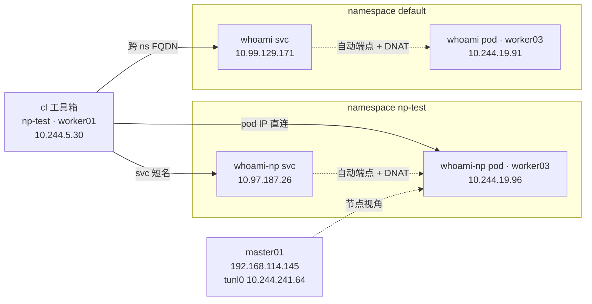
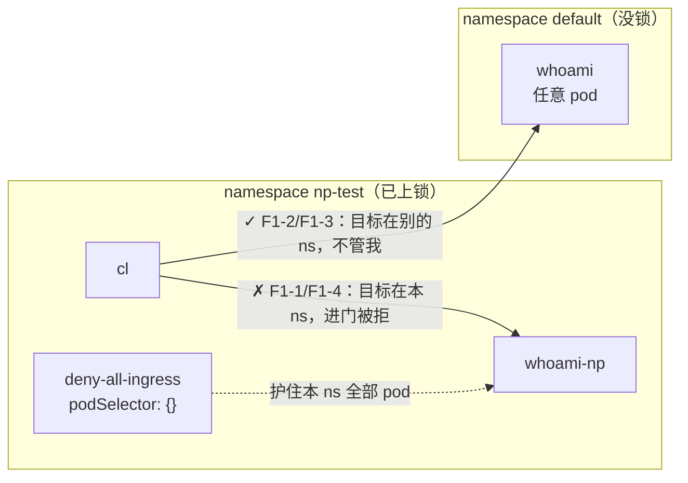
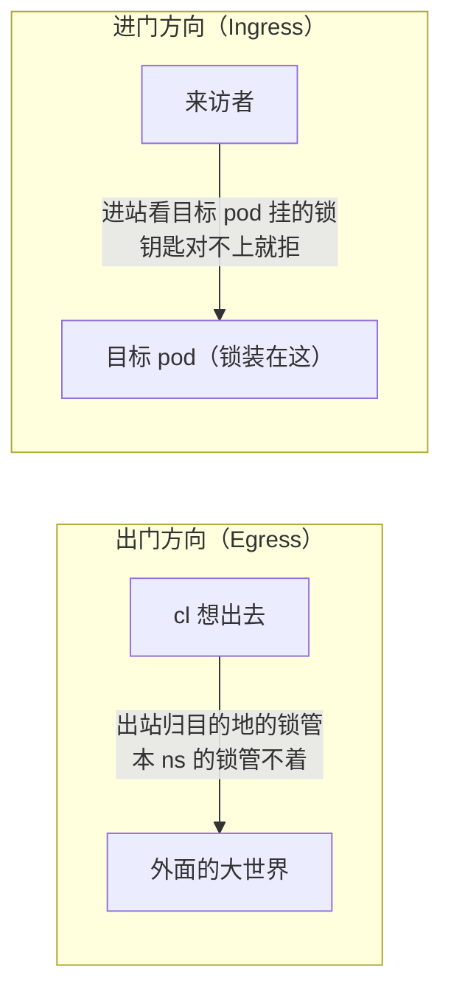
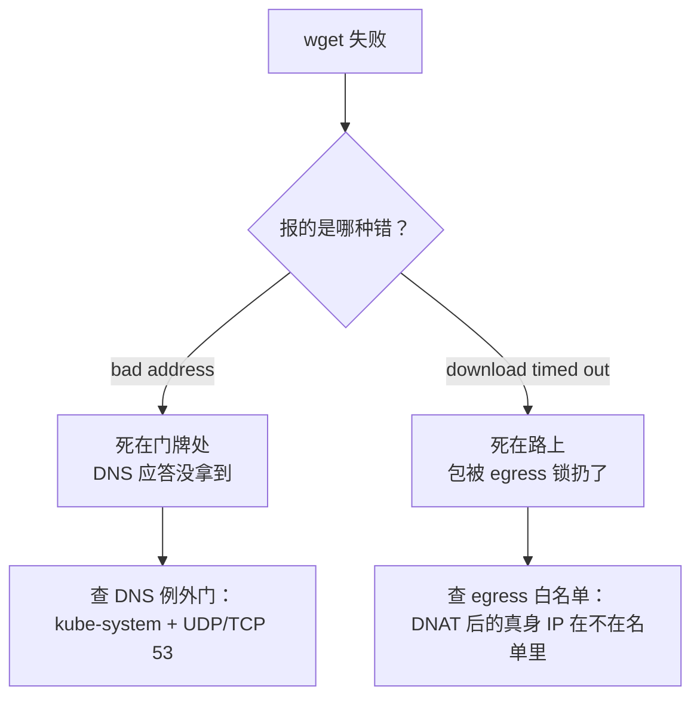
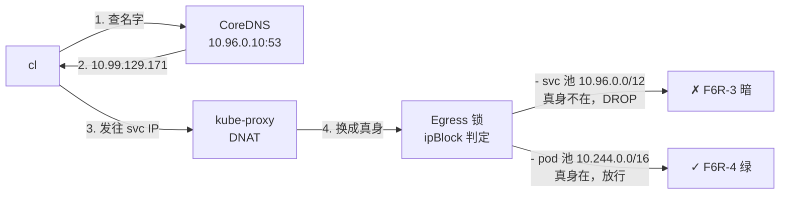

# NetworkPolicy 上锁实录：deny-all 总闸、白名单放行与 DNS 例外

!!! note "实测声明"
    本文所有命令与输出全部来自真实环境实测：K8s 1.36.1，3 master + 3 worker（Debian 13，Calico 3.28.2，IPIP 模式，natOutgoing=true）。实验执行于 2026-10-22 一天之内（10:00–17:58，八批 + 一场彩蛋复盘）。集群已运行 162 天，此前从未有过一把 NetworkPolicy。终端输出逐字回填自当天落盘文件（master01:~/np-lab-logs/，共 11 件 raw），除标注"节选"外未做任何改写。

## 先看两个输出

```
# 集群运行 162 天后的网络策略存量：
$ kubectl get networkpolicy -A
No resources found
```

```
# 第一把锁上了 20 分钟后，我预测跨 ns 访问"应该还是暗"：
=== F2-2 跨 ns FQDN（预注册：仍暗）===
Hostname: whoami-56747fc899-hlclc
IP: 127.0.0.1
IP: ::1
IP: 10.244.19.91
IP: fe80::7045:d2ff:feac:27a2
RemoteAddr: 10.244.5.30:51102
GET / HTTP/1.1
Host: whoami.default.svc.cluster.local
User-Agent: Wget
Connection: close

wget exit=0
```

第一个输出是这个集群的真实状态：**运行 162 天，12 个 namespace，一把 NetworkPolicy 都没有**。任何 pod 可以直连任何 pod，跨 namespace 也一样。上一篇的 [Gateway API 与 ingress-nginx 对比实验](gateway-api-installation.md)讨论北向入口如何接收外部流量；南向的世界——pod 和 pod 之间——却完全敞着。

第二个输出是我翻车的现场：我给 np-test 上了锁，预测跨 namespace 的访问应该还是暗的，结果它亮着，还亮得理直气壮。锁管进不管出——这条规则 K8s 文档里写着，但没被自己的数据打过脸之前，它就只是一句看过就忘的话。

这篇是 CKA 备考 W2 周的实验记录：给一个裸奔了 162 天的集群，第一次穿上网络策略的衣服。一天八批实验，我自己翻车三次，最后换来一套能照抄的上锁配方。

## 一节地基课：先看懂手里的网段

这节地基课是被一个中途冒出来的问题逼出来的：实验 pod 拿到 10.244.5.30，它要访问的 Service 是 10.97.187.26，节点是 192.168.114.x——三套完全不同的号码。为什么？

CIDR 一句话讲完：`10.244.0.0/16` 的意思是"前 16 位是网络号，钉死；后面随便用"。/16 剩 16 位，65,536 个地址；/24 剩 8 位，256 个；/8 剩 24 位，一千六百多万个。位越少，网越大。

这台集群手里就三张网，各归各的发号机。关于 Calico 如何为 Pod 分配地址并实现跨节点通信，可参考 [Kubernetes CNI 工作原理详解](../kubernetes/architecture/network/cni.md)：

| 网段 | 实际范围 | 谁在发号 |
|---|---|---|
| 192.168.114.0/24 | 256 个地址 | 物理网络（节点 145-150、NFS 155） |
| 10.96.0.0/12 | 10.96.0.0 ~ 10.111.255.255 | apiserver（Service CIDR） |
| 10.244.0.0/16 | 65,536 个地址 | Calico（Pod CIDR，每节点再切 /26 块） |

三个都是 RFC1918 私网：10/8 是"大企业默认"，也是我们这台集群的集群内世界；172.16/12 你天天在 Docker bridge 的 172.17.0.x 里见；192.168/16 是家里路由器的段。

发号机也不是同一台脾气：

- **Service 号是 apiserver 从位图里找空位**。所以先建的 whoami 拿了 10.99.129.171，后建的 whoami-np 拿了 10.97.187.26——不是先来后到，是哪空塞哪。
- **Pod 号是 Calico 块内指针**。cl 第一次创建拿到 10.244.5.29，删掉重建，拿到 10.244.5.30——指针不回头。
- 节点号是物理网络的事，K8s 不管。

这节课当天下午就被 apiserver 当场执法了一次（见后文彩蛋章），比我预想的来得早。

## 场地：一个 ns，三个变量

实验场地是新建的 np-test namespace，三个对象：工具 pod cl（busybox，钉在 worker01）、业务 pod whoami-np（钉在 worker03）加它的 Service，再加上 default ns 里[上一篇实验](gateway-api-installation.md)留下的 whoami 当跨 ns 靶子。

```yaml
# ~/np-lab-logs/np-test.yaml（节选）
apiVersion: v1
kind: Namespace
metadata:
  name: np-test
---
apiVersion: v1
kind: Pod
metadata:
  name: cl
  namespace: np-test
  labels:
    app: cl
spec:
  nodeSelector:
    kubernetes.io/hostname: worker01
  containers:
  - name: busybox
    image: swr.cn-north-4.myhuaweicloud.com/ddn-k8s/docker.io/library/busybox:1.36.1
    command: ["sleep", "36000"]
---
apiVersion: v1
kind: Pod
metadata:
  name: whoami-np
  namespace: np-test
  labels:
    app: whoami-np
spec:
  nodeSelector:
    kubernetes.io/hostname: worker03
  containers:
  - name: whoami
    image: swr.cn-north-4.myhuaweicloud.com/ddn-k8s/docker.io/traefik/whoami:v1.11
    ports:
    - containerPort: 80
```

（镜像行是修复后的 1.36.1——首发写的是 `busybox:1.36`，翻车过程见下文。Service whoami-np 段省略：`selector: app: whoami-np`、`port: 80`，就是 svc 表里那行 10.97.187.26。）



第一发就翻了车——不是网络问题，是镜像：

```
NAME            READY   STATUS         RESTARTS   AGE   IP             NODE       NOMINATED NODE   READINESS GATES
pod/cl          0/1     ErrImagePull   0          4s    10.244.5.29    worker01   <none>           <none>
pod/whoami-np   1/1     Running        0          4s    10.244.19.96   worker03   <none>           <none>
```

describe 里 kubelet 说得很清楚：

```
Events:
  Type     Reason     Age                   From               Message
  ----     ------     ----                  ----               -------
  Normal   Scheduled  5m56s                 default-scheduler  Successfully assigned np-test/cl to worker01
  Normal   Pulling    3m (x5 over 5m55s)    kubelet            spec.containers{busybox}: Pulling image "swr.cn-north-4.myhuaweicloud.com/ddn-k8s/docker.io/library/busybox:1.36"
  Warning  Failed     3m (x5 over 5m55s)    kubelet            spec.containers{busybox}: Failed to pull image "swr.cn-north-4.myhuaweicloud.com/ddn-k8s/docker.io/library/busybox:1.36": rpc error: code = NotFound desc = failed to pull and unpack image "swr.cn-north-4.myhuaweicloud.com/ddn-k8s/docker.io/library/busybox:1.36": failed to resolve reference "swr.cn-north-4.myhuaweicloud.com/ddn-k8s/docker.io/library/busybox:1.36": swr.cn-north-4.myhuaweicloud.com/ddn-k8s/docker.io/library/busybox:1.36: not found
  Warning  Failed     3m (x5 over 5m55s)    kubelet            spec.containers{busybox}: Error: ErrImagePull
```

`1.36: not found`。华为镜像源不搬 rolling 别名 tag——Docker Hub 上的 busybox:1.36 是个滚动指针，今天指向 1.36 的某个小版本，但镜像源只同步了具名版本。改成 1.36.1，删掉重建：

```
pod "cl" deleted from np-test namespace
namespace/np-test unchanged
pod/cl created
pod/whoami-np unchanged
service/whoami-np unchanged
=== F2 重验 ===
NAME            READY   STATUS    RESTARTS   AGE    IP             NODE       NOMINATED NODE   READINESS GATES
pod/cl          1/1     Running   0          6s     10.244.5.30    worker01   <none>           <none>
pod/whoami-np   1/1     Running   0          6m4s   10.244.19.96   worker03   <none>           <none>
```

注意 cl 的 IP 从 .29 变成了 .30——刚才那个 ErrImagePull 的 pod 也占过号，Calico 的指针不回头。这是地基课"块内指针"的第一次现身。

## 裸奔基线：四路全绿，还带出两个马甲

上锁前先拍 X 光。四条路各打一遍（下面是节选，砍掉的重复回显行不影响判读）：

```
# F3-0 cl 的 DNS 视角（ndots 基线）：
search np-test.svc.cluster.local svc.cluster.local cluster.local
nameserver 10.96.0.10
options ndots:5

=== F3-1 同 ns svc 短名（cl → whoami-np）===
Hostname: whoami-np
IP: 127.0.0.1
IP: ::1
IP: 10.244.19.96
IP: fe80::90ee:11ff:fe2f:3578
RemoteAddr: 10.244.5.30:44350
GET / HTTP/1.1
Host: whoami-np

=== F3-2 跨 ns FQDN（cl → default 的 whoami）===
Hostname: whoami-56747fc899-hlclc
IP: 127.0.0.1
IP: ::1
IP: 10.244.19.91
RemoteAddr: 10.244.5.30:43468
GET / HTTP/1.1
Host: whoami.default.svc.cluster.local

=== F3-4 同 ns + 跨节点 pod IP 直连（cl → whoami-np）===
RemoteAddr: 10.244.5.30:43948

=== F3-5 master01 节点视角直连 pod IP（上锁钩子预埋）===
Hostname: whoami-np
IP: 10.244.19.96
RemoteAddr: 10.244.241.64:43904
Host: 10.244.19.96
```

（F3-3 跨 ns pod IP 直连同样回绿，四路全绿，节选省略。）

两个细节比"全绿"本身更值钱。

**第一，RemoteAddr 是谁，说明包从哪来。** cl 的每次访问，whoami 看到的来源都是 10.244.5.30——cl 的真身。对比[上一篇 Ingress 实验](gateway-api-installation.md)：走 NodePort 的同一类流量，pod 那头看到的来源是 10.244.5.0——worker01 tunl0 的马甲（那篇里 nginx 门递出的 XFF 就是它，我的真实 IP 被吃掉了）。**pod 直连 pod，没有 SNAT；过节点端口，才套马甲。** 同一对节点，前后两天实验，两个答案。

**第二，master01 敲 pod 的门，亮的是 10.244.241.64。** 这不是 master01 的物理 IP（192.168.114.145），是它 tunl0 接口上的一个 /32 小号。节点要进 pod 的世界，得从 IPIP 隧道的门进，进门的凭证是这张分身。这个 241.64 在第一把锁上完之后还会回来，先记住它。

## 第一把锁：最短的 yaml，最狠的门

```yaml
# ~/np-lab-logs/np-deny-all.yaml
apiVersion: networking.k8s.io/v1
kind: NetworkPolicy
metadata:
  name: deny-all-ingress
  namespace: np-test
spec:
  podSelector: {}
  policyTypes:
  - Ingress
```

五行 spec，两行是关键：`podSelector: {}`——空选择器，选中 np-test 里**全部** pod；`policyTypes: [Ingress]`——管进门方向；ingress 规则列表——没有，一行都没有。

NetworkPolicy 的语义是白名单：**规则列表为空 = 全部拒绝**。这跟 K8s 里大多数对象相反（Service 不写 selector 顶多没有后端，不写规则顶多不路由），但跟上一篇 [Gateway API 的三层门禁](gateway-api-installation.md)同宗——那边 listener 不带 allowedRoutes 也是默认拒。想先建立 Service、Ingress、NetworkPolicy 与 Gateway API 的整体概念，可参阅 [Kubernetes 网络资源详解](../kubernetes/architecture/network.md)。

上锁，八个观测点一轮打完（节选，砍掉的重复回显行不影响判读）：

```
networkpolicy.networking.k8s.io/deny-all-ingress created
NAME               POD-SELECTOR   AGE
deny-all-ingress   <none>         3s

=== F1-1 同 ns svc（预注册：暗）===
wget: download timed out
wget exit=1

=== F1-2 跨 ns FQDN（预注册：亮）===
Hostname: whoami-56747fc899-hlclc
IP: 10.244.19.91
RemoteAddr: 10.244.5.30:51954
Host: whoami.default.svc.cluster.local
wget exit=0

=== F1-3 跨 ns pod IP 直连（预注册：亮）===
Hostname: whoami-56747fc899-hlclc
RemoteAddr: 10.244.5.30:57704
wget exit=0

=== F1-4 同 ns pod IP 直连（预注册：暗）===
wget: download timed out
wget exit=1

=== F1-5 DNS 还活着吗（方向性：ingress 锁不碰出站）===
Server:         10.96.0.10
Address:        10.96.0.10:53

Name:   whoami-np.np-test.svc.cluster.local
Address: 10.97.187.26

** server can't find whoami-np.cluster.local: NXDOMAIN

** server can't find whoami-np.cluster.local: NXDOMAIN

** server can't find whoami-np.svc.cluster.local: NXDOMAIN

** server can't find whoami-np.svc.cluster.local: NXDOMAIN

command terminated with exit code 1

=== F1-6 master01 节点直连 pod IP（深钩子，预注册：暗）===
curl exit=28

=== F1-7 kubectl exec 通道本身（开放观测点）===
exec-channel-alive

=== F1-8 master01 tunl0 身份（钉死 F3-5 的 10.244.241.64）===
3: tunl0@NONE: <NOARP,UP,LOWER_UP> mtu 1480 qdisc noqueue state UNKNOWN group default qlen 1000
    inet 10.244.241.64/32 scope global tunl0
       valid_lft forever preferred_lft forever
```

同一个 cl，同一个瞬间：F1-1/1-4 暗（目标在 np-test 里），F1-2/1-3 亮（目标在 default 里）。**锁的边界就是 namespace 的边界**——这是 NetworkPolicy 最重要的一张图：



另外三个衍生结论，每个都值得单独记：

**节点无籍。** F1-6：master01 直接 curl whoami-np 的 pod IP，超时（curl exit=28）。锁装在目标 pod 上，只认白名单里的来源——白名单按 namespace 发票，master01 这个节点永远领不到 np-test 的票。**上锁之后，你的 curl 连排障资格都没有**，想看目标 pod 活不活着，得走下一条。

**exec 走的是控制面。** F1-7：`kubectl exec` 畅通无阻。这条链路是 apiserver → kubelet 10250 → CRI，根本不走 pod 的数据面——抄表的不走大门。这就是为什么 F1-1 都暗成 timeout 了，wget 命令本身还能递进 cl 里执行。

**tunl0 收口。** F1-8 把 F3-5 的悬念钉死：`inet 10.244.241.64/32`——一个 /32 单号，IPIP 隧道的端点。master01 敲 pod 的门时穿的那张分身，档案在此。

## 我把锁的方向想反了

锁上了，np-test 进不来人了。但我很快要开第二个实验：让 cl 可以被同 ns 访问，同时预测跨 ns 的访问应该维持原样。第二个预测完全错了。

```yaml
# ~/np-lab-logs/np-allow-same-ns.yaml
apiVersion: networking.k8s.io/v1
kind: NetworkPolicy
metadata:
  name: allow-from-np-test
  namespace: np-test
spec:
  podSelector: {}
  policyTypes:
  - Ingress
  ingress:
  - from:
    - namespaceSelector:
        matchLabels:
          kubernetes.io/metadata.name: np-test
```

这把锁说：允许来自 np-test 的流量进门。判读 3/5——F2-2 和 F2-3 双双亮了，都是我预测"仍暗"的（节选）：

```
=== F2-2 跨 ns FQDN（预注册：仍暗）===
Hostname: whoami-56747fc899-hlclc
IP: 10.244.19.91
RemoteAddr: 10.244.5.30:51102
Host: whoami.default.svc.cluster.local
wget exit=0

=== F2-3 跨 ns pod IP（预注册：仍暗）===
Hostname: whoami-56747fc899-hlclc
IP: 10.244.19.91
RemoteAddr: 10.244.5.30:42924
Host: 10.244.19.91
wget exit=0

=== F2-5 master01 节点直连（预注册：仍暗）===
curl exit=28
```

我当时脑子里的模型是：np-test 上了一把锁，cl 作为 np-test 的成员，它出去的流量也应该受这把锁管——所以跨 ns 该暗。**数据说：不对。**

F2-2/F2-3 这两组流量是同一秒打出去的：cl → default 的 whoami，通；master01 → np-test 的 whoami-np，不通（F2-5）。区别在哪？**前者目标没锁，后者目标有锁。**



**锁管进不管出。** 每把 NetworkPolicy 装在目标 pod 上，管的只有"谁可以进来"。cl 出去访问谁，取决于对方那头有没有锁、锁开了哪些门。我以为 np-test 上锁=cl 出行受限，实际 np-test 上锁=别人进 np-test 受限。

这个翻车值钱的地方在于：F2-2 亮，恰好证明 default ns 还在裸奔——cl 一脚跨出 ns，世界照旧，跟 F1 之前一模一样。np-test 这把锁拦住的从来不是 cl 的脚步，是外来者的脚步。

## 出站上锁：连名字都查不到的真空

要把出门也管起来，得另上一把 Egress 锁。还是五行：

```yaml
# ~/np-lab-logs/np-egress-deny.yaml
apiVersion: networking.k8s.io/v1
kind: NetworkPolicy
metadata:
  name: deny-all-egress
  namespace: np-test
spec:
  podSelector: {}
  policyTypes:
  - Egress
```

这把锁一上，np-test 变成了真空病房——最先死的是 DNS：

```
=== F3-1 DNS 还活着吗（预注册：死——53 也算出站）===
;; connection timed out; no servers could be reached

command terminated with exit code 1

=== F3-2 同 ns svc 短名（预注册：死，但死法不同——bad address）===
wget: bad address 'whoami-np'
wget exit=1

=== F3-3 同 ns pod IP 直连（预注册：死，timeout 族）===
wget: download timed out
wget exit=1

=== F3-4 跨 ns pod IP——上一块还亮着（预注册：这把终结它）===
wget: download timed out
wget exit=1

=== F3-5 master01 → whoami-np（对照：ingress 锁独立生效，预期不变）===
curl exit=28
```

注意 F3-2 和 F3-3 的报错**不是一个病**：

- `bad address 'whoami-np'`——死在门牌查询处。名字根本没变成 IP，包压根没上路。
- `download timed out`——死在路上。IP 拿到了，包发出去了，被 Egress 锁扔了。

这两种死法是 NetworkPolicy 排障的第一分诊线：



生产环境里，**上了 Egress 锁忘放 DNS，是 NetworkPolicy 事故的第一大源头**：症状是整个 namespace 的应用集体"失联"，网络明明是好的，所有名字都变不成 IP。

## 给 DNS 开一条缝，死法当场迁移

真空病房里先救 DNS。给 kube-system 的 53 端口开门，UDP 和 TCP 各开一条——查询走 UDP，应答太大时（比如 DNSSEC 记录）会回落 TCP 重查，所以两个都要开：

```yaml
# ~/np-lab-logs/np-allow-dns.yaml
apiVersion: networking.k8s.io/v1
kind: NetworkPolicy
metadata:
  name: allow-egress-dns
  namespace: np-test
spec:
  podSelector: {}
  policyTypes:
  - Egress
  egress:
  - to:
    - namespaceSelector:
        matchLabels:
          kubernetes.io/metadata.name: kube-system
    ports:
    - protocol: UDP
      port: 53
    - protocol: TCP
      port: 53
```

```
=== F4-1 DNS 复活（预注册：亮）===
Server:         10.96.0.10
Address:        10.96.0.10:53

** server can't find whoami-np.cluster.local: NXDOMAIN

** server can't find whoami-np.cluster.local: NXDOMAIN


```

（F4-1 这段就是 `| head -8` 的原样输出——8 行：Server、Address、空行、NXDOMAIN、空行、NXDOMAIN、两个空行，np-test 域的应答行被截在门外。）紧接着的两个观测点：

```
=== F4-2 svc 短名（预注册：死，但死法迁移）===
wget: download timed out
wget exit=1

=== F4-3 pod IP 直连（预注册：仍死）===
wget: download timed out
wget exit=1
```

F4-1 这段要小心读，它比看起来复杂。先看最重要的对比：锁还没开的时候（F3-1），nslookup 的输出是 `;; connection timed out; no servers could be reached`——**连电话都没人接**。而现在屏幕上有 `Server: 10.96.0.10` 的应答头、有 NXDOMAIN 行——**电话接通了，对面回了话**。NXDOMAIN 的意思是"这个域名不存在"，它是 CoreDNS 给出的权威否定应答，不是查询失败。cluster.local 域里确实没有 whoami-np（它在 np-test.svc.cluster.local 里），这两行是 search 列表后缀的正常回声——而它们能出现在屏幕上，本身就证明给 UDP 53 开的门已经通了。

至于 np-test 域那条真正的成功记录（`whoami-np.np-test.svc.cluster.local → 10.97.187.26`，F1-5 里见过它的样子），被当时的 `head -8` 截在门外了——没关系，**F4-2 已经替 DNS 交了供词：报错从 bad address 变成了 download timed out**。关于 Pod 搜索域、ndots 和 Service 域名解析过程，可继续阅读 [CoreDNS：Service 域名怎么解析成 ClusterIP](../kubernetes/architecture/network/service-dns-to-clusterip.md)。

同一条命令，锁还是那些锁，死点从门牌处挪到了路上——只因中间给 53 开了一条门缝。死法迁移，就是 DNS 例外门生效的直接证据。

这里还埋着今天最深的一个坑的引线：DNS 门开了，F4-2 还是死。为什么？cl 拿着 10.97.187.26 发包，kube-proxy 在路上把它 DNAT 成 pod 真身 10.244.19.96，Egress 锁看的是换完之后的那个地址——而 10.244.19.96 不在任何一扇开着的门里。**Egress 锁真正判的是"包最终落到谁手里"**。关于 Service IP 如何经 kube-proxy 转成 Pod 地址，可参考 [Service ClusterIP 与 kube-proxy iptables 链路拆解](../kubernetes/architecture/network/clusterip-link-deep.md)；这个机制的完整对拍，留给压轴。

## 两把总闸三扇门：一个 namespace 的完整衣服

最后一块：业务门。同 ns、TCP 80：

```yaml
# ~/np-lab-logs/np-allow-web.yaml
apiVersion: networking.k8s.io/v1
kind: NetworkPolicy
metadata:
  name: allow-egress-web-np-test
  namespace: np-test
spec:
  podSelector: {}
  policyTypes:
  - Egress
  egress:
  - to:
    - namespaceSelector:
        matchLabels:
          kubernetes.io/metadata.name: np-test
    ports:
    - protocol: TCP
      port: 80
```

上锁，三个观测点（F5-1/F5-2 的完整回显各 12 行，下面是节选，Hostname、RemoteAddr、exit code 是判读三要素）：

```
=== F5-1 同 ns svc 短名（预注册：回绿——53+80 两洞齐全，全链路）===
Hostname: whoami-np
IP: 10.244.19.96
RemoteAddr: 10.244.5.30:36562
Host: whoami-np
wget exit=0

=== F5-2 同 ns pod IP 直连（预注册：回绿）===
Hostname: whoami-np
IP: 10.244.19.96
RemoteAddr: 10.244.5.30:55830
Host: 10.244.19.96
wget exit=0

=== F5-3 跨 ns FQDN（预注册：仍暗——DNS 过关，路上拦）===
wget: download timed out
wget exit=1

=== F5-4 master01 → whoami-np（预注册：仍暗，对照组）===
curl exit=28
```

到这里，np-test 的完整状态是：

| 锁 | 方向 | 作用 |
|---|---|---|
| deny-all-ingress | 进 | 全部拒 |
| allow-from-np-test | 进 | 同 ns 可进 |
| deny-all-egress | 出 | 全部拒 |
| allow-egress-dns | 出 | DNS 可出（kube-system:53） |
| allow-egress-web-np-test | 出 | 同 ns TCP 80 可出 |

数一下：**两把 deny-all 总闸（进、出）+ 三扇例外门（进方向放同 ns 一扇，出方向放 DNS 和 web 两扇）**，五把 NetworkPolicy 对象，各管各的方向。对外的效果一句话：**np-test 里的 pod 出不去（除了 DNS 和同 ns 的 web），外面的流量也进不来（除了同 ns）**。这是一个 namespace 在生产里的标准姿势，yaml 全在上面，照抄就能用。

F5-4 那行 curl exit=28 是故意留的对照组：master01 到现在还是进不来——**节点无籍，过了五把锁还是无籍**。这不是 bug，是设计。

## 彩蛋连环撞：CIDR、裸选择器与引号

下午的设计本来很干净：验证两个补充命题——裸 FQDN 到底死在哪一步、给 Service 池开 ipBlock 门有没有用。结果连撞三次，一个比一个深。

**第一撞：我写的 CIDR 被 apiserver 拒收。** 我想给 svc 池（10.96.0.0/12）开个 egress 门，凭着印象写下了 `10.120.0.0/12`——apply 直接被拒：

```
The NetworkPolicy "allow-egress-svc-pool" is invalid: spec.egress[0].to[0].ipBlock.cidr: Invalid value: "10.120.0.0/12": must not have bits set beyond the prefix length
```

这是上午地基课的执法现场。120 写成二进制是 `0111 1000`——/12 只认前 12 位的说话权，第二个字节的低 4 位（1000）在前缀之外还有位被置位，所以它不是一个合法的 /12 网络地址。合法的 /12 第二字节必须是 16 的倍数：96 是（0110 0000），112 是（0111 0000），120 不是。**CIDR 不能凭印象写，要换算**——而且 svc 池的正确答案 10.96.0.0/12 也不能靠印象，下一节用锚点法现查。

这个报错还顺手埋了一个现场：apply 被拒意味着这把锁**根本没建成**。后面有个观测点跑出了 timeout——它跑的时候原有的五把锁还在原样站着，那个 timeout 不是"svc 池的门白开"的证据（锁不存在就谈不上验证）。我当时还嘴快了一句"这个实验在命令发出前就被拦了"，实际那个命令块早送达、早执行完了。**块一旦发出就已执行，作废必须显式喊**——习惯问题被当场抓了现行。删那把不存在的锁时报 NotFound，恰好反过来证明它从没活过。

**第二撞：我对裸 podSelector 的自诊也是错的。** 第一版实验 A 的锁里写了 `to: - podSelector: {}`（裸的，不带 namespaceSelector），当时它上面 A2 的实测是暗的——我上午的口头诊断说"这是全集群的门"。数据不同意：如果 `podSelector: {}` 在 to 里是全集群语义，cl → default 的 whoami 应该亮，但它 timeout 了。裸 podSelector（不带 namespaceSelector）就是**本 ns** 的意思，跟 allow-egress-web-np-test 那把等价。**对自己的诊断，也要过数据关**——这是我今天第二次被同一句话教育。

**第三撞：修正版的命令引号劈了。** 重发的修正块里 A2 的命令带着劈掉的引号，cl 里当场报：

```
--- A2 FQDN（预注册：暗——洞写了 ns=cluster 本地全域，cl 的 DNS 应答谁都不在洞里）---
sh: syntax error: unterminated quoted string
command terminated with exit code 2
```

实测没测成。好在它想验证的核心语义（裸 podSelector 到底管多大范围），第一版 A2 的 timeout 已经给了反证——第二撞的结案不依赖这次重跑。这一课的完整教训是：**修正块和旧块长得太像**，串进终端历史里就分不清谁是谁——重发命令必须全块重贴，不能引用旧块。至于"加一把什么都不放的锁、已开的门会不会被关上"这个还没碰过的新问题，傍晚重制批原样补上了，见下一节。

## 对拍收尾：锁认的是 DNAT 之后的真身

傍晚的重制批 F6R，一上来先系安全带——基线核验：

```
=== F6R-0 基线核验（上午折腾后，四锁两洞是否完好）===
NAME                       POD-SELECTOR   AGE
allow-egress-dns           <none>         5h32m
allow-egress-web-np-test   <none>         4h14m
allow-from-np-test         <none>         6h38m
deny-all-egress            <none>         6h23m
deny-all-ingress           <none>         6h58m
Hostname: whoami-np
IP: 127.0.0.1
IP: ::1
IP: 10.244.19.96
wget exit=0
```

五把锁齐、基线绿（锁龄也跟上午各批的时间线对得上），可以继续。

**第一课：多把锁是并集，不是交集。** 我上午还想着"多锁叠加取交集"——新加一把锁应该能关上已开的门。重制批第一发就是打它的脸：造一把什么都不放的锁（egress 白名单指向一个不存在的标签 `app: nonexistent-xyz`），加上去，看已开的门会不会被关上：

```
=== F6R-2 并集证明：加一把什么都不放的锁 ===
networkpolicy.networking.k8s.io/allow-nothing-xyz created
--- 同 ns svc（预注册：仍绿——放行取并集，新锁开不了洞也收不了洞）---
Hostname: whoami-np
IP: 127.0.0.1
IP: ::1
IP: 10.244.19.96
wget exit=0

networkpolicy.networking.k8s.io "allow-nothing-xyz" deleted from np-test namespace
```

绿的，稳稳的。**同方向第一把锁关上默认门，之后的锁只能添允许、永远关不上已开的门；想收紧，唯一办法是删掉开门的那把。** Egress 方向放行取并集——这是规则，不是建议。

**第二课：svc 池的门白开，pod 池的门才通。** 压轴对拍。目标 default 的 whoami（svc 10.99.129.171 → DNAT 后真身 10.244.19.91），它不在任何一扇开着的门里，唯一的活路就是新开的 ipBlock。锚点先钉死——kubernetes svc 的 clusterIP 永远是 Service 池的第一个：

```
=== F6R-1 svc 池锚点（ipBlock CIDR 的证据源，不靠记忆）===
10.96.0.1
```

两扇门，同一个目标，同一台 DNS，同一条 DNAT 路径，唯一变量是 ipBlock 写哪个池：

```
=== F6R-3 ipBlock 对拍之一：svc 池洞 ===
networkpolicy.networking.k8s.io/allow-egress-svc-pool created
--- cl → whoami FQDN（预注册：仍暗——包被 DNAT 成 pod IP，svc 池洞扑空）---
wget: download timed out
wget exit=1

networkpolicy.networking.k8s.io "allow-egress-svc-pool" deleted from np-test namespace

=== F6R-4 ipBlock 对拍之二：pod 池洞 ===
networkpolicy.networking.k8s.io/allow-egress-pod-pool created
--- cl → whoami FQDN（预注册：回绿——DNAT 后真身 10.244.19.91 落在 pod 池洞里）---
Hostname: whoami-56747fc899-hlclc
IP: 127.0.0.1
IP: ::1
IP: 10.244.19.91
wget exit=0

networkpolicy.networking.k8s.io "allow-egress-pod-pool" deleted from np-test namespace
```



对拍 2/2，定案：**给 Service CIDR 开 egress 门没用，锁看的是 DNAT 之后的 pod 真身；要开门，按 Pod CIDR 开。** "我想放行这个服务，写了它的 ClusterIP 进 ipBlock，怎么还是不通"——这个生产事故的形状，现在在我们集群有了完整的实验档案。

收尾还是安全带：F6R-5 终态复验，五锁俱在、基线回绿——对照 F6R-0 的锁龄：allow-egress-web-np-test 从 4h14m 走到 4h15m、deny-all-egress 从 6h23m 到 6h24m，其余三把的分钟位没动。中间隔了三组"建锁-验证-删锁"，墙钟走了一两分钟，五把锁一把没动。终态回到基线，安全带扣好，实验才算完。

## 带走三件事

一天的八批实验，留给读者三个动作：

**查一遍自己集群的裸奔天数。** `kubectl get networkpolicy -A`——如果也是 No resources found，你的集群和我的在同一个状态里待了不知多少天。不用慌，但值得知道。

**上锁照抄这个顺序。** deny-all-ingress 先上，allow-from 同 ns 跟上，deny-all-egress 第三，DNS 例外门（kube-system + UDP/TCP 53）紧随其后，业务门最后。顺序反了，任何一步都可能造成一段全灭窗口——第三、四步之间的真空病房，就是反面前。

**排障先分死法。** bad address 查 DNS 例外门，download timed out 查 egress 白名单——而且白名单对的是 DNAT 后的真身 IP，不是 Service IP。

最后留一个今天没做完的坑：egress 想按**域名**放行怎么办？K8s 原生 NetworkPolicy 做不到——ipBlock 只认 IP，CoreDNS 的应答会随 pod 重建漂移。FQDN 白名单是 CNI 插件层的能力（Calico 的域名投影、Cilium 的 L7 规则是两扇门）。这是下一课的票根。

## 推荐阅读

- [Kubernetes 网络资源详解：Service、Ingress、NetworkPolicy、Gateway API 一文讲透](../kubernetes/architecture/network.md)——先建立网络资源全景，理解 NetworkPolicy 与其他流量入口/服务资源的边界。
- [Kubernetes CNI 工作原理详解：Pod 网络通信是如何实现的？](../kubernetes/architecture/network/cni.md)——补充 Calico、Pod CIDR 与跨节点通信的网络基础。
- [CoreDNS：Service 域名怎么解析成 ClusterIP](../kubernetes/architecture/network/service-dns-to-clusterip.md)——理解 NetworkPolicy 出站隔离时 DNS 查询、搜索域和 Service 名称解析的影响。
- [Service ClusterIP 为什么 ping 不通？kube-proxy + iptables 链路拆解](../kubernetes/architecture/network/clusterip-link-deep.md)——深入理解 Service DNAT，以及本文中 Egress 策略按最终 Pod 地址匹配的背景。
- [Gateway API 装机实录：错的暗号沉默 90 分钟，换门只用了 1.3 秒](gateway-api-installation.md)——对照阅读北向入口策略与本文的 Pod 间南向网络隔离实验。
