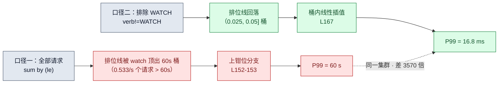
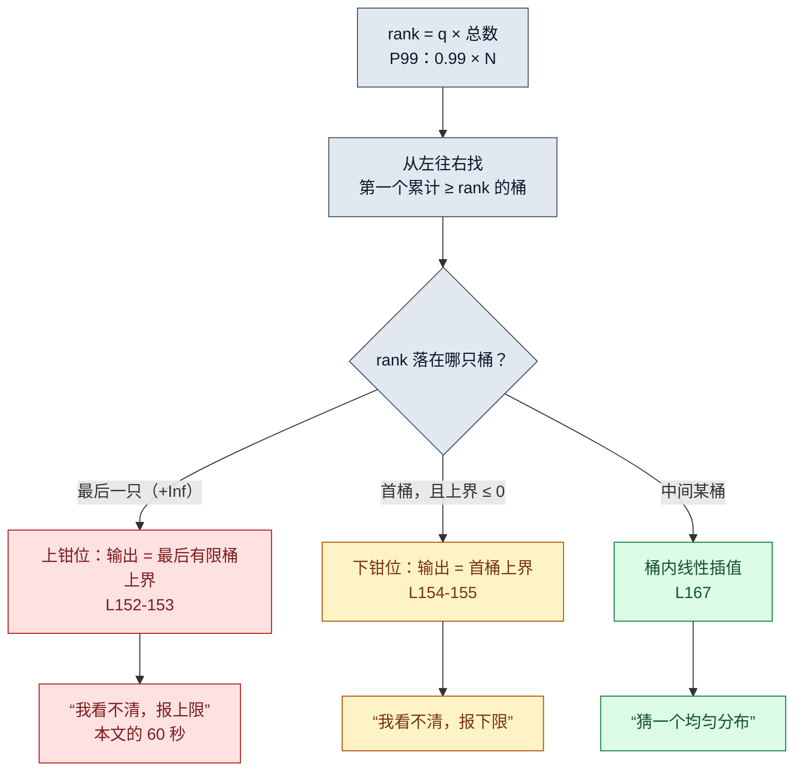
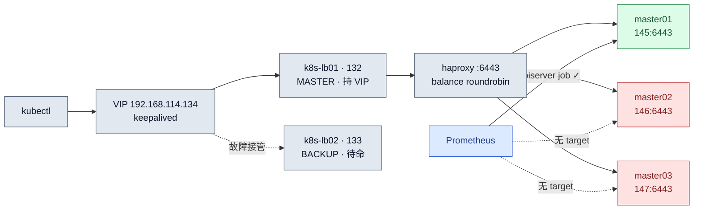

---

title: Prometheus P99 实测：apiserver 延迟 60 秒整的背后
description: Kubernetes API Server 的 P99 显示 60 秒，不一定代表普通请求真的这么慢。本文实测 Prometheus histogram_quantile 与 apiserver_request_duration_seconds，揭示 WATCH 长连接如何把分位数推到最后有限桶，并通过过滤 WATCH 将 P99 从 60 秒还原到 16.8 毫秒；附 PromQL、直方图插值与采集盲区排查。
keywords:
        - Kubernetes API Server P99
        - Prometheus histogram_quantile
        - apiserver_request_duration_seconds
        - PromQL 直方图
        - WATCH 请求延迟
        - Kubernetes 监控
tags:
        - Kubernetes
        - Prometheus
        - PromQL
        - 可观测性
        - 故障排查
series: 测试集群生产化改造
series_order: 7

---

# Prometheus P99 实测：apiserver 延迟 60 秒整的背后

> **实测声明**：3 master + 3 worker，kubeadm 1.36.1，Debian 13，Prometheus v3.12.0（kube-prometheus-stack chart 部署，NodePort 30090）。实验窗口 2026-10-08 一个下午，六批（环境确认 → A 普查 → B 机制 → C 窗口 → C5 裁决 → C6 直连），全部查询 tee 落盘，本文数字全部逐字引自落盘文件。涉及源码为 prometheus v3.12.0 的 GitHub raw 实拉存档（本地副本 `research/prom-src/quantile-v3.12.0.go`，jsdelivr 镜像核对，行号可查）。预注册预测写在动作之前，命中与翻车都如实记录。

## 仪表盘上的 60 秒

第二战役（可观测性四件套：Prometheus → Grafana → Loki → Mimir）开工。第一篇我想把"指标到底怎么读"这件事做扎实——监控篇把 targets 修绿、告警篇把通知打通，都是采集面和通知面；读数面还没认真看过。

前一阶段的[监控实录](k8s-monitoring-red-from-day-one.md)修绿了 targets，[告警复盘](k8s-alerts-ignored-for-25-days.md)打通了通知；这一篇转向指标读数。第一个查询就撞上了怪东西：apiserver 请求耗时的全局 P99：

```text
$ curl -s --data-urlencode 'query=histogram_quantile(0.99, sum by (le) (rate(apiserver_request_duration_seconds_bucket[5m])))' http://localhost:30090/api/v1/query
{"status":"success","data":{"resultType":"vector","result":[{"metric":{},"value":[1791441099.700,"60"]}]}}
```

**60。秒。整。**

apiserver 处理请求的 P99 耗时精确等于 60.000 秒，不多一毫秒不少一毫秒。任何一个真实系统的延迟分布都不可能长这样——这不是测量结果，这是测量工具在说："我只能看到这里。"

要把这 60 秒讲清楚，得先从 P99 本身是什么讲起。而这篇的实验过程比预注册的走向曲折得多：三次预测翻车，每一次翻出来的东西都比命中值钱。

## P50 和 P99 到底在量什么

P50/P99 不是指标，是**读法**。真正的指标叫 `apiserver_request_duration_seconds`——[Kubernetes API Server](../kubernetes/architecture/api-server.md) 处理每个请求花了多少秒。P99 是对它的算法之一，所以完整说法永远是"谁的 P99"：apiserver 请求耗时的 P99。

直观版定义：取一个窗口（比如 5 分钟），把窗口内所有请求按耗时从快到慢排队：

- **P50**（中位数）= 队伍正中间那位的耗时——一半比 TA 快，一半比 TA 慢
- **P99** = 排在 99% 位置那位的耗时——100 个请求里只有 1 个比 TA 慢

你敲的每条 kubectl 命令都在这支队伍里。它是一个 GET 或 LIST 请求，耗时已经落进了 apiserver 上报的 2270 条桶序列（`count(apiserver_request_duration_seconds_bucket)` = 2270，本集群实测）。

为什么不用平均值？构造个例子（数字是编的教学例子，逻辑是真的）：100 个请求，99 个 10ms，1 个 2000ms。平均值 ≈ 30ms，"挺健康"；P50 = 10ms，"大部分确实快"；P99 = 2000ms，"有 1% 的体验是灾难"。慢请求会被快请求稀释——平均值回答"系统的典型负担"，分位数回答"用户的真实体感"。而"卡不卡"恰恰由尾部决定。最大值也不行，被单次毛刺绑架。SRE 写 SLO、定告警阈值，事实标准口径都是分位数；关于如何将延迟等指标用于可靠性目标，可参阅 [SLO/SLI 与 Error Budget 实践](../observability/slo-sli.md)。

还有一个最容易误解的点：**P99 是查询时算出来的，不是采集时存下来的**。apiserver 从不上报"P99"这个数，它只上报**桶**——`le="0.005"` 意思是"耗时 ≤5ms 的累计请求数"，一路累计到 `le="+Inf"`（总数）。`histogram_quantile(0.99, ...)` 拿这堆桶现算。PromQL 查询与 Prometheus 指标模型可参考[监控体系与 PromQL 指南](../observability/prometheus.md)。这个"算"字，是本篇的主角，也是 60 秒的伏笔。

## 先认全四种指标

Prometheus 世界里指标就四种类型，集群里各有活标本。A 组普查，预测写在查询前：

```text
$ curl -s --data-urlencode 'query=apiserver_request_total{verb="GET",resource="services",code="200"}' http://localhost:30090/api/v1/query
{"status":"success",...,"value":[1791440939.057,"11655"]}
```

**counter**（计数器）：只增不减。`apiserver_request_total` 按动词/资源/状态码分序列计数，GET services 这个格子当前 11655 次。注意 JSON 里 value 数组的第一个数是样本时间戳——这是理解后面一个翻车的钥匙。

**gauge**（仪表盘）：可升可降，当前值。

```text
$ curl -s --data-urlencode 'query=kubelet_running_pods' http://localhost:30090/api/v1/query
# 输出 6 个序列（节选）：
#   master01/145:8  master02/146:8  master03/147:8
#   worker01/148:5  worker02/149:15 worker03:150:14    样本时刻全部相同：1791441010.820
```

六个节点的运行中 Pod 数，同一时刻抓的快照——这就是 gauge 的语义："现在"。

**histogram**（直方图）：主角，稍后单开一章。**summary**（摘要）：像 histogram 的"服务端预计算版"——分位数在采集端算好，直接上报固定几档：

```text
$ curl -s --data-urlencode 'query=go_gc_duration_seconds{quantile="0.5"}' http://localhost:30090/api/v1/query
# 输出 30+ 条序列（节选）：
#   kubelet(master02)     0.000214205
#   coredns               0.000223968
#   prometheus-operator   0.000074734     样本时刻：1791441061.412
```

标签是 `quantile="0.5"`，**没有 le 标签**——桶不存在，分位数是 Go 运行时自己报的。histogram 是"采集端存桶、查询端算分位"，summary 是"采集端算好、查询端直读"。代价对比后面讲。

## 我给 Prometheus 的算式挑了个错

A 组的第一个实验设计是验证 counter 只增：查一次 `apiserver_request_total`，跑一条 kubectl，等 40 秒再查，读数应该 +1。

预测：+1。实测：**11655 → 11655，纹丝不动**。

第一步先怀疑自己没等到抓取。Prometheus 每 30 秒抓一次，instant 查询读的是**上一次抓取的样本**，不是实时值。两次查询的时间戳相差 54.7 秒——跨了近两个抓取周期，样本确实刷新了，值真没变。

那就是序列找错了。`kubectl -n monitoring get svc` 这种"列出所有"的请求，动词不是 GET，是 **LIST**。单对象才是 GET：

```text
$ kubectl get svc kubernetes -o name    # 这才是 GET
$ kubectl get svc                       # 这是 LIST
```

我拿 GET 的格子等 LIST 的增量，等不来的。修正实验（A1b）换聚合查询观察：

```text
# 注入前（节选，sum by (instance, verb) 聚合，resource="services"）：
#   145 LIST 11603   GET 11661   PUT 11637   WATCH 63196
# 注入：kubectl -n monitoring get svc + kubectl get svc kubernetes -o name，sleep 70
# 注入后：
#   145 LIST 11604   GET 11662   PUT 11638   WATCH 63202
```

LIST +1、GET +1，都在 145 这台上。当时的判读是"翻车修复完成"——这个结论后来又被自己打了个折（见"你的集群入口长什么样"一章：在 roundrobin 派发下，这两笔 +1 也可能只是恰好落在被采集那台上的背景流量）。但翻车本身送了两个知识点：**kubectl 的列表请求是 LIST 不是 GET**（受控实验的增量必须对准序列，标签就是序列的身份）；**instant 查询读到的是上一次抓取的快照**（间隔没跨过抓取周期时，同值不代表没发生）。

顺带一提，PUT 也 +1 了，计划外的第三者，到收稿也没定案——背景里总有人在写东西。

## 60 秒的解剖

回到主角。全局 P99 = 60 秒，而桶边界（A5 普查，227 条序列共用同一套）是：

```text
0.005 / 0.025 / 0.05 / 0.1 / 1.0 / 5.0 / 10.0 / 30.0 / 60.0 / +Inf
```

**60.0 恰好是最后一个有限桶的上界。**  P99 精确等于它——第一个嫌疑就清楚了：有一批耗时超过 60 秒的请求，把 99% 分位线顶出了 60 秒桶，掉进了 +Inf；Prometheus 看不清 +Inf 里发生了什么，只能回答"我最远只看到 60"。

谁会超过 60 秒？先看动词流量表：

```text
$ curl -s --data-urlencode 'query=sum by (verb) (rate(apiserver_request_duration_seconds_count[5m]))' http://localhost:30090/api/v1/query
# WATCH  0.5518518518518518   ← 每秒 0.55 个 watch 请求完成
# GET    2.437037037037037
# PUT    0.9111111111111112   ← 后台组件在持续写（lease 续约这类）
# POST   0.26296296296296295
# LIST   0.022222222222222223
```

WATCH 在场，量级 0.55/秒。再直接问"超过 60 秒的请求有多少"——+Inf 桶与 60 秒桶的 rate 差：

```text
$ curl -s --data-urlencode 'query=sum(rate(apiserver_request_duration_seconds_bucket{le="+Inf"}[5m])) - sum(rate(apiserver_request_duration_seconds_bucket{le="60.0"}[5m]))' http://localhost:30090/api/v1/query
{"status":"success",...,"value":[...,"0.5333333333333328"]}
```

**0.533/s。**  和 WATCH 完成速率 0.552/s 几乎相等。

链条闭合了：每个完成退出的 watch 请求，耗时几乎都超过 60 秒。这完全合理——全集群每个控制器、每个 informer 都挂着对 apiserver 的长连接 watch，一次挂着几分钟很正常。watch 是 K8s 的心跳，不是故障。

验证最后一步——把 WATCH 排除再算 P99：

```text
$ curl -s --data-urlencode 'query=histogram_quantile(0.99, sum by (le) (rate(apiserver_request_duration_seconds_bucket{verb!="WATCH"}[5m])))' http://localhost:30090/api/v1/query
{"status":"success",...,"value":[...,"0.01680833333333334"]}
```

**16.8 毫秒。**  从 60 秒到 16.8 毫秒，3570 倍。超过 60 秒的请求（0.533/s）几乎个个是 watch（watch 完成速率 0.552/s）——apiserver 的"慢"，慢在长连接心跳，不在普通请求。

这条有个实用的推论：**监控 apiserver 延迟，watch 流量要么排除、要么单看**。混在一起的 P99 会永远顶在最后一个有限桶上——它量的不是"apiserver 慢不慢"，是"watch 连接活多久"。



## 手算一遍 P99

"查询端现算"到底怎么算的？最硬的验证方式：我自己拿桶数据手算，跟 Prometheus 的输出对账。

选 GET services 这条序列（A3 普查，样本时刻 1791441033.644）：

```text
le="0.005"   11616     ← 只有 11616 个请求 ≤5ms
le="0.025"   11660     ← 到 25ms 累计 11660
le="0.05"    11660     ← 之后全部持平
...
le="+Inf"    11660     ← 总数
```

算法（也是源码里的算法，下章对行号）：先算排名 `rank = q × 总数`，从左往右找**第一个累计数 ≥ rank 的桶**，然后在该桶内做线性插值。

P50：rank = 0.5 × 11660 = 5830。第一个 ≥5830 的桶是 (0, 0.005]，桶内 11616 个观测，相对排名 5830。插值：

```
P50 = 0 + (0.005 - 0) × 5830/11616 = 0.002509469696969697
```

P99：rank = 0.99 × 11660 = 11543.4，同样落首桶：

```
P99 = 0 + 0.005 × 11543.4/11616 = 0.004968750000000000
```

Prometheus 的实测输出（B1 批次）：

```text
histogram_quantile(0.5,   ...bucket{verb="GET",resource="services"}) → 0.0025094656225798126
histogram_quantile(0.99,  ...bucket{verb="GET",resource="services"}) → 0.004968743545611016
histogram_quantile(0.999, ...bucket{verb="GET",resource="services"}) → 0.019697727272726874
```

对账：P50 干算 0.002509469696…，实测 0.002509465622…——**前六位一致，第 7 位起分叉**。P99 同样（0.00496875 vs 0.004968743…）。分叉不是公式错了：手算用的是 A3 时刻的桶快照（样本时刻 1791441033.644），而 B1 查询在十五分钟后——**counter 又走了一刻钟，桶里的数字已经变了**。同一公式、不同时刻的数据、略不同的答案。

这个"分叉"本身就是最后一块拼图：histogram_quantile 从不存储任何分位数，**每次查询都拿当下的桶快照从头现算**。它的输出没有"版本"概念——你以为在查"P99"，实际是在查"用此刻桶数据算出来的 P99"。桶在动，答案就在动。

回过头看，插值假设的脆弱也摆在这里：4.97ms 这个值不等于任何真实请求的耗时——GET services 的真实分布是 11616 个 ≤5ms 和 44 个 5~25ms，99 分位线落在首桶内部，Prometheus **假设首桶内均匀分布**，线性估出 4.97ms。真实分布如果前紧后松，这个数就是编的。桶越宽、分位越靠尾，编得越离谱。这套桶在 0.1s 和 1.0s 之间还有个十倍空洞——分布真落到那里时，误差能到一个数量级。

## 源码里的三种答案

上面所有行为的出处，在 `promql/quantile.go`（v3.12.0 实拉）。核心函数 `BucketQuantile`，L105 起。找桶之后的三个分支（L151-168）：

```go
// pkg/kubelet 无关，这是 prometheus/prometheus promql/quantile.go，v3.12.0
// L151-168（节选，注释为本文所加）
switch {
case b == len(buckets)-1:
        // rank 掉进了 +Inf 桶：我们能给出的最好答案，
        // 是最后一个有限桶的上界。60 秒钳位的出处。
        quantile = buckets[len(buckets)-2].UpperBound
case b == 0 && buckets[0].UpperBound <= 0:
        // 掉进首桶且首桶上界 ≤0：钳到首桶上界
        quantile = buckets[0].UpperBound
default:
        var (
                bucketStart float64
                bucketEnd   = buckets[b].UpperBound
                count       = buckets[b].Count
        )
        if b > 0 {
                bucketStart = buckets[b-1].UpperBound
                count -= buckets[b-1].Count
                rank -= buckets[b-1].Count
        }
        // 桶内线性插值——上一章手算的就是这行
        quantile = bucketStart + (bucketEnd-bucketStart)*(rank/count)
}
```

三个分支，三种诚实的程度：插值（猜一个均匀分布）、上钳位（承认看不清，报上限）、下钳位（同理报下限）。60 秒就是第一个 `case` 在我集群上的现场演出。



函数头上的官方注释（L174-176）更坦诚，值得逐字读：

```go
// For custom buckets, the result is interpolated linearly, i.e. it is assumed
// the observations are uniformly distributed within each bucket. (This is a
// quite blunt assumption, but it is consistent with the interpolation method
// used for classic histograms so far.)
```

 **"这是个相当粗暴的假设"——作者自己说的。**  histogram_quantile 不是显微镜，是一把刻度稀疏的尺子：桶边界是真的，桶内部全是猜的。

顺带把 60 秒的边界也钉死：`apiserver_request_duration_seconds` 的桶上限 60 秒意味着，超过 60 秒的请求无论实际 61 秒还是 600 秒，在这套指标里无法区分——它们全被折叠进 +Inf，只留下"超过 60"这一个事实。要看得更远，得改桶边界（apiserver 侧）或换 native histogram（没有固定桶边界，指数桶可分辨到任意量级——生态还在路上，ADR 视角这是"经典桶的已知病"）。

## 两个窗口，两种性格

`rate(...[5m])` 里那个 5m 是窗口——分位数的时间分辨率。C 组想用"注入尖峰看两个窗口反应"做对比实验，结果尖峰本身失踪了（下章，本篇最大翻车），但窗口对比反而借噪声拿到了更干净的实证。

同一查询，只换窗口（非 WATCH 流量）：

```text
[1m] 基线：0.014699999999999984      （14.7ms）
[5m] 基线：0.0208...                  （20.8ms）
```

然后是 15 分钟的 `query_range` 回溯（step=15s，回溯手法来自监控篇——Alerts 页是状态镜，query_range 是录像机）：

-  **[1m] 曲线**：值域 5.0ms ~ 24.6ms，摆幅 4.9 倍，期间三次跌到 5.0ms 附近——那是 P99 掉进首桶 (0, 0.005] 的插值低位，桶边界引力肉眼可见
-  **[5m] 曲线**：值域 17.6ms ~ 21.1ms，带宽 ±10%，平滑如镜

同一个集群、同一分钟、同一批数据，两个窗口给出两种性格： **[1m] 灵敏但抖，[5m] 平滑但钝**。哪个对？都对，它们回答的是不同问题："刚才那一下怎么样"（短窗）vs"最近一阵子怎么样"（长窗）。窗口选短的，告警会频繁误报；选长的，真事故的发现会晚。没有免费午餐，只有取舍——而这个取舍，经常在复制粘贴仪表盘查询时被无意识继承。

## 消失的尖峰

C 组的原始设计：给 apiserver 注入延迟尖峰（几发重的 `kubectl get pods -A -o json`），观察 P99 在 [1m]/[5m] 两个窗口的形态差异。预注册预测：[1m] 跳升可见，[5m] 纹丝不动。

实测：**两个窗口都纹丝不动。**  不止——注入的请求在监控里消失得干干净净：pods LIST 的桶 rate 十桶全零；15 分钟录像在注入时刻前后完全平滑。

"给 apiserver 注入负载，监控毫无反应"——这个阴性结果值三条命，因为它是三层原因叠加的，每层都独立验证过：

**第一层：注入不重。**  这是最后定案也最丢人的一层。注入用的 `time` 输出一直躺在落盘文件里：

```text
real    0m0.212s
user    0m0.202s      ← kubectl 自己解析 JSON 的 CPU 时间
sys     0m0.017s
```

real 212ms 里 user 占 202ms——**那 200 毫秒是 kubectl 客户端的 CPU，不是 apiserver 的服务时间**（四发注入的 time 三件套全在这个量级：230/223/017、219/206/021）。58 个 Pod 的集群，`pods -A -o json` 对 apiserver 是个轻请求。铁证来自直连三台的桶分布（见第三层）：**m2/m3 有史以来没有一个超过 25ms 的 pods LIST 请求**。"延迟尖峰"从一开始就不存在，它长在我自己的 time 读法里——观察者延迟污染计时的又一变体，这次污染源是客户端 CPU。教训：**time 三件套（real/user/sys）必须拆开读，real ≠ 服务端耗时**。

**第二层：大数稀释。**  算一笔账（这笔账我在预注册时算过，设计实验时又忘了用，此处如实自嘲）：非 WATCH 流量约 3.6 req/s，[1m] 窗口约 220 个请求，4 发注入占比不到 2%，根本够不着 99% 排位线。就算全部可见，P99 也不会动。分位数是大数游戏——样本量不够时，个别慢请求推不动它，它对"少量真实的慢"一样失明。

**第三层：采集盲区。**  三台 master 的 apiserver，Prometheus 只盯着一台。targets API 实测：apiserver job 只有一个 target——`192.168.114.145:6443`，up。m2/m3 的 apiserver 序列根本不存在。

这层的定案过程值得一记。注入后 counter 不动（88.6 秒观察窗、跨两个抓取周期、分毫未变）只能证明"没落在 145"；要证明"落在 m2/m3"，得绕过 Prometheus 直接问 apiserver 本尊——`kubectl --server` 直连读 `/metrics`，实时内存值，零抓取延迟：

```text
# 直连三台读 pods LIST（cluster scope）计数器：
m1(145):  9   → 注入一发后：10   ← 这次落在了 145
m2(146):  4   → 4（纹丝不动）
m3(147):  2   → 2（纹丝不动）
```

m2 = 4、m3 = 2——**盲区里的服务器一直在干活，只是没有任何人看**。而注入的落点由不得我：kubectl 走 VIP 进来，负载均衡器逐连接派发，客户端侧不可预测（同一条命令十几分钟内两次执行，一次没落 145、一次落了——下一章说为什么）。

三层里 ANY 一层单独存在，都足以让"注入尖峰看监控反应"这个实验白做。而它们同时为真。这就是预注册的价值：没有预测写在前面，这个阴性结果会被"实验失败"四个字糊弄过去，三层里最值钱的发现（独眼监控）就漏了。

## 你的集群入口长什么样

追"注入去哪了"的副产品，是把整条入口拓扑重新验明正身——起因是我说"查 haproxy 配置"，在 master01 上一查：**没有 haproxy 进程，没有 VIP**。三台 master 的 `ip a` 都没有。但 kubectl 明明连着 `https://192.168.114.134:6443`。

谜底是两台专门的负载均衡虚机（vCenter 命名就写着答案）：

lb01 网卡上 VIP 的指纹：`inet 192.168.114.134/32 ... proto 0x12`——/32 掩码加 0x12 协议标记（VRRP），keepalived 加 IP 的铁签名。haproxy 配置五行看完：`bind *:6443`、`balance roundrobin`、三台 master 各一行 `server ... check`。整条链路画成一张图：



入口是双机热备，监控是独眼——同一张图里看得清清楚楚。

roundrobin 解释了注入落点的不可预测：**每条新连接按全局计数器轮转派发**，worker 节点的 kubelet、后台组件的连接都在穿过这台 LB 推进计数器，你的 kubectl 只是插队。今天被追踪的注入连接里：同一命令十几分钟内两次执行，一发落在 145（counter 9→10）、一发没落（88 秒观察窗纹丝不动）；C 组的另外几发也从没在 145 的 pods LIST 桶里出现过。落点散布和 roundrobin 的均匀期望对得上——从客户端看，就是掷骰子。

这段侦探还附带两个自省素材。其一，我对"LB 在哪"的记忆停留在"keepalived+haproxy 堆叠在 master 上"的通用印象——搭完没再看过的东西，认知会停在搭建意图，这是生产化改造要还的债。其二，有个数字巧合差点骗到我：haproxy 配置里 `timeout server 60s`，恰好也是 60——空闲超 60 秒的 watch 连接会被 LB 切断，apiserver 记一笔 >60s，喂给 +Inf 桶。定量上自洽（0.533/s 的完成速率 × 60~75 秒存活 ≈ 32-40 条并发 watch，一台 apiserver 的合理份额），但归因需要对照实验（直连绕过 LB 的 watch vs 走 VIP 的 watch），本篇不宣称，挂给下一篇。两个 60 秒——haproxy 的超时和 histogram 的桶界——数值撞车是巧合：LB 超时不决定桶边界，但如果它真在切 watch，喂的正是 +Inf 那只桶；读者若在别处看到"LB 超时决定桶"的说法，记得这俩是两码事。

## 你可以在自己集群上做的三件事

一，查你的 apiserver P99 是不是也顶着桶上限：`histogram_quantile(0.99, sum by (le) (rate(apiserver_request_duration_seconds_bucket[5m])))`——如果输出恰好等于某个桶边界（尤其最后一个有限桶），你的 P99 也在钳位，先看 WATCH 流量占比再下"慢"的结论。

二，算一遍"超时请求速率"：`+Inf 桶 rate − 最后有限桶 rate`，再跟 `sum by (verb) (rate(..._count[5m]))` 里的 WATCH 对一下——两个数接近，就是本篇的链条。

三，查你的 targets：`curl -s http://<prom>:9090/api/v1/targets | grep -o '"job":"apiserver"' | wc -l`——数一下 target 个数是不是等于 master 数。如果不是，你的监控也是独眼。怎么修，下一篇就是。

---

下一篇：**监控盲区修复**——给 m2/m3 的 apiserver 补上采集，targets 从 1/3 到 3/3。入口有双机备胎、监控却只盯一台的集群，该把另一只眼装上了。

## 推荐阅读

- [Prometheus 监控体系：架构、PromQL 与服务发现](../observability/prometheus.md)：补齐 Prometheus 指标模型、PromQL 和采集机制背景。
- [Kubernetes API Server 详解](../kubernetes/architecture/api-server.md)：了解本文延迟指标所属组件及 API Server 的请求处理链路。
- [SLO/SLI/Error Budget 实践](../observability/slo-sli.md)：延伸了解如何用延迟分位数定义服务可靠性指标。
- [Kubernetes 监控首日：API Server 指标为何全红](k8s-monitoring-red-from-day-one.md)：回看本系列前篇的监控接入与 targets 排查。