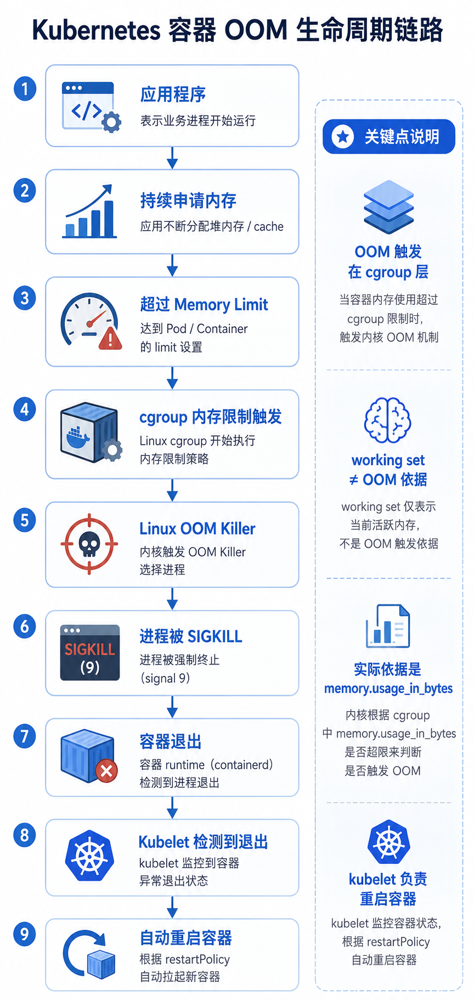
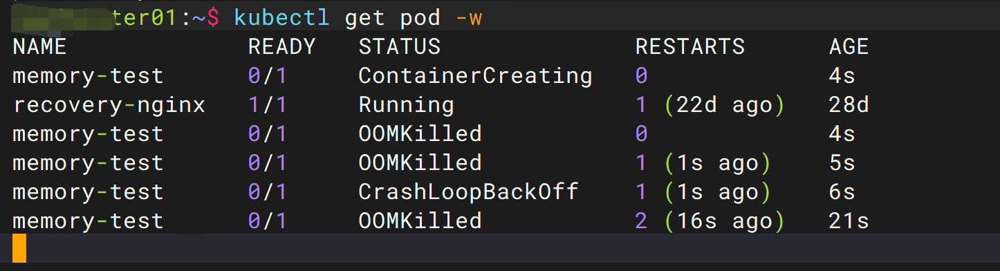
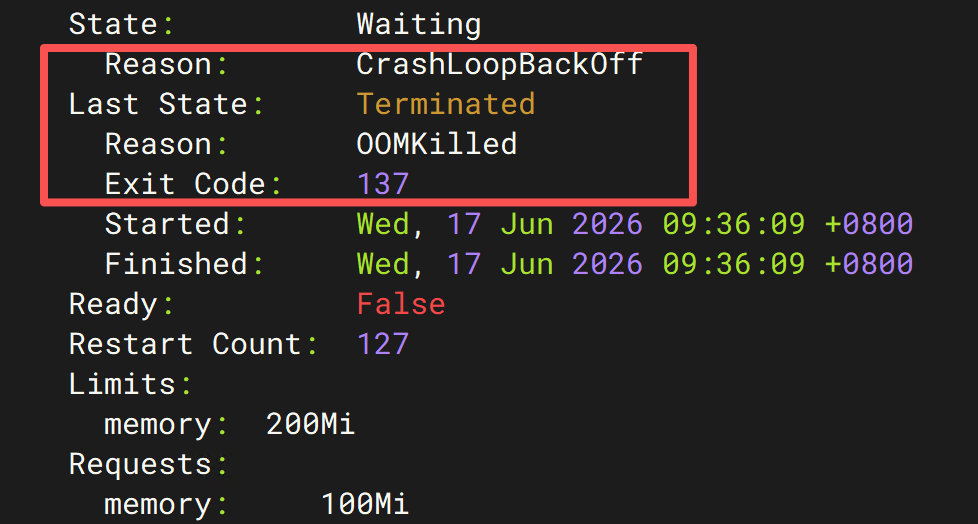
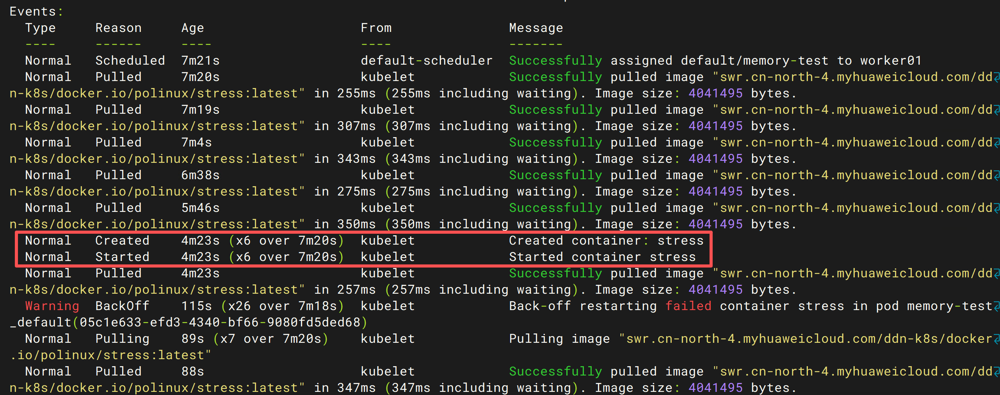
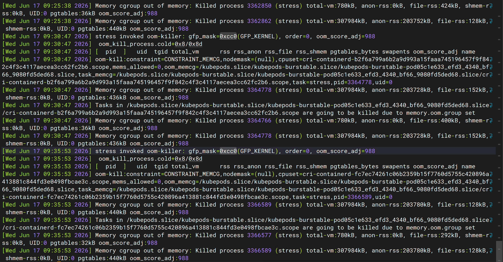
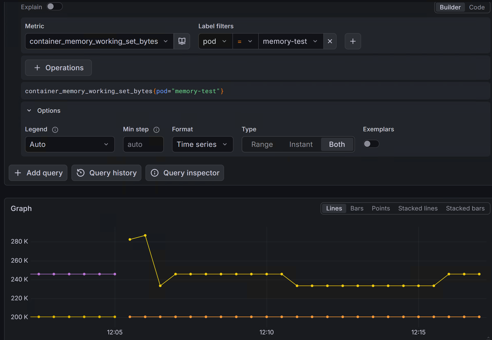
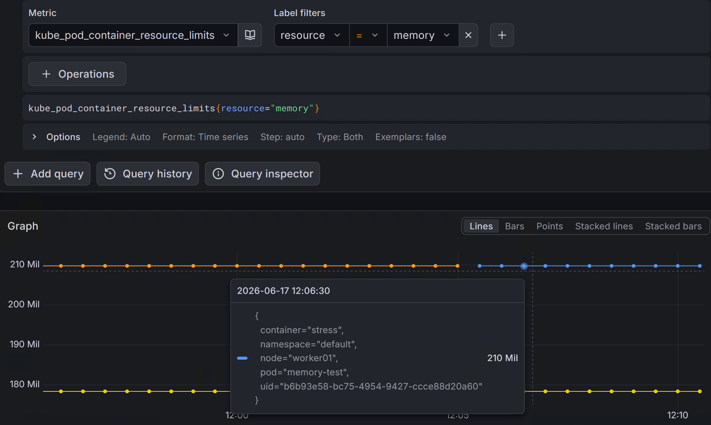

# Kubernetes 故障模拟实战：Pod OOM（内存溢出）之后会发生什么？

在上一篇文章《[Kubernetes 节点 CPU 打满故障演练：从现象到根因的全流程解析](cpu-stress-test.md)》中，我模拟了容器 CPU 被持续占满的场景，并观察了 Kubernetes 与 Linux 对高 CPU 负载的处理方式。

而在生产环境中，另一类更加常见且危险的故障则是：

> Pod OOM（Out Of Memory，内存溢出）

CPU 打满通常只是让业务变慢，而内存耗尽则可能直接导致应用进程被系统强制终止。

本文将通过实验模拟 Pod OOM 的全过程，观察 Kubernetes 如何处理内存溢出问题，以及如何利用监控和日志快速定位故障原因。

---

## 本文你将学到什么

* 什么是 OOM
* 什么是 OOMKilled
* Exit Code 137 代表什么
* Linux OOM Killer 工作原理
* Pod OOM 后 Kubernetes 的处理流程
* 如何通过 kubectl 排查 OOM
* Prometheus 如何提前发现 OOM 风险
* 生产环境如何避免 OOM

---

## 什么是 OOM？

OOM（Out Of Memory）即：

> 系统可用内存不足。

当应用程序持续申请内存，而系统已经无法满足新的内存请求时，Linux Kernel 会触发 OOM Killer 机制。

OOM Killer 会选择一个进程并强制终止，从而释放内存资源。

在 Kubernetes 中，通常表现为：

```bash
kubectl get pod
```

输出类似：

```text
NAME          READY   STATUS
memory-test   0/1     OOMKilled
```

或者：

```text
CrashLoopBackOff
```

很多运维人员第一次看到 Pod 状态异常时，会误认为是程序 Bug。

实际上：

> 绝大多数 OOMKilled 都是资源配置不合理导致的。

---

## Kubernetes 中 OOM 的处理流程

当容器发生 OOM 时，整个链路如下：



---

## 实验环境

创建一个会主动消耗内存的测试 Pod。

```yaml
apiVersion: v1
kind: Pod
metadata:
  name: memory-test
spec:
  containers:
    - name: stress
      image: polinux/stress

      resources:
        requests:
          memory: "100Mi"

        limits:
          memory: "200Mi"

      command:
        - stress

      args:
        - "--vm"
        - "1"
        - "--vm-bytes"
        - "300M"
        - "--vm-hang"
        - "0"
```

资源限制：

```text
Memory Request = 100Mi
Memory Limit   = 200Mi

实际申请内存 = 300Mi
```

理论上：

```text
300Mi > 200Mi
```

因此一定会触发 OOM。

创建 Pod：

```bash
kubectl apply -f memory-test.yaml
```

---

## 观察 Pod 状态变化

执行：

```bash
kubectl get pod -w
```

观察状态变化：

```text
memory-test   ContainerCreating
memory-test   OOMKilled
memory-test   ContainerCreating
memory-test   OOMKilled
```

持续几次后：

```text
CrashLoopBackOff
```

形成如下循环：

```text
启动
 ↓
OOM
 ↓
重启
 ↓
OOM
 ↓
重启
 ↓
OOM
 ↓
CrashLoopBackOff
```



---

## 查看 OOMKilled 信息

查看 Pod 详情：

```bash
kubectl describe pod memory-test
```

重点关注：

```text
    State:          Waiting
      Reason:       CrashLoopBackOff
    Last State:     Terminated
      Reason:       OOMKilled
      Exit Code:    137
```

其中：

```text
Exit Code = 137
```



很多人会疑惑：

137 是什么意思？
实际上：
```text
137 = 128 + 9
```

其中：
```text
9 = SIGKILL
```

说明：
```text
进程被 Linux Kernel 强制终止
```

并不是应用主动退出。

---

## 查看 Events

除了查看 Pod 状态之外，Events 也是排查故障的重要依据。

执行：

```bash
kubectl describe pod memory-test
```

在输出底部可以看到类似信息：

```text
Events:
  Type     Reason     Message
  ----     ------     -------
  Normal   Scheduled  Successfully assigned default/memory-test to worker01
  Normal   Pulled     Successfully pulled image ...
  Normal   Created    Created container: stress
  Normal   Started    Started container stress
  Warning  BackOff    Back-off restarting failed container stress
  Normal   Pulling    Pulling image ...
```



从这些事件可以还原 Pod 的完整运行过程：

```text
Pod 创建成功
    ↓
镜像拉取成功
    ↓
容器启动
    ↓
发生 OOM
    ↓
容器退出
    ↓
Kubelet 检测到异常
    ↓
自动重启容器
    ↓
再次启动
    ↓
再次 OOM
    ↓
进入 CrashLoopBackOff
```

这里最容易产生误解的是：

```text
Warning  BackOff
```

很多人看到 BackOff 后会认为这是 OOM 的直接证据。

实际上并不是。

BackOff 的真实含义是：

> 容器已经连续多次启动失败，Kubelet 为避免频繁重启导致节点资源浪费，开始采用指数退避（Exponential Backoff）机制降低重启频率。

因此：

```text
BackOff ≠ OOM
```

BackOff 只是容器反复失败后的结果状态。

真正证明发生 OOM 的证据在 Pod 状态中：

```text
Last State:
  Reason: OOMKilled
  Exit Code: 137
```

说明容器进程已经被 Linux Kernel 强制终止。

结合本次实验中的 Events，可以得出如下结论：

```text
OOMKilled
      ↓
容器退出
      ↓
Kubelet重启容器
      ↓
再次启动
      ↓
再次OOM
      ↓
连续失败
      ↓
CrashLoopBackOff
```

因此在实际排障过程中：

不要仅仅依赖 Events 判断故障原因，而应该结合以下信息综合分析：

```bash
kubectl describe pod memory-test
```

重点查看：

* Last State
* Reason
* Exit Code
* Restart Count

必要时还应登录节点查看内核日志：

```bash
dmesg | grep -i oom
```

通过 Pod 状态、Events 和 Node 日志三者结合，才能准确判断是否发生了 OOM 故障。

## Node 节点如何看 OOM 日志？


登录 Pod 所在节点：
```
ssh worker01
```

查看内核日志：
```
sudo dmesg -T | grep -i oom
```
输出如下(本段末尾部分日志图示)：
```
Memory cgroup out of memory:
Killed process 3364778 (stress)

Tasks in ...
are going to be killed due to memory.oom.group set
```

其中：

* `Memory cgroup out of memory`

表示：
```
Pod 所属的 Memory Cgroup
已经达到内存上限
```
并非整个 Node 内存耗尽。

* `Killed process (stress)`

表示：
```
Linux Kernel OOM Killer
选择终止 stress 进程
```
释放内存。

* `oom_score_adj=988`

表示：

```
该 Pod 的 QoS Class 为 Burstable
在发生 OOM 时优先被回收。
```

* `memory.oom.group set`

表示：
```
容器内所有相关进程
将被一起终止
```
避免部分进程残留导致异常状态。

最终形成完整链路：
```
stress申请300MB内存
          ↓
超过200Mi Limit
          ↓
Memory Cgroup OOM
          ↓
Linux OOM Killer
          ↓
Killed process (stress)
          ↓
Container Exit Code 137
          ↓
OOMKilled
          ↓
Kubelet 重启容器
          ↓
CrashLoopBackOff
```

下图为日志示例：


---

## Prometheus 如何发现 OOM 风险？

生产环境中：

OOM 往往不是突然发生的。

更常见的是：

```text
80%
 ↓
85%
 ↓
90%
 ↓
95%
 ↓
OOM
```

因此需要提前监控内存使用率。

---

### 查看当前内存使用量

PromQL：

```promql
container_memory_working_set_bytes
```



该指标表示容器当前实际占用的工作集内存（Working Set Memory），通常可以理解为应用程序正在活跃使用且不容易被系统直接回收的内存。

在 Kubernetes 故障排查中，`container_memory_working_set_bytes` 是分析 Pod 内存使用情况和 OOM（Out Of Memory）问题最常用的指标之一。

---

### 查看 POD 内存限制

PromQL：

```promql
kube_pod_container_resource_limits{
  resource="memory"
}
```



该指标来自 kube-state-metrics，用于获取 Pod 中容器配置的 Memory Limit。

例如：

```yaml
resources:
  limits:
    memory: 200Mi
```

对应的监控数据会以 Byte 为单位存储在 Prometheus 中。

---

### 计算内存使用率

PromQL：

```promql
100 *
sum by(namespace,pod)(
  container_memory_working_set_bytes{
    container!="",
    container!="POD"
  }
)
/
sum by(namespace,pod)(
  kube_pod_container_resource_limits{
    resource="memory"
  }
)
```

该指标用于计算POD容器当前内存使用量占 Memory Limit 的百分比。

例如：

| 当前使用量 | Memory Limit | 使用率 |
| ----- | ------------ | --- |
| 400Mi | 500Mi        | 80% |
| 450Mi | 500Mi        | 90% |
| 490Mi | 500Mi        | 98% |

---

### 如何判断是否存在 OOM 风险

通常可以参考以下经验值：

| 内存使用率     | 风险等级 | 建议               |
| --------- | ---- | ---------------- |
| < 70%     | 低    | 正常运行             |
| 70% ~ 80% | 中    | 持续观察内存增长趋势       |
| 80% ~ 90% | 高    | 建议配置监控告警         |
| > 90%     | 极高   | 存在 OOM 风险，应及时排查  |
| 接近 100%   | 危险   | 容器可能随时被 OOM Kill |

当容器内存使用率持续超过 **80%** 时，应开始关注业务负载变化和内存增长趋势。

当内存使用率长期超过 **90%** 时，建议立即触发告警并分析原因，例如：

* 应用程序存在内存泄漏
* 突发流量导致内存激增
* Memory Limit 配置过小
* 缓存占用持续增长

对于配置了 Memory Limit 的 Pod，当内存使用量接近或达到限制值时，Linux 内核可能触发 OOM Killer，导致容器被强制终止，并在 Kubernetes 中显示为 **OOMKilled** 状态。

---

## Grafana 中如何判断发生过 OOM？

OOM 通常会留下明显特征。

典型表现：

```text
内存使用率不断上升
          ↑
          ↑
          ↑
达到Limit
          │
          ▼
突然归零
```

原因：

```text
Pod 被杀死
容器重启
监控指标重新开始统计
```

同时：

```text
Restart Count 持续增加
```

因此：

> 内存曲线突然归零 + Restart Count 增长

基本可以判断发生过 OOM。

---

## 为什么 Requests 和 Limits 都要配置？

很多初学者经常写：

```yaml
resources:
  requests:
    memory: 100Mi

  limits:
    memory: 200Mi
```

却不知道它们的区别。

---

### Request

用于调度。

Scheduler 根据 Request 判断节点是否有足够资源。

例如：

```text
Node 剩余内存：

500Mi
```

Pod Request：

```text
600Mi
```

则不会调度成功。

---

### Limit

用于限制。

当容器实际使用量超过 Limit 时：

```text
OOMKilled
```

立即发生。

因此：

```text
Request 决定能否调度

Limit 决定何时OOM
```

两者缺一不可。

---

## 生产环境中的 OOM 常见原因

### Java Heap 设置过大

例如：

```bash
-Xmx4g
```

而容器限制：

```yaml
limits:
  memory: 2Gi
```

启动后很快 OOM。

---

### 内存泄漏

例如：

* 缓存不释放
* Goroutine 泄漏
* 对象持续堆积

最终导致内存不断增长。

---

### 流量突增

例如：

```text
平时 100 QPS

突然增长到 1000 QPS
```

导致：

* 连接数暴涨
* 缓存暴涨
* Session 暴涨

最终 OOM。

---

### 没有设置 Memory Limit

例如：

```yaml
resources: {}
```

此时某个 Pod 可能占满整个节点内存。

最终导致：

```text
Node级别 OOM
```

影响同节点其他业务。

---

## 如何避免 OOM？

建议遵循以下原则：

### 必须配置 Request

```yaml
requests:
  memory: 512Mi
```

---

### 必须配置 Limit

```yaml
limits:
  memory: 1Gi
```

---

### 配置 Prometheus 告警

推荐阈值：

```text
内存使用率 > 80%
```

触发告警。

---

### 定期分析历史数据

关注：

* 平均值
* 峰值
* 增长趋势

根据实际情况调整资源配置。

---

## 总结

一次 Pod OOM 的完整生命周期如下：

```text
应用申请内存
        ↓
超过 Memory Limit
        ↓
Linux OOM Killer
        ↓
进程被 SIGKILL
        ↓
Pod OOMKilled
        ↓
Kubelet重启容器
        ↓
CrashLoopBackOff
```

!!! important "需要牢记"
    CPU 打满通常只是性能下降，而内存耗尽则可能直接导致业务中断。

因此在 Kubernetes 生产环境中，OOM 也是最值得重点关注和监控的一类故障。

---

## 相关阅读

* [Kubernetes Pod 生命周期详解]()
* [Kubernetes Requests 与 Limits 最佳实践]()
* [Prometheus AlertManager 告警配置实战]()
* [Grafana 容器资源监控实战]()
* [Kubernetes 故障模拟实战：CPU 打满之后会发生什么？](../lab/cpu-stress-test.md)
* [Kubernetes 故障模拟实战：ETCD 异常之后会发生什么？]()
