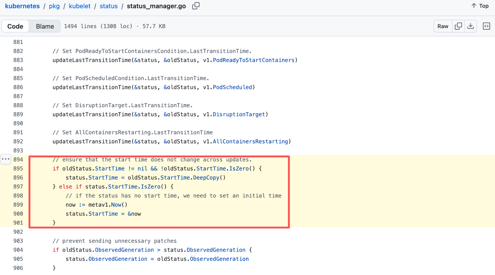
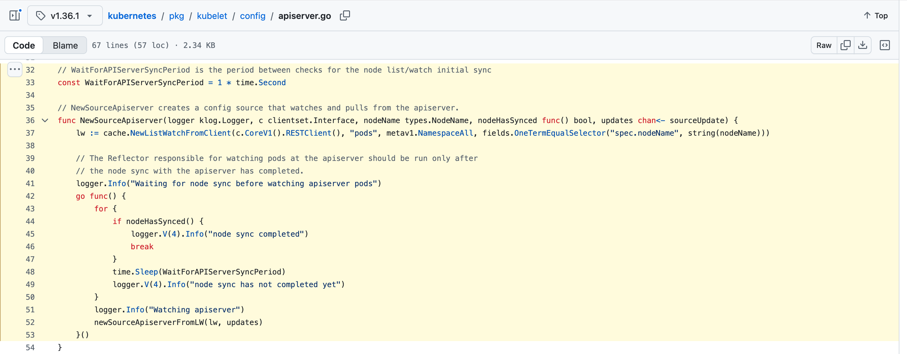
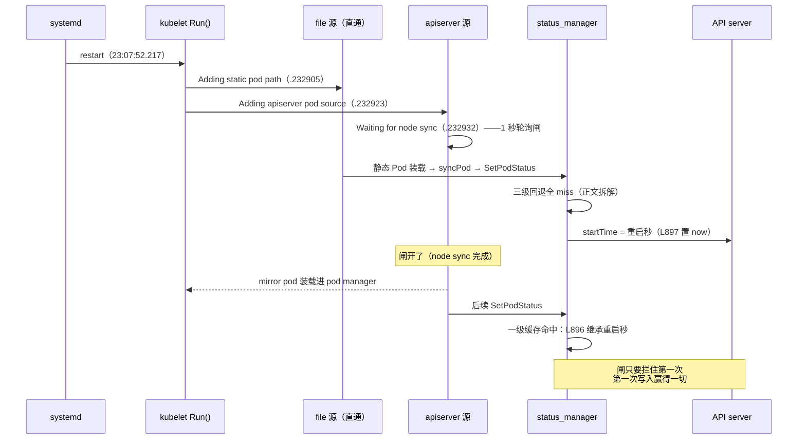
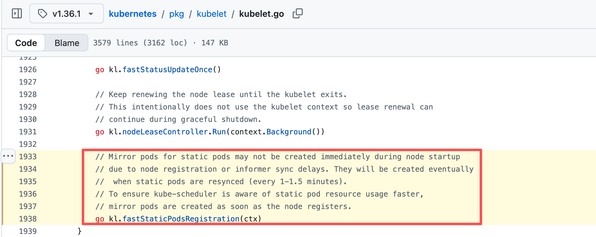
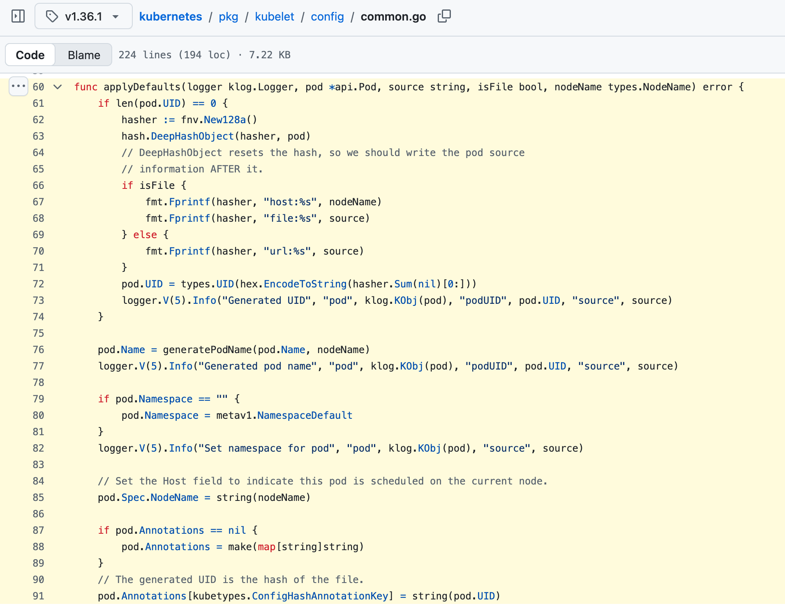

---

title: Kubernetes 静态 Pod startTime 解析：kubelet 重启后为何重置
description: 通过 Kubernetes 1.36.1 kubelet 源码与集群实测，解析静态 Pod 的 status.startTime 为何跨对象重建保持不变，却会在 kubelet 重启后重置；详解 mirror Pod、状态缓存与 node sync 时序，并用重启实验验证结论。
keywords:
    - Kubernetes 静态 Pod
    - Pod status.startTime
    - kubelet 重启
    - mirror Pod
    - kubelet 源码
    - Pod 生命周期
tags:
    - Kubernetes
    - kubelet
    - 静态 Pod
    - 源码解析
    - 故障排查
series: 测试集群生产化改造
series_order: 6

---

> **实测声明**：3 master + 3 worker，kubeadm 1.36.1，Debian 13，Calico。考古窗口 2026-10-04 ~ 10-07，实验含一次真实的 `systemctl restart kubelet`（10-05 23:32:16 CST，master01）。全部终端输出 tee 落盘（逐字摘录）。涉及源码为 k8s v1.36.1 的 GitHub raw 实拉存档（本地副本 `research/kubelet-src-v1.36.1/`，jsdelivr 与 api.github.com 双源字节级核对过，行号可查）。journalctl 输出为节点本地时间（CST）；`kubectl` 的 API 字段一律 UTC（如 `15:07:52Z`），正文引用时双标折算。
>
> 系列上一篇：[K8s bind-address 修复实录：sed 改对了没生效，凶手是自己的备份文件](/lab/k8s-bind-address-fix/)，记录了静态 Pod 对象重建以及 startTime 未随之变化的现场。本篇继续追查这个字段为什么会继承旧值，又为何在 kubelet 重启后重置。

先看这次考古的终点。10 月 5 日晚上我在 master01 上重启了 kubelet，然后查了两个静态 Pod 的三列字段：

```text
$ kubectl -n kube-system get pod kube-controller-manager-master01 kube-scheduler-master01 \
  -o custom-columns='POD:.metadata.name,UID:.metadata.uid,START:.status.startTime,CONTAINER:.status.containerStatuses[0].state.running.startedAt'
POD                                UID                                    START                  CONTAINER
kube-controller-manager-master01   14b00fa0-c9d1-4ee4-95bc-912b71fd7449   2026-10-05T15:32:16Z   2026-09-29T02:54:01Z
kube-scheduler-master01            d361f174-b81b-4cea-b283-cdd0590059d1   2026-10-05T15:32:16Z   2026-09-29T02:55:20Z
```

同一行输出里躺着三个时间。UID 指向的对象是 9 月 28 日建的；`CONTAINER`（容器上次启动）是 9 月 29 日；`START`（pod status 的 startTime）是 10 月 5 日——恰好是我重启 kubelet 的那一秒，两个 pod 精确到秒地相同。重启 kubelet 之前，这个字段的值是 8 月 30 日。若想先厘清 Pod Phase、容器状态与生命周期时间线，可参阅 [Kubernetes Pod 生命周期源码解析](../kubernetes/architecture/node/pod-lifecycle.md)。

一个字段，两次换值（8-30 出生、10-05 重置），中间扛过对象重建和容器重启，纹丝不动；每次换值，都精确对上 kubelet 的重启秒。这不是巧合能解释的——它是机制。而为了看懂这三行输出，我花了三天，翻了一整晚 kubelet 源码，还被自己的第一次源码解读骗了一轮。这篇文章就是完整的过程，包括那次走眼。

## 悬案回放：watch 说重建了，startTime 说没有

上一篇 bind-address 修复收官时留了个尾巴。9 月 29 日修 master01，`kubectl get pod -w` 看得清清楚楚：sched 旧对象（AGE 27d）Terminating → 新对象 Pending → Running，KCM watch 首行 AGE 30s——**对象级重建**。但两小时后查 `.status.startTime`：

```text
$ kubectl -n kube-system get pod kube-controller-manager-master01 -o jsonpath='{.status.startTime}'
2026-08-30T15:07:52Z        # = 8-30 23:07:52 CST，KCM 与 sched 同值
```

对象今天重建的，startTime 停在**一个月前**。而且不止今天——旧 sched 对象的 AGE 是 27d（9 月 1 日建的），它身上的 startTime 也是 8-30。这两个字段在至少两轮重建里就一直各说各话。

当时留了个工作假设：startTime 是 kubelet 内部"首次看到这个 Pod"的时刻，只要 kubelet 不重启，它跨对象重建保持粘性；AGE 是 mirror pod 对象的年龄，重建归零。假设有两个可打的赌注：kubelet 不重启就粘（没验证过 kubelet 重启的场景）；粘性的介质是什么（没验证过）。要钉死，只能翻源码。

## 源码首读：全库只有一处写入

kubelet 写 Pod status 的路，最后全部汇进 `status_manager.go` 的 `updateStatusInternal`——`SetPodStatus` 在 L484 调它，另外三条 terminate/finished 路径（L557、L606、L707）也调它。四条路，一个漏斗。而在这个函数里给 `status.StartTime` 赋值的语句，我拉下来的整批 kubelet 源码里只有两行，还挨在一起：

```go
// pkg/kubelet/status/status_manager.go L894-901
// ensure that the start time does not change across updates.
if oldStatus.StartTime != nil && !oldStatus.StartTime.IsZero() {
    status.StartTime = oldStatus.StartTime.DeepCopy()    // 有旧值：继承
} else if status.StartTime.IsZero() {
    // if the status has no start time, we need to set an initial time
    now := metav1.Now()
    status.StartTime = &now                             // 无旧值：现在
}
```

注释把设计意图写得明明白白：**保证 startTime 跨更新不变**。




要变，只有一条路——`oldStatus.StartTime` 是空的。那 `oldStatus` 从哪来？同一个函数再往上翻 40 行，三级回退：

```go
// pkg/kubelet/status/status_manager.go L851-865（节选）
cachedStatus, isCached := m.podStatuses[pod.UID]              // 一级：进程内缓存，按 UID 查
if isCached {
    oldStatus = cachedStatus.status
} else if mirrorPod, ok := m.podManager.GetMirrorPodByPod(pod); ok {
    oldStatus = mirrorPod.Status                             // 二级：旧 mirror pod 的 status
} else {
    oldStatus = pod.Status                                   // 三级：pod 自带 status
}
```

我盯着二级回退看了很久，越看越觉得答案已经齐了：**kubelet 重启，进程内缓存必然是空的（一级 miss），但 mirror pod 对象好端端活在 apiserver 里，startTime 就存在它的 status 字段上。kubelet 启动后从 apiserver 拉回 mirror pod，二级回退接住，L896 继承——重启也粘。**

## journalctl 的一记耳光

对表方法很笨但很硬：startTime 的现值是 8-30 23:07:52（CST），那就去 journal 里查那个时刻 kubelet 在干什么。如果"重启也粘"是对的，8-30 23:07:52 附近**不应该有** kubelet 重启；如果有重启，我的推断当场死刑。

```text
$ sudo journalctl -u kubelet --since "2026-08-30 23:00" --until "2026-08-30 23:20" --no-pager | head -40
Aug 30 23:07:52 master01 systemd[1]: Stopping kubelet.service - kubelet: The Kubernetes Node Agent...
Aug 30 23:07:52 master01 systemd[1]: kubelet.service: Deactivated successfully.
Aug 30 23:07:52 master01 systemd[1]: kubelet.service: Consumed 3h 41min 43.727s CPU time, 159.2M memory peak.
Aug 30 23:07:52 master01 systemd[1]: Started kubelet.service - kubelet: The Kubernetes Node Agent.
Aug 30 23:07:52 master01 kubelet[3212366]: I0830 23:07:52.217348 3212366 server.go:545] "Kubelet version" kubeletVersion="v1.36.1"
...
```

8 月 30 日 23:07:52，kubelet 停止又启动，**停和启在同一秒**，新进程 pid 3212366——而 startTime 的值，正是这一秒。打脸打得分毫不差：kubelet 重启，startTime 不但没粘，反而**精确重置到重启那一秒**。

顺带一提中间那行墓志铭：`Consumed 3h 41min 43.727s CPU time`——上一代 kubelet（pid 1028）一生的 CPU 总账。systemd 连它的丧葬开销都记好了。

那 8-30 晚上为什么重启 kubelet？我翻了之前的发表记录：那晚在做 1.37 的 PVC 闲置追踪实验（`PersistentVolumeClaimUnusedSinceTime` gate），收尾时把 manifest 收拾干净、重启 kubelet 让单源状态落地。也就是说，今天这个悬案的"案发时刻"，本身就是两个月前另一篇文章的实验现场——这个巧合后面还会再收一次。

问题回来了：源码明明给了二级回退这条路，为什么实测是重置？**代码没骗我，是我漏看了时序**——那 40 行三级回退没有问题，问题在于它被执行的那一刻，它要用的数据还没到位。

## 我漏看的 27 微秒

再看一遍 8-30 那晚的启动日志，这次看毫秒：

```text
Aug 30 23:07:52 master01 kubelet[3212366]: I0830 23:07:52.232881 3212366 kubelet.go:485]  "Attempting to sync node with API server"
Aug 30 23:07:52 master01 kubelet[3212366]: I0830 23:07:52.232905 3212366 kubelet.go:386]  "Adding static pod path" path="/etc/kubernetes/manifests"
Aug 30 23:07:52 master01 kubelet[3212366]: I0830 23:07:52.232923 3212366 kubelet.go:397]  "Adding apiserver pod source"
Aug 30 23:07:52 master01 kubelet[3212366]: I0830 23:07:52.232932 3212366 apiserver.go:41] "Waiting for node sync before watching apiserver pods"
```

四条日志挤在 51 微秒里，但命运完全不同。file 源（`Adding static pod path`）打出这行后**立即开始装载** `/etc/kubernetes/manifests/` 里的静态 Pod。apiserver 源呢？9 微秒后打出 `Waiting for node sync`——然后被拦住。拦它的东西在源码里，就在那行日志的出处：

```go
// pkg/kubelet/config/apiserver.go L32-33, L41-53（节选）
// WaitForAPIServerSyncPeriod is the period between checks for the node list/watch initial sync
const WaitForAPIServerSyncPeriod = 1 * time.Second

logger.Info("Waiting for node sync before watching apiserver pods")
go func() {
    for {
        if nodeHasSynced() {
            break
        }
        time.Sleep(WaitForAPIServerSyncPeriod)    // 每秒问一次：节点同步了吗
    }
    logger.Info("Watching apiserver")
    newSourceApiserverFromLW(lw, updates)
}()
```

apiserver 源要等 node 的 list/watch 初次同步完成才能开始干活，轮询周期 1 秒。**这 1 秒就是那道闸**：file 源直通，apiserver 源过闸。而二级回退要查的 mirror pod，恰恰是 apiserver 源负责装进 pod manager 的。



时序就这么定了：



file 源的静态 Pod 先进 syncLoop，`syncPod` 里先算状态再建 mirror（`kubelet.go` L2073 `generateAPIPodStatus` → L2101 `SetPodStatus`，而 `tryReconcileMirrorPods` 在 L2186，排在后面）。关于 kubelet 如何通过 SyncLoop 和 PodWorkers 协调 Pod 更新，可参阅 [Kubelet SyncLoop 工作原理](../kubernetes/architecture/node/kubelet-syncloop.md)。`SetPodStatus` 走进 `updateStatusInternal` 的那一刻：一级缓存空、二级查 mirror——apiserver 源还在闸后面排队、mirror pod 根本不在 pod manager 里、三级查 pod 自身——静态 Pod 来自 manifest 文件，没有 status。三级全 miss，L897 分支赢：**startTime = 现在 = 重启那一秒**。

等 apiserver 源过了闸、mirror pod 装载进来之后呢？没用了。此时进程内缓存已经有值（一级命中），L896 继承的是缓存里的重启秒。**闸只需要拦住第一次，第一次写入赢得一切。**

这个时序不是我的猜测——kubelet 自己在代码注释里写得明明白白，就写在 `Run()` 里：

```go
// pkg/kubelet/kubelet.go L1933-1935
// Mirror pods for static pods may not be created immediately during node startup
// due to node registration or informer sync delays. They will be created eventually
//  when static pods are resynced (every 1-1.5 minutes).
```

"mirror pod 在节点启动时**可能不会立即创建**"——注释说的是 mirror 对象的创建延迟，但对本篇的悬案，它同样成立于 mirror pod 的装载时序。我第一次读源码时跳过了这段注释，直接扑向三级回退的分支逻辑，于是得出了"重启也粘"。**分支逻辑读对了，时序漏了——代码里"什么时候能拿到数据"和"代码怎么写"是两个问题。**  journal 里那行 `apiserver.go:41` 还和本地源码 L41 逐字对上，等于运行日志亲手给这版源码做了版本鉴定。



## 名字是身份，UID 是指纹，世代是时钟

机制链现在可以完整拼出来了。先把三个角色对齐：

**UID 是内容指纹。**  file 源装载静态 Pod 时，如果 manifest 没写 UID，kubelet 会现算一个：

```go
// pkg/kubelet/config/common.go L60-72, L90-91（节选）
func applyDefaults(logger klog.Logger, pod *api.Pod, source string, isFile bool, nodeName types.NodeName) error {
    if len(pod.UID) == 0 {
        hasher := fnv.New128a()
        hash.DeepHashObject(hasher, pod)
        ...
        pod.UID = types.UID(fmt.Sprintf(...))     // UID = manifest 内容的 hash
    }
    ...
    pod.Annotations[kubetypes.ConfigHashAnnotationKey] = string(pod.UID)
}
```

manifest 内容不变，UID 不变——所以重启实验里预测 UID 纹丝不动是有源码背书的。反过来说，manifest 动一个字符，UID 就换人。上一篇 `.bak` 事故里 sed 前后的两份 manifest 同全名、不同 hash，两个"身份"在监视目录里打架，正是这行代码在背后定的性。而 kubelet 判断"这个 mirror 对象属不属于这个 pod"的仲裁逻辑 `IsMirrorPodOf`（`pod_manager.go` L306-316）查三样：名字、namespace、hash——三样全对上才认亲。



**名字是身份。**  二级回退 `GetMirrorPodByPod`（`pod_manager.go` L334-339）查表用的键是 **pod 全名**，不是 UID。这就是粘性的真正介质：kubelet 活着的时候，对象删了重建、manifest 改了又改、容器重启，只要全名没变，status 缓存和 mirror 查表都能按名字找到前任，startTime 就一路继承下去。上一篇 bind-address 里三台 master 轮番重建对象而 startTime 纹丝不动，走的就是这条名字链。

**世代是时钟。**  kubelet 每次重启，进程内缓存清零，apiserver 源被 1 秒闸拦住，第一次 `SetPodStatus` 必然三级全 miss——startTime 重置为重启秒。同一节点上所有静态 Pod 的 startTime 会在同一秒对齐（它们挤在同一批 file 源装载里），这个"同秒成对"就是世代签名：看到两个不相干的 Pod startTime 一模一样，先想到的不该是巧合，是该查 kubelet 的重启历史了。

API 文档怎么说这个字段？`types.go` L5387：

```go
// RFC 3339 date and time at which the object was acknowledged by the Kubelet.
// This is before the Kubelet pulled the container image(s) for the pod.
StartTime *metav1.Time `json:"startTime,omitempty" ...`
```

"object was acknowledged by the Kubelet"——普通 Pod 语义下这话没毛病：apiserver 建对象，kubelet 第一次看到它，记下时刻，之后这个对象一直就是那个对象。但静态 Pod 的世界里，"object" 每轮重建都是新对象，而 kubelet 的"acknowledged"时刻跟着**名字链和世代**走，不跟对象走。文档没撒谎，只是没打算覆盖静态 Pod 这个分支。

## 预注册终局：四条预测对四条实测

机制链有了，但按本系列的老规矩，故事没跑实验不算完。10 月 5 日晚在 master01 上执行 `sudo systemctl restart kubelet`（master 里影响最小的选择：leader 在 master03，m1 是备胎；用 restart 绝不用 stop——7 月 23 日的四周 NotReady 教训还在墙上）。预测在执行**之前**写死：

| # | 预测                                    | 依据                                                |
| --- | ----------------------------------------- | ----------------------------------------------------- |
| 1 | 双 pod START = 重启秒，两 pod 同秒      | 1 秒闸：file 源直通，首次状态更新抢在 mirror 装载前 |
| 2 | UID 逐字符不变                          | manifest 没动，内容指纹不动（common.go L60-72）     |
| 3 | CONTAINER 不变（02:54:01Z / 02:55:20Z） | 容器归 containerd 管，kubelet 重启不碰它            |
| 4 | 对象不删不建（AGE 继续从 9-28 数）      | manifest hash 没变，IsMirrorPodOf 三查全过          |

重启后 30 秒，开头那三行输出就是成绩单。逐条对：

```text
$ sudo journalctl -u kubelet --since "2026-10-05 22:00" --no-pager | grep -E 'Stopping kubelet|Started kubelet|Kubelet version' | tail -5
Oct 05 23:32:16 master01 systemd[1]: Stopping kubelet.service - kubelet: The Kubernetes Node Agent...
Oct 05 23:32:16 master01 systemd[1]: Started kubelet.service - kubelet: The Kubernetes Node Agent.
Oct 05 23:32:16 master01 kubelet[3917076]: I1005 23:32:16.564219 3917076 server.go:545] "Kubelet version" kubeletVersion="v1.36.1"
```

**4/4 全中。**  重启秒 23:32:16，双 pod START `2026-10-05T15:32:16Z`（= 23:32:16 CST）精确到秒相等——8-30 那晚的世代签名（15:07:52Z）在 10-05 完整复现，这是第二个实测锚点。UID `14b00fa0-c9d1-4ee4-95bc-912b71fd7449` 逐字符不变。CONTAINER 两列 `02:54:01Z` / `02:55:20Z` 与证书 CN 的 Unix 秒（`@1790650441` / `@1790650520`，上一篇已换算为 10:54:01 / 10:55:20 CST）互相咬合——**kubelet 状态字段和 TLS 证书两个独立来源，对同一时刻作证**。sched 的对象是全组最老的（9 月 1 日生），照样被重置到世代秒——对象年龄与 startTime 无关，这句话从此有对照组了。

顺带一个精度细节：startTime 的 15:32:16 与 systemd 启动同秒，说明首次状态更新在 1 秒内完成——file 源直通的速度实感。而 8-30 那次，四条启动日志挤在 51 微秒里。快，是这套机制的常态；慢的只有那道闸拦住的 apiserver 源。

## 8-30 世代的一生

最后一块拼图：世代志。master01 的 kubelet 进程谱系，journal 全程在册：

```text
pid 1028       →  8-21 修复 NotReady 后的那代（墓志铭：3h 41min 43.727s CPU）
pid 3212366    →  8-30 23:07:52 出生（v137 PVC 实验夜）
pid 3917076    →  10-05 23:32:16 出生（本篇的重启实验，现任）
```

中间那代活了 36 天 0 时 24 分 24 秒。它的一生恰好是这台集群折腾史的一段完整切片：出生在 8 月 30 日晚——那晚我在给 KCM manifest 加 feature gate，先是 yq 在三台 master 上是三种不同实现，接着 sed 追加出重复 gate，然后发现 leader 在 master03 而开关改在 master01，最后收尾时把 `sed -i.bak` 留下的备份文件挪出了 manifests 目录、重启 kubelet 收工。**上一篇 bind-address 里那个"备份落在监视目录里变成合法 manifest"的事故，原始教训就是那晚记下的**——两个月后在 m2 上重犯，又花了一整篇才修完。

它扛过 manifest 三轮修改、对象两轮重建、容器重启（9-29 的 sed 修复），startTime 始终守在出生那一秒。最后死于 10 月 5 日晚上——一个专门为验证"它为什么能守住"而设计的实验。**出生和死亡都是实验。**  它死后，m1 的 startTime 基线换代为 10-05 秒，但它一生守住的证据都已归档：journal 出生记录、watch 的对象重建记录、证书 CN、预注册预测表。活证据没了，链式证据反而更硬。

## 你可以在自己集群上做的三件事

**第一件，看 hash 指纹（零成本）。**  静态 Pod 的 UID 就是 manifest 内容 hash，且同一个值也写在注解里：

```bash
kubectl -n kube-system get pod kube-controller-manager-$(hostname) \
  -o jsonpath='{.metadata.uid}{"\n"}{.metadata.annotations.kubernetes\.io/config\.hash}{"\n"}'
# 两行输出应当逐字符相同；改一次 manifest 再看，两个都会变
```

**第二件，找世代签名。**  挑两个不相干的静态 Pod，比 startTime：

```bash
kubectl -n kube-system get pods -o custom-columns='POD:.metadata.name,START:.status.startTime' \
  | grep -E 'controller-manager|scheduler|etcd|apiserver'
# 同一节点同秒 → 那一刻 kubelet 重启过；再拿 journalctl -u kubelet 对表
```

**第三件，亲眼看那道闸。**  任何一次 kubelet 重启的 journal 里都有它：

```bash
sudo journalctl -u kubelet --since "-5min" | grep -E 'Adding static pod path|Waiting for node sync'
# 两行的时间差通常在微秒级——差的不是速度，是 apiserver 源要先过 node sync 的 1 秒轮询闸
```

!!! warning "别用 startTime 当时间证据"
    排障要"这个 Pod 到底什么时候出的事"，**别信 status 字段，去 journalctl 里找进程自己的签名**（重启秒、证书 CN 的 Unix 秒、systemd 的 Consumed 行）。status.startTime 在静态 Pod 上回答的是"kubelet 哪一代接手的"，不是"这个对象多大岁数"，更不是"容器上次什么时候起的"。三个问题三个钟，kubectl 一行就能同时显示三个，这不是方便，是陷阱。

## 收口

这桩悬案的完整叙事弧，如实记录：工作假设"不重启就粘"（对了一半）→ 源码首读"重启也粘"（**错了**，分支逻辑对、时序漏了）→ journal 一个时间戳打脸 → 回源码翻出 1 秒闸 → 预注册实验 4/4 全中封版。三天里最值钱的不是结论，是那次走眼——它把"静态读源码"和"读对时序"的差距摆到了明面上：**看分支逻辑时，永远要问一句"这个分支执行的那一刻，它依赖的数据到位了吗"。**

以后拿到任何一个"时间字段"，先问三件事：这是谁的时钟（kubelet 的？containerd 的？API 对象的？），什么时候置的（谁的首见时刻），会不会被继承（名字链还是世代）。三问答完，这个字段才配进你的排障证据链。

第一战役（生产化改造五篇）到此全部收官，悬案也清零了。下一篇进系列第二战役：可观测性四件套，从 Prometheus 开始——histogram 的分桶到底怎么变成 P99，我会先在自己集群上把桶打出来再写。

## 延伸阅读

- [K8s bind-address 修复实录：静态 Pod 重建与备份文件事故](k8s-bind-address-fix.md)：本篇 startTime 悬案的起点，记录对象重建时的现场。
- [Kubernetes Pod 生命周期源码解析](../kubernetes/architecture/node/pod-lifecycle.md)：理解 Pod 状态、容器状态与生命周期各自代表的时间。
- [Kubelet SyncLoop 工作原理](../kubernetes/architecture/node/kubelet-syncloop.md)：继续追踪 kubelet 如何接收 Pod 更新并驱动同步。

---