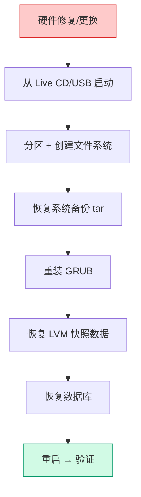

# Linux 备份与恢复策略：从 rsync 到裸机恢复

## 前言

备份是运维中最容易被忽视、但出事时最救命的工作。数据丢失的原因比你想的多：误删、磁盘故障、勒索病毒、机房火灾。一个好的备份策略应该回答三个问题：**备份什么、多久备一次、怎么恢复**。

本文覆盖从文件级到裸机级的完整备份方案。

---

## 备份策略基础

### 3-2-1 原则

| 规则 | 含义 |
| :---: | --- |
| **3** | 数据至少有 3 份副本（原始 + 2 备份） |
| **2** | 至少 2 种不同介质（本地磁盘 + 远程/云端） |
| **1** | 至少 1 份异地副本（防机房火灾） |

### 备份类型

| 类型 | 说明 | 优点 | 缺点 |
| --- | --- | --- | --- |
| **全量备份** | 备份全部数据 | 恢复快 | 慢、占空间 |
| **增量备份** | 只备份上次备份后变化的数据 | 快、省空间 | 恢复需要链条完整 |
| **差异备份** | 备份上次全量之后变化的数据 | 比全量快、比增量恢复简单 | 随时间变大 |

---

## rsync：文件级同步

### 基础用法

```bash
# 本地同步
rsync -av --delete /source/ /backup/

# 远程同步（SSH）
rsync -avz -e ssh /local/data/ user@backup-server:/backup/data/

# 常用参数
# -a: 归档模式（保留权限、时间、软链接）
# -v: 详细输出
# -z: 传输时压缩
# --delete: 删除目标中源没有的文件
# --exclude: 排除目录
# -n/--dry-run: 模拟运行
```

### 增量备份脚本

```bash
#!/bin/bash
# /opt/scripts/backup-rsync.sh

SOURCE="/var/lib/mysql /etc /home"
BACKUP_USER="backup"
BACKUP_HOST="backup-server"
BACKUP_ROOT="/backup/$(hostname)"
LOG="/var/log/backup.log"

for dir in $SOURCE; do
    rsync -avz --delete \
        -e "ssh -i /root/.ssh/backup_key" \
        "$dir/" \
        "${BACKUP_USER}@${BACKUP_HOST}:${BACKUP_ROOT}${dir}/" \
        >> "$LOG" 2>&1
done

# 记录备份时间
date >> "$LOG"
```

### 版本快照（保留历史）

```bash
# 用 --link-dest 创建硬链接快照（省空间）
DATE=$(date +%Y%m%d_%H%M)
rsync -av --delete \
    --link-dest=/backup/latest \
    /data/ \
    /backup/$DATE/

# 更新 latest 链接
rm -f /backup/latest
ln -s /backup/$DATE /backup/latest

# 清理 30 天前的备份
find /backup -maxdepth 1 -type d -name "202*" -mtime +30 -exec rm -rf {} \;
```

---

## tar：归档备份

```bash
# 创建压缩归档
tar -czpf backup_$(date +%Y%m%d).tar.gz /etc /home /var/www

# 恢复
tar -xzpf backup.tar.gz -C /restore/

# 带排除规则
tar -czpf backup.tar.gz / \
    --exclude=/proc \
    --exclude=/sys \
    --exclude=/tmp \
    --exclude=/mnt \
    --exclude=/dev \
    --exclude=/run
```

---

## dd：磁盘镜像

```bash
# 全盘镜像（逐位复制）
sudo dd if=/dev/sda of=/backup/sda.img bs=4M status=progress

# 压缩镜像
sudo dd if=/dev/sda bs=4M | gzip -9 > /backup/sda.img.gz

# 恢复
sudo gunzip -c /backup/sda.img.gz | dd of=/dev/sda bs=4M status=progress

# 仅备份分区表 + 引导
sudo dd if=/dev/sda of=/backup/mbr.img bs=512 count=1
```

!!! warning "dd 只适合冷备份"
    对正在运行的磁盘做 `dd` 会得到不一致的镜像。生产环境用 LVM 快照 + dd。

---

## LVM 快照备份

```bash
# 1. 创建快照
sudo lvcreate -L 5G -s -n lv_data_snap /dev/vg_data/lv_data

# 2. 挂载快照并备份
sudo mount -o ro /dev/vg_data/lv_data_snap /mnt/snap
tar -czpf /backup/data_$(date +%Y%m%d).tar.gz -C /mnt/snap .
sudo umount /mnt/snap

# 3. 删除快照
sudo lvremove -f /dev/vg_data/lv_data_snap
```

---

## 数据库备份

### MySQL/MariaDB

```bash
# 全量备份（会锁表）
mysqldump -u root -p --all-databases --single-transaction \
    | gzip > /backup/mysql_$(date +%Y%m%d).sql.gz

# 恢复
gunzip < mysql_backup.sql.gz | mysql -u root -p
```

### PostgreSQL

```bash
# 全量备份
pg_dumpall -U postgres | gzip > /backup/pg_$(date +%Y%m%d).sql.gz

# 恢复
gunzip < pg_backup.sql.gz | psql -U postgres
```

---

## 裸机灾难恢复流程

当服务器完全无法启动，需要整机重建时：



### 关键恢复步骤

```bash
# 1. 分区（按备份时的布局）
sudo fdisk /dev/sda      # 或恢复分区表 dd if=mbr.img of=/dev/sda

# 2. 格式化
sudo mkfs.ext4 /dev/sda1
sudo mkfs.ext4 /dev/sda2

# 3. 挂载并恢复
sudo mount /dev/sda2 /mnt
sudo tar -xzpf system_backup.tar.gz -C /mnt

# 4. 重新安装 GRUB
sudo mount --bind /dev /mnt/dev
sudo mount --bind /proc /mnt/proc
sudo mount --bind /sys /mnt/sys
sudo chroot /mnt grub-install /dev/sda
sudo chroot /mnt update-grub
```

---

## 备份验证与测试

**备份没有经过恢复测试 = 没有备份。**

```bash
# 在另一台机器上验证
tar -tzf backup.tar.gz | head    # 列出内容
tar -xzpf backup.tar.gz -C /tmp/test-restore/   # 实际恢复测试

# 关键文件抽样验证
diff <(cat /etc/fstab) <(cat /tmp/test-restore/etc/fstab)
```

---

## 总结

一个可落地的备份方案：

1. **文件级**：`rsync` 每日增量 + `--link-dest` 版本快照
2. **数据库**：`mysqldump`/`pg_dumpall` 每日 + binlog/WAL 实时
3. **系统级**：`tar` + LVM 快照，每周全量
4. **异地**：`rsync` 到远程服务器或云存储
5. **验证**：每季度一次恢复演练

备份只是手段，恢复才是目的。确保你每季度至少演练一次完整恢复。 🚀
