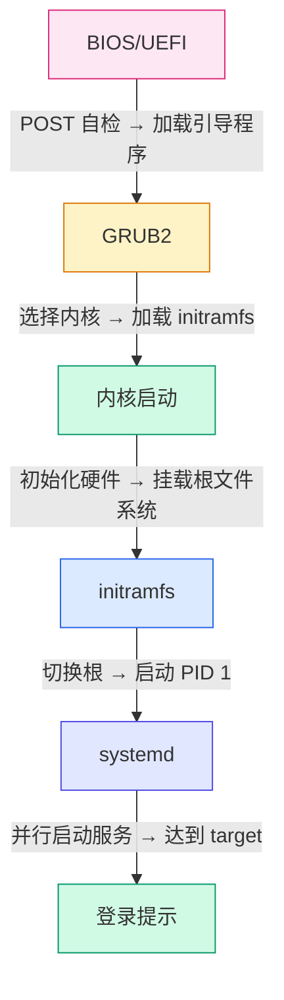

# Linux 启动流程详解：从开机到登录的完整过程

## 前言

按下电源键到出现登录提示符，这几十秒内发生了什么？理解启动流程不只是满足好奇心——当系统「卡住不动」时，知道它在哪一步卡住了，你才能在正确的位置按正确的键进入修复模式。

本文拆解从固件到登录的六个阶段，每一步都给出关键命令和排障入口。

---

## 启动流程全景



---

## 阶段一：BIOS/UEFI 固件

| | Legacy BIOS | UEFI |
| --- | :---: | :---: |
| **分区表** | MBR | GPT |
| **引导程序位置** | 磁盘第一个扇区（446 字节） | ESP 分区（`/boot/efi`） |
| **引导程序格式** | 裸二进制 | `.efi` 可执行文件 |
| **安全启动** | 不支持 | Secure Boot |
| **多系统支持** | 困难 | 原生支持 |

```bash
# 查看当前是 BIOS 还是 UEFI
ls /sys/firmware/efi        # 目录存在 → UEFI，不存在 → BIOS

# 查看 ESP 分区
lsblk -f | grep -i vfat
```

---

## 阶段二：GRUB2 引导程序

### GRUB2 配置文件

| 文件 | 作用 |
| --- | --- |
| `/etc/default/grub` | 用户可编辑的配置（内核参数、超时、默认启动项） |
| `/boot/grub/grub.cfg` | 自动生成的最终配置（**不要手动编辑**） |
| `/etc/grub.d/` | 生成 `grub.cfg` 的脚本片段 |

```bash
# 修改配置后，必须重新生成 grub.cfg
sudo grub-mkconfig -o /boot/grub/grub.cfg    # BIOS
sudo grub-mkconfig -o /boot/efi/EFI/<distro>/grub.cfg  # UEFI
```

### 常用 GRUB 配置

```bash
# /etc/default/grub

GRUB_TIMEOUT=5                    # 引导菜单等待秒数
GRUB_CMDLINE_LINUX="quiet splash" # 内核启动参数
GRUB_CMDLINE_LINUX_DEFAULT=""     # 默认内核参数
```

### 临时修改内核参数（排障用）

在 GRUB 菜单按 `e` 编辑启动项：

```text
# 常见临时参数：
single          → 单用户模式（救援）
init=/bin/bash  → 直接进 root shell（无需密码）
systemd.unit=emergency.target → systemd 紧急模式
```

---

## 阶段三：内核加载与 initramfs

### 内核做了什么？

1. 解压自己
2. 初始化 CPU、内存、中断
3. 加载内置驱动
4. 挂载 initramfs（临时根文件系统）
5. 执行 `/init`（initramfs 中的第一个程序）

### initramfs 是什么？

initramfs 是一个**临时的小型根文件系统**，包含：

-   必要的内核模块（磁盘驱动、文件系统驱动）
-   设备检测工具（`udev`）
-   磁盘解密工具（LUKS）
-   挂载真正根文件系统所需的一切

!!! tip "需要 initramfs 的典型场景"
    -   根文件系统在 LVM 上 → initramfs 加载 LVM 模块并激活 VG
    -   根文件系统加密（LUKS） → initramfs 提示输入密码
    -   根文件系统在 RAID 上 → initramfs 加载 RAID 驱动
    -   根文件系统在 NVMe 上 → initramfs 加载 NVMe 驱动

```bash
# 查看当前内核的 initramfs
ls -lh /boot/initrd.img-*

# 重新生成 initramfs
sudo update-initramfs -u -k all           # Debian/Ubuntu
sudo dracut --force                       # RHEL/Rocky

# 查看 initramfs 内容
lsinitramfs /boot/initrd.img-$(uname -r) | head -30
```

---

## 阶段四：systemd 启动

内核将控制权交给 `/sbin/init`（指向 systemd，PID=1）：

```bash
# 查看启动耗时
systemd-analyze

# 查看每个服务的启动时间（找慢的）
systemd-analyze blame | head -15

# 查看启动关键链
systemd-analyze critical-chain

# 生成启动 SVG 图
systemd-analyze plot > boot.svg
```

### 启动到达的 Target

```bash
# 查看当前 target
systemctl get-default

# 常见 target
multi-user.target      # 命令行多用户（服务器默认）
graphical.target       # 图形界面
rescue.target          # 单用户救援
emergency.target       # 紧急模式（最小化）
```

---

## 救援与紧急模式

### 单用户/救援模式

在 GRUB 菜单按 `e`，在 `linux` 行末尾加 `single` 或 `systemd.unit=rescue.target`：

```bash
# 进入后可以：
passwd root               # 重置 root 密码
fsck -f /dev/sda1         # 检查文件系统
mount -o remount,rw /     # 重新挂载为读写
```

### 紧急模式

如果根文件系统挂载失败，systemd 会自动进入 `emergency.target`。或手动添加 `systemd.unit=emergency.target` 内核参数。

---

## 启动排障

### 卡在 GRUB 提示符

```text
grub>
```

说明 GRUB 找不到 `grub.cfg` 或内核文件：

```bash
# 手动引导
grub> ls                          # 列出磁盘和分区
grub> set root=(hd0,msdos1)       # 设根分区
grub> linux /vmlinuz root=/dev/sda1
grub> initrd /initrd.img
grub> boot
```

进入系统后重建 GRUB：

```bash
sudo grub-install /dev/sda
sudo grub-mkconfig -o /boot/grub/grub.cfg
```

### 卡在 initramfs 阶段

通常是磁盘驱动或 LUKS/LVM 问题：

```bash
# initramfs 提示符下
blkid                    # 查看可用设备
lvm vgchange -ay         # 激活 LVM
cryptsetup luksOpen ...  # 解锁 LUKS
exit                     # 继续启动
```

---

## 总结

Linux 启动六个阶段，排障按顺序定位：

1. **BIOS/UEFI**：硬件自检，找引导设备
2. **GRUB2**：`/etc/default/grub` + `grub-mkconfig` 生成配置
3. **内核 + initramfs**：加载驱动、解密磁盘、挂载根
4. **systemd**：`systemd-analyze blame` 找慢服务
5. **Target 到达**：multi-user 或 graphical
6. **登录**：getty + login

排障关键字：GRUB按 `e`、内核参数 `single`/`emergency`、`systemd-analyze`、`update-initramfs`。🚀
