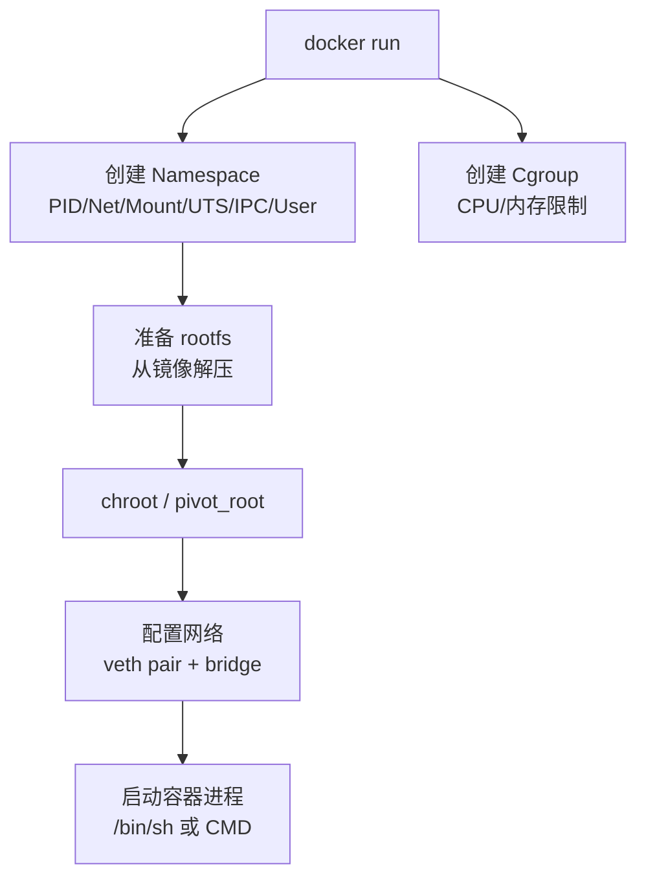

# 容器底层原理：Namespace 与 Cgroup 动手实验

## 前言

Docker 和 Kubernetes 用起来很方便，但它们底层依赖的两个 Linux 内核特性——**Namespace（隔离）**和 **Cgroup（限制）**——才是容器的本质。

本文不装 Docker，只用手工命令一步一步「造」一个容器。读完你会明白：容器不是什么黑科技，它就是带了一堆内核参数启动的普通 Linux 进程。

---

## 容器的本质 = Namespace + Cgroup

| 特性 | 解决的问题 | 示例 |
| --- | --- | --- |
| **Namespace** | 「能看到什么」——隔离 | 容器内的 `ps` 只看到自己的进程 |
| **Cgroup** | 「能用多少」——限制 | 容器最多用 128MB 内存 |

---

## 六种 Namespace

| Namespace | 隔离内容 | 系统调用 | 典型用途 |
| --- | --- | --- | --- |
| **UTS** | 主机名和域名 | `CLONE_NEWUTS` | 容器有自己的 hostname |
| **PID** | 进程 ID 空间 | `CLONE_NEWPID` | 容器内 `ps` 只看到自己的进程 |
| **Net** | 网络设备、IP、端口 | `CLONE_NEWNET` | 容器有自己的网卡和 IP |
| **Mount** | 文件系统挂载点 | `CLONE_NEWNS` | 容器有自己的根文件系统 |
| **IPC** | 进程间通信（信号量/消息队列） | `CLONE_NEWIPC` | 容器间 IPC 隔离 |
| **User** | UID/GID 映射 | `CLONE_NEWUSER` | 容器内 root 不是宿主机 root |

### 动手：观察当前 Namespace

```bash
# 查看当前 shell 所属的 namespace
ls -la /proc/$$/ns/
# lrwxrwxrwx 1 root root 0 Jul 20 14:30 net -> net:[4026531840]
# lrwxrwxrwx 1 root root 0 Jul 20 14:30 pid -> pid:[4026531836]
# lrwxrwxrwx 1 root root 0 Jul 20 14:30 mnt -> mnt:[4026531841]
# ...

# 方括号里的数字是 namespace 的 inode 号
# 两个进程数字相同 → 它们在同一个 namespace 中
```

---

## 手动创建容器（unshare 实战）

### Step 1：创建隔离环境

```bash
# 创建一个新的 PID + Mount + UTS + IPC + Net namespace
sudo unshare --pid --mount --uts --ipc --net --fork /bin/bash
```

此时你进入了一个「半隔离」环境——但还没有自己的根文件系统。

### Step 2：准备根文件系统

```bash
# 用最小的 Alpine rootfs
mkdir /tmp/container-root
cd /tmp/container-root
wget https://dl-cdn.alpinelinux.org/alpine/latest-stable/releases/x86_64/alpine-minirootfs-latest-x86_64.tar.gz
sudo tar xzf alpine-minirootfs-latest-x86_64.tar.gz

# 挂载必要的虚拟文件系统
sudo mount -t proc proc /tmp/container-root/proc
sudo mount -t sysfs sys /tmp/container-root/sys
sudo mount -t tmpfs tmp /tmp/container-root/tmp
```

### Step 3：chroot + pivot_root

```bash
# 在新 namespace 中切换根
sudo unshare --pid --mount --uts --ipc --net --fork --mount-proc \
    /usr/sbin/chroot /tmp/container-root /bin/sh
```

现在你在一个手动创建的「容器」中：

```bash
hostname my-container       # 改主机名（UTS namespace）
hostname                    # my-container

ps aux                      # 只看到容器内的进程（PID namespace）
# PID   USER     COMMAND
#   1   root     /bin/sh
#   2   root     ps aux

ip link show                # 只看到 lo（net namespace 隔离）
```

### Step 4：给容器配网络

在**宿主机**的另一个终端：

```bash
# 创建 veth pair
sudo ip link add veth0 type veth peer name veth1

# 一端给容器
sudo ip link set veth1 netns <容器PID>

# 在容器中配置 IP
sudo nsenter -t <容器PID> -n ip addr add 10.0.0.2/24 dev veth1
sudo nsenter -t <容器PID> -n ip link set veth1 up
sudo nsenter -t <容器PID> -n ip link set lo up

# 在宿主机中配置另一端
sudo ip addr add 10.0.0.1/24 dev veth0
sudo ip link set veth0 up

# 容器内 ping 宿主机
sudo nsenter -t <容器PID> -n ping 10.0.0.1
```

---

## Cgroup v2：资源限制

### 创建控制组

```bash
# 创建 cgroup
sudo mkdir /sys/fs/cgroup/mycontainer

# 启用 CPU 和内存控制器
echo "+cpu +memory" | sudo tee /sys/fs/cgroup/cgroup.subtree_control

# 限制内存 128 MB
echo "134217728" | sudo tee /sys/fs/cgroup/mycontainer/memory.max

# 限制 CPU 0.5 核
echo "50000 100000" | sudo tee /sys/fs/cgroup/mycontainer/cpu.max

# 将容器进程加进去
echo <容器PID> | sudo tee /sys/fs/cgroup/mycontainer/cgroup.procs
```

### 验证限制

```bash
# 在容器中测试内存限制
dd if=/dev/zero of=/dev/null bs=200M count=1
# 会被 cgroup 杀掉

# 查看 cgroup 事件
cat /sys/fs/cgroup/mycontainer/memory.events
# oom 1      ← OOM 已经触发
```

---

## Docker 在做什么？

现在你知道 `docker run` 本质上干了什么：



---

## 总结

容器不是什么魔法——它就是：

1. **隔离**：`unshare` + Namespace（6 种）——让容器「以为」自己独占系统
2. **限制**：Cgroup v2（CPU、内存、I/O）——防止容器吃光宿主机资源
3. **rootfs**：`chroot` + 镜像——给容器一个文件系统
4. **网络**：veth pair + bridge——让容器联网

理解这四件事，Docker 和 Kubernetes 就不再是黑盒。 🚀
