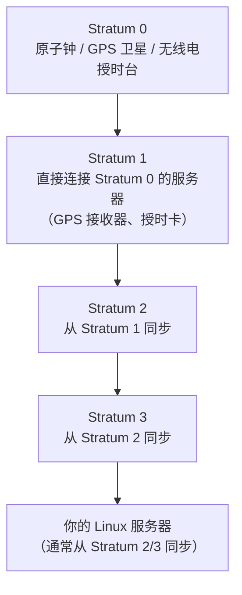

# NTP 时间同步原理详解：网络时间协议是如何工作的？

## 前言

很多人在第一次接触 NTP（Network Time Protocol，网络时间协议）时，直觉上认为它很简单：

> 我的电脑向时间服务器请求当前时间 → 收到回复 → 更新自己的时钟。

如果真是这样，那 NTP 就不会成为分布式系统领域最精妙的协议之一了。

真正的挑战不是「获取时间」本身，而是**如何确定网络延迟对结果造成了多大影响**。你的电脑发出的请求包在路上走了 2ms 还是 200ms？如果不搞清楚这一点，收到的「当前时间」就没有意义——等你收到时，它已经过时了。

NTP 通过巧妙的四时间戳交换机制、多源投票算法和渐进式时钟微调策略，让分布在不可靠网络上的数亿台设备，将时钟偏差控制在毫秒级别。本文将从原理到实践，完整拆解 NTP 的工作方式。

---

## 为什么精确时间如此重要？

在现代 IT 系统中，时钟不同步不仅仅是「时间不准」的问题——它可能直接导致系统故障：

| 场景 | 时钟偏差的影响 |
| --- | --- |
| **HTTPS/TLS 证书** | 证书有有效期。系统时间偏差过大，浏览器会拒绝「未生效」或「已过期」的有效证书，导致网站无法访问 |
| **Kerberos 认证** | 默认容忍 5 分钟偏差。超出则认证失败，用户无法登录域 |
| **分布式数据库** | 多节点写入依赖时间戳排序。时钟不同步导致数据冲突、写入顺序错乱 |
| **日志关联分析** | 排查故障时需要跨服务器关联日志。如果时间对不上，根本无法还原事件顺序 |
| **Cron 定时任务** | 备份、清理、数据同步等任务依赖准确时间触发 |
| **金融交易** | 监管合规要求精确到毫秒的审计时间戳 |
| **监控告警** | Prometheus、Grafana 等多源数据关联，时间不一致直接导致误报或漏报 |

!!! tip "一个真实案例"
    Kubernetes 集群中某节点时钟比 Master 快了 30 秒，导致该节点上所有 Pod 的证书验证失败，kubelet 反复重启。最终排查发现是该节点的 NTP 服务因防火墙规则无法访问上游时间服务器——问题被定位后，一次 `chronyc sources` 就找到了根因。

---

## NTP 的层级架构：Stratum

### 时钟层级

NTP 不要求每台设备直接连接原子钟。它通过一个分层架构分发时间：



| 层级 | 说明 | 示例 |
| --- | --- | --- |
| **Stratum 0** | 权威参考时钟，不直接接入网络 | 原子钟、GPS 卫星、北斗卫星、无线电授时台 |
| **Stratum 1** | 直接连接 Stratum 0 的服务器 | GPS NTP 服务器、国家授时中心服务器 |
| **Stratum 2** | 从 Stratum 1 同步 | 公有 NTP 池（`pool.ntp.org`）、ISP NTP 服务器 |
| **Stratum 3+** | 从上级 Stratum 同步 | 企业内网 NTP 服务器、你的个人电脑 |

!!! info "你的电脑不需要原子钟"
    你不需要直接连接 GPS 接收器或原子钟。只要同步链路能追溯到可靠的 Stratum 0 源，你的时钟就是可信的——NTP 会处理好中间的一切误差。

---

## 时钟偏移 vs 时钟漂移

这两个概念常被混淆，但含义完全不同：

| 概念 | 定义 | 类比 |
| --- | --- | --- |
| **时钟偏移（Clock Skew）** | 两个时钟在某个时刻的**瞬时差值** | 服务器 A 显示 `10:00:05`，服务器 B 显示 `10:00:00`，偏移 = 5 秒 |
| **时钟漂移（Clock Drift）** | 时钟因硬件晶振不完美而**逐渐偏离**真实时间的速率 | 一个每天快 2 秒的便宜晶振，其漂移率约为 23 ppm |

漂移导致偏移随时间累积。即使今天同步了，明天又会偏差。这就是为什么 NTP 不是一次性操作——它必须**持续运行**，不断修正漂移带来的累积误差。

即使是高质量石英晶振，漂移率也在几个 ppm（百万分之几）。看似微不足道，但一天下来就是数百毫秒的偏差，一周就是秒级——足够导致 Kerberos 认证失败。

---

## 为什么「直接问时间」行不通？

假设你的电脑发出一个最简单的请求：

```
Client              Server
  |                    |
  |--- "几点啦?" ---->|
  |                    |
  |<--- "12:00:00" ---|
  |                    |
```

问题在于：回复抵达时，网络延迟是 2ms、20ms 还是 200ms？**你不知道**。

如果不考虑网络延迟，你只能假设回复是瞬间到达的——这意味着你同步得到的时间**永远比真实时间慢了一个网络延迟的量**。对于需要毫秒级精度的场景，这完全不可接受。

这就是分布式系统中**时钟同步的根本难题**：你无法区分「时间差」和「网络延迟」。

---

## NTP 的核心机制：四时间戳交换

NTP 解决上述问题的方法非常精妙——交换四个时间戳：

```
Client                                Server
  |                                      |
  |-- t1（客户端发送请求）--------------->|
  |                                      | t2（服务器收到请求）
  |                                      |
  |                                      | t3（服务器发送回复）
  |<-- t4（客户端收到回复）--------------|
  |                                      |
```

| 时间戳 | 含义 | 记录方 |
| --- | --- | --- |
| **t1** | 客户端发出请求的时刻 | 客户端时钟 |
| **t2** | 服务器收到请求的时刻 | 服务器时钟 |
| **t3** | 服务器发出回复的时刻 | 服务器时钟 |
| **t4** | 客户端收到回复的时刻 | 客户端时钟 |

有了这四个值，客户端可以算出两个关键量：

### 往返延迟（Round-trip Delay）

\[
\delta = (t_4 - t_1) - (t_3 - t_2)
\]

其中：

-   $t_4 - t_1$：从客户端发出请求到收到回复的**总耗时**
-   $t_3 - t_2$：服务器**处理请求所花的时间**
-   两值相减 = 纯网络传输往返时间

### 时钟偏移（Clock Offset）

\[
\theta = \frac{(t_2 - t_1) + (t_3 - t_4)}{2}
\]

这个公式计算的本质是：

-   $(t_2 - t_1)$：按客户端时钟看，请求在网络上走了多久（含客户端→服务器的延迟 + 时钟偏差）
-   $(t_3 - t_4)$：按客户端时钟看，回复在网络上走了多久（含服务器→客户端的延迟 − 时钟偏差）
-   两值相加除以 2，**对称的网络延迟互相抵消**，剩下的就是时钟偏差

!!! tip "核心洞察"
    NTP 默认假设网络延迟是**对称的**（去程 ≈ 回程）。在这个假设下，四时间戳交换可以精确分离「时钟偏差」和「网络延迟」。实际情况中延迟不一定对称，但统计平均下来这个假设是有效的。

---

## NTP 如何选择最佳时间服务器

NTP 不是简单地连接最近的服务器并盲目信任它。它有一套严谨的多源评估机制：

### Step 1：查询多台时间服务器

NTP 客户端通常配置了多台上游服务器（建议至少 3 台）：

```
Server A  \
           \
Server B  ---> 你的 Linux 服务器
           /
Server C  /
```

多服务器策略同时提升了**精度**和**容错性**——一台服务器出问题，不影响整体同步。

---

### Step 2：测量每台服务器的延迟和偏移

对于每台服务器，NTP 反复执行四时间戳交换，持续积累数据：

-   **网络延迟（Delay）**：包来回的时间
-   **时钟偏移（Offset）**：服务器与本地时钟的差值

一台延迟巨大或延迟波动剧烈的服务器，测量数据的可信度就低。

---

### Step 3：排除不可靠的时间源

并非每台服务器都值得信任。以下原因可能导致服务器报告错误时间：

-   硬件故障（晶振损坏）
-   配置错误（时区、闰秒设置错误）
-   网络严重拥塞（延迟抖动极大）
-   服务器自身失去与上游的同步

NTP 通过**交叉算法（Intersection Algorithm）**过滤异常值。例如：

| 时间服务器 | 估算偏移 |
| --- | --- |
| Server A | +8 ms |
| Server B | +9 ms |
| Server C | +10 ms |
| Server D | **+430 ms** |

Server A、B、C 的意见高度一致（8~10 ms），而 Server D 明显是离群值。NTP 会识别并**排除** Server D，防止一颗「老鼠屎」坏掉整锅粥。

---

### Step 4：选出最佳同步源

排除异常值后，NTP 综合以下因素选出最优服务器：

| 因素 | 权重说明 |
| --- | --- |
| **低网络延迟** | 延迟越低，四时间戳的对称假设越可靠 |
| **延迟稳定性** | 延迟抖动小 → 测量数据可信度高 |
| **时钟稳定性** | 该服务器自身的时钟漂移很小 |
| **Stratum 层级** | 越低越好，但**不是唯一标准** |

!!! warning "Stratum 1 不一定最好"
    一个通过低延迟局域网连接的 Stratum 2 服务器，可能比通过拥堵公网连接的 Stratum 1 服务器提供更精确的同步。NTP 评估的是**整体同步质量**，不是单纯比 Stratum 数字。

---

## NTP 为什么通常不「跳」时钟？

假设你的电脑发现时钟快了 5 秒。最直接的做法是——立刻往回拨 5 秒。

**但这样做会导致严重问题：**

-   数据库事务日志中出现**时间倒流**，破坏写入顺序
-   Cron 定时任务可能**被跳过或重复执行**
-   日志文件时间戳出现**乱序**
-   TLS 证书验证可能出现**逻辑错误**
-   分布式应用的**事件排序混乱**

因此，NTP 通常采用 **Slewing（渐进微调）** 而非 **Stepping（直接跳变）**：

> 稍微加快或减慢系统时钟的运行速度，让它慢慢收敛到正确时间，而不是突然改变显示时间。

当偏差在 128ms 以内时，NTP 默认使用 slewing；超过这个阈值才执行 stepping。这种设计让时间同步「润物细无声」，应用层几乎无感知。

---

## NTP 的精度有多高？

| 网络环境 | 典型精度 |
| --- | --- |
| **局域网（LAN）** | 毫秒级（通常 < 5ms） |
| **公网（Internet）** | 十毫秒级（通常 10~50ms） |
| **PTP + 硬件时间戳** | 微秒到纳秒级 |

NTP 的设计目标是**让广大互联网设备「够用」**——对于绝大多数服务器、桌面和网络设备，毫秒级精度完全满足需求。需要更高精度的场景（如金融高频交易、电信基站）使用 PTP（Precision Time Protocol）。

---

## 没有互联网，NTP 能工作吗？

**可以。** NTP 不依赖互联网。

企业内网完全可以自建 NTP 基础设施：

```
GPS 天线 → Stratum 1 NTP 服务器 → 内网 Stratum 2 → 所有服务器
```

常见方案：

-   **GPS/北斗接收器 + NTP 服务器**：机房常见配置
-   **原子钟/PTP 主时钟**：金融、电信行业
-   **纯内网多级 NTP**：军工、隔离网络、工业控制系统

即使完全没有外部时间源，只要内网一台服务器被设为「权威时钟」，其他服务器也能保持相互同步——虽然不一定是 UTC 绝对时间，但相对时间一致对于日志关联、Kerberos 等场景已经足够。

---

## Linux 时间同步实战

### 查看当前时间同步状态

```bash
# 查看系统时间状态
timedatectl status
```

典型输出：

```text
               Local time: Sat 2026-07-20 14:30:00 CST
           Universal time: Sat 2026-07-20 06:30:00 UTC
                 RTC time: Sat 2026-07-20 06:30:00
                Time zone: Asia/Shanghai (CST, +0800)
System clock synchronized: yes
              NTP service: active
          RTC in local TZ: no
```

重点关注：

-   `System clock synchronized: yes` — 系统时钟已同步
-   `NTP service: active` — NTP 服务在运行

---

### Chrony：现代 Linux 的时间同步首选

大多数现代 Linux 发行版（Ubuntu 22.04+、RHEL 9+、Rocky Linux 9+）默认使用 **Chrony** 替代传统的 `ntpd`。

| 对比 | ntpd | Chrony |
| --- | :---: | :---: |
| 启动后同步速度 | 慢 | **快**（秒级同步） |
| 虚拟机时钟漂移 | 一般 | **更好**（对不稳定时钟优化） |
| 间歇性网络 | 较差 | **强**（移动设备友好） |
| 配置复杂度 | 中等 | 简单 |

#### 安装 Chrony

```bash
# Debian/Ubuntu
sudo apt install -y chrony

# RHEL/Rocky Linux/CentOS
sudo yum install -y chrony
```

#### 配置时间服务器

编辑 `/etc/chrony/chrony.conf`（或 `/etc/chrony.conf`）：

```text
# 使用 NTP 池（全球负载均衡）
pool 2.pool.ntp.org iburst

# 国内推荐：阿里云 NTP
pool ntp.aliyun.com iburst

# 国内推荐：腾讯云 NTP
pool ntp.tencent.com iburst

# 允许本地网络中的设备从此服务器同步（可选）
allow 192.168.0.0/16
```

!!! tip "`iburst` 参数的作用"
    `iburst` 让 Chrony 在启动后前几分钟内以更高频率发送 NTP 请求，加速初始同步。生产环境强烈推荐添加。

#### 启动并验证

```bash
# 启动 Chrony 并设为开机自启
sudo systemctl enable chrony --now

# 查看同步源
chronyc sources -v
```

预期输出：

```text
MS Name/IP address         Stratum Poll Reach LastRx Last sample
===============================================================================
^* ntp.aliyun.com                2   6    37    15   +1.2ms[+1.3ms] +/- 45ms
^+ time.neu.edu.cn               2   6    37    16   -0.8ms[-0.7ms] +/- 52ms
```

关键标识：

| 符号 | 含义 |
| :---: | --- |
| `^*` | 当前正在使用的同步源（系统时钟正跟随它） |
| `^+` | 可接受的候选源 |
| `^-` | 被排除的源（离群值） |
| `^?` | 尚未建立连接的源 |

#### 查看详细同步状态

```bash
# 跟踪当前同步源
chronyc tracking
```

```text
Reference ID    : 0A6F0102 (ntp.aliyun.com)
Stratum         : 3
Ref time (UTC)  : Sat Jul 20 06:30:00 2026
System time     : 0.000123456 seconds slow of NTP time
Last offset     : +0.001234567 seconds
RMS offset      : 0.000234567 seconds
Frequency       : 2.345 ppm slow
Residual freq   : +0.001 ppm
Skew            : 0.123 ppm
Root delay      : 0.012345678 seconds
Root dispersion : 0.003456789 seconds
Update interval : 128.2 seconds
Leap status     : Normal
```

关键指标解读：

| 指标 | 说明 |
| --- | --- |
| `System time` | 系统时钟与 NTP 时间的当前偏差 |
| `Frequency` | 本地时钟晶振的漂移速率（ppm），Chrony 会自动补偿 |
| `Root delay` | 到 Stratum 0 源的累积网络延迟 |
| `Update interval` | 两次同步请求的间隔 |

---

### 使用 systemd-timesyncd（轻量方案）

如果你的系统只需要**基本的时间同步**（不需要作为 NTP 服务器），`systemd-timesyncd` 是一个更轻量的选择：

```bash
# 启用
sudo timedatectl set-ntp true

# 查看状态
timedatectl timesync-status
```

它只与配置的 NTP 服务器通信获取时间，不对外提供 NTP 服务——适合桌面、笔记本和不需要对外授时的一般服务器。

---

### 手动时间同步

```bash
# 手动强制同步（需要先停止 NTP 服务）
sudo systemctl stop chrony
sudo ntpdate ntp.aliyun.com
sudo systemctl start chrony

# 或使用 timedatectl 一次性同步
sudo timedatectl set-ntp false
sudo ntpdate ntp.aliyun.com
sudo timedatectl set-ntp true
```

---

## 常见问题排查

### Chrony 无法同步：`chronyc sources` 显示 `?`

```bash
# 检查 Chrony 服务状态
sudo systemctl status chrony

# 检查是否能连通 NTP 服务器（UDP 123 端口）
nc -uz ntp.aliyun.com 123

# 检查防火墙
sudo firewall-cmd --list-services | grep ntp   # firewalld
sudo ufw status | grep 123                      # ufw
```

---

### 系统时钟偏差过大，Chrony 不自动修正

当偏差超过一定阈值时，Chrony 默认可能不会 step：

```bash
# 查看 chrony 是否在等待
chronyc tracking | grep "System time"

# 允许大偏差时自动步进
sudo chronyc makestep
```

或在 `/etc/chrony/chrony.conf` 中添加：

```text
makestep 1.0 3
```

表示：在启动后的前 3 次同步中，如果偏差 > 1 秒，直接步进。

---

### 虚拟机时钟漂移严重

虚拟机的时钟漂移通常比物理机大得多（CPU 时间被 Hypervisor 偷走，导致时钟不准）。解决：

1. 在 VMware 中，编辑 VM 设置 → 选项 → VMware Tools → 勾选 **「将客户机时间与主机同步」**
2. 确保 `chrony` 以更高频率同步（减少 `minpoll`/`maxpoll` 值）
3. 对关键 VM，考虑分配独占 CPU 核心减少 steal time

---

## 常见误区澄清

| 误区 | 事实 |
| --- | --- |
| 「NTP 直接连接原子钟」 | 大多数设备通过层级链同步，不直接连原子钟 |
| 「Stratum 1 永远最准」 | 网络延迟和服务器质量同样重要；近处的 Stratum 2 可能优于远处的 Stratum 1 |
| 「NTP 就是问服务器几点」 | 它通过四时间戳交换估算延迟和偏移，远不止一问一答 |
| 「NTP 让所有时钟完全一致」 | 无法消除所有误差，目标是让偏差「足够小」 |
| 「Stratum 数字越低一定越好」 | Stratum 只是层级，不代表实际精度 |

---

## 总结

NTP 的成功不在于它连接了原子钟，而在于它**诚实面对网络的不确定性**：

1. **四时间戳交换**：精妙地将网络延迟从时钟偏差中分离出来
2. **多源投票 + 异常值过滤**：不盲信任何单台服务器
3. **渐进微调（Slewing）**：不动声色地修正时钟，避免突然跳变破坏应用
4. **层级架构**：让精准时间从原子钟逐级分发到全球数十亿台设备

在分布式系统领域，时间同步被称为「最难的问题之一」。NTP 用一套看似简单实则深刻的机制，让这个世界上的计算机在不可靠的网络上保持了几十年的「共识」。

对于 Linux 运维人员，掌握 NTP 远不止 `apt install chrony` 这么简单——当 Kerberos 认证突然失败、K8s 节点莫名其妙 NotReady、日志时间线对不上号时，你首先要检查的，就是时钟同步。 🕐

---

## 参考资源

-   [RFC 5905 - Network Time Protocol Version 4](https://www.rfc-editor.org/rfc/rfc5905)
-   [Chrony 官方文档](https://chrony-project.org/documentation.html)
-   [NTP Pool Project](https://www.ntppool.org/)
-   [阿里云 NTP 服务](https://help.aliyun.com/document_detail/92704.html)
