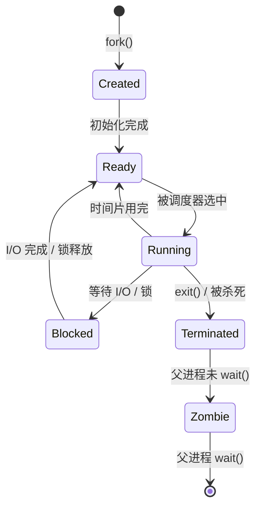

# Linux 进程管理：从 PID 到 cgroup 的完整指南

## 前言

进程是 Linux 系统中最核心的抽象之一。你运行的每个程序——无论是 `nginx`、`sshd`，还是你刚输入的 `ls` 命令——都会创建一个或多个进程。理解进程的创建、调度、信号处理、资源限制，是运维和容器技术的基础。

!!! tip "为什么进程管理对 Kubernetes 很重要？"
    Kubernetes 中 Pod 的资源限制（`requests`/`limits`）底层依赖 **cgroup**；`postStart`/`preStop` 钩子本质是发送**信号**；`kubectl exec` 背后是 Linux **namespace + 进程隔离**。理解 Linux 进程，K8s 的很多设计就不再是黑盒。

---

## 进程基础概念

### 什么是进程？

**进程 = 程序的一次执行实例 + 它所拥有的资源（内存、文件描述符、CPU 时间等）。**

同一个程序可以启动多个进程（例如多个 `nginx worker`），它们共享同一份代码，但各有独立的内存空间和数据。

### 进程 vs 线程

| | 进程 | 线程 |
| --- | :---: | :---: |
| **内存空间** | 独立（fork 后隔离） | 共享（同一进程内） |
| **创建开销** | 大（复制页表、文件描述符） | 小 |
| **通信方式** | IPC（管道、Socket、共享内存） | 直接读写共享内存 |
| **崩溃影响** | 不影响其他进程 | 可能导致整个进程崩溃 |
| **典型场景** | Nginx master + worker | 每个 worker 内部的连接处理 |

---

## 进程状态

进程在其生命周期中会经历多种状态：



| 状态标识 | 含义 | `ps` 显示 | 说明 |
| --- | --- | :---: | --- |
| **R (Running/Runnable)** | 正在运行或等待 CPU | `R` | 包括正在 CPU 上执行和排队等待 CPU |
| **S (Sleeping)** | 可中断睡眠，等待事件 | `S` | 等待 I/O、网络、定时器等，可被信号唤醒 |
| **D (Uninterruptible Sleep)** | 不可中断睡眠 | `D` | 等待内核 I/O 完成，**信号无法打断**。如果长期处于 D 状态，说明磁盘或 NFS 严重阻塞 |
| **T (Stopped)** | 被调试器/信号暂停 | `T` | `Ctrl+Z` 或 `SIGSTOP` 触发 |
| **Z (Zombie)** | 僵尸进程 | `Z` | 已死亡但父进程尚未回收（wait） |
| **X (Dead)** | 即将被彻底清理 | — | 瞬间状态，几乎不可见 |

```bash
# 查看进程状态分布
ps aux | awk '{print $8}' | sort | uniq -c | sort -rn

# 查看所有 D 状态进程（重点关注）
ps aux | awk '$8 ~ /D/'
```

!!! warning "D 状态（不可中断睡眠）是危险信号"
    D 状态进程不能被 `kill -9` 杀死。如果大量进程卡在 D 状态，通常是**磁盘故障、NFS 挂死、SAN 存储断连**的征兆。解决办法是恢复底层存储，而不是杀进程。

---

## 进程的创建：fork + exec

Linux 中创建新进程的唯一方式是 `fork()` + `exec()`：


| 步骤 | 系统调用 | 做了什么 |
| :---: | --- | --- |
| 1 | `fork()` | 创建父进程的完整副本（复制内存、文件描述符），返回两次：父进程得到子进程 PID，子进程得到 0 |
| 2 | `exec()` | 用新程序替换子进程的内存空间，PID 不变 |
| 3 | `wait()` | 父进程等待子进程结束，回收其退出状态 |

这就是为什么每个进程（除了 init）都有父进程——系统中形成了一棵**进程树**：

```bash
# 查看进程树
pstree -p
# systemd(1)─┬─sshd(800)───sshd(1200)───bash(1205)───pstree(3456)
#             ├─nginx(900)─┬─nginx(901)
#             │            └─nginx(902)
#             └─cron(600)
```

---

## 信号机制

信号是 Linux 中进程间通信的最基本方式——它告诉进程「发生了某件事」：

| 信号 | 编号 | 默认行为 | 说明 |
| --- | :---: | --- | --- |
| **SIGHUP** | 1 | Term | 挂断（终端关闭）。常用于让守护进程重载配置文件 |
| **SIGINT** | 2 | Term | 中断（`Ctrl+C`） |
| **SIGQUIT** | 3 | Core | 退出并生成 core dump（`Ctrl+\`） |
| **SIGKILL** | 9 | Term | **强制杀死，无法捕获或忽略** |
| **SIGTERM** | 15 | Term | 优雅终止（默认 `kill` 发送的信号） |
| **SIGSTOP** | 19 | Stop | 暂停进程，**无法捕获** |
| **SIGCONT** | 18 | Cont | 继续暂停的进程 |
| **SIGUSR1** | 10 | Term | 用户自定义信号 1 |
| **SIGUSR2** | 12 | Term | 用户自定义信号 2 |

!!! tip "Kubernetes 中的信号"
    `kubectl delete pod` 先发 `SIGTERM`，等待 `terminationGracePeriodSeconds`（默认 30s），如果进程还没退出，再发 `SIGKILL`。这也是为什么你的应用需要正确处理 `SIGTERM`——实现优雅关闭。

```bash
# 查看所有信号
kill -l

# 优雅终止（推荐）
kill -15 1234      # 或 kill 1234

# 强制杀死（只有 SIGKILL 不管用时才用）
kill -9 1234

# 让 Nginx 重载配置
kill -HUP $(cat /var/run/nginx.pid)
```

---

## 进程优先级与 nice 值

### nice 值

Linux 使用 **nice 值**来表示进程的 CPU 调度优先级：

| 范围 | 含义 |
| --- | --- |
| **-20** | 最高优先级（最不 nice——抢占更多 CPU） |
| **0** | 默认优先级 |
| **19** | 最低优先级（最 nice——让出 CPU 给其他进程） |

```bash
# 以低优先级启动
nice -n 19 ./heavy_job

# 调整运行中进程的优先级（提高需要 root）
renice -n -5 -p 1234
```

!!! warning "nice 值不代表「固定分配」"
    nice 值是 CFS 调度器的**权重参考**，不是「高优先级一定抢到 CPU」。实际 CPU 分配还取决于负载、核心数等因素。

---

## cgroup：现代进程资源控制

cgroup（Control Groups）是 Linux 内核提供的进程资源限制机制。Docker 和 Kubernetes 的 `--memory`、`--cpus` 参数，底层都是 cgroup。

### cgroup v2 核心概念

| 概念 | 说明 |
| --- | --- |
| **controller** | 资源控制器（`cpu`、`memory`、`io`、`pids`） |
| **hierarchy** | 树形结构，子 cgroup 继承父 cgroup 的限制 |
| **subtree_control** | 控制哪些 controller 可被子 cgroup 使用 |

### 查看 cgroup

```bash
# 查看进程属于哪个 cgroup
cat /proc/1234/cgroup

# 查看 cgroup 文件系统挂载
mount | grep cgroup

# systemd 方式查看（推荐）
systemctl status $$
systemd-cgls   # 树形显示所有 cgroup
```

### 手动创建 cgroup 限制（cgroup v2）

```bash
# 创建一个受限制的 cgroup
sudo mkdir /sys/fs/cgroup/myapp
echo "+cpu +memory" | sudo tee /sys/fs/cgroup/cgroup.subtree_control

# 限制内存为 128MB
echo "134217728" | sudo tee /sys/fs/cgroup/myapp/memory.max

# 限制 CPU 为 0.5 核
echo "50000 100000" | sudo tee /sys/fs/cgroup/myapp/cpu.max

# 将进程加入 cgroup
echo 1234 | sudo tee /sys/fs/cgroup/myapp/cgroup.procs
```

!!! tip "cgroup 与 Docker/K8s"
    你不需要手动操作 cgroup——Docker `--memory=128m --cpus=0.5` 和 K8s `resources.limits` 就是上述操作的封装。但理解底层 cgroup 能帮你：
    -   诊断「容器被 OOM Kill」的真正原因（`memory.max` 被突破）
    -   理解 `cpu.throttled` 指标的含义
    -   排查为什么容器看到的内存和宿主机不一样

---

## 僵尸进程与孤儿进程

### 僵尸进程（Zombie）

**定义**：子进程已退出，但父进程尚未调用 `wait()` 回收其退出状态。

僵尸进程不占用内存和 CPU，但占用一个 PID。如果大量僵尸堆积，会导致 PID 耗尽，无法创建新进程。

```bash
# 查找僵尸进程
ps aux | grep 'Z'
# 或
ps -eo pid,ppid,stat,cmd | grep 'Z'
```

**解决**：
1. `kill` 僵尸进程的父进程（父进程退出后，僵尸会被 init 接管并清理）
2. 修复父进程代码，确保调用 `wait()` 或正确处理 `SIGCHLD` 信号

### 孤儿进程（Orphan）

**定义**：父进程退出了，但子进程还在运行。

孤儿进程会被 `init`（PID=1，通常是 systemd）自动接管，不会有负面影响。

```bash
# 模拟孤儿进程
(sleep 60 &)    # 立即退出子 shell，sleep 变成孤儿
ps -eo pid,ppid,stat,cmd | grep sleep
# PPID 会变成 1
```

---

## 前后台与 nohup

```bash
# 后台启动
./long_task.sh &

# 查看后台任务
jobs -l

# 将当前前台任务挂起并放到后台
# Ctrl+Z → bg

# 将后台任务调到前台
fg %1

# 防止终端关闭后进程被杀
nohup ./long_task.sh > output.log 2>&1 &

# 更推荐的方案：使用 tmux 或 screen
tmux new -s myjob
./long_task.sh
# Ctrl+B D 断开，tmux attach -t myjob 恢复
```

---

## 常见问题排查

### 进程 CPU 100%

```bash
# 定位高 CPU 进程
top -o %CPU

# 查看具体线程（关键！）
top -H -p <PID>

# 或使用 pidstat
pidstat -u 1 -p <PID>
```

### 进程内存泄漏

```bash
# 持续监控某进程的内存变化
while true; do
    ps -o pid,rss,vsz,comm -p <PID>
    sleep 5
done

# 更详细的内存映射
pmap -x <PID>
cat /proc/<PID>/smaps | grep -i pss
```

### 某个进程有多少线程？

```bash
cat /proc/<PID>/status | grep Threads
# 或
ls /proc/<PID>/task | wc -l
```

---

## 下一步学习

| 方向 | 教程 |
| --- | --- |
| **服务管理** | [systemd 详解](systemd-explained.md) — 进程的「管家」 |
| **资源监控** | [系统监控](../base-system/system-monitoring.md) — top/htop/pidstat |
| **性能优化** | [Linux 性能优化](../performance/index.md) — CPU/内存调优 |
| **容器底层** | [Shell 基础](../shell/index.md) — 自动化进程管理 |

---

## 总结

进程管理是理解 Linux 运行机制的核心枢纽：

1. **状态转换**：R/S/D/T/Z 五种状态，D 状态需要高度警惕
2. **fork+exec**：一切进程的创建方式，形成了进程树
3. **信号**：优雅终止用 SIGTERM，强制用 SIGKILL，重载配置用 SIGHUP
4. **nice 值**：影响调度权重，但不是绝对优先级
5. **cgroup**：Docker/K8s 资源限制的底层机制
6. **僵尸 vs 孤儿**：僵尸占 PID 不占内存，孤儿被 init 接管无害

掌握进程管理后，你会发现自己能从容应对「杀不掉的进程」「内存泄漏排查」「容器 OOM」等一系列实际问题。 🚀
