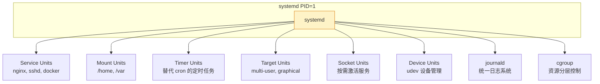

# systemd 详解：现代 Linux 的 init 系统与服务管理

## 前言

`systemd` 是目前几乎所有主流 Linux 发行版的默认 init 系统。它不仅仅是「启动系统」——它管理服务、挂载点、定时器、日志、设备、网络……几乎渗透到了 Linux 系统管理的方方面面。

对于运维和开发者来说，掌握 systemd 不是可选项，而是必修课。写一个自己的 Service 文件、用 Timer 替代 Cron、通过 `journalctl` 查日志——这些是日常最频繁的操作。

!!! info "systemd 争议"
    systemd 从诞生起就充满争议——有人认为它过于庞大、违反 Unix 哲学。但事实是：它已经是 Linux 生态的事实标准。与其争论，不如学好它。

---

## systemd 的核心概念

### 架构全景



### Unit：systemd 的万能抽象

systemd 用 **Unit** 统一管理一切。不同类型的 Unit 有不同的后缀：

| Unit 类型 | 后缀 | 用途 | 示例 |
| --- | :---: | --- | --- |
| **Service** | `.service` | 管理守护进程 | `nginx.service` |
| **Target** | `.target` | 启动目标（一组 Unit 的集合） | `multi-user.target` |
| **Timer** | `.timer` | 定时任务（替代 Cron） | `logrotate.timer` |
| **Mount** | `.mount` | 挂载点管理 | `home.mount` |
| **Socket** | `.socket` | 按需激活服务（类似 inetd） | `docker.socket` |
| **Device** | `.device` | 设备管理（udev） | `sda.device` |
| **Slice** | `.slice` | cgroup 分层 | `user.slice` |
| **Scope** | `.scope` | 外部进程组 | `session-1.scope` |

```bash
# 查看所有已加载的 Unit
systemctl list-units

# 查看所有已安装的 Unit（含未激活）
systemctl list-unit-files

# 按类型筛选
systemctl list-units --type=service
systemctl list-units --type=timer
```

---

## systemctl 常用操作

### 服务生命周期管理

```bash
# 启动/停止/重启
sudo systemctl start nginx
sudo systemctl stop nginx
sudo systemctl restart nginx

# 重载配置（不中断服务——最常用！）
sudo systemctl reload nginx

# 查看状态
systemctl status nginx
# ● nginx.service - A high performance web server
#    Loaded: loaded (/lib/systemd/system/nginx.service; enabled)
#    Active: active (running) since Sat 2026-07-20 14:30:00 CST; 2h ago

# 开机自启
sudo systemctl enable nginx
sudo systemctl disable nginx

# 查看是否开机自启
systemctl is-enabled nginx

# 屏蔽 Unit（防止被手动或间接启动）
sudo systemctl mask bad-service
sudo systemctl unmask bad-service
```

### 系统状态

```bash
# 查看系统启动耗时
systemd-analyze

# 查看每个 Unit 的启动耗时（找慢的）
systemd-analyze blame

# 查看启动依赖链
systemd-analyze critical-chain

# 查看当前默认 Target
systemctl get-default

# 切换 Target（相当于切换运行级别）
sudo systemctl isolate multi-user.target    # 命令行模式
sudo systemctl isolate graphical.target     # 图形模式
```

---

## 编写 Service Unit 文件

### 最简单的示例

创建 `/etc/systemd/system/myapp.service`：

```ini
[Unit]
Description=My Custom Application
After=network.target

[Service]
Type=simple
User=www-data
Group=www-data
WorkingDirectory=/opt/myapp
ExecStart=/opt/myapp/bin/start.sh
ExecStop=/bin/kill -TERM $MAINPID
Restart=on-failure
RestartSec=5s

[Install]
WantedBy=multi-user.target
```

```bash
sudo systemctl daemon-reload   # 重新加载 Unit 文件
sudo systemctl start myapp
sudo systemctl enable myapp    # 开机自启
```

### Service Type 详解

| Type | 说明 | 适用场景 |
| --- | --- | --- |
| **simple**（默认） | `ExecStart` 启动即认为服务已就绪 | 大多数前台运行的服务 |
| **forking** | 父进程启动后退出的传统守护进程 | nginx（传统模式）、php-fpm |
| **oneshot** | 执行一次后退出，适用于初始化脚本 | 清理脚本、数据库迁移 |
| **notify** | 服务启动后发 `sd_notify` 通知 systemd | 支持 systemd 通知协议的服务 |
| **idle** | 等其他服务启动完再启动 | 非关键后台任务 |

### 常用选项

```ini
[Unit]
Description=描述
Documentation=https://example.com/docs
After=network.target          # 在这些 Unit 之后启动
Before=xxx.service            # 在这些 Unit 之前启动
Requires=xxx.service          # 强依赖（被依赖的停止则本服务也停止）
Wants=xxx.service             # 弱依赖（被依赖的失败不影响本服务）

[Service]
Environment="VAR1=value1" "VAR2=value2"
EnvironmentFile=/etc/myapp/env   # 从文件加载环境变量
ExecStartPre=/usr/bin/mkdir -p /run/myapp   # 启动前执行
ExecStartPost=/bin/echo "started"           # 启动后执行
ExecReload=/bin/kill -HUP $MAINPID          # reload 时执行
Restart=on-failure              # always / on-success / on-failure / on-abnormal / no
RestartSec=5s
LimitNOFILE=65536               # 文件描述符限制
LimitNPROC=4096                 # 进程数限制
PrivateTmp=true                 # 使用私有 /tmp（安全推荐）
ProtectSystem=strict            # 只读系统目录（安全推荐）
ReadWritePaths=/var/lib/myapp   # 例外：允许写入的路径
```

---

## journalctl：统一日志系统

`journald` 是 systemd 配套的日志服务，提供结构化、索引化的日志存储。

### 基本查询

```bash
# 查看所有日志（从最新开始）
journalctl

# 实时跟踪（类似 tail -f）
journalctl -f

# 本次启动以来的日志
journalctl -b

# 上一次启动的日志（排查重启问题必用）
journalctl -b -1

# 查看指定服务的日志
journalctl -u nginx
journalctl -u nginx -f           # 实时跟踪
journalctl -u nginx --since today

# 时间范围
journalctl --since "2026-07-20 14:00:00" --until "2026-07-20 15:00:00"

# 按优先级过滤
journalctl -p err                # 仅错误及以上
journalctl -p emerg..warning     # emerg 到 warning 范围

# 查看内核日志
journalctl -k
```

### 高级过滤

```bash
# 查看指定 PID 的日志
journalctl _PID=1234

# 查看指定用户的日志
journalctl _UID=1000

# 组合条件（AND）
journalctl -u nginx _PID=1234

# 输出 JSON
journalctl -u nginx -o json-pretty

# 查看磁盘占用
journalctl --disk-usage
```

!!! tip "journalctl 优势"
    相比传统 `grep /var/log/messages`，journalctl 的优势在于：
    -   **结构化查询**：按服务、PID、优先级、时间范围精确过滤
    -   **启动关联**：`-b -1` 看上次启动的日志，排查「重启后挂了」非常有效
    -   **自动轮转**：不需要配置 logrotate

---

## Systemd Timer：替代 Cron

systemd Timer 是 Cron 的现代替代方案：

```bash
# /etc/systemd/system/backup.service
[Unit]
Description=Daily Backup

[Service]
Type=oneshot
ExecStart=/opt/scripts/backup.sh
User=backup

# /etc/systemd/system/backup.timer
[Unit]
Description=Run backup daily

[Timer]
OnCalendar=daily              # 每天一次
# OnCalendar=*-*-* 02:00:00   # 每天凌晨 2 点
# OnCalendar=Mon..Fri 09:00   # 工作日 9 点
Persistent=true               # 如果错过了，启动后补执行

[Install]
WantedBy=timers.target
```

```bash
sudo systemctl daemon-reload
sudo systemctl enable backup.timer --now

# 查看所有 Timer
systemctl list-timers
# NEXT                        LEFT       LAST                        PASSED   UNIT
# Sat 2026-07-20 00:00:00 CST 17h left   Fri 2026-07-19 00:00:10 CST 6h ago   backup.timer
```

### Timer vs Cron

| | Cron | Systemd Timer |
| --- | :---: | :---: |
| **配置位置** | `/etc/crontab`、`crontab -e` | `.timer` + `.service` 文件 |
| **日志** | `/var/log/cron`（需自己查） | `journalctl -u xxx.service` |
| **错过补执行** | 不支持（anacron 部分支持） | `Persistent=true` |
| **随机延迟** | 需手动 `sleep` | `RandomizedDelaySec=` |
| **依赖管理** | 无 | `After=`、`Requires=` |
| **资源隔离** | 无 | `MemoryMax=`、`CPUQuota=` |

---

## 常见问题

### 修改了 Unit 文件不生效？

```bash
sudo systemctl daemon-reload
sudo systemctl restart <service>
```

### 服务起不来，怎么查？

```bash
# 1. 看状态
systemctl status nginx -l      # -l 显示完整输出

# 2. 看日志
journalctl -u nginx -xe        # -e 跳到末尾，-x 显示详细解释

# 3. 验证 Unit 文件
systemd-analyze verify /etc/systemd/system/nginx.service
```

### 如何让服务在挂载完成后启动？

```ini
[Unit]
After=network.target remote-fs.target
RequiresMountsFor=/mnt/data    # 等 /mnt/data 挂载完成后才启动
```

---

## 下一步学习

| 方向 | 教程 |
| --- | --- |
| **进程管理** | [进程管理](process-management.md) — systemd 管理的本质是进程 |
| **定时任务** | [定时任务](scheduled-tasks.md) — Cron vs Timer 对比 |
| **日志管理** | [日志管理](log-management.md) — journald 与 rsyslog 协同 |
| **Shell** | [Shell 基础](../shell/index.md) — 配合写启动脚本 |

---

## 总结

systemd 是现代 Linux 系统管理的核心枢纽：

1. **Unit 是万能抽象**：Service、Timer、Mount 都用同一种方式管理
2. **systemctl**：`start/stop/enable/disable/status/reload` 是最常用的六个操作
3. **Service 文件**：`Type` 决定 systemd 如何判断服务是否就绪
4. **journalctl**：结构化日志让排障效率翻倍
5. **Timer 替代 Cron**：更精确、更有日志、更易管理

掌握 systemd，你就掌握了 Linux 服务器的「指挥中心」。 🚀
