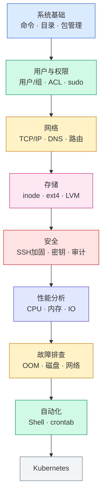

# Linux · 现代基础设施的底座

Linux 不只是一个操作系统，它是现代基础设施的底座。

无论是 Kubernetes、Docker、数据库、中间件、虚拟化平台还是云计算环境，底层几乎都运行在 Linux 之上。理解 Linux，才能真正理解现代基础设施。

本专题记录工作与实验中涉及的 Linux 知识、运维经验以及故障实践，帮助你从「会使用 Linux」逐步走向「理解 Linux」。

---

## 为什么学习 Linux？

今天的大部分基础设施都建立在 Linux 之上：

- Kubernetes 节点运行 Linux
- Docker 基于 Linux 内核能力实现
- 云服务器绝大多数采用 Linux
- 数据库、中间件广泛部署于 Linux
- Prometheus、Grafana 等监控系统运行于 Linux
- OpenStack、Ceph 等基础设施依赖 Linux

如果说：

```text
Kubernetes 是云原生的大脑，
那么 Linux 就是整个基础设施的地基。
```

---
## 内容索引

### 系统基础

Linux 日常运维的核心技能。

| 文章 | 说明 |
|---|---|
| [Linux 目录结构说明](base-system/linux-directory-structure/) | FHS 标准、各目录用途与设计逻辑 |
| [Linux 常用命令](base-system/common-commands/) | 日常运维高频命令速查 |
| [Linux 完整命令参考](base-system/all-commands/) | 按功能分类的完整命令列表 |
| [软件包管理](base-system/package-management/) | apt / yum / dnf / dpkg / rpm |
| [系统监控](base-system/system-monitoring/) | top / htop / iostat / vmstat |
| [日志管理](base-system/log-management/) | journald / rsyslog / 日志轮转 |
| [故障排除](base-system/troubleshooting/) | 常见系统故障的定位方法 |

### 用户与安全

安全不是独立于运维之外的工作，很多安全问题本质上是系统管理问题。

| 文章 | 说明 |
|---|---|
| [用户和权限管理](security/user-and-permission/) | 用户/组/ACL/SELinux 基础 |
| [数据删除与安全擦除](security/data-deletion-and-secure-erasure/) | 文件真的删掉了吗？数据恢复与安全销毁 |

### 网络

很多 Kubernetes 问题本质是网络问题，而网络问题的根因往往在 Linux 层。

| 文章 | 说明 |
|---|---|
| [Linux 网络基础](network/network/) | 网络配置、接口管理、路由基础 |

### 性能优化

| 文章 | 说明 |
|---|---|
| [性能优化](performance/performance-optimization/) | CPU / 内存 / IO / 网络调优 |

### Shell 与自动化

| 文章 | 说明 |
|---|---|
| [Shell 脚本基础](shell/shell/) | Shell 语法与常用脚本实践 |

> 后续持续补充：awk/sed、crontab、自动化运维脚本。

---

## 学习顺序



详细的分阶段学习路线 → [Linux 学习路线](roadmap/)

---

## 后续计划

以下方向持续更新中：

| 方向 | 规划内容 |
|---|---|
| 存储 | inode 深入解析、ext4 工作原理、LVM 实践、SSD 与 TRIM |
| 安全 | SSH 安全加固、Fail2Ban、SELinux、LUKS 全盘加密、审计日志 |
| 系统 | systemd、cgroup、namespace、Linux 启动流程 |
| 网络 | TCP/IP 协议栈、DNS 原理、iptables、网络故障排查 |

---

> 学习 Linux，不是为了记住多少命令，而是为了理解现代基础设施是如何运转的。
>
> —— 1HairLabs
