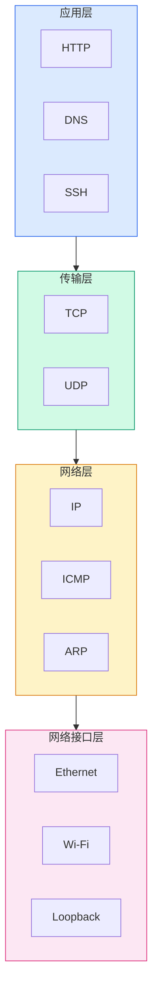
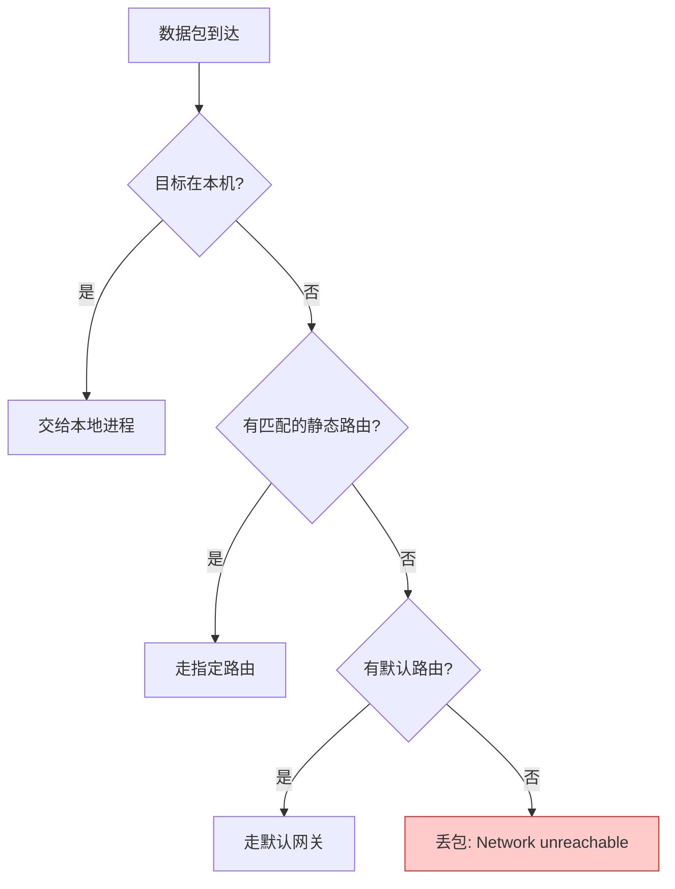
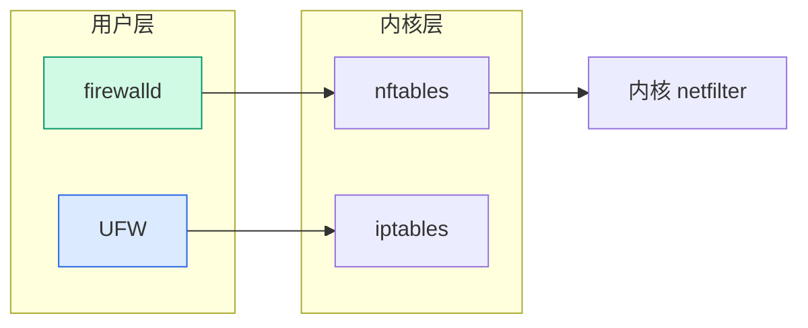
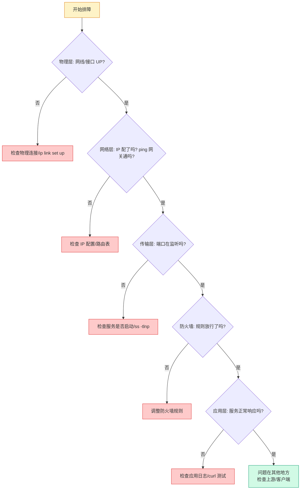

# Linux 网络基础概览：从协议栈到实战排障

## 前言

网络是 Linux 系统的命脉。一台没有网络的服务器，就像一个与世隔绝的房间——再强大的计算能力也无从发挥。从配置一个 IP 地址、排查网络不通，到设计防火墙规则、优化网络吞吐，网络技能贯穿运维工作的每一天。

本文作为网络系列的总览，帮你建立 Linux 网络的**全局认知框架**：理解协议栈的层次结构、掌握核心工具的使用场景、形成系统化的排障思路。

!!! tip "配套实战文章"
    本文侧重**概念梳理和思维框架**。具体的命令操作（配置 IP、管理路由、设置防火墙等）请参考 [Linux 网络管理](network.md)，那里有完整的命令示例和实战练习。

---

## Linux 网络协议栈

### TCP/IP 四层模型

网络通信的本质是数据在不同层次之间逐层封装和解析：



| 层 | 核心协议 | Linux 中的体现 | 排查工具 |
| --- | --- | --- | --- |
| **应用层** | HTTP、DNS、SSH、NTP | `curl`、`dig`、`ssh`、`nginx` | `curl -v`、`dig`、`telnet` |
| **传输层** | TCP、UDP | Socket、端口号 | `ss`、`netstat`、`tcpdump` |
| **网络层** | IP、ICMP、ARP | IP 地址、路由表 | `ping`、`ip route`、`traceroute` |
| **网络接口层** | Ethernet、Wi-Fi | 网卡驱动、MAC 地址 | `ip link`、`ethtool` |

!!! tip "排障口诀：从下往上查"
    网络不通时，按**从下往上**的顺序排查：
    1. 网线插了吗？接口 UP 了吗？（`ip link`）
    2. IP 地址配了吗？（`ip addr`）
    3. 能 ping 通网关吗？（`ping <gateway>`）
    4. 路由正确吗？（`ip route`）
    5. DNS 能解析吗？（`dig`）
    6. 端口在监听吗？（`ss -tlnp`）
    7. 防火墙放行了吗？（`iptables -L` / `ufw status`）

---

## 网络接口与地址

### 接口类型

| 类型 | 说明 | 示例 |
| --- | --- | --- |
| **物理接口** | 实体网卡 | `eth0`、`ens33`、`enp0s3` |
| **Loopback** | 本机回环，127.0.0.1 | `lo` |
| **虚拟接口** | Docker 网桥、VPN 隧道、VLAN 子接口 | `docker0`、`tun0`、`eth0.100` |
| **Bond/Team** | 多网卡聚合 | `bond0`、`team0` |

!!! info "接口命名规则的变化"
    传统命名（`eth0`、`eth1`）已被 **Predictable Network Interface Names** 取代。现代 Linux 中看到 `enp0s3` 或 `ens33` 是正常的——它基于硬件拓扑（PCI 总线位置），不会因为插拔网卡而漂移。

### IP 地址核心概念

| 概念 | 说明 | 示例 |
| --- | --- | --- |
| **IPv4** | 32 位地址，点分十进制 | `192.168.1.100/24` |
| **子网掩码** | 区分网络位和主机位 | `/24` = `255.255.255.0` |
| **CIDR** | 无类域间路由，用 `/N` 表示掩码 | `10.0.0.0/8`、`172.16.0.0/12` |
| **私有地址** | 局域网专用，不可在公网路由 | `10.0.0.0/8`、`172.16.0.0/12`、`192.168.0.0/16` |
| **网关** | 通往其他网络的出口 | 通常是路由器的 LAN 口 IP |

---

## 路由

路由决定了数据包从源到目的地的路径。

### 路由三要素

| 要素 | 说明 | 命令查看 |
| --- | --- | --- |
| **目标网络** | 数据包要去哪里 | `ip route` 中的 `default`、`192.168.1.0/24` |
| **下一跳（Gateway）** | 下一站交给谁 | `via 192.168.1.1` |
| **出接口** | 从哪个网卡发出 | `dev eth0` |

```bash
ip route
# default via 192.168.1.1 dev eth0        ← 默认路由，去往任何未知目标都走这
# 192.168.1.0/24 dev eth0 proto kernel    ← 直连路由，本网段直接通信
```

### 路由决策流程



---

## DNS 解析

DNS 将人类可读的域名（`1hairlabs.cn`）转换为机器可读的 IP 地址（`1.2.3.4`）。

### 解析顺序

Linux 系统中 DNS 解析的优先顺序由 `/etc/nsswitch.conf` 中的 `hosts` 行决定：

```text
hosts: files dns
```

| 优先级 | 来源 | 文件 |
| :---: | --- | --- |
| 1 | 本地 hosts 文件 | `/etc/hosts` |
| 2 | DNS 服务器 | `/etc/resolv.conf` |

### 常用 DNS 服务器

| 提供商 | 地址 | 特点 |
| --- | --- | --- |
| **阿里云** | `223.5.5.5` / `223.6.6.6` | 国内速度快 |
| **腾讯云** | `119.29.29.29` | 国内速度快 |
| **114 DNS** | `114.114.114.114` | 老牌公共 DNS |
| **Cloudflare** | `1.1.1.1` | 全球加速，隐私保护 |
| **Google** | `8.8.8.8` | 全球通用 |

---

## 防火墙体系

Linux 防火墙经历了三代演进：

| 代际 | 框架 | 命令 | 状态 |
| :---: | --- | --- | :---: |
| 1 | `ip_tables` | `iptables` | 传统，广泛兼容 |
| 2 | `nf_tables` | `nft` | 现代内核框架，替代 iptables |
| 3 | 上层封装 | `ufw`、`firewalld` | 用户友好的前端 |



!!! info "我该用哪个？"
    -   **桌面/简单服务器**：`ufw`（Ubuntu 系）或 `firewalld`（RHEL 系），一行命令搞定
    -   **复杂规则/高性能**：直接写 `nft` 规则
    -   **兼容老系统**：`iptables`（但新系统建议迁移到 nftables）

---

## 常用诊断工具速查

| 场景 | 工具 | 一句话用法 |
| --- | --- | --- |
| 查看 IP | `ip addr` | `ip -br addr` |
| 查看路由 | `ip route` | `ip route get 8.8.8.8` 看走哪条路 |
| 连通性 | `ping` | `ping -c 4 8.8.8.8` |
| 路径追踪 | `traceroute` / `mtr` | `mtr 8.8.8.8`（动态路由追踪） |
| DNS 查询 | `dig` | `dig 1hairlabs.cn` |
| 端口监听 | `ss` | `ss -tlnp`（TCP 监听端口） |
| 抓包 | `tcpdump` | `tcpdump -i eth0 port 80` |
| 连接测试 | `curl` | `curl -v https://1hairlabs.cn` |
| 带宽监控 | `iftop` / `nload` | `iftop -i eth0` |
| 防火墙 | `iptables -L` / `nft list ruleset` | 查看当前规则 |

---

## 排障思维框架

当收到「服务器连不上了」的报告时，用下面的流程快速定位：



---

## 下一步学习

| 方向 | 教程 |
| --- | --- |
| **实战操作** | [Linux 网络管理](network.md) — 配置、路由、防火墙、排障完整命令详解 |
| **性能优化** | [Linux 性能优化](../performance/index.md) — 网络吞吐调优 |
| **Shell 基础** | [Shell 基础](../shell/index.md) — 网络脚本自动化 |

---

## 总结

Linux 网络管理的核心在于理解**分层模型**和**数据流向**：

1. **四层协议栈**：从网卡到应用，每层有每层的工具和排查方法
2. **路由决定路径**：默认路由是你通往互联网的「大门」
3. **DNS 是电话本**：`/etc/resolv.conf` + `/etc/hosts` 控制解析行为
4. **防火墙是门卫**：UFW/firewalld/iptables/nftables 层层封装，选你最顺手的
5. **排障从下往上**：物理层 → 网络层 → 传输层 → 应用层，逐层排除

网络不通不可怕，可怕的是不知道从哪查起。有了这个框架，每次都能有条不紊地定位问题。 🚀
