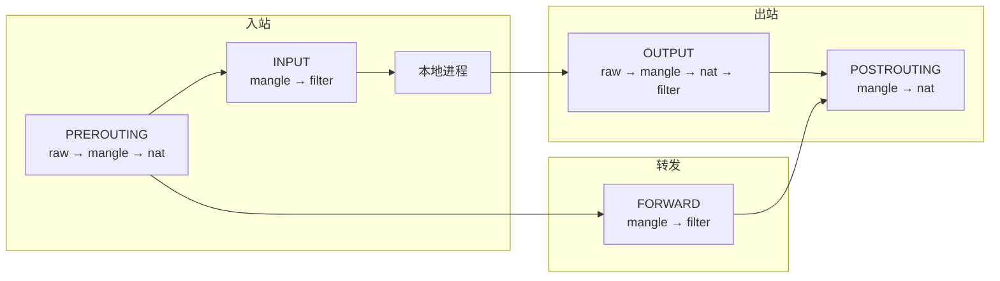

# iptables 与 nftables 深度实战：从规则编写到网络调试

## 前言

`iptables` 是 Linux 防火墙的代名词，也是 Kubernetes Service 的实现基础。但 `iptables` 正在被更现代的 **nftables** 取代——它语法更简洁、性能更好、原生支持 IPv4/IPv6 统一管理。

本文先深入 iptables 的核心概念（五链四表），再对比 nftables 的改进，最后介绍这两者在 Kubernetes 中的角色。

---

## iptables 核心：五链四表

### 数据包在 Netfilter 中的旅程



### 五链

| 链 | 触发时机 |
| --- | --- |
| **PREROUTING** | 数据包进入网络栈后立即触发（目的地址转换 DNAT） |
| **INPUT** | 发往本机进程 |
| **FORWARD** | 经过本机转发（路由器） |
| **OUTPUT** | 本机进程发出 |
| **POSTROUTING** | 数据包即将离开网络栈（源地址转换 SNAT/Masquerade） |

### 四表

| 表 | 功能 | 可用链 |
| --- | --- | --- |
| **filter** | 包过滤（默认表） | INPUT, FORWARD, OUTPUT |
| **nat** | 网络地址转换 | PREROUTING, INPUT, OUTPUT, POSTROUTING |
| **mangle** | 修改包头（TTL/TOS） | 全部五链 |
| **raw** | 绕过连接追踪 | PREROUTING, OUTPUT |

---

## iptables 规则编写

### 查看规则

```bash
# 数字形式（不解析 IP/端口），带行号
sudo iptables -L -n -v --line-numbers

# 查看 nat 表
sudo iptables -t nat -L -n -v
```

### 常用操作

```bash
# 放行端口
sudo iptables -A INPUT -p tcp --dport 22 -j ACCEPT

# 拒绝
sudo iptables -A INPUT -s 203.0.113.0/24 -j DROP

# 插入到第 1 位
sudo iptables -I INPUT 1 -p tcp --dport 80 -j ACCEPT

# 删除第 3 条规则
sudo iptables -D INPUT 3

# 默认策略
sudo iptables -P INPUT DROP     # 拒绝所有入站
sudo iptables -P FORWARD DROP
sudo iptables -P OUTPUT ACCEPT
```

### NAT 与端口转发

```bash
# DNAT：将外部 8080 转到内部 80
sudo iptables -t nat -A PREROUTING -p tcp --dport 8080 \
    -j DNAT --to-destination 10.0.0.5:80

# SNAT：内网机器上网
sudo iptables -t nat -A POSTROUTING -s 10.0.0.0/24 \
    -j SNAT --to-source 203.0.113.1

# MASQUERADE：动态 SNAT（出口 IP 不固定时用）
sudo iptables -t nat -A POSTROUTING -s 10.0.0.0/24 \
    -o eth0 -j MASQUERADE

# 开启 IP 转发（必须）
echo 1 | sudo tee /proc/sys/net/ipv4/ip_forward
```

### 连接追踪

```bash
# 仅允许已建立连接的回包
sudo iptables -A INPUT -m conntrack --ctstate ESTABLISHED,RELATED -j ACCEPT

# 限制新连接速率（防 DDoS）
sudo iptables -A INPUT -p tcp --dport 80 \
    -m conntrack --ctstate NEW \
    -m limit --limit 100/s --limit-burst 200 \
    -j ACCEPT
```

### 持久化规则

```bash
# Debian/Ubuntu
sudo apt install iptables-persistent
sudo netfilter-persistent save

# RHEL/Rocky
sudo service iptables save
```

---

## nftables：iptables 的继任者

### 核心改进

| | iptables | nftables |
| --- | :---: | :---: |
| **语法** | 每表每链单独命令 | 统一配置语言，类似脚本 |
| **IPv4/IPv6** | 两套独立工具 | **原生统一** |
| **规则更新** | 全量替换 | **原子更新**（不影响已有连接） |
| **内核匹配** | 每个匹配加载一次模块 | 一次加载，多次复用 |
| **性能** | 基础 | **更高**（规则多时优势明显） |

### nftables 基础示例

```bash
# 进入交互式配置
sudo nft

# 查看当前规则
nft list ruleset
```

```bash
# 基础防火墙脚本
sudo nft -f - << 'EOF'
#!/usr/sbin/nft -f

flush ruleset

table inet filter {
    chain input {
        type filter hook input priority 0; policy drop;

        # 允许回环
        iif lo accept

        # 允许已有连接
        ct state established,related accept

        # 放行 SSH
        tcp dport 22 accept

        # 放行 HTTP/HTTPS
        tcp dport {80, 443} accept

        # 记录被拒绝的包
        log prefix "nftables-drop: " limit rate 5/minute
        counter drop
    }

    chain forward {
        type filter hook forward priority 0; policy drop;
    }

    chain output {
        type filter hook output priority 0; policy accept;
    }
}

table ip nat {
    chain prerouting {
        type nat hook prerouting priority dstnat; policy accept;
        # DNAT: 8080 → 10.0.0.5:80
        tcp dport 8080 dnat to 10.0.0.5:80
    }

    chain postrouting {
        type nat hook postrouting priority srcnat; policy accept;
        # MASQUERADE
        oifname "eth0" masquerade
    }
}
EOF
```

### iptables → nftables 翻译工具

```bash
# 将现有 iptables 规则翻译为 nftables
sudo iptables-translate -A INPUT -p tcp --dport 22 -j ACCEPT
# nft add rule ip filter INPUT tcp dport 22 counter accept
```

---

## iptables 在 Kubernetes 中的角色

Kubernetes Service（ClusterIP/NodePort）依赖 iptables 实现负载均衡：

```bash
# 查看 K8s 生成的 iptables 规则
sudo iptables -t nat -L KUBE-SERVICES -n

# 每个 Service 对应一条规则链：
# KUBE-SVC-XXXX → 概率性选择后端 Pod
# KUBE-SEP-XXXX → 指向具体 Pod IP:Port
```

kube-proxy 监控 API Server 的 Service/Endpoint 变化，实时更新 iptables 规则。这也是为什么大规模集群中 kube-proxy 可能成为瓶颈——规则太多，iptables 逐条匹配的效率下降。Cilium 等 eBPF 方案的动机正是解决这个问题。

---

## 总结

1. **iptables**：五链四表是理解 Linux 网络的基础，至今仍是 Kubernetes Service 的默认实现
2. **nftables**：更现代、更高性能、更简洁，是新项目的首选
3. **关键操作**：`-A` 追加、`-I` 插入、`-D` 删除、`-L -n -v --line-numbers` 查看
4. **NAT**：DNAT 改目标（端口映射）、SNAT/MASQUERADE 改源（上网）
5. **持久化**：`iptables-persistent` 或 `netfilter-persistent save`

理解 iptables，你不仅掌握了防火墙，还理解了 Kubernetes Service 和 Docker 端口映射的底层原理。 🚀
