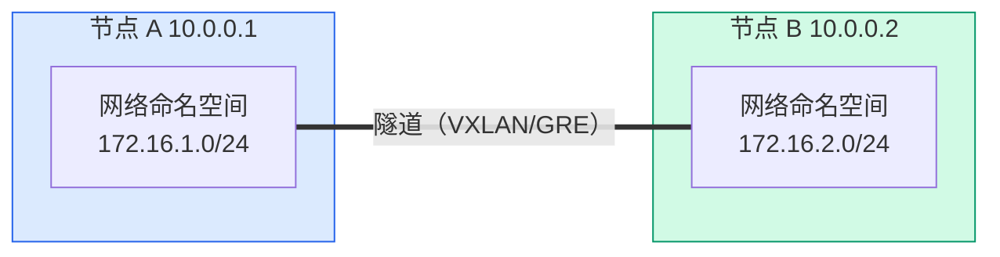
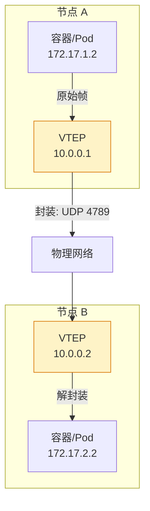

# Linux 隧道与覆盖网络：VXLAN、GRE 与 WireGuard

## 前言

如果你接触过 Kubernetes，一定听过「Pod 网络」和「覆盖网络（Overlay Network）」。Flannel、Calico、Cilium 这些 CNI 插件本质上都在解决同一个问题：**如何让不同节点上的 Pod 像在同一个局域网中一样通信？**

答案往往是 **VXLAN**——一种覆盖网络技术。本文从 GRE 隧道讲起，深入 VXLAN 的原理和手动配置，最后介绍 WireGuard 作为现代化 VPN 方案的替代。

---

## 为什么需要隧道？

两台在不同物理网络中的机器，想在它们之间建立一个「虚拟的直连链路」：



物理网络可能不允许路由 `172.16.x.x`（私有地址跨 Internet），隧道将原始数据包**封装**在物理网络允许的包中传输。

---

## GRE 隧道：最简单的隧道

GRE（Generic Routing Encapsulation）是最基本的 Linux 隧道：

```bash
# 节点 A（10.0.0.1）
sudo ip tunnel add gre1 mode gre remote 10.0.0.2 local 10.0.0.1 ttl 255
sudo ip addr add 172.16.100.1/30 dev gre1
sudo ip link set gre1 up

# 节点 B（10.0.0.2）
sudo ip tunnel add gre1 mode gre remote 10.0.0.1 local 10.0.0.2 ttl 255
sudo ip addr add 172.16.100.2/30 dev gre1
sudo ip link set gre1 up
```

现在节点 A 可以 ping 通 `172.16.100.2`，节点 B 可以 ping 通 `172.16.100.1`——尽管它们之间可能有多个路由器跳转。

---

## VXLAN：覆盖网络的核心

### 为什么 VXLAN 取代了 GRE？

| | GRE | VXLAN |
| --- | :---: | :---: |
| **封装** | IP-in-IP（协议号 47） | MAC-in-UDP（端口 4789） |
| **标识符** | 无 | **VNI（24 位，1600 万个虚拟网络）** |
| **多租户** | 不支持 | **支持**（每个 VNI 一个隔离网络） |
| **负载均衡** | 困难（ECMP 基于 IP） | 容易（UDP 源端口随机化） |
| **Kubernetes** | 基本不用 | **Flannel、Cilium 的默认模式** |

### VXLAN 架构



**VTEP**（VXLAN Tunnel Endpoint）是 VXLAN 隧道的端点，负责封装和解封装。

### 手动搭建 VXLAN

```bash
# 节点 A
sudo ip link add vxlan0 type vxlan \
    id 100 \
    remote 10.0.0.2 \
    dstport 4789 \
    dev eth0
sudo ip addr add 172.16.100.1/24 dev vxlan0
sudo ip link set vxlan0 up

# 节点 B
sudo ip link add vxlan0 type vxlan \
    id 100 \
    remote 10.0.0.1 \
    dstport 4789 \
    dev eth0
sudo ip addr add 172.16.100.2/24 dev vxlan0
sudo ip link set vxlan0 up
```

| 参数 | 含义 |
| --- | --- |
| `id 100` | VNI（VXLAN Network Identifier），隔离不同虚拟网络 |
| `remote` | 对端 VTEP 的 IP |
| `dstport 4789` | VXLAN 标准端口 |
| `dev eth0` | 物理出口网卡 |

### 多播模式（多个 VTEP 对端）

实际场景中通常有多台节点，用多播发现对端：

```bash
sudo ip link add vxlan0 type vxlan \
    id 100 \
    group 239.1.1.1 \    # 多播组
    dstport 4789 \
    dev eth0
```

所有加入同一多播组的节点自动发现彼此，不需要手动指定 `remote`。

---

## 网络命名空间：Linux 容器的网络基础

网络命名空间是实现网络隔离的 Linux 内核特性——每个容器/Pod 都有自己的网络命名空间：

```bash
# 创建网络命名空间
sudo ip netns add ns1
sudo ip netns add ns2

# 在命名空间中执行命令
sudo ip netns exec ns1 ip addr
sudo ip netns exec ns1 ping 8.8.8.8    # 不通——ns1 没有网络接口

# 创建 veth pair 连接 ns1 和 ns2
sudo ip link add veth1 type veth peer name veth2
sudo ip link set veth1 netns ns1
sudo ip link set veth2 netns ns2

sudo ip netns exec ns1 ip addr add 10.0.0.1/24 dev veth1
sudo ip netns exec ns1 ip link set veth1 up
sudo ip netns exec ns2 ip addr add 10.0.0.2/24 dev veth2
sudo ip netns exec ns2 ip link set veth2 up

# 现在 ns1 和 ns2 可以通过 veth pair 直连
sudo ip netns exec ns1 ping 10.0.0.2
```

这就是 Docker 和 Kubernetes 实现容器网络的底层机制——veth pair 连接容器和宿主机网桥。

---

## WireGuard：现代化的加密隧道

如果你需要的是**安全加密的隧道**而非覆盖网络，WireGuard 是当代最佳选择：

### 安装

```bash
sudo apt install wireguard
```

### 配置（点对点）

**节点 A (`/etc/wireguard/wg0.conf`)**：

```ini
[Interface]
PrivateKey = <节点A私钥>
Address    = 10.0.0.1/24
ListenPort = 51820

[Peer]
PublicKey  = <节点B公钥>
AllowedIPs = 10.0.0.2/32
Endpoint   = <节点B的公网IP>:51820
```

**节点 B (`/etc/wireguard/wg0.conf`)**：

```ini
[Interface]
PrivateKey = <节点B私钥>
Address    = 10.0.0.2/24
ListenPort = 51820

[Peer]
PublicKey  = <节点A公钥>
AllowedIPs = 10.0.0.1/32
Endpoint   = <节点A的公网IP>:51820
```

```bash
# 生成密钥
wg genkey | tee privatekey | wg pubkey > publickey

# 启动
sudo wg-quick up wg0
```

WireGuard 的优势：内置于 Linux 内核、配置极简、性能远超 OpenVPN/IPsec。

---

## 总结

理解隧道和覆盖网络是掌握 Kubernetes 网络的前提：

1. **GRE**：最简单的隧道，IP-in-IP 封装
2. **VXLAN**：MAC-in-UDP，支持多租户（VNI），Flannel/Cilium 的基石
3. **网络命名空间 + veth pair**：容器网络的底层原语
4. **WireGuard**：现代 VPN，加密集于 Noise 协议，性能和安全性顶尖

当你用 `kubectl describe pod` 看到一个 `veth` 或 `vxlan` 接口时，你已经在心智中有了它的位置。 🚀
