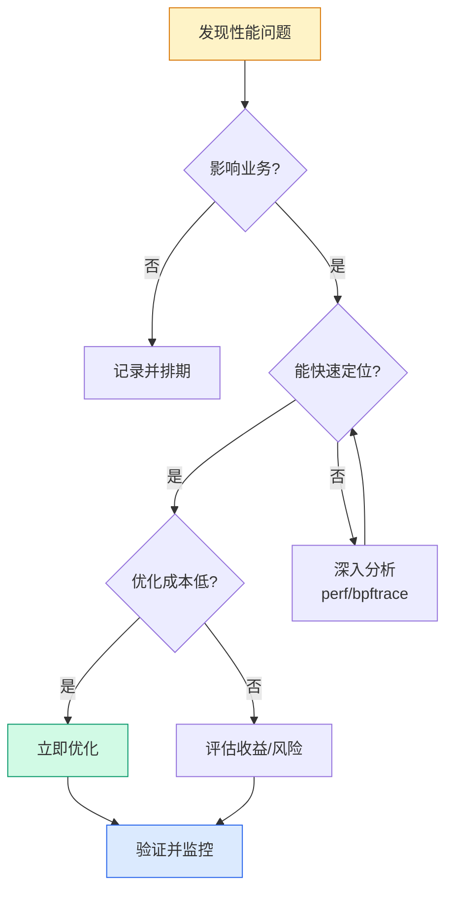

# Linux 性能优化概览：从监控到调优的完整方法论

## 前言

性能优化是 Linux 运维中最考验综合能力的领域。它不像「安装某个软件」有固定的步骤可循——每台服务器的硬件不同、负载特征不同、瓶颈位置不同，盲目套用别人的优化参数轻则无效，重则适得其反。

本文作为性能优化系列的总览，帮你建立一套**可复用的分析框架**：知道从哪入手、用什么工具、看什么指标、怎么定位瓶颈，最后才谈怎么优化。

!!! tip "先看监控，再谈优化"
    没有监控数据的优化就像蒙着眼睛开车。强烈建议先掌握 [系统监控](../base-system/system-monitoring.md) 的基础知识，拿到 CPU、内存、磁盘、网络的基线数据后，再进入本文的优化环节。详细的内核参数调优请参考 [Linux 系统性能优化](performance-optimization.md)。

---

## 性能优化的核心思维

### 不是「让系统更快」，而是「消除瓶颈」

任何系统都有瓶颈。优化的本质是：


关键认知：

1. **瓶颈只有一个（或少数几个）**。CPU 100% 时优化内存没有意义
2. **优化是权衡**。用内存换 CPU（缓存），用 CPU 换 I/O（压缩），用延迟换吞吐（批量）
3. **先测量，后优化**。没有基线数据，你甚至不知道优化是否「有效」
4. **可回滚**。每次改内核参数前备份原始值

---

## 两大性能分析方法论

### USE 法（Utilization, Saturation, Errors）

适用于**任何硬件资源**的快速健康检查，来自 Brendan Gregg：

| 维度 | 含义 | CPU 示例 | 内存示例 | 磁盘示例 |
| --- | --- | --- | --- | --- |
| **利用率（Utilization）** | 资源忙碌时间的比例 | CPU 使用率 90% | 内存使用率 85% | 磁盘 100% 忙碌 |
| **饱和度（Saturation）** | 等待资源的队列长度 | `load average` > CPU 核数 | swap 使用中、OOM 触发 | I/O 等待队列堆积 |
| **错误（Errors）** | 资源相关的错误事件 | MCE 硬件错误 | OOM Killer 杀进程 | 磁盘坏块、I/O 错误 |

!!! tip "USE 法实战口诀"
    拿到一台服务器，依次问三个问题：
    1. CPU/内存/磁盘/网络各自用到了百分之几？（利用率）
    2. 有没有排队的任务在等资源？（饱和度）
    3. 有没有错误发生？（错误）
    
    三个问题回答完，瓶颈通常就水落石出了。

---

### TSA 法（Thread State Analysis）

从**线程状态**的角度分析，核心思路来自 Brendan Gregg：

> 把线程在每个状态上的时间百分比统计出来，时间占比最高的状态往往就是瓶颈。

| 线程状态 | 含义 | 可能瓶颈 |
| --- | --- | --- |
| **RUNNING** | 正在 CPU 上执行 | 正常，高占比说明计算密集 |
| **RUNNABLE** | 等待 CPU 调度 | CPU 不足或调度配置问题 |
| **SLEEPING (I/O)** | 等待磁盘/网络 I/O | 存储或网络瓶颈 |
| **SLEEPING (Lock)** | 等待锁释放 | 应用层锁竞争 |
| **UNINTERRUPTIBLE (D)** | 等待内核 I/O 完成，不可中断 | 磁盘 I/O 严重阻塞 |

---

## 四大资源维度速览

### CPU

| 关注点 | 关键指标 | 常用工具 |
| --- | --- | --- |
| **整体利用率** | `%usr`、`%sys`、`%iowait`、`%idle` | `top`、`htop`、`mpstat` |
| **饱和度** | `load average`（1m/5m/15m） | `uptime`、`top` |
| **上下文切换** | `cs`（voluntary/involuntary） | `vmstat`、`pidstat -w` |
| **中断** | `%irq`、`%softirq` | `mpstat`、`/proc/interrupts` |
| **进程级别** | 每个进程的 CPU 占比 | `pidstat`、`top -p <PID>` |

典型瓶颈判断：

```bash
# load average 持续 > CPU 逻辑核数 × 0.7 → 需要关注
uptime
# 08:30:00 up 30 days, 1:23, 2 users, load average: 6.50, 5.20, 4.80
# 如果是 4 核机器，6.50 已经过载

# %iowait 持续 > 10% → 磁盘可能是瓶颈
mpstat 1
```

---

### 内存

| 关注点 | 关键指标 | 常用工具 |
| --- | --- | --- |
| **整体使用** | `used`、`free`、`available` | `free -h` |
| **缓存** | `buff/cache` | `free -h` |
| **Swap** | `swap used`、`si/so` | `free -h`、`vmstat` |
| **进程级别** | RSS、VSZ、%MEM | `ps aux`、`top`、`smem` |
| **OOM** | `dmesg \| grep -i oom` | `dmesg`、`journalctl` |

!!! warning "`free` 和 `available` 的区别"
    `free` 列显示的是**完全没有被使用的内存**。但 Linux 会积极使用空闲内存做文件缓存（`buff/cache`），这部分内存在需要时可以立即回收。因此判断内存是否不足，应看 **`available`** 而非 `free`。

```bash
free -h
#               total   used   free   shared   buff/cache   available
# Mem:           7.6G   2.1G   1.2G     234M        4.3G        5.0G
#                               ↑ free 只有 1.2G       ↑ 但 available 有 5.0G，内存充足
```

---

### 磁盘 I/O

| 关注点 | 关键指标 | 常用工具 |
| --- | --- | --- |
| **负载** | `%util`（设备忙碌百分比） | `iostat -x` |
| **吞吐量** | `rMB/s`、`wMB/s` | `iostat`、`dstat` |
| **延迟** | `await`（平均等待时间）、`r_await`/`w_await` | `iostat -x` |
| **队列** | `avgqu-sz`（平均队列长度） | `iostat -x` |
| **进程级别** | 每个进程的读写量和延迟 | `iotop`、`pidstat -d` |

```bash
iostat -x 1
# Device  r/s   w/s   rMB/s  wMB/s  await  %util
# sda     120   80    4.5    2.1    15.3   95.0
# ↑ %util 接近 100%，磁盘已饱和
```

---

### 网络

| 关注点 | 关键指标 | 常用工具 |
| --- | --- | --- |
| **吞吐量** | `rx/tx MB/s` | `iftop`、`nload`、`sar -n DEV` |
| **连接状态** | ESTABLISHED、TIME_WAIT、CLOSE_WAIT | `ss -s`、`netstat` |
| **错误/丢包** | `errors`、`dropped`、`overruns` | `ip -s link`、`netstat -i` |
| **延迟** | RTT | `ping`、`mtr` |
| **进程级别** | 每个进程的网络连接 | `ss -tnp`、`lsof -i` |

---

## 性能分析工具矩阵

按场景和深度选择工具：

| 场景 | 推荐工具 | 一句话说明 |
| --- | --- | --- |
| **快速概览** | `top` / `htop` | 一眼看清系统全局 |
| **CPU 深度分析** | `mpstat` + `pidstat` | 看每个核心和每个进程 |
| **内存深入** | `free` + `vmstat` + `smem` | 看整体、看趋势、看进程 |
| **I/O 瓶颈定位** | `iostat -x` + `iotop` | 看磁盘负载 + 找祸首进程 |
| **网络排查** | `ss` + `sar -n DEV` | 看连接状态 + 历史流量 |
| **系统调用追踪** | `strace -c -p <PID>` | 统计进程的系统调用耗时 |
| **火焰图** | `perf` + FlameGraph | 可视化 CPU 热点函数 |
| **全栈追踪** | `bcc` / `bpftrace` | eBPF 动态追踪，能力上限极高 |

!!! tip "工具选择原则"
    1. 先用 `top`/`htop` 定位大方向
    2. 方向明确后用专用工具深挖（CPU→`mpstat`，磁盘→`iostat`，网络→`ss`）
    3. 常规工具查不出来，上 `strace`/`perf`/`bpftrace`

---

## 系统基线速查

优化前后都需要对比的基线指标：

```bash
# === CPU ===
lscpu                          # CPU 信息
uptime                         # load average
mpstat 1 5                     # 每核 CPU 使用率，采样 5 次

# === 内存 ===
free -h                        # 内存总览
vmstat 1 5                     # 内存 + swap + 中断 + 上下文切换
cat /proc/meminfo              # 详细内存信息

# === 磁盘 ===
lsblk                          # 磁盘和分区
iostat -x 1 5                  # 磁盘 I/O 详情
df -h                          # 磁盘空间

# === 网络 ===
ip -s link                     # 网络接口统计
ss -s                          # Socket 统计
sar -n DEV 1 5                 # 网络接口历史流量
```

将这些输出保存下来，就是你的**性能基线**：

```bash
mkdir -p ~/baseline/$(date +%Y%m%d)
mpstat 1 5    > ~/baseline/$(date +%Y%m%d)/cpu.txt
free -h       > ~/baseline/$(date +%Y%m%d)/memory.txt
iostat -x 1 5 > ~/baseline/$(date +%Y%m%d)/disk.txt
ss -s         > ~/baseline/$(date +%Y%m%d)/network.txt
```

---

## 优化优先级路线

不是所有瓶颈都值得立即处理——按影响范围和优化成本排序：



| 优先级 | 场景 | 典型方案 |
| :---: | --- | --- |
| 1 | 内存不足导致 OOM | 扩容 / 排查内存泄漏 |
| 2 | 磁盘 I/O 饱和 | 升级 SSD / 分散热点数据 |
| 3 | CPU 长期 90%+ | 扩核 / 优化代码 / 负载分离 |
| 4 | 网络丢包 / TIME_WAIT 堆积 | 内核参数调优（`tcp_tw_reuse` 等） |

---

## 下一步学习

| 方向 | 教程 |
| --- | --- |
| **详细调优** | [Linux 系统性能优化](performance-optimization.md) — CPU/内存/磁盘/网络内核参数深度调优 |
| **监控基础** | [系统监控](../base-system/system-monitoring.md) — 性能分析的「眼睛」 |
| **故障排查** | [系统故障排除](../base-system/troubleshooting.md) — 当性能问题发展为故障时 |
| **Shell 基础** | [Shell 基础](../shell/index.md) — 性能分析绕不开命令行 |

---

## 总结

性能优化不是「学会几个参数」就能搞定的事——它是一套完整的思维框架：

1. **建立基线**：用 `top`/`mpstat`/`iostat`/`free`/`ss` 采集当前状态
2. **定位瓶颈**：用 USE 法（利用率→饱和度→错误）逐一排查四大资源
3. **验证优化**：改参数前记录原始值，改完后对比基线
4. **持续监控**：优化不是一次性动作，负载会变化，瓶颈会转移

记住：**宁可花 30 分钟分析，也不要花 30 秒复制一段看不懂的优化脚本。** 🚀
