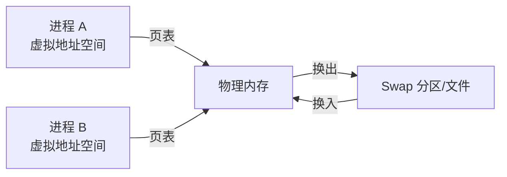

# Linux 内存管理深度解析：Buffer/Cache、Swap 与 OOM

## 前言

内存是系统性能的命脉。很多人看到 `free -h` 中 `available` 很少就喊「内存不够了」，看到 `buff/cache` 占了几 GB 就想清掉——这些都是对 Linux 内存管理的误解。

本文从虚拟内存讲起，拆解 Buffer 和 Cache 的区别、Swap 的真实作用、OOM Killer 的选择逻辑，帮你建立正确的内存认知。

---

## 虚拟内存 vs 物理内存

每个进程看到的内存地址是**虚拟地址**，由内核通过页表映射到物理内存：



| 概念 | 说明 |
| --- | --- |
| **虚拟内存** | 每个进程独享的地址空间，与实际物理内存无关 |
| **物理内存** | 实际的内存条容量 |
| **页（Page）** | 内存管理的最小单位，通常 4 KB |
| **页表** | 记录虚拟地址 → 物理地址的映射表 |
| **Swap** | 物理内存不够时，将不活跃的页暂时写到磁盘 |

---

## Buffer 与 Cache 的本质区别

```bash
free -h
#               total   used   free   shared   buff/cache   available
# Mem:           7.6G   2.1G   1.2G     234M        4.3G        5.0G
```

很多人把 `buff/cache` 当成「可释放的内存」——这没错，但需要区分它们：

| | Buffer | Cache |
| --- | :---: | :---: |
| **全称** | Buffer Cache | Page Cache |
| **缓存什么** | **块设备的元数据**（superblock、inode 等） | **文件数据**（文件内容） |
| **数据流向** | 内存 → 磁盘（写缓冲） | 磁盘 → 内存（读缓存） |
| **可释放性** | 几乎立即可释放 | 脏页需先写回磁盘 |
| **典型大小** | 几十到几百 MB | 几 GB |

```bash
# 查看详细内存信息
cat /proc/meminfo | grep -E "^(Buffers|Cached|Dirty|Writeback):"
```

!!! warning "手动 drop_caches 是危险操作"
    ```bash
    echo 3 > /proc/sys/vm/drop_caches  # 清空所有缓存
    ```
    这会让所有热数据缓存失效，系统性能瞬间暴跌——**仅限测试环境**。

---

## Swap 深度解析

### Swap 不是为了「内存不够了」才用的

Swap 的核心价值：

1. **冷内存换出**：把长期不用的内存页移到磁盘，腾出物理内存给热数据
2. **休眠支持**：系统休眠时需要把内存全部写到 Swap
3. **OOM 缓冲**：有 Swap 时 OOM Killer 触发得更晚，给系统反应时间

### swappiness：Swap 倾向

```bash
cat /proc/sys/vm/swappiness
# 默认 60
```

| swappiness 值 | 行为 |
| :---: | --- |
| **0** | 尽量不用 Swap（但不禁止） |
| **60**（默认） | 适中 |
| **100** | 积极换出 |

**推荐设置**：

```bash
# /etc/sysctl.d/99-swap.conf
# 数据库服务器：减少 Swap 干扰
vm.swappiness = 1

# 桌面/通用：默认 60 即可
```

### 查看 Swap 使用

```bash
# 整体
free -h

# 每个进程的 Swap 使用
for file in /proc/*/status; do
    awk '/VmSwap|Name/{printf "%s ",$2}END{print ""}' "$file" 2>/dev/null
done | grep -v "0 kB" | sort -nk2 -r | head -10
```

---

## OOM Killer 深入

### 触发条件

当系统物理内存 + Swap 全部耗尽，且无法回收足够内存时，OOM Killer 被激活。它会选择**一个进程**杀掉以释放内存。

### 选择逻辑

OOM Killer 给每个进程打一个 `oom_score`，分数越高越容易被杀：

```bash
# 查看进程的 OOM 分数
cat /proc/<PID>/oom_score

# 查看调整值（可人为干预）
cat /proc/<PID>/oom_adj        # -16 到 15
cat /proc/<PID>/oom_score_adj  # -1000 到 1000
```

### 保护关键进程

```bash
# 让 sshd 极难被 OOM 杀掉
echo -1000 > /proc/$(pgrep -f /usr/sbin/sshd | head -1)/oom_score_adj

# systemd service 中设置
[Service]
OOMScoreAdjust=-500
```

### 触发 OOM 时的日志

```bash
dmesg | grep -i "killed process"
journalctl -k | grep -i oom
```

典型输出：

```text
Out of memory: Killed process 12345 (java) total-vm:8GB, anon-rss:4GB, file-rss:0KB
```

---

## 内存泄漏排查

### 症状识别

```bash
# 持续监控内存趋势
free -h -s 5

# 查看进程内存增长
while true; do
    ps -eo pid,comm,rss,vsz --sort=-rss | head -15
    sleep 10
done
```

### 定位泄漏进程

```bash
# 按内存占用排序
ps aux --sort=-%mem | head -20

# 更准确：用 smem 看 PSS（实际物理内存分摊）
sudo smem -rss -s rss | head -20

# 查看进程的内存映射详情
sudo pmap -x <PID>
cat /proc/<PID>/smaps | grep -i pss
```

---

## cgroup 内存限制

在 Kubernetes/Docker 中，容器 OOM 是常见场景。理解底层 cgroup 限制是排障基础：

```bash
# 查看进程的 cgroup 路径
cat /proc/<PID>/cgroup

# 查看 cgroup 内存限制
cat /sys/fs/cgroup/memory/memory.limit_in_bytes

# 查看当前使用量
cat /sys/fs/cgroup/memory/memory.usage_in_bytes

# 查看 OOM 事件
cat /sys/fs/cgroup/memory/memory.oom_control
```

当 `usage_in_bytes` > `limit_in_bytes` 时，cgroup 内的进程被 OOM Kill。

---

## 总结

Linux 内存管理的核心认知：

1. **`free` 看 `available` 不看 `free`**——Cache 是朋友不是负担
2. **Buffer ≠ Cache**：Buffer 是元数据缓冲，Cache 是文件数据缓存
3. **Swap 不是「内存不够了」**——它是冷数据换出的健康机制
4. **OOM Killer 可以驯服**：通过 `oom_score_adj` 保护关键进程
5. **容器 OOM = cgroup limit 被突破**：调 `limits.memory` 而非怪 OOM Killer

搞懂了内存，你就搞懂了 Linux 性能的一半。 🚀
