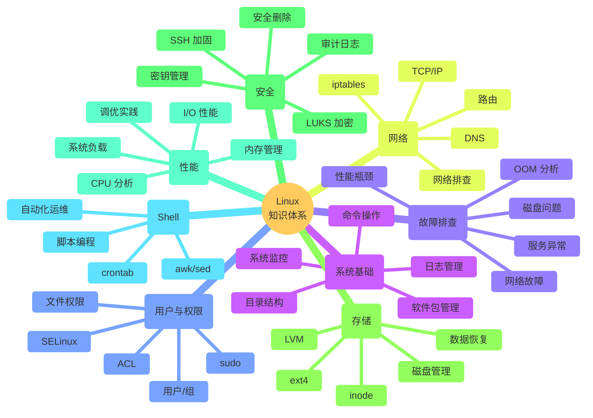
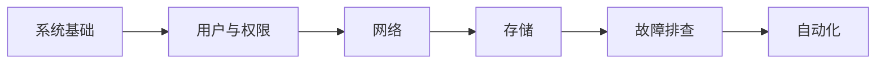
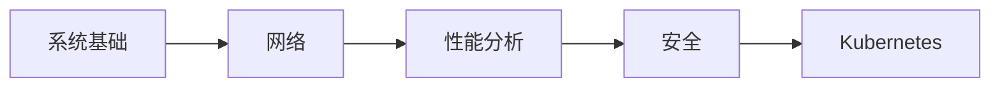

# Linux 学习路线

从基础命令到性能调优，构建系统化的 Linux 知识体系。

Linux 是云原生技术体系的地基。很多人学了很多命令，却不知道它们背后的原理；会用 systemd 管理服务，却不理解 cgroup 和 namespace 的机制。这份路线帮你把零散的知识点串成一条递进的路径。

---

## 知识全景

---

## 七阶段详解

### 第一阶段：系统基础

这是所有人接触 Linux 的起点。重点不是记住命令，而是理解 Linux 的组织方式。

**学习内容：**

- Linux 目录结构（FHS 标准）
- 常用命令操作
- 软件包管理（apt / yum / dnf）
- 系统日志（journald / rsyslog）
- 系统监控工具（top / htop / iostat）

**推荐阅读：**

| 文章 | 说明 |
|---|---|
| [Linux 目录结构说明](../base-system/linux-directory-structure/) | 理解 `/` `/etc` `/var` `/proc` 等目录的设计逻辑 |
| [Linux 常用命令](../base-system/common-commands/) | 日常运维高频命令速查 |
| [Linux 完整命令参考](../base-system/all-commands/) | 按功能分类的完整命令手册 |
| [软件包管理](../base-system/package-management/) | Debian 系和 RHEL 系的包管理对比 |
| [系统监控](../base-system/system-monitoring/) | top / htop / iostat / vmstat 实战 |
| [日志管理](../base-system/log-management/) | journald / rsyslog / 日志轮转配置 |
| [故障排除](../base-system/troubleshooting/) | 常见系统故障的定位思路 |

**学完后你应该能够：**

- ✅ 独立操作 Linux 服务器完成日常任务
- ✅ 知道文件存放在哪里、为什么存放在那里
- ✅ 使用监控工具判断系统健康状态
- ✅ 通过日志定位常见问题

---

### 第二阶段：用户与权限

Linux 的安全模型建立在 UID/GID 和文件权限之上。理解这一层，才能理解后续的 Kubernetes RBAC、容器用户映射等概念。

**学习内容：**

- 用户和组的管理
- 文件权限（rwx / 特殊位 / ACL）
- sudo 权限控制
- SELinux 基础

**推荐阅读：**

| 文章 | 说明 |
|---|---|
| [用户和权限管理](../security/user-and-permission/) | 用户/组/ACL/SELinux 基础 |

> 后续补充：sudo 与最小权限原则、SELinux 深入实践。

**学完后你应该能够：**

- ✅ 管理多用户环境下的权限
- ✅ 理解 UID/GID 在容器中的映射关系
- ✅ 配置 sudo 规则实现细粒度授权

---

### 第三阶段：网络

很多 Kubernetes 问题本质都是网络问题，而网络问题的根因往往在 Linux 层。

**学习内容：**

- TCP/IP 协议栈
- DNS 原理
- 路由与 iptables
- 网络接口与 Bridge
- 网络故障排查

**推荐阅读：**

| 文章 | 说明 |
|---|---|
| [Linux 网络基础](../network/network/) | 网络配置、接口管理、路由基础 |

> 后续补充：TCP/IP 协议栈详解、DNS 原理、iptables 与 nftables、VXLAN。

**学完后你应该能够：**

- ✅ 理解 Pod 为什么可以跨节点通信
- ✅ 排查网络连通性问题
- ✅ 理解 Kubernetes 网络模型的基础

---

### 第四阶段：存储与文件系统

存储是基础设施中最容易被忽视、出问题最难排查的部分。

**学习内容：**

- inode 与文件系统原理
- ext4 / XFS 文件系统
- LVM 逻辑卷管理
- 磁盘分区与挂载
- 数据恢复与安全擦除

**推荐阅读：**

| 文章 | 说明 |
|---|---|
| [数据删除与安全擦除](../security/data-deletion-and-secure-erasure/) | 文件真的删掉了吗？数据恢复与安全销毁原理 |

> 后续补充：inode 深入解析、ext4 工作原理、LVM 实践、SSD 与 TRIM。

**学完后你应该能够：**

- ✅ 理解文件系统如何在磁盘上组织数据
- ✅ 管理磁盘分区和逻辑卷
- ✅ 理解 Kubernetes PV/PVC 的底层映射关系

---

### 第五阶段：安全

安全不是独立于运维之外的工作。很多安全问题，本质上是系统管理问题。

**学习内容：**

- SSH 安全配置与密钥管理
- sudo 权限控制
- LUKS 全盘加密
- 审计与日志
- 安全删除

**推荐阅读：**

| 文章 | 说明 |
|---|---|
| [数据删除与安全擦除](../security/data-deletion-and-secure-erasure/) | 安全删除的原理与实践 |
| [用户和权限管理](../security/user-and-permission/) | 权限体系是安全的基石 |

> 后续补充：SSH 安全加固、Fail2Ban 实践、LUKS 全盘加密、审计日志分析。

**学完后你应该能够：**

- ✅ 加固 SSH 访问安全
- ✅ 设计合理的权限体系
- ✅ 理解容器环境下的安全边界

---

### 第六阶段：性能分析

性能问题是最考验底层理解的领域。不是会用 top 就够了，关键是要知道每个指标背后的含义。

**学习内容：**

- CPU 使用率与负载
- 内存管理（buffer/cache/swap）
- I/O 性能分析
- 系统负载与压力测试
- 性能调优实践

**推荐阅读：**

| 文章 | 说明 |
|---|---|
| [性能优化](../performance/performance-optimization/) | CPU / 内存 / IO / 网络调优方法 |

> 后续补充：CPU 使用率深度解析、Linux 内存管理原理、eBPF 性能分析。

**学完后你应该能够：**

- ✅ 通过指标定位性能瓶颈
- ✅ 理解容器资源限制（requests/limits）对系统的影响
- ✅ 进行基础的系统调优

---

### 第七阶段：Shell 与自动化

当你能用 Shell 自动化重复工作时，你的效率会有质的飞跃。

**学习内容：**

- Shell 脚本编程
- 文本处理（awk / sed / grep）
- 定时任务（crontab）
- 自动化运维脚本

**推荐阅读：**

| 文章 | 说明 |
|---|---|
| [Shell 脚本基础](../shell/shell/) | Shell 语法与常用脚本实践 |

> 后续补充：awk/sed 实战、crontab 进阶、自动化运维脚本集。

**学完后你应该能够：**

- ✅ 编写 Shell 脚本自动化日常任务
- ✅ 使用 awk/sed 处理日志和配置文件
- ✅ 构建简单的运维自动化流程

---

## 学习路径

不同角色的侧重点不同，但底层体系一致。

### 运维工程师

重点关注：日常运维、故障排查、自动化脚本。

### SRE / 平台工程师

重点关注：性能分析、网络、安全加固，为 Kubernetes 和云原生打基础。

---

## 学习原则

**1. 理解优先于记忆**

不要背命令，要理解命令背后的机制。知道 `ps` 读取的是 `/proc` 文件系统，比记住 `ps aux` 的输出格式更重要。

**2. 动手实验**

每个知识点都应该在虚拟机上实际操作。删一个文件、用 `debugfs` 恢复它、再安全擦除它——这个过程比读十遍文档都管用。

**3. 从 Linux 到 Kubernetes**

Linux 的很多概念在 Kubernetes 中有直接的映射：

| Linux 概念 | Kubernetes 对应 |
|---|---|
| namespace | Pod 隔离 |
| cgroup | requests / limits |
| iptables | Service / NetworkPolicy |
| systemd | Pod 生命周期管理 |
| 文件权限 | RBAC / SecurityContext |

理解 Linux 这一层，Kubernetes 的很多设计就不再是黑盒。

---

> Linux 是地基，Kubernetes 是大楼。地基不牢，大楼再漂亮也住不踏实。
>
> —— 1HairLabs
