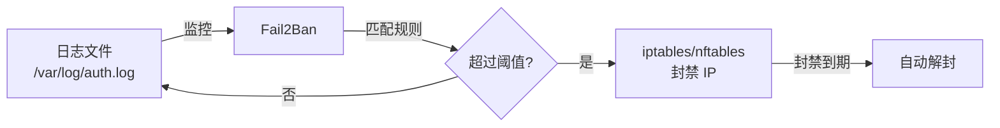

# Fail2Ban 实践：自动封禁恶意 IP

## 前言

公网服务器每天都会遭受大量自动化的暴力破解和漏洞扫描。人工处理这些攻击不现实——你需要一个能**自动检测、自动封禁**的工具，这就是 Fail2Ban。

Fail2Ban 监控日志文件，当某个 IP 在短时间内出现多次失败尝试时，自动调用防火墙（iptables/nftables）将该 IP 临时封禁。



---

## 安装与基础配置

```bash
# Debian/Ubuntu
sudo apt install fail2ban

# RHEL/Rocky
sudo dnf install fail2ban
```

### 配置文件结构

```
/etc/fail2ban/
├── jail.conf          # 默认配置（不要直接修改）
├── jail.local         # 自定义配置（覆盖默认值）
├── filter.d/          # 日志匹配规则
│   ├── sshd.conf
│   ├── nginx-http-auth.conf
│   └── ...
└── action.d/          # 封禁动作
    ├── iptables.conf
    └── ...
```

!!! tip "永远用 `.local` 文件覆盖"
    不要直接修改 `.conf` 文件——软件升级时会覆盖。在 `.local` 文件中写你的配置，它会自动覆盖同名 `.conf` 的对应项。

---

## 基础配置 `/etc/fail2ban/jail.local`

```ini
[DEFAULT]
# 封禁时间（秒）: 1 小时
bantime = 3600

# 统计窗口（秒）: 10 分钟内
findtime = 600

# 最大失败次数
maxretry = 5

# 忽略的 IP（白名单，永不被封）
ignoreip = 127.0.0.1/8 ::1 192.168.0.0/16 10.0.0.0/8

# 封禁动作
banaction = iptables-multiport

# 通知（可选）
destemail = admin@example.com
sender   = fail2ban@example.com
action   = %(action_mwl)s     # 封禁 + 发送含 whois 的邮件
```

### 守护 SSH

```ini
[sshd]
enabled  = true
port     = ssh
filter   = sshd
logpath  = /var/log/auth.log
maxretry = 3
bantime  = 7200          # 2 小时
```

!!! warning "改了 SSH 端口？"
    ```ini
    [sshd]
    port = 2222
    ```
    必须指定实际端口，否则 Fail2Ban 封错了端口号，等于白封。

### 守护 HTTP 认证

```ini
[nginx-http-auth]
enabled  = true
port     = http,https
filter   = nginx-http-auth
logpath  = /var/log/nginx/error.log
maxretry = 3
```

### 守护 Nginx 404/403 扫描

```ini
[nginx-botsearch]
enabled  = true
port     = http,https
filter   = nginx-botsearch
logpath  = /var/log/nginx/access.log
maxretry = 3
```

---

## 自定义 Jail：保护你的应用

假设你的 Python 应用在 `/var/log/myapp/error.log` 中记录登录失败：

```text
2026-07-20 14:30:00 Login failed for user 'admin' from IP 203.0.113.50
```

### Step 1：编写 Filter

`/etc/fail2ban/filter.d/myapp.conf`：

```ini
[Definition]
failregex = ^\s*Login failed for user .* from IP <HOST>\s*$
ignoreregex =
```

### Step 2：编写 Jail

在 `/etc/fail2ban/jail.local` 中添加：

```ini
[myapp]
enabled  = true
port     = 80,443
filter   = myapp
logpath  = /var/log/myapp/error.log
maxretry = 5
bantime  = 1800
```

### Step 3：测试正则

```bash
# 用你的日志测试 filter 是否正确匹配
fail2ban-regex /var/log/myapp/error.log '^\s*Login failed for user .* from IP <HOST>\s*$'

# 或用 filter 文件测试
fail2ban-regex /var/log/myapp/error.log /etc/fail2ban/filter.d/myapp.conf
```

---

## 管理命令

```bash
# 启动
sudo systemctl enable fail2ban --now

# 查看状态
sudo systemctl status fail2ban
sudo fail2ban-client status

# 查看某个 Jail 的状态
sudo fail2ban-client status sshd
# Status for the jail: sshd
# |- Filter
# |  |- Currently failed: 2
# |  |- Total failed:     50
# |  `- Journal matches:  _SYSTEMD_UNIT=sshd.service
# `- Actions
#    |- Currently banned: 3
#    |- Total banned:     25
#    `- Banned IP list:   203.0.113.50 198.51.100.23 192.0.2.100

# 手动封禁 IP
sudo fail2ban-client set sshd banip 203.0.113.99

# 手动解封 IP
sudo fail2ban-client set sshd unbanip 203.0.113.99
```

---

## Docker 环境中的 Fail2Ban

Docker 容器内运行 Fail2Ban 有局限性（容器通常看不到宿主机的 iptables）。推荐方案：

### 方案一：宿主机运行 Fail2Ban

在宿主机上安装 Fail2Ban，让它监控 Docker 映射到宿主机的日志目录：

```ini
[sshd]
logpath = /var/log/auth.log          # 宿主机的日志
```

### 方案二：配合 Traefik/Nginx Proxy

如果 Docker 服务通过反向代理暴露：

```ini
[traefik-auth]
enabled  = true
port     = http,https
filter   = traefik-auth
logpath  = /var/log/traefik/access.log
```

---

## 常见问题

### Fail2Ban 启动但不封禁

```bash
# 1. 检查 Jail 是否启用
sudo fail2ban-client status

# 2. 查看 Fail2Ban 自身日志
sudo tail -f /var/log/fail2ban.log

# 3. 手动测试正则是否匹配
fail2ban-regex /var/log/auth.log /etc/fail2ban/filter.d/sshd.conf
```

### 把自己封了怎么办？

```bash
# 物理机/控制台登录，解封自己
sudo fail2ban-client set sshd unbanip <你的IP>

# 把自己的 IP 加入白名单
# 编辑 /etc/fail2ban/jail.local:
ignoreip = 127.0.0.1/8 ::1 <你的IP>
```

### 重启后封禁列表会丢吗？

默认会丢。要持久化封禁列表，创建数据库目录：

```bash
sudo mkdir -p /var/lib/fail2ban
```

在 `/etc/fail2ban/jail.local` 中添加：

```ini
[DEFAULT]
dbfile = /var/lib/fail2ban/fail2ban.sqlite3
dbpurgeage = 86400    # 保留 24 小时的封禁记录
```

---

## 总结

Fail2Ban 是服务器安全的第一道自动化防线：

1. **安装即用**：默认带 sshd、nginx 等常见 filter
2. **自定义灵活**：为任何产生日志的服务编写 filter
3. **白名单不可少**：`ignoreip` 加上办公室/家的固定 IP
4. **持久化**：配置 `dbfile` 避免重启丢失封禁列表

配合 [SSH 加固](ssh-hardening.md) 使用效果更好——减少能被攻击的面，再让 Fail2Ban 自动处理剩下的。 🚀
